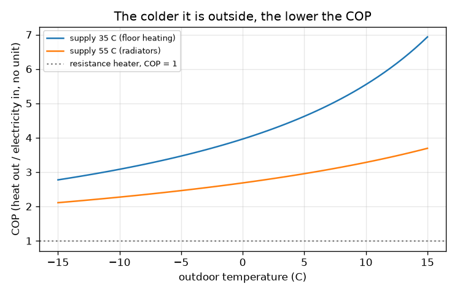
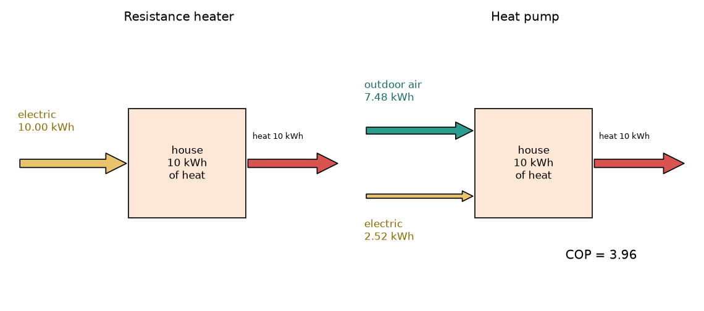

# सत्र 1: हीट पंप ऊष्मा को स्थानांतरित करता है, हीटर उसे बनाता है

*स्तर 1 (वैचारिक इंटरैक्टिव मॉडल) · लगभग 60 मिनट · openheatpump*

> यह एक सरलीकृत शैक्षिक मॉडल है। यह कोई प्रमाणित डिज़ाइन उपकरण नहीं है और इसका उपयोग वास्तविक संरचनाओं, विद्युत स्थापनाओं, वाहनों, औद्योगिक प्रक्रियाओं या चिकित्सा संबंधी निर्णयों के लिए नहीं किया जाना चाहिए।

**पूर्वापेक्षाएँ (Prerequisites)**

- स्कूली अंकगणित (गुणा, भाग, प्रतिशत)।
- आपने PRIMER.md पढ़ लिया है और `python start.py 1` एक बार चला लिया है।

**सीखने के उद्देश्य (Learning objectives)।** इस सत्र के बाद आप:

- समझा सकेंगे कि प्रतिरोध हीटर (resistance heater) प्रति kWh बिजली से 1 kWh ऊष्मा क्यों देता है और हीट पंप (heat pump) कई kWh क्यों दे सकता है।
- COP को परिभाषित कर सकेंगे और दी गई ऊष्मा के लिए आवश्यक बिजली ज्ञात करने हेतु Q = COP x W का उपयोग कर सकेंगे।
- हीट पंप के ऊर्जा प्रवाह खींच सकेंगे: बिजली अंदर, बाहरी ऊष्मा अंदर, घर के अंदर ऊष्मा बाहर।
- बाहरी तापमान के सापेक्ष COP का ग्राफ़ पढ़ सकेंगे और बता सकेंगे कि ठंड बढ़ने पर यह क्यों घटता है।

## A. वास्तविक दुनिया की समस्या
एक ठंडे दिन एक कमरे को 10 kWh ऊष्मा चाहिए। एक विद्युत प्रतिरोध हीटर बिजली की हर kWh को ठीक 1 kWh ऊष्मा में बदलता है, इसलिए वह 10 kWh उपयोग करता है। एक हीट पंप वही 10 kWh उस बिजली के केवल लगभग एक चौथाई से देता है। यह मुफ़्त ऊर्जा जैसा लगता है, तो बाकी ऊष्मा कहाँ से आती है, और मौसम ठंडा होने पर बचत क्यों घट जाती है? (एक सरलीकृत मॉडल के बारे में सामान्य शिक्षा, स्थापना डिज़ाइन नहीं।)

## B. अवधारणा और सिद्धांत
प्रतिरोध हीटर ऊष्मा बनाता है: सारी विद्युत ऊर्जा W ऊष्मा बन जाती है, इसलिए निकलने वाली ऊष्मा W के बराबर है। हीट पंप ऊष्मा नहीं बनाता; वह उसे ठंडी बाहरी हवा से गर्म घर में ले जाता है, बहुत कुछ वैसे ही जैसे एक पंप पानी को ऊपर चढ़ाता है, और यह चढ़ाने का काम बिजली से करता है। दी गई ऊष्मा Q_hot = W + Q_outdoor है, इसलिए ऊर्जा संरक्षित रहती है। निष्पादन गुणांक (coefficient of performance) COP = Q_hot / W है: प्रति kWh बिजली कितने kWh ऊष्मा। हीटर के लिए COP = 1। उत्थान (lift) दी गई (आपूर्ति, supply) ऊष्मा के तापमान और बाहरी तापमान के बीच का अंतर है; अंतर जितना बड़ा, पंप उतनी अधिक मेहनत करता है और COP उतना कम। किसी दिए गए अंतर के लिए सर्वोत्तम संभव COP, T_hot / (T_hot - T_cold) है, जिसमें तापमान केल्विन में हों (K = C + 273.15); वास्तविक मशीनें इसका लगभग 40 से 50 प्रतिशत तक पहुँचती हैं, और हम सामान्य मान के रूप में 0.45 का उपयोग करते हैं।

| प्रतीक | अर्थ | इकाई |
|---|---|---|
| W | उपयोग की गई विद्युत ऊर्जा | kWh |
| Q_hot | घर को दी गई ऊष्मा | kWh |
| Q_outdoor | बाहरी हवा से ली गई ऊष्मा | kWh |
| COP | निष्पादन गुणांक, Q_hot / W | कोई इकाई नहीं |
| T_supply, T_out | दी गई ऊष्मा का और बाहरी हवा का तापमान | डिग्री C (सूत्र में केल्विन) |
| eta | सर्वोत्तम संभव COP का वह अंश जो एक वास्तविक मशीन प्राप्त करती है (सामान्यतः 0.4 से 0.5) | कोई इकाई नहीं |

**मान्यताएँ (Assumptions)**

- 0.45 का अंश एक सामान्य मान है, किसी विशेष मशीन का आँकड़ा नहीं।
- स्थिर संचालन: कोई डीफ़्रॉस्ट नहीं, कोई पंखा या पंप शक्ति नहीं, कोई प्रारंभिक हानि नहीं।
- आपूर्ति तापमान (फ़र्श तापन के लिए 35 C, रेडिएटरों के लिए 55 C) स्थिर है।

$$ Q_{\text{hot}}=W+Q_{\text{outdoor}}\qquad \mathrm{COP}=\frac{Q_{\text{hot}}}{W}\qquad W=\frac{Q_{\text{hot}}}{\mathrm{COP}} $$

$$ \mathrm{COP}_{\text{best}}=\frac{T_{\text{supply}}}{T_{\text{supply}}-T_{\text{out}}},\qquad T[\mathrm{K}]=T[^\circ\mathrm{C}]+273.15 $$

$$ \mathrm{COP}\approx \eta\,\frac{T_{\text{supply}}}{T_{\text{supply}}-T_{\text{out}}},\qquad \eta\approx 0.45 $$

## C. दृश्य व्याख्या
पहला चित्र 10 kWh ऊष्मा के लिए दोनों मशीनों को साथ-साथ दिखाता है। हीटर में 10 kWh का एक पीला विद्युत तीर है। हीट पंप में 2.52 kWh का एक पतला पीला विद्युत तीर और बाहरी हवा से ली गई 7.48 kWh ऊष्मा का एक मोटा हरा-नीला (teal) तीर है; दोनों मामलों में लाल तीर 10 kWh घर के अंदर ले जाता है। दूसरा चित्र 35 C और 55 C आपूर्ति के लिए बाहरी तापमान के सापेक्ष COP आलेखित करता है: ठंड बढ़ने पर दोनों वक्र गिरते हैं, और 55 C वक्र 35 C वक्र से काफ़ी नीचे रहता है।

*35 C और 55 C आपूर्ति के लिए बाहरी तापमान के सापेक्ष COP।*

*10 kWh ऊष्मा के लिए ऊर्जा प्रवाह: बाहर 0 C, आपूर्ति 35 C पर हीटर (बाएँ) और हीट पंप (दाएँ)।*

## D. इंटरैक्टिव सिमुलेशन
पाठ चलाइए (`python start.py 1`), फिर लाइव ऐप खोलिए: [सत्र 1: हीटर बनाम हीट पंप](https://krunalpanchal1995.github.io/pan-iit-oss/openheatpump/session-01/) (या इसी फ़ोल्डर में `app.html`)। बाहरी तापमान और आपूर्ति तापमान के स्लाइडर खिसकाइए और COP गिरने पर मोटे हरे-नीले तीर को सिकुड़ते देखिए, फिर ग्राफ़ पर जाइए और COP वक्र पर बिंदु का अनुसरण कीजिए।

**चुनौती।** 2 kWh से कम बिजली का उपयोग करके ऊष्मा दीजिए।

## E. हल किया गया उदाहरण और प्रयोग
**समस्या।** एक घर को 10 kWh ऊष्मा चाहिए। बाहर 0 C है और हीट पंप 35 C पर ऊष्मा देता है। यह कितनी बिजली उपयोग करता है, और कितनी ऊष्मा बाहरी हवा से आती है?

1. केल्विन में बदलिए: T_supply = 35 + 273.15 = 308.15 K; अंतर 35 - 0 = 35 K है।
2. सर्वोत्तम संभव COP = 308.15 / 35 = 8.80। एक वास्तविक मशीन: COP = 0.45 x 8.80 = 3.96।
3. बिजली W = Q_hot / COP = 10 / 3.96 = 2.52 kWh।
4. बाहर से ऊष्मा = 10 - 2.52 = 7.48 kWh।
5. एक प्रतिरोध हीटर को 10.00 kWh चाहिए होंगे, इसलिए हीट पंप लगभग एक चौथाई बिजली उपयोग करता है।

**उत्तर।** COP 3.96; हीट पंप 2.52 kWh बिजली उपयोग करता है और बाहरी हवा से 7.48 kWh लेता है; एक प्रतिरोध हीटर 10.00 kWh उपयोग करेगा।

**प्रयोग।** कुछ बिजली बिल या स्मार्ट मीटर हीट पंप का बिजली उपयोग और उसके द्वारा दी गई ऊष्मा दिखाते हैं; एक सप्ताह के लिए एक को दूसरे से भाग देकर मापा गया मौसमी COP प्राप्त कीजिए। इसकी तुलना उस सप्ताह के मौसम के लिए मॉडल मान से कीजिए। वास्तविक आँकड़े आमतौर पर 3.96 से कम होते हैं क्योंकि डीफ़्रॉस्ट चक्र, परिसंचरण पंप, पंखे होते हैं और आपूर्ति तापमान 35 C से अधिक होता है; मॉडल इन सबको छोड़ देता है।

## F. मूल्यांकन और डिज़ाइन चुनौती
**प्रश्न प्रकार A: वैचारिक।** एक मित्र कहता है कि 1 kWh बिजली से 4 kWh ऊष्मा देने वाला हीट पंप ऊर्जा संरक्षण (conservation of energy) को तोड़ता है। समझाइए कि ऐसा क्यों नहीं है।

संकेत

तीन पदों के साथ ऊर्जा संतुलन लिखिए: बिजली, बाहरी ऊष्मा और दी गई ऊष्मा।

चरण-दर-चरण हल

ऊर्जा संरक्षित है क्योंकि दी गई ऊष्मा 1 kWh बिजली और बाहरी हवा से ली गई 3 kWh ऊष्मा का योग है: 1 + 3 = 4। पंप ऊर्जा नहीं बनाता, वह ऊष्मा को बाहर (ठंडे) से अंदर (गर्म) ले जाता है और ऐसा करने के लिए बिजली का उपयोग करता है। हीटर में बाहरी ऊष्मा का कोई पद नहीं होता, इसलिए वह प्रति kWh केवल 1 kWh दे सकता है।

**प्रश्न प्रकार B: संख्यात्मक।** बाहर 7 C, आपूर्ति 35 C, eta = 0.45। 12 kWh ऊष्मा के लिए हीट पंप को कितनी बिजली चाहिए, और कितनी ऊष्मा बाहर से आती है?

संकेत

COP = 0.45 x (35 + 273.15) / (35 - 7), फिर W = Q / COP।

चरण-दर-चरण हल

COP = 0.45 x 308.15 / 28 = 4.95। W = 12 / 4.95 = 2.42 kWh। बाहरी ऊष्मा = 12 - 2.42 = 9.58 kWh। जाँच: हीट पंप उन 12 kWh का लगभग पाँचवाँ भाग उपयोग करता है जो एक हीटर को चाहिए होंगे, और COP 0 C वाले 3.96 से अधिक है क्योंकि अंतर छोटा है।

**प्रश्न प्रकार C: ग्राफ़ और सिमुलेशन की व्याख्या।** COP ग्राफ़ में, लगभग किस बाहरी तापमान पर 35 C आपूर्ति का COP घटकर 3 हो जाता है? 55 C आपूर्ति के लिए क्या? यह आपको रेडिएटर बनाम फ़र्श तापन के बारे में क्या बताता है?

संकेत

देखिए कि हर वक्र स्तर 3 को कहाँ पार करता है। यदि आप सटीक मान चाहते हैं तो 0.45 x T_supply / (T_supply - T_out) = 3 हल कीजिए।

चरण-दर-चरण हल

35 C आपूर्ति के लिए COP लगभग -11 C पर 3 है; 55 C आपूर्ति के लिए यह लगभग +6 C पर ही 3 हो जाता है। अधिक आपूर्ति तापमान का अर्थ है उठाने के लिए बड़ा अंतर, इसलिए हर बाहरी तापमान पर COP कम होता है: निम्न-तापमान प्रणाली (फ़र्श तापन, बड़े रेडिएटर) वाला हीट पंप कहीं अधिक दक्ष (efficient) होता है।

**प्रश्न प्रकार D: डिज़ाइन और अनुकूलन चुनौती।** डिज़ाइन: बाहर 0 C पर एक घर को 10 kWh ऊष्मा चाहिए। 35 C फ़र्श-तापन लूप की तुलना 55 C रेडिएटर लूप से कीजिए। आप कौन सा चुनेंगे और समझौता (trade-off) क्या है?

संकेत

हर आपूर्ति तापमान के लिए COP और बिजली की गणना कीजिए।

चरण-दर-चरण हल

35 C पर: COP 3.96, बिजली 2.52 kWh। 55 C पर: COP 2.68, बिजली 3.72 kWh, लगभग 48 प्रतिशत अधिक। कम आपूर्ति तापमान चलाने में सस्ता है, पर इसके लिए बड़ा उत्सर्जक क्षेत्रफल (फ़र्श लूप या बड़े आकार के रेडिएटर) चाहिए जिसकी स्थापना महँगी हो सकती है। मान्यता: दोनों के लिए समान eta 0.45; वास्तविक मशीनें उच्च आपूर्ति तापमान पर कम दक्षता से भी चलती हैं।

[RUBRIC.md](../../RUBRIC.md) से स्वयं को अंक दीजिए। कागज़ पर काम करने के लिए [गतिविधि पत्रक](activity_sheet.md) प्रिंट कीजिए।

## आम भ्रांतियाँ
| आम भ्रांति | वास्तव में क्या सच है |
|---|---|
| 4 का COP का अर्थ है कि हीट पंप 400 प्रतिशत दक्ष है और शून्य से ऊर्जा बनाता है। | COP दी गई ऊष्मा की तुलना उपयोग की गई बिजली से करता है; अतिरिक्त ऊष्मा बाहरी हवा से अंदर लाई जाती है, इसलिए ऊर्जा संतुलन फिर भी बना रहता है। |
| बाहर हिमांक से नीचे तापमान होने पर हीट पंप काम नहीं कर सकता। | -10 C की बाहरी हवा में भी ऊष्मा होती है जिसे स्थानांतरित किया जा सकता है; COP कम होता है, पर इस मॉडल में फिर भी 1 से काफ़ी ऊपर। |
| COP सूत्र में तापमान डिग्री सेल्सियस में हो सकते हैं। | सूत्र केल्विन का उपयोग करता है; सेल्सियस संख्याओं से यह गलत उत्तर देता है, और 0 C पर शून्य से भाग। |
| बड़ा COP हमेशा बेहतर हीट पंप का अर्थ है। | COP मशीन जितना ही मौसम और आपूर्ति तापमान पर निर्भर करता है, इसलिए मशीनों की तुलना समान परिस्थितियों में कीजिए। |

## शब्दावली
- **हीट पंप (heat pump)**: एक मशीन जो कार्य का उपयोग करके ऊष्मा को ठंडी जगह से गर्म जगह ले जाती है
- **COP**: निष्पादन गुणांक (coefficient of performance): दी गई ऊष्मा को उपयोग की गई बिजली से भाग
- **प्रतिरोध हीटर (resistance heater)**: एक विद्युत हीटर जो अपनी सारी बिजली को ऊष्मा में बदलता है, COP = 1
- **केल्विन (kelvin)**: परम शून्य (absolute zero) से शुरू होने वाला तापमान पैमाना; K = डिग्री C + 273.15
- **आपूर्ति तापमान (supply temperature)**: वह तापमान जिस पर घर को ऊष्मा दी जाती है

## समापन
1. [exercises.md](exercises.md) में दिए तीन कोडिंग कार्य कीजिए।
2. अपने बदलावों के बाद `python start.py 1` फिर से चलाइए। यह चेकपॉइंट (checkpoint) पर समाप्त होता है; जब यह `PASS` छापे, तो आपका काम पूरा है। (केवल चेकपॉइंट: `python start.py check 1`।)

अगला: [सत्र 2](../session-02/README.md)
