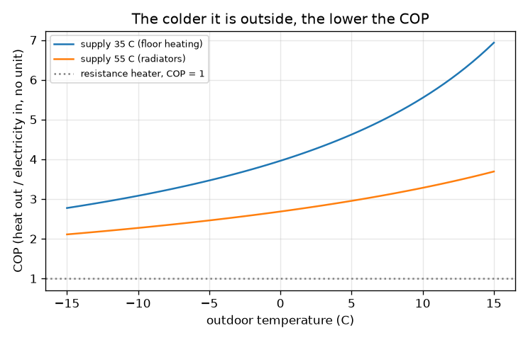
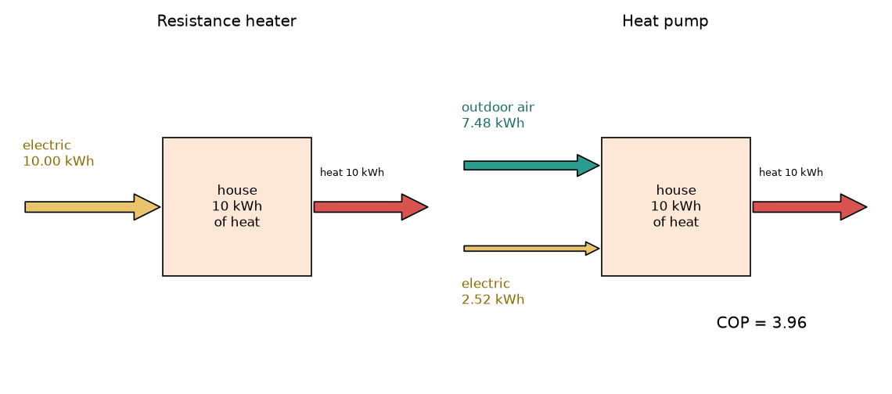

# സെഷൻ 1: ഹീറ്റ് പമ്പ് താപം നീക്കുന്നു, ഹീറ്റർ അത് ഉണ്ടാക്കുന്നു

[Session 1 — हिन्दी](README.hi.md)

*ലെവൽ 1 (ആശയപരമായ ഇന്ററാക്ടീവ് മോഡൽ) · ഏകദേശം 60 മിനിറ്റ് · openheatpump*

> ഇത് പഠനാവശ്യത്തിനുള്ള ലളിതമാക്കിയ ഒരു മോഡലാണ്. ഇത് സാധൂകരിക്കപ്പെട്ട ഒരു ഡിസൈൻ ഉപകരണമല്ല; യഥാർത്ഥ ഘടനകൾ, വൈദ്യുത ഇൻസ്റ്റലേഷനുകൾ, വാഹനങ്ങൾ, വ്യാവസായിക പ്രക്രിയകൾ അല്ലെങ്കിൽ വൈദ്യശാസ്ത്ര തീരുമാനങ്ങൾ എന്നിവയ്ക്കായി ഇത് ഉപയോഗിക്കരുത്.

**മുൻ‌അറിവ് (Prerequisites)**

- സ്കൂൾ ഗണിതം (ഗുണനം, ഹരണം, ശതമാനം).
- നിങ്ങൾ PRIMER.md വായിച്ചിട്ടുണ്ട്, `python start.py 1` ഒരിക്കൽ റൺ ചെയ്തിട്ടുണ്ട്.

**പഠന ലക്ഷ്യങ്ങൾ (Learning objectives).** ഈ സെഷനു ശേഷം നിങ്ങൾക്ക് കഴിയും:

- ഒരു റെസിസ്റ്റൻസ് ഹീറ്റർ ഓരോ kWh വൈദ്യുതിക്കും 1 kWh താപം നൽകുന്നതും ഒരു ഹീറ്റ് പമ്പിന് പലതവണ നൽകാൻ കഴിയുന്നതും എന്തുകൊണ്ടെന്ന് വിശദീകരിക്കാൻ.
- COP നിർവചിക്കാനും, നൽകേണ്ട താപത്തിന് വേണ്ട വൈദ്യുതി കണ്ടെത്താൻ Q = COP x W ഉപയോഗിക്കാനും.
- ഒരു ഹീറ്റ് പമ്പിന്റെ ഊർജ്ജ പ്രവാഹങ്ങൾ വരയ്ക്കാൻ: വൈദ്യുതി അകത്തേക്ക്, പുറത്തെ താപം അകത്തേക്ക്, അകത്തെ താപം പുറത്തേക്ക്.
- പുറത്തെ താപനിലയ്‌ക്കെതിരായ COP ഗ്രാഫ് വായിക്കാനും തണുപ്പ് കൂടുമ്പോൾ അത് കുറയുന്നത് എന്തുകൊണ്ടെന്ന് പറയാനും.

## A. യഥാർത്ഥ ലോക പ്രശ്നം
ഒരു തണുത്ത ദിവസം ഒരു മുറിക്ക് 10 kWh താപം വേണം. ഒരു ഇലക്ട്രിക് റെസിസ്റ്റൻസ് ഹീറ്റർ ഓരോ kWh വൈദ്യുതിയെയും കൃത്യം 1 kWh താപമാക്കുന്നു, അതിനാൽ അത് 10 kWh ഉപയോഗിക്കുന്നു. ഒരു ഹീറ്റ് പമ്പ് അതേ 10 kWh നൽകുന്നത് ആ വൈദ്യുതിയുടെ ഏകദേശം നാലിലൊന്ന് മാത്രം ഉപയോഗിച്ചാണ്. ഇത് സൗജന്യ ഊർജ്ജം പോലെ തോന്നും, അപ്പോൾ ബാക്കി താപം എവിടെ നിന്ന് വരുന്നു, കാലാവസ്ഥ തണുക്കുമ്പോൾ ഈ ലാഭം കുറയുന്നത് എന്തുകൊണ്ട്? (ലളിതമാക്കിയ ഒരു മോഡലിനെക്കുറിച്ചുള്ള പൊതുവിദ്യാഭ്യാസം, ഇൻസ്റ്റലേഷൻ ഡിസൈൻ അല്ല.)

## B. ആശയവും സിദ്ധാന്തവും
ഒരു റെസിസ്റ്റൻസ് ഹീറ്റർ താപം ഉണ്ടാക്കുന്നു: വൈദ്യുത ഊർജ്ജം W മുഴുവൻ താപമാകുന്നു, അതിനാൽ പുറത്തുവരുന്ന താപം W-ക്ക് തുല്യമാണ്. ഒരു ഹീറ്റ് പമ്പ് താപം ഉണ്ടാക്കുന്നില്ല; വെള്ളം മുകളിലേക്ക് പമ്പ് ചെയ്യുന്നതുപോലെ, ഉയർത്താൻ വൈദ്യുതി ഉപയോഗിച്ച് തണുത്ത പുറം വായുവിൽ നിന്ന് ചൂടുള്ള വീട്ടിലേക്ക് അത് താപം നീക്കുന്നു. നൽകുന്ന താപം Q_hot = W + Q_outdoor ആണ്, അതിനാൽ ഊർജ്ജം സംരക്ഷിക്കപ്പെടുന്നു. പെർഫോമൻസ് ഗുണാങ്കം (coefficient of performance) COP = Q_hot / W ആണ്: ഓരോ kWh വൈദ്യുതിക്കും kWh താപം. ഒരു ഹീറ്ററിന് COP = 1. ഉയർത്തൽ എന്നത് നൽകുന്ന (സപ്ലൈ) താപനിലയും പുറത്തെ താപനിലയും തമ്മിലുള്ള വ്യത്യാസമാണ്; വ്യത്യാസം കൂടുന്തോറും പമ്പ് കൂടുതൽ അധ്വാനിക്കുന്നു, COP കുറയുന്നു. ഒരു നിശ്ചിത വ്യത്യാസത്തിന് സാധ്യമായ ഏറ്റവും മികച്ച COP, കെൽവിനിലുള്ള താപനിലകൾ ഉപയോഗിച്ച് (K = C + 273.15), T_hot / (T_hot - T_cold) ആണ്; യഥാർത്ഥ യന്ത്രങ്ങൾ അതിന്റെ ഏകദേശം 40 മുതൽ 50 ശതമാനം വരെ എത്തുന്നു, നാം 0.45 സാധാരണ മൂല്യമായി ഉപയോഗിക്കുന്നു.

| ചിഹ്നം | അർത്ഥം | യൂണിറ്റ് |
|---|---|---|
| W | ഉപയോഗിച്ച വൈദ്യുത ഊർജ്ജം | kWh |
| Q_hot | വീട്ടിലേക്ക് നൽകിയ താപം | kWh |
| Q_outdoor | പുറം വായുവിൽ നിന്ന് എടുത്ത താപം | kWh |
| COP | പെർഫോമൻസ് ഗുണാങ്കം, Q_hot / W | യൂണിറ്റില്ല |
| T_supply, T_out | നൽകുന്ന താപത്തിന്റെയും പുറം വായുവിന്റെയും താപനില | ഡിഗ്രി C (സൂത്രവാക്യത്തിൽ കെൽവിൻ) |
| eta | ഒരു യഥാർത്ഥ യന്ത്രം എത്തുന്ന ഏറ്റവും മികച്ച COP-യുടെ ഭാഗം (സാധാരണ 0.4 മുതൽ 0.5 വരെ) | യൂണിറ്റില്ല |

**അനുമാനങ്ങൾ (Assumptions)**

- 0.45 എന്ന ഭാഗം ഒരു സാധാരണ മൂല്യമാണ്, ഏതെങ്കിലും പ്രത്യേക യന്ത്രത്തിന്റെ കണക്കല്ല.
- സ്ഥിരമായ പ്രവർത്തനം: ഡിഫ്രോസ്റ്റ് ഇല്ല, ഫാൻ അല്ലെങ്കിൽ പമ്പ് പവർ ഇല്ല, സ്റ്റാർട്ട്-അപ്പ് നഷ്ടങ്ങളില്ല.
- സപ്ലൈ താപനില (ഫ്ലോർ ഹീറ്റിംഗിന് 35 C, റേഡിയേറ്ററുകൾക്ക് 55 C) സ്ഥിരമാണ്.

$$ Q_{\text{hot}}=W+Q_{\text{outdoor}}\qquad \mathrm{COP}=\frac{Q_{\text{hot}}}{W}\qquad W=\frac{Q_{\text{hot}}}{\mathrm{COP}} $$

$$ \mathrm{COP}_{\text{best}}=\frac{T_{\text{supply}}}{T_{\text{supply}}-T_{\text{out}}},\qquad T[\mathrm{K}]=T[^\circ\mathrm{C}]+273.15 $$

$$ \mathrm{COP}\approx \eta\,\frac{T_{\text{supply}}}{T_{\text{supply}}-T_{\text{out}}},\qquad \eta\approx 0.45 $$

## C. ദൃശ്യ വിശദീകരണം
ആദ്യത്തെ ചിത്രം 10 kWh താപത്തിനായി രണ്ട് യന്ത്രങ്ങളെയും അടുത്തടുത്ത് വരയ്ക്കുന്നു. ഹീറ്ററിന് 10 kWh-ന്റെ ഒരു മഞ്ഞ വൈദ്യുത അമ്പ് ഉണ്ട്. ഹീറ്റ് പമ്പിന് 2.52 kWh-ന്റെ നേർത്ത മഞ്ഞ വൈദ്യുത അമ്പും പുറം വായുവിൽ നിന്ന് എടുത്ത 7.48 kWh താപത്തിന്റെ കട്ടിയുള്ള ടീൽ അമ്പും ഉണ്ട്; രണ്ട് സാഹചര്യത്തിലും ചുവന്ന അമ്പ് 10 kWh വീട്ടിലേക്ക് എത്തിക്കുന്നു. രണ്ടാമത്തെ ചിത്രം 35 C, 55 C സപ്ലൈക്ക് പുറത്തെ താപനിലയ്‌ക്കെതിരെ COP വരയ്ക്കുന്നു: തണുക്കുമ്പോൾ രണ്ട് വക്രങ്ങളും താഴുന്നു, 55 C വക്രം 35 C വക്രത്തിന് വളരെ താഴെയാണ്.

*35 C, 55 C സപ്ലൈക്ക് പുറത്തെ താപനിലയ്‌ക്കെതിരെ COP.*

*10 kWh താപത്തിന്റെ ഊർജ്ജ പ്രവാഹങ്ങൾ: ഹീറ്റർ (ഇടത്), ഹീറ്റ് പമ്പ് (വലത്), പുറത്ത് 0 C, 35 C സപ്ലൈ.*

## D. ഇന്ററാക്ടീവ് സിമുലേഷൻ
പാഠം റൺ ചെയ്യുക (`python start.py 1`), എന്നിട്ട് ലൈവ് ആപ്പ് തുറക്കുക: [സെഷൻ 1: ഹീറ്ററും ഹീറ്റ് പമ്പും തമ്മിൽ](https://krunalpanchal1995.github.io/pan-iit-oss/openheatpump/session-01/) (അല്ലെങ്കിൽ ഈ ഫോൾഡറിലെ `app.html`). പുറത്തെ താപനിലയും സപ്ലൈ താപനിലയും സ്ലൈഡറുകൾ നീക്കി COP കുറയുമ്പോൾ കട്ടിയുള്ള ടീൽ അമ്പ് ചുരുങ്ങുന്നത് കാണുക, പിന്നെ ഗ്രാഫിലേക്ക് മാറി COP വക്രത്തിലൂടെ ബിന്ദുവിനെ പിന്തുടരുക.

**വെല്ലുവിളി.** 2 kWh-ൽ കുറവ് വൈദ്യുതി ഉപയോഗിച്ച് താപം നൽകുക.

## E. ചെയ്തുകാണിച്ച ഉദാഹരണവും പരീക്ഷണവും
**പ്രശ്നം.** ഒരു വീടിന് 10 kWh താപം വേണം. പുറത്ത് 0 C ആണ്, ഹീറ്റ് പമ്പ് 35 C-ൽ താപം നൽകുന്നു. അത് എത്ര വൈദ്യുതി ഉപയോഗിക്കുന്നു, പുറം വായുവിൽ നിന്ന് എത്ര താപം വരുന്നു?

1. കെൽവിനിലേക്ക് മാറ്റുക: T_supply = 35 + 273.15 = 308.15 K; വ്യത്യാസം 35 - 0 = 35 K.
2. സാധ്യമായ ഏറ്റവും മികച്ച COP = 308.15 / 35 = 8.80. ഒരു യഥാർത്ഥ യന്ത്രം: COP = 0.45 x 8.80 = 3.96.
3. വൈദ്യുതി W = Q_hot / COP = 10 / 3.96 = 2.52 kWh.
4. പുറത്തുനിന്നുള്ള താപം = 10 - 2.52 = 7.48 kWh.
5. ഒരു റെസിസ്റ്റൻസ് ഹീറ്ററിന് 10.00 kWh വേണ്ടിവരും, അതിനാൽ ഹീറ്റ് പമ്പ് വൈദ്യുതിയുടെ ഏകദേശം നാലിലൊന്ന് ഉപയോഗിക്കുന്നു.

**ഉത്തരം.** COP 3.96; ഹീറ്റ് പമ്പ് 2.52 kWh വൈദ്യുതി ഉപയോഗിക്കുകയും പുറം വായുവിൽ നിന്ന് 7.48 kWh എടുക്കുകയും ചെയ്യുന്നു; ഒരു റെസിസ്റ്റൻസ് ഹീറ്റർ 10.00 kWh ഉപയോഗിക്കും.

**പരീക്ഷണം.** ചില വൈദ്യുതി ബില്ലുകളോ സ്മാർട്ട് മീറ്ററുകളോ ഒരു ഹീറ്റ് പമ്പിന്റെ വൈദ്യുതി ഉപയോഗവും അത് നൽകുന്ന താപവും കാണിക്കുന്നു; ഒരാഴ്ചത്തേക്ക് ഒന്നിനെ മറ്റൊന്ന് കൊണ്ട് ഹരിച്ച് അളന്ന സീസണൽ COP നേടുക. ആ ആഴ്ചയിലെ കാലാവസ്ഥയ്ക്കുള്ള മോഡൽ മൂല്യവുമായി താരതമ്യം ചെയ്യുക. ഡിഫ്രോസ്റ്റ് ചക്രങ്ങൾ, സർക്കുലേഷൻ പമ്പുകൾ, ഫാനുകൾ, 35 C-നേക്കാൾ ഉയർന്ന സപ്ലൈ താപനില എന്നിവ കാരണം യഥാർത്ഥ കണക്കുകൾ സാധാരണയായി 3.96-നേക്കാൾ കുറവായിരിക്കും; മോഡൽ ഇവയെല്ലാം ഒഴിവാക്കുന്നു.

## F. മൂല്യനിർണ്ണയവും ഡിസൈൻ വെല്ലുവിളിയും
**ചോദ്യ തരം A: ആശയപരം.** 1 kWh വൈദ്യുതിക്ക് 4 kWh താപം നൽകുന്ന ഒരു ഹീറ്റ് പമ്പ് ഊർജ്ജ സംരക്ഷണ നിയമം ലംഘിക്കുന്നു എന്ന് ഒരു സുഹൃത്ത് പറയുന്നു. എന്തുകൊണ്ട് അങ്ങനെയല്ലെന്ന് വിശദീകരിക്കുക.

സൂചന

മൂന്ന് പദങ്ങളുള്ള ഊർജ്ജ ബാലൻസ് എഴുതുക: വൈദ്യുതി, പുറത്തെ താപം, നൽകിയ താപം.

പടിപടിയായുള്ള പരിഹാരം

ഊർജ്ജം സംരക്ഷിക്കപ്പെടുന്നു, കാരണം നൽകിയ താപം 1 kWh വൈദ്യുതിയും പുറം വായുവിൽ നിന്ന് എടുത്ത 3 kWh താപവും ചേർന്നതാണ്: 1 + 3 = 4. പമ്പ് ഊർജ്ജം സൃഷ്ടിക്കുന്നില്ല, അത് പുറത്തുനിന്ന് (തണുത്ത) അകത്തേക്ക് (ചൂടുള്ള) താപം നീക്കുന്നു, അതിനായി വൈദ്യുതി ഉപയോഗിക്കുന്നു. ഒരു ഹീറ്ററിന് പുറത്തെ താപ പദമില്ല, അതിനാൽ ഓരോ kWh-നും 1 kWh മാത്രമേ നൽകാൻ കഴിയൂ.

**ചോദ്യ തരം B: സംഖ്യാപരം.** പുറത്ത് 7 C, സപ്ലൈ 35 C, eta = 0.45. 12 kWh താപത്തിന് ഒരു ഹീറ്റ് പമ്പിന് എത്ര വൈദ്യുതി വേണം, പുറത്തുനിന്ന് എത്ര താപം വരുന്നു?

സൂചന

COP = 0.45 x (35 + 273.15) / (35 - 7), പിന്നെ W = Q / COP.

പടിപടിയായുള്ള പരിഹാരം

COP = 0.45 x 308.15 / 28 = 4.95. W = 12 / 4.95 = 2.42 kWh. പുറത്തെ താപം = 12 - 2.42 = 9.58 kWh. യുക്തിപരിശോധന: ഹീറ്റ് പമ്പ് ഒരു ഹീറ്റർ ആവശ്യപ്പെടുന്ന 12 kWh-ന്റെ അഞ്ചിലൊന്ന് ഉപയോഗിക്കുന്നു, വ്യത്യാസം ചെറുതായതിനാൽ 0 C-ലെ 3.96-നേക്കാൾ COP കൂടുതലാണ്.

**ചോദ്യ തരം C: ഗ്രാഫ്, സിമുലേഷൻ വ്യാഖ്യാനം.** COP ഗ്രാഫിൽ, 35 C സപ്ലൈക്ക് COP 3 ആയി താഴുന്നത് ഏകദേശം ഏത് പുറം താപനിലയിൽ? 55 C സപ്ലൈക്ക് എങ്ങനെ? റേഡിയേറ്ററുകളും ഫ്ലോർ ഹീറ്റിംഗും തമ്മിലുള്ള വ്യത്യാസത്തെക്കുറിച്ച് ഇത് എന്ത് പറയുന്നു?

സൂചന

ഓരോ വക്രവും 3 എന്ന നിലയെ കടക്കുന്നിടം കണ്ടെത്തുക. കൃത്യമായ മൂല്യം വേണമെങ്കിൽ 0.45 x T_supply / (T_supply - T_out) = 3 പരിഹരിക്കുക.

പടിപടിയായുള്ള പരിഹാരം

35 C സപ്ലൈക്ക് ഏകദേശം -11 C-ൽ COP 3 ആണ്; 55 C സപ്ലൈക്ക് ഏകദേശം +6 C-ൽ തന്നെ അത് 3 ആണ്. ഉയർന്ന സപ്ലൈ താപനില എന്നാൽ ഉയർത്താൻ വലിയ വ്യത്യാസം, അതിനാൽ എല്ലാ പുറം താപനിലയിലും COP കുറവാണ്: താഴ്ന്ന താപനിലയുള്ള സംവിധാനമുള്ള (ഫ്ലോർ ഹീറ്റിംഗ്, വലിയ റേഡിയേറ്ററുകൾ) ഹീറ്റ് പമ്പ് വളരെ കാര്യക്ഷമമാണ്.

**ചോദ്യ തരം D: ഡിസൈൻ, ഒപ്റ്റിമൈസേഷൻ വെല്ലുവിളി.** ഡിസൈൻ: പുറത്ത് 0 C-ൽ ഒരു വീടിന് 10 kWh താപം വേണം. 35 C ഫ്ലോർ-ഹീറ്റിംഗ് ലൂപ്പും 55 C റേഡിയേറ്റർ ലൂപ്പും താരതമ്യം ചെയ്യുക. ഏതാണ് നിങ്ങൾ തിരഞ്ഞെടുക്കുക, വിട്ടുവീഴ്ച (trade-off) എന്താണ്?

സൂചന

ഓരോ സപ്ലൈ താപനിലയ്ക്കും COP-യും വൈദ്യുതിയും കണക്കാക്കുക.

പടിപടിയായുള്ള പരിഹാരം

35 C-ൽ: COP 3.96, വൈദ്യുതി 2.52 kWh. 55 C-ൽ: COP 2.68, വൈദ്യുതി 3.72 kWh, ഏകദേശം 48 ശതമാനം കൂടുതൽ. താഴ്ന്ന സപ്ലൈ താപനില പ്രവർത്തിപ്പിക്കാൻ ചെലവ് കുറവാണ്, പക്ഷേ അതിന് വലിയ താപം പുറത്തുവിടുന്ന വിസ്തീർണ്ണം (ഫ്ലോർ ലൂപ്പുകൾ അല്ലെങ്കിൽ വലിപ്പം കൂടിയ റേഡിയേറ്ററുകൾ) വേണം, അത് സ്ഥാപിക്കാൻ കൂടുതൽ ചെലവാകാം. അനുമാനം: രണ്ടിനും ഒരേ eta 0.45; യഥാർത്ഥ യന്ത്രങ്ങൾ ഉയർന്ന സപ്ലൈ താപനിലയിൽ കുറഞ്ഞ കാര്യക്ഷമതയോടെയും പ്രവർത്തിക്കുന്നു.

[RUBRIC.md](../../RUBRIC.md) ഉപയോഗിച്ച് സ്വയം സ്കോർ ചെയ്യുക. കടലാസിൽ പ്രവർത്തിക്കാൻ [ആക്ടിവിറ്റി ഷീറ്റ്](activity_sheet.md) പ്രിന്റ് ചെയ്യുക.

## സാധാരണ തെറ്റിദ്ധാരണകൾ
| സാധാരണ തെറ്റിദ്ധാരണ | യഥാർത്ഥത്തിൽ ശരിയായത് |
|---|---|
| COP 4 എന്നാൽ ഹീറ്റ് പമ്പ് 400 ശതമാനം കാര്യക്ഷമമാണ്, ഒന്നുമില്ലായ്മയിൽ നിന്ന് ഊർജ്ജം ഉണ്ടാക്കുന്നു എന്നാണ്. | COP നൽകിയ താപത്തെ ഉപയോഗിച്ച വൈദ്യുതിയുമായി താരതമ്യം ചെയ്യുന്നു; അധിക താപം പുറം വായുവിൽ നിന്ന് നീക്കി കൊണ്ടുവരുന്നതാണ്, അതിനാൽ ഊർജ്ജ ബാലൻസ് ഇപ്പോഴും ശരിയാണ്. |
| പുറത്ത് മരവിപ്പിക്കുന്ന തണുപ്പാണെങ്കിൽ ഹീറ്റ് പമ്പിന് പ്രവർത്തിക്കാൻ കഴിയില്ല. | -10 C-ലെ പുറം വായുവിലും നീക്കാൻ കഴിയുന്ന താപം ഉണ്ട്; COP കുറവാണ്, പക്ഷേ ഈ മോഡലിൽ ഇപ്പോഴും 1-നേക്കാൾ വളരെ കൂടുതലാണ്. |
| COP സൂത്രവാക്യത്തിലെ താപനിലകൾ ഡിഗ്രി സെൽഷ്യസിൽ ആകാം. | സൂത്രവാക്യം കെൽവിൻ ഉപയോഗിക്കുന്നു; സെൽഷ്യസ് സംഖ്യകൾ ഉപയോഗിച്ചാൽ തെറ്റായ ഉത്തരങ്ങൾ ലഭിക്കും, 0 C-ൽ പൂജ്യം കൊണ്ടുള്ള ഹരണവും. |
| വലിയ COP എപ്പോഴും മികച്ച ഹീറ്റ് പമ്പ് എന്നാണ്. | COP യന്ത്രത്തെപ്പോലെതന്നെ കാലാവസ്ഥയെയും സപ്ലൈ താപനിലയെയും ആശ്രയിക്കുന്നു, അതിനാൽ യന്ത്രങ്ങളെ ഒരേ സാഹചര്യങ്ങളിൽ താരതമ്യം ചെയ്യുക. |

## പദാവലി
- **ഹീറ്റ് പമ്പ് (heat pump)**: തണുത്ത സ്ഥലത്ത് നിന്ന് ചൂടുള്ള സ്ഥലത്തേക്ക് താപം നീക്കാൻ പ്രവൃത്തി (work) ഉപയോഗിക്കുന്ന യന്ത്രം
- **COP**: പെർഫോമൻസ് ഗുണാങ്കം: നൽകിയ താപത്തെ ഉപയോഗിച്ച വൈദ്യുതി കൊണ്ട് ഹരിച്ചത്
- **റെസിസ്റ്റൻസ് ഹീറ്റർ (resistance heater)**: അതിന്റെ എല്ലാ വൈദ്യുതിയും താപമാക്കുന്ന ഇലക്ട്രിക് ഹീറ്റർ, COP = 1
- **കെൽവിൻ (kelvin)**: കേവല പൂജ്യത്തിൽ തുടങ്ങുന്ന താപനില സ്കെയിൽ; K = ഡിഗ്രി C + 273.15
- **സപ്ലൈ താപനില (supply temperature)**: വീട്ടിലേക്ക് താപം നൽകുന്ന താപനില

## പൂർത്തിയാക്കുക
1. [exercises.md](exercises.md)-ലെ മൂന്ന് കോഡിംഗ് ജോലികൾ ചെയ്യുക.
2. നിങ്ങളുടെ മാറ്റങ്ങൾക്ക് ശേഷം `python start.py 1` വീണ്ടും റൺ ചെയ്യുക. അത് ചെക്ക്‌പോയിന്റോടെ അവസാനിക്കുന്നു; അത് `PASS` എന്ന് പ്രിന്റ് ചെയ്യുമ്പോൾ നിങ്ങൾ പൂർത്തിയാക്കി. (ചെക്ക്‌പോയിന്റ് മാത്രം: `python start.py check 1`.)

അടുത്തത്: [സെഷൻ 2](../session-02/README.md)
