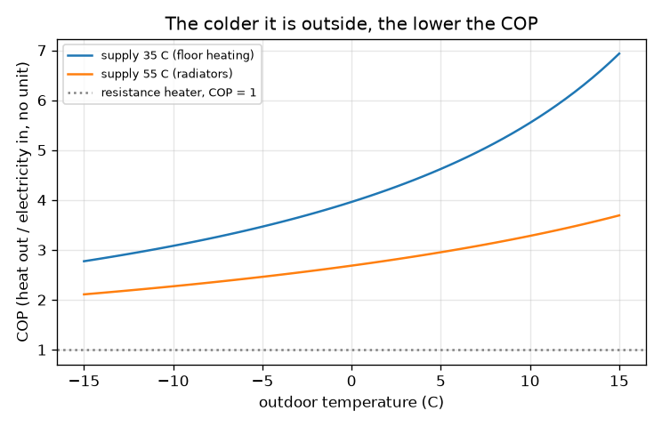
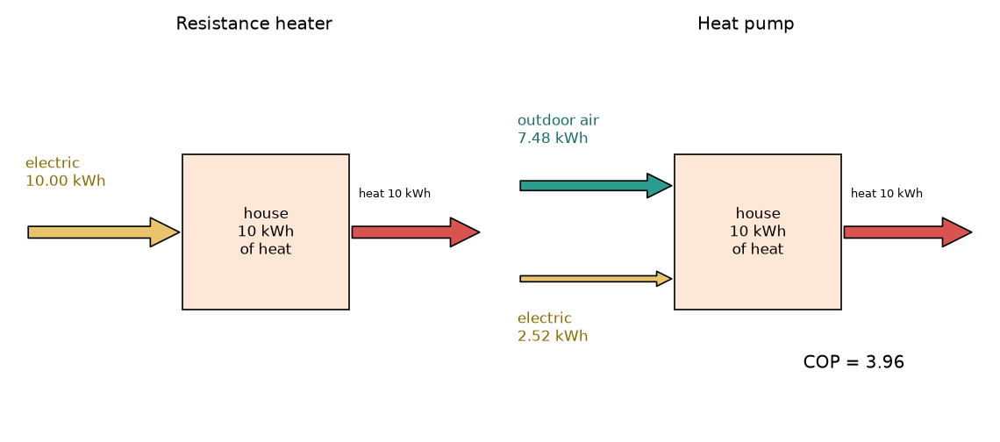

# அமர்வு 1: வெப்பக் குழாய் வெப்பத்தை நகர்த்துகிறது, ஹீட்டர் அதை உருவாக்குகிறது

[Session 1 — हिन्दी](README.hi.md) · [Session 1 — മലയാളം](README.ml.md)

*நிலை 1 (கருத்தியல் ஊடாடும் மாதிரி) · சுமார் 60 நிமிடங்கள் · openheatpump*

> இது கல்விக்கான எளிமைப்படுத்தப்பட்ட மாதிரி. இது சரிபார்க்கப்பட்ட வடிவமைப்புக் கருவி அல்ல; உண்மையான கட்டமைப்புகள், மின் நிறுவல்கள், வாகனங்கள், தொழில்துறை செயல்முறைகள் அல்லது மருத்துவ முடிவுகளுக்கு இதைப் பயன்படுத்தக் கூடாது.

**முன்தேவைகள் (Prerequisites)**

- பள்ளிக் கணிதம் (பெருக்கல், வகுத்தல், சதவீதம்).
- நீங்கள் PRIMER.md படித்து, `python start.py 1` ஒருமுறை இயக்கியுள்ளீர்கள்.

**கற்றல் நோக்கங்கள் (Learning objectives).** இந்த அமர்வுக்குப் பிறகு நீங்கள்:

- ஒரு தடை ஹீட்டர் (resistance heater) ஒவ்வொரு kWh மின்சாரத்துக்கும் 1 kWh வெப்பம் தருவதையும், ஒரு வெப்பக் குழாய் (heat pump) பல மடங்கு தர முடிவதையும் விளக்க முடியும்.
- COP-ஐ வரையறுத்து, கொடுக்கப்பட்ட வெப்பத்துக்குத் தேவையான மின்சாரத்தைக் காண Q = COP x W பயன்படுத்த முடியும்.
- வெப்பக் குழாயின் ஆற்றல் ஓட்டங்களை வரைய முடியும்: மின்சாரம் உள்ளே, வெளிப்புற வெப்பம் உள்ளே, உட்புற வெப்பம் வெளியே.
- வெளிப்புற வெப்பநிலைக்கு எதிரான COP வரைபடத்தைப் படித்து, குளிர் கூடும்போது அது ஏன் குறைகிறது என்று சொல்ல முடியும்.

## A. நிஜ உலகப் பிரச்சினை
ஒரு குளிர்ந்த நாளில் ஓர் அறைக்கு 10 kWh வெப்பம் தேவை. ஒரு மின் தடை ஹீட்டர் ஒவ்வொரு kWh மின்சாரத்தையும் சரியாக 1 kWh வெப்பமாக மாற்றுகிறது, எனவே அது 10 kWh பயன்படுத்துகிறது. ஒரு வெப்பக் குழாய் அதே 10 kWh-ஐ அந்த மின்சாரத்தில் சுமார் நான்கில் ஒரு பங்கை மட்டும் பயன்படுத்தித் தருகிறது. இது இலவச ஆற்றல் போலத் தெரிகிறது, அப்படியானால் மீதி வெப்பம் எங்கிருந்து வருகிறது, வானிலை குளிரும்போது இந்தச் சேமிப்பு ஏன் சுருங்குகிறது? (எளிமைப்படுத்தப்பட்ட மாதிரி பற்றிய பொதுக் கல்வி, நிறுவல் வடிவமைப்பு அல்ல.)

## B. கருத்தும் கோட்பாடும்
ஒரு தடை ஹீட்டர் வெப்பத்தை உருவாக்குகிறது: மின் ஆற்றல் W முழுவதும் வெப்பமாகிறது, எனவே வெளிவரும் வெப்பம் W-க்குச் சமம். ஒரு வெப்பக் குழாய் வெப்பத்தை உருவாக்குவதில்லை; நீரை மேலே ஏற்றும் பம்பு போல, ஏற்றுவதற்கு மின்சாரத்தைப் பயன்படுத்தி குளிர்ந்த வெளிக் காற்றிலிருந்து சூடான வீட்டுக்குள் வெப்பத்தை நகர்த்துகிறது. வழங்கப்படும் வெப்பம் Q_hot = W + Q_outdoor, எனவே ஆற்றல் காக்கப்படுகிறது. செயல்திறன் குணகம் (coefficient of performance) COP = Q_hot / W: ஒவ்வொரு kWh மின்சாரத்துக்கும் kWh வெப்பம். ஒரு ஹீட்டருக்கு COP = 1. ஏற்றம் என்பது வழங்கப்படும் (சப்ளை) வெப்பநிலைக்கும் வெளிப்புற வெப்பநிலைக்கும் இடையிலான இடைவெளி; இடைவெளி பெரிதாக இருந்தால் குழாய் கடினமாக உழைக்கிறது, COP குறைகிறது. கொடுக்கப்பட்ட இடைவெளிக்குச் சாத்தியமான சிறந்த COP, கெல்வினில் வெப்பநிலைகளுடன் (K = C + 273.15), T_hot / (T_hot - T_cold); உண்மையான இயந்திரங்கள் அதில் சுமார் 40 முதல் 50 சதவீதத்தை எட்டுகின்றன, நாம் 0.45-ஐ வழக்கமான மதிப்பாகப் பயன்படுத்துகிறோம்.

| குறியீடு | பொருள் | அலகு |
|---|---|---|
| W | பயன்படுத்தப்பட்ட மின் ஆற்றல் | kWh |
| Q_hot | வீட்டுக்கு வழங்கப்பட்ட வெப்பம் | kWh |
| Q_outdoor | வெளிக் காற்றிலிருந்து எடுக்கப்பட்ட வெப்பம் | kWh |
| COP | செயல்திறன் குணகம், Q_hot / W | அலகு இல்லை |
| T_supply, T_out | வழங்கப்படும் வெப்பத்தின் மற்றும் வெளிக் காற்றின் வெப்பநிலை | டிகிரி C (சூத்திரத்தில் கெல்வின்) |
| eta | உண்மையான இயந்திரம் எட்டும் சிறந்த COP-இன் பின்னம் (வழக்கமாக 0.4 முதல் 0.5) | அலகு இல்லை |

**அனுமானங்கள் (Assumptions)**

- 0.45 பின்னம் ஒரு வழக்கமான மதிப்பு, எந்த ஒரு குறிப்பிட்ட இயந்திரத்தின் எண்ணும் அல்ல.
- நிலையான இயக்கம்: டீஃப்ராஸ்ட் இல்லை, மின்விசிறி அல்லது பம்பு திறன் இல்லை, தொடக்க இழப்புகள் இல்லை.
- சப்ளை வெப்பநிலை (தரை வெப்பமூட்டலுக்கு 35 C, ரேடியேட்டர்களுக்கு 55 C) நிலையானது.

$$ Q_{\text{hot}}=W+Q_{\text{outdoor}}\qquad \mathrm{COP}=\frac{Q_{\text{hot}}}{W}\qquad W=\frac{Q_{\text{hot}}}{\mathrm{COP}} $$

$$ \mathrm{COP}_{\text{best}}=\frac{T_{\text{supply}}}{T_{\text{supply}}-T_{\text{out}}},\qquad T[\mathrm{K}]=T[^\circ\mathrm{C}]+273.15 $$

$$ \mathrm{COP}\approx \eta\,\frac{T_{\text{supply}}}{T_{\text{supply}}-T_{\text{out}}},\qquad \eta\approx 0.45 $$

## C. காட்சி விளக்கம்
முதல் படம் 10 kWh வெப்பத்துக்கு இரண்டு இயந்திரங்களையும் அருகருகே வரைகிறது. ஹீட்டருக்கு 10 kWh கொண்ட ஒரு மஞ்சள் மின் அம்பு உள்ளது. வெப்பக் குழாய்க்கு 2.52 kWh கொண்ட மெல்லிய மஞ்சள் மின் அம்பும் வெளிக் காற்றிலிருந்து எடுக்கப்பட்ட 7.48 kWh வெப்பத்தின் தடித்த டீல் அம்பும் உள்ளன; இரண்டு நிகழ்வுகளிலும் சிவப்பு அம்பு 10 kWh-ஐ வீட்டுக்குள் கொண்டு செல்கிறது. இரண்டாவது படம் 35 C மற்றும் 55 C சப்ளைக்கு வெளிப்புற வெப்பநிலைக்கு எதிராக COP-ஐ வரைகிறது: குளிரும்போது இரண்டு வளைவுகளும் இறங்குகின்றன, 55 C வளைவு 35 C வளைவை விட மிகக் கீழே உள்ளது.

*35 C மற்றும் 55 C சப்ளைக்கு வெளிப்புற வெப்பநிலைக்கு எதிராக COP.*

*10 kWh வெப்பத்துக்கான ஆற்றல் ஓட்டங்கள்: ஹீட்டர் (இடது) மற்றும் வெப்பக் குழாய் (வலது), வெளியே 0 C, 35 C சப்ளை.*

## D. ஊடாடும் உருவகப்படுத்தல்
பாடத்தை இயக்குங்கள் (`python start.py 1`), பிறகு நேரடிச் செயலியைத் திறங்கள்: [அமர்வு 1: ஹீட்டர் எதிர் வெப்பக் குழாய்](https://krunalpanchal1995.github.io/pan-iit-oss/openheatpump/session-01/) (அல்லது இந்தக் கோப்புறையிலுள்ள `app.html`). வெளிப்புற வெப்பநிலை மற்றும் சப்ளை வெப்பநிலை ஸ்லைடர்களை நகர்த்தி COP குறையும்போது தடித்த டீல் அம்பு சுருங்குவதைப் பாருங்கள், பிறகு வரைபடத்துக்கு மாறி COP வளைவு வழியாகப் புள்ளியைப் பின்தொடருங்கள்.

**சவால்.** 2 kWh-க்கும் குறைவான மின்சாரத்தைப் பயன்படுத்தி வெப்பத்தை வழங்குங்கள்.

## E. தீர்க்கப்பட்ட எடுத்துக்காட்டும் பரிசோதனையும்
**பிரச்சினை.** ஒரு வீட்டுக்கு 10 kWh வெப்பம் தேவை. வெளியே 0 C, வெப்பக் குழாய் 35 C-இல் வெப்பத்தை வழங்குகிறது. அது எவ்வளவு மின்சாரத்தைப் பயன்படுத்துகிறது, வெளிக் காற்றிலிருந்து எவ்வளவு வெப்பம் வருகிறது?

1. கெல்வினுக்கு மாற்றுங்கள்: T_supply = 35 + 273.15 = 308.15 K; இடைவெளி 35 - 0 = 35 K.
2. சாத்தியமான சிறந்த COP = 308.15 / 35 = 8.80. ஓர் உண்மையான இயந்திரம்: COP = 0.45 x 8.80 = 3.96.
3. மின்சாரம் W = Q_hot / COP = 10 / 3.96 = 2.52 kWh.
4. வெளியிலிருந்து வரும் வெப்பம் = 10 - 2.52 = 7.48 kWh.
5. ஒரு தடை ஹீட்டருக்கு 10.00 kWh தேவைப்படும், எனவே வெப்பக் குழாய் மின்சாரத்தில் சுமார் நான்கில் ஒரு பங்கைப் பயன்படுத்துகிறது.

**விடை.** COP 3.96; வெப்பக் குழாய் 2.52 kWh மின்சாரத்தைப் பயன்படுத்தி வெளிக் காற்றிலிருந்து 7.48 kWh எடுக்கிறது; ஒரு தடை ஹீட்டர் 10.00 kWh பயன்படுத்தும்.

**பரிசோதனை.** சில மின் கட்டணச் சீட்டுகள் அல்லது ஸ்மார்ட் மீட்டர்கள் ஒரு வெப்பக் குழாயின் மின் பயன்பாட்டையும் அது வழங்கும் வெப்பத்தையும் காட்டுகின்றன; ஒன்றை மற்றதால் ஒரு வாரத்துக்கு வகுத்து அளவிடப்பட்ட பருவகால COP-ஐப் பெறுங்கள். அந்த வாரத்தின் வானிலைக்கான மாதிரி மதிப்புடன் ஒப்பிடுங்கள். டீஃப்ராஸ்ட் சுழற்சிகள், சுற்றோட்டப் பம்புகள், மின்விசிறிகள் மற்றும் 35 C-ஐ விட அதிகமான சப்ளை வெப்பநிலை காரணமாக உண்மையான எண்கள் பொதுவாக 3.96-ஐ விடக் குறைவு; மாதிரி இவை அனைத்தையும் விட்டுவிடுகிறது.

## F. மதிப்பீடும் வடிவமைப்புச் சவாலும்
**கேள்வி வகை A: கருத்தியல்.** 1 kWh மின்சாரத்துக்கு 4 kWh வெப்பம் தரும் ஒரு வெப்பக் குழாய் ஆற்றல் அழியாமை விதியை மீறுகிறது என்று ஒரு நண்பர் சொல்கிறார். அது ஏன் மீறவில்லை என்று விளக்குங்கள்.

குறிப்பு

மூன்று உறுப்புகளுடன் ஆற்றல் சமநிலையை எழுதுங்கள்: மின்சாரம், வெளிப்புற வெப்பம், வழங்கப்பட்ட வெப்பம்.

படிப்படியான தீர்வு

ஆற்றல் காக்கப்படுகிறது, ஏனெனில் வழங்கப்பட்ட வெப்பம் 1 kWh மின்சாரமும் வெளிக் காற்றிலிருந்து எடுத்த 3 kWh வெப்பமும்: 1 + 3 = 4. குழாய் ஆற்றலை உருவாக்குவதில்லை, அது வெப்பத்தை வெளியிலிருந்து (குளிர்) உள்ளே (சூடு) நகர்த்துகிறது, அதற்கு மின்சாரத்தைப் பயன்படுத்துகிறது. ஒரு ஹீட்டருக்கு வெளிப்புற வெப்ப உறுப்பு இல்லை, எனவே ஒவ்வொரு kWh-க்கும் 1 kWh மட்டுமே தர முடியும்.

**கேள்வி வகை B: எண்ணியல்.** வெளியே 7 C, சப்ளை 35 C, eta = 0.45. 12 kWh வெப்பத்துக்கு ஒரு வெப்பக் குழாய்க்கு எவ்வளவு மின்சாரம் தேவை, வெளியிலிருந்து எவ்வளவு வெப்பம் வருகிறது?

குறிப்பு

COP = 0.45 x (35 + 273.15) / (35 - 7), பிறகு W = Q / COP.

படிப்படியான தீர்வு

COP = 0.45 x 308.15 / 28 = 4.95. W = 12 / 4.95 = 2.42 kWh. வெளிப்புற வெப்பம் = 12 - 2.42 = 9.58 kWh. சரிபார்ப்பு: ஒரு ஹீட்டருக்குத் தேவையான 12 kWh-இல் வெப்பக் குழாய் சுமார் ஐந்தில் ஒரு பங்கைப் பயன்படுத்துகிறது, இடைவெளி சிறியதாக இருப்பதால் COP, 0 C-இல் இருந்த 3.96-ஐ விட அதிகம்.

**கேள்வி வகை C: வரைபடம் மற்றும் உருவகப்படுத்தல் விளக்கம்.** COP வரைபடத்தில், 35 C சப்ளைக்கு COP 3-ஆகக் குறைவது சுமாராக எந்த வெளிப்புற வெப்பநிலையில்? 55 C சப்ளைக்கு? ரேடியேட்டர்கள் எதிர் தரை வெப்பமூட்டல் பற்றி இது என்ன சொல்கிறது?

குறிப்பு

ஒவ்வொரு வளைவும் 3 என்ற நிலையைக் கடக்கும் இடத்தைக் கண்டுபிடியுங்கள். சரியான மதிப்பு வேண்டுமெனில் 0.45 x T_supply / (T_supply - T_out) = 3-ஐத் தீர்க்கவும்.

படிப்படியான தீர்வு

35 C சப்ளைக்கு சுமார் -11 C-இல் COP 3; 55 C சப்ளைக்கு சுமார் +6 C-இலேயே அது 3. அதிக சப்ளை வெப்பநிலை என்றால் ஏற்ற வேண்டிய இடைவெளி பெரிது, எனவே ஒவ்வொரு வெளிப்புற வெப்பநிலையிலும் COP குறைவு: குறைந்த வெப்பநிலை அமைப்புடைய (தரை வெப்பமூட்டல், பெரிய ரேடியேட்டர்கள்) வெப்பக் குழாய் மிகவும் திறமையானது.

**கேள்வி வகை D: வடிவமைப்பு மற்றும் உகப்பாக்கச் சவால்.** வடிவமைப்பு: வெளியே 0 C-இல் ஒரு வீட்டுக்கு 10 kWh வெப்பம் தேவை. 35 C தரை-வெப்பமூட்டல் சுற்றையும் 55 C ரேடியேட்டர் சுற்றையும் ஒப்பிடுங்கள். எதைத் தேர்ந்தெடுப்பீர்கள், சமரசம் (trade-off) என்ன?

குறிப்பு

ஒவ்வொரு சப்ளை வெப்பநிலைக்கும் COP-ஐயும் மின்சாரத்தையும் கணக்கிடுங்கள்.

படிப்படியான தீர்வு

35 C-இல்: COP 3.96, மின்சாரம் 2.52 kWh. 55 C-இல்: COP 2.68, மின்சாரம் 3.72 kWh, சுமார் 48 சதவீதம் அதிகம். குறைந்த சப்ளை வெப்பநிலை இயக்கச் செலவு குறைவு, ஆனால் அதற்குப் பெரிய வெப்பம் வெளியிடும் பரப்பு (தரைச் சுற்றுகள் அல்லது பெரிதாக்கப்பட்ட ரேடியேட்டர்கள்) தேவை, அது நிறுவ அதிகம் செலவாகலாம். அனுமானம்: இரண்டுக்கும் அதே eta 0.45; உண்மையான இயந்திரங்கள் அதிக சப்ளை வெப்பநிலைகளில் குறைந்த திறனுடனும் இயங்குகின்றன.

[RUBRIC.md](../../RUBRIC.md) மூலம் உங்களை மதிப்பிடுங்கள். தாளில் வேலை செய்ய [செயல்பாட்டுத் தாளை](activity_sheet.md) அச்சிடுங்கள்.

## பொதுவான தவறான கருத்துகள்
| பொதுவான தவறான கருத்து | உண்மையில் சரியானது |
|---|---|
| COP 4 என்றால் வெப்பக் குழாய் 400 சதவீதத் திறன் கொண்டது, ஒன்றுமில்லாததிலிருந்து ஆற்றலை உருவாக்குகிறது. | COP வழங்கிய வெப்பத்தைப் பயன்படுத்திய மின்சாரத்துடன் ஒப்பிடுகிறது; கூடுதல் வெப்பம் வெளிக் காற்றிலிருந்து நகர்த்தி வரப்படுகிறது, எனவே ஆற்றல் சமநிலை இன்னும் பொருந்தும். |
| வெளியே உறைநிலைக்குக் கீழ் இருந்தால் வெப்பக் குழாய் வேலை செய்யாது. | -10 C வெளிக் காற்றிலும் நகர்த்தக்கூடிய வெப்பம் உள்ளது; COP குறைவு, ஆனால் இந்த மாதிரியில் இன்னும் 1-ஐ விட மிகவும் அதிகம். |
| COP சூத்திரத்தில் வெப்பநிலைகள் டிகிரி செல்சியஸில் இருக்கலாம். | சூத்திரம் கெல்வினைப் பயன்படுத்துகிறது; செல்சியஸ் எண்களுடன் தவறான விடைகளும், 0 C-இல் பூஜ்ஜியத்தால் வகுத்தலும் கிடைக்கும். |
| பெரிய COP எப்போதும் சிறந்த வெப்பக் குழாய் என்று பொருள். | COP இயந்திரத்தைப் போலவே வானிலை மற்றும் சப்ளை வெப்பநிலையையும் சார்ந்தது, எனவே இயந்திரங்களை ஒரே நிலைமைகளில் ஒப்பிடுங்கள். |

## சொற்களஞ்சியம்
- **வெப்பக் குழாய் (heat pump)**: குளிர்ந்த இடத்திலிருந்து சூடான இடத்துக்கு வெப்பத்தை நகர்த்த வேலையைப் பயன்படுத்தும் இயந்திரம்
- **COP**: செயல்திறன் குணகம்: வழங்கிய வெப்பத்தைப் பயன்படுத்திய மின்சாரத்தால் வகுத்தது
- **தடை ஹீட்டர் (resistance heater)**: தனது மின்சாரம் முழுவதையும் வெப்பமாக்கும் மின் ஹீட்டர், COP = 1
- **கெல்வின் (kelvin)**: தனிச்சுழியில் தொடங்கும் வெப்பநிலை அளவுகோல்; K = டிகிரி C + 273.15
- **சப்ளை வெப்பநிலை (supply temperature)**: வெப்பம் வீட்டுக்கு வழங்கப்படும் வெப்பநிலை

## முடிவு
1. [exercises.md](exercises.md)-இல் உள்ள மூன்று நிரலாக்கப் பணிகளைச் செய்யுங்கள்.
2. உங்கள் மாற்றங்களுக்குப் பிறகு `python start.py 1` மீண்டும் இயக்குங்கள். அது சோதனைச் சாவடியுடன் முடிகிறது; அது `PASS` என்று அச்சிடும்போது நீங்கள் முடித்துவிட்டீர்கள். (சோதனைச் சாவடி மட்டும்: `python start.py check 1`.)

அடுத்து: [அமர்வு 2](../session-02/README.md)
