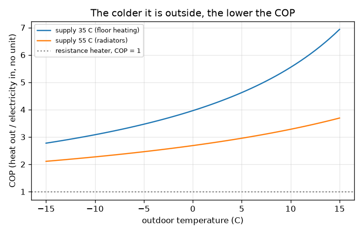
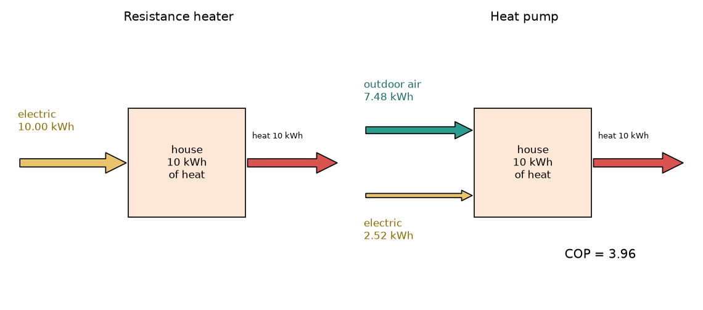

# సెషన్ 1: హీట్ పంప్ వేడిని తరలిస్తుంది, హీటర్ దానిని తయారు చేస్తుంది

[Session 1 — हिन्दी](README.hi.md) · [Session 1 — മലയാളം](README.ml.md) · [Session 1 — தமிழ்](README.ta.md)

*స్థాయి 1 (భావనాత్మక ఇంటరాక్టివ్ నమూనా) · సుమారు 60 నిమిషాలు · openheatpump*

> ఇది విద్య కోసం సరళీకరించిన నమూనా. ఇది ధ్రువీకరించబడిన డిజైన్ సాధనం కాదు; నిజమైన నిర్మాణాలు, విద్యుత్ ఇన్‌స్టలేషన్లు, వాహనాలు, పారిశ్రామిక ప్రక్రియలు లేదా వైద్య నిర్ణయాల కోసం దీనిని ఉపయోగించకూడదు.

**ముందస్తు అవసరాలు (Prerequisites)**

- పాఠశాల అంకగణితం (గుణకారం, భాగహారం, శాతాలు).
- మీరు PRIMER.md చదివి, `python start.py 1` ఒకసారి రన్ చేశారు.

**అభ్యసన లక్ష్యాలు (Learning objectives).** ఈ సెషన్ తర్వాత మీరు:

- రెసిస్టెన్స్ హీటర్ ప్రతి kWh విద్యుత్తుకు 1 kWh వేడిని ఇస్తుందని, హీట్ పంప్ అనేక రెట్లు ఇవ్వగలదని ఎందుకో వివరించగలరు.
- COP ని నిర్వచించి, ఇచ్చిన వేడికి అవసరమైన విద్యుత్తును కనుగొనడానికి Q = COP x W ఉపయోగించగలరు.
- హీట్ పంప్ యొక్క శక్తి ప్రవాహాలను గీయగలరు: విద్యుత్ లోపలికి, బయటి వేడి లోపలికి, ఇంటి వేడి బయటికి.
- బయటి ఉష్ణోగ్రతకు వ్యతిరేకంగా COP గ్రాఫ్‌ను చదివి, చలి పెరిగినప్పుడు అది ఎందుకు తగ్గుతుందో చెప్పగలరు.

## A. నిజ జీవిత సమస్య
ఒక చల్లని రోజున ఒక గదికి 10 kWh వేడి కావాలి. ఒక ఎలక్ట్రిక్ రెసిస్టెన్స్ హీటర్ ప్రతి kWh విద్యుత్తును సరిగ్గా 1 kWh వేడిగా మారుస్తుంది, కాబట్టి అది 10 kWh వాడుతుంది. ఒక హీట్ పంప్ అదే 10 kWh ను ఆ విద్యుత్తులో సుమారు నాలుగో వంతు మాత్రమే వాడి ఇస్తుంది. ఇది ఉచిత శక్తిలా అనిపిస్తుంది, అయితే మిగతా వేడి ఎక్కడి నుండి వస్తుంది, వాతావరణం చల్లబడినప్పుడు ఈ పొదుపు ఎందుకు తగ్గుతుంది? (సరళీకరించిన నమూనా గురించి సాధారణ విద్య, ఇన్‌స్టలేషన్ డిజైన్ కాదు.)

## B. భావన మరియు సిద్ధాంతం
ఒక రెసిస్టెన్స్ హీటర్ వేడిని తయారు చేస్తుంది: విద్యుత్ శక్తి W అంతా వేడిగా మారుతుంది, కాబట్టి వెలువడే వేడి W కి సమానం. ఒక హీట్ పంప్ వేడిని తయారు చేయదు; నీటిని పైకి ఎత్తే పంపు లాగా, ఎత్తడానికి విద్యుత్తును వాడి చల్లని బయటి గాలి నుండి వెచ్చని ఇంటిలోకి వేడిని తరలిస్తుంది. అందించే వేడి Q_hot = W + Q_outdoor, కాబట్టి శక్తి నిత్యత్వం పాటించబడుతుంది. పనితీరు గుణకం (coefficient of performance) COP = Q_hot / W: ప్రతి kWh విద్యుత్తుకు kWh వేడి. హీటర్‌కు COP = 1. ఎత్తు అంటే అందించే (సప్లై) ఉష్ణోగ్రతకు మరియు బయటి ఉష్ణోగ్రతకు మధ్య ఉన్న అంతరం; అంతరం పెద్దదైతే పంపు ఎక్కువ శ్రమిస్తుంది, COP తగ్గుతుంది. ఇచ్చిన అంతరానికి సాధ్యమైన ఉత్తమ COP, కెల్విన్‌లో ఉష్ణోగ్రతలతో (K = C + 273.15), T_hot / (T_hot - T_cold); నిజమైన యంత్రాలు దానిలో సుమారు 40 నుండి 50 శాతం చేరుతాయి, మనం 0.45 ను సాధారణ విలువగా ఉపయోగిస్తాం.

| గుర్తు | అర్థం | యూనిట్ |
|---|---|---|
| W | వాడిన విద్యుత్ శక్తి | kWh |
| Q_hot | ఇంటికి అందించిన వేడి | kWh |
| Q_outdoor | బయటి గాలి నుండి తీసుకున్న వేడి | kWh |
| COP | పనితీరు గుణకం, Q_hot / W | యూనిట్ లేదు |
| T_supply, T_out | అందించే వేడి మరియు బయటి గాలి ఉష్ణోగ్రత | డిగ్రీల C (సూత్రంలో కెల్విన్) |
| eta | నిజమైన యంత్రం చేరే ఉత్తమ COP భాగం (సాధారణంగా 0.4 నుండి 0.5) | యూనిట్ లేదు |

**ఊహలు (Assumptions)**

- 0.45 భాగం ఒక సాధారణ విలువ, ఏదో ఒక యంత్రం యొక్క సంఖ్య కాదు.
- స్థిర ఆపరేషన్: డీఫ్రాస్ట్ లేదు, ఫ్యాన్ లేదా పంపు శక్తి లేదు, స్టార్ట్-అప్ నష్టాలు లేవు.
- సప్లై ఉష్ణోగ్రత (ఫ్లోర్ హీటింగ్‌కు 35 C, రేడియేటర్లకు 55 C) స్థిరం.

$$ Q_{\text{hot}}=W+Q_{\text{outdoor}}\qquad \mathrm{COP}=\frac{Q_{\text{hot}}}{W}\qquad W=\frac{Q_{\text{hot}}}{\mathrm{COP}} $$

$$ \mathrm{COP}_{\text{best}}=\frac{T_{\text{supply}}}{T_{\text{supply}}-T_{\text{out}}},\qquad T[\mathrm{K}]=T[^\circ\mathrm{C}]+273.15 $$

$$ \mathrm{COP}\approx \eta\,\frac{T_{\text{supply}}}{T_{\text{supply}}-T_{\text{out}}},\qquad \eta\approx 0.45 $$

## C. దృశ్య వివరణ
మొదటి చిత్రం 10 kWh వేడి కోసం రెండు యంత్రాలను పక్కపక్కన గీస్తుంది. హీటర్‌కు 10 kWh గల ఒక పసుపు విద్యుత్ బాణం ఉంది. హీట్ పంప్‌కు 2.52 kWh గల సన్నని పసుపు విద్యుత్ బాణం మరియు బయటి గాలి నుండి తీసుకున్న 7.48 kWh వేడి యొక్క మందపాటి టీల్ బాణం ఉన్నాయి; రెండు సందర్భాలలో ఎరుపు బాణం 10 kWh ను ఇంటిలోకి తీసుకువెళ్తుంది. రెండవ చిత్రం 35 C మరియు 55 C సప్లైకి బయటి ఉష్ణోగ్రతకు వ్యతిరేకంగా COP ను గీస్తుంది: చల్లబడే కొద్దీ రెండు వక్రాలు పడిపోతాయి, 55 C వక్రం 35 C వక్రం కంటే చాలా కిందన ఉంటుంది.

*35 C మరియు 55 C సప్లైకి బయటి ఉష్ణోగ్రతకు వ్యతిరేకంగా COP.*

*10 kWh వేడికి శక్తి ప్రవాహాలు: హీటర్ (ఎడమ) మరియు హీట్ పంప్ (కుడి), బయట 0 C, 35 C సప్లై.*

## D. ఇంటరాక్టివ్ సిమ్యులేషన్
పాఠాన్ని రన్ చేయండి (`python start.py 1`), తర్వాత లైవ్ యాప్ తెరవండి: [సెషన్ 1: హీటర్ వర్సెస్ హీట్ పంప్](https://krunalpanchal1995.github.io/pan-iit-oss/openheatpump/session-01/) (లేదా ఈ ఫోల్డర్‌లోని `app.html`). బయటి ఉష్ణోగ్రత మరియు సప్లై ఉష్ణోగ్రత స్లైడర్లను కదిలించి COP తగ్గినప్పుడు మందపాటి టీల్ బాణం కుంచించుకుపోవడం చూడండి, తర్వాత గ్రాఫ్‌కు మారి COP వక్రం వెంట బిందువును అనుసరించండి.

**సవాలు.** 2 kWh కంటే తక్కువ విద్యుత్తు వాడి వేడిని అందించండి.

## E. సాధించిన ఉదాహరణ మరియు ప్రయోగం
**సమస్య.** ఒక ఇంటికి 10 kWh వేడి కావాలి. బయట 0 C, హీట్ పంప్ 35 C వద్ద వేడిని అందిస్తుంది. అది ఎంత విద్యుత్తు వాడుతుంది, బయటి గాలి నుండి ఎంత వేడి వస్తుంది?

1. కెల్విన్‌కు మార్చండి: T_supply = 35 + 273.15 = 308.15 K; అంతరం 35 - 0 = 35 K.
2. సాధ్యమైన ఉత్తమ COP = 308.15 / 35 = 8.80. ఒక నిజమైన యంత్రం: COP = 0.45 x 8.80 = 3.96.
3. విద్యుత్తు W = Q_hot / COP = 10 / 3.96 = 2.52 kWh.
4. బయటి నుండి వచ్చే వేడి = 10 - 2.52 = 7.48 kWh.
5. ఒక రెసిస్టెన్స్ హీటర్‌కు 10.00 kWh కావాలి, కాబట్టి హీట్ పంప్ విద్యుత్తులో సుమారు నాలుగో వంతు వాడుతుంది.

**సమాధానం.** COP 3.96; హీట్ పంప్ 2.52 kWh విద్యుత్తు వాడి బయటి గాలి నుండి 7.48 kWh తీసుకుంటుంది; రెసిస్టెన్స్ హీటర్ 10.00 kWh వాడుతుంది.

**ప్రయోగం.** కొన్ని విద్యుత్ బిల్లులు లేదా స్మార్ట్ మీటర్లు హీట్ పంప్ యొక్క విద్యుత్ వినియోగాన్ని మరియు అది అందించే వేడిని చూపిస్తాయి; ఒకదానిని మరొకదానితో ఒక వారం పాటు భాగించి కొలిచిన సీజనల్ COP పొందండి. ఆ వారం వాతావరణానికి నమూనా విలువతో పోల్చండి. డీఫ్రాస్ట్ చక్రాలు, సర్క్యులేషన్ పంపులు, ఫ్యాన్లు మరియు 35 C కంటే ఎక్కువ సప్లై ఉష్ణోగ్రత వల్ల నిజమైన సంఖ్యలు సాధారణంగా 3.96 కంటే తక్కువ; నమూనా వీటన్నింటినీ వదిలేస్తుంది.

## F. మూల్యాంకనం మరియు డిజైన్ సవాలు
**ప్రశ్న రకం A: భావనాత్మక.** 1 kWh విద్యుత్తుకు 4 kWh వేడిని ఇచ్చే హీట్ పంప్ శక్తి నిత్యత్వాన్ని ఉల్లంఘిస్తుందని ఒక స్నేహితుడు అంటాడు. అది ఎందుకు ఉల్లంఘించదో వివరించండి.

సూచన

మూడు పదాలతో శక్తి సమతుల్యతను రాయండి: విద్యుత్తు, బయటి వేడి, అందించిన వేడి.

దశలవారీ పరిష్కారం

శక్తి నిత్యత్వం పాటించబడుతుంది, ఎందుకంటే అందించిన వేడి 1 kWh విద్యుత్తు మరియు బయటి గాలి నుండి తీసుకున్న 3 kWh వేడి కలిపినది: 1 + 3 = 4. పంపు శక్తిని సృష్టించదు, అది వేడిని బయటి (చల్లని) నుండి లోపలికి (వెచ్చని) తరలిస్తుంది, దానికి విద్యుత్తును వాడుతుంది. హీటర్‌కు బయటి వేడి పదం లేదు, కాబట్టి ప్రతి kWh కి 1 kWh మాత్రమే ఇవ్వగలదు.

**ప్రశ్న రకం B: సంఖ్యాత్మక.** బయట 7 C, సప్లై 35 C, eta = 0.45. 12 kWh వేడికి హీట్ పంప్‌కు ఎంత విద్యుత్తు కావాలి, బయటి నుండి ఎంత వేడి వస్తుంది?

సూచన

COP = 0.45 x (35 + 273.15) / (35 - 7), తర్వాత W = Q / COP.

దశలవారీ పరిష్కారం

COP = 0.45 x 308.15 / 28 = 4.95. W = 12 / 4.95 = 2.42 kWh. బయటి వేడి = 12 - 2.42 = 9.58 kWh. సరిచూపు: హీటర్‌కు కావలసిన 12 kWh లో హీట్ పంప్ సుమారు ఐదో వంతు వాడుతుంది, అంతరం చిన్నది కాబట్టి COP, 0 C వద్ద ఉన్న 3.96 కంటే ఎక్కువ.

**ప్రశ్న రకం C: గ్రాఫ్ మరియు సిమ్యులేషన్ వ్యాఖ్యానం.** COP గ్రాఫ్‌లో, 35 C సప్లైకి COP 3 కి తగ్గేది సుమారు ఏ బయటి ఉష్ణోగ్రత వద్ద? 55 C సప్లైకి? రేడియేటర్లు వర్సెస్ ఫ్లోర్ హీటింగ్ గురించి ఇది ఏమి చెబుతుంది?

సూచన

ప్రతి వక్రం 3 స్థాయిని ఖండించే చోటు కనుగొనండి. ఖచ్చితమైన విలువ కావాలంటే 0.45 x T_supply / (T_supply - T_out) = 3 సాధించండి.

దశలవారీ పరిష్కారం

35 C సప్లైకి సుమారు -11 C వద్ద COP 3; 55 C సప్లైకి సుమారు +6 C వద్దే అది 3. ఎక్కువ సప్లై ఉష్ణోగ్రత అంటే ఎత్తవలసిన అంతరం పెద్దది, కాబట్టి ప్రతి బయటి ఉష్ణోగ్రత వద్ద COP తక్కువ: తక్కువ ఉష్ణోగ్రత వ్యవస్థ (ఫ్లోర్ హీటింగ్, పెద్ద రేడియేటర్లు) ఉన్న హీట్ పంప్ చాలా సమర్థవంతమైనది.

**ప్రశ్న రకం D: డిజైన్ మరియు ఆప్టిమైజేషన్ సవాలు.** డిజైన్: బయట 0 C వద్ద ఒక ఇంటికి 10 kWh వేడి కావాలి. 35 C ఫ్లోర్-హీటింగ్ లూప్‌ను మరియు 55 C రేడియేటర్ లూప్‌ను పోల్చండి. దేనిని ఎంచుకుంటారు, రాజీ (trade-off) ఏమిటి?

సూచన

ప్రతి సప్లై ఉష్ణోగ్రతకు COP మరియు విద్యుత్తును లెక్కించండి.

దశలవారీ పరిష్కారం

35 C వద్ద: COP 3.96, విద్యుత్తు 2.52 kWh. 55 C వద్ద: COP 2.68, విద్యుత్తు 3.72 kWh, సుమారు 48 శాతం ఎక్కువ. తక్కువ సప్లై ఉష్ణోగ్రత నడపడానికి చౌక, కానీ దానికి పెద్ద వేడి వెలువరించే వైశాల్యం (ఫ్లోర్ లూప్‌లు లేదా పెద్ద సైజు రేడియేటర్లు) కావాలి, అది ఏర్పాటు చేయడానికి ఎక్కువ ఖర్చు కావచ్చు. ఊహ: రెండింటికీ అదే eta 0.45; నిజమైన యంత్రాలు ఎక్కువ సప్లై ఉష్ణోగ్రతల వద్ద తక్కువ సామర్థ్యంతో కూడా నడుస్తాయి.

[RUBRIC.md](../../RUBRIC.md) తో మిమ్మల్ని మీరు స్కోర్ చేసుకోండి. కాగితంపై పని చేయడానికి [కార్యాచరణ పత్రం](activity_sheet.md) ప్రింట్ చేయండి.

## సాధారణ అపోహలు
| సాధారణ అపోహ | నిజానికి ఏది సరైనది |
|---|---|
| COP 4 అంటే హీట్ పంప్ 400 శాతం సమర్థవంతమైనది, ఏమీ లేని దాని నుండి శక్తిని తయారు చేస్తుంది. | COP అందించిన వేడిని వాడిన విద్యుత్తుతో పోలుస్తుంది; అదనపు వేడి బయటి గాలి నుండి తరలించి తెచ్చేది, కాబట్టి శక్తి సమతుల్యత ఇంకా నిలుస్తుంది. |
| బయట గడ్డకట్టే చలిలో హీట్ పంప్ పని చేయదు. | -10 C బయటి గాలిలో కూడా తరలించగల వేడి ఉంది; COP తక్కువ, కానీ ఈ నమూనాలో ఇంకా 1 కంటే చాలా ఎక్కువ. |
| COP సూత్రంలో ఉష్ణోగ్రతలు డిగ్రీల సెల్సియస్‌లో ఉండవచ్చు. | సూత్రం కెల్విన్ ఉపయోగిస్తుంది; సెల్సియస్ సంఖ్యలతో తప్పు సమాధానాలు, 0 C వద్ద సున్నాతో భాగహారం వస్తాయి. |
| పెద్ద COP ఎల్లప్పుడూ మెరుగైన హీట్ పంప్ అని అర్థం. | COP యంత్రం మీద ఎంతగా ఆధారపడుతుందో వాతావరణం మరియు సప్లై ఉష్ణోగ్రత మీద కూడా అంతే ఆధారపడుతుంది, కాబట్టి యంత్రాలను ఒకే పరిస్థితుల్లో పోల్చండి. |

## పదకోశం
- **హీట్ పంప్ (heat pump)**: చల్లని చోటు నుండి వెచ్చని చోటుకు వేడిని తరలించడానికి పనిని వాడే యంత్రం
- **COP**: పనితీరు గుణకం: అందించిన వేడిని వాడిన విద్యుత్తుతో భాగించినది
- **రెసిస్టెన్స్ హీటర్ (resistance heater)**: తన విద్యుత్తు అంతటినీ వేడిగా మార్చే ఎలక్ట్రిక్ హీటర్, COP = 1
- **కెల్విన్ (kelvin)**: పరమ శూన్యం వద్ద మొదలయ్యే ఉష్ణోగ్రత స్కేలు; K = డిగ్రీల C + 273.15
- **సప్లై ఉష్ణోగ్రత (supply temperature)**: వేడిని ఇంటికి అందించే ఉష్ణోగ్రత

## ముగింపు
1. [exercises.md](exercises.md) లోని మూడు కోడింగ్ పనులు చేయండి.
2. మీ మార్పుల తర్వాత `python start.py 1` మళ్లీ రన్ చేయండి. అది చెక్‌పాయింట్‌తో ముగుస్తుంది; అది `PASS` అని ప్రింట్ చేసినప్పుడు మీరు పూర్తి చేశారు. (చెక్‌పాయింట్ మాత్రమే: `python start.py check 1`.)

తర్వాత: [సెషన్ 2](../session-02/README.md)
