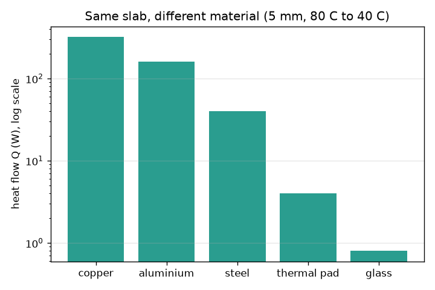
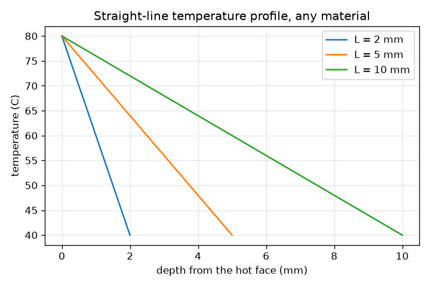

# सत्र 1: एक स्लैब (slab) से ऊष्मा का प्रवाह: फ़ूरिये का नियम (Fourier's law)

*स्तर 1 (वैचारिक इंटरैक्टिव मॉडल) · लगभग 60 मिनट · openheatspread*

> यह एक सरलीकृत शैक्षिक मॉडल है। यह कोई प्रमाणित डिज़ाइन उपकरण नहीं है और इसका उपयोग वास्तविक संरचनाओं, विद्युत संस्थापनों, वाहनों, औद्योगिक प्रक्रियाओं या चिकित्सा निर्णयों के लिए नहीं किया जाना चाहिए।

**पूर्वापेक्षाएँ (Prerequisites)**

- दशमलव और इकाइयों के साथ अंकगणित; सीधी-रेखा वाला ग्राफ़ पढ़ना।
- आपने PRIMER.md पढ़ लिया है और एक बार `python start.py 1` चला लिया है।

**सीखने के उद्देश्य (Learning objectives)।** इस सत्र के बाद आप:

- समझा सकेंगे कि ऊष्मा (heat) गर्म से ठंडे की ओर बहती है और उसकी दर वाट (watts) में मापी जाती है।
- Q = k A (T_hot - T_cold) / L का उपयोग करके हाथ से और Python में एक स्लैब से ऊष्मा प्रवाह की गणना कर सकेंगे।
- स्लैब के अंदर तापमान प्रोफ़ाइल (temperature profile) का रेखाचित्र बना सकेंगे और समझा सकेंगे कि वह सीधी रेखा क्यों है।
- पदार्थों की तुलना उनकी ऊष्मीय चालकता (thermal conductivity) से कर सकेंगे।

## A. वास्तविक दुनिया की समस्या
लैपटॉप के अंदर की चिप बिजली को ऊष्मा में बदलती है। ऊष्मा को एक पतले पैड से होकर धातु के हीटसिंक (heatsink) में निकलना होता है, और चिप तभी तक सुरक्षित है जब तक वह पर्याप्त ठंडी रहे। ऊष्मा एक परत से कितनी तेज़ी से गुज़रती है, उसके अंदर जाते हुए तापमान कैसे बदलता है, और ताँबे की एक पतली प्लेट उसी आकार के काँच के स्लैब से इतनी अधिक ऊष्मा क्यों ले जाती है? यह ऊष्मा प्रवाह के बारे में सामान्य शिक्षा है, वास्तविक उत्पादों के लिए कोई डिज़ाइन विधि नहीं।

## B. अवधारणा और सिद्धांत
ऊष्मा वह ऊर्जा है जो तापमान अंतर के कारण चलती है; वह हमेशा गर्म तरफ़ से ठंडी तरफ़ बहती है। स्थिर अवस्था (steady state) में (जब समय के साथ कुछ नहीं बदलता) एक सपाट स्लैब से ऊष्मा प्रवाह क्षेत्रफल A, उसके फलकों (faces) के बीच तापमान अंतर, और पदार्थ की ऊष्मीय चालकता k के समानुपाती होता है, और मोटाई L के व्युत्क्रमानुपाती होता है। चूँकि वही ऊष्मा स्लैब की हर परत को पार करती है, तापमान एक स्थिर दर से गिरता है, इसलिए प्रोफ़ाइल गर्म फलक से ठंडे फलक तक एक सीधी रेखा है। यह रेखा k पर निर्भर नहीं करती; k केवल यह तय करता है कि स्लैब कितनी ऊष्मा ले जाता है।

| प्रतीक | अर्थ | इकाई |
|---|---|---|
| Q | ऊष्मा प्रवाह (heat flow) (प्रति सेकंड ऊष्मा) | W |
| k | पदार्थ की ऊष्मीय चालकता | W/(m K) |
| A | वह क्षेत्रफल जिससे ऊष्मा गुज़रती है (1 cm^2 = 0.0001 m^2) | m^2 |
| T_hot, T_cold | दोनों फलकों के तापमान | C |
| L | स्लैब की मोटाई (ऊष्मा के चलने की दूरी) | m |
| q | ऊष्मा फ़्लक्स (heat flux), प्रति इकाई क्षेत्रफल ऊष्मा प्रवाह | W/m^2 |
| R | स्लैब का ऊष्मीय प्रतिरोध (thermal resistance) | K/W |

**मान्यताएँ (Assumptions)**

- स्थिर अवस्था: तापमान समय के साथ नहीं बदलते।
- ऊष्मा केवल एक दिशा में, सीधे स्लैब के आर-पार बहती है (1D)।
- k स्थिर है, और दोनों फलक निश्चित तापमानों पर रखे जाते हैं।
- फलकों के तापमान दिए गए हैं, इसलिए अच्छे चालकों के लिए Q के बड़े मान वही हैं जो आदर्श मॉडल कहता है, वह नहीं जो एक वास्तविक लैपटॉप दे सकता है।

$$ Q=\frac{k\,A\,(T_{hot}-T_{cold})}{L} $$

$$ T(x)=T_{hot}-\left(T_{hot}-T_{cold}\right)\frac{x}{L},\qquad 0\le x\le L $$

$$ q=\frac{Q}{A}=\frac{k\,(T_{hot}-T_{cold})}{L},\qquad R=\frac{L}{kA} $$

## C. दृश्य व्याख्या
पहला चित्र एक ही फलक तापमानों के साथ तीन स्लैब मोटाइयों के लिए गहराई के सापेक्ष तापमान दिखाता है: हर रेखा सीधी है, और स्लैब जितना मोटा, ढलान (slope) उतनी कोमल। दूसरा चित्र 80 C और 40 C पर उसी 5 mm, 1 cm^2 स्लैब से पाँच पदार्थों के लिए ऊष्मा प्रवाह लघुगणकीय पैमाने (logarithmic scale) पर दिखाता है: ताँबा 320 W ले जाता है, ऐल्युमिनियम 160 W, स्टील 40 W, एक थर्मल पैड 4 W और काँच 0.8 W।

*पाँच पदार्थों में एक ही स्लैब से ऊष्मा प्रवाह (लॉग पैमाना): चालकता तय करती है कि कितनी ऊष्मा बहती है।*

*तीन स्लैब मोटाइयों के लिए गहराई के सापेक्ष तापमान: हमेशा एक सीधी रेखा।*

## D. इंटरैक्टिव सिमुलेशन
पाठ चलाएँ (`python start.py 1`), फिर लाइव ऐप खोलें: [सत्र 1: स्लैब से ऊष्मा](https://krunalpanchal1995.github.io/pan-iit-oss/openheatspread/session-01/) (या इस फ़ोल्डर में `app.html`)। मोटाई वाले स्लाइडर को खिसकाएँ और तीर तथा सीधी तापमान रेखा को बदलते देखें। फिर चालकता बदलें और देखें कि ऊष्मा प्रवाह Q बदलता है लेकिन तापमान रेखा नहीं।

**चुनौती।** कम-से-कम 5 mm मोटे स्लैब से कम-से-कम 100 W प्रवाहित कराएँ।

## E. हल किया गया उदाहरण और प्रयोग
**समस्या।** एक थर्मल पैड (k = 5 W/(m K)) 1 mm मोटा है और 1 cm^2 ढकता है। उसका गर्म फलक 80 C पर और ठंडा फलक 50 C पर है। ऊष्मा प्रवाह, ऊष्मा फ़्लक्स और बीच में तापमान ज्ञात करें।

1. मीटर में बदलें: L = 1 mm = 0.001 m, A = 1 cm^2 = 0.0001 m^2।
2. Q = k A (T_hot - T_cold) / L = 5 * 0.0001 * 30 / 0.001 = 15 W।
3. फ़्लक्स q = Q / A = 15 / 0.0001 = 150000 W/m^2।
4. प्रोफ़ाइल एक सीधी रेखा है, इसलिए बीच में (x = 0.5 mm) तापमान औसत है: (80 + 50) / 2 = 65 C।
5. सामान्य जाँच (sanity check): 15 W लैपटॉप-चिप की उचित शक्ति है, और इतने पतले पैड पर 30 C की गिरावट वही है जो वास्तविक पैड दिखाते हैं।

**उत्तर।** Q = 15 W, q = 150000 W/m^2 और पैड का मध्य 65 C पर है।

**प्रयोग।** गर्म पानी के मग और एक ठंडे धातु के ब्लॉक के बीच एक पतला प्लास्टिक का स्केल या गत्ते की पट्टी रखें और दो चिपकने वाले थर्मामीटरों से फलकों के तापमान मापें; यदि आप ऊष्मा प्रवाह का अनुमान लगा सकें (केतली की शक्ति, या पानी के ठंडा होने की दर) तो आप k का अनुमान लगा सकते हैं। केवल एक मोटे उत्तर की अपेक्षा करें: मॉडल स्थिर प्रवाह, एक ही दिशा और पूर्ण संपर्क मानता है, जबकि वास्तविक ढेर में हवा के अंतराल होते हैं और वह अपनी बगलों से ऊष्मा खोता है।

## F. मूल्यांकन और डिज़ाइन चुनौती
**प्रश्न प्रकार A: वैचारिक।** ताँबे के एक स्लैब और काँच के एक स्लैब का आकार और फलक तापमान एक जैसे हैं। किसमें प्रति मिलीमीटर तापमान गिरावट अधिक है, और कौन अधिक ऊष्मा ले जाता है? समझाइए।

संकेत

सोचें कि प्रोफ़ाइल किस पर निर्भर करती है, और Q किस पर निर्भर करता है।

चरण-दर-चरण हल

दोनों की बिल्कुल एक जैसी सीधी-रेखा प्रोफ़ाइल है: प्रति मिलीमीटर गिरावट (T_hot - T_cold) / L है, जिसमें k नहीं है। ताँबा कहीं अधिक ऊष्मा ले जाता है, क्योंकि Q, k के समानुपाती है (400 बनाम लगभग 1 W/(m K), यानी लगभग 400 गुना अधिक)। चालकता यह तय करती है कि कितनी ऊष्मा बहती है, यह नहीं कि तापमान का आकार कैसा है।

**प्रश्न प्रकार B: संख्यात्मक।** k = 5 W/(m K) वाला एक थर्मल पैड 0.5 mm मोटा है और 1 cm^2 ढकता है, जिसके फलक 70 C और 50 C पर हैं। W में ऊष्मा प्रवाह ज्ञात करें और जाँचें कि उत्तर समझदारी भरा है।

संकेत

पहले 0.5 mm और 1 cm^2 को मीटर में बदलें। Q = k A dT / L।

चरण-दर-चरण हल

Q = 5 * 0.0001 * 20 / 0.0005 = 20 W। इकाइयाँ: W/(m K) गुणा m^2 गुणा K भाग m से W मिलता है। सामान्य जाँच: हल किए गए उदाहरण (15 W) की तुलना में पैड आधा मोटा है, जिससे प्रवाह दोगुना होता, लेकिन तापमान गिरावट कम है (20 K बनाम 30 K), जो उसे एक-तिहाई घटा देती है: 15 * 2 * 2/3 = 20 W।

**प्रश्न प्रकार C: ग्राफ़ और सिमुलेशन की व्याख्या।** L = 2, 5 और 10 mm (80 C से 40 C) वाले प्रोफ़ाइल ग्राफ़ में, हर स्लैब में 2 mm की गहराई पर तापमान क्या है, और इससे ढलान के बारे में क्या पता चलता है?

संकेत

T = 80 - 40 x / L का उपयोग करें। याद रखें कि 2 mm का स्लैब 2 mm पर समाप्त होता है।

चरण-दर-चरण हल

L = 2 mm: 80 - 40 * 2 / 2 = 40 C (ठंडा फलक)। L = 5 mm: 80 - 16 = 64 C। L = 10 mm: 80 - 8 = 72 C। ढलानें 20, 8 और 4 C प्रति mm हैं: स्लैब जितना मोटा, तापमान उतना ही धीरे गिरता है, क्योंकि वही 40 C का अंतर अधिक दूरी पर फैला होता है।

**प्रश्न प्रकार D: डिज़ाइन और अनुकूलन (optimisation) चुनौती।** डिज़ाइन: एक पैड (k = 5 W/(m K), 1 cm^2) को 80 C पर चिप फलक से 50 C पर हीटसिंक फलक तक कम-से-कम 12 W ले जाना है। निर्माण विभाग कहता है कि यह 0.3 mm से पतला नहीं हो सकता। एक मोटाई चुनें और उसका औचित्य दें।

संकेत

नियम को पुनर्व्यवस्थित करें: L = k A dT / Q अधिकतम अनुमत मोटाई देता है।

चरण-दर-चरण हल

अधिकतम मोटाई: L = 5 * 0.0001 * 30 / 12 = 0.00125 m = 1.25 mm। इसलिए 0.3 mm से 1.25 mm तक कोई भी मोटाई काम करती है। 0.5 mm का चुनाव 5 * 0.0001 * 30 / 0.0005 = 30 W ले जाता है, एक आरामदायक मार्जिन। समझौता (trade-off): पतले पैड अधिक ऊष्मा ले जाते हैं लेकिन उन्हें बनाना और असमान चिप पर सपाट दबाना कठिन है; मोटे पैड क्षमाशील हैं लेकिन 1.25 mm पर उनका मार्जिन ख़त्म हो जाता है।

[RUBRIC.md](../../RUBRIC.md) से स्वयं को अंक दें। काग़ज़ पर काम करने के लिए [गतिविधि पत्रक](activity_sheet.md) प्रिंट करें।

## सामान्य भ्रांतियाँ (Common misconceptions)
| सामान्य भ्रांति | वास्तव में क्या सही है |
|---|---|
| एक अच्छा चालक अपने अंदर तापमान को तेज़ी से गिराता है। | स्थिर प्रोफ़ाइल एक सीधी रेखा है, चाहे k कुछ भी हो। एक अच्छा चालक बस उसी तापमान अंतर पर बहुत अधिक ऊष्मा बहने देता है। |
| ऊष्मा और तापमान एक ही चीज़ हैं। | तापमान बताता है कि कोई वस्तु कितनी गर्म है (C); ऊष्मा तापमान अंतर के कारण चलने वाली ऊर्जा है, जिसे वाट में दर के रूप में मापा जाता है। |
| मोटाई दोगुनी करने से ऊष्मा प्रवाह दोगुना होता है। | यह उसे आधा कर देता है: ऊष्मा प्रवाह मोटाई के व्युत्क्रमानुपाती है। |

## शब्दावली (Glossary)
- **ऊष्मीय चालकता (thermal conductivity) (k)**: कोई पदार्थ कितनी अच्छी तरह ऊष्मा का चालन करता है, W/(m K) में; ताँबा लगभग 400, हवा लगभग 0.026
- **ऊष्मा प्रवाह (heat flow) (Q)**: प्रति सेकंड चलने वाली ऊष्मा ऊर्जा, वाट में
- **ऊष्मा फ़्लक्स (heat flux) (q)**: प्रति इकाई क्षेत्रफल ऊष्मा प्रवाह, W/m^2 में
- **स्थिर अवस्था (steady state)**: वह स्थिति जिसमें तापमान समय के साथ अब नहीं बदलते
- **ऊष्मीय प्रतिरोध (thermal resistance) (R)**: कोई परत ऊष्मा प्रवाह का कितनी दृढ़ता से विरोध करती है, K/W में; यहाँ L/(kA)
- **फ़ूरिये का नियम (Fourier's law)**: ऊष्मा प्रवाह क्षेत्रफल और तापमान अंतर के समानुपाती और मोटाई के व्युत्क्रमानुपाती होता है

## समापन
1. [exercises.md](exercises.md) में दिए तीन कोडिंग कार्य करें।
2. अपने बदलावों के बाद `python start.py 1` फिर से चलाएँ। यह चेकपॉइंट (checkpoint) के साथ समाप्त होता है; जब यह `PASS` प्रिंट करे, तो आपका काम पूरा है। (केवल चेकपॉइंट: `python start.py check 1`।)

आगे: [सत्र 2](../session-02/README.md)
