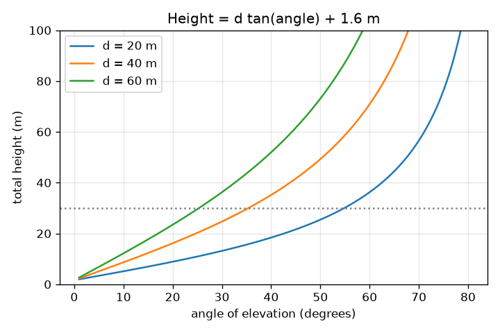
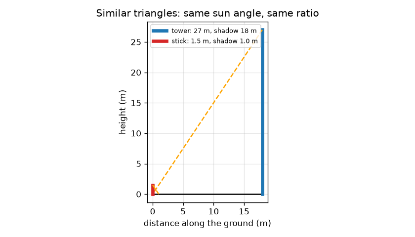

# सत्र 1: समरूप त्रिभुज, परछाइयाँ और एक कोण

*स्तर 1 (संकल्पनात्मक इंटरैक्टिव मॉडल) · लगभग 60 मिनट · openheights*

> यह एक सरलीकृत शैक्षिक मॉडल है। यह कोई प्रमाणित डिज़ाइन टूल नहीं है और इसका उपयोग वास्तविक संरचनाओं, विद्युत स्थापनाओं, वाहनों, औद्योगिक प्रक्रियाओं या चिकित्सा निर्णयों के लिए नहीं किया जाना चाहिए।

**पूर्व-आवश्यकताएँ (Prerequisites)**

- समकोण त्रिभुज में किसी कोण का स्पर्शज्या (tangent) (स्कूल त्रिकोणमिति)।
- आपने PRIMER.md पढ़ लिया है और `python start.py 1` एक बार चला लिया है।

**सीखने के उद्देश्य (Learning objectives)।** इस सत्र के बाद आप:

- परछाइयों से ऊँचाई ज्ञात करने के लिए समरूप त्रिभुजों (similar triangles) का उपयोग कर सकेंगे।
- समझा सकेंगे कि उन्नयन कोण (angle of elevation) क्या है और इसे फ़ोन से माप सकेंगे।
- height = distance x tan(angle) का उपयोग कर सकेंगे और आँख की ऊँचाई जोड़ सकेंगे।
- एक निश्चित दूरी के लिए कोण के विरुद्ध ऊँचाई का ग्राफ़ पढ़ सकेंगे।

## A. वास्तविक दुनिया की समस्या
आप फ़ीते के साथ किसी मीनार या पेड़ पर नहीं चढ़ सकते, पर आप ज़मीन पर खड़े हो सकते हैं। दो रोज़मर्रा की तरकीबें ऊँचाई देती हैं: उसकी डाली गई परछाई, और उसके शिखर को देखने के लिए आप अपना सिर (या फ़ोन) जितना झुकाते हैं वह कोण। ये क्यों काम करती हैं, और ज़मीन के बारे में आपको क्या जानना ज़रूरी है?

## B. संकल्पना और सिद्धांत
समान कोणों वाले दो त्रिभुज समरूप होते हैं: उनकी भुजाएँ समान अनुपात में होती हैं। किसी एक क्षण पर सूर्य हर जगह ज़मीन के साथ समान कोण बनाता है, इसलिए एक छड़ी और एक मीनार अपनी परछाइयों के साथ समरूप त्रिभुज बनाते हैं, और height / shadow दोनों के लिए समान होता है। उन्नयन कोण a आपकी आँख पर क्षैतिज से ऊपर शिखर तक मापा जाता है। क्षैतिज भुजा d और आपकी आँख से ऊपर ऊर्ध्वाधर भुजा H वाले समकोण त्रिभुज में, tan(a) = H / d, इसलिए H = d tan(a)। मीनार आपकी आँख से इतनी ऊँची है, इसलिए कुल ऊँचाई पाने के लिए आप अपनी आँख की ऊँचाई जोड़ते हैं। यह एक सरलीकृत मॉडल है: समतल ज़मीन, एक ऊर्ध्वाधर मीनार, पूरी तरह समतल पकड़ा फ़ोन और एक सटीक दूरी।

| प्रतीक | अर्थ | इकाई |
|---|---|---|
| h_t, s_t | मीनार की ऊँचाई और उसकी परछाई की लंबाई | m |
| h_s, s_s | छड़ी की ऊँचाई और उसकी परछाई की लंबाई | m |
| d | आपसे आधार तक की क्षैतिज दूरी | m |
| a | शिखर तक का उन्नयन कोण | डिग्री |
| e | ज़मीन से आँख की ऊँचाई | m |
| h | मीनार की कुल ऊँचाई | m |

**मान्यताएँ (Assumptions)**

- आपके और मीनार के बीच ज़मीन समतल और सपाट है।
- मीनार ऊर्ध्वाधर है और d मापने के लिए आप उसके आधार तक चल सकते हैं।
- परछाइयाँ एक ही क्षण पर, एक ही समतल ज़मीन पर मापी जाती हैं।
- कोण ठीक-ठीक पढ़ा जाता है (त्रुटियाँ सत्र 2 और 3 का विषय हैं)।

$$ \frac{h_t}{s_t}=\frac{h_s}{s_s}\quad\Rightarrow\quad h_t=h_s\,\frac{s_t}{s_s} $$

$$ \tan a=\frac{h-e}{d} $$

$$ h=d\tan a+e $$

## C. दृश्य व्याख्या
पहला चित्र छड़ी और मीनार को उनकी परछाइयों के साथ दिखाता है: दोनों नारंगी रेखाओं (सूर्य किरणों) का ढाल समान है, और दोनों त्रिभुज अलग-अलग आकार में एक ही आकृति के हैं। दूसरा चित्र तीन दूरियों के लिए कोण के विरुद्ध कुल ऊँचाई आलेखित करता है। हर वक्र आँख की ऊँचाई से शुरू होता है और पहले धीरे, फिर तेज़ी से उठता है: 90 डिग्री के पास स्पर्शज्या तेज़ी से बढ़ती है। समान कोण पर दूरी दोगुनी करने से आँख से ऊपर की ऊँचाई दोगुनी हो जाती है।

*तीन दूरियों के लिए कोण के विरुद्ध कुल ऊँचाई: बड़े कोणों पर स्पर्शज्या वक्र अधिक खड़ा हो जाता है।*

*समरूप त्रिभुज: एक 1.5 m की छड़ी और एक 27 m की मीनार का सूर्य कोण समान है।*

## D. इंटरैक्टिव सिमुलेशन
पाठ चलाइए (`python start.py 1`), फिर लाइव ऐप खोलिए: [सत्र 1: एक कोण से ऊँचाई](https://krunalpanchal1995.github.io/pan-iit-oss/openheights/session-01/) (या इसी फ़ोल्डर में `app.html`)। दूरी और कोण को खिसकाइए, और दृष्टि रेखा को धूसर 30 m मीनार के शिखर की ओर उठते देखिए; फिर ग्राफ़ दृश्य खोलिए और बिंदु को वक्र पर चलते देखिए।

**चुनौती।** अनुमान को 30 m मीनार के बराबर, 0.5 m के भीतर, लाइए।

## E. हल किया गया उदाहरण और प्रयोग
**समस्या।** (a) एक 1.5 m की छड़ी 1.0 m की परछाई डालती है जब एक मीनार 18 m की परछाई डालती है। मीनार कितनी ऊँची है? (b) आप दूसरी मीनार से 40 m दूर खड़े हैं, 35 डिग्री पढ़ते हैं, और आपकी आँख 1.6 m ऊँची है। यह कितनी ऊँची है?

1. (a) छड़ी का अनुपात: 1.5 / 1.0 = प्रति मीटर परछाई 1.5 m ऊँचाई।
2. (a) मीनार: 1.5 x 18 = 27 m।
3. (b) tan 35 डिग्री = 0.7002।
4. (b) आँख से ऊपर ऊँचाई = 40 x 0.7002 = 28.01 m।
5. (b) कुल = 28.01 + 1.6 = 29.61 m।

**उत्तर।** (a) मीनार 27 m ऊँची है। (b) मीनार 29.61 m ऊँची है।

**प्रयोग।** किसी लैंप पोस्ट या पेड़ को दो बार मापिए: एक बार धूप वाले दिन परछाई विधि से (एक ऊर्ध्वाधर मीटर छड़ी और परछाई को उसी मिनट पर मापिए), एक बार फ़ोन क्लाइनोमीटर ऐप और फ़ीते के साथ कोण विधि से। तुलना कीजिए। कुछ प्रतिशत के भीतर सहमति की अपेक्षा कीजिए; अंतर धुंधले परछाई किनारों, ढलान वाली ज़मीन, झुके हुए फ़ोन और आधार ठीक कहाँ है यह न जानने से आते हैं। मॉडल में सटीक रेखाएँ और पूरी तरह ऊर्ध्वाधर मीनार है, मैदान में नहीं।

## F. मूल्यांकन और डिज़ाइन चुनौती
**प्रश्न प्रकार A: संकल्पनात्मक।** एक छड़ी और एक मीनार अपनी परछाइयों के साथ समरूप त्रिभुज क्यों बनाते हैं, और यदि आप छड़ी की परछाई सुबह 9 बजे और मीनार की 11 बजे मापें तो क्या गड़बड़ होगी?

संकेत

समरूप का अर्थ है समान कोण। सूर्य किरण और ज़मीन के बीच का कोण किससे तय होता है?

चरण-दर-चरण हल

किसी एक क्षण पर सूर्य किरणें समानांतर होती हैं, इसलिए सूर्य और समतल ज़मीन के बीच का कोण छड़ी और मीनार के लिए समान है; ज़मीन पर समकोण भी साझा है, इसलिए सभी कोण मेल खाते हैं और त्रिभुज समरूप हैं। सुबह 9 बजे और 11 बजे सूर्य अलग-अलग ऊँचाइयों पर होता है, इसलिए परछाई-से-ऊँचाई अनुपात अलग होता है और उत्तर ग़लत आता है। दोनों परछाइयाँ एक ही समय पर मापिए।

**प्रश्न प्रकार B: संख्यात्मक।** एक पेड़ 15 m की परछाई डालता है जब एक 2.0 m की छड़ी 1.2 m की परछाई डालती है। पेड़ कितना ऊँचा है? फिर एक दूसरे पेड़ को 12 m दूर से 40 डिग्री पर देखा जाता है और आँख 1.6 m पर है; यह कितना ऊँचा है?

संकेत

h_t = h_s s_t / s_s का उपयोग कीजिए, फिर h = d tan a + e। tan 40 डिग्री = 0.8391।

चरण-दर-चरण हल

पहला पेड़: 2.0 x 15 / 1.2 = 25.0 m। दूसरा पेड़: आँख से ऊपर 12 x 0.8391 = 10.07 m, उसमें 1.6 m जोड़ने पर 11.67 m। समझदारी जाँच (sanity check): 40 डिग्री पर (45 से थोड़ा कम) आँख से ऊपर की ऊँचाई दूरी 12 m से थोड़ी कम है, इसलिए लगभग 10 m सही है।

**प्रश्न प्रकार C: ग्राफ़ और सिमुलेशन की व्याख्या।** d = 40 m के लिए कोण के विरुद्ध कुल ऊँचाई के ग्राफ़ पर, 20, 45 और 60 डिग्री पर ऊँचाइयाँ पढ़िए। कोण बढ़ने पर प्रति डिग्री ऊँचाई का क्या होता है?

संकेत

d = 40 m वाले वक्र का उपयोग कीजिए, या 40 tan(a) + 1.6 की गणना कीजिए।

चरण-दर-चरण हल

20 डिग्री पर लगभग 16.2 m, 45 डिग्री पर 41.6 m, 60 डिग्री पर 70.9 m। 20 से 45 डिग्री तक ऊँचाई 25.4 m बढ़ती है (लगभग 1.0 m प्रति डिग्री); 45 से 60 तक यह 15 डिग्री में 29.3 m बढ़ती है (लगभग 2.0 m प्रति डिग्री)। वक्र अधिक खड़ा होता जाता है क्योंकि बड़े कोणों पर स्पर्शज्या तेज़ी से बढ़ती है; वहाँ 1 डिग्री की चूक अधिक मायने रखती है।

**प्रश्न प्रकार D: डिज़ाइन और इष्टतमीकरण (optimisation) चुनौती।** डिज़ाइन: आपको लगता है कि एक पेड़ लगभग 12 m ऊँचा है और आपके पास 50 m का फ़ीता है। चुनिए कि कहाँ खड़े हों और इसे उचित ठहराइए। 2 m दूर, या 45 m दूर खड़े होने में क्या ग़लत होगा?

संकेत

45 डिग्री के कोण के लिए d की गणना कीजिए, जहाँ tan a = 1। खड़े कोणों पर फ़ोन को स्थिर पकड़ने के बारे में और लंबी दूरियों पर कोण के छोटे होने के बारे में सोचिए।

चरण-दर-चरण हल

45 डिग्री के लिए, tan a = 1, इसलिए d = h - e = 12 - 1.6 = 10.4 m। 2 m दूर खड़े होने पर कोण लगभग 79 डिग्री होता है: आप लगभग सीधे ऊपर देखते हैं, फ़ोन पकड़ना कठिन होता है, और कोण की छोटी चूकें ऊँचाई में बड़े बदलाव लाती हैं (सत्र 2)। 45 m दूर खड़े होने पर केवल लगभग 13 डिग्री मिलता है, और शिखर क्षितिज से ऊपर एक छोटे कोण पर होता है, इसलिए एक छोटी चूक पाठ्यांक का बड़ा अंश होती है और शाखाएँ या पेड़ दृश्य रोक सकते हैं। समझौता (trade-off): लगभग 45 डिग्री एक अच्छा मध्य मार्ग है, जिसमें बाधाओं के लिए जगह है।

[RUBRIC.md](../../RUBRIC.md) से स्वयं को अंक दीजिए। कागज़ पर काम करने के लिए [गतिविधि पत्रक](activity_sheet.md) प्रिंट कीजिए।

## सामान्य भ्रांतियाँ (Common misconceptions)
| सामान्य भ्रांति | वास्तव में क्या सच है |
|---|---|
| ऊँचाई केवल d tan(a) है। | यह केवल आपकी आँख से ऊपर की ऊँचाई है; कुल ऊँचाई पाने के लिए अपनी आँख की ऊँचाई जोड़िए। |
| दूरी d मीनार के शिखर तक की दूरी है। | d ज़मीन के साथ आधार तक की क्षैतिज दूरी है; दृष्टि रेखा उससे लंबी होती है। |
| परछाई विधि दिन के किन्हीं भी दो समयों पर काम करती है। | छड़ी और मीनार की परछाइयाँ एक ही क्षण पर मापी जानी चाहिए, क्योंकि सूर्य का कोण बदलता है। |
| कोण दोगुना करने से ऊँचाई दोगुनी हो जाती है। | ऊँचाई tan(a) के अनुसार चलती है, जो a के समानुपाती नहीं है: d = 40 m पर (आँख की ऊँचाई 1.6 m के साथ) 20 डिग्री से 16.2 m और 40 डिग्री से 35.2 m मिलता है। |

## शब्दावली (Glossary)
- **उन्नयन कोण (angle of elevation)**: क्षैतिज से ऊपर उस वस्तु तक का कोण जिसे आप देखते हैं
- **समरूप त्रिभुज (similar triangles)**: समान कोणों वाले त्रिभुज, इसलिए उनकी भुजाएँ समान अनुपात में होती हैं
- **स्पर्शज्या (tangent)**: समकोण त्रिभुज में, सम्मुख भुजा बटा आसन्न भुजा
- **क्लाइनोमीटर (clinometer)**: एक उपकरण या फ़ोन ऐप जो झुकाव कोण पढ़ता है
- **आधार रेखा (baseline)**: ज़मीन पर मापी गई वह दूरी जिस पर विधि निर्भर करती है

## समापन
1. [exercises.md](exercises.md) में दिए गए तीन कोडिंग कार्य कीजिए।
2. अपने बदलावों के बाद `python start.py 1` फिर से चलाइए। यह checkpoint के साथ समाप्त होता है; जब यह `PASS` छापे, तो आपका काम पूरा है। (केवल checkpoint: `python start.py check 1`।)

अगला: [सत्र 2](../session-02/README.md)
