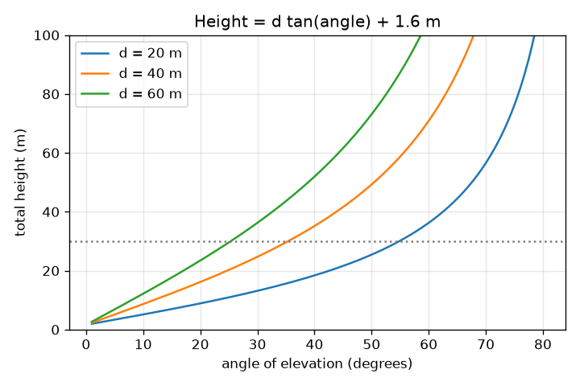
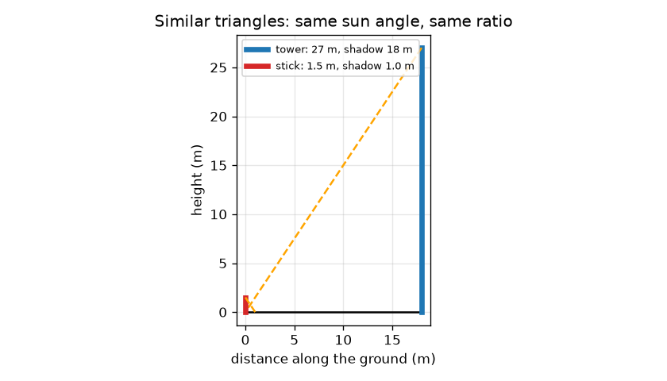

# സെഷൻ 1: സദൃശ ത്രികോണങ്ങൾ, നിഴലുകൾ, ഒരു കോൺ

[Session 1 — हिन्दी](README.hi.md)

*ലെവൽ 1 (ആശയപരമായ ഇന്ററാക്ടീവ് മോഡൽ) · ഏകദേശം 60 മിനിറ്റ് · openheights*

> ഇത് ലളിതമാക്കിയ ഒരു വിദ്യാഭ്യാസ മോഡലാണ്. ഇത് സാധൂകരിക്കപ്പെട്ട ഒരു ഡിസൈൻ ഉപകരണമല്ല; യഥാർത്ഥ നിർമ്മിതികൾ, വൈദ്യുത ഇൻസ്റ്റലേഷനുകൾ, വാഹനങ്ങൾ, വ്യാവസായിക പ്രക്രിയകൾ അല്ലെങ്കിൽ വൈദ്യശാസ്ത്രപരമായ തീരുമാനങ്ങൾ എന്നിവയ്ക്ക് ഇത് ഉപയോഗിക്കരുത്.

**മുൻ‌അറിവ് (Prerequisites)**

- മട്ടത്രികോണത്തിലെ ഒരു കോണിന്റെ ടാൻജെന്റ് (tangent) (സ്കൂൾ ത്രികോണമിതി).
- നിങ്ങൾ PRIMER.md വായിക്കുകയും `python start.py 1` ഒരു തവണ റൺ ചെയ്യുകയും ചെയ്തിട്ടുണ്ട്.

**പഠന ലക്ഷ്യങ്ങൾ (Learning objectives).** ഈ സെഷനു ശേഷം നിങ്ങൾക്ക് കഴിയും:

- നിഴലുകളിൽ നിന്ന് ഉയരം കണ്ടെത്താൻ സദൃശ ത്രികോണങ്ങൾ (similar triangles) ഉപയോഗിക്കാൻ.
- ഉന്നതി കോൺ (angle of elevation) എന്താണെന്ന് വിശദീകരിക്കാനും ഫോൺ ഉപയോഗിച്ച് അളക്കാനും.
- ഉയരം = ദൂരം x tan(കോൺ) ഉപയോഗിച്ച് കണ്ണിന്റെ ഉയരം ചേർക്കാൻ.
- ഒരു നിശ്ചിത ദൂരത്തിന് കോണിനെതിരെ ഉയരത്തിന്റെ ഗ്രാഫ് വായിക്കാൻ.

## A. യഥാർത്ഥ ലോക പ്രശ്നം
ടേപ്പുമായി ഒരു ഗോപുരത്തിലോ മരത്തിലോ കയറാൻ നിങ്ങൾക്ക് കഴിയില്ല, പക്ഷേ നിങ്ങൾക്ക് നിലത്ത് നിൽക്കാം. രണ്ട് നിത്യജീവിത തന്ത്രങ്ങൾ ഉയരം നൽകുന്നു: അത് വീഴ്ത്തുന്ന നിഴലും, അതിന്റെ മുകൾഭാഗം കാണാൻ നിങ്ങൾ തല (അല്ലെങ്കിൽ ഫോൺ) ചരിക്കുന്ന കോണും. ഇവ പ്രവർത്തിക്കുന്നത് എന്തുകൊണ്ട്, നിലത്തെക്കുറിച്ച് നിങ്ങൾ എന്താണ് അറിയേണ്ടത്?

## B. ആശയവും സിദ്ധാന്തവും
ഒരേ കോണുകളുള്ള രണ്ട് ത്രികോണങ്ങൾ സദൃശമാണ്: അവയുടെ വശങ്ങൾ ഒരേ അനുപാതത്തിലാണ്. ഒരു നിമിഷത്തിൽ സൂര്യൻ എല്ലായിടത്തും നിലവുമായി ഒരേ കോൺ ഉണ്ടാക്കുന്നു, അതിനാൽ ഒരു വടിയും ഗോപുരവും അവയുടെ നിഴലുകളോടെ സദൃശ ത്രികോണങ്ങൾ ഉണ്ടാക്കുന്നു, ഉയരം / നിഴൽ രണ്ടിനും ഒന്നുതന്നെ. ഉന്നതി കോൺ a അളക്കുന്നത് നിങ്ങളുടെ കണ്ണിലെ തിരശ്ചീന രേഖയിൽ നിന്ന് മുകളിലേക്കാണ്. തിരശ്ചീന വശം d-യും നിങ്ങളുടെ കണ്ണിന് മുകളിൽ ലംബ വശം H-ഉം ഉള്ള മട്ടത്രികോണത്തിൽ, tan(a) = H / d, അതിനാൽ H = d tan(a). ഗോപുരം നിങ്ങളുടെ കണ്ണിനേക്കാൾ ആ അളവിൽ ഉയരമുള്ളതാണ്, അതിനാൽ ആകെ ഉയരം കിട്ടാൻ നിങ്ങളുടെ കണ്ണിന്റെ ഉയരം ചേർക്കുക. ഇത് ലളിതമാക്കിയ മോഡലാണ്: പരന്ന നിലം, ലംബമായ ഗോപുരം, തികച്ചും നിരപ്പായ ഫോൺ, കൃത്യമായ ദൂരം.

| ചിഹ്നം | അർത്ഥം | യൂണിറ്റ് |
|---|---|---|
| h_t, s_t | ഗോപുരത്തിന്റെ ഉയരവും അതിന്റെ നിഴലിന്റെ നീളവും | m |
| h_s, s_s | വടിയുടെ ഉയരവും അതിന്റെ നിഴലിന്റെ നീളവും | m |
| d | നിങ്ങളിൽ നിന്ന് അടിത്തറയിലേക്കുള്ള തിരശ്ചീന ദൂരം | m |
| a | മുകൾഭാഗത്തേക്കുള്ള ഉന്നതി കോൺ | ഡിഗ്രി |
| e | നിലത്തിനു മുകളിൽ കണ്ണിന്റെ ഉയരം | m |
| h | ഗോപുരത്തിന്റെ ആകെ ഉയരം | m |

**അനുമാനങ്ങൾ (Assumptions)**

- നിങ്ങൾക്കും ഗോപുരത്തിനും ഇടയിൽ നിലം പരന്നതും നിരപ്പായതുമാണ്.
- ഗോപുരം ലംബമാണ്, d അളക്കാൻ നിങ്ങൾക്ക് അതിന്റെ അടിത്തറ വരെ നടക്കാൻ കഴിയും.
- നിഴലുകൾ ഒരേ നിമിഷത്തിൽ, ഒരേ പരന്ന നിലത്ത് അളക്കുന്നു.
- കോൺ കൃത്യമായി വായിക്കുന്നു (പിശകുകൾ സെഷൻ 2, 3 എന്നിവയുടെ വിഷയമാണ്).

$$ \frac{h_t}{s_t}=\frac{h_s}{s_s}\quad\Rightarrow\quad h_t=h_s\,\frac{s_t}{s_s} $$

$$ \tan a=\frac{h-e}{d} $$

$$ h=d\tan a+e $$

## C. ദൃശ്യ വിശദീകരണം
ആദ്യ ചിത്രം വടിയെയും ഗോപുരത്തെയും അവയുടെ നിഴലുകളോടെ വരയ്ക്കുന്നു: രണ്ട് ഓറഞ്ച് വരകൾ (സൂര്യരശ്മികൾ) ഒരേ ചരിവുള്ളവയാണ്, രണ്ട് ത്രികോണങ്ങളും വ്യത്യസ്ത വലിപ്പത്തിൽ ഒരേ ആകൃതിയാണ്. രണ്ടാമത്തെ ചിത്രം മൂന്ന് ദൂരങ്ങൾക്ക് കോണിനെതിരെ ആകെ ഉയരം വരയ്ക്കുന്നു. ഓരോ വക്രവും കണ്ണിന്റെ ഉയരത്തിൽ തുടങ്ങി സാവധാനം, പിന്നീട് കുത്തനെ ഉയരുന്നു: 90 ഡിഗ്രിക്ക് സമീപം ടാൻജെന്റ് വേഗത്തിൽ വളരുന്നു. ദൂരം ഇരട്ടിയാക്കിയാൽ ഒരേ കോണിൽ കണ്ണിന് മുകളിലുള്ള ഉയരം ഇരട്ടിയാകുന്നു.

*മൂന്ന് ദൂരങ്ങൾക്ക് കോണിനെതിരെ ആകെ ഉയരം: വലിയ കോണുകളിൽ ടാൻജെന്റ് വക്രം കൂടുതൽ കുത്തനെയാകുന്നു.*

*സദൃശ ത്രികോണങ്ങൾ: 1.5 m വടിയും 27 m ഗോപുരവും ഒരേ സൂര്യകോൺ പങ്കിടുന്നു.*

## D. ഇന്ററാക്ടീവ് സിമുലേഷൻ
പാഠം റൺ ചെയ്യുക (`python start.py 1`), തുടർന്ന് ലൈവ് ആപ്പ് തുറക്കുക: [സെഷൻ 1: ഒരു കോണിൽ നിന്ന് ഉയരം](https://krunalpanchal1995.github.io/pan-iit-oss/openheights/session-01/) (അല്ലെങ്കിൽ ഈ ഫോൾഡറിലെ `app.html`). ദൂരവും കോണും സ്ലൈഡ് ചെയ്ത് കാഴ്ചരേഖ ചാരനിറത്തിലുള്ള 30 m ഗോപുരത്തിന്റെ മുകളിലേക്ക് ഉയരുന്നത് കാണുക; തുടർന്ന് ഗ്രാഫ് കാഴ്ച തുറന്ന് ബിന്ദു വക്രത്തിലൂടെ നീങ്ങുന്നത് കാണുക.

**വെല്ലുവിളി.** എസ്റ്റിമേറ്റ് 30 m ഗോപുരത്തിന് 0.5 m-നുള്ളിൽ തുല്യമാക്കുക.

## E. പ്രവർത്തിച്ച ഉദാഹരണവും പരീക്ഷണവും
**പ്രശ്നം.** (a) ഒരു ഗോപുരം 18 m നിഴൽ വീഴ്ത്തുമ്പോൾ 1.5 m വടി 1.0 m നിഴൽ വീഴ്ത്തുന്നു. ഗോപുരത്തിന് എത്ര ഉയരമുണ്ട്? (b) മറ്റൊരു ഗോപുരത്തിൽ നിന്ന് 40 m അകലെ നിന്ന് നിങ്ങൾ 35 ഡിഗ്രി വായിക്കുന്നു, നിങ്ങളുടെ കണ്ണ് 1.6 m ഉയരത്തിലാണ്. അതിന് എത്ര ഉയരമുണ്ട്?

1. (a) വടിയുടെ അനുപാതം: 1.5 / 1.0 = ഓരോ മീറ്റർ നിഴലിനും 1.5 m ഉയരം.
2. (a) ഗോപുരം: 1.5 x 18 = 27 m.
3. (b) tan 35 ഡിഗ്രി = 0.7002.
4. (b) കണ്ണിന് മുകളിലുള്ള ഉയരം = 40 x 0.7002 = 28.01 m.
5. (b) ആകെ = 28.01 + 1.6 = 29.61 m.

**ഉത്തരം.** (a) ഗോപുരത്തിന് 27 m ഉയരം. (b) ഗോപുരത്തിന് 29.61 m ഉയരം.

**പരീക്ഷണം.** ഒരു വിളക്കുകാലോ മരമോ രണ്ടുതവണ അളക്കുക: ഒരിക്കൽ വെയിലുള്ള ദിവസം നിഴൽ രീതിയിൽ (ഒരേ മിനിറ്റിൽ ലംബമായ ഒരു മീറ്റർ വടിയും നിഴലും അളക്കുക), ഒരിക്കൽ ഫോൺ ക്ലിനോമീറ്റർ (clinometer) ആപ്പും ടേപ്പും ഉപയോഗിച്ച് കോൺ രീതിയിൽ. താരതമ്യം ചെയ്യുക. ഏതാനും ശതമാനത്തിനുള്ളിൽ യോജിപ്പ് പ്രതീക്ഷിക്കുക; അവ്യക്തമായ നിഴൽ അരികുകൾ, ചരിഞ്ഞ നിലം, ചരിഞ്ഞ ഫോൺ, അടിത്തറ എവിടെയാണെന്ന് കൃത്യമായി അറിയാത്തത് എന്നിവയിൽ നിന്നാണ് വ്യത്യാസങ്ങൾ വരുന്നത്. മോഡലിൽ കൃത്യമായ വരകളും തികച്ചും ലംബമായ ഗോപുരവുമുണ്ട്, വയലിൽ അങ്ങനെയല്ല.

## F. മൂല്യനിർണ്ണയവും ഡിസൈൻ വെല്ലുവിളിയും
**ചോദ്യ തരം A: ആശയപരം.** ഒരു വടിയും ഗോപുരവും അവയുടെ നിഴലുകളോടെ സദൃശ ത്രികോണങ്ങൾ ഉണ്ടാക്കുന്നത് എന്തുകൊണ്ട്, വടിയുടെ നിഴൽ രാവിലെ 9-നും ഗോപുരത്തിന്റെ നിഴൽ 11-നും അളന്നാൽ എന്ത് തെറ്റും?

സൂചന

സദൃശം എന്നാൽ ഒരേ കോണുകൾ. സൂര്യരശ്മിയും നിലവും തമ്മിലുള്ള കോൺ നിശ്ചയിക്കുന്നത് എന്താണ്?

ഘട്ടം ഘട്ടമായുള്ള പരിഹാരം

ഒരു നിമിഷത്തിൽ സൂര്യരശ്മികൾ സമാന്തരമാണ്, അതിനാൽ സൂര്യനും പരന്ന നിലവും തമ്മിലുള്ള കോൺ വടിക്കും ഗോപുരത്തിനും ഒന്നുതന്നെ; നിലത്തെ മട്ടകോണും പൊതുവാണ്, അതിനാൽ എല്ലാ കോണുകളും യോജിക്കുന്നു, ത്രികോണങ്ങൾ സദൃശമാണ്. രാവിലെ 9-നും 11-നും സൂര്യൻ വ്യത്യസ്ത ഉയരങ്ങളിലാണ്, അതിനാൽ നിഴൽ-ഉയരം അനുപാതം വ്യത്യസ്തമാണ്, ഉത്തരം തെറ്റാണ്. രണ്ട് നിഴലുകളും ഒരേ സമയം അളക്കുക.

**ചോദ്യ തരം B: സംഖ്യാപരം.** 2.0 m വടി 1.2 m നിഴൽ വീഴ്ത്തുമ്പോൾ ഒരു മരം 15 m നിഴൽ വീഴ്ത്തുന്നു. മരത്തിന് എത്ര ഉയരം? തുടർന്ന് മറ്റൊരു മരം 12 m അകലെ നിന്ന് 40 ഡിഗ്രിയിൽ കാണുന്നു, കണ്ണ് 1.6 m ഉയരത്തിൽ; അതിന് എത്ര ഉയരം?

സൂചന

h_t = h_s s_t / s_s ഉപയോഗിക്കുക, തുടർന്ന് h = d tan a + e. tan 40 ഡിഗ്രി = 0.8391.

ഘട്ടം ഘട്ടമായുള്ള പരിഹാരം

ആദ്യ മരം: 2.0 x 15 / 1.2 = 25.0 m. രണ്ടാമത്തെ മരം: 12 x 0.8391 = കണ്ണിന് മുകളിൽ 10.07 m, 1.6 m ചേർത്താൽ 11.67 m. യുക്തിപരിശോധന (sanity check): 40 ഡിഗ്രിയിൽ (45-ൽ അല്പം കുറവ്) കണ്ണിന് മുകളിലുള്ള ഉയരം 12 m ദൂരത്തേക്കാൾ അല്പം കുറവാണ്, അതിനാൽ ഏകദേശം 10 m ശരിയാണ്.

**ചോദ്യ തരം C: ഗ്രാഫും സിമുലേഷനും വ്യാഖ്യാനിക്കൽ.** d = 40 m-ന് കോണിനെതിരെ ആകെ ഉയരത്തിന്റെ ഗ്രാഫിൽ, 20, 45, 60 ഡിഗ്രിയിലെ ഉയരങ്ങൾ വായിക്കുക. കോൺ വളരുമ്പോൾ ഒരു ഡിഗ്രിക്കുള്ള ഉയരത്തിന് എന്ത് സംഭവിക്കുന്നു?

സൂചന

d = 40 m-നുള്ള വക്രം ഉപയോഗിക്കുക, അല്ലെങ്കിൽ 40 tan(a) + 1.6 കണക്കാക്കുക.

ഘട്ടം ഘട്ടമായുള്ള പരിഹാരം

20 ഡിഗ്രിയിൽ ഏകദേശം 16.2 m, 45 ഡിഗ്രിയിൽ 41.6 m, 60 ഡിഗ്രിയിൽ 70.9 m. 20-ൽ നിന്ന് 45 ഡിഗ്രിയിലേക്ക് ഉയരം 25.4 m കൂടുന്നു (ഒരു ഡിഗ്രിക്ക് ഏകദേശം 1.0 m); 45-ൽ നിന്ന് 60-ലേക്ക് 15 ഡിഗ്രിയിൽ 29.3 m കൂടുന്നു (ഒരു ഡിഗ്രിക്ക് ഏകദേശം 2.0 m). വലിയ കോണുകളിൽ ടാൻജെന്റ് വേഗത്തിൽ വളരുന്നതിനാൽ വക്രം കൂടുതൽ കുത്തനെയാകുന്നു; അവിടെ 1 ഡിഗ്രി പിഴവ് കൂടുതൽ പ്രധാനമാണ്.

**ചോദ്യ തരം D: ഡിസൈനും ഒപ്റ്റിമൈസേഷൻ വെല്ലുവിളിയും.** ഡിസൈൻ: ഒരു മരത്തിന് ഏകദേശം 12 m ഉയരമുണ്ടെന്ന് നിങ്ങൾ കരുതുന്നു, നിങ്ങൾക്ക് 50 m ടേപ്പ് ഉണ്ട്. എവിടെ നിൽക്കണമെന്ന് തിരഞ്ഞെടുത്ത് ന്യായീകരിക്കുക. 2 m അകലെ അല്ലെങ്കിൽ 45 m അകലെ നിന്നാൽ എന്താണ് തെറ്റ്?

സൂചന

tan a = 1 ആകുന്ന 45 ഡിഗ്രി കോണിന് d കണക്കാക്കുക. കുത്തനെയുള്ള കോണുകളിൽ ഫോൺ സ്ഥിരമായി പിടിക്കുന്നതിനെക്കുറിച്ചും ദൂരം കൂടുമ്പോൾ കോൺ ചെറുതാകുന്നതിനെക്കുറിച്ചും ചിന്തിക്കുക.

ഘട്ടം ഘട്ടമായുള്ള പരിഹാരം

45 ഡിഗ്രിക്ക്, tan a = 1, അതിനാൽ d = h - e = 12 - 1.6 = 10.4 m. 2 m അകലെ നിന്നാൽ കോൺ ഏകദേശം 79 ഡിഗ്രി: നിങ്ങൾ ഏതാണ്ട് നേരെ മുകളിലേക്ക് നോക്കുന്നു, ഫോൺ പിടിക്കാൻ ബുദ്ധിമുട്ടാണ്, കോണിലെ ചെറിയ പിഴവുകൾ ഉയരത്തിൽ വലിയ മാറ്റമുണ്ടാക്കുന്നു (സെഷൻ 2). 45 m അകലെ നിന്നാൽ ഏകദേശം 13 ഡിഗ്രി മാത്രം, മുകൾഭാഗം ചക്രവാളത്തിന് മുകളിൽ ചെറിയ കോണിലാണ്, അതിനാൽ ചെറിയ പിഴവ് വായനയുടെ വലിയ അംശമാണ്, ശാഖകളോ മരങ്ങളോ കാഴ്ച തടഞ്ഞേക്കാം. വിട്ടുവീഴ്ച (trade-off): ഏകദേശം 45 ഡിഗ്രി നല്ല ഒത്തുതീർപ്പാണ്, തടസ്സങ്ങൾക്ക് ഇടം നൽകുന്നു.

[RUBRIC.md](../../RUBRIC.md) ഉപയോഗിച്ച് സ്വയം സ്കോർ ചെയ്യുക. പേപ്പറിൽ ചെയ്യാൻ [പ്രവർത്തന ഷീറ്റ്](activity_sheet.md) പ്രിന്റ് ചെയ്യുക.

## സാധാരണ തെറ്റിദ്ധാരണകൾ
| സാധാരണ തെറ്റിദ്ധാരണ | യഥാർത്ഥത്തിൽ ശരിയായത് |
|---|---|
| ഉയരം വെറും d tan(a) ആണ്. | അത് നിങ്ങളുടെ കണ്ണിന് മുകളിലുള്ള ഉയരം മാത്രമാണ്; ആകെ ഉയരം കിട്ടാൻ നിങ്ങളുടെ കണ്ണിന്റെ ഉയരം ചേർക്കുക. |
| ദൂരം d എന്നത് ഗോപുരത്തിന്റെ മുകൾഭാഗത്തേക്കുള്ള ദൂരമാണ്. | d എന്നത് നിലത്തിലൂടെ അടിത്തറയിലേക്കുള്ള തിരശ്ചീന ദൂരമാണ്; കാഴ്ചരേഖ അതിനേക്കാൾ നീളമുള്ളതാണ്. |
| നിഴൽ രീതി ദിവസത്തിലെ ഏത് രണ്ട് സമയത്തും പ്രവർത്തിക്കും. | സൂര്യന്റെ കോൺ മാറുന്നതിനാൽ വടിയുടെയും ഗോപുരത്തിന്റെയും നിഴലുകൾ ഒരേ നിമിഷത്തിൽ അളക്കണം. |
| കോൺ ഇരട്ടിയാക്കിയാൽ ഉയരം ഇരട്ടിയാകും. | ഉയരം tan(a)-യെ പിന്തുടരുന്നു, അത് a-യ്ക്ക് ആനുപാതികമല്ല: d = 40 m-ൽ (കണ്ണിന്റെ ഉയരം 1.6 m-ഓടെ) 20 ഡിഗ്രി 16.2 m നൽകുന്നു, 40 ഡിഗ്രി 35.2 m നൽകുന്നു. |

## പദാവലി (Glossary)
- **ഉന്നതി കോൺ (angle of elevation)**: തിരശ്ചീന രേഖയിൽ നിന്ന് നിങ്ങൾ നോക്കുന്ന വസ്തുവിലേക്കുള്ള കോൺ
- **സദൃശ ത്രികോണങ്ങൾ (similar triangles)**: ഒരേ കോണുകളുള്ള ത്രികോണങ്ങൾ, അതിനാൽ അവയുടെ വശങ്ങൾ ഒരേ അനുപാതത്തിലാണ്
- **ടാൻജെന്റ് (tangent)**: മട്ടത്രികോണത്തിൽ, എതിർവശത്തെ അടുത്തവശം കൊണ്ട് ഹരിച്ചത്
- **ക്ലിനോമീറ്റർ (clinometer)**: ചരിവ് കോൺ വായിക്കുന്ന ഉപകരണം അല്ലെങ്കിൽ ഫോൺ ആപ്പ്
- **ബേസ്‌ലൈൻ (baseline)**: രീതി ആശ്രയിക്കുന്ന, നിലത്ത് അളന്ന ദൂരം

## പൂർത്തിയാക്കുക
1. [exercises.md](exercises.md)-ലെ മൂന്ന് കോഡിംഗ് ടാസ്കുകൾ ചെയ്യുക.
2. നിങ്ങളുടെ മാറ്റങ്ങൾക്ക് ശേഷം `python start.py 1` വീണ്ടും റൺ ചെയ്യുക. അത് ചെക്ക്‌പോയിന്റോടെ അവസാനിക്കുന്നു; അത് `PASS` പ്രിന്റ് ചെയ്യുമ്പോൾ, നിങ്ങൾ പൂർത്തിയാക്കി. (ചെക്ക്‌പോയിന്റ് മാത്രം: `python start.py check 1`.)

അടുത്തത്: [സെഷൻ 2](../session-02/README.md)
