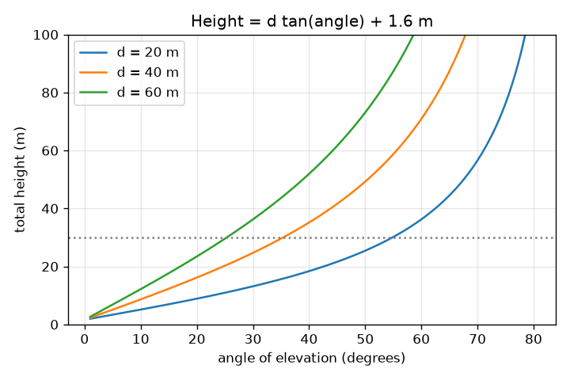
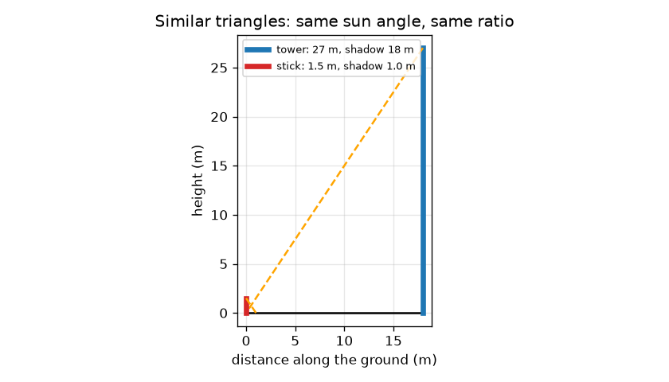

# அமர்வு 1: ஒத்த முக்கோணங்கள், நிழல்கள் மற்றும் ஒரு கோணம்

[Session 1 — हिन्दी](README.hi.md)

*நிலை 1 (கருத்தியல் ஊடாடும் மாதிரி) · சுமார் 60 நிமிடங்கள் · openheights*

> இது எளிமைப்படுத்தப்பட்ட ஒரு கல்வி மாதிரி. இது சரிபார்க்கப்பட்ட வடிவமைப்புக் கருவி அல்ல; உண்மையான கட்டமைப்புகள், மின் நிறுவல்கள், வாகனங்கள், தொழில்துறை செயல்முறைகள் அல்லது மருத்துவ முடிவுகளுக்கு இதைப் பயன்படுத்தக் கூடாது.

**முன்தேவைகள் (Prerequisites)**

- செங்கோண முக்கோணத்தில் ஒரு கோணத்தின் டேன்ஜென்ட் (tangent) (பள்ளி முக்கோணவியல்).
- நீங்கள் PRIMER.md படித்து, `python start.py 1` ஐ ஒரு முறை இயக்கியிருக்க வேண்டும்.

**கற்றல் நோக்கங்கள் (Learning objectives).** இந்த அமர்வுக்குப் பிறகு நீங்கள்:

- நிழல்களிலிருந்து உயரத்தைக் கண்டறிய ஒத்த முக்கோணங்களைப் (similar triangles) பயன்படுத்த முடியும்.
- ஏற்றக் கோணம் (angle of elevation) என்றால் என்ன என்று விளக்கி, தொலைபேசியால் அளக்க முடியும்.
- உயரம் = தூரம் x tan(கோணம்) ஐப் பயன்படுத்தி கண் உயரத்தைக் கூட்ட முடியும்.
- ஒரு நிலையான தூரத்திற்குக் கோணத்திற்கு எதிரான உயர வரைபடத்தைப் படிக்க முடியும்.

## A. நிஜ உலகப் பிரச்சனை
அளவு நாடாவுடன் ஒரு கோபுரத்திலோ மரத்திலோ உங்களால் ஏற முடியாது, ஆனால் தரையில் நிற்க முடியும். இரண்டு அன்றாடத் தந்திரங்கள் உயரத்தைத் தருகின்றன: அது விழுத்தும் நிழல், மற்றும் அதன் உச்சியைப் பார்க்க நீங்கள் தலையை (அல்லது தொலைபேசியை) சாய்க்கும் கோணம். இவை ஏன் வேலை செய்கின்றன, தரையைப் பற்றி நீங்கள் என்ன தெரிந்திருக்க வேண்டும்?

## B. கருத்தும் கோட்பாடும்
ஒரே கோணங்களைக் கொண்ட இரண்டு முக்கோணங்கள் ஒத்தவை: அவற்றின் பக்கங்கள் ஒரே விகிதத்தில் உள்ளன. ஒரு கணத்தில் சூரியன் எல்லா இடத்திலும் தரையுடன் ஒரே கோணத்தை உண்டாக்குகிறது, எனவே ஒரு குச்சியும் கோபுரமும் அவற்றின் நிழல்களுடன் ஒத்த முக்கோணங்களை உருவாக்குகின்றன, உயரம் / நிழல் இரண்டிற்கும் ஒன்றே. ஏற்றக் கோணம் a உங்கள் கண் மட்டத்தில் உள்ள கிடைமட்டத்திலிருந்து உச்சி வரை அளக்கப்படுகிறது. கிடைமட்டப் பக்கம் d மற்றும் உங்கள் கண்ணுக்கு மேலே செங்குத்துப் பக்கம் H கொண்ட செங்கோண முக்கோணத்தில், tan(a) = H / d, எனவே H = d tan(a). கோபுரம் உங்கள் கண்ணை விட அந்த அளவு உயரமானது, எனவே மொத்த உயரம் பெற உங்கள் கண் உயரத்தைக் கூட்டுங்கள். இது எளிமைப்படுத்தப்பட்ட மாதிரி: தட்டையான தரை, செங்குத்துக் கோபுரம், முழுமையாகச் சமமான தொலைபேசி, துல்லியமான தூரம்.

| குறியீடு | பொருள் | அலகு |
|---|---|---|
| h_t, s_t | கோபுரத்தின் உயரமும் அதன் நிழலின் நீளமும் | m |
| h_s, s_s | குச்சியின் உயரமும் அதன் நிழலின் நீளமும் | m |
| d | உங்களிடமிருந்து அடிப்பகுதிக்கு உள்ள கிடைமட்டத் தூரம் | m |
| a | உச்சிக்கான ஏற்றக் கோணம் | டிகிரி |
| e | தரையிலிருந்து கண் உயரம் | m |
| h | கோபுரத்தின் மொத்த உயரம் | m |

**அனுமானங்கள் (Assumptions)**

- உங்களுக்கும் கோபுரத்துக்கும் இடையே தரை தட்டையாகவும் சமமாகவும் உள்ளது.
- கோபுரம் செங்குத்தாக உள்ளது, d ஐ அளக்க நீங்கள் அதன் அடிப்பகுதி வரை நடந்து செல்லலாம்.
- நிழல்கள் ஒரே கணத்தில், ஒரே தட்டையான தரையில் அளக்கப்படுகின்றன.
- கோணம் துல்லியமாகப் படிக்கப்படுகிறது (பிழைகள் அமர்வு 2 மற்றும் 3-ன் தலைப்பு).

$$ \frac{h_t}{s_t}=\frac{h_s}{s_s}\quad\Rightarrow\quad h_t=h_s\,\frac{s_t}{s_s} $$

$$ \tan a=\frac{h-e}{d} $$

$$ h=d\tan a+e $$

## C. காட்சி விளக்கம்
முதல் படம் குச்சியையும் கோபுரத்தையும் அவற்றின் நிழல்களுடன் வரைகிறது: இரண்டு ஆரஞ்சுக் கோடுகள் (சூரியக் கதிர்கள்) ஒரே சரிவு கொண்டவை, இரண்டு முக்கோணங்களும் வெவ்வேறு அளவில் ஒரே வடிவம். இரண்டாவது படம் மூன்று தூரங்களுக்குக் கோணத்திற்கு எதிராக மொத்த உயரத்தை வரைகிறது. ஒவ்வொரு வளைவும் கண் உயரத்தில் தொடங்கி மெதுவாக, பிறகு செங்குத்தாக உயர்கிறது: 90 டிகிரிக்கு அருகில் டேன்ஜென்ட் வேகமாக வளர்கிறது. தூரத்தை இரு மடங்காக்கினால் அதே கோணத்தில் கண்ணுக்கு மேலான உயரம் இரு மடங்காகிறது.

*மூன்று தூரங்களுக்குக் கோணத்திற்கு எதிரான மொத்த உயரம்: பெரிய கோணங்களில் டேன்ஜென்ட் வளைவு செங்குத்தாகிறது.*

*ஒத்த முக்கோணங்கள்: 1.5 m குச்சியும் 27 m கோபுரமும் ஒரே சூரியக் கோணத்தைப் பகிர்கின்றன.*

## D. ஊடாடும் உருவகப்படுத்தல்
பாடத்தை இயக்கவும் (`python start.py 1`), பிறகு நேரடிச் செயலியைத் திறக்கவும்: [அமர்வு 1: ஒரு கோணத்திலிருந்து உயரம்](https://krunalpanchal1995.github.io/pan-iit-oss/openheights/session-01/) (அல்லது இந்தக் கோப்புறையில் உள்ள `app.html`). தூரத்தையும் கோணத்தையும் நகர்த்தி, பார்வைக் கோடு சாம்பல் நிற 30 m கோபுரத்தின் உச்சியை நோக்கி உயர்வதைப் பாருங்கள்; பிறகு வரைபடக் காட்சியைத் திறந்து புள்ளி வளைவில் நகர்வதைப் பாருங்கள்.

**சவால்.** மதிப்பீட்டை 30 m கோபுரத்திற்கு 0.5 m-க்குள் சமமாக்குங்கள்.

## E. தீர்க்கப்பட்ட உதாரணமும் சோதனையும்
**பிரச்சனை.** (a) ஒரு கோபுரம் 18 m நிழல் விழுத்தும்போது 1.5 m குச்சி 1.0 m நிழல் விழுத்துகிறது. கோபுரத்தின் உயரம் என்ன? (b) மற்றொரு கோபுரத்திலிருந்து 40 m தொலைவில் நின்று 35 டிகிரி படிக்கிறீர்கள், உங்கள் கண் 1.6 m உயரத்தில் உள்ளது. அதன் உயரம் என்ன?

1. (a) குச்சியின் விகிதம்: 1.5 / 1.0 = ஒரு மீட்டர் நிழலுக்கு 1.5 m உயரம்.
2. (a) கோபுரம்: 1.5 x 18 = 27 m.
3. (b) tan 35 டிகிரி = 0.7002.
4. (b) கண்ணுக்கு மேலான உயரம் = 40 x 0.7002 = 28.01 m.
5. (b) மொத்தம் = 28.01 + 1.6 = 29.61 m.

**விடை.** (a) கோபுரம் 27 m உயரம். (b) கோபுரம் 29.61 m உயரம்.

**சோதனை.** ஒரு விளக்குக் கம்பத்தையோ மரத்தையோ இருமுறை அளவிடுங்கள்: ஒருமுறை வெயில் நாளில் நிழல் முறையில் (ஒரே நிமிடத்தில் செங்குத்து மீட்டர்க் குச்சியையும் நிழலையும் அளக்கவும்), ஒருமுறை தொலைபேசி கிளைனோமீட்டர் (clinometer) செயலியும் நாடாவும் கொண்டு கோண முறையில். ஒப்பிடுங்கள். சில சதவீதத்திற்குள் ஒத்துப்போகும் என்று எதிர்பாருங்கள்; மங்கலான நிழல் விளிம்புகள், சாய்வான தரை, சாய்ந்த தொலைபேசி, அடிப்பகுதி எங்கே என்று சரியாகத் தெரியாதது ஆகியவற்றிலிருந்து வேறுபாடுகள் வருகின்றன. மாதிரியில் துல்லியமான கோடுகளும் முழுமையாகச் செங்குத்தான கோபுரமும் உள்ளன, களத்தில் இல்லை.

## F. மதிப்பீடும் வடிவமைப்புச் சவாலும்
**கேள்வி வகை A: கருத்தியல்.** ஒரு குச்சியும் கோபுரமும் தங்கள் நிழல்களுடன் ஒத்த முக்கோணங்களை உருவாக்குவது ஏன், குச்சியின் நிழலைக் காலை 9 மணிக்கும் கோபுரத்தின் நிழலை 11 மணிக்கும் அளந்தால் என்ன தவறாகும்?

குறிப்பு

ஒத்தவை என்றால் ஒரே கோணங்கள். சூரியக் கதிருக்கும் தரைக்கும் இடையிலான கோணத்தை எது தீர்மானிக்கிறது?

படிப்படியான தீர்வு

ஒரு கணத்தில் சூரியக் கதிர்கள் இணையானவை, எனவே சூரியனுக்கும் தட்டையான தரைக்கும் இடையிலான கோணம் குச்சிக்கும் கோபுரத்துக்கும் ஒன்றே; தரையில் உள்ள செங்கோணமும் பொதுவானது, எனவே எல்லாக் கோணங்களும் பொருந்துகின்றன, முக்கோணங்கள் ஒத்தவை. காலை 9 மணிக்கும் 11 மணிக்கும் சூரியன் வெவ்வேறு உயரங்களில் உள்ளது, எனவே நிழல்-உயர விகிதம் வேறுபடுகிறது, விடை தவறாகிறது. இரண்டு நிழல்களையும் ஒரே நேரத்தில் அளவிடுங்கள்.

**கேள்வி வகை B: எண்ணியல்.** 2.0 m குச்சி 1.2 m நிழல் விழுத்தும்போது ஒரு மரம் 15 m நிழல் விழுத்துகிறது. மரத்தின் உயரம் என்ன? பிறகு மற்றொரு மரம் 12 m தொலைவிலிருந்து 40 டிகிரியில் தெரிகிறது, கண் 1.6 m உயரத்தில்; அதன் உயரம் என்ன?

குறிப்பு

h_t = h_s s_t / s_s பயன்படுத்துங்கள், பிறகு h = d tan a + e. tan 40 டிகிரி = 0.8391.

படிப்படியான தீர்வு

முதல் மரம்: 2.0 x 15 / 1.2 = 25.0 m. இரண்டாவது மரம்: 12 x 0.8391 = கண்ணுக்கு மேல் 10.07 m, 1.6 m கூட்டினால் 11.67 m. சரிபார்ப்பு (sanity check): 40 டிகிரியில் (45-ஐ விடச் சற்றுக் குறைவு) கண்ணுக்கு மேலான உயரம் 12 m தூரத்தை விடச் சற்றுக் குறைவு, எனவே சுமார் 10 m சரியே.

**கேள்வி வகை C: வரைபடம் மற்றும் உருவகப்படுத்தல் விளக்கம்.** d = 40 m-க்கான கோணத்திற்கு எதிரான மொத்த உயர வரைபடத்தில், 20, 45, 60 டிகிரிகளில் உயரங்களைப் படியுங்கள். கோணம் வளரும்போது ஒரு டிகிரிக்கான உயரத்திற்கு என்ன நடக்கிறது?

குறிப்பு

d = 40 m-க்கான வளைவைப் பயன்படுத்துங்கள், அல்லது 40 tan(a) + 1.6 கணக்கிடுங்கள்.

படிப்படியான தீர்வு

20 டிகிரியில் சுமார் 16.2 m, 45 டிகிரியில் 41.6 m, 60 டிகிரியில் 70.9 m. 20-லிருந்து 45 டிகிரி வரை உயரம் 25.4 m கூடுகிறது (ஒரு டிகிரிக்குச் சுமார் 1.0 m); 45-லிருந்து 60 வரை 15 டிகிரியில் 29.3 m கூடுகிறது (ஒரு டிகிரிக்குச் சுமார் 2.0 m). பெரிய கோணங்களில் டேன்ஜென்ட் வேகமாக வளர்வதால் வளைவு செங்குத்தாகிறது; அங்கே 1 டிகிரி தவறு அதிக முக்கியத்துவம் பெறுகிறது.

**கேள்வி வகை D: வடிவமைப்பு மற்றும் உகப்பாக்கச் சவால்.** வடிவமைப்பு: ஒரு மரம் சுமார் 12 m உயரம் என்று நினைக்கிறீர்கள், உங்களிடம் 50 m நாடா உள்ளது. எங்கே நிற்பது என்று தேர்ந்தெடுத்து நியாயப்படுத்துங்கள். 2 m தொலைவிலோ 45 m தொலைவிலோ நின்றால் என்ன தவறு?

குறிப்பு

tan a = 1 ஆகும் 45 டிகிரி கோணத்திற்கு d ஐக் கணக்கிடுங்கள். செங்குத்தான கோணங்களில் தொலைபேசியை நிலையாகப் பிடிப்பதையும், நீண்ட தூரங்களில் கோணம் சிறிதாவதையும் பற்றிச் சிந்தியுங்கள்.

படிப்படியான தீர்வு

45 டிகிரிக்கு, tan a = 1, எனவே d = h - e = 12 - 1.6 = 10.4 m. 2 m தொலைவில் நின்றால் கோணம் சுமார் 79 டிகிரி: கிட்டத்தட்ட நேராக மேலே பார்க்கிறீர்கள், தொலைபேசியைப் பிடிப்பது கடினம், கோணத்தில் சிறிய தவறுகள் உயரத்தில் பெரிய மாற்றத்தை உண்டாக்குகின்றன (அமர்வு 2). 45 m தொலைவில் நின்றால் சுமார் 13 டிகிரி மட்டுமே, உச்சி அடிவானத்துக்கு மேலே சிறிய கோணத்தில் உள்ளது, எனவே சிறிய தவறு வாசிப்பின் பெரிய பகுதியாகிறது, கிளைகளோ மரங்களோ பார்வையைத் தடுக்கலாம். சமரசம் (trade-off): சுமார் 45 டிகிரி நல்ல இணக்கம், தடைகளுக்கு இடம் தருகிறது.

[RUBRIC.md](../../RUBRIC.md) மூலம் உங்களை மதிப்பிட்டுக் கொள்ளுங்கள். காகிதத்தில் செய்ய [செயல்பாட்டுத் தாள்](activity_sheet.md) அச்சிடுங்கள்.

## பொதுவான தவறான கருத்துகள்
| பொதுவான தவறான கருத்து | உண்மையில் சரியானது |
|---|---|
| உயரம் என்பது வெறும் d tan(a). | அது உங்கள் கண்ணுக்கு மேலான உயரம் மட்டுமே; மொத்த உயரம் பெற உங்கள் கண் உயரத்தைக் கூட்டுங்கள். |
| தூரம் d என்பது கோபுரத்தின் உச்சிக்கான தூரம். | d என்பது தரை வழியே அடிப்பகுதிக்கான கிடைமட்டத் தூரம்; பார்வைக் கோடு அதைவிட நீளமானது. |
| நிழல் முறை நாளின் எந்த இரண்டு நேரங்களிலும் வேலை செய்யும். | சூரியக் கோணம் மாறுவதால் குச்சி மற்றும் கோபுர நிழல்கள் ஒரே கணத்தில் அளக்கப்பட வேண்டும். |
| கோணத்தை இரு மடங்காக்கினால் உயரம் இரு மடங்காகும். | உயரம் tan(a) ஐப் பின்பற்றுகிறது, அது a-க்கு விகிதசமம் அல்ல: d = 40 m-ல் (கண் உயரம் 1.6 m உடன்) 20 டிகிரி 16.2 m தருகிறது, 40 டிகிரி 35.2 m தருகிறது. |

## சொற்களஞ்சியம் (Glossary)
- **ஏற்றக் கோணம் (angle of elevation)**: கிடைமட்டத்திலிருந்து நீங்கள் பார்க்கும் பொருளுக்கான கோணம்
- **ஒத்த முக்கோணங்கள் (similar triangles)**: ஒரே கோணங்கள் கொண்ட முக்கோணங்கள், எனவே அவற்றின் பக்கங்கள் ஒரே விகிதத்தில் இருக்கும்
- **டேன்ஜென்ட் (tangent)**: செங்கோண முக்கோணத்தில், எதிர்ப்பக்கத்தை அடுத்தப் பக்கத்தால் வகுத்தது
- **கிளைனோமீட்டர் (clinometer)**: சாய்வுக் கோணத்தைப் படிக்கும் கருவி அல்லது தொலைபேசிச் செயலி
- **அடிக்கோடு (baseline)**: முறை சார்ந்திருக்கும், தரையில் அளந்த தூரம்

## நிறைவு
1. [exercises.md](exercises.md) இல் உள்ள மூன்று நிரலாக்கப் பணிகளைச் செய்யுங்கள்.
2. உங்கள் மாற்றங்களுக்குப் பிறகு `python start.py 1` ஐ மீண்டும் இயக்குங்கள். அது சோதனைச் சாவடியுடன் (checkpoint) முடிகிறது; அது `PASS` என அச்சிடும்போது, நீங்கள் முடித்துவிட்டீர்கள். (சோதனைச் சாவடி மட்டும்: `python start.py check 1`.)

அடுத்து: [அமர்வு 2](../session-02/README.md)
