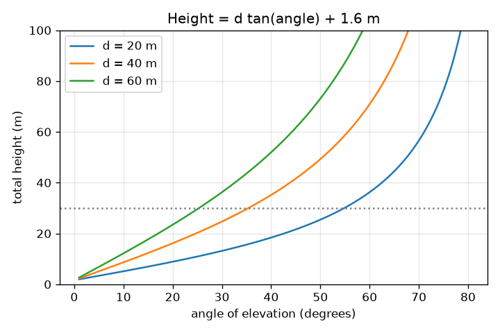
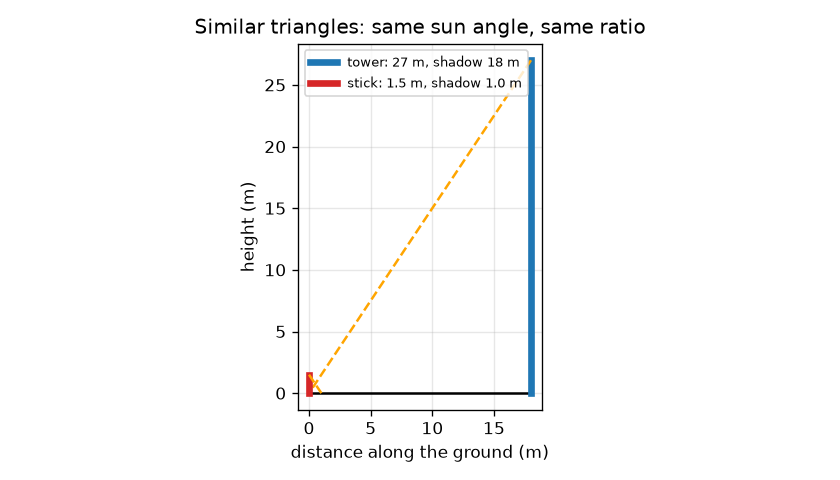

# సెషన్ 1: సదృశ త్రిభుజాలు, నీడలు మరియు ఒక కోణం

[Session 1 — हिन्दी](README.hi.md)

*స్థాయి 1 (భావనాత్మక ఇంటరాక్టివ్ మోడల్) · సుమారు 60 నిమిషాలు · openheights*

> ఇది సరళీకరించిన విద్యా మోడల్. ఇది ధృవీకరించబడిన డిజైన్ సాధనం కాదు; నిజమైన నిర్మాణాలు, విద్యుత్ ఇన్‌స్టాలేషన్‌లు, వాహనాలు, పారిశ్రామిక ప్రక్రియలు లేదా వైద్య నిర్ణయాల కోసం దీనిని ఉపయోగించకూడదు.

**ముందస్తు అవసరాలు (Prerequisites)**

- లంబకోణ త్రిభుజంలో ఒక కోణం యొక్క టాన్జెంట్ (tangent) (పాఠశాల త్రికోణమితి).
- మీరు PRIMER.md చదివి, `python start.py 1` ను ఒకసారి రన్ చేసి ఉండాలి.

**అభ్యాస లక్ష్యాలు (Learning objectives).** ఈ సెషన్ తర్వాత మీరు:

- నీడల నుండి ఎత్తును కనుగొనడానికి సదృశ త్రిభుజాలను (similar triangles) ఉపయోగించగలరు.
- ఉన్నతి కోణం (angle of elevation) అంటే ఏమిటో వివరించి, ఫోన్‌తో కొలవగలరు.
- ఎత్తు = దూరం x tan(కోణం) ఉపయోగించి కంటి ఎత్తును కూడగలరు.
- ఒక స్థిర దూరానికి కోణానికి వ్యతిరేకంగా ఎత్తు గ్రాఫ్‌ను చదవగలరు.

## A. నిజ జీవిత సమస్య
కొలత టేపుతో మీరు టవర్ లేదా చెట్టు ఎక్కలేరు, కానీ నేలపై నిలబడగలరు. రెండు రోజువారీ ట్రిక్కులు ఎత్తును ఇస్తాయి: అది వేసే నీడ, మరియు దాని పైభాగాన్ని చూడటానికి మీరు తలను (లేదా ఫోన్‌ను) వాల్చే కోణం. ఇవి ఎందుకు పనిచేస్తాయి, నేల గురించి మీరు ఏమి తెలుసుకోవాలి?

## B. భావన మరియు సిద్ధాంతం
ఒకే కోణాలు గల రెండు త్రిభుజాలు సదృశం: వాటి భుజాలు ఒకే నిష్పత్తిలో ఉంటాయి. ఒక క్షణంలో సూర్యుడు ప్రతిచోటా నేలతో ఒకే కోణం చేస్తాడు, కాబట్టి ఒక కర్ర మరియు టవర్ వాటి నీడలతో సదృశ త్రిభుజాలను ఏర్పరుస్తాయి, ఎత్తు / నీడ రెండింటికీ ఒకటే. ఉన్నతి కోణం a మీ కంటి వద్ద క్షితిజ సమాంతరం నుండి పైభాగం వరకు కొలుస్తారు. క్షితిజ సమాంతర భుజం d మరియు మీ కంటి పైన లంబ భుజం H గల లంబకోణ త్రిభుజంలో, tan(a) = H / d, కాబట్టి H = d tan(a). టవర్ మీ కంటి కంటే ఆ మేరకు ఎత్తైనది, కాబట్టి మొత్తం ఎత్తు పొందడానికి మీ కంటి ఎత్తును కూడండి. ఇది సరళీకరించిన మోడల్: చదునైన నేల, నిలువు టవర్, పూర్తిగా సమంగా ఉన్న ఫోన్, ఖచ్చితమైన దూరం.

| చిహ్నం | అర్థం | యూనిట్ |
|---|---|---|
| h_t, s_t | టవర్ ఎత్తు మరియు దాని నీడ పొడవు | m |
| h_s, s_s | కర్ర ఎత్తు మరియు దాని నీడ పొడవు | m |
| d | మీ నుండి పాదం వరకు క్షితిజ సమాంతర దూరం | m |
| a | పైభాగానికి ఉన్నతి కోణం | డిగ్రీలు |
| e | నేల నుండి కంటి ఎత్తు | m |
| h | టవర్ మొత్తం ఎత్తు | m |

**ఊహలు (Assumptions)**

- మీకు మరియు టవర్‌కు మధ్య నేల చదునుగా, సమంగా ఉంది.
- టవర్ నిలువుగా ఉంది, d కొలవడానికి మీరు దాని పాదం వరకు నడవవచ్చు.
- నీడలు ఒకే క్షణంలో, ఒకే చదునైన నేలపై కొలవబడతాయి.
- కోణం ఖచ్చితంగా చదవబడుతుంది (దోషాలు సెషన్ 2 మరియు 3 అంశం).

$$ \frac{h_t}{s_t}=\frac{h_s}{s_s}\quad\Rightarrow\quad h_t=h_s\,\frac{s_t}{s_s} $$

$$ \tan a=\frac{h-e}{d} $$

$$ h=d\tan a+e $$

## C. దృశ్య వివరణ
మొదటి చిత్రం కర్రను మరియు టవర్‌ను వాటి నీడలతో గీస్తుంది: రెండు నారింజ గీతలు (సూర్యకిరణాలు) ఒకే వాలు కలిగి ఉన్నాయి, రెండు త్రిభుజాలు వేర్వేరు పరిమాణాల్లో ఒకే ఆకారం. రెండవ చిత్రం మూడు దూరాలకు కోణానికి వ్యతిరేకంగా మొత్తం ఎత్తును గీస్తుంది. ప్రతి వక్రం కంటి ఎత్తు వద్ద మొదలై నెమ్మదిగా, తర్వాత నిటారుగా పెరుగుతుంది: 90 డిగ్రీల దగ్గర టాన్జెంట్ వేగంగా పెరుగుతుంది. దూరాన్ని రెట్టింపు చేస్తే అదే కోణంలో కంటి పైన ఉన్న ఎత్తు రెట్టింపవుతుంది.

*మూడు దూరాలకు కోణానికి వ్యతిరేకంగా మొత్తం ఎత్తు: పెద్ద కోణాల్లో టాన్జెంట్ వక్రం నిటారుగా అవుతుంది.*

*సదృశ త్రిభుజాలు: 1.5 m కర్ర మరియు 27 m టవర్ ఒకే సూర్య కోణాన్ని పంచుకుంటాయి.*

## D. ఇంటరాక్టివ్ సిమ్యులేషన్
పాఠాన్ని రన్ చేయండి (`python start.py 1`), తర్వాత లైవ్ యాప్‌ను తెరవండి: [సెషన్ 1: ఒక కోణం నుండి ఎత్తు](https://krunalpanchal1995.github.io/pan-iit-oss/openheights/session-01/) (లేదా ఈ ఫోల్డర్‌లోని `app.html`). దూరం మరియు కోణాన్ని జరిపి, దృష్టి రేఖ బూడిద రంగు 30 m టవర్ పైభాగం వైపు పెరగడం చూడండి; తర్వాత గ్రాఫ్ వ్యూ తెరిచి బిందువు వక్రం వెంబడి కదలడం చూడండి.

**సవాలు.** అంచనాను 30 m టవర్‌కు 0.5 m లోపల సమానం చేయండి.

## E. సాధించిన ఉదాహరణ మరియు ప్రయోగం
**సమస్య.** (a) ఒక టవర్ 18 m నీడ వేసినప్పుడు 1.5 m కర్ర 1.0 m నీడ వేస్తుంది. టవర్ ఎత్తు ఎంత? (b) మరో టవర్ నుండి 40 m దూరంలో నిలబడి మీరు 35 డిగ్రీలు చదువుతారు, మీ కన్ను 1.6 m ఎత్తులో ఉంది. దాని ఎత్తు ఎంత?

1. (a) కర్ర నిష్పత్తి: 1.5 / 1.0 = ప్రతి మీటరు నీడకు 1.5 m ఎత్తు.
2. (a) టవర్: 1.5 x 18 = 27 m.
3. (b) tan 35 డిగ్రీలు = 0.7002.
4. (b) కంటి పైన ఎత్తు = 40 x 0.7002 = 28.01 m.
5. (b) మొత్తం = 28.01 + 1.6 = 29.61 m.

**సమాధానం.** (a) టవర్ 27 m ఎత్తు. (b) టవర్ 29.61 m ఎత్తు.

**ప్రయోగం.** ఒక దీపస్తంభాన్ని లేదా చెట్టును రెండుసార్లు కొలవండి: ఒకసారి ఎండ రోజున నీడ పద్ధతిలో (ఒకే నిమిషంలో నిలువు మీటరు కర్ర మరియు నీడను కొలవండి), ఒకసారి ఫోన్ క్లైనోమీటర్ (clinometer) యాప్ మరియు టేపుతో కోణ పద్ధతిలో. పోల్చండి. కొన్ని శాతాల లోపల సరిపోలిక ఆశించండి; అస్పష్టమైన నీడ అంచులు, వాలు నేల, వంగిన ఫోన్, పాదం ఎక్కడ ఉందో ఖచ్చితంగా తెలియకపోవడం వల్ల తేడాలు వస్తాయి. మోడల్‌లో ఖచ్చితమైన గీతలు మరియు పూర్తిగా నిలువు టవర్ ఉన్నాయి, పొలంలో లేవు.

## F. మూల్యాంకనం మరియు డిజైన్ సవాలు
**ప్రశ్న రకం A: భావనాత్మక.** ఒక కర్ర మరియు టవర్ వాటి నీడలతో సదృశ త్రిభుజాలను ఎందుకు ఏర్పరుస్తాయి, కర్ర నీడను ఉదయం 9 గంటలకు మరియు టవర్ నీడను 11 గంటలకు కొలిస్తే ఏమి తప్పవుతుంది?

సూచన

సదృశం అంటే ఒకే కోణాలు. సూర్యకిరణం మరియు నేల మధ్య కోణాన్ని ఏది నిర్ణయిస్తుంది?

దశలవారీ పరిష్కారం

ఒక క్షణంలో సూర్యకిరణాలు సమాంతరం, కాబట్టి సూర్యుడికి మరియు చదునైన నేలకు మధ్య కోణం కర్రకు, టవర్‌కు ఒకటే; నేల వద్ద లంబకోణం కూడా ఉమ్మడి, కాబట్టి అన్ని కోణాలు సరిపోతాయి, త్రిభుజాలు సదృశం. ఉదయం 9 గంటలకు, 11 గంటలకు సూర్యుడు వేర్వేరు ఎత్తుల్లో ఉంటాడు, కాబట్టి నీడ-ఎత్తు నిష్పత్తి భిన్నంగా ఉంటుంది, సమాధానం తప్పవుతుంది. రెండు నీడలను ఒకే సమయంలో కొలవండి.

**ప్రశ్న రకం B: సంఖ్యాత్మక.** 2.0 m కర్ర 1.2 m నీడ వేసినప్పుడు ఒక చెట్టు 15 m నీడ వేస్తుంది. చెట్టు ఎత్తు ఎంత? తర్వాత మరో చెట్టు 12 m దూరం నుండి 40 డిగ్రీల వద్ద కనిపిస్తుంది, కన్ను 1.6 m ఎత్తులో; దాని ఎత్తు ఎంత?

సూచన

h_t = h_s s_t / s_s ఉపయోగించండి, తర్వాత h = d tan a + e. tan 40 డిగ్రీలు = 0.8391.

దశలవారీ పరిష్కారం

మొదటి చెట్టు: 2.0 x 15 / 1.2 = 25.0 m. రెండవ చెట్టు: 12 x 0.8391 = కంటి పైన 10.07 m, 1.6 m కలిపితే 11.67 m. సరిచూపు (sanity check): 40 డిగ్రీల వద్ద (45 కంటే కొంచెం తక్కువ) కంటి పైన ఎత్తు 12 m దూరం కంటే కొంచెం తక్కువ, కాబట్టి సుమారు 10 m సరైనదే.

**ప్రశ్న రకం C: గ్రాఫ్ మరియు సిమ్యులేషన్ వ్యాఖ్యానం.** d = 40 m కోసం కోణానికి వ్యతిరేకంగా మొత్తం ఎత్తు గ్రాఫ్‌లో, 20, 45, 60 డిగ్రీల వద్ద ఎత్తులను చదవండి. కోణం పెరిగే కొద్దీ డిగ్రీకి ఎత్తుకు ఏమవుతుంది?

సూచన

d = 40 m వక్రాన్ని ఉపయోగించండి, లేదా 40 tan(a) + 1.6 లెక్కించండి.

దశలవారీ పరిష్కారం

20 డిగ్రీల వద్ద సుమారు 16.2 m, 45 డిగ్రీల వద్ద 41.6 m, 60 డిగ్రీల వద్ద 70.9 m. 20 నుండి 45 డిగ్రీల వరకు ఎత్తు 25.4 m పెరుగుతుంది (డిగ్రీకి సుమారు 1.0 m); 45 నుండి 60 వరకు 15 డిగ్రీల్లో 29.3 m పెరుగుతుంది (డిగ్రీకి సుమారు 2.0 m). పెద్ద కోణాల్లో టాన్జెంట్ వేగంగా పెరుగుతుంది కాబట్టి వక్రం నిటారుగా అవుతుంది; అక్కడ 1 డిగ్రీ పొరపాటు ఎక్కువ ప్రభావం చూపుతుంది.

**ప్రశ్న రకం D: డిజైన్ మరియు ఆప్టిమైజేషన్ సవాలు.** డిజైన్: ఒక చెట్టు సుమారు 12 m ఎత్తు అని మీరు అనుకుంటున్నారు, మీ దగ్గర 50 m టేపు ఉంది. ఎక్కడ నిలబడాలో ఎంచుకుని సమర్థించండి. 2 m దూరంలో లేదా 45 m దూరంలో నిలబడితే ఏమి తప్పు?

సూచన

tan a = 1 అయ్యే 45 డిగ్రీల కోణానికి d లెక్కించండి. నిటారు కోణాల్లో ఫోన్‌ను స్థిరంగా పట్టుకోవడం గురించి, ఎక్కువ దూరాల్లో కోణం చిన్నదవడం గురించి ఆలోచించండి.

దశలవారీ పరిష్కారం

45 డిగ్రీలకు, tan a = 1, కాబట్టి d = h - e = 12 - 1.6 = 10.4 m. 2 m దూరంలో నిలబడితే కోణం సుమారు 79 డిగ్రీలు: మీరు దాదాపు నేరుగా పైకి చూస్తారు, ఫోన్ పట్టుకోవడం కష్టం, కోణంలో చిన్న పొరపాట్లు ఎత్తులో పెద్ద మార్పు చేస్తాయి (సెషన్ 2). 45 m దూరంలో నిలబడితే సుమారు 13 డిగ్రీలు మాత్రమే, పైభాగం క్షితిజం పైన చిన్న కోణంలో ఉంటుంది, కాబట్టి చిన్న పొరపాటు రీడింగ్‌లో పెద్ద భాగం, కొమ్మలు లేదా చెట్లు వీక్షణను అడ్డుకోవచ్చు. రాజీ (trade-off): సుమారు 45 డిగ్రీలు మంచి సమన్వయం, అడ్డంకులకు చోటు ఇస్తుంది.

[RUBRIC.md](../../RUBRIC.md) తో మిమ్మల్ని మీరు స్కోర్ చేసుకోండి. కాగితంపై పని చేయడానికి [కార్యాచరణ షీట్](activity_sheet.md) ప్రింట్ చేయండి.

## సాధారణ అపోహలు
| సాధారణ అపోహ | వాస్తవంగా నిజమైనది |
|---|---|
| ఎత్తు కేవలం d tan(a). | అది మీ కంటి పైన ఉన్న ఎత్తు మాత్రమే; మొత్తం ఎత్తు పొందడానికి మీ కంటి ఎత్తును కూడండి. |
| దూరం d అంటే టవర్ పైభాగానికి దూరం. | d అనేది నేల వెంబడి పాదానికి ఉన్న క్షితిజ సమాంతర దూరం; దృష్టి రేఖ దాని కంటే పొడవు. |
| నీడ పద్ధతి రోజులో ఏ రెండు సమయాల్లోనైనా పనిచేస్తుంది. | సూర్యుడి కోణం మారుతుంది కాబట్టి కర్ర మరియు టవర్ నీడలను ఒకే క్షణంలో కొలవాలి. |
| కోణాన్ని రెట్టింపు చేస్తే ఎత్తు రెట్టింపవుతుంది. | ఎత్తు tan(a) ను అనుసరిస్తుంది, అది a కు అనులోమానుపాతం కాదు: d = 40 m వద్ద (కంటి ఎత్తు 1.6 m తో) 20 డిగ్రీలు 16.2 m ఇస్తాయి, 40 డిగ్రీలు 35.2 m ఇస్తాయి. |

## పదకోశం (Glossary)
- **ఉన్నతి కోణం (angle of elevation)**: క్షితిజ సమాంతరం నుండి మీరు చూసే వస్తువుకు కోణం
- **సదృశ త్రిభుజాలు (similar triangles)**: ఒకే కోణాలు గల త్రిభుజాలు, కాబట్టి వాటి భుజాలు ఒకే నిష్పత్తిలో ఉంటాయి
- **టాన్జెంట్ (tangent)**: లంబకోణ త్రిభుజంలో, ఎదుటి భుజాన్ని ఆసన్న భుజంతో భాగించినది
- **క్లైనోమీటర్ (clinometer)**: వాలు కోణాన్ని చదివే సాధనం లేదా ఫోన్ యాప్
- **బేస్‌లైన్ (baseline)**: పద్ధతి ఆధారపడే, నేలపై కొలిచిన దూరం

## ముగింపు
1. [exercises.md](exercises.md) లోని మూడు కోడింగ్ పనులు చేయండి.
2. మీ మార్పుల తర్వాత `python start.py 1` ను మళ్ళీ రన్ చేయండి. అది చెక్‌పాయింట్‌తో ముగుస్తుంది; అది `PASS` అని ప్రింట్ చేసినప్పుడు, మీరు పూర్తి చేసినట్లు. (చెక్‌పాయింట్ మాత్రమే: `python start.py check 1`.)

తదుపరి: [సెషన్ 2](../session-02/README.md)
