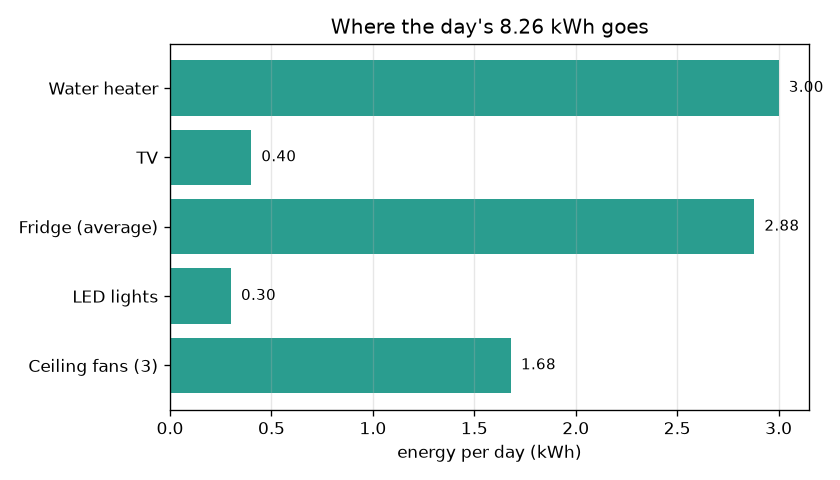
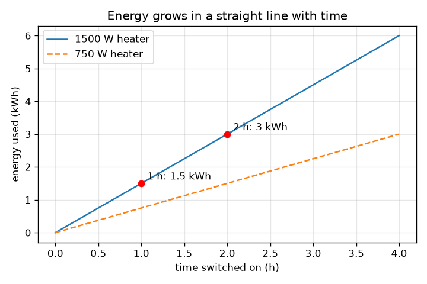

# सत्र 1: शक्ति गुणा समय ऊर्जा है

*स्तर 1 (वैचारिक इंटरैक्टिव मॉडल) · लगभग 60 मिनट · openhousehold*

> यह एक सरलीकृत शैक्षिक मॉडल (simplified educational model) है। यह कोई सत्यापित डिज़ाइन टूल नहीं है और इसका उपयोग वास्तविक संरचनाओं, बिजली की स्थापनाओं, वाहनों, औद्योगिक प्रक्रियाओं या चिकित्सा निर्णयों के लिए नहीं किया जाना चाहिए।

**पूर्व-आवश्यकताएँ (Prerequisites)**

- दशमलव संख्याओं का गुणा।
- आपने PRIMER.md पढ़ लिया है और `python start.py 1` एक बार चला लिया है।

**सीखने के उद्देश्य (Learning objectives).** इस सत्र के बाद आप:

- शक्ति (power, kW) और ऊर्जा (energy, kWh) में अंतर कर सकेंगे और बता सकेंगे कि हर एक क्या मापता है।
- ऊर्जा = शक्ति x समय और लागत = ऊर्जा x दर का उपयोग हाथ से और Python में कर सकेंगे।
- एक छोटे घर की दैनिक ऊर्जा जोड़ सकेंगे और उसका सबसे बड़ा उपभोक्ता ढूँढ सकेंगे।
- प्रति उपकरण ऊर्जा का स्तंभ आरेख (bar chart) और समय के सापेक्ष ऊर्जा का सीधी-रेखा ग्राफ़ पढ़ सकेंगे।

## A. वास्तविक दुनिया की समस्या
बिजली का बिल 'यूनिट' में होता है। 1500 W का वॉटर हीटर शक्तिशाली लगता है, फिर भी पूरी शाम चालू छोड़ा गया 100 W का टीवी भी पैसे खर्च कराता है। कौन अधिक मायने रखता है? उत्तर दोनों बातों पर निर्भर करता है: उपकरण कितना शक्तिशाली है (शक्ति) और कितनी देर चलता है (समय)। यह सत्र आपको वह एक नियम देता है जो उपकरणों की सूची को यूनिट की संख्या और लागत में बदल देता है। केवल शिक्षा के लिए: एक सरलीकृत मॉडल, वायरिंग या उपकरण खरीदने के बारे में सलाह नहीं।

## B. अवधारणा और सिद्धांत
शक्ति यह है कि ऊर्जा कितनी तेज़ी से उपयोग होती है। इसकी इकाई वाट (watt, W) है; 1 किलोवाट (kW) = 1000 W। ऊर्जा किसी समय में उपयोग की गई कुल मात्रा है। जब शक्ति kW में और समय घंटों में हो, तो ऊर्जा किलोवाट-घंटे (kWh) में आती है, जो आपके बिल की 'यूनिट' है। लागत ऊर्जा गुणा प्रति kWh मूल्य (दर / rate) है। अलग-अलग उपकरणों की ऊर्जाएँ सीधे जोड़ी जा सकती हैं।

| प्रतीक | अर्थ | इकाई |
|---|---|---|
| P | उपकरण की शक्ति | W या kW |
| t | उपकरण कितने समय चालू रहता है | h |
| E | उपयोग की गई ऊर्जा | kWh |
| r | ऊर्जा का मूल्य (एकसमान, उदाहरण के लिए) | Rs प्रति kWh |
| C | लागत | Rs |

**मान्यताएँ (Assumptions)**

- चालू रहते समय हर उपकरण स्थिर शक्ति लेता है।
- प्रतिदिन घंटे हर दिन समान हैं।
- दर एक ही एकसमान संख्या है (सत्र 2 स्लैब जोड़ता है)।
- फ्रिज की जगह उसकी औसत शक्ति, 24 h में 120 W, ली गई है।

$$ E\,[\mathrm{kWh}]=P\,[\mathrm{kW}]\times t\,[\mathrm{h}] $$

$$ E_{\mathrm{day}}=\sum_i P_i\,t_i $$

$$ C=E_{\mathrm{day}}\times r $$

## C. दृश्य व्याख्या
पहला चित्र उपकरण के अनुसार दिन की ऊर्जा का स्तंभ आरेख है: हीटर (3.00 kWh) और फ्रिज (2.88 kWh) सबसे बड़े उपभोक्ता हैं, भले ही फ्रिज केवल 120 W का है, क्योंकि वह कभी बंद नहीं होता। दूसरा चित्र चालू रहने के समय के सापेक्ष हीटर की ऊर्जा दिखाता है। यह मूल बिंदु से गुज़रने वाली एक सीधी रेखा है; ढलान (slope) शक्ति है (1500 W हीटर के लिए 1.5 kWh प्रति घंटा)। लाल बिंदु दिखाते हैं कि 2 घंटे 3 kWh देते हैं और 1 घंटा 1.5 kWh देता है। ऐप का ब्लॉक आरेख प्रवाह दिखाता है: इनपुट, ऊर्जा, घर का कुल, लागत।

*प्रति दिन प्रति उपकरण ऊर्जा: हीटर और हमेशा चालू फ्रिज आगे हैं।*

*समय के सापेक्ष ऊर्जा एक सीधी रेखा है; समय आधा करने पर ऊर्जा आधी हो जाती है।*

## D. इंटरैक्टिव सिमुलेशन
पाठ चलाइए (`python start.py 1`), फिर लाइव ऐप खोलिए: [सत्र 1: शक्ति x समय = ऊर्जा](https://krunalpanchal1995.github.io/pan-iit-oss/openhousehold/session-01/) (या इस फ़ोल्डर में `app.html`)। हीटर की शक्ति और घंटे बदलिए और स्तंभों तथा लागत को बदलते देखिए। रेखा ग्राफ़ पर जाइए और देखिए कि समय दोगुना करने पर ऊर्जा दोगुनी हो जाती है।

**चुनौती (Challenge).** दिन की लागत को Rs 40 से नीचे लाइए, जबकि हीटर फिर भी कम से कम आधा घंटा चले।

## E. हल किया गया उदाहरण और प्रयोग
**समस्या.** एक 1.5 kW हीटर 2 घंटे चलता है। यह कितनी ऊर्जा उपयोग करता है? अगर समय आधा कर दिया जाए तो? ऐप का पूरा घर प्रतिदिन कितनी ऊर्जा उपयोग करता है और Rs 6 प्रति kWh पर उसकी लागत कितनी है?

1. हीटर: E = 1.5 kW x 2 h = 3 kWh।
2. आधा समय: E = 1.5 kW x 1 h = 1.5 kWh। आधा समय, आधी ऊर्जा।
3. अन्य: पंखे 0.21 kW x 8 h = 1.68 kWh; बत्तियाँ 0.06 kW x 5 h = 0.30 kWh; फ्रिज 0.12 kW x 24 h = 2.88 kWh; टीवी 0.10 kW x 4 h = 0.40 kWh।
4. कुल = 1.68 + 0.30 + 2.88 + 0.40 + 3.00 = 8.26 kWh प्रतिदिन।
5. लागत = 8.26 kWh x Rs 6 = Rs 49.56 प्रतिदिन। हीटर 1 घंटा चलने पर कुल 6.76 kWh और Rs 40.56 है, यानी Rs 9.00 प्रतिदिन की बचत।

**उत्तर.** हीटर 3 kWh उपयोग करता है, या समय आधा करने पर 1.5 kWh। घर 8.26 kWh उपयोग करता है और Rs 6 प्रति kWh पर प्रतिदिन Rs 49.56 चुकाता है।

**प्रयोग (Experiment).** किसी वास्तविक उपकरण का लेबल देखिए, वाट में उसकी शक्ति नोट कीजिए, और उसकी ऊर्जा मापने के लिए प्लग-इन ऊर्जा मीटर (या दीवार पर लगे मीटर को एक घंटे के उपयोग से पहले और बाद में पढ़कर) का उपयोग कीजिए। शक्ति x समय से तुलना कीजिए। वास्तविक उपकरण लेबल से अलग होते हैं: हीटर अपने थर्मोस्टैट के साथ चालू-बंद होता रहता है, फ्रिज का कंप्रेसर केवल कुछ समय चलता है, और लेबल अधिकतम मान दिखाता है। मॉडल निश्चित संख्याओं का उपयोग करता है; मीटर दिखाता है कि वास्तव में क्या हुआ।

## F. मूल्यांकन और डिज़ाइन चुनौती
**प्रश्न प्रकार A: वैचारिक (Conceptual).** किलोवाट और किलोवाट-घंटे के बीच अंतर समझाइए। बिल किसके लिए शुल्क लेता है?

संकेत

एक दर है, दूसरा मात्रा। गति और दूरी के बारे में सोचिए।

चरण-दर-चरण हल

किलोवाट शक्ति है: अभी इस समय ऊर्जा कितनी तेज़ी से उपयोग हो रही है (गति जैसा)। किलोवाट-घंटा ऊर्जा है: समय के साथ उपयोग की गई कुल मात्रा (तय की गई दूरी जैसा)। बिल किलोवाट-घंटों के लिए शुल्क लेता है, क्योंकि कुछ मिनट उपयोग किया गया शक्तिशाली उपकरण पूरे दिन चालू छोड़े गए कमज़ोर उपकरण से कम ऊर्जा उपयोग कर सकता है।

**प्रश्न प्रकार B: संख्यात्मक (Numerical).** एक 100 W टीवी प्रतिदिन 4 घंटे चलता है। उसकी प्रतिदिन और प्रति 30 दिन ऊर्जा, और Rs 6 प्रति kWh पर प्रति 30 दिन लागत निकालिए। जाँचिए कि उत्तर तर्कसंगत है।

संकेत

पहले वाट को kW में बदलिए: 1000 से भाग दीजिए।

चरण-दर-चरण हल

E = 0.1 kW x 4 h = 0.4 kWh प्रतिदिन। प्रति 30 दिन: 0.4 x 30 = 12 kWh। लागत = 12 x 6 = Rs 72। तर्कसंगतता जाँच (sanity check): कुछ घंटे उपयोग किया गया छोटा उपकरण महीने में केवल कुछ kWh देता है, और 12 kWh इसमें ठीक बैठता है।

**प्रश्न प्रकार C: ग्राफ़ और सिमुलेशन की व्याख्या.** समय के सापेक्ष हीटर ऊर्जा के सीधी-रेखा ग्राफ़ में, ढलान का क्या अर्थ है? अगर आप शक्ति आधी कर दें तो रेखा का क्या होता है?

संकेत

ढलान = ऊर्ध्व बदलाव / क्षैतिज बदलाव: kWh प्रति घंटा।

चरण-दर-चरण हल

ढलान प्रति घंटा ऊर्जा है, जो kW में शक्ति है (1500 W के लिए 1.5 kWh प्रति घंटा)। शक्ति आधी करने पर ढलान आधा हो जाता है: रेखा नीचे और अधिक सपाट होती है, इसलिए 2 घंटे 3 kWh के बजाय 1.5 kWh देते हैं।

**प्रश्न प्रकार D: डिज़ाइन और अनुकूलन (optimisation) चुनौती.** डिज़ाइन: परिवार चाहता है कि गरम पानी पूरी तरह छोड़े बिना दैनिक लागत Rs 40 से कम हो (अभी Rs 49.56 है)। ऐप से दो बदलाव बताइए और हर एक को गणना से जाँचिए।

संकेत

लागत = कुल ऊर्जा x 6, इसलिए कुल 40 / 6 = 6.67 kWh से नीचे आना चाहिए। आपको 1.59 kWh से अधिक घटाना होगा।

चरण-दर-चरण हल

8.26 - 6.67 = 1.59 kWh या अधिक की बचत चाहिए। विकल्प 1: हीटर 2 h से 1 h करने पर 1.5 kWh बचते हैं, जो अकेले पर्याप्त नहीं (6.76 kWh, Rs 40.56)। साथ में: पंखे 8 h से 6 h करने पर 0.42 kWh बचते हैं। नया कुल 6.34 kWh, लागत Rs 38.04। समझौता (trade-off): कम गरम पानी और कम ठंडक। विकल्प 2: 2 h के लिए 750 W हीटर 1.5 kWh देता है (यह भी 1.5 kWh बचाता है), पर यह पानी को धीरे गरम करता है, इसलिए इसे अधिक समय लग सकता है।

[RUBRIC.md](../../RUBRIC.md) से स्वयं को अंक दीजिए। कागज़ पर काम करने के लिए [गतिविधि पत्रक](activity_sheet.md) प्रिंट कीजिए।

## सामान्य भ्रांतियाँ
| सामान्य भ्रांति (misconception) | वास्तव में क्या सच है |
|---|---|
| अधिक वाट वाला उपकरण चलाने में हमेशा अधिक खर्च होता है। | लागत शक्ति गुणा समय पर निर्भर करती है। 24 h चालू 100 W टीवी (2.4 kWh), 1 h चालू 1500 W हीटर (1.5 kWh) से अधिक उपयोग करता है। |
| kW और kWh एक ही चीज़ हैं। | kW बताता है कि ऊर्जा कितनी तेज़ी से उपयोग होती है; kWh उपयोग की गई मात्रा है। kWh पाने के लिए kW को घंटों से गुणा कीजिए। |
| फ्रिज कम खर्च करता है क्योंकि वह केवल 120 W का है। | वह पूरे दिन चलता है, इसलिए 0.12 kW x 24 h = 2.88 kWh, लगभग 2 घंटे चले हीटर जितना। |

## शब्दावली
- **शक्ति (power)**: ऊर्जा कितनी तेज़ी से उपयोग होती है, वाट (W) या किलोवाट (kW) में
- **ऊर्जा (energy)**: समय के साथ उपयोग की गई कुल मात्रा, किलोवाट-घंटे (kWh) में
- **किलोवाट-घंटा (kilowatt-hour, kWh)**: 1 घंटे तक चलने वाले 1 kW द्वारा उपयोग की गई ऊर्जा; बिल पर एक 'यूनिट'
- **दर (rate)**: प्रति kWh मूल्य
- **भार (load)**: एक उपकरण या उपकरणों का समूह जो बिजली उपयोग करता है

## समापन
1. [exercises.md](exercises.md) में दिए तीन कोडिंग कार्य कीजिए।
2. अपने बदलावों के बाद `python start.py 1` फिर से चलाइए। यह चेकपॉइंट (checkpoint) के साथ समाप्त होता है; जब यह `PASS` छापे, तो आपका काम पूरा है। (केवल चेकपॉइंट: `python start.py check 1`।)

आगे: [सत्र 2](../session-02/README.md)
