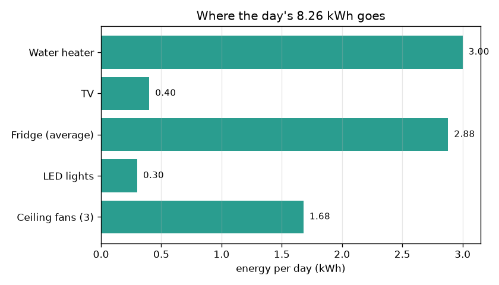
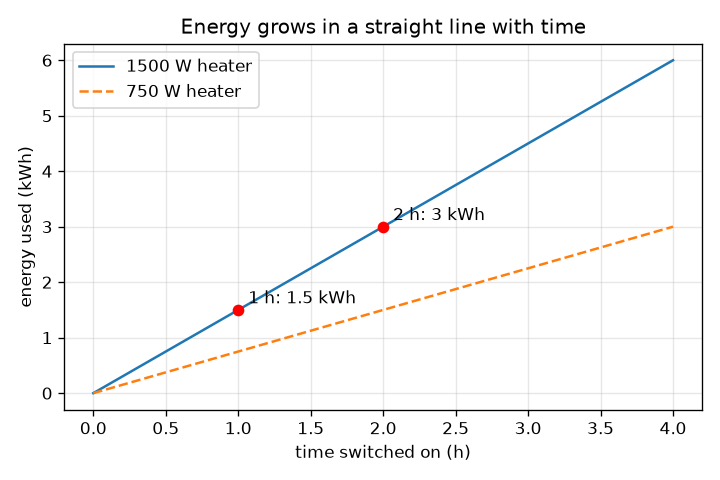

# സെഷൻ 1: പവർ ഗുണം സമയം = ഊർജ്ജം

[Session 1 — हिन्दी](README.hi.md) · [Session 1 — മലയാളം](README.ml.md)

*ലെവൽ 1 (ആശയപരമായ ഇന്ററാക്ടീവ് മോഡൽ) · ഏകദേശം 60 മിനിറ്റ് · openhousehold*

> ഇത് ലളിതമാക്കിയ ഒരു വിദ്യാഭ്യാസ മോഡലാണ്. ഇത് സാധൂകരിക്കപ്പെട്ട (validated) ഒരു ഡിസൈൻ ഉപകരണമല്ല; യഥാർത്ഥ നിർമ്മിതികൾ, ഇലക്ട്രിക്കൽ ഇൻസ്റ്റലേഷനുകൾ, വാഹനങ്ങൾ, വ്യാവസായിക പ്രക്രിയകൾ അല്ലെങ്കിൽ മെഡിക്കൽ തീരുമാനങ്ങൾ എന്നിവയ്ക്ക് ഇത് ഉപയോഗിക്കരുത്.

**മുൻ‌വ്യവസ്ഥകൾ (Prerequisites)**

- ദശാംശ സംഖ്യകളുടെ ഗുണനം.
- നിങ്ങൾ PRIMER.md വായിക്കുകയും `python start.py 1` ഒരിക്കൽ റൺ ചെയ്യുകയും ചെയ്തിട്ടുണ്ട്.

**പഠന ലക്ഷ്യങ്ങൾ (Learning objectives).** ഈ സെഷനു ശേഷം നിങ്ങൾക്ക് കഴിയും:

- പവറിനെ (kW) ഊർജ്ജത്തിൽ (kWh) നിന്ന് വേർതിരിച്ചറിയാനും ഓരോന്നും എന്താണ് അളക്കുന്നതെന്ന് പറയാനും.
- ഊർജ്ജം = പവർ x സമയം, ചെലവ് = ഊർജ്ജം x നിരക്ക് എന്നിവ കൈകൊണ്ടും Python-ലും ഉപയോഗിക്കാൻ.
- ഒരു ചെറിയ വീടിന്റെ ദൈനംദിന ഊർജ്ജം കൂട്ടി ഏറ്റവും വലിയ ഉപയോക്താവിനെ കണ്ടെത്താൻ.
- ഉപകരണം തിരിച്ചുള്ള ഊർജ്ജത്തിന്റെ ബാർ ചാർട്ടും സമയത്തിനെതിരായ ഊർജ്ജത്തിന്റെ നേർരേഖാ ഗ്രാഫും വായിക്കാൻ.

## A. യഥാർത്ഥ ലോക പ്രശ്നം
വൈദ്യുതി ബിൽ 'യൂണിറ്റു'കളിലാണ്. 1500 W വാട്ടർ ഹീറ്റർ ശക്തമായി തോന്നും, എന്നിട്ടും വൈകുന്നേരം മുഴുവൻ ഓണാക്കി വച്ച 100 W ടിവിക്കും പണം ചെലവാകുന്നു. ഏതാണ് കൂടുതൽ പ്രധാനം? ഉത്തരം ഒരു ഉപകരണം എത്ര ശക്തമാണ് (പവർ) എന്നതിനെയും അത് എത്ര നേരം പ്രവർത്തിക്കുന്നു (സമയം) എന്നതിനെയും ആശ്രയിക്കുന്നു. ഉപകരണങ്ങളുടെ ഒരു പട്ടികയെ യൂണിറ്റുകളുടെ എണ്ണമായും ചെലവായും മാറ്റുന്ന ഒരൊറ്റ നിയമം ഈ സെഷൻ നിങ്ങൾക്ക് നൽകുന്നു. വിദ്യാഭ്യാസം മാത്രം: ലളിതമാക്കിയ മോഡൽ, വയറിംഗിനെക്കുറിച്ചോ ഉപകരണങ്ങൾ വാങ്ങുന്നതിനെക്കുറിച്ചോ ഉള്ള ഉപദേശമല്ല.

## B. ആശയവും സിദ്ധാന്തവും
ഊർജ്ജം എത്ര വേഗത്തിൽ ഉപയോഗിക്കുന്നു എന്നതാണ് പവർ. അതിന്റെ യൂണിറ്റ് വാട്ട് (W); 1 കിലോവാട്ട് (kW) = 1000 W. കുറച്ച് സമയത്തിനിടെ ഉപയോഗിച്ച മൊത്തമാണ് ഊർജ്ജം. പവർ kW-ലും സമയം മണിക്കൂറിലും ആകുമ്പോൾ ഊർജ്ജം കിലോവാട്ട്-മണിക്കൂറിൽ (kWh) ലഭിക്കുന്നു, നിങ്ങളുടെ ബില്ലിലെ 'യൂണിറ്റ്'. ചെലവ് എന്നത് ഊർജ്ജത്തെ ഒരു kWh-ന്റെ വില (നിരക്ക്) കൊണ്ട് ഗുണിച്ചതാണ്. വ്യത്യസ്ത ഉപകരണങ്ങളുടെ ഊർജ്ജം ലളിതമായി കൂട്ടാം.

| ചിഹ്നം | അർത്ഥം | യൂണിറ്റ് |
|---|---|---|
| P | ഒരു ഉപകരണത്തിന്റെ പവർ | W അല്ലെങ്കിൽ kW |
| t | ഉപകരണം ഓണാക്കിയിരിക്കുന്ന സമയം | h |
| E | ഉപയോഗിച്ച ഊർജ്ജം | kWh |
| r | ഊർജ്ജത്തിന്റെ വില (ഒരേപോലെ, ഉദാഹരണത്തിനുള്ളത്) | Rs per kWh |
| C | ചെലവ് | Rs |

**അനുമാനങ്ങൾ (Assumptions)**

- ഓരോ ഉപകരണവും ഓണായിരിക്കുമ്പോൾ സ്ഥിര പവർ വലിച്ചെടുക്കുന്നു.
- ദിവസേനയുള്ള മണിക്കൂറുകൾ എല്ലാ ദിവസവും ഒരുപോലെയാണ്.
- നിരക്ക് ഒരൊറ്റ സ്ഥിര സംഖ്യയാണ് (സെഷൻ 2 സ്ലാബുകൾ ചേർക്കുന്നു).
- ഫ്രിഡ്ജിനെ അതിന്റെ ശരാശരി പവറായ 24 മണിക്കൂറിൽ 120 W കൊണ്ട് മാറ്റിസ്ഥാപിക്കുന്നു.

$$ E\,[\mathrm{kWh}]=P\,[\mathrm{kW}]\times t\,[\mathrm{h}] $$

$$ E_{\mathrm{day}}=\sum_i P_i\,t_i $$

$$ C=E_{\mathrm{day}}\times r $$

## C. ദൃശ്യ വിശദീകരണം
ആദ്യ ചിത്രം ഉപകരണം തിരിച്ചുള്ള ദിവസത്തെ ഊർജ്ജത്തിന്റെ ബാർ ചാർട്ടാണ്: ഹീറ്റർ (3.00 kWh), ഫ്രിഡ്ജ് (2.88 kWh) എന്നിവ ഏറ്റവും വലിയ ഉപയോക്താക്കളാണ്, ഫ്രിഡ്ജ് 120 W മാത്രമാണെങ്കിലും, കാരണം അത് ഒരിക്കലും ഓഫാകുന്നില്ല. രണ്ടാമത്തെ ചിത്രം ഓണായിരിക്കുന്ന സമയത്തിനെതിരെ ഹീറ്റർ ഊർജ്ജം പ്ലോട്ട് ചെയ്യുന്നു. ഇത് ഉത്ഭവസ്ഥാനത്തിലൂടെ കടന്നുപോകുന്ന ഒരു നേർരേഖയാണ്; ചരിവ് (slope) പവർ ആണ് (1500 W ഹീറ്ററിന് മണിക്കൂറിൽ 1.5 kWh). ചുവന്ന ബിന്ദുക്കൾ 2 മണിക്കൂർ 3 kWh-ഉം 1 മണിക്കൂർ 1.5 kWh-ഉം നൽകുന്നത് കാണിക്കുന്നു. ആപ്പിലെ ബ്ലോക്ക് ഡയഗ്രം ഒഴുക്ക് കാണിക്കുന്നു: ഇൻപുട്ടുകൾ, ഊർജ്ജം, വീടിന്റെ ആകെ, ചെലവ്.

*ഒരു ദിവസത്തെ ഉപകരണം തിരിച്ചുള്ള ഊർജ്ജം: ഹീറ്ററും എപ്പോഴും ഓണായ ഫ്രിഡ്ജും മുന്നിൽ.*

*സമയത്തിനെതിരായ ഊർജ്ജം ഒരു നേർരേഖയാണ്; സമയം പകുതിയാക്കിയാൽ ഊർജ്ജവും പകുതിയാകുന്നു.*

## D. ഇന്ററാക്ടീവ് സിമുലേഷൻ
പാഠം റൺ ചെയ്യുക (`python start.py 1`), തുടർന്ന് ലൈവ് ആപ്പ് തുറക്കുക: [സെഷൻ 1: പവർ x സമയം = ഊർജ്ജം](https://krunalpanchal1995.github.io/pan-iit-oss/openhousehold/session-01/) (അല്ലെങ്കിൽ ഈ ഫോൾഡറിലെ `app.html`). ഹീറ്ററിന്റെ പവറും മണിക്കൂറുകളും മാറ്റി ബാറുകളും ചെലവും മാറുന്നത് നിരീക്ഷിക്കുക. ലൈൻ ഗ്രാഫിലേക്ക് മാറി സമയം ഇരട്ടിയാക്കിയാൽ ഊർജ്ജവും ഇരട്ടിയാകുന്നത് കാണുക.

**വെല്ലുവിളി (Challenge).** ഹീറ്റർ കുറഞ്ഞത് അരമണിക്കൂറെങ്കിലും പ്രവർത്തിക്കുമ്പോൾ തന്നെ ദിവസത്തെ ചെലവ് Rs 40-ന് താഴെയാക്കുക.

## E. പരിഹരിച്ച ഉദാഹരണവും പരീക്ഷണവും
**പ്രശ്നം.** ഒരു 1.5 kW ഹീറ്റർ 2 മണിക്കൂർ പ്രവർത്തിക്കുന്നു. അത് എത്ര ഊർജ്ജം ഉപയോഗിക്കുന്നു? സമയം പകുതിയാക്കിയാലോ? ആപ്പിലെ മുഴുവൻ വീടും ഒരു ദിവസം എത്ര ഉപയോഗിക്കുന്നു, ഒരു kWh-ന് Rs 6 നിരക്കിൽ ചെലവ് എത്ര?

1. ഹീറ്റർ: E = 1.5 kW x 2 h = 3 kWh.
2. പകുതി സമയം: E = 1.5 kW x 1 h = 1.5 kWh. പകുതി സമയം, പകുതി ഊർജ്ജം.
3. മറ്റുള്ളവ: ഫാനുകൾ 0.21 kW x 8 h = 1.68 kWh; ലൈറ്റുകൾ 0.06 kW x 5 h = 0.30 kWh; ഫ്രിഡ്ജ് 0.12 kW x 24 h = 2.88 kWh; ടിവി 0.10 kW x 4 h = 0.40 kWh.
4. ആകെ = 1.68 + 0.30 + 2.88 + 0.40 + 3.00 = പ്രതിദിനം 8.26 kWh.
5. ചെലവ് = 8.26 kWh x Rs 6 = പ്രതിദിനം Rs 49.56. ഹീറ്റർ 1 മണിക്കൂറിൽ ആകെ 6.76 kWh-ഉം Rs 40.56-ഉം ആണ്, ഒരു ദിവസം Rs 9.00 ലാഭം.

**ഉത്തരം.** ഹീറ്റർ 3 kWh ഉപയോഗിക്കുന്നു, സമയം പകുതിയാക്കിയാൽ 1.5 kWh. വീട് 8.26 kWh ഉപയോഗിക്കുകയും ഒരു kWh-ന് Rs 6 നിരക്കിൽ പ്രതിദിനം Rs 49.56 നൽകുകയും ചെയ്യുന്നു.

**പരീക്ഷണം.** ഒരു യഥാർത്ഥ ഉപകരണത്തിലെ ലേബൽ നോക്കി അതിന്റെ പവർ വാട്ടിൽ കുറിക്കുക, ഒരു പ്ലഗ്-ഇൻ എനർജി മീറ്റർ (അല്ലെങ്കിൽ ഒരു മണിക്കൂർ ഉപയോഗത്തിന് മുമ്പും ശേഷവും റീഡ് ചെയ്യുന്ന ചുമരിലെ മീറ്റർ) ഉപയോഗിച്ച് അതിന്റെ ഊർജ്ജം അളക്കുക. പവർ x സമയവുമായി താരതമ്യം ചെയ്യുക. യഥാർത്ഥ ഉപകരണങ്ങൾ ലേബലിൽ നിന്ന് വ്യത്യാസപ്പെടുന്നു: ഹീറ്റർ അതിന്റെ തെർമോസ്റ്റാറ്റിനൊപ്പം ഓണും ഓഫുമാകുന്നു, ഫ്രിഡ്ജ് കംപ്രസർ കുറച്ച് സമയം മാത്രം പ്രവർത്തിക്കുന്നു, ലേബൽ പരമാവധി മൂല്യമാണ് കാണിക്കുന്നത്. മോഡൽ സ്ഥിര സംഖ്യകൾ ഉപയോഗിക്കുന്നു; മീറ്റർ യഥാർത്ഥത്തിൽ സംഭവിച്ചത് കാണിക്കുന്നു.

## F. വിലയിരുത്തലും ഡിസൈൻ വെല്ലുവിളിയും
**ചോദ്യ തരം A: ആശയപരം.** കിലോവാട്ടും കിലോവാട്ട്-മണിക്കൂറും തമ്മിലുള്ള വ്യത്യാസം വിശദീകരിക്കുക. ബിൽ ഏതിനാണ് ഈടാക്കുന്നത്?

സൂചന

ഒന്ന് ഒരു നിരക്കാണ്, മറ്റൊന്ന് ഒരു അളവാണ്. വേഗതയെയും ദൂരത്തെയും കുറിച്ച് ചിന്തിക്കുക.

ഘട്ടം ഘട്ടമായുള്ള പരിഹാരം

കിലോവാട്ട് പവർ ആണ്: ഇപ്പോൾ ഊർജ്ജം എത്ര വേഗത്തിൽ ഉപയോഗിക്കുന്നു (വേഗത പോലെ). കിലോവാട്ട്-മണിക്കൂർ ഊർജ്ജമാണ്: കുറച്ച് സമയത്തിനിടെ ഉപയോഗിച്ച മൊത്തം (സഞ്ചരിച്ച ദൂരം പോലെ). ബിൽ കിലോവാട്ട്-മണിക്കൂറിനാണ് ഈടാക്കുന്നത്, കാരണം ഏതാനും മിനിറ്റ് ഉപയോഗിച്ച ശക്തമായ ഉപകരണം ദിവസം മുഴുവൻ ഓണാക്കിയ ദുർബല ഉപകരണത്തേക്കാൾ കുറഞ്ഞ ഊർജ്ജം ഉപയോഗിച്ചേക്കാം.

**ചോദ്യ തരം B: സംഖ്യാപരം.** ഒരു 100 W ടിവി ദിവസം 4 മണിക്കൂർ പ്രവർത്തിക്കുന്നു. അതിന്റെ പ്രതിദിന ഊർജ്ജവും 30 ദിവസത്തെ ഊർജ്ജവും, ഒരു kWh-ന് Rs 6 നിരക്കിൽ 30 ദിവസത്തെ ചെലവും കണ്ടെത്തുക. ഉത്തരം യുക്തിസഹമാണോ എന്ന് പരിശോധിക്കുക.

സൂചന

ആദ്യം വാട്ടിനെ kW ആക്കുക: 1000 കൊണ്ട് ഹരിക്കുക.

ഘട്ടം ഘട്ടമായുള്ള പരിഹാരം

E = 0.1 kW x 4 h = പ്രതിദിനം 0.4 kWh. 30 ദിവസത്തേക്ക്: 0.4 x 30 = 12 kWh. ചെലവ് = 12 x 6 = Rs 72. യുക്തിപരിശോധന (sanity check): ഏതാനും മണിക്കൂർ ഉപയോഗിക്കുന്ന ചെറിയ ഉപകരണം മാസത്തിൽ ഏതാനും kWh മാത്രമേ നൽകൂ, 12 kWh അതിനോട് യോജിക്കുന്നു.

**ചോദ്യ തരം C: ഗ്രാഫ്, സിമുലേഷൻ വ്യാഖ്യാനം.** സമയത്തിനെതിരായ ഹീറ്റർ ഊർജ്ജത്തിന്റെ നേർരേഖാ ഗ്രാഫിൽ, ചരിവ് എന്താണ് അർത്ഥമാക്കുന്നത്? പവർ പകുതിയാക്കിയാൽ രേഖയ്ക്ക് എന്ത് സംഭവിക്കും?

സൂചന

ചരിവ് എന്നാൽ ഉയർച്ച ÷ ദൂരം (rise over run): മണിക്കൂറിൽ kWh.

ഘട്ടം ഘട്ടമായുള്ള പരിഹാരം

ചരിവ് മണിക്കൂറിലെ ഊർജ്ജമാണ്, അതായത് kW-ലെ പവർ (1500 W-ന് മണിക്കൂറിൽ 1.5 kWh). പവർ പകുതിയാക്കിയാൽ ചരിവും പകുതിയാകുന്നു: രേഖ താഴ്ന്നതും പരന്നതുമാകുന്നു, അതിനാൽ 2 മണിക്കൂർ 3 kWh-ന് പകരം 1.5 kWh നൽകുന്നു.

**ചോദ്യ തരം D: ഡിസൈൻ, ഒപ്റ്റിമൈസേഷൻ വെല്ലുവിളി.** ഡിസൈൻ: ചൂടുവെള്ളം പൂർണ്ണമായി ഉപേക്ഷിക്കാതെ കുടുംബം ദിവസത്തെ ചെലവ് Rs 40-ന് താഴെ (ഇപ്പോൾ Rs 49.56) ആക്കാൻ ആഗ്രഹിക്കുന്നു. ആപ്പിൽ നിന്ന് രണ്ട് മാറ്റങ്ങൾ പട്ടികപ്പെടുത്തി ഓരോന്നും ഒരു കണക്കുകൂട്ടൽ കൊണ്ട് പരിശോധിക്കുക.

സൂചന

ചെലവ് = ആകെ ഊർജ്ജം x 6, അതിനാൽ ആകെ 40 / 6 = 6.67 kWh-ന് താഴെ വരണം. നിങ്ങൾ 1.59 kWh-ൽ കൂടുതൽ കുറയ്ക്കണം.

ഘട്ടം ഘട്ടമായുള്ള പരിഹാരം

8.26 - 6.67 = 1.59 kWh അല്ലെങ്കിൽ അതിൽ കൂടുതൽ ലാഭിക്കണം. ഓപ്ഷൻ 1: ഹീറ്റർ 2 h-ൽ നിന്ന് 1 h-ലേക്ക് 1.5 kWh ലാഭിക്കുന്നു, ഒറ്റയ്ക്ക് തികയില്ല (6.76 kWh, Rs 40.56). ഒപ്പം ചേർക്കുക: ഫാനുകൾ 8 h-ൽ നിന്ന് 6 h-ലേക്ക് 0.42 kWh ലാഭിക്കുന്നു. പുതിയ ആകെ 6.34 kWh, ചെലവ് Rs 38.04. വിട്ടുവീഴ്ച (trade-off): കുറഞ്ഞ ചൂടുവെള്ളവും കുറഞ്ഞ തണുപ്പും. ഓപ്ഷൻ 2: 2 h-ന് 750 W ഹീറ്റർ 1.5 kWh നൽകുന്നു (അതും 1.5 kWh ലാഭിക്കുന്നു), പക്ഷേ അത് വെള്ളം പതുക്കെ ചൂടാക്കുന്നു, അതിനാൽ കൂടുതൽ സമയം വേണ്ടിവന്നേക്കാം.

[RUBRIC.md](../../RUBRIC.md) ഉപയോഗിച്ച് സ്വയം സ്കോർ ചെയ്യുക. കടലാസിൽ പ്രവർത്തിക്കാൻ [ആക്ടിവിറ്റി ഷീറ്റ്](activity_sheet.md) പ്രിന്റ് ചെയ്യുക.

## സാധാരണ തെറ്റിദ്ധാരണകൾ
| സാധാരണ തെറ്റിദ്ധാരണ | യഥാർത്ഥത്തിൽ സത്യം എന്താണ് |
|---|---|
| കൂടുതൽ വാട്ടേജുള്ള ഉപകരണം പ്രവർത്തിപ്പിക്കാൻ എപ്പോഴും കൂടുതൽ ചെലവാകും. | ചെലവ് പവർ ഗുണം സമയത്തെ ആശ്രയിക്കുന്നു. 24 മണിക്കൂർ ഓണായ 100 W ടിവി (2.4 kWh) 1 മണിക്കൂർ ഓണായ 1500 W ഹീറ്ററിനേക്കാൾ (1.5 kWh) കൂടുതൽ ഉപയോഗിക്കുന്നു. |
| kW-ഉം kWh-ഉം ഒന്നുതന്നെയാണ്. | kW എന്നത് ഊർജ്ജം എത്ര വേഗത്തിൽ ഉപയോഗിക്കുന്നു എന്നതാണ്; kWh എന്നത് ഉപയോഗിച്ച അളവാണ്. kWh ലഭിക്കാൻ kW-നെ മണിക്കൂറുകൾ കൊണ്ട് ഗുണിക്കുക. |
| ഫ്രിഡ്ജ് 120 W മാത്രമായതിനാൽ ചെലവ് കുറവാണ്. | അത് ദിവസം മുഴുവൻ പ്രവർത്തിക്കുന്നു, അതിനാൽ 0.12 kW x 24 h = 2.88 kWh, 2 മണിക്കൂർ ഹീറ്ററിന് ഏകദേശം തുല്യം. |

## പദാവലി (Glossary)
- **പവർ (power)**: ഊർജ്ജം എത്ര വേഗത്തിൽ ഉപയോഗിക്കുന്നു, വാട്ടിൽ (W) അല്ലെങ്കിൽ കിലോവാട്ടിൽ (kW)
- **ഊർജ്ജം (energy)**: കുറച്ച് സമയത്തിനിടെ ഉപയോഗിച്ച മൊത്തം അളവ്, കിലോവാട്ട്-മണിക്കൂറിൽ (kWh)
- **കിലോവാട്ട്-മണിക്കൂർ (kWh)**: 1 kW 1 മണിക്കൂർ പ്രവർത്തിക്കുമ്പോൾ ഉപയോഗിക്കുന്ന ഊർജ്ജം; ബില്ലിലെ ഒരു 'യൂണിറ്റ്'
- **നിരക്ക് (rate)**: ഒരു kWh-ന്റെ വില
- **ലോഡ് (load)**: വൈദ്യുതി ഉപയോഗിക്കുന്ന ഒരു ഉപകരണം അല്ലെങ്കിൽ ഉപകരണങ്ങളുടെ കൂട്ടം

## പൂർത്തിയാക്കുക
1. [exercises.md](exercises.md)-ലെ മൂന്ന് കോഡിംഗ് ടാസ്കുകൾ ചെയ്യുക.
2. നിങ്ങളുടെ മാറ്റങ്ങൾക്കു ശേഷം `python start.py 1` വീണ്ടും റൺ ചെയ്യുക. അത് ചെക്ക്‌പോയിന്റോടെ അവസാനിക്കുന്നു; അത് `PASS` പ്രിന്റ് ചെയ്യുമ്പോൾ, നിങ്ങൾ പൂർത്തിയാക്കി. (ചെക്ക്‌പോയിന്റ് മാത്രം: `python start.py check 1`.)

അടുത്തത്: [സെഷൻ 2](../session-02/README.md)
