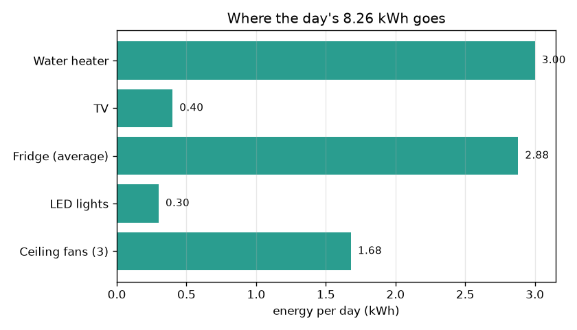
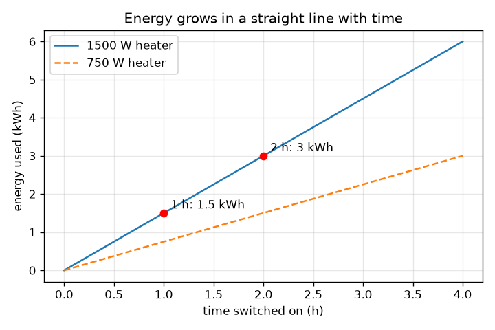

# அமர்வு 1: திறன் பெருக்கல் நேரம் = ஆற்றல்

[Session 1 — हिन्दी](README.hi.md) · [Session 1 — മലയാളം](README.ml.md) · [Session 1 — தமிழ்](README.ta.md)

*நிலை 1 (கருத்தியல் ஊடாடும் மாதிரி) · சுமார் 60 நிமிடங்கள் · openhousehold*

> இது ஒரு எளிமைப்படுத்தப்பட்ட கல்வி மாதிரி. இது சரிபார்க்கப்பட்ட (validated) வடிவமைப்புக் கருவி அல்ல; உண்மையான கட்டமைப்புகள், மின் நிறுவல்கள், வாகனங்கள், தொழில்துறை செயல்முறைகள் அல்லது மருத்துவ முடிவுகளுக்கு இதைப் பயன்படுத்தக் கூடாது.

**முன்தேவைகள் (Prerequisites)**

- தசம எண்களைப் பெருக்குதல்.
- நீங்கள் PRIMER.md படித்து, `python start.py 1` ஐ ஒருமுறை இயக்கியிருக்கிறீர்கள்.

**கற்றல் நோக்கங்கள் (Learning objectives).** இந்த அமர்வுக்குப் பிறகு உங்களால் முடியும்:

- திறனை (power, kW) ஆற்றலிலிருந்து (energy, kWh) வேறுபடுத்தி, ஒவ்வொன்றும் எதை அளக்கிறது என்று சொல்ல.
- ஆற்றல் = திறன் x நேரம் மற்றும் செலவு = ஆற்றல் x கட்டணம் ஆகியவற்றைக் கையாலும் Python-இலும் பயன்படுத்த.
- ஒரு சிறிய வீட்டின் தினசரி ஆற்றலைக் கூட்டி, அதிகம் பயன்படுத்தும் சாதனத்தைக் கண்டறிய.
- சாதனத்துக்கான ஆற்றல் பட்டை வரைபடத்தையும் நேரத்துக்கு எதிரான ஆற்றலின் நேர்கோட்டு வரைபடத்தையும் படிக்க.

## A. நிஜ உலகப் பிரச்சினை
மின் கட்டணம் 'அலகுகளில்' (units) உள்ளது. 1500 W வாட்டர் ஹீட்டர் சக்திவாய்ந்ததாகத் தோன்றும், ஆனாலும் மாலை முழுவதும் ஓடவிட்ட 100 W டிவிக்கும் பணம் செலவாகிறது. எது அதிக முக்கியம்? விடை ஒரு சாதனம் எவ்வளவு வலிமையானது (திறன்) என்பதையும் எவ்வளவு நேரம் ஓடுகிறது (நேரம்) என்பதையும் பொறுத்தது. சாதனங்களின் பட்டியலை அலகுகளின் எண்ணிக்கையாகவும் செலவாகவும் மாற்றும் ஒரே விதியை இந்த அமர்வு உங்களுக்குத் தருகிறது. கல்விக்காக மட்டும்: ஒரு எளிமைப்படுத்தப்பட்ட மாதிரி, வயரிங் அல்லது சாதனங்கள் வாங்குவது பற்றிய ஆலோசனை அல்ல.

## B. கருத்தும் கோட்பாடும்
ஆற்றல் எவ்வளவு வேகமாகப் பயன்படுத்தப்படுகிறது என்பதே திறன். அதன் அலகு வாட் (W); 1 கிலோவாட் (kW) = 1000 W. சிறிது நேரத்தில் பயன்படுத்தப்பட்ட மொத்தமே ஆற்றல். திறன் kW இலும் நேரம் மணிகளிலும் இருக்கும்போது, ஆற்றல் கிலோவாட்-மணி (kWh) இல் கிடைக்கிறது, உங்கள் கட்டணச் சீட்டில் உள்ள 'அலகு'. செலவு என்பது ஆற்றலை ஒரு kWh இன் விலையால் (கட்டணம்) பெருக்கியது. வெவ்வேறு சாதனங்களின் ஆற்றல்களை எளிதாகக் கூட்டலாம்.

| குறியீடு | பொருள் | அலகு |
|---|---|---|
| P | ஒரு சாதனத்தின் திறன் | W அல்லது kW |
| t | சாதனம் இயக்கப்பட்டிருக்கும் நேரம் | h |
| E | பயன்படுத்தப்பட்ட ஆற்றல் | kWh |
| r | ஆற்றலின் விலை (சீரானது, எடுத்துக்காட்டுக்கு) | Rs per kWh |
| C | செலவு | Rs |

**அனுமானங்கள் (Assumptions)**

- ஒவ்வொரு சாதனமும் இயங்கும்போது நிலையான திறனை இழுக்கிறது.
- நாளொன்றுக்கான மணிகள் ஒவ்வொரு நாளும் ஒன்றே.
- கட்டணம் ஒரே சீரான எண் (அமர்வு 2 அடுக்குகளைச் சேர்க்கிறது).
- குளிர்சாதனப் பெட்டி அதன் சராசரித் திறனான 24 மணிநேரத்துக்கு 120 W ஆல் மாற்றப்படுகிறது.

$$ E\,[\mathrm{kWh}]=P\,[\mathrm{kW}]\times t\,[\mathrm{h}] $$

$$ E_{\mathrm{day}}=\sum_i P_i\,t_i $$

$$ C=E_{\mathrm{day}}\times r $$

## C. காட்சி விளக்கம்
முதல் படம் சாதனத்துக்கான நாளின் ஆற்றலின் பட்டை வரைபடம்: ஹீட்டர் (3.00 kWh) மற்றும் குளிர்சாதனப் பெட்டி (2.88 kWh) அதிகம் பயன்படுத்துபவை, குளிர்சாதனப் பெட்டி 120 W மட்டுமே என்றாலும், ஏனெனில் அது ஒருபோதும் அணைவதில்லை. இரண்டாவது படம் இயக்க நேரத்துக்கு எதிராக ஹீட்டர் ஆற்றலை வரைகிறது. இது ஆதிப்புள்ளி வழியாகச் செல்லும் நேர்கோடு; சாய்வு (slope) திறன் (1500 W ஹீட்டருக்கு மணிக்கு 1.5 kWh). சிவப்புப் புள்ளிகள் 2 மணி 3 kWh ஐயும் 1 மணி 1.5 kWh ஐயும் தருவதைக் காட்டுகின்றன. செயலியில் உள்ள தொகுதி வரைபடம் ஓட்டத்தைக் காட்டுகிறது: உள்ளீடுகள், ஆற்றல், வீட்டின் மொத்தம், செலவு.

*ஒரு நாளுக்குச் சாதனத்துக்கான ஆற்றல்: ஹீட்டரும் எப்போதும் ஓடும் குளிர்சாதனப் பெட்டியும் முன்னிலை.*

*நேரத்துக்கு எதிரான ஆற்றல் ஒரு நேர்கோடு; நேரத்தைப் பாதியாக்கினால் ஆற்றலும் பாதியாகிறது.*

## D. ஊடாடும் உருவகப்படுத்தல் (Interactive simulation)
பாடத்தை இயக்குங்கள் (`python start.py 1`), பின்னர் நேரடிச் செயலியைத் திறங்கள்: [அமர்வு 1: திறன் x நேரம் = ஆற்றல்](https://krunalpanchal1995.github.io/pan-iit-oss/openhousehold/session-01/) (அல்லது இந்தக் கோப்புறையில் உள்ள `app.html`). ஹீட்டரின் திறனையும் மணிகளையும் மாற்றி, பட்டைகளும் செலவும் மாறுவதைக் கவனியுங்கள். கோட்டு வரைபடத்துக்கு மாறி, நேரத்தை இரட்டிப்பாக்கினால் ஆற்றலும் இரட்டிப்பாவதைப் பாருங்கள்.

**சவால் (Challenge).** ஹீட்டர் குறைந்தது அரை மணி நேரமாவது ஓடும்போதே நாளின் செலவை Rs 40 க்குக் கீழே கொண்டு வாருங்கள்.

## E. தீர்க்கப்பட்ட எடுத்துக்காட்டும் சோதனையும்
**பிரச்சினை.** ஒரு 1.5 kW ஹீட்டர் 2 மணி நேரம் ஓடுகிறது. அது எவ்வளவு ஆற்றலைப் பயன்படுத்துகிறது? நேரம் பாதியானால்? செயலியின் முழு வீடும் ஒரு நாளைக்கு எவ்வளவு பயன்படுத்துகிறது, ஒரு kWh க்கு Rs 6 என்றால் செலவு என்ன?

1. ஹீட்டர்: E = 1.5 kW x 2 h = 3 kWh.
2. பாதி நேரம்: E = 1.5 kW x 1 h = 1.5 kWh. பாதி நேரம், பாதி ஆற்றல்.
3. மற்றவை: மின்விசிறிகள் 0.21 kW x 8 h = 1.68 kWh; விளக்குகள் 0.06 kW x 5 h = 0.30 kWh; குளிர்சாதனப் பெட்டி 0.12 kW x 24 h = 2.88 kWh; டிவி 0.10 kW x 4 h = 0.40 kWh.
4. மொத்தம் = 1.68 + 0.30 + 2.88 + 0.40 + 3.00 = நாளொன்றுக்கு 8.26 kWh.
5. செலவு = 8.26 kWh x Rs 6 = நாளொன்றுக்கு Rs 49.56. ஹீட்டர் 1 மணியில் மொத்தம் 6.76 kWh மற்றும் Rs 40.56, நாளொன்றுக்கு Rs 9.00 சேமிப்பு.

**விடை.** ஹீட்டர் 3 kWh பயன்படுத்துகிறது, நேரம் பாதியானால் 1.5 kWh. வீடு 8.26 kWh பயன்படுத்தி, ஒரு kWh க்கு Rs 6 என்ற கட்டணத்தில் நாளொன்றுக்கு Rs 49.56 செலுத்துகிறது.

**சோதனை.** ஒரு உண்மைச் சாதனத்தின் லேபிளைப் பார்த்து அதன் திறனை வாட்டில் குறித்துக்கொண்டு, ஒரு பிளக்-இன் ஆற்றல் மீட்டரைக் (அல்லது ஒரு மணி நேரப் பயன்பாட்டுக்கு முன்னும் பின்னும் படிக்கும் சுவரிலுள்ள மீட்டரை) கொண்டு அதன் ஆற்றலை அளவிடுங்கள். திறன் x நேரத்துடன் ஒப்பிடுங்கள். உண்மைச் சாதனங்கள் லேபிளிலிருந்து வேறுபடுகின்றன: ஹீட்டர் தன் தெர்மோஸ்டாட்டுடன் இயங்குவதும் நிற்பதுமாக இருக்கும், குளிர்சாதனப் பெட்டியின் அமுக்கி சிறிது நேரம் மட்டுமே ஓடும், லேபிள் அதிகபட்சத்தைக் காட்டுகிறது. மாதிரி நிலையான எண்களைப் பயன்படுத்துகிறது; மீட்டர் உண்மையில் நடந்ததைக் காட்டுகிறது.

## F. மதிப்பீடும் வடிவமைப்புச் சவாலும்
**கேள்வி வகை A: கருத்தியல்.** கிலோவாட்டுக்கும் கிலோவாட்-மணிக்கும் உள்ள வேறுபாட்டை விளக்குங்கள். கட்டணம் எதற்காக வசூலிக்கப்படுகிறது?

குறிப்பு

ஒன்று விகிதம், மற்றொன்று அளவு. வேகத்தையும் தூரத்தையும் நினைத்துப் பாருங்கள்.

படிப்படியான தீர்வு

கிலோவாட் என்பது திறன்: இப்போது ஆற்றல் எவ்வளவு வேகமாகப் பயன்படுத்தப்படுகிறது (வேகம் போல). கிலோவாட்-மணி என்பது ஆற்றல்: சிறிது நேரத்தில் பயன்படுத்தப்பட்ட மொத்தம் (கடந்த தூரம் போல). கட்டணம் கிலோவாட்-மணிக்காக வசூலிக்கப்படுகிறது, ஏனெனில் சில நிமிடங்கள் பயன்படுத்தப்பட்ட வலிமையான சாதனம் நாள் முழுவதும் ஓடவிட்ட பலவீனமான சாதனத்தை விடக் குறைவான ஆற்றலைப் பயன்படுத்தலாம்.

**கேள்வி வகை B: எண்ணியல்.** ஒரு 100 W டிவி நாளொன்றுக்கு 4 மணி நேரம் ஓடுகிறது. அதன் நாளுக்கான ஆற்றலையும் 30 நாட்களுக்கான ஆற்றலையும், ஒரு kWh க்கு Rs 6 என்ற கட்டணத்தில் 30 நாட்களுக்கான செலவையும் காண்க. விடை நியாயமானதா என்று சரிபாருங்கள்.

குறிப்பு

முதலில் வாட்டை kW ஆக மாற்றுங்கள்: 1000 ஆல் வகுங்கள்.

படிப்படியான தீர்வு

E = 0.1 kW x 4 h = நாளொன்றுக்கு 0.4 kWh. 30 நாட்களுக்கு: 0.4 x 30 = 12 kWh. செலவு = 12 x 6 = Rs 72. நம்பகத்தன்மைச் சோதனை (sanity check): சில மணி நேரம் பயன்படுத்தப்படும் சிறிய சாதனம் மாதத்துக்குச் சில kWh மட்டுமே தரும், 12 kWh அதற்குப் பொருந்துகிறது.

**கேள்வி வகை C: வரைபடம் மற்றும் உருவகப்படுத்தல் விளக்கம்.** நேரத்துக்கு எதிரான ஹீட்டர் ஆற்றலின் நேர்கோட்டு வரைபடத்தில், சாய்வு எதைக் குறிக்கிறது? திறனைப் பாதியாக்கினால் கோட்டுக்கு என்ன நடக்கும்?

குறிப்பு

சாய்வு என்பது ஏற்றம் ÷ ஓட்டம் (rise over run): மணிக்கு kWh.

படிப்படியான தீர்வு

சாய்வு என்பது மணிக்கான ஆற்றல், அதாவது kW இல் திறன் (1500 W க்கு மணிக்கு 1.5 kWh). திறனைப் பாதியாக்கினால் சாய்வும் பாதியாகிறது: கோடு தாழ்வாகவும் தட்டையாகவும் ஆகிறது, எனவே 2 மணி 3 kWh க்குப் பதிலாக 1.5 kWh தருகிறது.

**கேள்வி வகை D: வடிவமைப்பு மற்றும் உகப்பாக்கச் சவால்.** வடிவமைப்பு: வெந்நீரை முழுவதுமாக விட்டுவிடாமல் குடும்பம் நாளின் செலவை Rs 40 க்குக் கீழே (இப்போது Rs 49.56) கொண்டு வர விரும்புகிறது. செயலியிலிருந்து இரண்டு மாற்றங்களைப் பட்டியலிட்டு, ஒவ்வொன்றையும் ஒரு கணக்கீட்டால் சரிபாருங்கள்.

குறிப்பு

செலவு = மொத்த ஆற்றல் x 6, எனவே மொத்தம் 40 / 6 = 6.67 kWh க்குக் கீழே வர வேண்டும். நீங்கள் 1.59 kWh க்கு மேல் குறைக்க வேண்டும்.

படிப்படியான தீர்வு

8.26 - 6.67 = 1.59 kWh அல்லது அதற்கு மேல் சேமிக்க வேண்டும். தேர்வு 1: ஹீட்டர் 2 h இலிருந்து 1 h க்கு 1.5 kWh சேமிக்கிறது, தனியாகப் போதாது (6.76 kWh, Rs 40.56). கூடவே சேர்க்கவும்: மின்விசிறிகள் 8 h இலிருந்து 6 h க்கு 0.42 kWh சேமிக்கின்றன. புதிய மொத்தம் 6.34 kWh, செலவு Rs 38.04. சமரசம் (trade-off): குறைவான வெந்நீர், குறைவான குளிர்ச்சி. தேர்வு 2: 2 h க்கு 750 W ஹீட்டர் 1.5 kWh தருகிறது (அதுவும் 1.5 kWh சேமிக்கிறது), ஆனால் அது நீரை மெதுவாகச் சூடாக்குகிறது, எனவே அதிக நேரம் தேவைப்படலாம்.

[RUBRIC.md](../../RUBRIC.md) கொண்டு உங்களுக்கு நீங்களே மதிப்பெண் இடுங்கள். தாளில் வேலை செய்ய [செயல்பாட்டுத் தாளை](activity_sheet.md) அச்சிடுங்கள்.

## பொதுவான தவறான கருத்துகள்
| பொதுவான தவறான கருத்து | உண்மையில் சரியானது என்ன |
|---|---|
| அதிக வாட்டேஜ் உள்ள சாதனம் இயக்க எப்போதும் அதிகச் செலவாகும். | செலவு திறன் பெருக்கல் நேரத்தைப் பொறுத்தது. 24 மணி ஓடும் 100 W டிவி (2.4 kWh) 1 மணி ஓடும் 1500 W ஹீட்டரை (1.5 kWh) விட அதிகம் பயன்படுத்துகிறது. |
| kW உம் kWh உம் ஒன்றே. | kW என்பது ஆற்றல் எவ்வளவு வேகமாகப் பயன்படுத்தப்படுகிறது; kWh என்பது பயன்படுத்தப்பட்ட அளவு. kWh பெற kW ஐ மணிகளால் பெருக்குங்கள். |
| குளிர்சாதனப் பெட்டி 120 W மட்டுமே என்பதால் செலவு குறைவு. | அது நாள் முழுவதும் ஓடுகிறது, எனவே 0.12 kW x 24 h = 2.88 kWh, 2 மணி ஹீட்டருக்கு ஏறத்தாழ சமம். |

## சொற்களஞ்சியம் (Glossary)
- **திறன் (power)**: ஆற்றல் எவ்வளவு வேகமாகப் பயன்படுத்தப்படுகிறது, வாட் (W) அல்லது கிலோவாட் (kW) இல்
- **ஆற்றல் (energy)**: சிறிது நேரத்தில் பயன்படுத்தப்பட்ட மொத்த அளவு, கிலோவாட்-மணி (kWh) இல்
- **கிலோவாட்-மணி (kWh)**: 1 kW 1 மணி நேரம் ஓடும்போது பயன்படுத்தப்படும் ஆற்றல்; கட்டணச் சீட்டில் ஒரு 'அலகு'
- **கட்டணம் (rate)**: ஒரு kWh இன் விலை
- **சுமை (load)**: மின்சாரம் பயன்படுத்தும் ஒரு சாதனம் அல்லது சாதனங்களின் குழு

## முடிக்க
1. [exercises.md](exercises.md) இல் உள்ள மூன்று நிரலாக்கப் பணிகளைச் செய்யுங்கள்.
2. உங்கள் மாற்றங்களுக்குப் பிறகு `python start.py 1` ஐ மீண்டும் இயக்குங்கள். அது சோதனைச் சாவடியுடன் (checkpoint) முடிகிறது; அது `PASS` என அச்சிடும்போது, நீங்கள் முடித்துவிட்டீர்கள். (சோதனைச் சாவடி மட்டும்: `python start.py check 1`.)

அடுத்து: [அமர்வு 2](../session-02/README.md)
