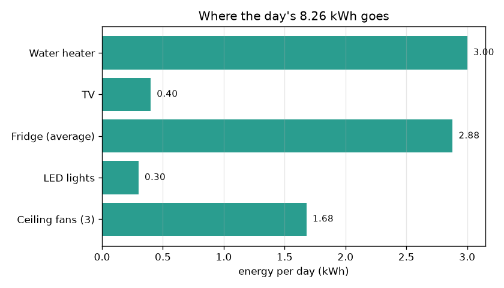
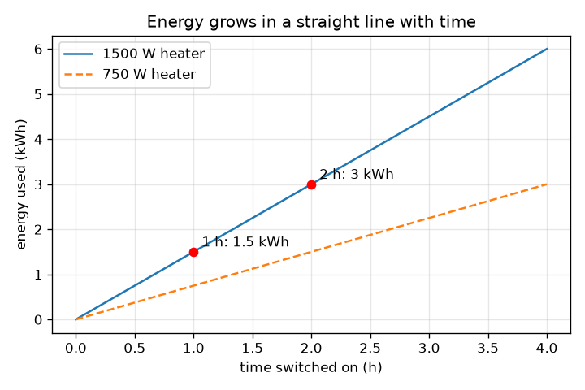

# సెషన్ 1: పవర్ గుణకారం సమయం = శక్తి

[Session 1 — हिन्दी](README.hi.md) · [Session 1 — മലയാളം](README.ml.md) · [Session 1 — தமிழ்](README.ta.md) · [Session 1 — తెలుగు](README.te.md)

*స్థాయి 1 (భావనాత్మక ఇంటరాక్టివ్ మోడల్) · సుమారు 60 నిమిషాలు · openhousehold*

> ఇది సరళీకరించిన ఒక విద్యా మోడల్. ఇది ధృవీకరించబడిన (validated) డిజైన్ సాధనం కాదు; నిజమైన నిర్మాణాలు, విద్యుత్ ఇన్‌స్టలేషన్‌లు, వాహనాలు, పారిశ్రామిక ప్రక్రియలు లేదా వైద్య నిర్ణయాల కోసం దీనిని ఉపయోగించకూడదు.

**ముందస్తు అవసరాలు (Prerequisites)**

- దశాంశ సంఖ్యల గుణకారం.
- మీరు PRIMER.md చదివి, `python start.py 1` ను ఒకసారి రన్ చేశారు.

**అభ్యాస లక్ష్యాలు (Learning objectives).** ఈ సెషన్ తర్వాత మీరు చేయగలరు:

- పవర్‌ను (kW) శక్తి (kWh) నుండి వేరుచేసి, ప్రతి ఒక్కటి దేన్ని కొలుస్తుందో చెప్పడం.
- శక్తి = పవర్ x సమయం మరియు ఖర్చు = శక్తి x రేటు ను చేతితో మరియు Python లో ఉపయోగించడం.
- ఒక చిన్న ఇంటి రోజువారీ శక్తిని కూడి, అత్యధికంగా వాడే పరికరాన్ని కనుగొనడం.
- పరికరానికి శక్తి బార్ చార్ట్‌ను మరియు సమయానికి వ్యతిరేకంగా శక్తి యొక్క సరళరేఖా గ్రాఫ్‌ను చదవడం.

## A. నిజ జీవిత సమస్య
విద్యుత్ బిల్లు 'యూనిట్ల'లో (units) ఉంటుంది. 1500 W వాటర్ హీటర్ శక్తివంతంగా అనిపిస్తుంది, అయినా సాయంత్రమంతా వదిలేసిన 100 W టీవీకి కూడా డబ్బు ఖర్చవుతుంది. ఏది ఎక్కువ ముఖ్యం? సమాధానం ఒక పరికరం ఎంత బలమైనది (పవర్) మరియు ఎంతసేపు నడుస్తుంది (సమయం) అనే రెండింటిపై ఆధారపడి ఉంటుంది. పరికరాల జాబితాను యూనిట్ల సంఖ్యగా మరియు ఖర్చుగా మార్చే ఒకే నియమాన్ని ఈ సెషన్ మీకు ఇస్తుంది. విద్యకు మాత్రమే: ఒక సరళీకరించిన మోడల్, వైరింగ్ లేదా పరికరాల కొనుగోలుపై సలహా కాదు.

## B. భావన మరియు సిద్ధాంతం
శక్తి ఎంత వేగంగా వాడబడుతుందో అదే పవర్. దాని యూనిట్ వాట్ (W); 1 కిలోవాట్ (kW) = 1000 W. కొంత సమయంలో వాడిన మొత్తమే శక్తి. పవర్ kW లో, సమయం గంటలలో ఉన్నప్పుడు, శక్తి కిలోవాట్-గంట (kWh) లో వస్తుంది, మీ బిల్లులోని 'యూనిట్'. ఖర్చు అంటే శక్తిని ఒక kWh ధరతో (రేటు) గుణించినది. వేర్వేరు పరికరాల శక్తులను సులభంగా కూడవచ్చు.

| గుర్తు | అర్థం | యూనిట్ |
|---|---|---|
| P | ఒక పరికరం పవర్ | W లేదా kW |
| t | పరికరం ఆన్‌లో ఉన్న సమయం | h |
| E | వాడిన శక్తి | kWh |
| r | శక్తి ధర (ఒకేలా, ఉదాహరణ కోసం) | Rs per kWh |
| C | ఖర్చు | Rs |

**ఊహలు (Assumptions)**

- ప్రతి పరికరం ఆన్‌లో ఉన్నప్పుడు స్థిరమైన పవర్ తీసుకుంటుంది.
- రోజుకు గంటలు ప్రతిరోజూ ఒకేలా ఉంటాయి.
- రేటు ఒకే స్థిర సంఖ్య (సెషన్ 2 స్లాబ్‌లను జోడిస్తుంది).
- ఫ్రిజ్‌ను దాని సగటు పవర్ 24 గంటలకు 120 W తో భర్తీ చేస్తారు.

$$ E\,[\mathrm{kWh}]=P\,[\mathrm{kW}]\times t\,[\mathrm{h}] $$

$$ E_{\mathrm{day}}=\sum_i P_i\,t_i $$

$$ C=E_{\mathrm{day}}\times r $$

## C. దృశ్య వివరణ
మొదటి చిత్రం పరికరం వారీగా రోజు శక్తి బార్ చార్ట్: హీటర్ (3.00 kWh) మరియు ఫ్రిజ్ (2.88 kWh) అత్యధికంగా వాడేవి, ఫ్రిజ్ కేవలం 120 W అయినా, ఎందుకంటే అది ఎప్పుడూ ఆఫ్ కాదు. రెండవ చిత్రం ఆన్‌లో ఉన్న సమయానికి వ్యతిరేకంగా హీటర్ శక్తిని ప్లాట్ చేస్తుంది. ఇది మూలబిందువు గుండా వెళ్ళే సరళరేఖ; వాలు (slope) పవర్ (1500 W హీటర్‌కు గంటకు 1.5 kWh). ఎరుపు చుక్కలు 2 గంటలు 3 kWh ను, 1 గంట 1.5 kWh ను ఇవ్వడం చూపిస్తాయి. యాప్‌లోని బ్లాక్ డయాగ్రామ్ ప్రవాహాన్ని చూపిస్తుంది: ఇన్‌పుట్‌లు, శక్తి, ఇంటి మొత్తం, ఖర్చు.

*రోజుకు పరికరం వారీగా శక్తి: హీటర్ మరియు ఎప్పుడూ ఆన్‌లో ఉండే ఫ్రిజ్ ముందంజలో.*

*సమయానికి వ్యతిరేకంగా శక్తి సరళరేఖ; సమయాన్ని సగం చేస్తే శక్తి కూడా సగమవుతుంది.*

## D. ఇంటరాక్టివ్ సిమ్యులేషన్
పాఠాన్ని రన్ చేయండి (`python start.py 1`), ఆపై లైవ్ యాప్ తెరవండి: [సెషన్ 1: పవర్ x సమయం = శక్తి](https://krunalpanchal1995.github.io/pan-iit-oss/openhousehold/session-01/) (లేదా ఈ ఫోల్డర్‌లోని `app.html`). హీటర్ పవర్ మరియు గంటలను మార్చి బార్‌లు మరియు ఖర్చు మారడం గమనించండి. లైన్ గ్రాఫ్‌కు మారి, సమయాన్ని రెట్టింపు చేస్తే శక్తి కూడా రెట్టింపు కావడం చూడండి.

**సవాలు (Challenge).** హీటర్ కనీసం అరగంట నడుస్తూనే రోజు ఖర్చును Rs 40 కంటే తక్కువకు తీసుకురండి.

## E. సాధించిన ఉదాహరణ మరియు ప్రయోగం
**సమస్య.** ఒక 1.5 kW హీటర్ 2 గంటలు నడుస్తుంది. అది ఎంత శక్తిని వాడుతుంది? సమయం సగమైతే? యాప్‌లోని మొత్తం ఇల్లు రోజుకు ఎంత వాడుతుంది, ఒక kWh కు Rs 6 రేటుతో ఖర్చు ఎంత?

1. హీటర్: E = 1.5 kW x 2 h = 3 kWh.
2. సగం సమయం: E = 1.5 kW x 1 h = 1.5 kWh. సగం సమయం, సగం శక్తి.
3. ఇతరాలు: ఫ్యాన్లు 0.21 kW x 8 h = 1.68 kWh; లైట్లు 0.06 kW x 5 h = 0.30 kWh; ఫ్రిజ్ 0.12 kW x 24 h = 2.88 kWh; టీవీ 0.10 kW x 4 h = 0.40 kWh.
4. మొత్తం = 1.68 + 0.30 + 2.88 + 0.40 + 3.00 = రోజుకు 8.26 kWh.
5. ఖర్చు = 8.26 kWh x Rs 6 = రోజుకు Rs 49.56. హీటర్ 1 గంటలో మొత్తం 6.76 kWh మరియు Rs 40.56, రోజుకు Rs 9.00 ఆదా.

**సమాధానం.** హీటర్ 3 kWh వాడుతుంది, సమయం సగమైతే 1.5 kWh. ఇల్లు 8.26 kWh వాడి, ఒక kWh కు Rs 6 రేటుతో రోజుకు Rs 49.56 చెల్లిస్తుంది.

**ప్రయోగం.** నిజమైన పరికరంపై లేబుల్ చూసి దాని పవర్‌ను వాట్లలో గుర్తించి, ప్లగ్-ఇన్ ఎనర్జీ మీటర్‌తో (లేదా ఒక గంట వాడకానికి ముందు మరియు తర్వాత చదివే గోడ మీటర్‌తో) దాని శక్తిని కొలవండి. పవర్ x సమయంతో పోల్చండి. నిజమైన పరికరాలు లేబుల్ నుండి భిన్నంగా ఉంటాయి: హీటర్ థర్మోస్టాట్‌తో ఆన్ ఆఫ్ అవుతుంది, ఫ్రిజ్ కంప్రెసర్ కొంత సమయం మాత్రమే నడుస్తుంది, లేబుల్ గరిష్టాన్ని చూపుతుంది. మోడల్ స్థిర సంఖ్యలను ఉపయోగిస్తుంది; మీటర్ నిజంగా జరిగినదాన్ని చూపిస్తుంది.

## F. మూల్యాంకనం మరియు డిజైన్ సవాలు
**ప్రశ్న రకం A: భావనాత్మకం.** కిలోవాట్‌కు మరియు కిలోవాట్-గంటకు మధ్య తేడాను వివరించండి. బిల్లు దేనికి వసూలు చేస్తుంది?

సూచన

ఒకటి రేటు, మరొకటి మొత్తం. వేగం మరియు దూరం గురించి ఆలోచించండి.

దశలవారీ పరిష్కారం

కిలోవాట్ అంటే పవర్: ప్రస్తుతం శక్తి ఎంత వేగంగా వాడబడుతోంది (వేగం లాగా). కిలోవాట్-గంట అంటే శక్తి: కొంత సమయంలో వాడిన మొత్తం (ప్రయాణించిన దూరం లాగా). బిల్లు కిలోవాట్-గంటలకు వసూలు చేస్తుంది, ఎందుకంటే కొన్ని నిమిషాలు వాడిన బలమైన పరికరం రోజంతా వదిలేసిన బలహీన పరికరం కంటే తక్కువ శక్తిని వాడవచ్చు.

**ప్రశ్న రకం B: సంఖ్యాత్మకం.** ఒక 100 W టీవీ రోజుకు 4 గంటలు నడుస్తుంది. దాని రోజు శక్తి, 30 రోజుల శక్తి మరియు ఒక kWh కు Rs 6 రేటుతో 30 రోజుల ఖర్చును కనుగొనండి. సమాధానం సహేతుకమేనా అని తనిఖీ చేయండి.

సూచన

ముందుగా వాట్‌లను kW గా మార్చండి: 1000 తో భాగించండి.

దశలవారీ పరిష్కారం

E = 0.1 kW x 4 h = రోజుకు 0.4 kWh. 30 రోజులకు: 0.4 x 30 = 12 kWh. ఖర్చు = 12 x 6 = Rs 72. సహేతుకత తనిఖీ (sanity check): కొన్ని గంటలు వాడిన చిన్న పరికరం నెలకు కొన్ని kWh మాత్రమే ఇస్తుంది, 12 kWh దానికి సరిపోతుంది.

**ప్రశ్న రకం C: గ్రాఫ్ మరియు సిమ్యులేషన్ వ్యాఖ్యానం.** సమయానికి వ్యతిరేకంగా హీటర్ శక్తి సరళరేఖా గ్రాఫ్‌లో, వాలు దేన్ని సూచిస్తుంది? పవర్‌ను సగం చేస్తే రేఖకు ఏమవుతుంది?

సూచన

వాలు అంటే ఎత్తు ÷ పొడవు (rise over run): గంటకు kWh.

దశలవారీ పరిష్కారం

వాలు గంటకు శక్తి, అంటే kW లో పవర్ (1500 W కు గంటకు 1.5 kWh). పవర్‌ను సగం చేస్తే వాలు కూడా సగమవుతుంది: రేఖ తక్కువగా మరియు చదునుగా అవుతుంది, కాబట్టి 2 గంటలు 3 kWh కు బదులు 1.5 kWh ఇస్తాయి.

**ప్రశ్న రకం D: డిజైన్ మరియు ఆప్టిమైజేషన్ సవాలు.** డిజైన్: వేడి నీటిని పూర్తిగా వదులుకోకుండా కుటుంబం రోజు ఖర్చును Rs 40 కంటే తక్కువకు (ప్రస్తుతం Rs 49.56) తీసుకురావాలనుకుంటుంది. యాప్ నుండి రెండు మార్పులను జాబితా చేసి, ప్రతిదాన్ని ఒక లెక్కతో తనిఖీ చేయండి.

సూచన

ఖర్చు = మొత్తం శక్తి x 6, కాబట్టి మొత్తం 40 / 6 = 6.67 kWh కంటే తక్కువకు రావాలి. మీరు 1.59 kWh కంటే ఎక్కువ తగ్గించాలి.

దశలవారీ పరిష్కారం

8.26 - 6.67 = 1.59 kWh లేదా అంతకంటే ఎక్కువ ఆదా చేయాలి. ఎంపిక 1: హీటర్ 2 h నుండి 1 h కు 1.5 kWh ఆదా చేస్తుంది, ఒంటరిగా సరిపోదు (6.76 kWh, Rs 40.56). దానితో పాటు: ఫ్యాన్లు 8 h నుండి 6 h కు 0.42 kWh ఆదా చేస్తాయి. కొత్త మొత్తం 6.34 kWh, ఖర్చు Rs 38.04. రాజీ (trade-off): తక్కువ వేడి నీరు మరియు తక్కువ చల్లదనం. ఎంపిక 2: 2 h కు 750 W హీటర్ 1.5 kWh ఇస్తుంది (అదీ 1.5 kWh ఆదా చేస్తుంది), కానీ అది నీటిని నెమ్మదిగా వేడి చేస్తుంది, కాబట్టి ఎక్కువ సమయం పట్టవచ్చు.

[RUBRIC.md](../../RUBRIC.md) తో మీకు మీరే స్కోర్ ఇచ్చుకోండి. కాగితంపై పని చేయడానికి [కార్యాచరణ పత్రాన్ని](activity_sheet.md) ప్రింట్ చేయండి.

## సాధారణ అపోహలు
| సాధారణ అపోహ | వాస్తవంగా నిజం ఏమిటి |
|---|---|
| ఎక్కువ వాటేజ్ ఉన్న పరికరం నడపడానికి ఎల్లప్పుడూ ఎక్కువ ఖర్చవుతుంది. | ఖర్చు పవర్ గుణకారం సమయంపై ఆధారపడుతుంది. 24 గంటలు నడిచే 100 W టీవీ (2.4 kWh) 1 గంట నడిచే 1500 W హీటర్ (1.5 kWh) కంటే ఎక్కువ వాడుతుంది. |
| kW మరియు kWh ఒకటే. | kW అంటే శక్తి ఎంత వేగంగా వాడబడుతుంది; kWh అంటే వాడిన మొత్తం. kWh పొందడానికి kW ను గంటలతో గుణించండి. |
| ఫ్రిజ్ కేవలం 120 W కాబట్టి ఖర్చు తక్కువ. | అది రోజంతా నడుస్తుంది, కాబట్టి 0.12 kW x 24 h = 2.88 kWh, 2 గంటల హీటర్‌కు దాదాపు సమానం. |

## పదకోశం (Glossary)
- **పవర్ (power)**: శక్తి ఎంత వేగంగా వాడబడుతుంది, వాట్ (W) లేదా కిలోవాట్ (kW) లో
- **శక్తి (energy)**: కొంత సమయంలో వాడిన మొత్తం పరిమాణం, కిలోవాట్-గంట (kWh) లో
- **కిలోవాట్-గంట (kWh)**: 1 kW 1 గంట నడిచినప్పుడు వాడే శక్తి; బిల్లులో ఒక 'యూనిట్'
- **రేటు (rate)**: ఒక kWh ధర
- **లోడ్ (load)**: విద్యుత్ వాడే ఒక పరికరం లేదా పరికరాల సమూహం

## ముగించండి
1. [exercises.md](exercises.md) లోని మూడు కోడింగ్ పనులు చేయండి.
2. మీ మార్పుల తర్వాత `python start.py 1` ను మళ్ళీ రన్ చేయండి. అది చెక్‌పాయింట్‌తో ముగుస్తుంది; అది `PASS` అని ప్రింట్ చేసినప్పుడు, మీరు పూర్తి చేశారు. (చెక్‌పాయింట్ మాత్రమే: `python start.py check 1`.)

తదుపరి: [సెషన్ 2](../session-02/README.md)
