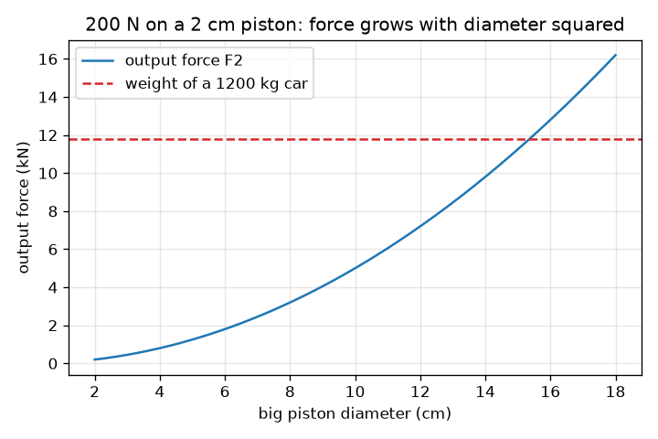
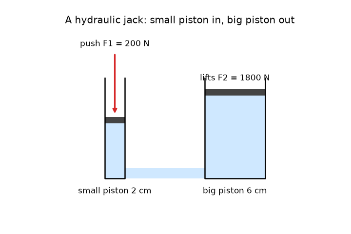

# सत्र 1: छोटा धक्का, बड़ी उठान

*स्तर 1 (वैचारिक इंटरैक्टिव मॉडल) · लगभग 60 मिनट · openhydraulics*

> यह एक सरलीकृत शैक्षिक मॉडल है। यह कोई प्रमाणित डिज़ाइन उपकरण नहीं है और इसका उपयोग वास्तविक संरचनाओं, विद्युत संस्थापनों, वाहनों, औद्योगिक प्रक्रियाओं या चिकित्सा निर्णयों के लिए नहीं किया जाना चाहिए।

**पूर्व-आवश्यकताएँ (Prerequisites)**

- बल, क्षेत्रफल, और वृत्त का क्षेत्रफल (स्कूल स्तर)।
- आपने PRIMER.md पढ़ लिया है और एक बार `python start.py 1` चला लिया है।

**सीखने के उद्देश्य (Learning objectives)।** इस सत्र के बाद आप:

- समझा सकेंगे कि स्थिर द्रव में दाब (pressure) सभी दिशाओं में बराबर लगता है।
- दाब को बल भाग क्षेत्रफल के रूप में और दूसरे पिस्टन (piston) पर बल की गणना कर सकेंगे।
- समझा सकेंगे कि बल क्यों गुणा होता है जबकि दूरी भाग होती है।
- पिस्टन व्यास के विरुद्ध निर्गत बल (output force) का ग्राफ़ पढ़ सकेंगे।

## A. वास्तविक जीवन की समस्या
गैराज का जैक पूरी कार उठा लेता है जब आप एक हाथ से हैंडल पंप करते हैं। एक कार का भार लगभग 12 000 न्यूटन होता है, जितना आप उठा सकते हैं उससे कहीं अधिक, तो अतिरिक्त बल कहाँ से आता है? कुछ भी जादू नहीं है: जैक में भरा द्रव वही दाब एक छोटे पिस्टन से एक बड़े पिस्टन तक पहुँचाता है, और बड़ा पिस्टन उस दाब को बड़े बल में बदल देता है। इस लाभ की हम क्या क़ीमत चुकाते हैं?

## B. अवधारणा और सिद्धांत
दाब किसी क्षेत्रफल पर फैला हुआ बल है: p = F / A। पास्कल का नियम (Pascal's law) कहता है कि स्थिर द्रव में, एक जगह जोड़ा गया दाब सभी दिशाओं में और द्रव के हर बिंदु पर बराबर महसूस होता है। दो-पिस्टन वाली मशीन में वही दाब p दोनों पिस्टनों पर लगता है, इसलिए F1 / A1 = F2 / A2 और बड़े पिस्टन पर बल F2 = F1 (A2 / A1) है। एक गोल पिस्टन का क्षेत्रफल A = pi d^2 / 4 है, इसलिए व्यास (diameter) दोगुना करने से क्षेत्रफल, और बल, चार गुना बड़ा हो जाता है। द्रव को दबाया (squash) नहीं जा सकता, इसलिए जो आयतन छोटे सिलिंडर से निकलता है वह बड़े में प्रवेश करता है: A1 s1 = A2 s2। इसलिए बड़ा पिस्टन केवल s2 = s1 (A1 / A2) चलता है: बल गुणा होता है, दूरी भाग होती है।

| प्रतीक | अर्थ | इकाई |
|---|---|---|
| p | द्रव में दाब | Pa (N/m^2) |
| F1, F2 | छोटे और बड़े पिस्टन पर बल | N |
| A1, A2 | छोटे और बड़े पिस्टन का क्षेत्रफल | m^2 |
| d1, d2 | छोटे और बड़े पिस्टन का व्यास | m |
| s1, s2 | छोटे और बड़े पिस्टन द्वारा चली गई दूरी | m |

**मान्यताएँ (Assumptions)**

- द्रव स्थिर है और उसे दबाया नहीं जा सकता।
- पिस्टनों पर कोई घर्षण नहीं और कोई रिसाव नहीं।
- द्रव स्तंभ के भार की उपेक्षा की गई है (जैक में यह बहुत छोटा है)।
- यह एक सरलीकृत शैक्षिक मॉडल है, डिज़ाइन उपकरण नहीं।

$$ p=\frac{F}{A},\qquad A=\frac{\pi d^{2}}{4} $$

$$ \frac{F_1}{A_1}=\frac{F_2}{A_2}\ \Rightarrow\ F_2=F_1\,\frac{A_2}{A_1}=F_1\left(\frac{d_2}{d_1}\right)^{2} $$

$$ A_1 s_1=A_2 s_2\ \Rightarrow\ s_2=s_1\,\frac{A_1}{A_2} $$

## C. दृश्य व्याख्या
पहला चित्र पैमाने पर खींचा गया एक हाइड्रोलिक जैक है: बाईं ओर एक पतला पंप सिलिंडर, दाईं ओर एक चौड़ा सिलिंडर, दोनों नीचे जुड़े हुए और द्रव से भरे हुए। एक लाल तीर छोटे पिस्टन को नीचे धकेलता है; बड़ा पिस्टन ऊपर उठता है, पर बहुत कम। दूसरा चित्र 2 cm पिस्टन पर 200 N धक्के के लिए बड़े पिस्टन के व्यास के विरुद्ध निर्गत बल आलेखित करता है। यह एक परवलय (parabola) है, क्योंकि बल व्यास के वर्ग के साथ बढ़ता है, और यह लगभग 15.3 cm व्यास पर 1200 kg कार के भार (डैश रेखा, 11.8 kN) को काटता है।

*2 cm पिस्टन पर 200 N धक्के के लिए बड़े पिस्टन के व्यास के विरुद्ध निर्गत बल, 1200 kg कार के भार के साथ।*

*पैमाने पर एक हाइड्रोलिक जैक: छोटा पिस्टन दूर तक चलता है, बड़ा पिस्टन थोड़ा-सा।*

## D. इंटरैक्टिव सिमुलेशन
पाठ चलाएँ (`python start.py 1`), फिर लाइव ऐप खोलें: [सत्र 1: छोटा धक्का, बड़ी उठान](https://krunalpanchal1995.github.io/pan-iit-oss/openhydraulics/session-01/) (या इसी फ़ोल्डर में `app.html`)। धक्का, दोनों व्यास और स्ट्रोक बदलें। देखें कि चित्र में दाब हर जगह एक जैसा रहता है, उठ जाने पर कार हरी हो जाती है, और बड़ा पिस्टन छोटे की तुलना में बहुत कम चलता है। फिर बल ग्राफ़ खोलें।

**चुनौती।** 1200 kg की कार (11.8 kN) उठाएँ: एक धक्का, दोनों व्यास और स्ट्रोक ऐसे चुनें कि कार हरी हो जाए।

## E. हल किया गया उदाहरण और प्रयोग
**समस्या।** 2 cm व्यास वाले छोटे पिस्टन पर 200 N का धक्का लगता है। बड़े पिस्टन का व्यास 6 cm है। दाब, बड़े पिस्टन पर बल, गुणक (multiplier), और छोटे पिस्टन के 5 cm चलने पर बड़ा पिस्टन कितना चलता है, ज्ञात करें। जाँचें कि दोनों ओर कार्य (work) बराबर है।

1. छोटे पिस्टन का क्षेत्रफल: A1 = pi * 0.02^2 / 4 = 3.142e-4 m^2।
2. दाब: p = F1 / A1 = 200 / 3.142e-4 = 636 600 Pa = 636.6 kPa (वायुमंडलीय दाब का लगभग 6.4 गुना)।
3. गुणक = (d2 / d1)^2 = (6 / 2)^2 = 9, इसलिए F2 = 9 * 200 = 1800 N।
4. दूरी: s2 = s1 / 9 = 50 mm / 9 = 5.6 mm।
5. अंदर गया कार्य: 200 N * 0.05 m = 10 J। बाहर निकला कार्य: 1800 N * 0.00556 m = 10 J। दोनों मेल खाते हैं।

**उत्तर।** p = 636.6 kPa, F2 = 1800 N, गुणक 9, बड़ा पिस्टन 5.6 mm चलता है, और अंदर और बाहर का कार्य 10 J है।

**प्रयोग।** एक छोटी और एक बड़ी प्लास्टिक सिरिंज को एक छोटी नली से जोड़ें और पूरे तंत्र को पानी से भरें, बिना किसी हवा के बुलबुले के। रूलर से दोनों बोर व्यास मापें और छोटे प्लंजर को धकेलें जबकि दूसरा व्यक्ति बड़े प्लंजर को रसोई के तराज़ू के सामने या हाथ से अपनी जगह पकड़े रखे। बल अनुपात व्यास अनुपात के वर्ग के क़रीब होना चाहिए। मापा गया अनुपात मॉडल से थोड़ा कम होगा: रबर की सील रगड़ती हैं, और कोई भी हवा का बुलबुला दब जाता है। मॉडल में इनमें से कुछ नहीं है, इसीलिए यह केवल पहला सन्निकटन (approximation) है।

## F. मूल्यांकन और डिज़ाइन चुनौती
**प्रश्न प्रकार A: वैचारिक।** एक हाइड्रोलिक जैक 200 N के धक्के से 1800 N का बल देता है। क्या यह उस नियम को तोड़ता है कि ऊर्जा बनाई नहीं जा सकती? चली गई दूरियों के साथ समझाएँ।

संकेत

दोनों ओर बल गुणा दूरी की तुलना करें।

चरण-दर-चरण हल

नहीं। बड़ा पिस्टन छोटे से नौ गुना कम चलता है, इसलिए कार्य बराबर है: 200 N * 0.05 m = 10 J अंदर, और 1800 N * 0.00556 m = 10 J बाहर। जैक दूरी के बदले बल देता है; यह ऊर्जा नहीं बनाता। एक वास्तविक जैक में घर्षण और रिसाव बाहर निकले कार्य को अंदर गए कार्य से थोड़ा कम कर देते हैं।

**प्रश्न प्रकार B: संख्यात्मक।** 300 N का बल 2.5 cm व्यास वाले छोटे पिस्टन को धकेलता है। बड़े पिस्टन का व्यास 10 cm है। kPa में दाब और बड़े पिस्टन पर बल ज्ञात करें।

संकेत

2.5 cm को 0.025 m में बदलें और A = pi d^2 / 4 तथा p = F / A का उपयोग करें। गुणक (d2 / d1)^2 है।

चरण-दर-चरण हल

A1 = pi * 0.025^2 / 4 = 4.909e-4 m^2, इसलिए p = 300 / 4.909e-4 = 611 155 Pa = 611.2 kPa। गुणक = (10 / 2.5)^2 = 16, इसलिए F2 = 16 * 300 = 4800 N। जाँच (sanity check): बड़ा पिस्टन चार गुना चौड़ा है, इसलिए उसका क्षेत्रफल सोलह गुना बड़ा है और बल भी।

**प्रश्न प्रकार C: ग्राफ़ और सिमुलेशन की व्याख्या।** बल ग्राफ़ (2 cm पिस्टन पर 200 N) में, बड़े पिस्टन के किस व्यास पर निर्गत बल पहली बार 1200 kg कार के भार के बराबर होता है, और व्यास दोगुना करने के बारे में वक्र आपको क्या बताता है?

संकेत

पढ़ें कि वक्र डैश रेखा को कहाँ काटता है, या 200 (d2 / 2)^2 = 11 772 हल करें।

चरण-दर-चरण हल

वक्र d2 = 15.3 cm के पास डैश रेखा को काटता है: d2 = 2 cm * sqrt(11 772 / 200) = 15.3 cm। व्यास दोगुना करने से बल चार गुना बड़ा हो जाता है, इसीलिए वक्र सीधी रेखा में उठने के बजाय परवलय की तरह ऊपर की ओर मुड़ता है।

**प्रश्न प्रकार D: डिज़ाइन और अनुकूलन (optimisation) चुनौती।** डिज़ाइन: आप 1.5 cm व्यास वाले पंप पिस्टन पर 150 N से धकेल सकते हैं और आपको 500 kg का भार (4905 N) उठाना है। बड़े पिस्टन का व्यास चुनें, और बताएँ कि भार को 1 cm उठाने के लिए आपको कितनी दूर धकेलना होगा।

संकेत

सबसे छोटा व्यास F2 = 4905 N को संतुष्ट करता है। फिर s2 = s1 / गुणक का उपयोग करें।

चरण-दर-चरण हल

सबसे छोटा व्यास d2 = 1.5 cm * sqrt(4905 / 150) = 8.58 cm है, इसलिए 9 cm चुनें। तब गुणक 36 है और F2 = 5400 N, 10 प्रतिशत का मार्जिन। भार को 1 cm उठाने के लिए पंप पिस्टन को कुल 36 cm चलना होगा, उदाहरण के लिए 6 cm के छह स्ट्रोक। समझौता (trade-off): चौड़ा बड़ा पिस्टन अधिक भार उठाता है पर प्रति सेंटीमीटर उठान के लिए अधिक पंपिंग चाहता है।

[RUBRIC.md](../../RUBRIC.md) से स्वयं को अंक दें। काग़ज़ पर काम करने के लिए [गतिविधि पत्रक (activity sheet)](activity_sheet.md) प्रिंट करें।

## सामान्य भ्रांतियाँ (Common misconceptions)
| सामान्य भ्रांति | वास्तव में क्या सच है |
|---|---|
| बड़े पिस्टन के नीचे दाब अधिक है क्योंकि वह बड़ा है। | द्रव में दाब हर जगह एक जैसा है। बड़े पिस्टन का क्षेत्रफल बड़ा है, इसलिए वही दाब बड़ा बल देता है। |
| हाइड्रोलिक जैक ऊर्जा बनाता है। | यह बल को बड़ा और दूरी को छोटा करता है। एक आदर्श जैक में अंदर गया कार्य बाहर निकले कार्य के बराबर है, और वास्तविक जैक थोड़ा खोता है। |
| दाब केवल नीचे की ओर धकेलता है, जैसे द्रव का भार। | स्थिर द्रव में दाब सभी दिशाओं में बराबर धकेलता है, दीवारों और पिस्टनों पर एक समान। |
| पिस्टन का व्यास दोगुना करने से बल दोगुना होता है। | बल क्षेत्रफल के अनुसार चलता है, जो व्यास के वर्ग के साथ बढ़ता है, इसलिए व्यास दोगुना करने से बल चार गुना बड़ा होता है। |

## शब्दावली (Glossary)
- **दाब (pressure)**: बल भाग वह क्षेत्रफल जिस पर वह लगता है; पास्कल में मापा जाता है
- **पास्कल (Pa)**: एक न्यूटन प्रति वर्ग मीटर; 1000 Pa, 1 kPa है
- **पास्कल का नियम (Pascal's law)**: स्थिर द्रव में जोड़ा गया दाब सभी दिशाओं में बराबर आगे पहुँचाया जाता है
- **पिस्टन (piston)**: एक चकती जो सिलिंडर में खिसकती है और द्रव पर धकेलती है
- **गुणक (multiplier)**: निर्गत बल और निवेश बल का अनुपात, A2 / A1

## समापन
1. [exercises.md](exercises.md) में दिए गए तीन कोडिंग कार्य करें।
2. अपने बदलावों के बाद `python start.py 1` फिर से चलाएँ। यह चेकपॉइंट के साथ समाप्त होता है; जब यह `PASS` छापे, तो आपका काम पूरा हो गया। (केवल चेकपॉइंट: `python start.py check 1`।)

आगे: [सत्र 2](../session-02/README.md)
