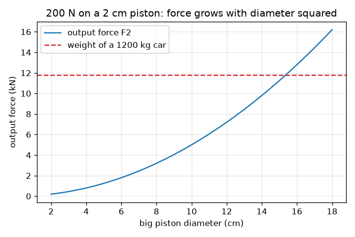
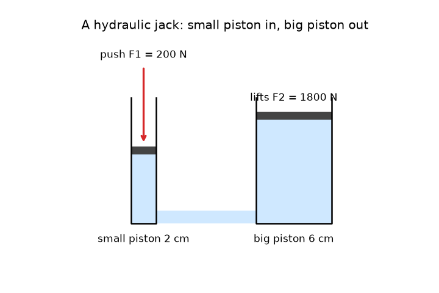

# സെഷൻ 1: ചെറിയ തള്ളൽ, വലിയ ഉയർത്തൽ

[Session 1 — हिन्दी](README.hi.md) · [Session 1 — മലയാളം](README.ml.md)

*ലെവൽ 1 (ആശയപരമായ ഇന്ററാക്ടീവ് മോഡൽ) · ഏകദേശം 60 മിനിറ്റ് · openhydraulics*

> ഇത് ലളിതമാക്കിയ ഒരു വിദ്യാഭ്യാസ മോഡലാണ്. ഇത് സാധൂകരിക്കപ്പെട്ട (validated) ഡിസൈൻ ഉപകരണമല്ല; യഥാർത്ഥ ഘടനകൾ, വൈദ്യുത സംവിധാനങ്ങൾ, വാഹനങ്ങൾ, വ്യാവസായിക പ്രക്രിയകൾ അല്ലെങ്കിൽ വൈദ്യശാസ്ത്ര തീരുമാനങ്ങൾ എന്നിവയ്ക്ക് ഇത് ഉപയോഗിക്കരുത്.

**മുൻ‌അറിവ് (Prerequisites)**

- ബലം, വിസ്തീർണ്ണം, വൃത്തത്തിന്റെ വിസ്തീർണ്ണം (സ്കൂൾ നിലവാരം).
- നിങ്ങൾ PRIMER.md വായിക്കുകയും `python start.py 1` ഒരിക്കൽ പ്രവർത്തിപ്പിക്കുകയും ചെയ്തിട്ടുണ്ട്.

**പഠന ലക്ഷ്യങ്ങൾ (Learning objectives).** ഈ സെഷനു ശേഷം നിങ്ങൾക്ക് കഴിയും:

- നിശ്ചലമായ ദ്രാവകത്തിലെ മർദ്ദം (pressure) എല്ലാ ദിശകളിലും തുല്യമായി പ്രവർത്തിക്കുന്നു എന്ന് വിശദീകരിക്കാൻ.
- മർദ്ദം ബലം ഹരണം വിസ്തീർണ്ണം ആയി കണക്കാക്കാനും രണ്ടാമത്തെ പിസ്റ്റണിലെ ബലം കണ്ടെത്താനും.
- ബലം ഗുണിക്കപ്പെടുമ്പോൾ ദൂരം ഹരിക്കപ്പെടുന്നത് എന്തുകൊണ്ടെന്ന് വിശദീകരിക്കാൻ.
- ഔട്ട്പുട്ട് ബലത്തിന്റെ പിസ്റ്റൺ വ്യാസത്തിനെതിരായ ഗ്രാഫ് വായിക്കാൻ.

## A. യഥാർത്ഥ ലോക പ്രശ്നം
ഒരു ഗാരേജ് ജാക്ക് ഒരു കൈ കൊണ്ട് ഹാൻഡിൽ പമ്പ് ചെയ്യുമ്പോൾ ഒരു മുഴുവൻ കാറിനെ ഉയർത്തുന്നു. ഒരു കാറിന് ഏകദേശം 12 000 ന്യൂട്ടൺ ഭാരമുണ്ട്, നിങ്ങൾക്ക് ഉയർത്താവുന്നതിലും വളരെ കൂടുതൽ, അപ്പോൾ അധിക ബലം എവിടെ നിന്ന് വരുന്നു? ഒന്നും മായാജാലമല്ല: ജാക്കിലെ ദ്രാവകം ഒരേ മർദ്ദം ചെറിയ പിസ്റ്റണിൽ നിന്ന് വലിയ പിസ്റ്റണിലേക്ക് കൈമാറുന്നു, വലിയ പിസ്റ്റൺ ആ മർദ്ദത്തെ വലിയ ബലമാക്കി മാറ്റുന്നു. നേട്ടത്തിന് നാം എന്ത് വില നൽകുന്നു?

## B. ആശയവും സിദ്ധാന്തവും
മർദ്ദം എന്നത് ഒരു വിസ്തീർണ്ണത്തിൽ പരത്തിയ ബലമാണ്: p = F / A. പാസ്കലിന്റെ നിയമം (Pascal's law) പറയുന്നത്, നിശ്ചലമായ ദ്രാവകത്തിൽ ഒരിടത്ത് ചേർക്കുന്ന മർദ്ദം എല്ലാ ദിശകളിലും ദ്രാവകത്തിലെ ഓരോ ബിന്ദുവിലും തുല്യമായി അനുഭവപ്പെടുന്നു എന്നാണ്. രണ്ട്-പിസ്റ്റൺ യന്ത്രത്തിൽ ഒരേ മർദ്ദം p രണ്ട് പിസ്റ്റണുകളിലും പ്രവർത്തിക്കുന്നു, അതിനാൽ F1 / A1 = F2 / A2, വലിയ പിസ്റ്റണിലെ ബലം F2 = F1 (A2 / A1) ആണ്. വൃത്താകൃതിയിലുള്ള പിസ്റ്റണിന്റെ വിസ്തീർണ്ണം A = pi d^2 / 4 ആണ്, അതിനാൽ വ്യാസം ഇരട്ടിയാക്കുമ്പോൾ വിസ്തീർണ്ണവും ബലവും നാലിരട്ടിയാകുന്നു. ദ്രാവകത്തെ ഞെരുക്കാൻ കഴിയില്ല, അതിനാൽ ചെറിയ സിലിണ്ടറിൽ നിന്ന് പുറത്തുപോകുന്ന വ്യാപ്തം വലിയതിലേക്ക് പ്രവേശിക്കുന്നു: A1 s1 = A2 s2. അതിനാൽ വലിയ പിസ്റ്റൺ s2 = s1 (A1 / A2) മാത്രം നീങ്ങുന്നു: ബലം ഗുണിക്കപ്പെടുന്നു, ദൂരം ഹരിക്കപ്പെടുന്നു.

| ചിഹ്നം | അർത്ഥം | യൂണിറ്റ് |
|---|---|---|
| p | ദ്രാവകത്തിലെ മർദ്ദം | Pa (N/m^2) |
| F1, F2 | ചെറിയ, വലിയ പിസ്റ്റണുകളിലെ ബലം | N |
| A1, A2 | ചെറിയ, വലിയ പിസ്റ്റണുകളുടെ വിസ്തീർണ്ണം | m^2 |
| d1, d2 | ചെറിയ, വലിയ പിസ്റ്റണുകളുടെ വ്യാസം | m |
| s1, s2 | ചെറിയ, വലിയ പിസ്റ്റണുകൾ നീങ്ങിയ ദൂരം | m |

**അനുമാനങ്ങൾ (Assumptions)**

- ദ്രാവകം നിശ്ചലമാണ്, ഞെരുക്കാൻ കഴിയില്ല.
- പിസ്റ്റണുകളിൽ ഘർഷണമില്ല, ചോർച്ചയില്ല.
- ദ്രാവക സ്തംഭത്തിന്റെ ഭാരം അവഗണിക്കുന്നു (ഒരു ജാക്കിൽ അത് നിസ്സാരമാണ്).
- ഇത് ലളിതമാക്കിയ വിദ്യാഭ്യാസ മോഡലാണ്, ഡിസൈൻ ഉപകരണമല്ല.

$$ p=\frac{F}{A},\qquad A=\frac{\pi d^{2}}{4} $$

$$ \frac{F_1}{A_1}=\frac{F_2}{A_2}\ \Rightarrow\ F_2=F_1\,\frac{A_2}{A_1}=F_1\left(\frac{d_2}{d_1}\right)^{2} $$

$$ A_1 s_1=A_2 s_2\ \Rightarrow\ s_2=s_1\,\frac{A_1}{A_2} $$

## C. ദൃശ്യ വിശദീകരണം
ആദ്യ ചിത്രം സ്കെയിലിൽ വരച്ച ഒരു ഹൈഡ്രോളിക് ജാക്ക് ആണ്: ഇടത്ത് നേർത്ത പമ്പ് സിലിണ്ടർ, വലത്ത് വീതിയുള്ള സിലിണ്ടർ, രണ്ടും അടിയിൽ യോജിപ്പിച്ച് ദ്രാവകം നിറച്ചത്. ഒരു ചുവന്ന അമ്പ് ചെറിയ പിസ്റ്റണെ താഴേക്ക് തള്ളുന്നു; വലിയ പിസ്റ്റൺ ഉയരുന്നു, പക്ഷേ വളരെ കുറച്ച്. രണ്ടാമത്തെ ചിത്രം 2 cm പിസ്റ്റണിൽ 200 N തള്ളലിന് വലിയ പിസ്റ്റൺ വ്യാസത്തിനെതിരെ ഔട്ട്പുട്ട് ബലം പ്ലോട്ട് ചെയ്യുന്നു. ബലം വ്യാസത്തിന്റെ വർഗ്ഗത്തോടൊപ്പം വളരുന്നതിനാൽ ഇത് ഒരു പരാബോളയാണ്, ഏകദേശം 15.3 cm വ്യാസത്തിൽ ഇത് 1200 kg കാറിന്റെ ഭാരത്തെ (ഡാഷ് രേഖ, 11.8 kN) മുറിച്ചുകടക്കുന്നു.

*2 cm പിസ്റ്റണിൽ 200 N തള്ളലിന് വലിയ പിസ്റ്റൺ വ്യാസത്തിനെതിരെ ഔട്ട്പുട്ട് ബലം, 1200 kg കാറിന്റെ ഭാരത്തോടൊപ്പം.*

*സ്കെയിലിൽ ഒരു ഹൈഡ്രോളിക് ജാക്ക്: ചെറിയ പിസ്റ്റൺ ഏറെ നീങ്ങുന്നു, വലിയ പിസ്റ്റൺ കുറച്ച് നീങ്ങുന്നു.*

## D. ഇന്ററാക്ടീവ് സിമുലേഷൻ
പാഠം പ്രവർത്തിപ്പിക്കുക (`python start.py 1`), തുടർന്ന് ലൈവ് ആപ്പ് തുറക്കുക: [സെഷൻ 1: ചെറിയ തള്ളൽ, വലിയ ഉയർത്തൽ](https://krunalpanchal1995.github.io/pan-iit-oss/openhydraulics/session-01/) (അല്ലെങ്കിൽ ഈ ഫോൾഡറിലെ `app.html`). തള്ളൽ, രണ്ട് വ്യാസങ്ങൾ, സ്ട്രോക്ക് എന്നിവ മാറ്റുക. ചിത്രത്തിൽ മർദ്ദം എല്ലായിടത്തും ഒരുപോലെ നിൽക്കുന്നതും, കാർ ഉയർത്തപ്പെടുമ്പോൾ പച്ചയാകുന്നതും, വലിയ പിസ്റ്റൺ ചെറിയതിനേക്കാൾ വളരെ കുറച്ച് നീങ്ങുന്നതും നിരീക്ഷിക്കുക. തുടർന്ന് ബല ഗ്രാഫ് തുറക്കുക.

**വെല്ലുവിളി.** 1200 kg കാർ (11.8 kN) ഉയർത്തുക: കാർ പച്ചയാകുന്ന വിധത്തിൽ തള്ളൽ, രണ്ട് വ്യാസങ്ങൾ, സ്ട്രോക്ക് എന്നിവ തിരഞ്ഞെടുക്കുക.

## E. ഉദാഹരണ പ്രശ്നവും പരീക്ഷണവും
**പ്രശ്നം.** 2 cm വ്യാസമുള്ള ഒരു ചെറിയ പിസ്റ്റണിൽ 200 N തള്ളൽ പ്രവർത്തിക്കുന്നു. വലിയ പിസ്റ്റണിന്റെ വ്യാസം 6 cm ആണ്. മർദ്ദം, വലിയ പിസ്റ്റണിലെ ബലം, ഗുണകം (multiplier), ചെറിയ പിസ്റ്റൺ 5 cm നീങ്ങുമ്പോൾ വലിയ പിസ്റ്റൺ എത്ര നീങ്ങുന്നു എന്നിവ കണ്ടെത്തുക. ഇരുവശത്തും പ്രവൃത്തി (work) തുല്യമാണെന്ന് പരിശോധിക്കുക.

1. ചെറിയ പിസ്റ്റൺ വിസ്തീർണ്ണം: A1 = pi * 0.02^2 / 4 = 3.142e-4 m^2.
2. മർദ്ദം: p = F1 / A1 = 200 / 3.142e-4 = 636 600 Pa = 636.6 kPa (അന്തരീക്ഷ മർദ്ദത്തിന്റെ ഏകദേശം 6.4 മടങ്ങ്).
3. ഗുണകം = (d2 / d1)^2 = (6 / 2)^2 = 9, അതിനാൽ F2 = 9 * 200 = 1800 N.
4. ദൂരം: s2 = s1 / 9 = 50 mm / 9 = 5.6 mm.
5. നൽകിയ പ്രവൃത്തി: 200 N * 0.05 m = 10 J. ലഭിച്ച പ്രവൃത്തി: 1800 N * 0.00556 m = 10 J. അവ യോജിക്കുന്നു.

**ഉത്തരം.** p = 636.6 kPa, F2 = 1800 N, ഗുണകം 9, വലിയ പിസ്റ്റൺ 5.6 mm നീങ്ങുന്നു, അകത്തും പുറത്തുമുള്ള പ്രവൃത്തി 10 J.

**പരീക്ഷണം.** ഒരു ചെറിയ പ്ലാസ്റ്റിക് സിറിഞ്ചും വലിയ ഒന്നും ഒരു ചെറിയ ട്യൂബ് കൊണ്ട് യോജിപ്പിച്ച് വായു കുമിളകളില്ലാതെ മുഴുവൻ സംവിധാനവും വെള്ളം കൊണ്ട് നിറയ്ക്കുക. രണ്ട് ബോർ വ്യാസങ്ങൾ ഒരു സ്കെയിൽ കൊണ്ട് അളക്കുക, മറ്റൊരാൾ വലിയ പ്ലങ്കറെ ഒരു അടുക്കള ത്രാസിനെതിരെയോ കൈകൊണ്ടോ പിടിച്ചുനിർത്തുമ്പോൾ ചെറിയ പ്ലങ്കർ തള്ളുക. ബല അനുപാതം വ്യാസ അനുപാതത്തിന്റെ വർഗ്ഗത്തോട് അടുത്തായിരിക്കണം. അളന്ന അനുപാതം മോഡലിനേക്കാൾ അല്പം കുറവായിരിക്കും: റബ്ബർ സീലുകൾ ഉരസുന്നു, ഏതൊരു വായു കുമിളയും ഞെരുങ്ങുന്നു. മോഡലിന് ഇവയൊന്നുമില്ല, അതുകൊണ്ടാണ് ഇത് ഒരു ആദ്യ ഏകദേശ കണക്ക് മാത്രമാകുന്നത്.

## F. മൂല്യനിർണ്ണയവും ഡിസൈൻ വെല്ലുവിളിയും
**ചോദ്യ തരം A: ആശയപരം.** ഒരു ഹൈഡ്രോളിക് ജാക്ക് 200 N തള്ളലിൽ നിന്ന് 1800 N ബലം നൽകുന്നു. ഇത് ഊർജ്ജം സൃഷ്ടിക്കാൻ കഴിയില്ല എന്ന നിയമത്തെ ലംഘിക്കുന്നുണ്ടോ? നീങ്ങിയ ദൂരങ്ങൾ ഉപയോഗിച്ച് വിശദീകരിക്കുക.

സൂചന

രണ്ട് വശങ്ങളിലെയും ബലം ഗുണം ദൂരം താരതമ്യം ചെയ്യുക.

ഘട്ടം ഘട്ടമായുള്ള പരിഹാരം

ഇല്ല. വലിയ പിസ്റ്റൺ ചെറിയതിനേക്കാൾ ഒമ്പത് മടങ്ങ് കുറച്ച് നീങ്ങുന്നു, അതിനാൽ പ്രവൃത്തി ഒന്നുതന്നെയാണ്: അകത്ത് 200 N * 0.05 m = 10 J, പുറത്ത് 1800 N * 0.00556 m = 10 J. ജാക്ക് ദൂരത്തെ ബലത്തിനായി കൈമാറ്റം ചെയ്യുന്നു; അത് ഊർജ്ജം സൃഷ്ടിക്കുന്നില്ല. യഥാർത്ഥ ജാക്കിൽ ഘർഷണവും ചോർച്ചയും പുറത്തുള്ള പ്രവൃത്തിയെ അകത്തുള്ളതിനേക്കാൾ അല്പം ചെറുതാക്കുന്നു.

**ചോദ്യ തരം B: സംഖ്യാപരം.** 300 N ബലം 2.5 cm വ്യാസമുള്ള ചെറിയ പിസ്റ്റണെ തള്ളുന്നു. വലിയ പിസ്റ്റണിന്റെ വ്യാസം 10 cm ആണ്. kPa-യിൽ മർദ്ദവും വലിയ പിസ്റ്റണിലെ ബലവും കണ്ടെത്തുക.

സൂചന

2.5 cm-നെ 0.025 m ആക്കി A = pi d^2 / 4, p = F / A എന്നിവ ഉപയോഗിക്കുക. ഗുണകം (d2 / d1)^2 ആണ്.

ഘട്ടം ഘട്ടമായുള്ള പരിഹാരം

A1 = pi * 0.025^2 / 4 = 4.909e-4 m^2, അതിനാൽ p = 300 / 4.909e-4 = 611 155 Pa = 611.2 kPa. ഗുണകം = (10 / 2.5)^2 = 16, അതിനാൽ F2 = 16 * 300 = 4800 N. യുക്തിപരിശോധന (sanity check): വലിയ പിസ്റ്റൺ നാലിരട്ടി വീതിയുള്ളതാണ്, അതിനാൽ അതിന്റെ വിസ്തീർണ്ണം പതിനാറിരട്ടി വലുതാണ്, ബലവും അങ്ങനെതന്നെ.

**ചോദ്യ തരം C: ഗ്രാഫ്, സിമുലേഷൻ വ്യാഖ്യാനം.** ബല ഗ്രാഫിൽ (2 cm പിസ്റ്റണിൽ 200 N), ഏത് വലിയ പിസ്റ്റൺ വ്യാസത്തിൽ ഔട്ട്പുട്ട് ബലം ആദ്യമായി 1200 kg കാറിന്റെ ഭാരത്തിന് തുല്യമാകുന്നു, വ്യാസം ഇരട്ടിയാക്കുന്നതിനെക്കുറിച്ച് വക്രം എന്തു പറയുന്നു?

സൂചന

വക്രം ഡാഷ് രേഖയെ മുറിച്ചുകടക്കുന്നിടം വായിക്കുക, അല്ലെങ്കിൽ 200 (d2 / 2)^2 = 11 772 പരിഹരിക്കുക.

ഘട്ടം ഘട്ടമായുള്ള പരിഹാരം

വക്രം d2 = 15.3 cm-ന് അടുത്ത് ഡാഷ് രേഖയെ മുറിച്ചുകടക്കുന്നു: d2 = 2 cm * sqrt(11 772 / 200) = 15.3 cm. വ്യാസം ഇരട്ടിയാക്കുന്നത് ബലം നാലിരട്ടിയാക്കുന്നു, അതുകൊണ്ടാണ് വക്രം നേർരേഖയിൽ ഉയരുന്നതിന് പകരം ഒരു പരാബോളയായി മുകളിലേക്ക് വളയുന്നത്.

**ചോദ്യ തരം D: ഡിസൈൻ, ഒപ്റ്റിമൈസേഷൻ വെല്ലുവിളി.** ഡിസൈൻ: 1.5 cm വ്യാസമുള്ള പമ്പ് പിസ്റ്റണിൽ നിങ്ങൾക്ക് 150 N കൊണ്ട് തള്ളാം, 500 kg ഭാരം (4905 N) ഉയർത്തണം. ഒരു വലിയ പിസ്റ്റൺ വ്യാസം തിരഞ്ഞെടുക്കുക, ഭാരം 1 cm ഉയർത്താൻ എത്ര ദൂരം തള്ളണമെന്ന് പറയുക.

സൂചന

ഏറ്റവും ചെറിയ വ്യാസം F2 = 4905 N തൃപ്തിപ്പെടുത്തുന്നു. തുടർന്ന് s2 = s1 / ഗുണകം ഉപയോഗിക്കുക.

ഘട്ടം ഘട്ടമായുള്ള പരിഹാരം

ഏറ്റവും ചെറിയ വ്യാസം d2 = 1.5 cm * sqrt(4905 / 150) = 8.58 cm ആണ്, അതിനാൽ 9 cm തിരഞ്ഞെടുക്കുക. അപ്പോൾ ഗുണകം 36 ഉം F2 = 5400 N ഉം ആണ്, 10 ശതമാനം മാർജിൻ. ഭാരം 1 cm ഉയർത്താൻ പമ്പ് പിസ്റ്റൺ ആകെ 36 cm നീങ്ങണം, ഉദാഹരണത്തിന് 6 cm വീതമുള്ള ആറ് സ്ട്രോക്കുകൾ. വിട്ടുവീഴ്ച (trade-off): വീതിയുള്ള വലിയ പിസ്റ്റൺ കൂടുതൽ ഭാരം വഹിക്കുന്നു, പക്ഷേ ഉയർത്തലിന്റെ ഓരോ സെന്റിമീറ്ററിനും കൂടുതൽ പമ്പിംഗ് വേണം.

[RUBRIC.md](../../RUBRIC.md) ഉപയോഗിച്ച് സ്വയം സ്കോർ ചെയ്യുക. പേപ്പറിൽ ചെയ്യാൻ [പ്രവർത്തന ഷീറ്റ്](activity_sheet.md) പ്രിന്റ് ചെയ്യുക.

## സാധാരണ തെറ്റിദ്ധാരണകൾ
| സാധാരണ തെറ്റിദ്ധാരണ | യഥാർത്ഥത്തിൽ ശരിയായത് |
|---|---|
| വലിയ പിസ്റ്റണിന് കീഴിൽ അത് വലുതായതിനാൽ മർദ്ദം കൂടുതലാണ്. | ദ്രാവകത്തിൽ എല്ലായിടത്തും മർദ്ദം ഒന്നുതന്നെയാണ്. വലിയ പിസ്റ്റണിന് വലിയ വിസ്തീർണ്ണമുണ്ട്, അതിനാൽ ഒരേ മർദ്ദം വലിയ ബലം നൽകുന്നു. |
| ഒരു ഹൈഡ്രോളിക് ജാക്ക് ഊർജ്ജം ഉണ്ടാക്കുന്നു. | അത് ബലം വലുതാക്കുകയും ദൂരം ചെറുതാക്കുകയും ചെയ്യുന്നു. ആദർശ ജാക്കിൽ അകത്തെ പ്രവൃത്തി പുറത്തെ പ്രവൃത്തിക്ക് തുല്യമാണ്, യഥാർത്ഥ ജാക്ക് അല്പം നഷ്ടപ്പെടുത്തുന്നു. |
| ദ്രാവക ഭാരം പോലെ മർദ്ദം താഴേക്ക് മാത്രം തള്ളുന്നു. | നിശ്ചലമായ ദ്രാവകത്തിലെ മർദ്ദം ചുവരുകളിലും പിസ്റ്റണുകളിലും എല്ലാ ദിശകളിലും തുല്യമായി തള്ളുന്നു. |
| പിസ്റ്റൺ വ്യാസം ഇരട്ടിയാക്കിയാൽ ബലം ഇരട്ടിയാകുന്നു. | ബലം വിസ്തീർണ്ണത്തെ പിന്തുടരുന്നു, അത് വ്യാസത്തിന്റെ വർഗ്ഗത്തോടൊപ്പം പോകുന്നു, അതിനാൽ വ്യാസം ഇരട്ടിയാക്കുന്നത് ബലം നാലിരട്ടിയാക്കുന്നു. |

## പദാവലി (Glossary)
- **മർദ്ദം (pressure)**: ബലം, അത് പ്രവർത്തിക്കുന്ന വിസ്തീർണ്ണം കൊണ്ട് ഹരിച്ചത്; പാസ്കലിൽ അളക്കുന്നു
- **പാസ്കൽ (pascal, Pa)**: ചതുരശ്ര മീറ്ററിന് ഒരു ന്യൂട്ടൺ; 1000 Pa എന്നത് 1 kPa
- **പാസ്കലിന്റെ നിയമം (Pascal's law)**: നിശ്ചലമായ ദ്രാവകത്തിൽ ചേർത്ത മർദ്ദം എല്ലാ ദിശകളിലും തുല്യമായി കൈമാറപ്പെടുന്നു
- **പിസ്റ്റൺ (piston)**: ഒരു സിലിണ്ടറിൽ തെന്നിനീങ്ങി ദ്രാവകത്തെ തള്ളുന്ന ഒരു ഡിസ്ക്
- **ഗുണകം (multiplier)**: ഔട്ട്പുട്ട് ബലത്തിന്റെയും ഇൻപുട്ട് ബലത്തിന്റെയും അനുപാതം, A2 / A1

## പൂർത്തിയാക്കുക
1. [exercises.md](exercises.md)-ലെ മൂന്ന് കോഡിംഗ് ടാസ്കുകൾ ചെയ്യുക.
2. നിങ്ങളുടെ മാറ്റങ്ങൾക്ക് ശേഷം `python start.py 1` വീണ്ടും പ്രവർത്തിപ്പിക്കുക. അത് ചെക്ക്പോയിന്റോടെ അവസാനിക്കുന്നു; അത് `PASS` പ്രിന്റ് ചെയ്യുമ്പോൾ നിങ്ങൾ പൂർത്തിയാക്കി. (ചെക്ക്പോയിന്റ് മാത്രം: `python start.py check 1`.)

അടുത്തത്: [സെഷൻ 2](../session-02/README.md)
