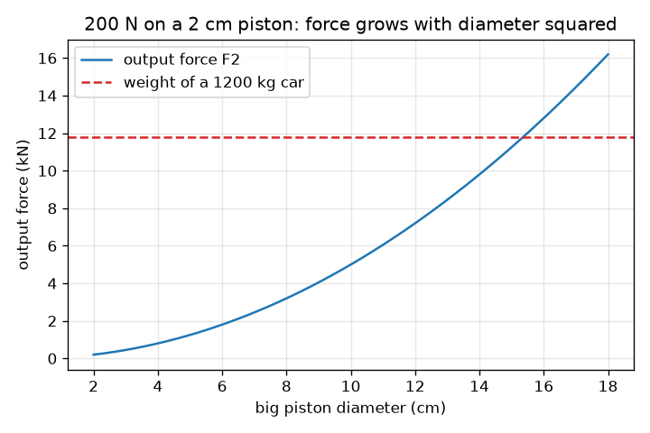
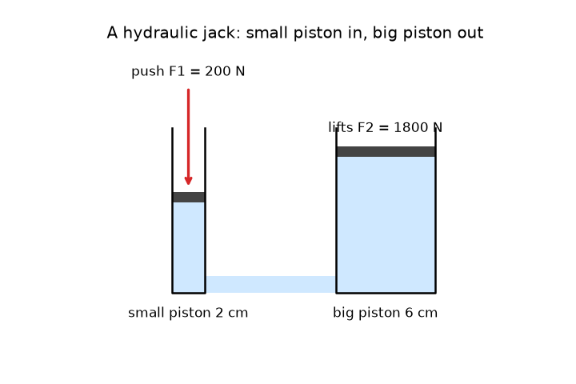

# அமர்வு 1: சிறிய தள்ளல், பெரிய தூக்கல்

[Session 1 — हिन्दी](README.hi.md) · [Session 1 — മലയാളം](README.ml.md) · [Session 1 — தமிழ்](README.ta.md)

*நிலை 1 (கருத்தியல் ஊடாடும் மாதிரி) · சுமார் 60 நிமிடங்கள் · openhydraulics*

> இது எளிமைப்படுத்தப்பட்ட ஒரு கல்வி மாதிரி. இது சரிபார்க்கப்பட்ட (validated) வடிவமைப்புக் கருவி அல்ல; உண்மையான கட்டமைப்புகள், மின் நிறுவல்கள், வாகனங்கள், தொழில்துறை செயல்முறைகள் அல்லது மருத்துவ முடிவுகளுக்கு இதைப் பயன்படுத்தக் கூடாது.

**முன்தேவைகள் (Prerequisites)**

- விசை, பரப்பு, வட்டத்தின் பரப்பு (பள்ளி நிலை).
- நீங்கள் PRIMER.md-ஐப் படித்து `python start.py 1`-ஐ ஒருமுறை இயக்கியிருக்கிறீர்கள்.

**கற்றல் நோக்கங்கள் (Learning objectives).** இந்த அமர்வுக்குப் பிறகு நீங்கள்:

- ஓய்வில் உள்ள திரவத்தில் அழுத்தம் (pressure) எல்லாத் திசைகளிலும் சமமாகச் செயல்படுகிறது என்பதை விளக்க முடியும்.
- அழுத்தத்தை விசை வகுத்தல் பரப்பு எனக் கணக்கிட்டு, இரண்டாவது பிஸ்டனின் மீதான விசையைக் கண்டறிய முடியும்.
- விசை பெருகும்போது தூரம் ஏன் குறைகிறது என்பதை விளக்க முடியும்.
- பிஸ்டன் விட்டத்திற்கு எதிரான வெளியீட்டு விசையின் வரைபடத்தைப் படிக்க முடியும்.

## A. நிஜ உலகச் சிக்கல்
ஒரு கேரேஜ் ஜாக் ஒரு கையால் கைப்பிடியை அழுத்தும்போது ஒரு முழு காரையும் தூக்குகிறது. ஒரு காரின் எடை சுமார் 12 000 நியூட்டன், நீங்கள் தூக்கக்கூடியதை விட மிக அதிகம், அப்படியானால் கூடுதல் விசை எங்கிருந்து வருகிறது? எதுவும் மாயமல்ல: ஜாக்கில் உள்ள திரவம் அதே அழுத்தத்தைச் சிறிய பிஸ்டனிலிருந்து பெரிய பிஸ்டனுக்குக் கடத்துகிறது, பெரிய பிஸ்டன் அந்த அழுத்தத்தைப் பெரிய விசையாக மாற்றுகிறது. இந்த ஆதாயத்துக்கு நாம் என்ன விலை கொடுக்கிறோம்?

## B. கருத்தும் கோட்பாடும்
அழுத்தம் என்பது ஒரு பரப்பில் பரவிய விசை: p = F / A. பாஸ்கல் விதி (Pascal's law) கூறுவது, ஓய்வில் உள்ள திரவத்தில் ஓரிடத்தில் சேர்க்கப்படும் அழுத்தம் எல்லாத் திசைகளிலும், திரவத்தின் ஒவ்வொரு புள்ளியிலும் சமமாக உணரப்படுகிறது என்பதே. இரண்டு-பிஸ்டன் இயந்திரத்தில் அதே அழுத்தம் p இரு பிஸ்டன்களிலும் செயல்படுகிறது, எனவே F1 / A1 = F2 / A2, பெரிய பிஸ்டனின் மீதான விசை F2 = F1 (A2 / A1). வட்டவடிவ பிஸ்டனின் பரப்பு A = pi d^2 / 4, எனவே விட்டத்தை இரட்டிப்பாக்கினால் பரப்பும் விசையும் நான்கு மடங்காகும். திரவத்தை அமுக்க முடியாது, எனவே சிறிய உருளையை விட்டு வெளியேறும் கன அளவு பெரியதில் நுழைகிறது: A1 s1 = A2 s2. எனவே பெரிய பிஸ்டன் s2 = s1 (A1 / A2) மட்டுமே நகர்கிறது: விசை பெருகுகிறது, தூரம் குறைகிறது.

| குறியீடு | பொருள் | அலகு |
|---|---|---|
| p | திரவத்தில் அழுத்தம் | Pa (N/m^2) |
| F1, F2 | சிறிய மற்றும் பெரிய பிஸ்டன்களின் மீதான விசை | N |
| A1, A2 | சிறிய மற்றும் பெரிய பிஸ்டன்களின் பரப்பு | m^2 |
| d1, d2 | சிறிய மற்றும் பெரிய பிஸ்டன்களின் விட்டம் | m |
| s1, s2 | சிறிய மற்றும் பெரிய பிஸ்டன்கள் நகர்ந்த தூரம் | m |

**அனுமானங்கள் (Assumptions)**

- திரவம் ஓய்வில் உள்ளது, அமுக்க முடியாதது.
- பிஸ்டன்களில் உராய்வு இல்லை, கசிவு இல்லை.
- திரவ நெடுவரிசையின் எடை புறக்கணிக்கப்படுகிறது (ஜாக்கில் அது மிகச் சிறியது).
- இது எளிமைப்படுத்தப்பட்ட கல்வி மாதிரி, வடிவமைப்புக் கருவி அல்ல.

$$ p=\frac{F}{A},\qquad A=\frac{\pi d^{2}}{4} $$

$$ \frac{F_1}{A_1}=\frac{F_2}{A_2}\ \Rightarrow\ F_2=F_1\,\frac{A_2}{A_1}=F_1\left(\frac{d_2}{d_1}\right)^{2} $$

$$ A_1 s_1=A_2 s_2\ \Rightarrow\ s_2=s_1\,\frac{A_1}{A_2} $$

## C. காட்சி விளக்கம்
முதல் படம் அளவுக்கேற்ப வரையப்பட்ட ஒரு நீரியல் ஜாக்: இடப்புறம் மெல்லிய பம்ப் உருளை, வலப்புறம் அகலமான உருளை, இரண்டும் அடியில் இணைக்கப்பட்டுத் திரவம் நிரப்பப்பட்டுள்ளன. ஒரு சிவப்பு அம்பு சிறிய பிஸ்டனைக் கீழே தள்ளுகிறது; பெரிய பிஸ்டன் உயர்கிறது, ஆனால் மிகக் குறைவாக. இரண்டாவது படம் 2 cm பிஸ்டனில் 200 N தள்ளலுக்குப் பெரிய பிஸ்டன் விட்டத்திற்கு எதிராக வெளியீட்டு விசையை வரைகிறது. விசை விட்டத்தின் வர்க்கத்துடன் வளர்வதால் இது ஒரு பரவளையம், சுமார் 15.3 cm விட்டத்தில் இது 1200 kg காரின் எடையை (கோடிட்ட கோடு, 11.8 kN) குறுக்கிடுகிறது.

*2 cm பிஸ்டனில் 200 N தள்ளலுக்குப் பெரிய பிஸ்டன் விட்டத்திற்கு எதிராக வெளியீட்டு விசை, 1200 kg காரின் எடையுடன்.*

*அளவுக்கேற்ப ஒரு நீரியல் ஜாக்: சிறிய பிஸ்டன் அதிகம் நகர்கிறது, பெரிய பிஸ்டன் சிறிது நகர்கிறது.*

## D. ஊடாடும் உருவகப்படுத்தல்
பாடத்தை இயக்கவும் (`python start.py 1`), பிறகு நேரடி செயலியைத் திறக்கவும்: [அமர்வு 1: சிறிய தள்ளல், பெரிய தூக்கல்](https://krunalpanchal1995.github.io/pan-iit-oss/openhydraulics/session-01/) (அல்லது இந்தக் கோப்புறையில் உள்ள `app.html`). தள்ளல், இரண்டு விட்டங்கள், அடிப்பயணம் (stroke) ஆகியவற்றை மாற்றவும். படத்தில் அழுத்தம் எங்கும் ஒரே மாதிரி இருப்பதையும், கார் தூக்கப்படும்போது பச்சையாவதையும், பெரிய பிஸ்டன் சிறியதை விட மிகக் குறைவாக நகர்வதையும் கவனிக்கவும். பிறகு விசை வரைபடத்தைத் திறக்கவும்.

**சவால்.** 1200 kg காரை (11.8 kN) தூக்கவும்: கார் பச்சையாகும்படி தள்ளல், இரண்டு விட்டங்கள், அடிப்பயணம் ஆகியவற்றைத் தேர்ந்தெடுக்கவும்.

## E. தீர்க்கப்பட்ட உதாரணமும் சோதனையும்
**சிக்கல்.** 2 cm விட்டமுள்ள சிறிய பிஸ்டனின் மீது 200 N தள்ளல் செயல்படுகிறது. பெரிய பிஸ்டனின் விட்டம் 6 cm. அழுத்தம், பெரிய பிஸ்டனின் மீதான விசை, பெருக்கி (multiplier), சிறிய பிஸ்டன் 5 cm நகரும்போது பெரிய பிஸ்டன் எவ்வளவு நகர்கிறது ஆகியவற்றைக் கண்டறியவும். இரு பக்கங்களிலும் வேலை (work) சமம் எனச் சரிபார்க்கவும்.

1. சிறிய பிஸ்டன் பரப்பு: A1 = pi * 0.02^2 / 4 = 3.142e-4 m^2.
2. அழுத்தம்: p = F1 / A1 = 200 / 3.142e-4 = 636 600 Pa = 636.6 kPa (வளிமண்டல அழுத்தத்தின் சுமார் 6.4 மடங்கு).
3. பெருக்கி = (d2 / d1)^2 = (6 / 2)^2 = 9, எனவே F2 = 9 * 200 = 1800 N.
4. தூரம்: s2 = s1 / 9 = 50 mm / 9 = 5.6 mm.
5. உள்ளிடும் வேலை: 200 N * 0.05 m = 10 J. வெளிவரும் வேலை: 1800 N * 0.00556 m = 10 J. அவை ஒத்துப்போகின்றன.

**விடை.** p = 636.6 kPa, F2 = 1800 N, பெருக்கி 9, பெரிய பிஸ்டன் 5.6 mm நகர்கிறது, உள்ளும் புறமும் வேலை 10 J.

**சோதனை.** ஒரு சிறிய பிளாஸ்டிக் ஊசிக்குழலையும் (syringe) ஒரு பெரியதையும் ஒரு குறுகிய குழாயால் இணைத்து, காற்றுக் குமிழ்கள் இல்லாமல் முழு அமைப்பையும் தண்ணீரால் நிரப்பவும். இரு துளை விட்டங்களை அளவுகோலால் அளந்து, இரண்டாவது நபர் பெரிய உந்தியை (plunger) சமையலறை எடைத்தராசுக்கு எதிராகவோ கையாலோ பிடித்திருக்கும்போது சிறிய உந்தியைத் தள்ளவும். விசை விகிதம் விட்ட விகிதத்தின் வர்க்கத்துக்கு அருகில் இருக்க வேண்டும். அளந்த விகிதம் மாதிரியை விடச் சற்றுக் குறைவாக இருக்கும்: ரப்பர் அடைப்புகள் உராய்கின்றன, எந்தக் காற்றுக் குமிழும் அமுங்குகிறது. மாதிரியில் இவை எதுவும் இல்லை, அதனால்தான் இது ஒரு முதல் தோராயம் மட்டுமே.

## F. மதிப்பீடும் வடிவமைப்புச் சவாலும்
**கேள்வி வகை A: கருத்தியல்.** ஒரு நீரியல் ஜாக் 200 N தள்ளலிலிருந்து 1800 N விசையைத் தருகிறது. இது ஆற்றலை உருவாக்க முடியாது என்ற விதியை மீறுகிறதா? நகர்ந்த தூரங்களைக் கொண்டு விளக்கவும்.

குறிப்பு

இரு பக்கங்களிலும் விசை பெருக்கல் தூரத்தை ஒப்பிடவும்.

படிப்படியான தீர்வு

இல்லை. பெரிய பிஸ்டன் சிறியதை விட ஒன்பது மடங்கு குறைவாக நகர்கிறது, எனவே வேலை சமம்: உள்ளே 200 N * 0.05 m = 10 J, வெளியே 1800 N * 0.00556 m = 10 J. ஜாக் தூரத்தை விசைக்காகப் பரிமாறுகிறது; அது ஆற்றலை உருவாக்குவதில்லை. உண்மையான ஜாக்கில் உராய்வும் கசிவும் வெளிவரும் வேலையை உள்ளிடும் வேலையை விடச் சற்றுச் சிறியதாக்குகின்றன.

**கேள்வி வகை B: எண்ணியல்.** 300 N விசை 2.5 cm விட்டமுள்ள சிறிய பிஸ்டனைத் தள்ளுகிறது. பெரிய பிஸ்டனின் விட்டம் 10 cm. kPa-இல் அழுத்தத்தையும் பெரிய பிஸ்டனின் மீதான விசையையும் கண்டறியவும்.

குறிப்பு

2.5 cm-ஐ 0.025 m ஆக மாற்றி A = pi d^2 / 4 மற்றும் p = F / A பயன்படுத்தவும். பெருக்கி (d2 / d1)^2.

படிப்படியான தீர்வு

A1 = pi * 0.025^2 / 4 = 4.909e-4 m^2, எனவே p = 300 / 4.909e-4 = 611 155 Pa = 611.2 kPa. பெருக்கி = (10 / 2.5)^2 = 16, எனவே F2 = 16 * 300 = 4800 N. நியாயச் சோதனை (sanity check): பெரிய பிஸ்டன் நான்கு மடங்கு அகலம், எனவே அதன் பரப்பு பதினாறு மடங்கு பெரியது, விசையும் அவ்வாறே.

**கேள்வி வகை C: வரைபடம் மற்றும் உருவகப்படுத்தல் விளக்கம்.** விசை வரைபடத்தில் (2 cm பிஸ்டனில் 200 N), எந்தப் பெரிய பிஸ்டன் விட்டத்தில் வெளியீட்டு விசை முதன்முதலில் 1200 kg காரின் எடைக்குச் சமமாகிறது, விட்டத்தை இரட்டிப்பாக்குவது பற்றி வளைவு என்ன சொல்கிறது?

குறிப்பு

வளைவு கோடிட்ட கோட்டைக் குறுக்கிடும் இடத்தைப் படிக்கவும், அல்லது 200 (d2 / 2)^2 = 11 772-ஐத் தீர்க்கவும்.

படிப்படியான தீர்வு

வளைவு d2 = 15.3 cm அருகே கோடிட்ட கோட்டைக் குறுக்கிடுகிறது: d2 = 2 cm * sqrt(11 772 / 200) = 15.3 cm. விட்டத்தை இரட்டிப்பாக்குவது விசையை நான்கு மடங்காக்குகிறது, அதனால்தான் வளைவு நேர்கோட்டில் உயராமல் ஒரு பரவளையமாக மேல்நோக்கி வளைகிறது.

**கேள்வி வகை D: வடிவமைப்பு மற்றும் உகப்பாக்கச் சவால்.** வடிவமைப்பு: 1.5 cm விட்டமுள்ள பம்ப் பிஸ்டனில் நீங்கள் 150 N கொண்டு தள்ளலாம், 500 kg சுமையை (4905 N) தூக்க வேண்டும். ஒரு பெரிய பிஸ்டன் விட்டத்தைத் தேர்ந்தெடுத்து, சுமையை 1 cm உயர்த்த எவ்வளவு தூரம் தள்ள வேண்டும் எனச் சொல்லவும்.

குறிப்பு

மிகச் சிறிய விட்டம் F2 = 4905 N-ஐ நிறைவு செய்கிறது. பிறகு s2 = s1 / பெருக்கி பயன்படுத்தவும்.

படிப்படியான தீர்வு

மிகச் சிறிய விட்டம் d2 = 1.5 cm * sqrt(4905 / 150) = 8.58 cm, எனவே 9 cm தேர்ந்தெடுக்கவும். அப்போது பெருக்கி 36, F2 = 5400 N, 10 சதவீத இடைவெளி. சுமையை 1 cm உயர்த்த பம்ப் பிஸ்டன் மொத்தம் 36 cm நகர வேண்டும், எடுத்துக்காட்டாக 6 cm வீதம் ஆறு அடிப்பயணங்கள். சமரசம் (trade-off): அகலமான பெரிய பிஸ்டன் அதிகச் சுமையைத் தாங்கும், ஆனால் தூக்கலின் ஒவ்வொரு சென்டிமீட்டருக்கும் அதிகமாகப் பம்ப் செய்ய வேண்டும்.

[RUBRIC.md](../../RUBRIC.md) கொண்டு உங்களை நீங்களே மதிப்பிடுங்கள். தாளில் செய்ய [செயல்பாட்டுத் தாளை](activity_sheet.md) அச்சிடுங்கள்.

## பொதுவான தவறான கருத்துகள்
| பொதுவான தவறான கருத்து | உண்மையில் சரியானது |
|---|---|
| பெரிய பிஸ்டனுக்குக் கீழே அது பெரியது என்பதால் அழுத்தம் அதிகம். | திரவத்தில் எங்கும் அழுத்தம் ஒன்றே. பெரிய பிஸ்டனுக்குப் பெரிய பரப்பு உண்டு, எனவே அதே அழுத்தம் பெரிய விசையைத் தருகிறது. |
| ஒரு நீரியல் ஜாக் ஆற்றலை உருவாக்குகிறது. | அது விசையைப் பெரிதாக்கி தூரத்தைச் சிறிதாக்குகிறது. இலட்சிய ஜாக்கில் உள்ளிடும் வேலை வெளிவரும் வேலைக்குச் சமம், உண்மையான ஜாக் சற்று இழக்கிறது. |
| திரவ எடையைப் போல அழுத்தம் கீழ்நோக்கி மட்டுமே தள்ளுகிறது. | ஓய்வில் உள்ள திரவத்தில் அழுத்தம் சுவர்கள், பிஸ்டன்கள் என எல்லாவற்றின் மீதும் எல்லாத் திசைகளிலும் சமமாகத் தள்ளுகிறது. |
| பிஸ்டன் விட்டத்தை இரட்டிப்பாக்கினால் விசை இரட்டிப்பாகும். | விசை பரப்பைப் பின்பற்றுகிறது, அது விட்டத்தின் வர்க்கத்துடன் செல்கிறது, எனவே விட்டத்தை இரட்டிப்பாக்கினால் விசை நான்கு மடங்காகும். |

## சொற்களஞ்சியம் (Glossary)
- **அழுத்தம் (pressure)**: விசை வகுத்தல் அது செயல்படும் பரப்பு; பாஸ்கலில் அளக்கப்படுகிறது
- **பாஸ்கல் (pascal, Pa)**: சதுர மீட்டருக்கு ஒரு நியூட்டன்; 1000 Pa என்பது 1 kPa
- **பாஸ்கல் விதி (Pascal's law)**: ஓய்வில் உள்ள திரவத்தில் சேர்க்கப்பட்ட அழுத்தம் எல்லாத் திசைகளிலும் சமமாகக் கடத்தப்படுகிறது
- **பிஸ்டன் (piston)**: உருளையில் வழுக்கிச் சென்று திரவத்தைத் தள்ளும் வட்டு
- **பெருக்கி (multiplier)**: வெளியீட்டு விசைக்கும் உள்ளீட்டு விசைக்கும் இடையிலான விகிதம், A2 / A1

## நிறைவு
1. [exercises.md](exercises.md)-இல் உள்ள மூன்று நிரலாக்கப் பணிகளைச் செய்யவும்.
2. உங்கள் மாற்றங்களுக்குப் பிறகு `python start.py 1`-ஐ மீண்டும் இயக்கவும். அது சோதனைச்சாவடியுடன் (checkpoint) முடிகிறது; அது `PASS` என அச்சிடும்போது நீங்கள் முடித்துவிட்டீர்கள். (சோதனைச்சாவடி மட்டும்: `python start.py check 1`.)

அடுத்து: [அமர்வு 2](../session-02/README.md)
