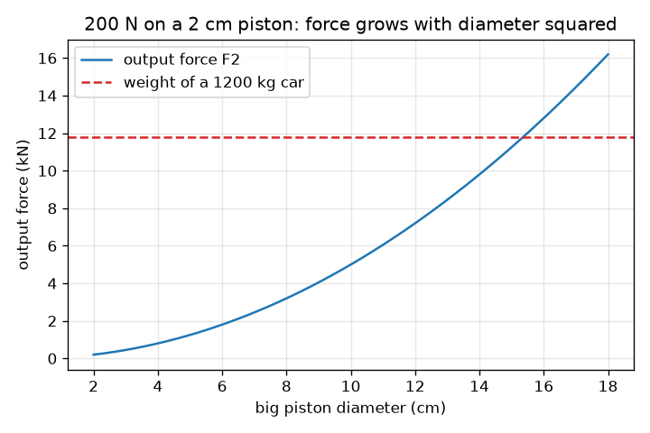
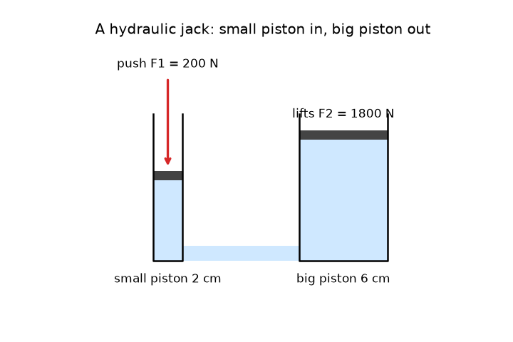

# సెషన్ 1: చిన్న నెట్టు, పెద్ద ఎత్తు

[Session 1 — हिन्दी](README.hi.md) · [Session 1 — മലയാളം](README.ml.md) · [Session 1 — தமிழ்](README.ta.md) · [Session 1 — తెలుగు](README.te.md)

*స్థాయి 1 (భావనాత్మక ఇంటరాక్టివ్ నమూనా) · సుమారు 60 నిమిషాలు · openhydraulics*

> ఇది సరళీకరించిన విద్యా నమూనా. ఇది ధృవీకరించబడిన (validated) డిజైన్ సాధనం కాదు; నిజమైన నిర్మాణాలు, విద్యుత్ సంస్థాపనలు, వాహనాలు, పారిశ్రామిక ప్రక్రియలు లేదా వైద్య నిర్ణయాల కోసం దీన్ని ఉపయోగించకూడదు.

**ముందస్తు జ్ఞానం (Prerequisites)**

- బలం, వైశాల్యం, వృత్తం వైశాల్యం (పాఠశాల స్థాయి).
- మీరు PRIMER.md చదివి `python start.py 1` ఒకసారి నడిపారు.

**అభ్యసన లక్ష్యాలు (Learning objectives).** ఈ సెషన్ తర్వాత మీరు:

- విశ్రాంతిలో ఉన్న ద్రవంలో పీడనం (pressure) అన్ని దిశల్లో సమానంగా పనిచేస్తుందని వివరించగలరు.
- పీడనాన్ని బలం భాగహారం వైశాల్యంగా లెక్కించి, రెండో పిస్టన్‌పై బలాన్ని కనుగొనగలరు.
- బలం గుణించబడినప్పుడు దూరం ఎందుకు భాగించబడుతుందో వివరించగలరు.
- పిస్టన్ వ్యాసానికి వ్యతిరేకంగా అవుట్‌పుట్ బలం గ్రాఫ్ చదవగలరు.

## A. వాస్తవ ప్రపంచ సమస్య
గ్యారేజ్ జాక్ ఒక చేత్తో హ్యాండిల్‌ను పంప్ చేస్తే మొత్తం కారును ఎత్తుతుంది. ఒక కారు బరువు సుమారు 12 000 న్యూటన్లు, మీరు ఎత్తగలిగిన దానికంటే చాలా ఎక్కువ, మరి అదనపు బలం ఎక్కడ నుండి వస్తుంది? ఏదీ మాయ కాదు: జాక్‌లోని ద్రవం అదే పీడనాన్ని చిన్న పిస్టన్ నుండి పెద్ద పిస్టన్‌కు చేరవేస్తుంది, పెద్ద పిస్టన్ ఆ పీడనాన్ని పెద్ద బలంగా మారుస్తుంది. ఈ లాభానికి మనం ఏ మూల్యం చెల్లిస్తున్నాం?

## B. భావన మరియు సిద్ధాంతం
పీడనం అంటే ఒక వైశాల్యంపై పరచిన బలం: p = F / A. పాస్కల్ నియమం (Pascal's law) ప్రకారం, విశ్రాంతిలో ఉన్న ద్రవంలో ఒక చోట జోడించిన పీడనం అన్ని దిశల్లో, ద్రవంలోని ప్రతి బిందువు వద్ద సమానంగా అనుభవంలోకి వస్తుంది. రెండు-పిస్టన్ యంత్రంలో అదే పీడనం p రెండు పిస్టన్‌లపై పనిచేస్తుంది, కాబట్టి F1 / A1 = F2 / A2, పెద్ద పిస్టన్‌పై బలం F2 = F1 (A2 / A1). గుండ్రని పిస్టన్ వైశాల్యం A = pi d^2 / 4, కాబట్టి వ్యాసాన్ని రెట్టింపు చేస్తే వైశాల్యం, బలం నాలుగు రెట్లు అవుతాయి. ద్రవాన్ని నొక్కలేము, కాబట్టి చిన్న సిలిండర్ నుండి బయటకు వెళ్ళే ఘనపరిమాణం పెద్దదానిలోకి వెళ్తుంది: A1 s1 = A2 s2. కాబట్టి పెద్ద పిస్టన్ s2 = s1 (A1 / A2) మాత్రమే కదులుతుంది: బలం గుణించబడుతుంది, దూరం భాగించబడుతుంది.

| గుర్తు | అర్థం | యూనిట్ |
|---|---|---|
| p | ద్రవంలో పీడనం | Pa (N/m^2) |
| F1, F2 | చిన్న, పెద్ద పిస్టన్‌లపై బలం | N |
| A1, A2 | చిన్న, పెద్ద పిస్టన్‌ల వైశాల్యం | m^2 |
| d1, d2 | చిన్న, పెద్ద పిస్టన్‌ల వ్యాసం | m |
| s1, s2 | చిన్న, పెద్ద పిస్టన్‌లు కదిలిన దూరం | m |

**ఊహలు (Assumptions)**

- ద్రవం విశ్రాంతిలో ఉంది, నొక్కలేనిది.
- పిస్టన్‌ల వద్ద ఘర్షణ లేదు, లీకేజీ లేదు.
- ద్రవ స్తంభం బరువు విస్మరించబడుతుంది (జాక్‌లో అది చాలా చిన్నది).
- ఇది సరళీకరించిన విద్యా నమూనా, డిజైన్ సాధనం కాదు.

$$ p=\frac{F}{A},\qquad A=\frac{\pi d^{2}}{4} $$

$$ \frac{F_1}{A_1}=\frac{F_2}{A_2}\ \Rightarrow\ F_2=F_1\,\frac{A_2}{A_1}=F_1\left(\frac{d_2}{d_1}\right)^{2} $$

$$ A_1 s_1=A_2 s_2\ \Rightarrow\ s_2=s_1\,\frac{A_1}{A_2} $$

## C. దృశ్య వివరణ
మొదటి చిత్రం స్కేల్‌కు అనుగుణంగా గీసిన హైడ్రాలిక్ జాక్: ఎడమవైపు సన్నని పంప్ సిలిండర్, కుడివైపు వెడల్పాటి సిలిండర్, రెండూ అడుగున కలిపి ద్రవంతో నింపబడ్డాయి. ఒక ఎరుపు బాణం చిన్న పిస్టన్‌ను కిందికి నెడుతుంది; పెద్ద పిస్టన్ పైకి లేస్తుంది, కానీ చాలా తక్కువగా. రెండో చిత్రం 2 cm పిస్టన్‌పై 200 N నెట్టుకు పెద్ద పిస్టన్ వ్యాసానికి వ్యతిరేకంగా అవుట్‌పుట్ బలాన్ని ప్లాట్ చేస్తుంది. బలం వ్యాసం వర్గంతో పెరుగుతుంది కాబట్టి ఇది ఒక పరావలయం, సుమారు 15.3 cm వ్యాసం వద్ద ఇది 1200 kg కారు బరువును (చుక్కల రేఖ, 11.8 kN) దాటుతుంది.

*2 cm పిస్టన్‌పై 200 N నెట్టుకు పెద్ద పిస్టన్ వ్యాసానికి వ్యతిరేకంగా అవుట్‌పుట్ బలం, 1200 kg కారు బరువుతో.*

*స్కేల్‌కు అనుగుణంగా ఒక హైడ్రాలిక్ జాక్: చిన్న పిస్టన్ ఎక్కువ కదులుతుంది, పెద్ద పిస్టన్ కొంచెమే కదులుతుంది.*

## D. ఇంటరాక్టివ్ సిమ్యులేషన్
పాఠాన్ని నడపండి (`python start.py 1`), తర్వాత లైవ్ యాప్‌ను తెరవండి: [సెషన్ 1: చిన్న నెట్టు, పెద్ద ఎత్తు](https://krunalpanchal1995.github.io/pan-iit-oss/openhydraulics/session-01/) (లేదా ఈ ఫోల్డర్‌లోని `app.html`). నెట్టు, రెండు వ్యాసాలు, స్ట్రోక్ మార్చండి. చిత్రంలో పీడనం ప్రతిచోటా ఒకేలా ఉండటం, కారు ఎత్తబడినప్పుడు ఆకుపచ్చగా మారడం, పెద్ద పిస్టన్ చిన్నదాని కంటే చాలా తక్కువగా కదలడం గమనించండి. తర్వాత బలం గ్రాఫ్ తెరవండి.

**సవాలు.** 1200 kg కారును (11.8 kN) ఎత్తండి: కారు ఆకుపచ్చగా మారేలా నెట్టు, రెండు వ్యాసాలు, స్ట్రోక్ ఎంచుకోండి.

## E. సాధించిన ఉదాహరణ మరియు ప్రయోగం
**సమస్య.** 2 cm వ్యాసం ఉన్న చిన్న పిస్టన్‌పై 200 N నెట్టు పనిచేస్తుంది. పెద్ద పిస్టన్ వ్యాసం 6 cm. పీడనం, పెద్ద పిస్టన్‌పై బలం, గుణకం (multiplier), చిన్న పిస్టన్ 5 cm కదిలినప్పుడు పెద్ద పిస్టన్ ఎంత కదులుతుందో కనుగొనండి. రెండు వైపులా పని (work) సమానమని తనిఖీ చేయండి.

1. చిన్న పిస్టన్ వైశాల్యం: A1 = pi * 0.02^2 / 4 = 3.142e-4 m^2.
2. పీడనం: p = F1 / A1 = 200 / 3.142e-4 = 636 600 Pa = 636.6 kPa (వాతావరణ పీడనం కంటే సుమారు 6.4 రెట్లు).
3. గుణకం = (d2 / d1)^2 = (6 / 2)^2 = 9, కాబట్టి F2 = 9 * 200 = 1800 N.
4. దూరం: s2 = s1 / 9 = 50 mm / 9 = 5.6 mm.
5. ఇన్‌పుట్ పని: 200 N * 0.05 m = 10 J. అవుట్‌పుట్ పని: 1800 N * 0.00556 m = 10 J. అవి సరిపోతాయి.

**సమాధానం.** p = 636.6 kPa, F2 = 1800 N, గుణకం 9, పెద్ద పిస్టన్ 5.6 mm కదులుతుంది, లోపల బయట పని 10 J.

**ప్రయోగం.** ఒక చిన్న ప్లాస్టిక్ సిరంజి, ఒక పెద్దది తీసుకుని ఒక చిన్న ట్యూబ్‌తో కలిపి, గాలి బుడగలు లేకుండా మొత్తం వ్యవస్థను నీటితో నింపండి. రెండు బోర్ వ్యాసాలను స్కేలుతో కొలవండి, రెండో వ్యక్తి పెద్ద ప్లంగర్‌ను వంటగది త్రాసుకు వ్యతిరేకంగా లేదా చేత్తో పట్టుకున్నప్పుడు చిన్న ప్లంగర్‌ను నెట్టండి. బలం నిష్పత్తి వ్యాస నిష్పత్తి వర్గానికి దగ్గరగా ఉండాలి. కొలిచిన నిష్పత్తి నమూనా కంటే కొంచెం తక్కువగా ఉంటుంది: రబ్బరు సీల్‌లు రాపిడి చేస్తాయి, ఏ గాలి బుడగైనా నలుగుతుంది. నమూనాలో ఇవేవీ లేవు, అందుకే ఇది మొదటి సుమారు అంచనా మాత్రమే.

## F. మూల్యాంకనం మరియు డిజైన్ సవాలు
**ప్రశ్న రకం A: భావనాత్మక.** ఒక హైడ్రాలిక్ జాక్ 200 N నెట్టు నుండి 1800 N బలాన్ని ఇస్తుంది. ఇది శక్తిని సృష్టించలేమనే నియమాన్ని ఉల్లంఘిస్తుందా? కదిలిన దూరాలతో వివరించండి.

సూచన

రెండు వైపులా బలం గుణకారం దూరాన్ని పోల్చండి.

దశలవారీ పరిష్కారం

లేదు. పెద్ద పిస్టన్ చిన్నదాని కంటే తొమ్మిది రెట్లు తక్కువ కదులుతుంది, కాబట్టి పని సమానం: లోపల 200 N * 0.05 m = 10 J, బయట 1800 N * 0.00556 m = 10 J. జాక్ దూరాన్ని బలానికి బదులుగా మార్చుకుంటుంది; అది శక్తిని సృష్టించదు. నిజమైన జాక్‌లో ఘర్షణ, లీకేజీ వల్ల బయటకు వచ్చే పని లోపలికి పెట్టిన పని కంటే కొంచెం తక్కువగా ఉంటుంది.

**ప్రశ్న రకం B: సంఖ్యాత్మక.** 300 N బలం 2.5 cm వ్యాసం ఉన్న చిన్న పిస్టన్‌ను నెడుతుంది. పెద్ద పిస్టన్ వ్యాసం 10 cm. kPa లో పీడనాన్ని, పెద్ద పిస్టన్‌పై బలాన్ని కనుగొనండి.

సూచన

2.5 cm ను 0.025 m గా మార్చి A = pi d^2 / 4, p = F / A వాడండి. గుణకం (d2 / d1)^2.

దశలవారీ పరిష్కారం

A1 = pi * 0.025^2 / 4 = 4.909e-4 m^2, కాబట్టి p = 300 / 4.909e-4 = 611 155 Pa = 611.2 kPa. గుణకం = (10 / 2.5)^2 = 16, కాబట్టి F2 = 16 * 300 = 4800 N. సహేతుకత తనిఖీ (sanity check): పెద్ద పిస్టన్ నాలుగు రెట్లు వెడల్పు, కాబట్టి దాని వైశాల్యం పదహారు రెట్లు పెద్దది, బలం కూడా అంతే.

**ప్రశ్న రకం C: గ్రాఫ్ మరియు సిమ్యులేషన్ వ్యాఖ్యానం.** బలం గ్రాఫ్‌లో (2 cm పిస్టన్‌పై 200 N), ఏ పెద్ద పిస్టన్ వ్యాసం వద్ద అవుట్‌పుట్ బలం మొదటిసారి 1200 kg కారు బరువుకు సమానమవుతుంది, వ్యాసాన్ని రెట్టింపు చేయడం గురించి వక్రం ఏమి చెబుతుంది?

సూచన

వక్రం చుక్కల రేఖను దాటే చోటు చదవండి, లేదా 200 (d2 / 2)^2 = 11 772 సాధించండి.

దశలవారీ పరిష్కారం

వక్రం d2 = 15.3 cm దగ్గర చుక్కల రేఖను దాటుతుంది: d2 = 2 cm * sqrt(11 772 / 200) = 15.3 cm. వ్యాసాన్ని రెట్టింపు చేస్తే బలం నాలుగు రెట్లు అవుతుంది, అందుకే వక్రం సరళ రేఖలో పెరగకుండా పరావలయంగా పైకి వంగుతుంది.

**ప్రశ్న రకం D: డిజైన్ మరియు ఆప్టిమైజేషన్ సవాలు.** డిజైన్: 1.5 cm వ్యాసం ఉన్న పంప్ పిస్టన్‌పై మీరు 150 N తో నెట్టగలరు, 500 kg భారాన్ని (4905 N) ఎత్తాలి. ఒక పెద్ద పిస్టన్ వ్యాసాన్ని ఎంచుకుని, భారాన్ని 1 cm ఎత్తడానికి ఎంత దూరం నెట్టాలో చెప్పండి.

సూచన

అతి చిన్న వ్యాసం F2 = 4905 N ను తీరుస్తుంది. తర్వాత s2 = s1 / గుణకం వాడండి.

దశలవారీ పరిష్కారం

అతి చిన్న వ్యాసం d2 = 1.5 cm * sqrt(4905 / 150) = 8.58 cm, కాబట్టి 9 cm ఎంచుకోండి. అప్పుడు గుణకం 36, F2 = 5400 N, 10 శాతం మార్జిన్. భారాన్ని 1 cm ఎత్తడానికి పంప్ పిస్టన్ మొత్తం 36 cm కదలాలి, ఉదాహరణకు 6 cm చొప్పున ఆరు స్ట్రోక్‌లు. రాజీ (trade-off): వెడల్పాటి పెద్ద పిస్టన్ ఎక్కువ భారాన్ని మోస్తుంది, కానీ ఎత్తిన ప్రతి సెంటీమీటర్‌కు ఎక్కువ పంపింగ్ కావాలి.

[RUBRIC.md](../../RUBRIC.md) తో మిమ్మల్ని మీరు అంచనా వేసుకోండి. కాగితంపై పని చేయడానికి [కార్యాచరణ పత్రాన్ని](activity_sheet.md) ప్రింట్ చేయండి.

## సాధారణ అపోహలు
| సాధారణ అపోహ | నిజానికి సరైనది |
|---|---|
| పెద్ద పిస్టన్ పెద్దది కాబట్టి దాని కింద పీడనం ఎక్కువ. | ద్రవంలో ప్రతిచోటా పీడనం ఒకటే. పెద్ద పిస్టన్‌కు పెద్ద వైశాల్యం ఉంది, కాబట్టి అదే పీడనం పెద్ద బలాన్ని ఇస్తుంది. |
| హైడ్రాలిక్ జాక్ శక్తిని తయారు చేస్తుంది. | అది బలాన్ని పెద్దదిగా, దూరాన్ని చిన్నదిగా చేస్తుంది. ఆదర్శ జాక్‌లో ఇన్‌పుట్ పని అవుట్‌పుట్ పనికి సమానం, నిజమైన జాక్ కొంచెం కోల్పోతుంది. |
| ద్రవ బరువు లాగా పీడనం కిందికి మాత్రమే నెడుతుంది. | విశ్రాంతిలో ఉన్న ద్రవంలో పీడనం గోడలపై, పిస్టన్‌లపై అన్ని దిశల్లో సమానంగా నెడుతుంది. |
| పిస్టన్ వ్యాసాన్ని రెట్టింపు చేస్తే బలం రెట్టింపు అవుతుంది. | బలం వైశాల్యాన్ని అనుసరిస్తుంది, అది వ్యాసం వర్గంతో పోతుంది, కాబట్టి వ్యాసాన్ని రెట్టింపు చేస్తే బలం నాలుగు రెట్లు అవుతుంది. |

## పదకోశం (Glossary)
- **పీడనం (pressure)**: బలం భాగహారం అది పనిచేసే వైశాల్యం; పాస్కల్స్‌లో కొలుస్తారు
- **పాస్కల్ (pascal, Pa)**: చదరపు మీటరుకు ఒక న్యూటన్; 1000 Pa అంటే 1 kPa
- **పాస్కల్ నియమం (Pascal's law)**: విశ్రాంతిలో ఉన్న ద్రవానికి జోడించిన పీడనం అన్ని దిశల్లో సమానంగా చేరవేయబడుతుంది
- **పిస్టన్ (piston)**: సిలిండర్‌లో జారుతూ ద్రవాన్ని నెట్టే డిస్క్
- **గుణకం (multiplier)**: అవుట్‌పుట్ బలానికి ఇన్‌పుట్ బలానికి నిష్పత్తి, A2 / A1

## ముగింపు
1. [exercises.md](exercises.md) లోని మూడు కోడింగ్ పనులు చేయండి.
2. మీ మార్పుల తర్వాత `python start.py 1` ను మళ్ళీ నడపండి. అది చెక్‌పాయింట్‌తో ముగుస్తుంది; అది `PASS` అని ప్రింట్ చేసినప్పుడు మీరు పూర్తి చేశారు. (చెక్‌పాయింట్ మాత్రమే: `python start.py check 1`.)

తదుపరి: [సెషన్ 2](../session-02/README.md)
