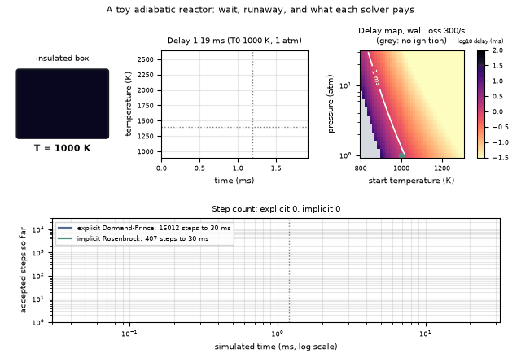
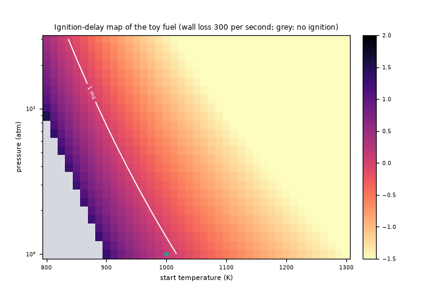
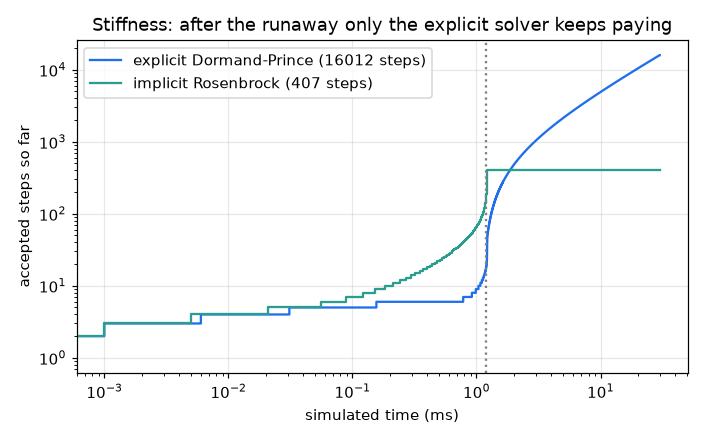
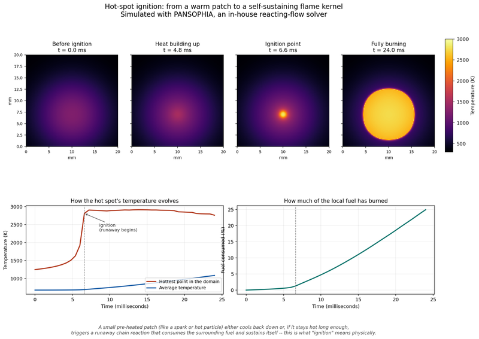
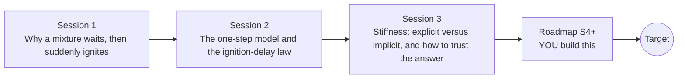

# openignition

[](https://github.com/KrunalPanchal1995/pan-iit-oss/actions/workflows/tests.yml)   [](https://colab.research.google.com/github/KrunalPanchal1995/pan-iit-oss/blob/main/openignition/sessions/session-01/lesson.ipynb) [](https://krunalpanchal1995.github.io/pan-iit-oss/openignition/)

**Predict when a mixture ignites: ignition delay, thermal runaway and stiff solvers, in three sessions.**

openignition teaches how a fuel-air mixture waits and then suddenly ignites: a one-step Arrhenius toy with heat release, the ignition-delay law, and the stiff solvers that compute it reliably, using only Python and a browser.

- **Start from a wait and a jump.** Session 1 needs only a calculator-level feel for exponentials; the rest is explained as you go.
- **See it ignite.** Every session ships a slider app that runs in the browser, with labelled graphs.
- **Know you got it right.** Each session ends with a checkpoint that prints PASS or FAIL against hand calculations and an exact reference.
- **Build the missing half.** The repo stops at Session 3 on purpose; the roadmap shows the path to the Target.

[Target](#the-target) · [Who is this for](#who-is-this-for) · [Quick start](#quick-start) · [Sessions](#sessions) · [Roadmap](#roadmap) · [Contribute](#contribute) · [Explainer PDF](docs/explainer.pdf)

> **This repo is incomplete on purpose.** Sessions 1 to 3 are here and fully working. The finished Target below is a preview of what the community can build next. We show you the path, not the code. Sessions 4 and up are yours.

## The Target

A toy insulated box holds a fuel mixture that starts at 1000 K. Its temperature creeps up for about a millisecond and then explodes to 2500 K. Beside it, a map shows how the ignition delay changes with start temperature and pressure, with a grey region where wall losses stop ignition altogether. Underneath, two solvers run through the same ignition: after the runaway the explicit one must keep taking tiny steps while the implicit one barely moves. Your goal over the coming sessions: build the delay map and the stiff solver yourself, then replace the one-step toy by a chain-branching model.



*Target: a toy reactor ignites, an ignition-delay map, and explicit versus implicit step counts*



*Target detail: ignition delay over start temperature and pressure, with a no-ignition region*



*Target detail: accepted steps of an explicit and an implicit solver through the same ignition*



*PANSOPHIA solver: a hot spot ignites into a flame kernel (temperature jump at the ignition point)*

Try it live:

- [Math Visual Studio: numerical ODE solvers and stability (Atlas S32)](https://krunalpanchal1995.github.io/studio/#atlas?ch=S32&ex=1)

How the Target was made is shown only as a path in [promo/roadmap.md](promo/roadmap.md).

## Who is this for
**secondary school to diploma / undergraduate (levels 3-5).** Topic area: Chemistry and Materials Science.

Prerequisites:

- The exponential function e^x on a calculator, and a feel for reading a graph of temperature against time.
- Python 3.10 or newer; if `python --version` works, you are ready. PRIMER.md explains the rest.
- No prior chemistry, differential-equation or GitHub experience is needed; every symbol is explained.

New to Python? Read [PRIMER.md](PRIMER.md) first (10 minutes).

## Quick start

No installation knowledge needed. You need [Git](https://git-scm.com/downloads) and [Python 3.10+](https://www.python.org/downloads/) (Windows: tick "Add Python to PATH"). On Mac and Linux type `python3` wherever this page says `python`.

```bash
git clone https://github.com/KrunalPanchal1995/pan-iit-oss.git
cd pan-iit-oss/openignition
python start.py 1
```

`start.py` creates a private environment, installs what is needed and runs Session 1 with its checkpoint. Next: `python start.py 2`, `python start.py 3`, or `python start.py test` to check everything. Only a checkpoint: `python start.py check 1`.

<!-- friendly-help -->
<details>
<summary><b>Not working? Common fixes (no Git, "python not found", no internet)</b></summary>

- **No Git?** You do not need it. On the main page of this collection click the green **Code** button, then **Download ZIP**, unzip it, open a terminal inside the folder `pan-iit-oss-main/openignition` and run `python start.py 1`. The ZIP holds every project, so it is large; the live apps need no download at all.
- **"python is not recognized" or "command not found".** On Windows try `py start.py 1`. On Mac and Linux try `python3 start.py 1`. If neither works, install Python from [python.org](https://www.python.org/downloads/) and tick "Add Python to PATH".
- **Needs internet once.** The first run downloads NumPy and Matplotlib into a private folder (`.venv`); after that it works offline.
- **Rather not install anything?** Open the [live apps](https://krunalpanchal1995.github.io/pan-iit-oss/openignition/) in your browser, or use the Colab badge at the top of this page.
- **Still stuck?** [Open an issue](https://github.com/KrunalPanchal1995/pan-iit-oss/issues/new?title=%5Bopenignition%5D%20) with your operating system and the message you see. Questions from beginners are welcome.

</details>

Five lines turn the idea of Session 1 into a result (they work as they are): Save it as `try.py` and run it with `python start.py run try.py` (this uses the private environment, where NumPy is installed):

```python
import numpy as np
k = lambda T: 2.5e9 * np.exp(-150e3 / (8.314 * T))     # toy Arrhenius rate, 1/s
T, c, dt = 1000.0, 1.0, 0.5e-6                          # 1000 K, all the fuel, half-microsecond steps
for n in range(int(2e-3 / dt)): T, c = T + dt * 1500 * k(T) * c, c - dt * k(T) * c
print(round(T), 'K after 2 ms')                         # -> 2500: the mixture has ignited
```

Every session also opens in your browser with sliders (no install): [live apps](https://krunalpanchal1995.github.io/pan-iit-oss/openignition/). Or use the Colab badge above for the notebook.

## Sessions

| # | Session | Model level | Time | Live app |
|---|---|---|---|---|
| 1 | [Why a mixture waits, then suddenly ignites](sessions/session-01/README.md) | Level 1: conceptual interactive model | 60 min | [open](https://krunalpanchal1995.github.io/pan-iit-oss/openignition/session-01/) |
| 2 | [The one-step model and the ignition-delay law](sessions/session-02/README.md) | Level 2: mathematical engineering model | 75 min | [open](https://krunalpanchal1995.github.io/pan-iit-oss/openignition/session-02/) |
| 3 | [Stiffness: explicit versus implicit, and how to trust the answer](sessions/session-03/README.md) | Level 3: simulation and validation | 90 min | [open](https://krunalpanchal1995.github.io/pan-iit-oss/openignition/session-03/) |

Each session follows the same six steps: A real-world problem, B concept and theory, C visual explanation, D interactive simulation, E worked example and experiment, F assessment and design challenge. Each ends with `checkpoint.py`, which prints `PASS` or `FAIL` against reference numbers. Session 3 also contains the real-world mini-project: **Tabulate the ignition delay of a toy fuel and draw its law**.

## Architecture



| Folder or file | What is inside |
|---|---|
| `sessions/` | three sessions: README (A-F), `lesson.py`, notebook, live app, exercises, activity sheet, checkpoint |
| `promo/` | the Target: media, live links, and the roadmap (path only) |
| `docs/` | `explainer.tex` and the built `explainer.pdf` |
| `tests/` | runs every lesson and checkpoint headless |
| `start.py` | one command to set up and run anything |
| `QUALITY.md`, `RUBRIC.md` | the quality checklist and the scoring rubric |
| `.github/` | CI, PDF build, Pages deploy, issue and PR templates |

## Roadmap

| Milestone | What you will build | Difficulty |
|---|---|---|
| Session 4: A chain-branching toy with an explosion limit | A three-variable toy (fuel, a radical pool, temperature) whose delay depends on pressure in a non-monotone way. | intermediate |
| Session 5: Variable heat capacity | A reactor with a temperature-dependent cp (a simple polynomial) in place of the constant DT_AD. | intermediate |
| Session 6: A higher-order stiff solver | An implicit solver of order three or more with an analytic Jacobian. | advanced |
| Session 7: Include fuel burn-up in the Semenov boundary | A modified criterion or a quick numerical correction for the critical surrounding temperature. | advanced |
| Session 8: Hot-spot ignition in one dimension | A one-dimensional grid with heat conduction added to the toy reaction. | advanced |

Full detail with a checkpoint per milestone: [promo/roadmap.md](promo/roadmap.md).

## Contribute
New to GitHub? Read [CONTRIBUTING.md](CONTRIBUTING.md); it starts from zero. Pick an issue labelled `good first issue`. Translations into Hindi, Telugu, Tamil and Malayalam are welcome.

<details>
<summary>Development</summary>

```bash
python start.py test        # runs every lesson and checkpoint
```
Lessons use `# %%` cell markers so they open as notebooks in VS Code. See [QUALITY.md](QUALITY.md) for the standard every session meets.
</details>

## License
MIT. See [LICENSE](LICENSE). Media in `promo/media` is (c) Krunal Panchal, CC BY 4.0.

## Acknowledgments
Part of the [PAN IIT OSS](https://hellofoss.tech-iitb.org/projects) open-source teaching collection, modelled on the structure of [openspline](https://github.com/openspline/openspline). Built on ideas from the Math Visual Studio at https://krunalpanchal1995.github.io/studio/.
