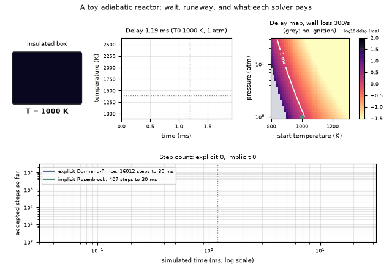
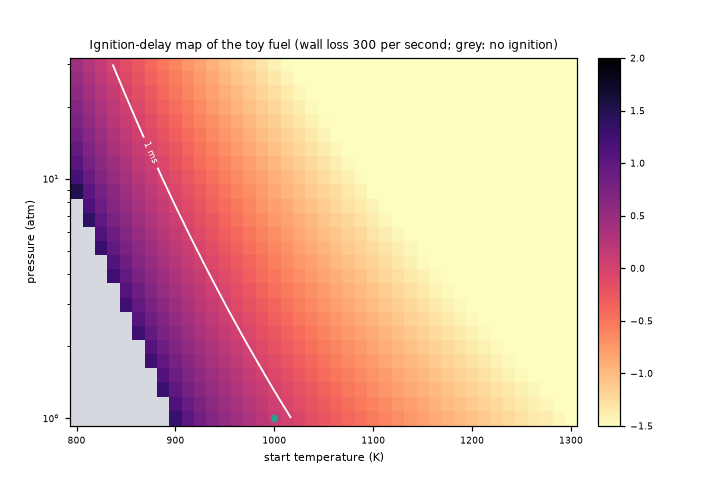
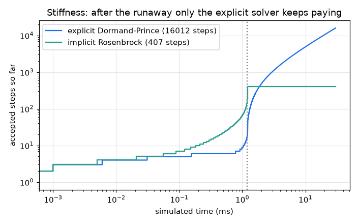
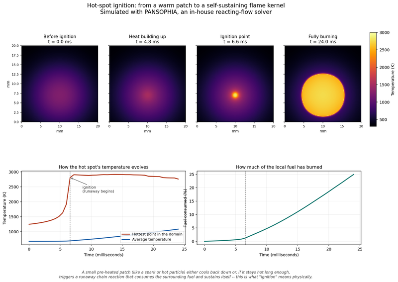

# What you are building toward

A toy insulated box holds a fuel mixture that starts at 1000 K. Its temperature creeps up for about a millisecond and then explodes to 2500 K. Beside it, a map shows how the ignition delay changes with start temperature and pressure, with a grey region where wall losses stop ignition altogether. Underneath, two solvers run through the same ignition: after the runaway the explicit one must keep taking tiny steps while the implicit one barely moves. Your goal over the coming sessions: build the delay map and the stiff solver yourself, then replace the one-step toy by a chain-branching model.

*Target: a toy reactor ignites, an ignition-delay map, and explicit versus implicit step counts*

*Target detail: ignition delay over start temperature and pressure, with a no-ignition region*

*Target detail: accepted steps of an explicit and an implicit solver through the same ignition*

*PANSOPHIA solver: a hot spot ignites into a flame kernel (temperature jump at the ignition point)*

These results come from a private reference build. The code is not published; the roadmap shows the path so you can build your own.

Live links:

- [Math Visual Studio: numerical ODE solvers and stability (Atlas S32)](https://krunalpanchal1995.github.io/studio/#atlas?ch=S32&ex=1)
