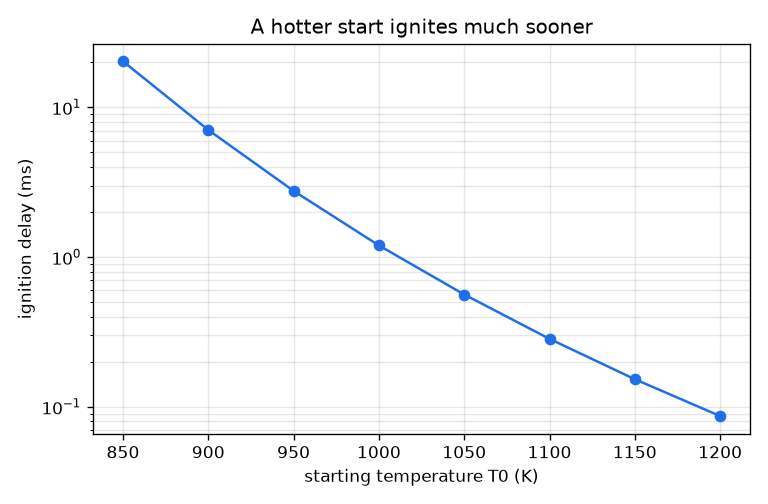
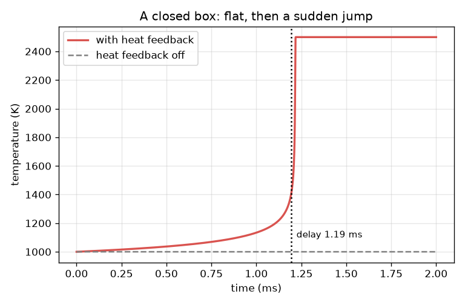

# सत्र 1: मिश्रण इंतज़ार क्यों करता है, फिर अचानक प्रज्वलित हो जाता है

*स्तर 1 (वैचारिक इंटरैक्टिव मॉडल) · लगभग 60 मिनट · openignition*

> यह एक सरलीकृत शैक्षिक मॉडल है। यह कोई प्रमाणित डिज़ाइन उपकरण नहीं है और इसका उपयोग वास्तविक संरचनाओं, बिजली की स्थापनाओं, वाहनों, औद्योगिक प्रक्रियाओं या चिकित्सा निर्णयों के लिए नहीं किया जाना चाहिए।

**पूर्वापेक्षाएँ (Prerequisites)**

- कैलकुलेटर पर घातांकी फलन (exponential function) e^x।
- समय के सापेक्ष तापमान का ग्राफ़ पढ़ना।
- आपने PRIMER.md पढ़ लिया है और `python start.py 1` एक बार चला लिया है।

**सीखने के उद्देश्य।** इस सत्र के बाद आप:

- ऊष्मीय पलायन (thermal runaway) समझा सकेंगे: ऊष्मा का निकलना अभिक्रिया को तेज़ करता है, जो और अधिक ऊष्मा छोड़ती है।
- हाथ से और Python में आरेनियस दर स्थिरांक (Arrhenius rate constant) की गणना कर सकेंगे।
- ऐसे तापमान-समय वक्र से, जो पहले सपाट होता है और फिर उछलता है, प्रज्वलन विलंब (ignition delay) पढ़ सकेंगे।
- ग्राफ़ से अनुमान लगा सकेंगे कि अधिक गर्म शुरुआत विलंब को कैसे घटाती है।

## A. वास्तविक दुनिया की समस्या
इंजन के सिलिंडर में ईंधन-वायु मिश्रण को संपीडित (compress) कीजिए और थोड़ी देर तक लगभग कुछ नहीं होता। फिर, उस इंतज़ार के समय के एक छोटे अंश में, तापमान विस्फोटक रूप से बढ़ जाता है। इंतज़ार का यह समय प्रज्वलन विलंब है, और इंजन डिज़ाइनर इसकी परवाह करते हैं क्योंकि ग़लत क्षण पर प्रज्वलन का अर्थ है नॉक (knock) या मिसफ़ायर। मिश्रण इंतज़ार क्यों करता है, और अंत इतना अचानक क्यों होता है? यह repo एक-चरणीय खिलौना मॉडल (toy) उपयोग करता है: बनावटी संख्याओं वाली एक बनावटी अभिक्रिया। यह केवल सीखने के लिए है और इसका उपयोग इंजन या किसी अन्य उपकरण के डिज़ाइन के लिए नहीं किया जाना चाहिए। वास्तविक हाइड्रोजन-ऑक्सीजन प्रज्वलन शृंखला-शाखन (chain-branching) अभिक्रियाओं का एक जाल है जिसकी विस्फोट सीमाएँ (explosion limits) होती हैं, जो इस खिलौना मॉडल में नहीं हैं।

## B. अवधारणा और सिद्धांत
मान लीजिए c बचा हुआ ईंधन है (1 का अर्थ सारा, 0 का अर्थ कुछ नहीं) और T एक ऊष्मारोधी (insulated) बक्से में गैस का तापमान। ईंधन k(T) c की दर से ख़र्च होता है, जहाँ आरेनियस दर स्थिरांक k(T) = A exp(-Ea / (R T)) तापमान के साथ तेज़ी से बढ़ता है क्योंकि केवल कुछ ही टक्करें अभिक्रिया करने लायक ऊर्जावान होती हैं। जला हुआ ईंधन का हर अंश गैस को गर्म करता है; यदि सारा ईंधन जल जाए, तो तापमान DT_AD = 1500 K बढ़ेगा। इसलिए dT/dt = DT_AD k c। यह एक पुनर्निवेश चक्र (feedback loop) है: गर्म गैस बड़ा k देती है, जो ईंधन को तेज़ी से जलाता है, जो गैस को और गर्म करता है। शुरू में k छोटा होता है और तापमान मुश्किल से हिलता है (इंतज़ार); बाद में चक्र बेक़ाबू हो जाता है (उछाल)। जब T 400 K बढ़ जाता है तो हम मिश्रण को प्रज्वलित कहते हैं और उस समय को प्रज्वलन विलंब tau कहते हैं।

| प्रतीक | अर्थ | इकाई |
|---|---|---|
| T | गैस का तापमान | K |
| c | बचा हुआ ईंधन, 1 = सारा | कोई इकाई नहीं |
| k(T) | आरेनियस दर स्थिरांक | 1/s |
| A | पूर्व-घातांकी गुणक (pre-exponential factor) (खिलौना मान 2.5e9) | 1/s |
| Ea | सक्रियण ऊर्जा (activation energy) (खिलौना मान 150 000) | J/mol |
| R | गैस स्थिरांक 8.314 | J/(mol K) |
| DT_AD | सारा ईंधन जलने पर तापमान वृद्धि (खिलौना मान 1500) | K |
| tau | प्रज्वलन विलंब: T के 400 K बढ़ने का समय | s |

**मान्यताएँ (Assumptions)**

- एक अभिक्रिया, ईंधन से उत्पाद, बनावटी संख्याओं के साथ: एक खिलौना, हाइड्रोजन रसायन नहीं।
- एक ऊष्मारोधी बक्सा (कोई ऊष्मा बाहर नहीं जाती) जिसमें तापमान एकसमान है।
- DT_AD एक स्थिरांक है (स्थिर ऊष्मा धारिता, heat capacity)।
- प्रज्वलन का अर्थ है 400 K की वृद्धि; अन्य परिभाषाओं की तुलना सत्र 2 में की गई है।

$$ k(T)=A\,e^{-E_a/(RT)} $$

$$ \frac{dc}{dt}=-k(T)\,c $$

$$ \frac{dT}{dt}=\Delta T_{ad}\,k(T)\,c $$

$$ T+\Delta T_{ad}\,c=\text{constant}\quad\text{(heat released equals fuel burnt)} $$

## C. दृश्य व्याख्या
बायाँ चित्र 1000 K के प्रारंभिक तापमान पर समय के सापेक्ष बक्से का तापमान दिखाता है। यह धीरे-धीरे रेंगता है (1.0 ms के बाद 1134 K), फिर तेज़ी से ऊपर मुड़ता है (1.2 ms पर 1458 K) और 1.3 ms तक 2500 K पहुँच जाता है: सपाट, फिर उछाल। धूसर डैश वाली रेखा वही बक्सा है जिसमें ऊष्मा पुनर्निवेश बंद है: तापमान कभी नहीं हिलता और 1 ms के बाद केवल 3.6 प्रतिशत ईंधन ख़र्च होता है। दायाँ चित्र लघुगणकीय (log) पैमाने पर प्रारंभिक तापमान के सापेक्ष प्रज्वलन विलंब दिखाता है: 900 K पर 7.06 ms पर 1100 K पर केवल 0.284 ms।

*प्रज्वलन विलंब (लघुगणकीय पैमाना) प्रारंभिक तापमान के साथ तेज़ी से गिरता है।*

*एक बंद बक्सा: तापमान सपाट रहता है, फिर उछलता है; ऊष्मा पुनर्निवेश बंद होने पर यह कभी नहीं हिलता।*

## D. इंटरैक्टिव सिमुलेशन
पाठ चलाइए (`python start.py 1`), फिर लाइव ऐप खोलिए: [सत्र 1: एक बक्सा जो स्वयं को गर्म करता है](https://krunalpanchal1995.github.io/pan-iit-oss/openignition/session-01/) (या इसी फ़ोल्डर में `app.html`)। समय स्लाइडर खींचिए और बक्से का रंग बदलते तथा ईंधन स्तर गिरते देखिए, फिर ग्राफ़ दृश्य पर जाइए और उछाल देखिए। प्रारंभिक तापमान और ऊष्मा मुक्ति बदलिए और रीडआउट में प्रज्वलन विलंब देखिए।

**चुनौती।** 1100 K से अधिक गर्म शुरुआत किए बिना मिश्रण को 0.25 ms से कम में प्रज्वलित कीजिए। (संकेत: समृद्ध (richer) मिश्रण अधिक ऊष्मा छोड़ता है।)

## E. हल किया गया उदाहरण और प्रयोग
**समस्या।** 1000 K के प्रारंभिक तापमान पर दर स्थिरांक k ज्ञात कीजिए। यदि कोई ऊष्मा पुनर्निवेश न हो, तो 1 ms के बाद कितना ईंधन ख़र्च होगा? पुनर्निवेश चालू होने पर प्रज्वलन के क्षण जले ईंधन से तुलना कीजिए।

1. Ea / (R T) = 150000 / (8.314 * 1000) = 18.04।
2. k = 2.5e9 * exp(-18.04) = 36.5 प्रति सेकंड।
3. पुनर्निवेश के बिना तापमान 1000 K पर रहता है, इसलिए 1 ms के बाद c = exp(-36.5 * 0.001) = exp(-0.0365) = 0.964: केवल 3.6 प्रतिशत ईंधन ख़र्च हुआ।
4. पुनर्निवेश के साथ, प्रज्वलन का अर्थ है T का 400 K बढ़ना। सारा ईंधन जलने से 1500 K मिलता, इसलिए 400 K का अर्थ है ईंधन का 400 / 1500 = 0.267 अंश जला: 26.7 प्रतिशत।
5. सिमुलेशन 1000 K पर प्रज्वलन विलंब 1.19 ms देता है।

**उत्तर।** k = 36.5 प्रति सेकंड। पुनर्निवेश बंद होने पर 1 ms में केवल 3.6 प्रतिशत ईंधन जलता है; पुनर्निवेश चालू होने पर, 1.19 ms के बाद प्रज्वलन तक पहुँचने पर 26.7 प्रतिशत जल चुका होता है।

**प्रयोग।** प्रज्वलन विलंब मापने का एक वास्तविक तरीक़ा है रैपिड कम्प्रेशन मशीन या शॉक ट्यूब: एक पिस्टन या एक आघात तरंग (shock wave) पहले से मिश्रित गैस को लगभग तुरंत गर्म करती है, और एक दाब संवेदक (pressure sensor) दिखाता है कि दाब कब उछलता है। मापे गए विलंबों की तुलना खिलौना मॉडल से कीजिए: आकार (लंबा इंतज़ार, फिर अचानक उछाल, और एक विलंब जो तापमान के साथ तेज़ी से घटता है) मेल खाता है; संख्याएँ नहीं, क्योंकि खिलौना मॉडल में एक ही अभिक्रिया है, दीवारों तक कोई ऊष्मा हानि नहीं और बनावटी स्थिरांक हैं, जबकि वास्तविक मिश्रण में बहुत-सी अभिक्रियाएँ और दीवारें होती हैं। विशेष रूप से हाइड्रोजन के लिए वास्तविक व्यवहार में शृंखला-शाखन और दाब पर निर्भर विस्फोट सीमाएँ शामिल हैं; खिलौना मॉडल में इनमें से कुछ नहीं है।

## F. मूल्यांकन और डिज़ाइन चुनौती
**प्रश्न प्रकार A: वैचारिक।** मिश्रण लंबे समय तक इंतज़ार क्यों करता है और फिर लगभग तुरंत प्रज्वलित क्यों हो जाता है, जबकि रसायन पूरे समय एक ही है? ऊष्मा पुनर्निवेश के बिना वाला बक्सा कभी प्रज्वलित क्यों नहीं होता?

संकेत

सोचिए कि तापमान दर के साथ क्या करता है, और दर तापमान के साथ क्या करती है।

चरण-दर-चरण हल

दर k तापमान के साथ तेज़ी से बढ़ती है और अभिक्रिया गैस को गर्म करती है, इसलिए प्रक्रिया स्वयं को पोषित करती है: एक धनात्मक पुनर्निवेश चक्र (ऊष्मीय पलायन)। जब तक थोड़ा ही ईंधन जला है, गर्मी बहुत कम होती है, इसलिए तापमान और दर मुश्किल से बदलते हैं और गैस इंतज़ार करती हुई लगती है; जब तापमान पर्याप्त बढ़ जाता है, तो ऊष्मा की हर वृद्धि दर को स्पष्ट रूप से बड़ा कर देती है और चक्र तब तक तेज़ होता है जब तक ईंधन ख़त्म न हो जाए। पुनर्निवेश के बिना तापमान अपने प्रारंभिक मान पर रहता है, दर स्थिर रहती है और ईंधन बस धीरे-धीरे क्षय होता है (1 ms में 3.6 प्रतिशत), इसलिए कोई पलायन नहीं होता।

**प्रश्न प्रकार B: संख्यात्मक।** 1100 K पर दर स्थिरांक ज्ञात कीजिए। यह 1000 K की तुलना में कितने गुना बड़ा है? यदि 10 प्रतिशत ईंधन जलता है, तो बक्सा कितने केल्विन गर्म होता है?

संकेत

1100 K पर Ea / (R T), फिर उसके ऋणात्मक का exp; ऊष्मा = जला अंश गुणा DT_AD।

चरण-दर-चरण हल

Ea / (R T) = 150000 / (8.314 * 1100) = 16.40, इसलिए k = 2.5e9 * exp(-16.40) = 188 प्रति सेकंड। गुणक 188 / 36.5 = 5.2 है। 10 प्रतिशत जलने से बक्सा 0.1 * 1500 = 150 K गर्म होता है। समझदारी जाँच: गर्म गैस का k बड़ा होना चाहिए, और जले ईंधन का छोटा अंश 1500 K का छोटा अंश देता है।

**प्रश्न प्रकार C: ग्राफ़ और सिमुलेशन की व्याख्या।** दाएँ चित्र में, जब प्रारंभिक तापमान 1000 K से 1050 K तक बढ़ता है तो विलंब कितने गुना घटता है? वक्र की ढाल (steepness) आपको दर के बारे में क्या बताती है?

संकेत

दोनों तापमानों पर विलंब पढ़िए और भाग दीजिए; विलंब लघुगणकीय पैमाने पर है।

चरण-दर-चरण हल

विलंब लगभग 1.2 ms से लगभग 0.56 ms तक गिरता है, लगभग 2.1 का गुणक। मामूली 50 K का बदलाव इंतज़ार को आधा कर देता है, क्योंकि k स्वयं तापमान के साथ तेज़ी से बदलता है (1100 K पर k, 1000 K की तुलना में 5.2 गुना बड़ा है), इसलिए पलायन जल्दी शुरू होता है।

**प्रश्न प्रकार D: डिज़ाइन और अनुकूलन (optimisation) चुनौती।** डिज़ाइन: आपको 0.5 ms के भीतर प्रज्वलन चाहिए। 1500 K ऊष्मा मुक्ति के साथ काम करने वाला सबसे कम प्रारंभिक तापमान (10 K के चरणों में) ज्ञात कीजिए। फिर पता लगाइए कि क्या 2000 K ऊष्मा मुक्ति वाला समृद्ध मिश्रण आपको ठंडी शुरुआत करने देता है, और बताइए कि आप क्या छोड़ते हैं।

संकेत

T0 = 1050, 1060, ... के लिए euler_delay(T0) और फिर euler_delay(T0, 2000.0) का उपयोग कीजिए।

चरण-दर-चरण हल

1050 K पर विलंब 0.562 ms है (बहुत धीमा); 1060 K पर यह 0.488 ms है, इसलिए सबसे कम प्रारंभिक तापमान 1060 K है। 2000 K ऊष्मा मुक्ति के साथ 1050 K पर विलंब 0.416 ms है, इसलिए समृद्ध मिश्रण 1050 K से, 10 K ठंडे पर (और उससे भी कम पर) काम करता है। समझौता (trade-off): समृद्ध मिश्रण का अर्थ है प्रति वायु अधिक ईंधन, इसलिए अधिक गर्म जली गैस (प्रारंभ से 2000 K ऊपर) और, वास्तविक इंजन में, अधिक उत्सर्जन और नॉक का अधिक जोखिम; अधिक गर्म शुरुआत के लिए अधिक संपीडन चाहिए। यह एक खिलौना मॉडल है: यह केवल समझौते की दिशा दिखाता है।

[RUBRIC.md](../../RUBRIC.md) से स्वयं को अंक दीजिए। काग़ज़ पर काम करने के लिए [गतिविधि पत्रक](activity_sheet.md) प्रिंट कीजिए।

## सामान्य भ्रांतियाँ
| सामान्य भ्रांति | वास्तव में क्या सच है |
|---|---|
| प्रज्वलन तब होता है जब तापमान एक निश्चित प्रज्वलन तापमान तक पहुँचता है। | कोई तीखा देहली तापमान नहीं है: मिश्रण एक विलंब के बाद प्रज्वलित होता है जो प्रारंभिक तापमान पर निर्भर करता है, और ठंडी शुरुआत बस कहीं अधिक इंतज़ार करती है। |
| इंतज़ार के दौरान कुछ नहीं हो रहा होता। | ईंधन पूरे समय ख़र्च हो रहा है और ऊष्मा निकल रही है, पर धीरे-धीरे; पुनर्निवेश चक्र तभी दिखता है जब तापमान पर्याप्त बढ़ चुका हो। |
| थोड़ा अधिक तापमान विलंब को केवल थोड़ा कम करता है। | विलंब बहुत तेज़ी से गिरता है: इस खिलौना मॉडल में 1000 K के आसपास हर 50 K पर यह लगभग आधा हो जाता है। |
| यह मॉडल वास्तविक हाइड्रोजन प्रज्वलन का पूर्वानुमान देता है। | यह बनावटी संख्याओं वाला एक-चरणीय खिलौना है। वास्तविक हाइड्रोजन-ऑक्सीजन प्रज्वलन विस्फोट सीमाओं वाला एक शृंखला-शाखन जाल है। |

## शब्दावली
- **प्रज्वलन विलंब (ignition delay)**: तापमान के बेक़ाबू होने से पहले का इंतज़ार का समय; यहाँ, 400 K वृद्धि का समय
- **ऊष्मीय पलायन (thermal runaway)**: ऊष्मा का निकलना अभिक्रिया को तेज़ करता है, जो और अधिक ऊष्मा छोड़ती है
- **आरेनियस दर स्थिरांक (Arrhenius rate constant)**: k = A exp(-Ea/(R T)), एक दर जो तापमान के साथ तेज़ी से बढ़ती है
- **सक्रियण ऊर्जा (activation energy)**: अभिक्रिया की ऊर्जा बाधा, Ea, J/mol में
- **रुद्धोष्म (adiabatic)**: परिवेश के साथ कोई ऊष्मा विनिमय नहीं

## समापन
1. [exercises.md](exercises.md) में दिए तीन कोडिंग कार्य कीजिए।
2. अपने बदलावों के बाद `python start.py 1` फिर से चलाइए। यह चेकपॉइंट (checkpoint) पर समाप्त होता है; जब यह `PASS` छापे, तो आपका काम पूरा है। (केवल चेकपॉइंट: `python start.py check 1`।)

अगला: [सत्र 2](../session-02/README.md)
