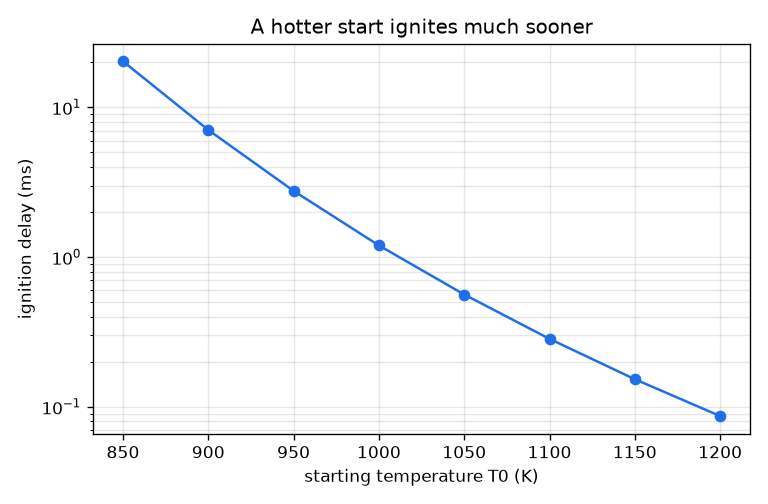
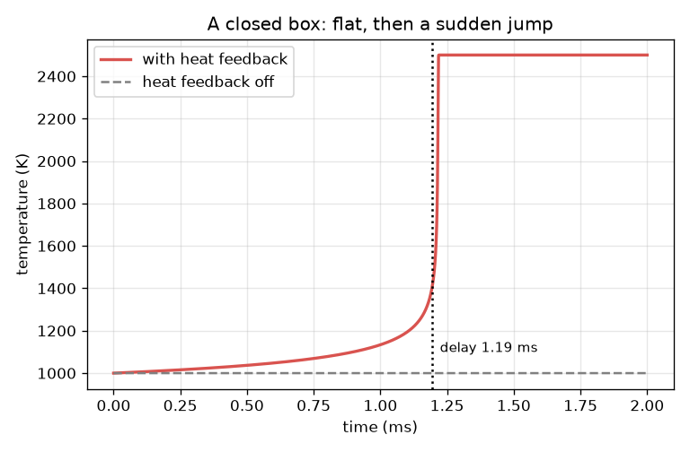

# Session 1: Why a mixture waits, then suddenly ignites

[Session 1 — हिन्दी](README.hi.md) · [Session 1 — മലയാളം](README.ml.md) · [Session 1 — தமிழ்](README.ta.md) · [Session 1 — తెలుగు](README.te.md)

*Level 1 (conceptual interactive model) · about 60 minutes · openignition*

> This is a simplified educational model. It is not a validated design tool and must not be used for real structures, electrical installations, vehicles, industrial processes or medical decisions.

**Prerequisites**

- The exponential function e^x on a calculator.
- Reading a graph of temperature against time.
- You have read PRIMER.md and run `python start.py 1` once.

**Learning objectives.** After this session you can:

- Explain thermal runaway: heat release speeds up the reaction, which releases more heat.
- Compute an Arrhenius rate constant by hand and in Python.
- Read the ignition delay from a temperature-time curve that is flat and then jumps.
- Predict, from a graph, how a hotter start shortens the delay.

## A. Real-world problem
Compress a fuel-air mixture in an engine cylinder and for a short time almost nothing happens. Then, within a small fraction of that waiting time, the temperature explodes. The waiting time is the ignition delay, and engine designers care because ignition at the wrong moment means knock or misfire. Why does the mixture wait, and why is the end so sudden? This repo uses a one-step toy: a single made-up reaction with made-up numbers. It is for learning only and must not be used to design an engine or any other device. Real hydrogen-oxygen ignition is a network of chain-branching reactions with explosion limits, which this toy does not contain.

## B. Concept and theory
Let c be the fuel left (1 means all of it, 0 means none) and T the temperature of the gas in an insulated box. The fuel is used up at a rate k(T) c, where the Arrhenius rate constant k(T) = A exp(-Ea / (R T)) grows steeply with temperature because only a few collisions are energetic enough to react. Each bit of fuel burnt heats the gas; if all the fuel burnt, the temperature would rise by DT_AD = 1500 K. So dT/dt = DT_AD k c. This is a feedback loop: hotter gas gives a larger k, which burns fuel faster, which heats the gas more. At first k is small and the temperature barely moves (the wait); later the loop runs away (the jump). We call the mixture ignited when T has risen by 400 K and call that time the ignition delay tau.

| Symbol | Meaning | Unit |
|---|---|---|
| T | gas temperature | K |
| c | fuel left, 1 = all of it | no unit |
| k(T) | Arrhenius rate constant | 1/s |
| A | pre-exponential factor (toy value 2.5e9) | 1/s |
| Ea | activation energy (toy value 150 000) | J/mol |
| R | gas constant 8.314 | J/(mol K) |
| DT_AD | temperature rise if all the fuel burns (toy value 1500) | K |
| tau | ignition delay: time for T to rise by 400 K | s |

**Assumptions**

- One reaction, fuel to products, with made-up numbers: a toy, not hydrogen chemistry.
- An insulated box (no heat escapes) with uniform temperature.
- DT_AD is a constant (a constant heat capacity).
- Ignition means a 400 K rise; other definitions are compared in Session 2.

$$ k(T)=A\,e^{-E_a/(RT)} $$

$$ \frac{dc}{dt}=-k(T)\,c $$

$$ \frac{dT}{dt}=\Delta T_{ad}\,k(T)\,c $$

$$ T+\Delta T_{ad}\,c=\text{constant}\quad\text{(heat released equals fuel burnt)} $$

## C. Visual explanation
The left figure shows the temperature of the box against time at a start temperature of 1000 K. It creeps up (1134 K after 1.0 ms), then bends sharply upward (1458 K at 1.2 ms) and reaches 2500 K by 1.3 ms: flat, then a jump. The grey dashed line is the same box with the heat feedback switched off: the temperature never moves and only 3.6 percent of the fuel is gone after 1 ms. The right figure shows the ignition delay against the start temperature on a log scale: 7.06 ms at 900 K but only 0.284 ms at 1100 K.

*The ignition delay (log scale) falls steeply with the start temperature.*

*A closed box: the temperature is flat, then jumps; with the heat feedback off it never moves.*

## D. Interactive simulation
Run the lesson (`python start.py 1`), then open the live app: [Session 1: a box that heats itself](https://krunalpanchal1995.github.io/pan-iit-oss/openignition/session-01/) (or `app.html` in this folder). Drag the time slider to watch the box change colour and the fuel level drop, then switch to the graph view and see the jump. Change the start temperature and the heat release and watch the ignition delay in the readout.

**Challenge.** Make the mixture ignite in under 0.25 ms while starting no hotter than 1100 K. (Hint: a richer mixture releases more heat.)

## E. Worked example and experiment
**Problem.** At a start temperature of 1000 K, find the rate constant k. If there were no heat feedback, how much fuel would be gone after 1 ms? Compare with the fuel burnt at the moment of ignition when the feedback is on.

1. Ea / (R T) = 150000 / (8.314 * 1000) = 18.04.
2. k = 2.5e9 * exp(-18.04) = 36.5 per second.
3. Without feedback the temperature stays at 1000 K, so after 1 ms c = exp(-36.5 * 0.001) = exp(-0.0365) = 0.964: only 3.6 percent of the fuel is gone.
4. With feedback, ignition means T has risen by 400 K. Burning all the fuel would give 1500 K, so 400 K means a fraction 400 / 1500 = 0.267 of the fuel is burnt: 26.7 percent.
5. The simulation gives the ignition delay at 1000 K as 1.19 ms.

**Answer.** k = 36.5 per second. With feedback off only 3.6 percent of the fuel burns in 1 ms; with feedback on, 26.7 percent has burnt when ignition is reached, after 1.19 ms.

**Experiment.** A real way to measure an ignition delay is a rapid compression machine or a shock tube: a piston or a shock wave heats a premixed gas almost instantly, and a pressure sensor shows when the pressure jumps. Compare the measured delays with the toy: the shape (a long wait, then a sudden jump, and a delay that shortens sharply with temperature) agrees; the numbers do not, because the toy has one reaction, no heat loss to the walls and made-up constants, while a real mixture has many reactions and walls. For hydrogen in particular the real behaviour involves chain branching and explosion limits that depend on pressure; the toy has none of that.

## F. Assessment and design challenge
**Question type A: Conceptual.** Why does the mixture wait for a long time and then ignite almost instantly, even though the chemistry is the same all the time? Why does the box without heat feedback never ignite?

Hint

Think about what the temperature does to the rate, and what the rate does to the temperature.

Step-by-step solution

The rate k grows steeply with temperature and the reaction heats the gas, so the process feeds itself: a positive feedback loop (thermal runaway). While little fuel has burnt the heating is tiny, so the temperature and the rate barely change and the gas seems to wait; once the temperature has risen enough, each increment of heat makes the rate noticeably larger and the loop accelerates until the fuel is gone. Without feedback the temperature stays at its start value, the rate stays constant and the fuel simply decays slowly (3.6 percent in 1 ms), so there is no runaway.

**Question type B: Numerical.** Find the rate constant at 1100 K. By what factor is it bigger than at 1000 K? If 10 percent of the fuel burns, by how many kelvin does the box heat up?

Hint

Ea / (R T) at 1100 K, then exp of minus that; heat = fraction burnt times DT_AD.

Step-by-step solution

Ea / (R T) = 150000 / (8.314 * 1100) = 16.40, so k = 2.5e9 * exp(-16.40) = 188 per second. The factor is 188 / 36.5 = 5.2. A 10 percent burn heats the box by 0.1 * 1500 = 150 K. Sanity check: a hotter gas must have a larger k, and a small fraction of fuel burnt gives a small fraction of 1500 K.

**Question type C: Graph and simulation interpretation.** In the right-hand figure, by what factor does the delay shrink when the start temperature rises from 1000 K to 1050 K? What does the steepness of the curve tell you about the rate?

Hint

Read the delay at both temperatures and divide; the delay is on a log scale.

Step-by-step solution

The delay falls from about 1.2 ms to about 0.56 ms, a factor of about 2.1. A modest 50 K change halves the wait, because k itself changes steeply with temperature (k is 5.2 times larger at 1100 K than at 1000 K), so the runaway starts sooner.

**Question type D: Design and optimisation challenge.** Design: you need ignition within 0.5 ms. Find the lowest start temperature (in steps of 10 K) that works with a heat release of 1500 K. Then find out whether a richer mixture with 2000 K heat release lets you start cooler, and say what you give up.

Hint

Use euler_delay(T0) for T0 = 1050, 1060, ... and then euler_delay(T0, 2000.0).

Step-by-step solution

At 1050 K the delay is 0.562 ms (too slow); at 1060 K it is 0.488 ms, so the lowest start temperature is 1060 K. With a 2000 K heat release the delay at 1050 K is 0.416 ms, so a richer mixture works from 1050 K, 10 K cooler (and from lower still). Trade-off: a richer mixture means more fuel per air, so a hotter burnt gas (2000 K above the start) and, in a real engine, more emissions and a greater risk of knock; a hotter start needs a higher compression. This is a toy: it only shows the direction of the trade-off.

Score yourself with [RUBRIC.md](../../RUBRIC.md). Print the [activity sheet](activity_sheet.md) to work on paper.

## Common misconceptions
| Common misconception | What is actually true |
|---|---|
| Ignition happens when the temperature reaches a fixed ignition temperature. | There is no sharp threshold temperature: the mixture ignites after a delay that depends on the start temperature, and a cooler start just waits much longer. |
| During the wait, nothing is happening. | Fuel is being used up and heat released all the time, but slowly; the feedback loop only becomes visible when the temperature has risen enough. |
| A little more temperature only gives a little shorter delay. | The delay falls very steeply: it roughly halves for each 50 K near 1000 K in this toy. |
| This model predicts real hydrogen ignition. | It is a one-step toy with made-up numbers. Real hydrogen-oxygen ignition is a chain-branching network with explosion limits. |

## Glossary
- **ignition delay**: the waiting time before the temperature runs away; here, the time for a 400 K rise
- **thermal runaway**: heat release speeds up the reaction, which releases more heat
- **Arrhenius rate constant**: k = A exp(-Ea/(R T)), a rate that grows steeply with temperature
- **activation energy**: the energy barrier of the reaction, Ea, in J/mol
- **adiabatic**: with no heat exchange with the surroundings

## Finish
1. Do the three coding tasks in [exercises.md](exercises.md).
2. Run `python start.py 1` again after your changes. It ends with the checkpoint; when it prints `PASS`, you are done. (Checkpoint only: `python start.py check 1`.)

Next: [Session 2](../session-02/README.md)
