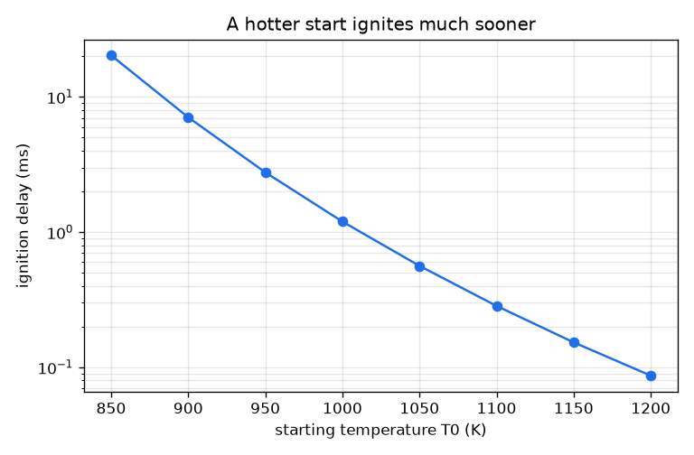
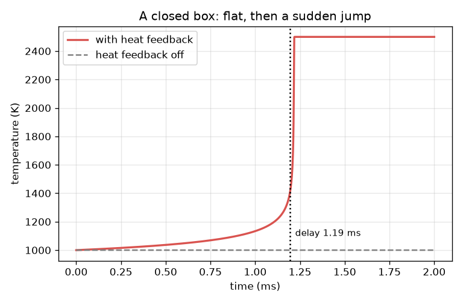

# സെഷൻ 1: ഒരു മിശ്രിതം കാത്തിരിക്കുന്നത് എന്തുകൊണ്ട്, പിന്നെ പെട്ടെന്ന് കത്തുന്നത് എന്തുകൊണ്ട്

[Session 1 — हिन्दी](README.hi.md)

*ലെവൽ 1 (ആശയപരമായ ഇന്ററാക്ടീവ് മോഡൽ) · ഏകദേശം 60 മിനിറ്റ് · openignition*

> ഇത് ലളിതമാക്കിയ ഒരു വിദ്യാഭ്യാസ മോഡൽ ആണ്. ഇത് സാധൂകരിച്ച (validated) ഡിസൈൻ ഉപകരണമല്ല; യഥാർത്ഥ നിർമിതികൾ, വൈദ്യുത ഇൻസ്റ്റലേഷനുകൾ, വാഹനങ്ങൾ, വ്യാവസായിക പ്രക്രിയകൾ അല്ലെങ്കിൽ വൈദ്യശാസ്ത്ര തീരുമാനങ്ങൾ എന്നിവയ്ക്ക് ഇത് ഉപയോഗിക്കരുത്.

**മുൻകൂട്ടി അറിയേണ്ടവ (Prerequisites)**

- ഒരു കാൽക്കുലേറ്ററിൽ എക്സ്പോണൻഷ്യൽ ഫംഗ്ഷൻ e^x.
- താപനില-സമയ ഗ്രാഫ് വായിക്കൽ.
- നിങ്ങൾ PRIMER.md വായിച്ചിട്ടുണ്ട്, `python start.py 1` ഒരിക്കൽ റൺ ചെയ്തിട്ടുണ്ട്.

**പഠന ലക്ഷ്യങ്ങൾ (Learning objectives).** ഈ സെഷനു ശേഷം നിങ്ങൾക്ക്:

- താപ റൺഅവേ (thermal runaway) വിശദീകരിക്കാം: താപ മോചനം രാസപ്രവർത്തനത്തെ വേഗത്തിലാക്കുന്നു, അത് കൂടുതൽ താപം മോചിപ്പിക്കുന്നു.
- ഒരു അർഹീനിയസ് നിരക്ക് സ്ഥിരാങ്കം (Arrhenius rate constant) കൈകൊണ്ടും Python-ലും കണക്കാക്കാം.
- പരന്നതും പിന്നെ കുതിച്ചുയരുന്നതുമായ ഒരു താപനില-സമയ വക്രത്തിൽ നിന്ന് ഇഗ്നിഷൻ വൈകൽ (ignition delay) വായിക്കാം.
- ചൂടുള്ള തുടക്കം വൈകൽ എങ്ങനെ കുറയ്ക്കുന്നു എന്ന് ഒരു ഗ്രാഫിൽ നിന്ന് പ്രവചിക്കാം.

## A. യഥാർത്ഥ ലോക പ്രശ്നം
ഒരു എൻജിൻ സിലിണ്ടറിൽ ഇന്ധന-വായു മിശ്രിതം കംപ്രസ് ചെയ്യുക, ഒരു ചെറിയ സമയത്തേക്ക് ഏതാണ്ട് ഒന്നും സംഭവിക്കുന്നില്ല. പിന്നെ ആ കാത്തിരിപ്പ് സമയത്തിന്റെ ഒരു ചെറിയ ഭാഗത്തിനുള്ളിൽ താപനില പൊട്ടിത്തെറിക്കുന്നു. കാത്തിരിപ്പ് സമയം ഇഗ്നിഷൻ വൈകലാണ്, തെറ്റായ നിമിഷത്തിലെ ഇഗ്നിഷൻ എന്നാൽ നോക്ക് (knock) അല്ലെങ്കിൽ മിസ്‌ഫയർ എന്നതിനാൽ എൻജിൻ ഡിസൈനർമാർ ഇതിൽ ശ്രദ്ധിക്കുന്നു. മിശ്രിതം കാത്തിരിക്കുന്നത് എന്തുകൊണ്ട്, അവസാനം ഇത്ര പെട്ടെന്നാകുന്നത് എന്തുകൊണ്ട്? ഈ റിപ്പോ ഒരു ഒറ്റ-ഘട്ട കളിപ്പാട്ടം ഉപയോഗിക്കുന്നു: ഉണ്ടാക്കിയെടുത്ത സംഖ്യകളുള്ള ഒരൊറ്റ ഉണ്ടാക്കിയെടുത്ത രാസപ്രവർത്തനം. ഇത് പഠനത്തിന് മാത്രമാണ്, ഒരു എൻജിനോ മറ്റേതെങ്കിലും ഉപകരണമോ ഡിസൈൻ ചെയ്യാൻ ഉപയോഗിക്കരുത്. യഥാർത്ഥ ഹൈഡ്രജൻ-ഓക്സിജൻ ഇഗ്നിഷൻ സ്ഫോടന പരിധികളുള്ള ചെയിൻ-ബ്രാഞ്ചിംഗ് രാസപ്രവർത്തനങ്ങളുടെ ഒരു ശൃംഖലയാണ്, ഈ കളിപ്പാട്ടത്തിൽ അത് ഇല്ല.

## B. ആശയവും സിദ്ധാന്തവും
c ബാക്കിയുള്ള ഇന്ധനവും (1 എന്നാൽ മുഴുവൻ, 0 എന്നാൽ ഒന്നുമില്ല), T ഇൻസുലേറ്റ് ചെയ്ത പെട്ടിയിലെ വാതകത്തിന്റെ താപനിലയും ആകട്ടെ. ഇന്ധനം k(T) c എന്ന നിരക്കിൽ ഉപയോഗിക്കപ്പെടുന്നു, അർഹീനിയസ് നിരക്ക് സ്ഥിരാങ്കം k(T) = A exp(-Ea / (R T)) താപനിലയ്‌ക്കൊപ്പം കുത്തനെ വളരുന്നു, കാരണം പ്രതിപ്രവർത്തിക്കാൻ തക്ക ഊർജ്ജമുള്ള കൂട്ടിയിടികൾ കുറച്ച് മാത്രമാണ്. കത്തുന്ന ഓരോ അംശം ഇന്ധനവും വാതകത്തെ ചൂടാക്കുന്നു; മുഴുവൻ ഇന്ധനവും കത്തിയാൽ താപനില DT_AD = 1500 K ഉയരും. അതിനാൽ dT/dt = DT_AD k c. ഇതൊരു ഫീഡ്‌ബാക്ക് ലൂപ്പ് ആണ്: ചൂടുള്ള വാതകം വലിയ k നൽകുന്നു, അത് ഇന്ധനം വേഗത്തിൽ കത്തിക്കുന്നു, അത് വാതകത്തെ കൂടുതൽ ചൂടാക്കുന്നു. തുടക്കത്തിൽ k ചെറുതാണ്, താപനില ഏതാണ്ട് അനങ്ങുന്നില്ല (കാത്തിരിപ്പ്); പിന്നീട് ലൂപ്പ് നിയന്ത്രണം വിടുന്നു (കുതിപ്പ്). T 400 K ഉയർന്നാൽ മിശ്രിതം കത്തി എന്ന് നാം പറയുന്നു, ആ സമയത്തെ ഇഗ്നിഷൻ വൈകൽ tau എന്ന് വിളിക്കുന്നു.

| ചിഹ്നം | അർത്ഥം | യൂണിറ്റ് |
|---|---|---|
| T | വാതക താപനില | K |
| c | ബാക്കിയുള്ള ഇന്ധനം, 1 = മുഴുവൻ | യൂണിറ്റ് ഇല്ല |
| k(T) | അർഹീനിയസ് നിരക്ക് സ്ഥിരാങ്കം | 1/s |
| A | പ്രീ-എക്സ്പോണൻഷ്യൽ ഘടകം (കളിപ്പാട്ട മൂല്യം 2.5e9) | 1/s |
| Ea | ആക്ടിവേഷൻ ഊർജ്ജം (കളിപ്പാട്ട മൂല്യം 150 000) | J/mol |
| R | വാതക സ്ഥിരാങ്കം 8.314 | J/(mol K) |
| DT_AD | മുഴുവൻ ഇന്ധനവും കത്തിയാലുള്ള താപനില വർദ്ധന (കളിപ്പാട്ട മൂല്യം 1500) | K |
| tau | ഇഗ്നിഷൻ വൈകൽ: T 400 K ഉയരാനുള്ള സമയം | s |

**അനുമാനങ്ങൾ (Assumptions)**

- ഉണ്ടാക്കിയെടുത്ത സംഖ്യകളോടെ ഇന്ധനം ഉൽപ്പന്നങ്ങളാകുന്ന ഒരൊറ്റ രാസപ്രവർത്തനം: ഒരു കളിപ്പാട്ടം, ഹൈഡ്രജൻ രസതന്ത്രമല്ല.
- ഏകീകൃത താപനിലയുള്ള ഒരു ഇൻസുലേറ്റ് ചെയ്ത പെട്ടി (താപം പുറത്തുപോകുന്നില്ല).
- DT_AD ഒരു സ്ഥിരാങ്കമാണ് (സ്ഥിര താപ ധാരിത).
- ഇഗ്നിഷൻ എന്നാൽ 400 K ഉയർച്ച; മറ്റ് നിർവചനങ്ങൾ സെഷൻ 2-ൽ താരതമ്യം ചെയ്യുന്നു.

$$ k(T)=A\,e^{-E_a/(RT)} $$

$$ \frac{dc}{dt}=-k(T)\,c $$

$$ \frac{dT}{dt}=\Delta T_{ad}\,k(T)\,c $$

$$ T+\Delta T_{ad}\,c=\text{constant}\quad\text{(heat released equals fuel burnt)} $$

## C. ദൃശ്യ വിശദീകരണം
ഇടത് ചിത്രം 1000 K തുടക്ക താപനിലയിൽ പെട്ടിയുടെ താപനില സമയത്തിനെതിരെ കാണിക്കുന്നു. അത് പതുക്കെ ഉയരുന്നു (1.0 ms കഴിഞ്ഞ് 1134 K), പിന്നെ കുത്തനെ മുകളിലേക്ക് വളയുന്നു (1.2 ms-ൽ 1458 K), 1.3 ms-ൽ 2500 K-ൽ എത്തുന്നു: പരന്നത്, പിന്നെ ഒരു കുതിപ്പ്. ചാരനിറ ഡാഷ് രേഖ ഹീറ്റ് ഫീഡ്‌ബാക്ക് ഓഫ് ചെയ്ത അതേ പെട്ടിയാണ്: താപനില ഒരിക്കലും അനങ്ങുന്നില്ല, 1 ms കഴിഞ്ഞിട്ടും ഇന്ധനത്തിന്റെ 3.6 ശതമാനം മാത്രമേ തീർന്നിട്ടുള്ളൂ. വലത് ചിത്രം തുടക്ക താപനിലയ്‌ക്കെതിരെ ലോഗ് സ്കെയിലിൽ ഇഗ്നിഷൻ വൈകൽ കാണിക്കുന്നു: 900 K-ൽ 7.06 ms, എന്നാൽ 1100 K-ൽ 0.284 ms മാത്രം.

*ഇഗ്നിഷൻ വൈകൽ (ലോഗ് സ്കെയിൽ) തുടക്ക താപനിലയ്‌ക്കൊപ്പം കുത്തനെ കുറയുന്നു.*

*ഒരു അടച്ച പെട്ടി: താപനില പരന്നതാണ്, പിന്നെ കുതിക്കുന്നു; ഹീറ്റ് ഫീഡ്‌ബാക്ക് ഓഫ് ചെയ്താൽ അത് ഒരിക്കലും അനങ്ങുന്നില്ല.*

## D. ഇന്ററാക്ടീവ് സിമുലേഷൻ
പാഠം റൺ ചെയ്യുക (`python start.py 1`), തുടർന്ന് ലൈവ് ആപ്പ് തുറക്കുക: [സെഷൻ 1: സ്വയം ചൂടാകുന്ന ഒരു പെട്ടി](https://krunalpanchal1995.github.io/pan-iit-oss/openignition/session-01/) (അല്ലെങ്കിൽ ഈ ഫോൾഡറിലെ `app.html`). പെട്ടി നിറം മാറുന്നതും ഇന്ധന നില താഴുന്നതും കാണാൻ ടൈം സ്ലൈഡർ വലിക്കുക, തുടർന്ന് ഗ്രാഫ് കാഴ്ചയിലേക്ക് മാറി കുതിപ്പ് കാണുക. തുടക്ക താപനിലയും താപ മോചനവും മാറ്റി റീഡൗട്ടിൽ ഇഗ്നിഷൻ വൈകൽ നിരീക്ഷിക്കുക.

**വെല്ലുവിളി.** 1100 K-ൽ കൂടുതൽ ചൂടില്ലാത്ത തുടക്കത്തിൽ നിന്ന് മിശ്രിതം 0.25 ms-ൽ താഴെ സമയത്തിൽ കത്തിക്കുക. (സൂചന: കൂടുതൽ സമ്പുഷ്ടമായ മിശ്രിതം കൂടുതൽ താപം മോചിപ്പിക്കുന്നു.)

## E. ഉദാഹരണവും പരീക്ഷണവും
**പ്രശ്നം.** 1000 K തുടക്ക താപനിലയിൽ നിരക്ക് സ്ഥിരാങ്കം k കണ്ടെത്തുക. ഹീറ്റ് ഫീഡ്‌ബാക്ക് ഇല്ലായിരുന്നെങ്കിൽ 1 ms കഴിഞ്ഞ് എത്ര ഇന്ധനം തീർന്നിരിക്കും? ഫീഡ്‌ബാക്ക് ഓണായിരിക്കുമ്പോൾ ഇഗ്നിഷൻ നിമിഷത്തിൽ കത്തിയ ഇന്ധനവുമായി താരതമ്യം ചെയ്യുക.

1. Ea / (R T) = 150000 / (8.314 * 1000) = 18.04.
2. k = 2.5e9 * exp(-18.04) = സെക്കൻഡിൽ 36.5.
3. ഫീഡ്‌ബാക്ക് ഇല്ലാതെ താപനില 1000 K-ൽ തുടരുന്നു, അതിനാൽ 1 ms കഴിഞ്ഞ് c = exp(-36.5 * 0.001) = exp(-0.0365) = 0.964: ഇന്ധനത്തിന്റെ 3.6 ശതമാനം മാത്രമേ തീർന്നിട്ടുള്ളൂ.
4. ഫീഡ്‌ബാക്കോടെ, ഇഗ്നിഷൻ എന്നാൽ T 400 K ഉയർന്നു എന്നാണ്. മുഴുവൻ ഇന്ധനവും കത്തിയാൽ 1500 K ലഭിക്കും, അതിനാൽ 400 K എന്നാൽ ഇന്ധനത്തിന്റെ 400 / 1500 = 0.267 ഭാഗം കത്തി: 26.7 ശതമാനം.
5. സിമുലേഷൻ 1000 K-ൽ ഇഗ്നിഷൻ വൈകൽ 1.19 ms ആയി നൽകുന്നു.

**ഉത്തരം.** k = സെക്കൻഡിൽ 36.5. ഫീഡ്‌ബാക്ക് ഓഫ് ആയാൽ 1 ms-ൽ ഇന്ധനത്തിന്റെ 3.6 ശതമാനം മാത്രമേ കത്തൂ; ഫീഡ്‌ബാക്ക് ഓണായാൽ, ഇഗ്നിഷനിൽ എത്തുമ്പോൾ, 1.19 ms കഴിഞ്ഞ്, 26.7 ശതമാനം കത്തിയിരിക്കും.

**പരീക്ഷണം.** ഇഗ്നിഷൻ വൈകൽ അളക്കാനുള്ള ഒരു യഥാർത്ഥ മാർഗം ഒരു റാപ്പിഡ് കംപ്രഷൻ മെഷീൻ അല്ലെങ്കിൽ ഷോക്ക് ട്യൂബ് ആണ്: ഒരു പിസ്റ്റൺ അല്ലെങ്കിൽ ഒരു ഷോക്ക് തരംഗം മുൻകൂട്ടി കലർത്തിയ വാതകത്തെ ഏതാണ്ട് തൽക്ഷണം ചൂടാക്കുന്നു, മർദ്ദം എപ്പോൾ കുതിക്കുന്നു എന്ന് ഒരു മർദ്ദ സെൻസർ കാണിക്കുന്നു. അളന്ന വൈകലുകളെ കളിപ്പാട്ടവുമായി താരതമ്യം ചെയ്യുക: ആകൃതി (നീണ്ട കാത്തിരിപ്പ്, പിന്നെ പെട്ടെന്നുള്ള കുതിപ്പ്, താപനിലയ്‌ക്കൊപ്പം കുത്തനെ കുറയുന്ന വൈകൽ) യോജിക്കുന്നു; സംഖ്യകൾ യോജിക്കുന്നില്ല, കാരണം കളിപ്പാട്ടത്തിന് ഒരൊറ്റ രാസപ്രവർത്തനവും ഭിത്തികളിലേക്ക് താപ നഷ്ടമില്ലായ്മയും ഉണ്ടാക്കിയെടുത്ത സ്ഥിരാങ്കങ്ങളുമാണ്, യഥാർത്ഥ മിശ്രിതത്തിന് നിരവധി രാസപ്രവർത്തനങ്ങളും ഭിത്തികളുമുണ്ട്. പ്രത്യേകിച്ച് ഹൈഡ്രജന്, യഥാർത്ഥ പെരുമാറ്റത്തിൽ മർദ്ദത്തെ ആശ്രയിക്കുന്ന ചെയിൻ ബ്രാഞ്ചിംഗും സ്ഫോടന പരിധികളും ഉൾപ്പെടുന്നു; കളിപ്പാട്ടത്തിൽ അതൊന്നുമില്ല.

## F. വിലയിരുത്തലും ഡിസൈൻ വെല്ലുവിളിയും
**ചോദ്യ തരം A: ആശയപരം.** രസതന്ത്രം എല്ലായ്‌പ്പോഴും ഒന്നുതന്നെ ആയിരുന്നിട്ടും മിശ്രിതം ദീർഘനേരം കാത്തിരുന്ന ശേഷം ഏതാണ്ട് തൽക്ഷണം കത്തുന്നത് എന്തുകൊണ്ട്? ഹീറ്റ് ഫീഡ്‌ബാക്ക് ഇല്ലാത്ത പെട്ടി ഒരിക്കലും കത്താത്തത് എന്തുകൊണ്ട്?

സൂചന

താപനില നിരക്കിനെ എന്ത് ചെയ്യുന്നു എന്നും നിരക്ക് താപനിലയെ എന്ത് ചെയ്യുന്നു എന്നും ചിന്തിക്കുക.

ഘട്ടം ഘട്ടമായുള്ള പരിഹാരം

നിരക്ക് k താപനിലയ്‌ക്കൊപ്പം കുത്തനെ വളരുന്നു, രാസപ്രവർത്തനം വാതകത്തെ ചൂടാക്കുന്നു, അതിനാൽ പ്രക്രിയ സ്വയം പോഷിപ്പിക്കുന്നു: ഒരു പോസിറ്റീവ് ഫീഡ്‌ബാക്ക് ലൂപ്പ് (താപ റൺഅവേ). കുറച്ച് ഇന്ധനം മാത്രം കത്തിയിരിക്കുമ്പോൾ ചൂടാക്കൽ നേരിയതാണ്, അതിനാൽ താപനിലയും നിരക്കും ഏതാണ്ട് മാറുന്നില്ല, വാതകം കാത്തിരിക്കുന്നതായി തോന്നുന്നു; താപനില മതിയായി ഉയർന്നുകഴിഞ്ഞാൽ, ഓരോ താപ വർദ്ധനയും നിരക്കിനെ ശ്രദ്ധേയമായി വലുതാക്കുന്നു, ഇന്ധനം തീരുന്നതുവരെ ലൂപ്പ് ത്വരിതപ്പെടുന്നു. ഫീഡ്‌ബാക്ക് ഇല്ലാതെ താപനില തുടക്ക മൂല്യത്തിൽ തുടരുന്നു, നിരക്ക് സ്ഥിരമായി തുടരുന്നു, ഇന്ധനം പതുക്കെ ക്ഷയിക്കുക മാത്രം ചെയ്യുന്നു (1 ms-ൽ 3.6 ശതമാനം), അതിനാൽ റൺഅവേ ഇല്ല.

**ചോദ്യ തരം B: സംഖ്യാപരം.** 1100 K-ൽ നിരക്ക് സ്ഥിരാങ്കം കണ്ടെത്തുക. ഇത് 1000 K-ലേതിനേക്കാൾ എത്ര മടങ്ങ് വലുതാണ്? ഇന്ധനത്തിന്റെ 10 ശതമാനം കത്തിയാൽ പെട്ടി എത്ര കെൽവിൻ ചൂടാകും?

സൂചന

1100 K-ൽ Ea / (R T), പിന്നെ അതിന്റെ നെഗറ്റീവിന്റെ exp; താപം = കത്തിയ ഭിന്നം ഗുണം DT_AD.

ഘട്ടം ഘട്ടമായുള്ള പരിഹാരം

Ea / (R T) = 150000 / (8.314 * 1100) = 16.40, അതിനാൽ k = 2.5e9 * exp(-16.40) = സെക്കൻഡിൽ 188. ഗുണനഘടകം 188 / 36.5 = 5.2. 10 ശതമാനം കത്തുന്നത് പെട്ടിയെ 0.1 * 1500 = 150 K ചൂടാക്കുന്നു. യുക്തി പരിശോധന: ചൂടുള്ള വാതകത്തിന് വലിയ k ഉണ്ടായിരിക്കണം, ഇന്ധനത്തിന്റെ ചെറിയ ഭിന്നം കത്തുന്നത് 1500 K-ന്റെ ചെറിയ ഭിന്നം നൽകുന്നു.

**ചോദ്യ തരം C: ഗ്രാഫും സിമുലേഷനും വ്യാഖ്യാനിക്കൽ.** വലത് ചിത്രത്തിൽ, തുടക്ക താപനില 1000 K-ൽ നിന്ന് 1050 K-ലേക്ക് ഉയരുമ്പോൾ വൈകൽ എത്ര മടങ്ങ് ചുരുങ്ങുന്നു? വക്രത്തിന്റെ കുത്തനെയുള്ള സ്വഭാവം നിരക്കിനെക്കുറിച്ച് എന്ത് പറയുന്നു?

സൂചന

രണ്ട് താപനിലകളിലെയും വൈകൽ വായിച്ച് ഹരിക്കുക; വൈകൽ ലോഗ് സ്കെയിലിലാണ്.

ഘട്ടം ഘട്ടമായുള്ള പരിഹാരം

വൈകൽ ഏകദേശം 1.2 ms-ൽ നിന്ന് ഏകദേശം 0.56 ms-ലേക്ക് കുറയുന്നു, ഏകദേശം 2.1 മടങ്ങ്. 50 K എന്ന മിതമായ മാറ്റം കാത്തിരിപ്പ് പകുതിയാക്കുന്നു, കാരണം k തന്നെ താപനിലയ്‌ക്കൊപ്പം കുത്തനെ മാറുന്നു (1100 K-ൽ k, 1000 K-ലേതിനേക്കാൾ 5.2 മടങ്ങ് വലുതാണ്), അതിനാൽ റൺഅവേ നേരത്തെ തുടങ്ങുന്നു.

**ചോദ്യ തരം D: ഡിസൈനും ഒപ്റ്റിമൈസേഷനും വെല്ലുവിളി.** ഡിസൈൻ: നിങ്ങൾക്ക് 0.5 ms-നുള്ളിൽ ഇഗ്നിഷൻ വേണം. 1500 K താപ മോചനത്തിൽ പ്രവർത്തിക്കുന്ന ഏറ്റവും കുറഞ്ഞ തുടക്ക താപനില (10 K ഘട്ടങ്ങളിൽ) കണ്ടെത്തുക. തുടർന്ന് 2000 K താപ മോചനമുള്ള കൂടുതൽ സമ്പുഷ്ട മിശ്രിതം തണുപ്പിൽ തുടങ്ങാൻ അനുവദിക്കുമോ എന്ന് കണ്ടെത്തി, നിങ്ങൾ എന്ത് ഉപേക്ഷിക്കുന്നു എന്ന് പറയുക.

സൂചന

T0 = 1050, 1060, ... എന്നിവയ്ക്ക് euler_delay(T0) ഉപയോഗിക്കുക, തുടർന്ന് euler_delay(T0, 2000.0).

ഘട്ടം ഘട്ടമായുള്ള പരിഹാരം

1050 K-ൽ വൈകൽ 0.562 ms ആണ് (വളരെ മന്ദം); 1060 K-ൽ അത് 0.488 ms ആണ്, അതിനാൽ ഏറ്റവും കുറഞ്ഞ തുടക്ക താപനില 1060 K ആണ്. 2000 K താപ മോചനത്തോടെ 1050 K-ൽ വൈകൽ 0.416 ms ആണ്, അതിനാൽ കൂടുതൽ സമ്പുഷ്ട മിശ്രിതം 1050 K-ൽ നിന്ന്, 10 K തണുപ്പിൽ (അതിലും താഴ്ന്നതിൽ നിന്ന്) പ്രവർത്തിക്കുന്നു. വിട്ടുവീഴ്ച (trade-off): സമ്പുഷ്ട മിശ്രിതം എന്നാൽ വായുവിന് കൂടുതൽ ഇന്ധനം, അതിനാൽ ചൂടുള്ള കത്തിയ വാതകം (തുടക്കത്തിന് 2000 K മുകളിൽ), ഒരു യഥാർത്ഥ എൻജിനിൽ കൂടുതൽ ഉദ്‌വമനവും നോക്കിന്റെ കൂടുതൽ അപകടസാധ്യതയും; ചൂടുള്ള തുടക്കത്തിന് ഉയർന്ന കംപ്രഷൻ വേണം. ഇതൊരു കളിപ്പാട്ടമാണ്: വിട്ടുവീഴ്ചയുടെ ദിശ മാത്രമേ ഇത് കാണിക്കുന്നുള്ളൂ.

[RUBRIC.md](../../RUBRIC.md) ഉപയോഗിച്ച് സ്വയം സ്കോർ ചെയ്യുക. പേപ്പറിൽ ചെയ്യാൻ [ആക്ടിവിറ്റി ഷീറ്റ്](activity_sheet.md) പ്രിന്റ് ചെയ്യുക.

## സാധാരണ തെറ്റിദ്ധാരണകൾ
| സാധാരണ തെറ്റിദ്ധാരണ | യഥാർത്ഥത്തിൽ ശരിയായത് |
|---|---|
| താപനില ഒരു നിശ്ചിത ഇഗ്നിഷൻ താപനിലയിൽ എത്തുമ്പോൾ ഇഗ്നിഷൻ സംഭവിക്കുന്നു. | മൂർച്ചയുള്ള ഒരു ത്രെഷോൾഡ് താപനില ഇല്ല: തുടക്ക താപനിലയെ ആശ്രയിക്കുന്ന ഒരു വൈകലിന് ശേഷമാണ് മിശ്രിതം കത്തുന്നത്, തണുത്ത തുടക്കം കൂടുതൽ നേരം കാത്തിരിക്കുക മാത്രം ചെയ്യുന്നു. |
| കാത്തിരിപ്പ് സമയത്ത് ഒന്നും സംഭവിക്കുന്നില്ല. | ഇന്ധനം ഉപയോഗിക്കപ്പെടുകയും താപം മോചിപ്പിക്കപ്പെടുകയും എല്ലായ്‌പ്പോഴും ചെയ്യുന്നു, പതുക്കെ; താപനില മതിയായി ഉയരുമ്പോൾ മാത്രമേ ഫീഡ്‌ബാക്ക് ലൂപ്പ് ദൃശ്യമാകൂ. |
| അൽപ്പം കൂടുതൽ താപനില വൈകലിൽ അൽപ്പം കുറവ് മാത്രം നൽകുന്നു. | വൈകൽ വളരെ കുത്തനെ കുറയുന്നു: ഈ കളിപ്പാട്ടത്തിൽ 1000 K-ന് സമീപം ഓരോ 50 K-നും ഏകദേശം പകുതിയാകുന്നു. |
| ഈ മോഡൽ യഥാർത്ഥ ഹൈഡ്രജൻ ഇഗ്നിഷൻ പ്രവചിക്കുന്നു. | ഇത് ഉണ്ടാക്കിയെടുത്ത സംഖ്യകളുള്ള ഒരു ഒറ്റ-ഘട്ട കളിപ്പാട്ടമാണ്. യഥാർത്ഥ ഹൈഡ്രജൻ-ഓക്സിജൻ ഇഗ്നിഷൻ സ്ഫോടന പരിധികളുള്ള ഒരു ചെയിൻ-ബ്രാഞ്ചിംഗ് ശൃംഖലയാണ്. |

## പദാവലി (Glossary)
- **ഇഗ്നിഷൻ വൈകൽ (ignition delay)**: താപനില നിയന്ത്രണം വിടുന്നതിന് മുമ്പുള്ള കാത്തിരിപ്പ് സമയം; ഇവിടെ 400 K ഉയർച്ചയ്ക്കുള്ള സമയം
- **താപ റൺഅവേ (thermal runaway)**: താപ മോചനം രാസപ്രവർത്തനത്തെ വേഗത്തിലാക്കുന്നു, അത് കൂടുതൽ താപം മോചിപ്പിക്കുന്നു
- **അർഹീനിയസ് നിരക്ക് സ്ഥിരാങ്കം (Arrhenius rate constant)**: k = A exp(-Ea/(R T)), താപനിലയ്‌ക്കൊപ്പം കുത്തനെ വളരുന്ന ഒരു നിരക്ക്
- **ആക്ടിവേഷൻ ഊർജ്ജം (activation energy)**: രാസപ്രവർത്തനത്തിന്റെ ഊർജ്ജ തടസ്സം, Ea, J/mol-ൽ
- **അഡിയബാറ്റിക് (adiabatic)**: ചുറ്റുപാടുമായി താപ കൈമാറ്റം ഇല്ലാത്തത്

## പൂർത്തിയാക്കുക
1. [exercises.md](exercises.md)-ലെ മൂന്ന് കോഡിംഗ് ടാസ്കുകൾ ചെയ്യുക.
2. നിങ്ങളുടെ മാറ്റങ്ങൾക്ക് ശേഷം `python start.py 1` വീണ്ടും റൺ ചെയ്യുക. അത് ചെക്ക്‌പോയിന്റോടെ അവസാനിക്കുന്നു; അത് `PASS` പ്രിന്റ് ചെയ്യുമ്പോൾ നിങ്ങൾ പൂർത്തിയാക്കി. (ചെക്ക്‌പോയിന്റ് മാത്രം: `python start.py check 1`.)

അടുത്തത്: [സെഷൻ 2](../session-02/README.md)
