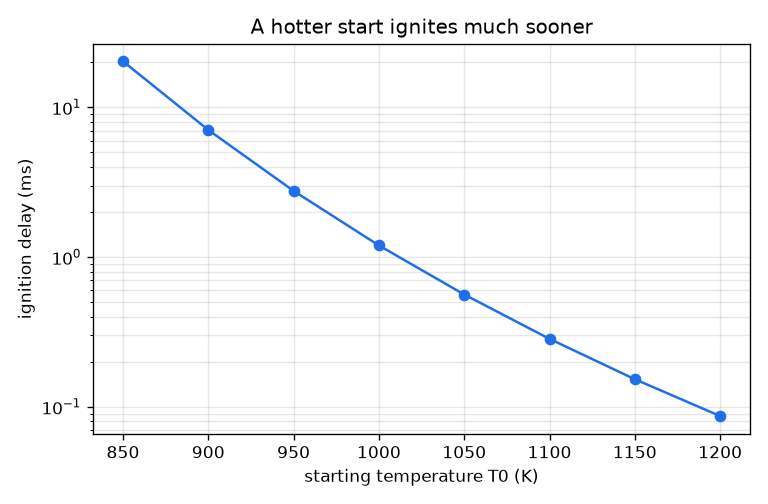
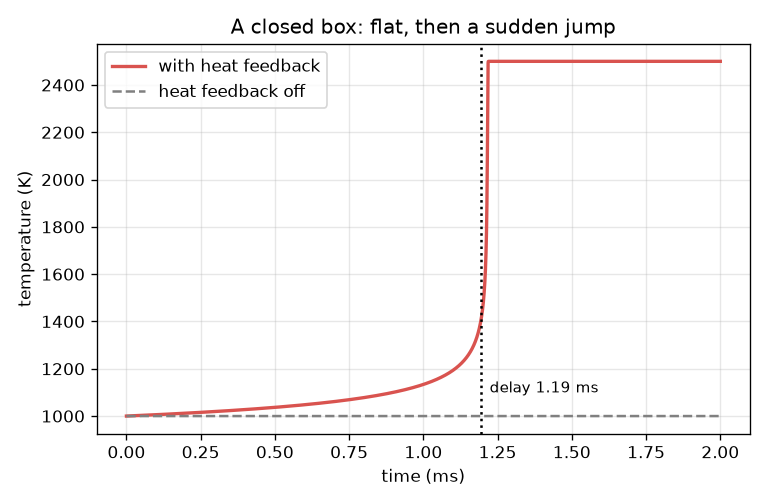

# அமர்வு 1: ஒரு கலவை ஏன் காத்திருக்கிறது, பின்னர் திடீரென்று பற்றிக்கொள்கிறது

[Session 1 — हिन्दी](README.hi.md)

*நிலை 1 (கருத்தியல் ஊடாடும் மாதிரி) · சுமார் 60 நிமிடங்கள் · openignition*

> இது எளிமைப்படுத்தப்பட்ட ஒரு கல்வி மாதிரி. இது சரிபார்க்கப்பட்ட (validated) வடிவமைப்புக் கருவி அல்ல; உண்மையான கட்டமைப்புகள், மின் நிறுவல்கள், வாகனங்கள், தொழிற்சாலை செயல்முறைகள் அல்லது மருத்துவ முடிவுகளுக்கு இதைப் பயன்படுத்தக் கூடாது.

**முன்தேவைகள் (Prerequisites)**

- கணிப்பானில் அடுக்குக்குறிச் சார்பு e^x.
- வெப்பநிலை-நேர வரைபடத்தைப் படித்தல்.
- நீங்கள் PRIMER.md படித்து, `python start.py 1` ஒருமுறை இயக்கியுள்ளீர்கள்.

**கற்றல் நோக்கங்கள் (Learning objectives).** இந்த அமர்வுக்குப் பிறகு நீங்கள்:

- வெப்ப ஓட்டத் தப்புதலை (thermal runaway) விளக்கலாம்: வெப்ப வெளியீடு வினையை விரைவுபடுத்துகிறது, அது மேலும் வெப்பத்தை வெளியிடுகிறது.
- ஓர் அர்ஹீனியஸ் வினைவேக மாறிலியை (Arrhenius rate constant) கையாலும் Python இலும் கணக்கிடலாம்.
- தட்டையாக இருந்து பின்னர் தாவும் வெப்பநிலை-நேர வளைவிலிருந்து தீப்பற்றல் தாமதத்தை (ignition delay) படிக்கலாம்.
- சூடான தொடக்கம் தாமதத்தை எவ்வாறு குறைக்கிறது என்பதை ஒரு வரைபடத்திலிருந்து முன்கணிக்கலாம்.

## A. நிஜ உலகப் பிரச்சினை
ஓர் இயந்திர உருளையில் எரிபொருள்-காற்றுக் கலவையை அழுத்துங்கள்; சிறிது நேரம் கிட்டத்தட்ட எதுவும் நடக்காது. பின்னர் அந்தக் காத்திருப்பு நேரத்தின் ஒரு சிறு பகுதிக்குள் வெப்பநிலை வெடிக்கிறது. காத்திருப்பு நேரம் தீப்பற்றல் தாமதம், தவறான கணத்தில் தீப்பற்றினால் தட்டல் (knock) அல்லது தவறான எரிதல் என்பதால் இயந்திர வடிவமைப்பாளர்கள் இதில் அக்கறை காட்டுகிறார்கள். கலவை ஏன் காத்திருக்கிறது, முடிவு ஏன் இவ்வளவு திடீரென்று இருக்கிறது? இந்த ரெப்போ ஒரு ஒற்றைப்படி பொம்மையைப் பயன்படுத்துகிறது: கற்பனை எண்களுடன் ஒரு கற்பனை வினை. இது கற்றலுக்கு மட்டும், ஓர் இயந்திரத்தையோ வேறு எந்தச் சாதனத்தையோ வடிவமைக்கப் பயன்படுத்தக் கூடாது. உண்மையான ஹைட்ரஜன்-ஆக்சிஜன் தீப்பற்றல் வெடிப்பு வரம்புகளுடன் கூடிய சங்கிலி-கிளைப்பு வினைகளின் வலைப்பின்னல், இந்தப் பொம்மையில் அது இல்லை.

## B. கருத்தும் கோட்பாடும்
c மீதமுள்ள எரிபொருள் (1 என்றால் முழுவதும், 0 என்றால் எதுவுமில்லை), T காப்பிடப்பட்ட பெட்டியிலுள்ள வாயுவின் வெப்பநிலை என்க. எரிபொருள் k(T) c வீதத்தில் தீர்கிறது, அர்ஹீனியஸ் வினைவேக மாறிலி k(T) = A exp(-Ea / (R T)) வெப்பநிலையுடன் செங்குத்தாக வளர்கிறது, ஏனெனில் வினைபுரியும் அளவு ஆற்றல் உள்ள மோதல்கள் சிலவே. எரியும் ஒவ்வொரு சிறு எரிபொருளும் வாயுவை வெப்பமாக்குகிறது; முழு எரிபொருளும் எரிந்தால் வெப்பநிலை DT_AD = 1500 K உயரும். எனவே dT/dt = DT_AD k c. இது ஒரு பின்னூட்ட வளையம்: சூடான வாயு பெரிய k ஐத் தருகிறது, அது எரிபொருளை விரைவாக எரிக்கிறது, அது வாயுவை மேலும் சூடாக்குகிறது. தொடக்கத்தில் k சிறியது, வெப்பநிலை கிட்டத்தட்ட நகரவில்லை (காத்திருப்பு); பின்னர் வளையம் கட்டுப்பாடிழக்கிறது (தாவல்). T 400 K உயர்ந்தால் கலவை பற்றிக்கொண்டது என்று கூறி, அந்த நேரத்தைத் தீப்பற்றல் தாமதம் tau என்கிறோம்.

| குறியீடு | பொருள் | அலகு |
|---|---|---|
| T | வாயு வெப்பநிலை | K |
| c | மீதமுள்ள எரிபொருள், 1 = முழுவதும் | அலகு இல்லை |
| k(T) | அர்ஹீனியஸ் வினைவேக மாறிலி | 1/s |
| A | முன்-அடுக்குக்குறிக் காரணி (பொம்மை மதிப்பு 2.5e9) | 1/s |
| Ea | செயல்படுத்து ஆற்றல் (பொம்மை மதிப்பு 150 000) | J/mol |
| R | வாயு மாறிலி 8.314 | J/(mol K) |
| DT_AD | முழு எரிபொருளும் எரிந்தால் வெப்பநிலை உயர்வு (பொம்மை மதிப்பு 1500) | K |
| tau | தீப்பற்றல் தாமதம்: T 400 K உயர ஆகும் நேரம் | s |

**அனுமானங்கள் (Assumptions)**

- கற்பனை எண்களுடன் எரிபொருள் விளைபொருளாகும் ஒரே வினை: ஒரு பொம்மை, ஹைட்ரஜன் வேதியியல் அல்ல.
- ஒரே சீரான வெப்பநிலையுடன் காப்பிடப்பட்ட பெட்டி (வெப்பம் வெளியேறாது).
- DT_AD ஒரு மாறிலி (மாறா வெப்பத் திறன்).
- தீப்பற்றல் என்றால் 400 K உயர்வு; பிற வரையறைகள் அமர்வு 2 இல் ஒப்பிடப்படுகின்றன.

$$ k(T)=A\,e^{-E_a/(RT)} $$

$$ \frac{dc}{dt}=-k(T)\,c $$

$$ \frac{dT}{dt}=\Delta T_{ad}\,k(T)\,c $$

$$ T+\Delta T_{ad}\,c=\text{constant}\quad\text{(heat released equals fuel burnt)} $$

## C. காட்சி விளக்கம்
இடப்பக்கப் படம் 1000 K தொடக்க வெப்பநிலையில் பெட்டியின் வெப்பநிலையை நேரத்திற்கு எதிராகக் காட்டுகிறது. அது மெதுவாக ஏறுகிறது (1.0 ms க்குப் பிறகு 1134 K), பின்னர் செங்குத்தாக மேலே வளைகிறது (1.2 ms இல் 1458 K), 1.3 ms இல் 2500 K ஐ எட்டுகிறது: தட்டை, பின்னர் ஒரு தாவல். சாம்பல் கோடிட்ட கோடு வெப்பப் பின்னூட்டம் அணைக்கப்பட்ட அதே பெட்டி: வெப்பநிலை ஒருபோதும் நகரவில்லை, 1 ms க்குப் பிறகும் எரிபொருளில் 3.6 சதவீதம் மட்டுமே தீர்ந்துள்ளது. வலப்பக்கப் படம் தொடக்க வெப்பநிலைக்கு எதிராகத் தீப்பற்றல் தாமதத்தை மடக்கை அளவில் காட்டுகிறது: 900 K இல் 7.06 ms, ஆனால் 1100 K இல் 0.284 ms மட்டுமே.

*தீப்பற்றல் தாமதம் (மடக்கை அளவு) தொடக்க வெப்பநிலையுடன் செங்குத்தாகக் குறைகிறது.*

*ஒரு மூடிய பெட்டி: வெப்பநிலை தட்டையாக இருந்து, பின்னர் தாவுகிறது; வெப்பப் பின்னூட்டம் அணைக்கப்பட்டால் அது ஒருபோதும் நகராது.*

## D. ஊடாடும் உருவகப்படுத்தல் (Interactive simulation)
பாடத்தை இயக்கவும் (`python start.py 1`), பின்னர் நேரடிச் செயலியைத் திறக்கவும்: [அமர்வு 1: தன்னைத்தானே சூடாக்கும் ஒரு பெட்டி](https://krunalpanchal1995.github.io/pan-iit-oss/openignition/session-01/) (அல்லது இந்தக் கோப்புறையிலுள்ள `app.html`). பெட்டி நிறம் மாறுவதையும் எரிபொருள் அளவு குறைவதையும் காண நேர ஸ்லைடரை இழுக்கவும், பின்னர் வரைபடக் காட்சிக்கு மாறித் தாவலைக் காணவும். தொடக்க வெப்பநிலையையும் வெப்ப வெளியீட்டையும் மாற்றி அளவீட்டில் தீப்பற்றல் தாமதத்தைக் கவனிக்கவும்.

**சவால்.** 1100 K ஐ விடச் சூடாக இல்லாத தொடக்கத்தில் இருந்து கலவையை 0.25 ms க்குள் பற்றவைக்கவும். (குறிப்பு: செறிவான கலவை அதிக வெப்பத்தை வெளியிடும்.)

## E. தீர்க்கப்பட்ட எடுத்துக்காட்டும் சோதனையும்
**பிரச்சினை.** 1000 K தொடக்க வெப்பநிலையில் வினைவேக மாறிலி k ஐக் கண்டறியவும். வெப்பப் பின்னூட்டம் இல்லாவிட்டால் 1 ms க்குப் பிறகு எவ்வளவு எரிபொருள் தீர்ந்திருக்கும்? பின்னூட்டம் இயக்கத்தில் இருக்கும்போது தீப்பற்றும் கணத்தில் எரிந்த எரிபொருளுடன் ஒப்பிடவும்.

1. Ea / (R T) = 150000 / (8.314 * 1000) = 18.04.
2. k = 2.5e9 * exp(-18.04) = ஒரு நொடிக்கு 36.5.
3. பின்னூட்டம் இல்லாமல் வெப்பநிலை 1000 K இல் இருக்கும், எனவே 1 ms க்குப் பிறகு c = exp(-36.5 * 0.001) = exp(-0.0365) = 0.964: எரிபொருளில் 3.6 சதவீதம் மட்டுமே தீர்ந்துள்ளது.
4. பின்னூட்டத்துடன், தீப்பற்றல் என்றால் T 400 K உயர்ந்தது. முழு எரிபொருளும் எரிந்தால் 1500 K கிடைக்கும், எனவே 400 K என்றால் எரிபொருளில் 400 / 1500 = 0.267 பங்கு எரிந்தது: 26.7 சதவீதம்.
5. உருவகப்படுத்தல் 1000 K இல் தீப்பற்றல் தாமதத்தை 1.19 ms எனத் தருகிறது.

**விடை.** k = ஒரு நொடிக்கு 36.5. பின்னூட்டம் அணைந்தால் 1 ms இல் எரிபொருளில் 3.6 சதவீதம் மட்டுமே எரிகிறது; பின்னூட்டம் இயங்கினால், தீப்பற்றலை அடையும்போது, 1.19 ms க்குப் பிறகு, 26.7 சதவீதம் எரிந்திருக்கும்.

**சோதனை.** தீப்பற்றல் தாமதத்தை அளக்க ஒரு உண்மையான வழி விரைவு அழுத்த இயந்திரம் அல்லது அதிர்ச்சிக் குழாய்: ஒரு பிஸ்டன் அல்லது அதிர்ச்சி அலை முன்கலந்த வாயுவைக் கிட்டத்தட்ட உடனே வெப்பமாக்குகிறது, அழுத்தம் எப்போது தாவுகிறது என்பதை ஓர் அழுத்த உணரி காட்டுகிறது. அளந்த தாமதங்களைப் பொம்மையுடன் ஒப்பிடவும்: வடிவம் (நீண்ட காத்திருப்பு, பின்னர் திடீர்த் தாவல், வெப்பநிலையுடன் செங்குத்தாகக் குறையும் தாமதம்) ஒத்துப்போகிறது; எண்கள் ஒத்துப்போவதில்லை, ஏனெனில் பொம்மைக்கு ஒரே வினையும் சுவர்களுக்கு வெப்ப இழப்பு இல்லாமையும் கற்பனை மாறிலிகளும் உள்ளன, உண்மைக் கலவைக்குப் பல வினைகளும் சுவர்களும் உள்ளன. குறிப்பாக ஹைட்ரஜனுக்கு, உண்மை நடத்தையில் அழுத்தத்தைச் சார்ந்த சங்கிலிக் கிளைப்பும் வெடிப்பு வரம்புகளும் உள்ளன; பொம்மையில் அவை இல்லை.

## F. மதிப்பீடும் வடிவமைப்புச் சவாலும்
**கேள்வி வகை A: கருத்தியல்.** வேதியியல் எப்போதும் ஒன்றாகவே இருந்தும் கலவை ஏன் நீண்ட நேரம் காத்திருந்து பின்னர் கிட்டத்தட்ட உடனே பற்றிக்கொள்கிறது? வெப்பப் பின்னூட்டம் இல்லாத பெட்டி ஏன் ஒருபோதும் பற்றுவதில்லை?

குறிப்பு

வெப்பநிலை வீதத்திற்கு என்ன செய்கிறது, வீதம் வெப்பநிலைக்கு என்ன செய்கிறது என்று சிந்தியுங்கள்.

படிப்படியான தீர்வு

வீதம் k வெப்பநிலையுடன் செங்குத்தாக வளர்கிறது, வினை வாயுவை வெப்பமாக்குகிறது, எனவே செயல்முறை தன்னைத்தானே ஊட்டிக்கொள்கிறது: ஒரு நேர்மறைப் பின்னூட்ட வளையம் (வெப்ப ஓட்டத் தப்புதல்). குறைந்த எரிபொருள் மட்டுமே எரிந்திருக்கும்போது வெப்பமாதல் மிகச் சிறியது, எனவே வெப்பநிலையும் வீதமும் கிட்டத்தட்ட மாறவில்லை, வாயு காத்திருப்பதாகத் தோன்றுகிறது; வெப்பநிலை போதுமான அளவு உயர்ந்தவுடன், ஒவ்வொரு வெப்ப அதிகரிப்பும் வீதத்தைக் கணிசமாகப் பெரிதாக்குகிறது, எரிபொருள் தீரும் வரை வளையம் முடுக்கமடைகிறது. பின்னூட்டம் இல்லாமல் வெப்பநிலை தொடக்க மதிப்பிலேயே இருக்கும், வீதம் மாறாமல் இருக்கும், எரிபொருள் மெதுவாக மட்டுமே குறையும் (1 ms இல் 3.6 சதவீதம்), எனவே தப்புதல் இல்லை.

**கேள்வி வகை B: எண்ணியல்.** 1100 K இல் வினைவேக மாறிலியைக் கண்டறியவும். இது 1000 K இல் உள்ளதை விட எத்தனை மடங்கு பெரியது? எரிபொருளில் 10 சதவீதம் எரிந்தால் பெட்டி எத்தனை கெல்வின் சூடாகும்?

குறிப்பு

1100 K இல் Ea / (R T), பின்னர் அதன் எதிர்மறையின் exp; வெப்பம் = எரிந்த பின்னம் பெருக்கல் DT_AD.

படிப்படியான தீர்வு

Ea / (R T) = 150000 / (8.314 * 1100) = 16.40, எனவே k = 2.5e9 * exp(-16.40) = ஒரு நொடிக்கு 188. காரணி 188 / 36.5 = 5.2. 10 சதவீதம் எரிவது பெட்டியை 0.1 * 1500 = 150 K சூடாக்குகிறது. நியாயச் சரிபார்ப்பு: சூடான வாயுவுக்குப் பெரிய k இருக்க வேண்டும், எரிபொருளில் சிறிய பின்னம் எரிவது 1500 K இல் சிறிய பின்னத்தைத் தருகிறது.

**கேள்வி வகை C: வரைபடம் மற்றும் உருவகப்படுத்தல் விளக்கம்.** வலப்பக்கப் படத்தில், தொடக்க வெப்பநிலை 1000 K இலிருந்து 1050 K ஆக உயரும்போது தாமதம் எத்தனை மடங்கு சுருங்குகிறது? வளைவின் செங்குத்துத்தன்மை வீதம் பற்றி என்ன கூறுகிறது?

குறிப்பு

இரண்டு வெப்பநிலைகளிலும் தாமதத்தைப் படித்து வகுக்கவும்; தாமதம் மடக்கை அளவில் உள்ளது.

படிப்படியான தீர்வு

தாமதம் சுமார் 1.2 ms இலிருந்து சுமார் 0.56 ms ஆகக் குறைகிறது, சுமார் 2.1 மடங்கு. 50 K என்ற மிதமான மாற்றம் காத்திருப்பை பாதியாக்குகிறது, ஏனெனில் k வெப்பநிலையுடன் செங்குத்தாக மாறுகிறது (1100 K இல் k, 1000 K ஐ விட 5.2 மடங்கு பெரியது), எனவே தப்புதல் முன்னதாகத் தொடங்குகிறது.

**கேள்வி வகை D: வடிவமைப்பு மற்றும் உகப்பாக்கச் (optimisation) சவால்.** வடிவமைப்பு: உங்களுக்கு 0.5 ms க்குள் தீப்பற்றல் வேண்டும். 1500 K வெப்ப வெளியீட்டுடன் செயல்படும் மிகக் குறைந்த தொடக்க வெப்பநிலையை (10 K படிகளில்) கண்டறியவும். பின்னர் 2000 K வெப்ப வெளியீடு கொண்ட செறிவான கலவை குளிர்ந்த தொடக்கத்தை அனுமதிக்குமா என்று கண்டறிந்து, நீங்கள் எதை விட்டுக்கொடுக்கிறீர்கள் என்று கூறுங்கள்.

குறிப்பு

T0 = 1050, 1060, ... க்கு euler_delay(T0) ஐப் பயன்படுத்தவும், பின்னர் euler_delay(T0, 2000.0).

படிப்படியான தீர்வு

1050 K இல் தாமதம் 0.562 ms (மிக மெதுவு); 1060 K இல் அது 0.488 ms, எனவே மிகக் குறைந்த தொடக்க வெப்பநிலை 1060 K. 2000 K வெப்ப வெளியீட்டுடன் 1050 K இல் தாமதம் 0.416 ms, எனவே செறிவான கலவை 1050 K இலிருந்து, 10 K குளிரிலிருந்து (இன்னும் குறைவிலிருந்தும்) செயல்படுகிறது. சமரசம் (trade-off): செறிவான கலவை என்றால் காற்றுக்கு அதிக எரிபொருள், எனவே சூடான எரிந்த வாயு (தொடக்கத்தை விட 2000 K மேல்), உண்மை இயந்திரத்தில் அதிக உமிழ்வும் தட்டலின் அதிக ஆபத்தும்; சூடான தொடக்கத்திற்கு அதிக அழுத்தம் தேவை. இது ஒரு பொம்மை: சமரசத்தின் திசையை மட்டுமே காட்டுகிறது.

[RUBRIC.md](../../RUBRIC.md) மூலம் உங்களை நீங்களே மதிப்பிடுங்கள். தாளில் செய்ய [செயல்பாட்டுத் தாளை](activity_sheet.md) அச்சிடவும்.

## பொதுவான தவறான கருத்துகள்
| பொதுவான தவறான கருத்து | உண்மையில் சரியானது |
|---|---|
| வெப்பநிலை ஒரு குறிப்பிட்ட தீப்பற்றல் வெப்பநிலையை அடையும்போது தீப்பற்றுகிறது. | கூர்மையான வரம்பு வெப்பநிலை இல்லை: தொடக்க வெப்பநிலையைப் பொறுத்த தாமதத்திற்குப் பிறகு கலவை பற்றுகிறது, குளிர்ந்த தொடக்கம் மிக நீண்ட நேரம் காத்திருக்கும் அவ்வளவே. |
| காத்திருப்பின்போது எதுவும் நடக்கவில்லை. | எரிபொருள் தீர்ந்துகொண்டும் வெப்பம் வெளியாகிக்கொண்டும் எப்போதும் இருக்கிறது, மெதுவாக; வெப்பநிலை போதுமான அளவு உயர்ந்த பின்புதான் பின்னூட்ட வளையம் தெரிகிறது. |
| சற்று அதிக வெப்பநிலை தாமதத்தைச் சற்றே குறைக்கும். | தாமதம் மிகச் செங்குத்தாகக் குறைகிறது: இந்தப் பொம்மையில் 1000 K அருகே ஒவ்வொரு 50 K க்கும் கிட்டத்தட்ட பாதியாகிறது. |
| இந்த மாதிரி உண்மை ஹைட்ரஜன் தீப்பற்றலை முன்கணிக்கிறது. | இது கற்பனை எண்களுடன் கூடிய ஒற்றைப்படி பொம்மை. உண்மை ஹைட்ரஜன்-ஆக்சிஜன் தீப்பற்றல் வெடிப்பு வரம்புகளுடன் கூடிய சங்கிலி-கிளைப்பு வலைப்பின்னல். |

## சொற்களஞ்சியம் (Glossary)
- **தீப்பற்றல் தாமதம் (ignition delay)**: வெப்பநிலை கட்டுப்பாடிழப்பதற்கு முன்புள்ள காத்திருப்பு நேரம்; இங்கே 400 K உயர்வுக்கான நேரம்
- **வெப்ப ஓட்டத் தப்புதல் (thermal runaway)**: வெப்ப வெளியீடு வினையை விரைவுபடுத்துகிறது, அது மேலும் வெப்பத்தை வெளியிடுகிறது
- **அர்ஹீனியஸ் வினைவேக மாறிலி (Arrhenius rate constant)**: k = A exp(-Ea/(R T)), வெப்பநிலையுடன் செங்குத்தாக வளரும் வீதம்
- **செயல்படுத்து ஆற்றல் (activation energy)**: வினையின் ஆற்றல் தடை, Ea, J/mol இல்
- **வெப்பம் பரிமாறாத (adiabatic)**: சுற்றுப்புறத்துடன் வெப்பப் பரிமாற்றம் இல்லாத

## நிறைவு
1. [exercises.md](exercises.md)-இல் உள்ள மூன்று நிரலாக்கப் பணிகளைச் செய்யவும்.
2. உங்கள் மாற்றங்களுக்குப் பிறகு `python start.py 1` மீண்டும் இயக்கவும். அது சோதனைச் சாவடியுடன் (checkpoint) முடிகிறது; அது `PASS` அச்சிடும்போது நீங்கள் முடித்துவிட்டீர்கள். (சோதனைச் சாவடி மட்டும்: `python start.py check 1`.)

அடுத்து: [அமர்வு 2](../session-02/README.md)
