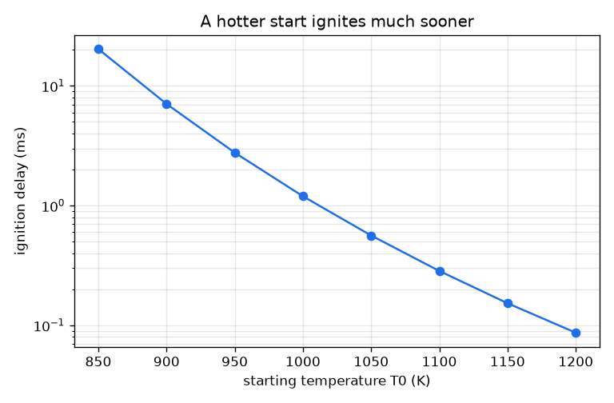
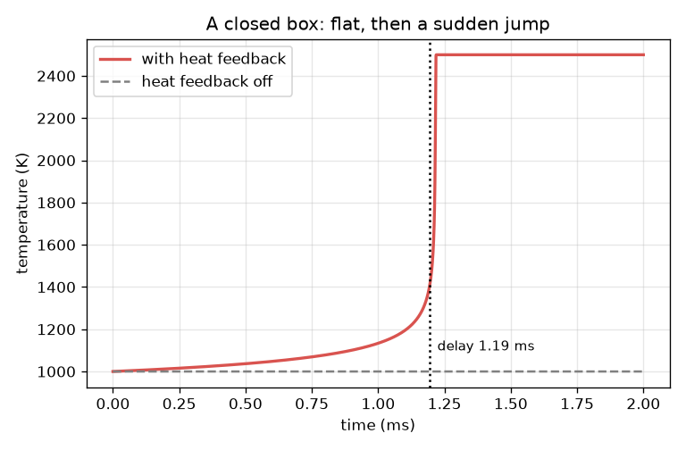

# సెషన్ 1: మిశ్రమం ఎందుకు వేచి ఉంటుంది, తర్వాత ఎందుకు అకస్మాత్తుగా మండుతుంది

[Session 1 — हिन्दी](README.hi.md)

*స్థాయి 1 (భావనాత్మక ఇంటరాక్టివ్ నమూనా) · సుమారు 60 నిమిషాలు · openignition*

> ఇది సరళీకరించిన విద్యా నమూనా. ఇది ధృవీకరించబడిన (validated) డిజైన్ సాధనం కాదు; నిజమైన నిర్మాణాలు, విద్యుత్ ఇన్‌స్టలేషన్లు, వాహనాలు, పారిశ్రామిక ప్రక్రియలు లేదా వైద్య నిర్ణయాల కోసం దీనిని ఉపయోగించకూడదు.

**ముందస్తు అవసరాలు (Prerequisites)**

- కాలిక్యులేటర్‌పై ఘాతాంక ప్రమేయం e^x.
- ఉష్ణోగ్రత-కాలం గ్రాఫ్ చదవడం.
- మీరు PRIMER.md చదివి, `python start.py 1` ఒకసారి రన్ చేశారు.

**అభ్యసన లక్ష్యాలు (Learning objectives).** ఈ సెషన్ తర్వాత మీరు:

- ఉష్ణ పరారి (thermal runaway) ను వివరించగలరు: ఉష్ణ విడుదల చర్యను వేగవంతం చేస్తుంది, అది మరింత ఉష్ణాన్ని విడుదల చేస్తుంది.
- అర్హీనియస్ రేటు స్థిరాంకాన్ని (Arrhenius rate constant) చేతితో మరియు Python లో లెక్కించగలరు.
- చదునుగా ఉండి తర్వాత దూకే ఉష్ణోగ్రత-కాలం వక్రం నుండి జ్వలన ఆలస్యాన్ని (ignition delay) చదవగలరు.
- వేడి ప్రారంభం ఆలస్యాన్ని ఎలా తగ్గిస్తుందో గ్రాఫ్ నుండి అంచనా వేయగలరు.

## A. వాస్తవ ప్రపంచ సమస్య
ఇంజిన్ సిలిండర్‌లో ఇంధన-గాలి మిశ్రమాన్ని కుదించండి; కొద్దిసేపు దాదాపు ఏమీ జరగదు. తర్వాత ఆ వేచి ఉండే సమయంలో ఒక చిన్న భాగంలోనే ఉష్ణోగ్రత పేలిపోతుంది. వేచి ఉండే సమయం జ్వలన ఆలస్యం, తప్పు క్షణంలో జ్వలన అంటే నాక్ (knock) లేదా మిస్‌ఫైర్ కాబట్టి ఇంజిన్ డిజైనర్లు దీని గురించి పట్టించుకుంటారు. మిశ్రమం ఎందుకు వేచి ఉంటుంది, ముగింపు ఎందుకు ఇంత అకస్మాత్తుగా ఉంటుంది? ఈ రెపో ఒక ఒకే-దశ బొమ్మను ఉపయోగిస్తుంది: కల్పిత సంఖ్యలతో ఒకే కల్పిత చర్య. ఇది నేర్చుకోవడానికి మాత్రమే, ఇంజిన్ లేదా మరే పరికరాన్ని డిజైన్ చేయడానికి ఉపయోగించకూడదు. నిజమైన హైడ్రోజన్-ఆక్సిజన్ జ్వలన పేలుడు పరిమితులతో కూడిన గొలుసు-శాఖల చర్యల నెట్‌వర్క్, ఈ బొమ్మలో అది లేదు.

## B. భావన మరియు సిద్ధాంతం
c మిగిలిన ఇంధనం (1 అంటే మొత్తం, 0 అంటే ఏమీ లేదు), T ఇన్సులేట్ చేసిన పెట్టెలో వాయువు ఉష్ణోగ్రత అనుకుందాం. ఇంధనం k(T) c రేటుతో ఖర్చవుతుంది, అర్హీనియస్ రేటు స్థిరాంకం k(T) = A exp(-Ea / (R T)) ఉష్ణోగ్రతతో నిటారుగా పెరుగుతుంది, ఎందుకంటే చర్య జరిపేంత శక్తి ఉన్న ఢీకొనడాలు కొన్ని మాత్రమే. కాలే ప్రతి కొద్ది ఇంధనం వాయువును వేడి చేస్తుంది; మొత్తం ఇంధనం కాలితే ఉష్ణోగ్రత DT_AD = 1500 K పెరుగుతుంది. కాబట్టి dT/dt = DT_AD k c. ఇది ఒక ఫీడ్‌బ్యాక్ లూప్: వేడి వాయువు పెద్ద k ఇస్తుంది, అది ఇంధనాన్ని వేగంగా కాలుస్తుంది, అది వాయువును మరింత వేడి చేస్తుంది. మొదట k చిన్నది, ఉష్ణోగ్రత దాదాపు కదలదు (వేచి ఉండటం); తర్వాత లూప్ అదుపు తప్పుతుంది (దూకు). T 400 K పెరిగినప్పుడు మిశ్రమం మండిందని అంటాము మరియు ఆ సమయాన్ని జ్వలన ఆలస్యం tau అంటాము.

| గుర్తు | అర్థం | ప్రమాణం |
|---|---|---|
| T | వాయు ఉష్ణోగ్రత | K |
| c | మిగిలిన ఇంధనం, 1 = మొత్తం | ప్రమాణం లేదు |
| k(T) | అర్హీనియస్ రేటు స్థిరాంకం | 1/s |
| A | పూర్వ-ఘాతాంక కారకం (బొమ్మ విలువ 2.5e9) | 1/s |
| Ea | ఉత్తేజ శక్తి (బొమ్మ విలువ 150 000) | J/mol |
| R | వాయు స్థిరాంకం 8.314 | J/(mol K) |
| DT_AD | మొత్తం ఇంధనం కాలితే ఉష్ణోగ్రత పెరుగుదల (బొమ్మ విలువ 1500) | K |
| tau | జ్వలన ఆలస్యం: T 400 K పెరగడానికి పట్టే సమయం | s |

**ఊహలు (Assumptions)**

- కల్పిత సంఖ్యలతో ఇంధనం ఉత్పత్తులుగా మారే ఒకే చర్య: ఒక బొమ్మ, హైడ్రోజన్ రసాయనశాస్త్రం కాదు.
- ఒకే సమాన ఉష్ణోగ్రతతో ఇన్సులేట్ చేసిన పెట్టె (ఉష్ణం బయటకు పోదు).
- DT_AD ఒక స్థిరాంకం (స్థిర ఉష్ణ సామర్థ్యం).
- జ్వలన అంటే 400 K పెరుగుదల; ఇతర నిర్వచనాలు సెషన్ 2లో పోల్చబడతాయి.

$$ k(T)=A\,e^{-E_a/(RT)} $$

$$ \frac{dc}{dt}=-k(T)\,c $$

$$ \frac{dT}{dt}=\Delta T_{ad}\,k(T)\,c $$

$$ T+\Delta T_{ad}\,c=\text{constant}\quad\text{(heat released equals fuel burnt)} $$

## C. దృశ్య వివరణ
ఎడమ చిత్రం 1000 K ప్రారంభ ఉష్ణోగ్రత వద్ద పెట్టె ఉష్ణోగ్రతను కాలానికి వ్యతిరేకంగా చూపిస్తుంది. అది నెమ్మదిగా పాకుతుంది (1.0 ms తర్వాత 1134 K), తర్వాత నిటారుగా పైకి వంగుతుంది (1.2 ms వద్ద 1458 K), 1.3 ms నాటికి 2500 K చేరుతుంది: చదునుగా, తర్వాత ఒక దూకు. బూడిద రంగు చుక్కల గీత ఉష్ణ ఫీడ్‌బ్యాక్ ఆపేసిన అదే పెట్టె: ఉష్ణోగ్రత ఎప్పుడూ కదలదు, 1 ms తర్వాత కూడా ఇంధనంలో 3.6 శాతం మాత్రమే పోయింది. కుడి చిత్రం ప్రారంభ ఉష్ణోగ్రతకు వ్యతిరేకంగా జ్వలన ఆలస్యాన్ని లాగ్ స్కేల్‌పై చూపిస్తుంది: 900 K వద్ద 7.06 ms, కానీ 1100 K వద్ద 0.284 ms మాత్రమే.

*జ్వలన ఆలస్యం (లాగ్ స్కేల్) ప్రారంభ ఉష్ణోగ్రతతో నిటారుగా తగ్గుతుంది.*

*మూసివేసిన పెట్టె: ఉష్ణోగ్రత చదునుగా ఉండి, తర్వాత దూకుతుంది; ఉష్ణ ఫీడ్‌బ్యాక్ ఆపితే అది ఎప్పుడూ కదలదు.*

## D. ఇంటరాక్టివ్ సిమ్యులేషన్
పాఠాన్ని రన్ చేయండి (`python start.py 1`), తర్వాత లైవ్ యాప్‌ను తెరవండి: [సెషన్ 1: తనను తానే వేడి చేసుకునే పెట్టె](https://krunalpanchal1995.github.io/pan-iit-oss/openignition/session-01/) (లేదా ఈ ఫోల్డర్‌లోని `app.html`). పెట్టె రంగు మారడం మరియు ఇంధన స్థాయి తగ్గడం చూడటానికి టైమ్ స్లైడర్‌ను లాగండి, తర్వాత గ్రాఫ్ వీక్షణకు మారి దూకును చూడండి. ప్రారంభ ఉష్ణోగ్రతను మరియు ఉష్ణ విడుదలను మార్చి రీడౌట్‌లో జ్వలన ఆలస్యాన్ని గమనించండి.

**సవాలు.** 1100 K కంటే ఎక్కువ వేడి కాని ప్రారంభంతో మిశ్రమాన్ని 0.25 ms లోపు మండించండి. (సూచన: గాఢమైన మిశ్రమం ఎక్కువ ఉష్ణాన్ని విడుదల చేస్తుంది.)

## E. సాధించిన ఉదాహరణ మరియు ప్రయోగం
**సమస్య.** 1000 K ప్రారంభ ఉష్ణోగ్రత వద్ద రేటు స్థిరాంకం k ను కనుగొనండి. ఉష్ణ ఫీడ్‌బ్యాక్ లేకుంటే 1 ms తర్వాత ఎంత ఇంధనం పోతుంది? ఫీడ్‌బ్యాక్ ఉన్నప్పుడు జ్వలన క్షణంలో కాలిన ఇంధనంతో పోల్చండి.

1. Ea / (R T) = 150000 / (8.314 * 1000) = 18.04.
2. k = 2.5e9 * exp(-18.04) = సెకనుకు 36.5.
3. ఫీడ్‌బ్యాక్ లేకుండా ఉష్ణోగ్రత 1000 K వద్దే ఉంటుంది, కాబట్టి 1 ms తర్వాత c = exp(-36.5 * 0.001) = exp(-0.0365) = 0.964: ఇంధనంలో 3.6 శాతం మాత్రమే పోయింది.
4. ఫీడ్‌బ్యాక్‌తో, జ్వలన అంటే T 400 K పెరిగింది. మొత్తం ఇంధనం కాలితే 1500 K వస్తుంది, కాబట్టి 400 K అంటే ఇంధనంలో 400 / 1500 = 0.267 భాగం కాలింది: 26.7 శాతం.
5. సిమ్యులేషన్ 1000 K వద్ద జ్వలన ఆలస్యాన్ని 1.19 ms గా ఇస్తుంది.

**సమాధానం.** k = సెకనుకు 36.5. ఫీడ్‌బ్యాక్ ఆపితే 1 ms లో ఇంధనంలో 3.6 శాతం మాత్రమే కాలుతుంది; ఫీడ్‌బ్యాక్ ఉంటే, జ్వలనకు చేరినప్పుడు, 1.19 ms తర్వాత, 26.7 శాతం కాలి ఉంటుంది.

**ప్రయోగం.** జ్వలన ఆలస్యాన్ని కొలవడానికి నిజమైన మార్గం వేగవంతమైన కుదింపు యంత్రం లేదా షాక్ ట్యూబ్: పిస్టన్ లేదా షాక్ తరంగం ముందే కలిపిన వాయువును దాదాపు తక్షణమే వేడి చేస్తుంది, పీడనం ఎప్పుడు దూకుతుందో పీడన సెన్సార్ చూపిస్తుంది. కొలిచిన ఆలస్యాలను బొమ్మతో పోల్చండి: ఆకారం (సుదీర్ఘ నిరీక్షణ, తర్వాత అకస్మాత్తు దూకు, ఉష్ణోగ్రతతో నిటారుగా తగ్గే ఆలస్యం) సరిపోతుంది; సంఖ్యలు సరిపోవు, ఎందుకంటే బొమ్మకు ఒకే చర్య, గోడలకు ఉష్ణ నష్టం లేకపోవడం మరియు కల్పిత స్థిరాంకాలు ఉన్నాయి, నిజమైన మిశ్రమానికి అనేక చర్యలు మరియు గోడలు ఉన్నాయి. ముఖ్యంగా హైడ్రోజన్‌కు, నిజమైన ప్రవర్తనలో పీడనంపై ఆధారపడే గొలుసు శాఖలు మరియు పేలుడు పరిమితులు ఉన్నాయి; బొమ్మలో అవి లేవు.

## F. మూల్యాంకనం మరియు డిజైన్ సవాలు
**ప్రశ్న రకం A: భావనాత్మక.** రసాయనశాస్త్రం ఎల్లప్పుడూ ఒకటే అయినా మిశ్రమం ఎందుకు చాలాసేపు వేచి ఉండి తర్వాత దాదాపు తక్షణమే మండుతుంది? ఉష్ణ ఫీడ్‌బ్యాక్ లేని పెట్టె ఎందుకు ఎప్పుడూ మండదు?

సూచన

ఉష్ణోగ్రత రేటుకు ఏమి చేస్తుంది, రేటు ఉష్ణోగ్రతకు ఏమి చేస్తుంది అని ఆలోచించండి.

దశలవారీ పరిష్కారం

రేటు k ఉష్ణోగ్రతతో నిటారుగా పెరుగుతుంది మరియు చర్య వాయువును వేడి చేస్తుంది, కాబట్టి ప్రక్రియ తనను తానే పోషించుకుంటుంది: ఒక సానుకూల ఫీడ్‌బ్యాక్ లూప్ (ఉష్ణ పరారి). తక్కువ ఇంధనం మాత్రమే కాలినప్పుడు వేడెక్కడం చాలా స్వల్పం, కాబట్టి ఉష్ణోగ్రత మరియు రేటు దాదాపు మారవు మరియు వాయువు వేచి ఉన్నట్లు అనిపిస్తుంది; ఉష్ణోగ్రత తగినంత పెరిగాక, ప్రతి ఉష్ణ పెరుగుదల రేటును గణనీయంగా పెద్దది చేస్తుంది, ఇంధనం అయిపోయే వరకు లూప్ వేగవంతమవుతుంది. ఫీడ్‌బ్యాక్ లేకుంటే ఉష్ణోగ్రత ప్రారంభ విలువ వద్దే ఉంటుంది, రేటు స్థిరంగా ఉంటుంది మరియు ఇంధనం నెమ్మదిగా క్షీణిస్తుంది (1 ms లో 3.6 శాతం), కాబట్టి పరారి ఉండదు.

**ప్రశ్న రకం B: సంఖ్యాత్మక.** 1100 K వద్ద రేటు స్థిరాంకాన్ని కనుగొనండి. ఇది 1000 K వద్ద కంటే ఎన్ని రెట్లు పెద్దది? ఇంధనంలో 10 శాతం కాలితే పెట్టె ఎన్ని కెల్విన్లు వేడెక్కుతుంది?

సూచన

1100 K వద్ద Ea / (R T), తర్వాత దాని రుణం యొక్క exp; ఉష్ణం = కాలిన భిన్నం గుణకారం DT_AD.

దశలవారీ పరిష్కారం

Ea / (R T) = 150000 / (8.314 * 1100) = 16.40, కాబట్టి k = 2.5e9 * exp(-16.40) = సెకనుకు 188. కారకం 188 / 36.5 = 5.2. 10 శాతం కాలడం పెట్టెను 0.1 * 1500 = 150 K వేడి చేస్తుంది. సహేతుకత తనిఖీ: వేడి వాయువుకు పెద్ద k ఉండాలి, ఇంధనంలో చిన్న భిన్నం కాలడం 1500 K లో చిన్న భిన్నాన్ని ఇస్తుంది.

**ప్రశ్న రకం C: గ్రాఫ్ మరియు సిమ్యులేషన్ వ్యాఖ్యానం.** కుడి చిత్రంలో, ప్రారంభ ఉష్ణోగ్రత 1000 K నుండి 1050 K కి పెరిగినప్పుడు ఆలస్యం ఎన్ని రెట్లు తగ్గుతుంది? వక్రం యొక్క నిటారుతనం రేటు గురించి ఏమి చెబుతుంది?

సూచన

రెండు ఉష్ణోగ్రతల వద్ద ఆలస్యాన్ని చదివి భాగించండి; ఆలస్యం లాగ్ స్కేల్‌పై ఉంది.

దశలవారీ పరిష్కారం

ఆలస్యం సుమారు 1.2 ms నుండి సుమారు 0.56 ms కి తగ్గుతుంది, సుమారు 2.1 రెట్లు. 50 K అనే స్వల్ప మార్పు నిరీక్షణను సగం చేస్తుంది, ఎందుకంటే k ఉష్ణోగ్రతతో నిటారుగా మారుతుంది (1100 K వద్ద k, 1000 K కంటే 5.2 రెట్లు పెద్దది), కాబట్టి పరారి ముందుగా మొదలవుతుంది.

**ప్రశ్న రకం D: డిజైన్ మరియు ఆప్టిమైజేషన్ (optimisation) సవాలు.** డిజైన్: మీకు 0.5 ms లోపు జ్వలన కావాలి. 1500 K ఉష్ణ విడుదలతో పనిచేసే అత్యల్ప ప్రారంభ ఉష్ణోగ్రతను (10 K అడుగులలో) కనుగొనండి. తర్వాత 2000 K ఉష్ణ విడుదల గల గాఢమైన మిశ్రమం చల్లగా ప్రారంభించడానికి అనుమతిస్తుందో కనుగొని, మీరు దేన్ని వదులుకుంటున్నారో చెప్పండి.

సూచన

T0 = 1050, 1060, ... కు euler_delay(T0) ఉపయోగించండి, తర్వాత euler_delay(T0, 2000.0).

దశలవారీ పరిష్కారం

1050 K వద్ద ఆలస్యం 0.562 ms (చాలా నెమ్మది); 1060 K వద్ద అది 0.488 ms, కాబట్టి అత్యల్ప ప్రారంభ ఉష్ణోగ్రత 1060 K. 2000 K ఉష్ణ విడుదలతో 1050 K వద్ద ఆలస్యం 0.416 ms, కాబట్టి గాఢమైన మిశ్రమం 1050 K నుండి, 10 K చల్లగా (ఇంకా తక్కువ నుండి కూడా) పనిచేస్తుంది. రాజీ (trade-off): గాఢమైన మిశ్రమం అంటే గాలికి ఎక్కువ ఇంధనం, కాబట్టి వేడి కాలిన వాయువు (ప్రారంభం కంటే 2000 K పైన), నిజమైన ఇంజిన్‌లో ఎక్కువ ఉద్గారాలు మరియు నాక్ ప్రమాదం ఎక్కువ; వేడి ప్రారంభానికి ఎక్కువ కుదింపు అవసరం. ఇది ఒక బొమ్మ: రాజీ దిశను మాత్రమే చూపిస్తుంది.

[RUBRIC.md](../../RUBRIC.md) తో మిమ్మల్ని మీరు స్కోర్ చేసుకోండి. కాగితంపై చేయడానికి [కార్యాచరణ పత్రాన్ని](activity_sheet.md) ప్రింట్ చేయండి.

## సాధారణ అపోహలు
| సాధారణ అపోహ | వాస్తవంగా నిజమైనది |
|---|---|
| ఉష్ణోగ్రత ఒక స్థిర జ్వలన ఉష్ణోగ్రత చేరినప్పుడు జ్వలన జరుగుతుంది. | పదునైన పరిమితి ఉష్ణోగ్రత లేదు: ప్రారంభ ఉష్ణోగ్రతపై ఆధారపడే ఆలస్యం తర్వాత మిశ్రమం మండుతుంది, చల్లని ప్రారంభం చాలా ఎక్కువసేపు వేచి ఉంటుంది అంతే. |
| వేచి ఉన్న సమయంలో ఏమీ జరగదు. | ఇంధనం ఖర్చవుతూ, ఉష్ణం విడుదలవుతూ ఎల్లప్పుడూ ఉంటుంది, నెమ్మదిగా; ఉష్ణోగ్రత తగినంత పెరిగాకే ఫీడ్‌బ్యాక్ లూప్ కనిపిస్తుంది. |
| కొంచెం ఎక్కువ ఉష్ణోగ్రత ఆలస్యాన్ని కొంచెం మాత్రమే తగ్గిస్తుంది. | ఆలస్యం చాలా నిటారుగా తగ్గుతుంది: ఈ బొమ్మలో 1000 K దగ్గర ప్రతి 50 K కి సుమారు సగం అవుతుంది. |
| ఈ నమూనా నిజమైన హైడ్రోజన్ జ్వలనను అంచనా వేస్తుంది. | ఇది కల్పిత సంఖ్యలతో కూడిన ఒకే-దశ బొమ్మ. నిజమైన హైడ్రోజన్-ఆక్సిజన్ జ్వలన పేలుడు పరిమితులతో కూడిన గొలుసు-శాఖల నెట్‌వర్క్. |

## పదకోశం (Glossary)
- **జ్వలన ఆలస్యం (ignition delay)**: ఉష్ణోగ్రత అదుపు తప్పే ముందు వేచి ఉండే సమయం; ఇక్కడ 400 K పెరుగుదలకు పట్టే సమయం
- **ఉష్ణ పరారి (thermal runaway)**: ఉష్ణ విడుదల చర్యను వేగవంతం చేస్తుంది, అది మరింత ఉష్ణాన్ని విడుదల చేస్తుంది
- **అర్హీనియస్ రేటు స్థిరాంకం (Arrhenius rate constant)**: k = A exp(-Ea/(R T)), ఉష్ణోగ్రతతో నిటారుగా పెరిగే రేటు
- **ఉత్తేజ శక్తి (activation energy)**: చర్య యొక్క శక్తి అవరోధం, Ea, J/mol లో
- **స్థిరోష్ణక (adiabatic)**: పరిసరాలతో ఉష్ణ మార్పిడి లేని

## ముగింపు
1. [exercises.md](exercises.md) లోని మూడు కోడింగ్ పనులను చేయండి.
2. మీ మార్పుల తర్వాత `python start.py 1` మళ్ళీ రన్ చేయండి. అది చెక్‌పాయింట్‌తో ముగుస్తుంది; అది `PASS` ప్రింట్ చేసినప్పుడు మీరు పూర్తి చేశారు. (చెక్‌పాయింట్ మాత్రమే: `python start.py check 1`.)

తర్వాత: [సెషన్ 2](../session-02/README.md)
