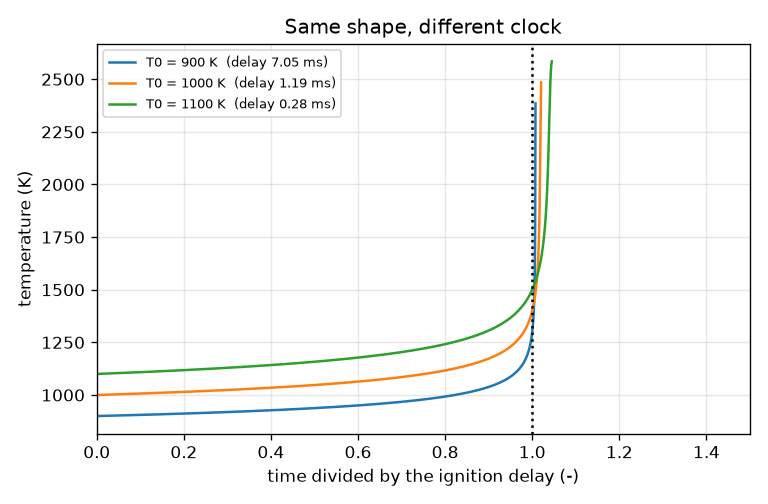
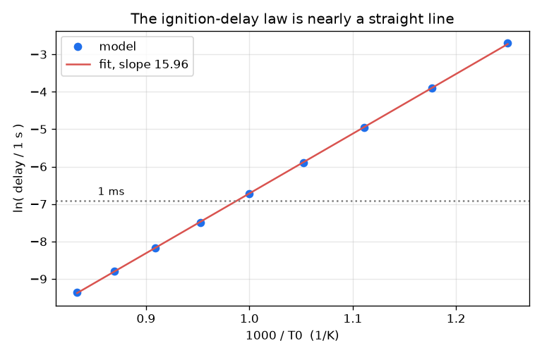

# Session 2: The one-step model and the ignition-delay law

*Level 2 (mathematical engineering model) · about 75 minutes · openignition*

> This is a simplified educational model. It is not a validated design tool and must not be used for real structures, electrical installations, vehicles, industrial processes or medical decisions.

**Prerequisites**

- Session 1: the box, the Arrhenius rate and the delay.
- The natural logarithm ln, and the idea of an integral as an area under a curve.
- Fitting a straight line (explained in Section B).

**Learning objectives.** After this session you can:

- Reduce the two coupled equations to one using the heat balance T = T0 + DT_AD (1 - c).
- Compute the ignition delay as an integral, and compare it with the Frank-Kamenetskii estimate.
- Show that ln(delay) against 1000/T0 is nearly a straight line, and read its slope.
- Solve the inverse problem: what start temperature gives a chosen delay?

## A. Real-world problem
An engine designer asks: how hot must the charge be so that it ignites within 1 millisecond, and what happens to the delay if the charge is 50 K cooler? In Session 1 we ran simulations and looked up answers; now we turn the model into equations we can solve and invert. The model is still a one-step toy with made-up numbers, for learning only: it keeps the part that all thermal ignition has in common (heat feedback on an Arrhenius rate) and leaves out chain branching, which dominates real hydrogen-oxygen ignition and gives it explosion limits. Never use it to design real equipment.

## B. Concept and theory
The model is dc/dt = -k c and dT/dt = DT_AD k c for a lumped, insulated box at constant pressure with constant heat capacity cp, where DT_AD = Q / cp is the heat released per unit fuel divided by cp. Dividing the two equations gives dT/dc = -DT_AD, so T = T0 + DT_AD (1 - c) at every instant: temperature and fuel are tied together. Substituting, the system collapses into one equation for c, and the time to go from c = 1 down to c* = 1 - 400 / DT_AD (the point where T has risen by 400 K) is an integral, tau = integral of dc / (k c) from c* to 1, which we evaluate by Gauss-Legendre quadrature (no time stepping). The textbook estimate of Frank-Kamenetskii replaces k(T) by k(T0) exp(Ea (T - T0) / (R T0^2)), which gives tau = R T0^2 / (Ea DT_AD k(T0)); it is a good guide but, because the true k grows more slowly than that exponential over a 400 K rise, it comes out too short. Over a range of start temperatures, ln(tau) plotted against 1000/T0 is nearly a straight line; a least-squares fit gives its slope, which is below Ea / (1000 R) because the gas heats up during the delay.

| Symbol | Meaning | Unit |
|---|---|---|
| c | fuel left (1 = all) | no unit |
| T0 | start temperature | K |
| DT_AD | Q / cp, temperature rise if all fuel burns (1500) | K |
| k(T) | Arrhenius rate constant A exp(-Ea/(R T)), A = 2.5e9 1/s, Ea = 150 kJ/mol | 1/s |
| tau | ignition delay: time to reach T0 + 400 K | s |
| Q | heat released per unit mass of fuel burnt | J/kg |
| cp | specific heat of the gas (constant) | J/(kg K) |

**Assumptions**

- Lumped (uniform) insulated box at constant pressure, constant cp, so DT_AD is one toy number.
- One reaction with made-up constants; not hydrogen chemistry (no chain branching, no explosion limits).
- Ignition criterion: T rises 400 K. A second criterion, the time of the largest dT/dt, is also computed.
- A constant-volume box would give a similar law with a different DT_AD; we do not treat it.

$$ \frac{dc}{dt}=-k(T)\,c,\qquad \frac{dT}{dt}=\Delta T_{ad}\,k(T)\,c,\qquad \Delta T_{ad}=\frac{Q}{c_p} $$

$$ \frac{dT}{dc}=-\Delta T_{ad}\;\Rightarrow\; T=T_0+\Delta T_{ad}\,(1-c) $$

$$ \tau=\int_{c^*}^{1}\frac{dc}{k\big(T_0+\Delta T_{ad}(1-c)\big)\,c},\qquad c^*=1-\frac{400\,\mathrm{K}}{\Delta T_{ad}} $$

$$ \tau_{FK}=\frac{R\,T_0^{2}}{E_a\,\Delta T_{ad}\,k(T_0)} $$

$$ \ln\tau\approx a+b\,\frac{1000}{T_0} $$

## C. Visual explanation
The first figure plots the temperature of the box against time divided by its own delay, for start temperatures of 900, 1000 and 1100 K: the three curves have almost the same shape and all reach the 400 K rise at time / delay = 1; only the clock changes. The second figure plots ln(delay) against 1000/T0 for start temperatures from 800 K to 1200 K: the points lie on a straight line (R squared above 0.9999) with slope 15.96. The activation energy input gives Ea / (1000 R) = 18.04, so the fitted slope is lower, because the gas heats up during the delay.

*Temperature against time divided by the delay: same shape, different clock.*

*ln(delay) against 1000/T0: nearly a straight line, slope 15.96.*

## D. Interactive simulation
Run the lesson (`python start.py 2`), then open the live app: [Session 2: the ignition-delay law](https://krunalpanchal1995.github.io/pan-iit-oss/openignition/session-02/) (or `app.html` in this folder). Change the start temperature, the activation energy and the heat release, and compare three views: the feedback loop with its numbers, the temperature curve, and the ln(delay) law with the pure Arrhenius slope drawn in grey for comparison.

**Challenge.** Find a start temperature (with any activation energy and heat release you like, but not the defaults) so that the delay is between 0.95 and 1.05 ms.

## E. Worked example and experiment
**Problem.** For T0 = 1000 K, estimate the delay with the Frank-Kamenetskii formula by hand, and compare it with the integral computed by the code.

1. k(T0) = 2.5e9 * exp(-18.04) = 36.514 per second (Session 1).
2. R T0^2 = 8.314 * 1 000 000 = 8.314e6 J/mol.
3. Ea DT_AD k(T0) = 150000 * 1500 * 36.514 = 8.216e9 J/mol per second.
4. tau_FK = 8.314e6 / 8.216e9 = 1.012e-3 s = 1.01 ms.
5. The integral evaluated by the code gives 1.192 ms, so the estimate is 0.849 (85 percent) of it.

**Answer.** The estimate gives 1.01 ms and the integral 1.19 ms: the textbook formula is about 15 percent too short at 1000 K, because the true rate grows more slowly than the exponential it assumes.

**Experiment.** In a shock-tube or rapid-compression experiment one measures the delay at a series of temperatures and plots ln(delay) against 1000/T. The toy predicts a straight line. A real fuel such as hydrogen gives a curved line, and the delay depends on pressure in a way that changes across the explosion limits, because chain-branching reactions compete with chain termination. A measured line can also be affected by heat loss, mixing and the exact definition of ignition (for example the maximum of dT/dt instead of a 400 K rise, which in the toy is 1.214 ms instead of 1.192 ms at 1000 K). So the model gives the right idea (a roughly Arrhenius law with an effective activation energy lower than the input one) but not the numbers of any real fuel.

## F. Assessment and design challenge
**Question type A: Conceptual.** Why is ln(delay) against 1000/T0 nearly a straight line, and why is its slope smaller than Ea / (1000 R)?

Hint

Think of a rate proportional to exp(-Ea/(R T)) and of what the gas temperature does during the delay.

Step-by-step solution

The delay is roughly the reciprocal of a rate that depends on T0 through exp(-Ea/(R T0)), so ln(delay) is roughly linear in 1/T0 with slope Ea/R (per unit 1/T0, or Ea/(1000 R) per unit 1000/T0). But during the delay the gas heats by 400 K, so most of the wait is spent at temperatures above T0, where the rate is higher and the dependence on T0 is weaker; that lowers the effective slope (15.96 instead of 18.04).

**Question type B: Numerical.** Use the Frank-Kamenetskii formula by hand to estimate the delay at 1100 K, and compare it with the exact value 0.2829 ms.

Hint

k(1100 K) = 188.3 per second from Session 1; tau = R T0^2 / (Ea DT_AD k).

Step-by-step solution

R T0^2 = 8.314 * 1.21e6 = 1.006e7. Ea DT_AD k = 150000 * 1500 * 188.27 = 4.236e10. tau_FK = 1.006e7 / 4.236e10 = 2.375e-4 s = 0.2375 ms, which is 0.84 of the exact 0.2829 ms. Sanity check: shorter than at 1000 K (1.01 ms), as it must be.

**Question type C: Graph and simulation interpretation.** From the ln(delay) plot, read the slope between the points at 900 K and 1100 K. Is it equal to the fitted slope 15.96? Why can it differ?

Hint

Slope = change in ln(delay) divided by change in 1000/T0, using ln(7.0495e-3) = -4.955 and ln(0.2829e-3) = -8.171.

Step-by-step solution

The slope is (-4.955 + 8.171) / (1000/900 - 1000/1100) = 3.216 / 0.202 = 15.9, close to but not exactly the fit value 15.96: the points are not on a perfectly straight line (R squared is 0.99996, not 1), and the local slope is slightly different from place to place.

**Question type D: Design and optimisation challenge.** Design: the charge can only be heated to 950 K, but you need a 1 ms delay. Using a catalyst-like additive that multiplies the pre-exponential factor A, by what factor must A grow? Name one other lever and its cost.

Hint

Doubling A halves the delay exactly. Find the delay at 950 K first.

Step-by-step solution

The delay at 950 K is 2.759 ms, so A must grow by 2.759 / 1.0 = 2.76 times. Another lever is a richer mixture (a larger DT_AD), which shortens the delay, or a lower activation energy; the cost of a richer mixture is more fuel, a hotter burnt gas and more emissions. Assumption: the toy keeps the same law with a larger A, which a real additive would not do exactly.

Score yourself with [RUBRIC.md](../../RUBRIC.md). Print the [activity sheet](activity_sheet.md) to work on paper.

## Common misconceptions
| Common misconception | What is actually true |
|---|---|
| The delay is proportional to exp(Ea/(R T0)) exactly. | That is only the leading behaviour; the heating during the delay lowers the effective slope (15.96 against 18.04 here). |
| The Frank-Kamenetskii estimate is exact. | It assumes a small temperature rise; for a 400 K rise it is about 15 percent short at 1000 K. |
| Ignition has a single definition. | A 400 K rise, the maximum rate of temperature rise and a fixed pressure rise all give slightly different delays; always state which one you use. |
| The one-step slope tells you the real activation energy of hydrogen. | It is a property of the toy numbers only; real hydrogen has branching reactions, a curved law and explosion limits. |

## Glossary
- **quadrature**: numerical evaluation of an integral by weighted sample points
- **Frank-Kamenetskii estimate**: a textbook formula for the delay that linearises the exponent around T0
- **heat balance**: the relation T = T0 + DT_AD (1 - c) between temperature and fuel
- **effective activation energy**: the activation energy implied by the slope of ln(delay) against 1/T0
- **bisection**: finding a root by repeatedly halving an interval

## Finish
1. Do the three coding tasks in [exercises.md](exercises.md).
2. Run `python start.py 2` again after your changes. It ends with the checkpoint; when it prints `PASS`, you are done. (Checkpoint only: `python start.py check 2`.)

Next: [Session 3](../session-03/README.md)
