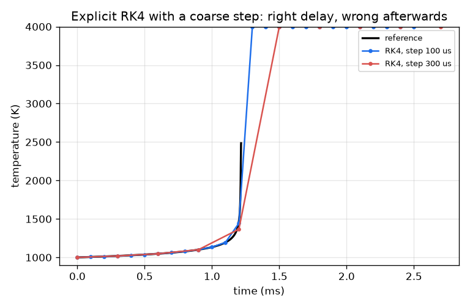
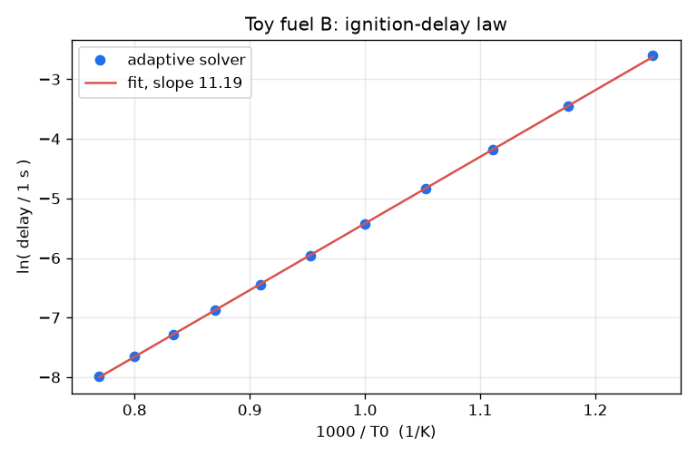
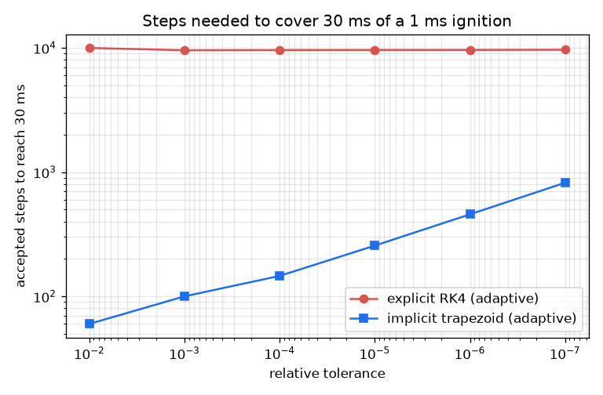

# Session 3: Stiffness: explicit versus implicit, and how to trust the answer

*Level 3 (simulation and validation) · about 90 minutes · openignition*

> This is a simplified educational model. It is not a validated design tool and must not be used for real structures, electrical installations, vehicles, industrial processes or medical decisions.

**Prerequisites**

- Session 1 and Session 2.
- Runge-Kutta (the idea of a step) helps; both methods are explained in Section B.
- A first look at a 2x2 matrix and Newton's method.

**Learning objectives.** After this session you can:

- Explain stiffness with the Jacobian: a very fast mode forces explicit steps to stay tiny even when nothing happens.
- Write an explicit RK4 and an implicit trapezoid solver with Newton iteration, both adaptive, and compare their cost and accuracy.
- Validate the delay against an exact quadrature and the Semenov criterion, and show convergence with tolerance.
- Measure normalised sensitivities and a pressure law, and recognise a failing step size.

## A. Real-world problem
Combustion codes spend most of their time on ignition-type chemistry because it is stiff: for a long time almost nothing changes, then everything changes within microseconds, and afterwards a very fast mode remains that must be integrated stably. How do we compute the delay reliably, how much does each method cost, and how do we know the answer is right? The model is still the one-step toy of Sessions 1 and 2, with made-up numbers; real hydrogen-oxygen ignition is a chain-branching network with explosion limits that are not in this toy, and nothing here is a validated design tool.

## B. Concept and theory
Write the state as y = (T, c) with dy/dt = f(y). The Jacobian J = df/dy (a 2x2 matrix) has eigenvalues that are the time scales of the model: after ignition c is almost zero and one eigenvalue is about -k(T_final), a decay of millions per second. An explicit method such as RK4 (four right-hand-side evaluations per step, no solving) is stable only if step times the fastest decay rate is below about 2.785, so the step is limited by stability, not by accuracy, long after ignition has finished. An implicit method defines the new state by an equation containing itself, for example the trapezoid rule z = y + h/2 (f(y) + f(z)), solved by Newton iteration with the Jacobian; it costs a 2x2 linear solve per iteration but is stable for large steps. Adaptive steps compare one full step with two half steps to estimate the local error. We validate with the exact quadrature of Session 2, with the analytic Semenov criterion (heat loss h to surroundings at Ta, fuel held constant: a steady state exists only if psi = DT_AD k(Ta) Ea / (R Ta^2 h) is at most 1/e), and with the normalised sensitivity S_x = d ln tau / d ln x. For pressure we use the illustrative rule k proportional to (P/P0)^m with m = 1; real behaviour is not a simple power law.

| Symbol | Meaning | Unit |
|---|---|---|
| y = (T, c) | state: temperature and fuel left | K, no unit |
| J | Jacobian df/dy, 2x2 | 1/s |
| h (step) | time step of an integrator | s |
| h (loss) | heat-loss rate to the surroundings | 1/s |
| Ta | surrounding temperature in the Semenov test | K |
| psi | Semenov parameter; critical value 1/e | no unit |
| S_x | normalised sensitivity d ln tau / d ln x | no unit |
| m | toy pressure exponent (1) | no unit |
| rtol | relative tolerance of the adaptive solvers | no unit |

**Assumptions**

- One-step toy with made-up constants, not hydrogen chemistry (no chain branching, no explosion limits).
- Insulated box except in the Semenov test, where a linear heat loss h (T - Ta) is added and the fuel is held at c = 1 for the analytic comparison.
- RK4 and the trapezoid are our own simple adaptive versions (step doubling), not production code.
- The pressure exponent m = 1 is illustrative, not measured.

$$ \dot T=\Delta T_{ad}\,k(T)\,c-h\,(T-T_a),\qquad \dot c=-k(T)\,c $$

$$ J=\begin{pmatrix}\Delta T_{ad}\,k'\,c-h & \Delta T_{ad}\,k\\ -k'\,c & -k\end{pmatrix},\qquad k'=k\,\frac{E_a}{RT^2} $$

$$ \text{RK4 stable only if } h\,|\lambda|\lesssim 2.785,\quad |\lambda|\approx k(T_0+\Delta T_{ad}) $$

$$ z=y+\tfrac{h}{2}\big(f(y)+f(z)\big)\quad\text{(trapezoid; Newton: } (I-\tfrac{h}{2}J)\,\delta=-g\text{)} $$

$$ \psi=\frac{\Delta T_{ad}\,k(T_a)\,E_a}{R\,T_a^{2}\,h}\le \frac1e\ \text{ for a steady state} $$

$$ S_x=\frac{d\ln\tau}{d\ln x},\qquad \tau\propto P^{-m} $$

## C. Visual explanation
The first figure plots the accepted steps of the adaptive explicit RK4 and the adaptive implicit trapezoid against the requested tolerance, for a run that covers 30 ms. The RK4 curve is flat (more than 9000 steps whatever the tolerance) because stability, not accuracy, sets its step, while the trapezoid grows with the tolerance (by more than 7 times from 1e-2 to 1e-6) but stays far below it. The second figure shows what a coarse explicit step does: with a step of 100 microseconds RK4 finds the ignition time to 0.27 percent and then the temperature shoots off the plot. The third figure repeats the Session 2 law for toy fuel B with the fit (slope 11.19).

*Explicit RK4 with 100 and 300 microsecond steps: the delay is almost right, the state afterwards is wrong.*

*Toy fuel B: delays from the adaptive implicit solver and the fitted ln(delay) law.*

*Accepted steps to cover 30 ms against tolerance: RK4 is limited by stability, the trapezoid by accuracy.*

## D. Interactive simulation
Run the lesson (`python start.py 3`), then open the live app: [Session 3: stiffness and step size](https://krunalpanchal1995.github.io/pan-iit-oss/openignition/session-03/) (or `app.html` in this folder). Move the step slider (it is logarithmic) and watch explicit RK4 and backward Euler follow, or fail to follow, the reference curve; look at the stability limit in the first view and at the delay error against the step size in the last view.

**Challenge.** Set the step as large as you can while explicit RK4 is still stable after ignition: within 10 percent below the stability limit.

## E. Worked example and experiment
**Problem.** For T0 = 1000 K find the fast decay rate after ignition and the largest stable RK4 step. Then check it by running RK4 just below and just above that step.

1. After ignition T = 1000 + 1500 = 2500 K and c is almost zero, so the fastest eigenvalue of the Jacobian is about -k(2500 K).
2. Ea / (R T) = 150000 / (8.314 * 2500) = 7.217, exp(-7.217) = 7.34e-4, so k = 2.5e9 * 7.34e-4 = 1.84e6 per second.
3. The RK4 stability limit is 2.785 / 1.84e6 = 1.52e-6 s = 1.52 microseconds.
4. RK4 with a step of 1.45 microseconds ends correctly at 2500 K with the fuel gone.
5. RK4 with 1.6 microseconds stays finite but ends wrong (the temperature is below 2450 K and more than 5 percent of the fuel is left); with 5 microseconds it blows up, even though the delay it found before the blow-up is right to 0.01 percent.

**Answer.** The fast decay rate is 1.84e6 per second and the RK4 step limit is 1.52 microseconds: the accurate ignition event is found with big steps, but covering the time after ignition explicitly forces steps hundreds of times smaller than the delay itself (1.19 ms).

**Experiment.** Stiffness is also something you can meet in a real experiment record: a fast sensor sampled too slowly shows aliasing in the same way an explicit solver with too big a step shows garbage. Compare the toy with a measured ignition-delay curve from a shock tube: the toy predicts a straight line of ln(delay) against 1000/T0, but real hydrogen shows curvature and a pressure dependence that changes sign across the explosion limits (chain branching versus termination), which a one-step model cannot reproduce. Model and measurement also differ because of heat loss, non-uniform temperature and the definition of the ignition time.

## Real-world application and mini-project: Tabulate the ignition delay of a toy fuel and draw its law
A new toy fuel B has the made-up numbers A = 1e7 per second, Ea = 110 kJ/mol and a heat release of 1200 K (stored as `FUEL_B` in the Session 3 lesson). Using the adaptive implicit solver `trapezoid_adaptive` (through `delay_table`), tabulate its ignition delay for start temperatures from 800 K to 1300 K in steps of 50 K, compare each value with the exact quadrature `reference_delay`, draw ln(delay) against 1000/T0 with a straight-line fit, and read off the start temperature that gives a 1 ms delay.

**Deliverable:** A script that prints the table of 11 delays next to the reference values, the fitted slope and R squared, and the temperature for a 1 ms delay from the fit, and saves the ln(delay) against 1000/T0 plot with the fitted line.

**Success looks like:** Every tabulated delay is within 0.1 percent of the reference, the fit has R squared above 0.9999 with slope 11.19, and the fitted temperature for 1 ms is 1153 K.

## F. Assessment and design challenge
**Question type A: Conceptual.** Why must an explicit method keep taking microsecond steps after the ignition is over, when the temperature is no longer changing? Why can an implicit method take huge steps there?

Hint

Think of the fast decaying mode of the Jacobian and of what a stability limit is.

Step-by-step solution

After ignition the fuel is almost zero and a very fast mode, decaying at about k(T_final) per second, remains. Any error in that mode is damped in reality, but an explicit method amplifies it if step times decay rate exceeds about 2.785, so the step must be below a stability limit of about 1.5 microseconds even though the solution itself is flat. An implicit method evaluates the right-hand side at the new state, so the fast decay is damped for any step size; it needs only enough accuracy for the slow behaviour.

**Question type B: Numerical.** For a run started at 900 K, find the final temperature, the decay rate k(final T) and the RK4 stability limit.

Hint

Final T = T0 + 1500; limit = 2.785 / k.

Step-by-step solution

Final T = 900 + 1500 = 2400 K. Ea / (R T) = 150000 / (8.314 * 2400) = 7.517, so k = 2.5e9 * exp(-7.517) = 1.36e6 per second. The limit is 2.785 / 1.36e6 = 2.05 microseconds, a little larger than at 1000 K because the final temperature is lower.

**Question type C: Graph and simulation interpretation.** In the steps-against-tolerance figure, why is the RK4 curve flat while the trapezoid curve rises? What does that mean for the choice of solver at a loose or a tight tolerance?

Hint

Which limit sets the RK4 step: accuracy or stability?

Step-by-step solution

The RK4 step is set by stability, so tightening the tolerance barely changes it (the step counts stay within 6 percent from 1e-2 to 1e-6). The trapezoid step is set by accuracy, so its step count grows by more than 7 times over the same range, but it stays far below RK4's at all of these tolerances for this stiff problem. If the tolerance were very tight and the problem not stiff, the explicit method could win; for stiff chemistry the implicit method is the right default.

**Question type D: Design and optimisation challenge.** Design: you must compute the delay to within 0.1 percent for a large number of cells over 30 ms each. Which solver and tolerance do you choose, and how much does it save? State the assumption.

Hint

Compare the number of right-hand-side calls and the delay error at tolerance 1e-3 for both solvers.

Step-by-step solution

At tolerance 1e-3 the adaptive trapezoid gives a delay within 0.1 percent using fewer than 2000 right-hand-side calls, while RK4 needs more than 100 times as many. So choose the implicit solver with tolerance 1e-3. Assumption: the Jacobian is cheap (2x2 here); in a real mechanism with many species the Jacobian and linear solve cost more, which reduces but usually does not remove the advantage.

Score yourself with [RUBRIC.md](../../RUBRIC.md). Print the [activity sheet](activity_sheet.md) to work on paper.

## Common misconceptions
| Common misconception | What is actually true |
|---|---|
| A smaller step is always better. | Too small a step wastes time; too large an explicit step blows up. Stiffness means the stable step is much smaller than the step needed for accuracy. |
| If the delay is right, the whole run is right. | RK4 at 5 microseconds found the delay to 0.01 percent and then blew up; always check the state after the event. |
| An implicit method is accurate for any step. | Backward Euler never blows up but a 1 ms step smears the delay by -77.6 percent; the error is first order in the step. |
| The Semenov formula is exact. | It assumes fixed fuel and a linearised exponent; with fuel burn-up the simulated critical temperature is more than 10 K higher. |
| The toy's sensitivities apply to hydrogen. | They are properties of the toy numbers; real hydrogen has chain branching and a pressure dependence that is not a power law. |

## Glossary
- **stiffness**: a very wide spread of time scales that forces an explicit method to take tiny steps
- **Jacobian**: the matrix of derivatives of the right-hand side; its eigenvalues are the time scales
- **implicit method**: a method whose new state appears on both sides of the update equation
- **Newton iteration**: solving an equation by repeated linearisation using the Jacobian
- **adaptive step**: a step size chosen automatically from an error estimate
- **normalised sensitivity**: d ln(output) / d ln(input): percent change per percent change
- **Semenov criterion**: the condition for a thermal steady state against heat loss: psi at most 1/e

## Finish
1. Do the three coding tasks in [exercises.md](exercises.md).
2. Run `python start.py 3` again after your changes. It ends with the checkpoint; when it prints `PASS`, you are done. (Checkpoint only: `python start.py check 3`.)

Next: the [roadmap](../../promo/roadmap.md). Session 4 is yours to build.
