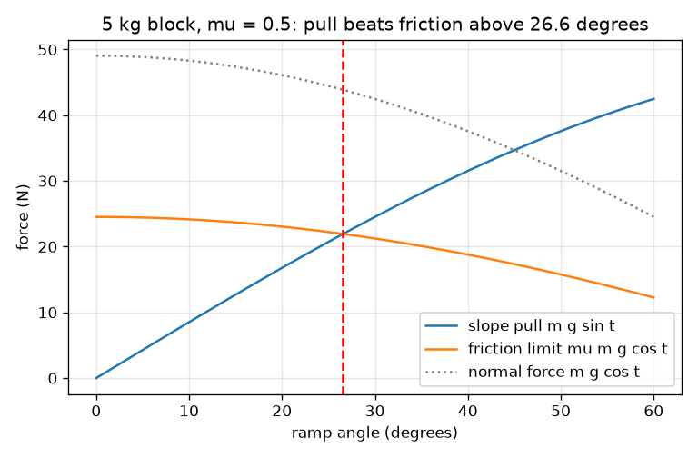
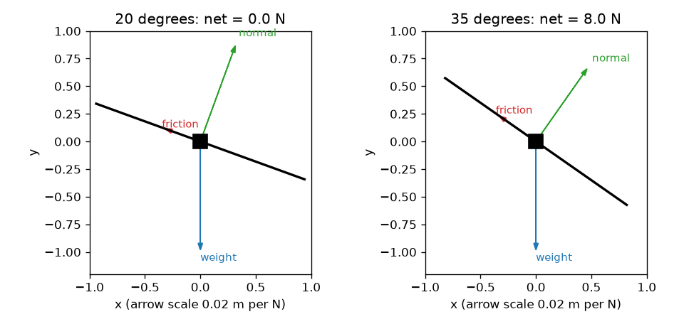

# सत्र 1: ढलान पर बल: घर्षण एक सीमा है

*स्तर 1 (अवधारणात्मक इंटरैक्टिव मॉडल) · लगभग 60 मिनट · openincline*

> यह एक सरलीकृत शैक्षिक मॉडल है। यह कोई प्रमाणित डिज़ाइन उपकरण नहीं है और इसका उपयोग वास्तविक संरचनाओं, विद्युत संस्थापनों, वाहनों, औद्योगिक प्रक्रियाओं या चिकित्सा निर्णयों के लिए नहीं किया जाना चाहिए।

**पूर्वापेक्षाएँ (Prerequisites)**

- स्कूल स्तर की त्रिकोणमिति: साइन, कोसाइन और टैन्जेंट।
- आप जानते हैं कि बल न्यूटन में मापा जाता है।
- आपने PRIMER.md पढ़ लिया है और `python start.py 1` एक बार चला लिया है।

**सीखने के उद्देश्य (Learning objectives)।** इस सत्र के बाद आप:

- ढलान (ramp) पर रखे गुटके के भार को ढलान के अनुदिश एक भाग और ढलान के अंदर की ओर एक भाग में बाँट सकेंगे।
- समझा सकेंगे कि घर्षण (friction) का एक अधिकतम संभव मान, mu गुणा अभिलंब बल, क्यों होता है।
- गणना से तय कर सकेंगे कि गुटका टिका रहेगा या फिसलेगा।
- कोण के सापेक्ष ढलान-खिंचाव और घर्षण-सीमा का ग्राफ़ पढ़ सकेंगे, और पता लगा सकेंगे कि वे कहाँ काटते हैं।

## A. वास्तविक दुनिया की समस्या
पहाड़ी पर खड़ी कार, लोडिंग रैंप पर रखा डिब्बा, झुकी मेज़ पर रखी किताब। सतह को थोड़ा झुकाएँ और कुछ नहीं हिलता; और झुकाएँ तो अचानक वह फिसल जाती है। फिसलना किस कोण पर शुरू होगा, यह क्या तय करता है? क्या भारी गुटके को अधिक ढलवाँ रैंप चाहिए? (यह सीखने के लिए एक सरलीकृत मॉडल है, वास्तविक रैंपों या वाहनों के लिए डिज़ाइन उपकरण नहीं।)

## B. अवधारणा और सिद्धांत
भार m g सीधे नीचे की ओर इंगित करता है। कोण t से झुके रैंप पर दो दिशाओं का उपयोग करना आसान है: रैंप के लंबवत, जहाँ रैंप अभिलंब बल (normal force) N से वापस धकेलता है, और ढलान के अनुदिश, जहाँ खिंचाव F गुटके को फिसलाने का प्रयास करता है। घर्षण ढलान पर ऊपर की ओर लगता है और फिसलने का विरोध करता है। यह कोई निश्चित संख्या नहीं है: यह खिंचाव के बिल्कुल बराबर होता है, एक अधिकतम मान mu गुणा N तक, जहाँ mu (घर्षण गुणांक (friction coefficient)) की कोई इकाई नहीं है और यह दोनों सतहों पर निर्भर करता है। यदि खिंचाव सीमा से कम है तो कुछ नहीं हिलता; यदि वह सीमा से अधिक हो जाए तो गुटका त्वरित होता है। m g sin t की तुलना mu m g cos t से करने पर द्रव्यमान कट जाता है, और फिसलने की शर्त tan t > mu बचती है।

| प्रतीक | अर्थ | इकाई |
|---|---|---|
| m | गुटके का द्रव्यमान | kg |
| g | गुरुत्व (9.81) | m/s^2 |
| t | क्षैतिज से रैंप का कोण | डिग्री |
| N | अभिलंब बल, रैंप के लंबवत | N |
| F | ढलान के अनुदिश गुरुत्व का खिंचाव | N |
| mu | घर्षण गुणांक (सत्र 1 के लिए एक मान) | कोई इकाई नहीं |
| f | वास्तव में लगने वाला घर्षण बल | N |
| a | ढलान पर नीचे की ओर त्वरण | m/s^2 |

**मान्यताएँ (Assumptions)**

- गुटका एक समतल, दृढ़ रैंप पर एक बिंदु द्रव्यमान है।
- घर्षण सरल नियम का पालन करता है: अधिकतम mu N, संपर्क क्षेत्रफल और चाल से स्वतंत्र।
- सत्र 1 विराम और फिसलन दोनों के लिए एक ही mu का उपयोग करता है; सत्र 2 इन्हें अलग करता है।
- कोई वायु प्रतिरोध नहीं, गुटके का कोई घूर्णन नहीं।

$$ N=mg\cos\theta,\qquad F=mg\sin\theta $$

$$ f_{\max}=\mu N=\mu mg\cos\theta,\qquad f=\min(F,\ \mu N) $$

$$ \text{slides if } mg\sin\theta>\mu mg\cos\theta\iff \tan\theta>\mu,\qquad a=\frac{F-f}{m} $$

## C. दृश्य व्याख्या
पहला चित्र mu = 0.5 के साथ 20 और 35 डिग्री पर 5 kg के गुटके के मुक्त-पिंड आरेख (free-body diagrams) दिखाता है: भार सीधे नीचे, अभिलंब बल रैंप से बाहर की ओर, और घर्षण ढलान पर ऊपर की ओर इंगित करता है। 20 डिग्री पर घर्षण खिंचाव के बिल्कुल बराबर है और कुल बल शून्य है; 35 डिग्री पर घर्षण अपनी सीमा पर है और 8 N का कुल बल बचता है। दूसरा चित्र कोण के सापेक्ष ढलान-खिंचाव (बढ़ता), घर्षण-सीमा (घटती) और अभिलंब बल (घटता) दिखाता है। खिंचाव और सीमा 26.6 डिग्री पर काटते हैं, जो mu = 0.5 के लिए फिसलन कोण है।

*ढलान-खिंचाव बढ़ता है और घर्षण-सीमा घटती है; वे फिसलन कोण पर काटते हैं (mu = 0.5 के लिए 26.6 डिग्री)।*

*20 डिग्री (टिका रहता है) और 35 डिग्री (फिसलता है) पर मुक्त-पिंड आरेख।*

## D. इंटरैक्टिव सिमुलेशन
पाठ चलाएँ (`python start.py 1`), फिर लाइव ऐप खोलें: [सत्र 1: रैंप पर गुटका](https://krunalpanchal1995.github.io/pan-iit-oss/openincline/session-01/) (या इस फ़ोल्डर में `app.html`)। कोण स्लाइडर बढ़ाएँ और खिंचाव व घर्षण के तीर देखें। द्रव्यमान बदलें और देखें कि हर बल बदलता है पर फिसलन कोण नहीं हिलता। ग्राफ़ दृश्य खोलें और पता लगाएँ कि नीला और लाल वक्र कहाँ काटते हैं।

**चुनौती।** घर्षण गुणांक 0.6 रखें, फिर वह सबसे छोटा पूर्णांक कोण खोजें जिस पर गुटका फिसलना शुरू करता है।

## E. हल किया गया उदाहरण और प्रयोग
**समस्या।** 5 kg का एक गुटका mu = 0.5 के साथ 20 डिग्री के रैंप पर रखा है। N, ढलान-खिंचाव और घर्षण-सीमा ज्ञात कीजिए। क्या यह टिका रहता है? यह किस कोण पर फिसलना शुरू करेगा?

1. N = m g cos t = 5 * 9.81 * cos 20 = 5 * 9.81 * 0.9397 = 46.09 N।
2. खिंचाव F = m g sin t = 5 * 9.81 * 0.3420 = 16.78 N।
3. घर्षण-सीमा = mu N = 0.5 * 46.09 = 23.05 N।
4. खिंचाव 16.78 N सीमा 23.05 N से कम है, इसलिए गुटका टिका रहता है: घर्षण 16.78 N के बराबर है और कुल बल 0 है।
5. फिसलन कोण tan t = mu = 0.5 को हल करता है, इसलिए t = arctan 0.5 = 26.57 डिग्री। जाँच: tan 20 = 0.364 < 0.5, टिके रहने के अनुरूप।

**उत्तर।** N = 46.09 N, खिंचाव = 16.78 N, सीमा = 23.05 N; गुटका 16.78 N घर्षण के साथ टिका रहता है। यह 26.57 डिग्री से ऊपर फिसलना शुरू करता है, द्रव्यमान चाहे जो हो।

**प्रयोग।** किसी भी गुटके को एक तख़्ते पर रखें और तख़्ते पर फ़ोन का कोण ऐप रखकर उसे धीरे-धीरे झुकाएँ। वह कोण नोट करें जहाँ वह फिसलता है; उस कोण का tan, mu का अनुमान देता है। उसी पदार्थ की हल्की वस्तु के साथ दोहराएँ: कोण लगभग वही होना चाहिए। वास्तविक सतहें हर प्रयास में एक-दो डिग्री बदलती हैं (धूल, गुटका कितनी देर रखा रहा, छोटे उभार), जबकि मॉडल में एक सटीक mu है; यह बिखराव ही मॉडल और वास्तविकता का मुख्य अंतर है।

## F. मूल्यांकन और डिज़ाइन चुनौती
**प्रश्न प्रकार A: अवधारणात्मक।** रैंप पर विराम में रखा गुटका फिसलना शुरू करेगा या नहीं, यह क्या तय करता है? क्या द्रव्यमान मायने रखता है? क्या गुटके के निचले फलक का आकार मायने रखता है?

संकेत

m g sin t की तुलना mu m g cos t से करें। क्या कट जाता है?

चरण-दर-चरण हल

केवल कोण और दोनों सतहों का घर्षण गुणांक तय करते हैं: गुटका तब फिसलता है जब tan t, mu से बड़ा हो। द्रव्यमान m खिंचाव और घर्षण-सीमा दोनों में आता है और कट जाता है, इसलिए एक ही पदार्थ के भारी और हल्के गुटके एक ही कोण पर फिसलना शुरू करते हैं। सरल घर्षण नियम में संपर्क क्षेत्रफल भी मायने नहीं रखता: बड़ा फलक उसी N को अधिक क्षेत्र में फैलाता है पर सीमा mu N नहीं बदलती।

**प्रश्न प्रकार B: संख्यात्मक।** 8 kg का एक गुटका 15 डिग्री के रैंप पर है, mu = 0.35। N, खिंचाव, घर्षण-सीमा और लगने वाला घर्षण ज्ञात कीजिए। क्या यह फिसलता है? उत्तर की तर्कसंगतता जाँचिए।

संकेत

N = m g cos t, F = m g sin t, सीमा = mu N का उपयोग करें, फिर तुलना करें।

चरण-दर-चरण हल

N = 8 * 9.81 * cos 15 = 75.81 N। F = 8 * 9.81 * sin 15 = 20.31 N। सीमा = 0.35 * 75.81 = 26.53 N। चूँकि 20.31 < 26.53, गुटका टिका रहता है और लगने वाला घर्षण 20.31 N है। जाँच: फिसलन कोण arctan 0.35 = 19.29 डिग्री है, जो 15 डिग्री से ऊपर है, इसलिए टिके रहना सही है। इकाई: न्यूटन।

**प्रश्न प्रकार C: ग्राफ़ और सिमुलेशन की व्याख्या।** 5 kg के गुटके के बल ग्राफ़ पर, mu = 0.5 के लिए ढलान-खिंचाव और घर्षण-सीमा 26.6 डिग्री पर काटते हैं। mu = 0.8 के लिए वे कहाँ काटेंगे, और कौन-सा वक्र हिलता है? कटान बिंदु के बाईं ओर घर्षण वक्र क्या करता है?

संकेत

केवल घर्षण-सीमा वक्र में mu है। tan t = 0.8 हल करें।

चरण-दर-चरण हल

लाल घर्षण-सीमा वक्र mu के साथ बढ़ता है, इसलिए वह ऊपर खिसकता है और कटान बिंदु दाईं ओर arctan 0.8 = 38.66 डिग्री पर चला जाता है। खिंचाव वक्र में mu नहीं है और वह वहीं रहता है। कटान बिंदु के बाईं ओर सीमा खिंचाव से ऊपर है, इसलिए वहाँ गुटका टिका रहता है; दाईं ओर खिंचाव बड़ा है और गुटका फिसलता है।

**प्रश्न प्रकार D: डिज़ाइन और इष्टतमीकरण (optimisation) चुनौती।** डिज़ाइन: 20 kg का एक डिब्बा mu = 0.45 वाले लकड़ी के रैंप पर बिना रस्सी के टिका रहना चाहिए। सुरक्षा मार्जिन के साथ अधिकतम रैंप कोण चुनें, ताकि आवश्यक घर्षण सीमा का अधिकतम 80 प्रतिशत हो। 1.2 m की ऊँचाई चाहिए। रैंप कितना लंबा होना चाहिए? समझौता (trade-off) क्या है?

संकेत

आवश्यक घर्षण खिंचाव है, इसलिए F <= 0.8 * mu N का अर्थ है tan t <= 0.8 mu। लंबाई = ऊँचाई / sin t।

चरण-दर-चरण हल

tan t <= 0.8 * 0.45 = 0.36, इसलिए t <= 19.80 डिग्री (फिसलन कोण 24.23 डिग्री है)। रैंप की लंबाई = 1.2 / sin 19.80 = 3.54 m। फिसलन कोण पर यह केवल 2.92 m होता पर बिना किसी सुरक्षा मार्जिन के। समझौता जगह बनाम सुरक्षा का है: यदि सतह गीली या धूल भरी हो जाए और mu घट जाए तो कम ढलवाँ, लंबा रैंप अधिक सुरक्षित है। 20 kg का द्रव्यमान उत्तर नहीं बदलता। यह एक कक्षा मॉडल है; वास्तविक रैंपों को पेशेवर डिज़ाइन की आवश्यकता होती है।

[RUBRIC.md](../../RUBRIC.md) से स्वयं को अंक दें। काग़ज़ पर काम करने के लिए [गतिविधि पत्रक](activity_sheet.md) प्रिंट करें।

## आम भ्रांतियाँ (Common misconceptions)
| आम भ्रांति | वास्तव में क्या सही है |
|---|---|
| भारी गुटके को फिसलने से पहले अधिक ढलवाँ रैंप चाहिए। | द्रव्यमान कट जाता है: फिसलन की शर्त tan t > mu में m नहीं है। |
| घर्षण हमेशा mu गुणा N के बराबर होता है। | जब तक गुटका टिका है, घर्षण खिंचाव के बराबर है; mu N केवल उसका अधिकतम संभव मान है। |
| अभिलंब बल हमेशा भार के बराबर होता है। | रैंप पर N = m g cos t, जो भार से छोटा है और रैंप ढलवाँ होने पर घटता है। |
| विराम में रखे गुटके पर शून्य बल होता है। | कई बल लगते हैं; वे संतुलित होते हैं। कुल बल शून्य है, हर बल नहीं। |

## शब्दावली (Glossary)
- **अभिलंब बल (normal force)**: किसी सतह का वस्तु पर धक्का, सतह के लंबवत
- **घर्षण गुणांक (friction coefficient) (mu)**: बिना इकाई की एक संख्या जो अधिकतम घर्षण को अभिलंब बल के एक अंश के रूप में तय करती है
- **मुक्त-पिंड आरेख (free-body diagram)**: एक वस्तु का चित्र जिसमें उस पर लगने वाले हर बल के लिए एक तीर हो
- **कुल बल (net force)**: किसी वस्तु पर लगे सभी बलों का योग; शून्य का अर्थ है कोई त्वरण नहीं
- **फिसलन कोण (slide angle)**: रैंप का वह कोण जिस पर विराम में रखा गुटका पहली बार फिसलना शुरू करता है

## समापन
1. [exercises.md](exercises.md) में दिए तीन कोडिंग कार्य करें।
2. अपने बदलावों के बाद `python start.py 1` फिर से चलाएँ। यह चेकपॉइंट के साथ समाप्त होता है; जब यह `PASS` छापे, तो आपका काम पूरा है। (केवल चेकपॉइंट: `python start.py check 1`।)

आगे: [सत्र 2](../session-02/README.md)
