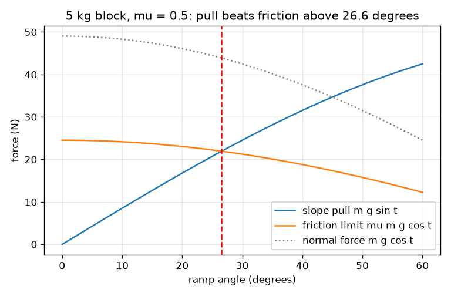
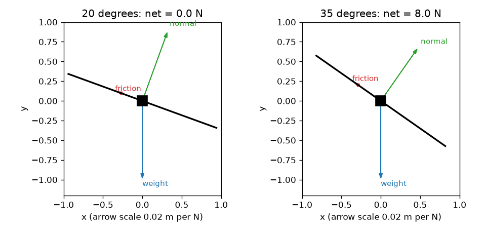

# സെഷൻ 1: ഒരു ചരിവുതലത്തിലെ ബലങ്ങൾ: ഘർഷണം ഒരു പരിധിയാണ്

[Session 1 — हिन्दी](README.hi.md)

*ലെവൽ 1 (ആശയപരമായ ഇന്ററാക്ടീവ് മോഡൽ) · ഏകദേശം 60 മിനിറ്റ് · openincline*

> ഇത് ഒരു ലളിതമാക്കിയ വിദ്യാഭ്യാസ മോഡൽ ആണ്. ഇത് സാധൂകരിക്കപ്പെട്ട ഒരു ഡിസൈൻ ഉപകരണമല്ല; യഥാർത്ഥ നിർമ്മിതികൾ, വൈദ്യുത ഇൻസ്റ്റലേഷനുകൾ, വാഹനങ്ങൾ, വ്യാവസായിക പ്രക്രിയകൾ അല്ലെങ്കിൽ വൈദ്യപരമായ തീരുമാനങ്ങൾ എന്നിവയ്ക്ക് ഇത് ഉപയോഗിക്കരുത്.

**മുൻ അറിവ് (Prerequisites)**

- സ്കൂൾ ത്രികോണമിതി (trigonometry): സൈൻ, കോസൈൻ, ടാൻജെന്റ്.
- ബലം ന്യൂട്ടനിൽ (newton) അളക്കുന്നു എന്ന് നിങ്ങൾക്കറിയാം.
- നിങ്ങൾ PRIMER.md വായിക്കുകയും `python start.py 1` ഒരു തവണ റൺ ചെയ്യുകയും ചെയ്തിട്ടുണ്ട്.

**പഠന ലക്ഷ്യങ്ങൾ (Learning objectives).** ഈ സെഷനു ശേഷം നിങ്ങൾക്ക് കഴിയും:

- ഒരു ചരിവുതലത്തിലെ കട്ടയുടെ ഭാരത്തെ ചരിവിനോട് ചേർന്ന ഒരു ഭാഗമായും ചരിവിലേക്കുള്ള ഒരു ഭാഗമായും വിഭജിക്കാൻ.
- ഘർഷണത്തിന് സാധ്യമായ ഏറ്റവും വലിയ ഒരു മൂല്യം, mu ഗുണം ലംബബലം (normal force), ഉള്ളത് എന്തുകൊണ്ടെന്ന് വിശദീകരിക്കാൻ.
- ഒരു കട്ട പിടിച്ചുനിൽക്കുമോ തെന്നുമോ എന്ന് കണക്കുകൂട്ടലിലൂടെ തീരുമാനിക്കാൻ.
- കോണിനെതിരെയുള്ള ചരിവ് വലിവിന്റെയും ഘർഷണ പരിധിയുടെയും ഗ്രാഫ് വായിച്ച് അവ എവിടെ കൂട്ടിമുട്ടുന്നു എന്ന് കണ്ടെത്താൻ.

## A. യഥാർത്ഥ ലോക പ്രശ്നം
ഒരു കുന്നിൽ നിർത്തിയിട്ട കാർ, ഒരു ലോഡിംഗ് റാമ്പിലെ പെട്ടി, ചരിഞ്ഞ മേശയിലെ പുസ്തകം. പ്രതലം അല്പം ചരിച്ചാൽ ഒന്നും നീങ്ങുന്നില്ല; കൂടുതൽ ചരിച്ചാൽ പെട്ടെന്ന് അത് തെന്നുന്നു. തെന്നൽ തുടങ്ങുന്ന കോൺ നിർണ്ണയിക്കുന്നത് എന്താണ്? ഭാരമുള്ള കട്ടയ്ക്ക് കൂടുതൽ ചരിവുള്ള റാമ്പ് വേണോ? (ഇത് പഠനത്തിനായുള്ള ലളിതമാക്കിയ മോഡലാണ്, യഥാർത്ഥ റാമ്പുകൾക്കോ വാഹനങ്ങൾക്കോ ഉള്ള ഡിസൈൻ ഉപകരണമല്ല.)

## B. ആശയവും സിദ്ധാന്തവും
ഭാരം m g നേരെ താഴേക്ക് ചൂണ്ടുന്നു. t കോണിൽ ചരിഞ്ഞ ഒരു റാമ്പിൽ രണ്ട് ദിശകൾ ഉപയോഗിക്കാൻ എളുപ്പമാണ്: റാമ്പിന് ലംബമായി, ഇവിടെ റാമ്പ് ലംബബലം N ഉപയോഗിച്ച് തിരികെ തള്ളുന്നു; ചരിവിനോട് ചേർന്ന്, ഇവിടെ വലിവ് F കട്ടയെ തെന്നിക്കാൻ ശ്രമിക്കുന്നു. ഘർഷണം ചരിവിന് മുകളിലേക്ക് പ്രവർത്തിക്കുകയും തെന്നലിനെ എതിർക്കുകയും ചെയ്യുന്നു. അത് ഒരു സ്ഥിര സംഖ്യയല്ല: അത് വലിവിനോട് കൃത്യമായി യോജിക്കുന്നു, mu ഗുണം N എന്ന ഏറ്റവും വലിയ മൂല്യം വരെ, ഇവിടെ mu (ഘർഷണ ഗുണാങ്കം, friction coefficient) ക്ക് യൂണിറ്റില്ല, അത് രണ്ട് പ്രതലങ്ങളെ ആശ്രയിച്ചിരിക്കുന്നു. വലിവ് പരിധിക്ക് താഴെയാണെങ്കിൽ ഒന്നും നീങ്ങുന്നില്ല; അത് പരിധി കവിയുമായിരുന്നെങ്കിൽ കട്ട ത്വരിക്കുന്നു. m g sin t നെ mu m g cos t യുമായി താരതമ്യം ചെയ്യുമ്പോൾ പിണ്ഡം ഒഴിവാകുന്നു, തെന്നൽ വ്യവസ്ഥ tan t > mu ശേഷിക്കുന്നു.

| ചിഹ്നം | അർത്ഥം | യൂണിറ്റ് |
|---|---|---|
| m | കട്ടയുടെ പിണ്ഡം | kg |
| g | ഗുരുത്വാകർഷണം (9.81) | m/s^2 |
| t | തിരശ്ചീനത്തിൽ നിന്ന് റാമ്പിന്റെ കോൺ | ഡിഗ്രി |
| N | ലംബബലം, റാമ്പിന് ലംബം | N |
| F | ചരിവിനോട് ചേർന്ന ഗുരുത്വാകർഷണ വലിവ് | N |
| mu | ഘർഷണ ഗുണാങ്കം (സെഷൻ 1 ന് ഒരു മൂല്യം) | യൂണിറ്റില്ല |
| f | യഥാർത്ഥത്തിൽ പ്രവർത്തിക്കുന്ന ഘർഷണ ബലം | N |
| a | ചരിവിലൂടെ താഴേക്കുള്ള ത്വരണം | m/s^2 |

**അനുമാനങ്ങൾ (Assumptions)**

- കട്ട ഒരു പരന്ന, ദൃഢമായ റാമ്പിലെ ബിന്ദു പിണ്ഡമാണ്.
- ഘർഷണം ലളിതമായ നിയമം പാലിക്കുന്നു: പരമാവധി mu N, സമ്പർക്ക വിസ്തീർണ്ണത്തിൽ നിന്നും വേഗതയിൽ നിന്നും സ്വതന്ത്രം.
- സെഷൻ 1 നിശ്ചലാവസ്ഥയ്ക്കും തെന്നലിനും ഒരേ mu ഉപയോഗിക്കുന്നു; സെഷൻ 2 അവയെ വേർതിരിക്കുന്നു.
- വായു പ്രതിരോധമില്ല, കട്ടയുടെ ഭ്രമണമില്ല.

$$ N=mg\cos\theta,\qquad F=mg\sin\theta $$

$$ f_{\max}=\mu N=\mu mg\cos\theta,\qquad f=\min(F,\ \mu N) $$

$$ \text{slides if } mg\sin\theta>\mu mg\cos\theta\iff \tan\theta>\mu,\qquad a=\frac{F-f}{m} $$

## C. ദൃശ്യ വിശദീകരണം
ആദ്യ ചിത്രം mu = 0.5 ഉള്ള 5 kg കട്ടയുടെ 20, 35 ഡിഗ്രിയിലുള്ള ഫ്രീ-ബോഡി ഡയഗ്രങ്ങൾ (free-body diagrams) കാണിക്കുന്നു: ഭാരം നേരെ താഴേക്ക് ചൂണ്ടുന്നു, ലംബബലം റാമ്പിൽ നിന്ന് പുറത്തേക്ക് ചൂണ്ടുന്നു, ഘർഷണം ചരിവിന് മുകളിലേക്ക് ചൂണ്ടുന്നു. 20 ഡിഗ്രിയിൽ ഘർഷണം വലിവിനോട് കൃത്യമായി യോജിക്കുന്നു, ആകെ ബലം പൂജ്യം; 35 ഡിഗ്രിയിൽ ഘർഷണം അതിന്റെ പരിധിയിലാണ്, 8 N ആകെ ബലം ശേഷിക്കുന്നു. രണ്ടാമത്തെ ചിത്രം ചരിവ് വലിവ് (ഉയരുന്നത്), ഘർഷണ പരിധി (താഴുന്നത്), ലംബബലം (താഴുന്നത്) എന്നിവയെ കോണിനെതിരെ പ്ലോട്ട് ചെയ്യുന്നു. വലിവും പരിധിയും 26.6 ഡിഗ്രിയിൽ കൂട്ടിമുട്ടുന്നു, mu = 0.5 ന്റെ തെന്നൽ കോൺ.

*ചരിവ് വലിവ് ഉയരുന്നു, ഘർഷണ പരിധി താഴുന്നു; അവ തെന്നൽ കോണിൽ കൂട്ടിമുട്ടുന്നു (mu = 0.5 ന് 26.6 ഡിഗ്രി).*

*20 ഡിഗ്രിയിലും (പിടിച്ചുനിൽക്കുന്നു) 35 ഡിഗ്രിയിലും (തെന്നുന്നു) ഫ്രീ-ബോഡി ഡയഗ്രങ്ങൾ.*

## D. ഇന്ററാക്ടീവ് സിമുലേഷൻ
പാഠം റൺ ചെയ്യുക (`python start.py 1`), തുടർന്ന് ലൈവ് ആപ്പ് തുറക്കുക: [സെഷൻ 1: റാമ്പിലെ കട്ട](https://krunalpanchal1995.github.io/pan-iit-oss/openincline/session-01/) (അല്ലെങ്കിൽ ഈ ഫോൾഡറിലെ `app.html`). കോൺ സ്ലൈഡർ ഉയർത്തി വലിവ്, ഘർഷണ അമ്പുകൾ നോക്കുക. പിണ്ഡം മാറ്റി എല്ലാ ബലങ്ങളും അതനുസരിച്ച് മാറുമെങ്കിലും തെന്നൽ കോൺ നീങ്ങുന്നില്ലെന്ന് കാണുക. ഗ്രാഫ് കാഴ്ച തുറന്ന് നീല, ചുവപ്പ് വക്രങ്ങൾ എവിടെ കൂട്ടിമുട്ടുന്നു എന്ന് കണ്ടെത്തുക.

**വെല്ലുവിളി (Challenge).** ഘർഷണ ഗുണാങ്കം 0.6 ആക്കുക, തുടർന്ന് കട്ട തെന്നാൻ തുടങ്ങുന്ന ഏറ്റവും ചെറിയ പൂർണ്ണ കോൺ കണ്ടെത്തുക.

## E. ഉദാഹരണ പ്രശ്നവും പരീക്ഷണവും
**പ്രശ്നം.** 5 kg കട്ട mu = 0.5 ഉള്ള 20 ഡിഗ്രി റാമ്പിൽ വിശ്രമിക്കുന്നു. N, ചരിവ് വലിവ്, ഘർഷണ പരിധി എന്നിവ കണ്ടെത്തുക. അത് പിടിച്ചുനിൽക്കുമോ? ഏത് കോണിൽ അത് തെന്നാൻ തുടങ്ങും?

1. N = m g cos t = 5 * 9.81 * cos 20 = 5 * 9.81 * 0.9397 = 46.09 N.
2. വലിവ് F = m g sin t = 5 * 9.81 * 0.3420 = 16.78 N.
3. ഘർഷണ പരിധി = mu N = 0.5 * 46.09 = 23.05 N.
4. വലിവ് 16.78 N പരിധി 23.05 N ന് താഴെയാണ്, അതിനാൽ കട്ട പിടിച്ചുനിൽക്കുന്നു: ഘർഷണം 16.78 N ഉം ആകെ ബലം 0 ഉം ആണ്.
5. തെന്നൽ കോൺ tan t = mu = 0.5 പരിഹരിക്കുന്നു, അതിനാൽ t = arctan 0.5 = 26.57 ഡിഗ്രി. പരിശോധന: tan 20 = 0.364 < 0.5, പിടിച്ചുനിൽക്കുന്നതുമായി യോജിക്കുന്നു.

**ഉത്തരം.** N = 46.09 N, വലിവ് = 16.78 N, പരിധി = 23.05 N; കട്ട 16.78 N ഘർഷണത്തോടെ പിടിച്ചുനിൽക്കുന്നു. അതിന്റെ പിണ്ഡം എന്തുതന്നെയായാലും 26.57 ഡിഗ്രിക്ക് മുകളിൽ അത് തെന്നാൻ തുടങ്ങുന്നു.

**പരീക്ഷണം.** ഏതെങ്കിലും ഒരു കട്ട ഒരു പലകയിൽ വയ്ക്കുക, പലകയിൽ ഒരു ഫോൺ ആംഗിൾ ആപ്പ് വച്ച് പതുക്കെ ചരിക്കുക. അത് തെന്നുന്ന കോൺ രേഖപ്പെടുത്തുക; ആ കോണിന്റെ tan mu വിനെ കണക്കാക്കുന്നു. അതേ വസ്തുവിന്റെ ഭാരം കുറഞ്ഞ ഒന്നിൽ ആവർത്തിക്കുക: കോൺ ഏകദേശം ഒരുപോലെ ആയിരിക്കണം. യഥാർത്ഥ പ്രതലങ്ങൾ ഓരോ ശ്രമത്തിലും ഒന്നോ രണ്ടോ ഡിഗ്രി വ്യത്യാസപ്പെടും (പൊടി, കട്ട എത്ര നേരം ഇരുന്നു, ചെറിയ കുഴികൾ), മോഡലിന് ഒരു കൃത്യമായ mu ആണ് ഉള്ളത്; ആ വിസരണമാണ് മോഡലും യാഥാർത്ഥ്യവും തമ്മിലുള്ള പ്രധാന വ്യത്യാസം.

## F. വിലയിരുത്തലും ഡിസൈൻ വെല്ലുവിളിയും
**ചോദ്യ തരം A: ആശയപരം.** ഒരു റാമ്പിൽ വിശ്രമിക്കുന്ന കട്ട തെന്നാൻ തുടങ്ങുമോ എന്ന് നിർണ്ണയിക്കുന്നത് എന്താണ്? പിണ്ഡത്തിന് പ്രാധാന്യമുണ്ടോ? കട്ടയുടെ അടിമുഖത്തിന്റെ വലിപ്പത്തിന് പ്രാധാന്യമുണ്ടോ?

സൂചന

m g sin t നെ mu m g cos t യുമായി താരതമ്യം ചെയ്യുക. എന്താണ് ഒഴിവാകുന്നത്?

ഘട്ടം ഘട്ടമായുള്ള പരിഹാരം

കോണും രണ്ട് പ്രതലങ്ങളുടെ ഘർഷണ ഗുണാങ്കവും മാത്രമേ നിർണ്ണയിക്കുന്നുള്ളൂ: tan t, mu വിനേക്കാൾ വലുതാകുമ്പോൾ കട്ട തെന്നുന്നു. പിണ്ഡം m വലിവിലും ഘർഷണ പരിധിയിലും ഉണ്ട്, ഒഴിവാകുന്നു, അതിനാൽ ഒരേ വസ്തുവിന്റെ ഭാരമുള്ളതും ഭാരം കുറഞ്ഞതുമായ കട്ടകൾ ഒരേ കോണിൽ തെന്നാൻ തുടങ്ങുന്നു. ലളിതമായ ഘർഷണ നിയമത്തിൽ സമ്പർക്ക വിസ്തീർണ്ണവും പ്രധാനമല്ല: വലിയ മുഖം അതേ N നെ കൂടുതൽ വിസ്തീർണ്ണത്തിൽ വ്യാപിപ്പിക്കുന്നു, പക്ഷേ പരിധി mu N മാറുന്നില്ല.

**ചോദ്യ തരം B: സംഖ്യാപരം.** 8 kg കട്ട 15 ഡിഗ്രി റാമ്പിൽ ഇരിക്കുന്നു, mu = 0.35. N, വലിവ്, ഘർഷണ പരിധി, പ്രവർത്തിക്കുന്ന ഘർഷണം എന്നിവ കണ്ടെത്തുക. അത് തെന്നുമോ? ഉത്തരം യുക്തിസഹമാണോ എന്ന് പരിശോധിക്കുക.

സൂചന

N = m g cos t, F = m g sin t, പരിധി = mu N ഉപയോഗിക്കുക, തുടർന്ന് താരതമ്യം ചെയ്യുക.

ഘട്ടം ഘട്ടമായുള്ള പരിഹാരം

N = 8 * 9.81 * cos 15 = 75.81 N. F = 8 * 9.81 * sin 15 = 20.31 N. പരിധി = 0.35 * 75.81 = 26.53 N. 20.31 < 26.53 ആയതിനാൽ കട്ട പിടിച്ചുനിൽക്കുന്നു, പ്രവർത്തിക്കുന്ന ഘർഷണം 20.31 N ആണ്. പരിശോധന: തെന്നൽ കോൺ arctan 0.35 = 19.29 ഡിഗ്രി ആണ്, 15 ഡിഗ്രിക്ക് മുകളിൽ, അതിനാൽ പിടിച്ചുനിൽക്കൽ ശരിയാണ്. യൂണിറ്റുകൾ: ന്യൂട്ടൻ.

**ചോദ്യ തരം C: ഗ്രാഫ്, സിമുലേഷൻ വ്യാഖ്യാനം.** 5 kg കട്ടയുടെ ബല ഗ്രാഫിൽ, ചരിവ് വലിവും ഘർഷണ പരിധിയും mu = 0.5 ന് 26.6 ഡിഗ്രിയിൽ കൂട്ടിമുട്ടുന്നു. mu = 0.8 ന് അവ എവിടെ കൂട്ടിമുട്ടും, ഏത് വക്രം നീങ്ങുന്നു? കൂട്ടിമുട്ടലിന്റെ ഇടതുവശത്ത് ഘർഷണ വക്രം എന്ത് ചെയ്യുന്നു?

സൂചന

ഘർഷണ-പരിധി വക്രത്തിൽ മാത്രമേ mu ഉള്ളൂ. tan t = 0.8 പരിഹരിക്കുക.

ഘട്ടം ഘട്ടമായുള്ള പരിഹാരം

ചുവപ്പ് ഘർഷണ-പരിധി വക്രം mu വിനൊപ്പം മുകളിലേക്ക് സ്കെയിൽ ചെയ്യുന്നു, അതിനാൽ അത് മുകളിലേക്ക് നീങ്ങുകയും കൂട്ടിമുട്ടൽ വലത്തേക്ക് arctan 0.8 = 38.66 ഡിഗ്രിയിലേക്ക് നീങ്ങുകയും ചെയ്യുന്നു. വലിവ് വക്രത്തിൽ mu ഇല്ല, അത് അതേ സ്ഥാനത്ത് തുടരുന്നു. കൂട്ടിമുട്ടലിന്റെ ഇടതുവശത്ത് പരിധി വലിവിന് മുകളിലാണ്, അതിനാൽ അവിടെ കട്ട പിടിച്ചുനിൽക്കുന്നു; വലതുവശത്ത് വലിവ് വലുതാണ്, കട്ട തെന്നുന്നു.

**ചോദ്യ തരം D: ഡിസൈൻ, ഒപ്റ്റിമൈസേഷൻ വെല്ലുവിളി.** ഡിസൈൻ: ഒരു 20 kg പെട്ടി mu = 0.45 ഉള്ള ഒരു മരം റാമ്പിൽ കയറില്ലാതെ നിൽക്കണം. ആവശ്യമായ ഘർഷണം പരിധിയുടെ പരമാവധി 80 ശതമാനം ആകത്തക്കവിധം സുരക്ഷാ മാർജിനോടെ പരമാവധി റാമ്പ് കോൺ തിരഞ്ഞെടുക്കുക. 1.2 m ഉയർച്ച വേണം. റാമ്പിന് എത്ര നീളം വേണം? ട്രേഡ്-ഓഫ് എന്താണ്?

സൂചന

ആവശ്യമായ ഘർഷണം വലിവാണ്, അതിനാൽ F <= 0.8 * mu N എന്നാൽ tan t <= 0.8 mu. നീളം = ഉയർച്ച / sin t.

ഘട്ടം ഘട്ടമായുള്ള പരിഹാരം

tan t <= 0.8 * 0.45 = 0.36, അതിനാൽ t <= 19.80 ഡിഗ്രി (തെന്നൽ കോൺ 24.23 ഡിഗ്രി ആണ്). റാമ്പ് നീളം = 1.2 / sin 19.80 = 3.54 m. തെന്നൽ കോണിൽ അത് 2.92 m മാത്രമായിരിക്കും, പക്ഷേ സുരക്ഷാ മാർജിൻ ഇല്ലാതെ. ട്രേഡ്-ഓഫ് സ്ഥലവും സുരക്ഷയും തമ്മിലാണ്: പ്രതലം നനയുകയോ പൊടിയാവുകയോ ചെയ്ത് mu കുറഞ്ഞാൽ കൂടുതൽ മൃദുവായ, നീളമുള്ള റാമ്പ് സുരക്ഷിതമാണ്. 20 kg പിണ്ഡം ഉത്തരം മാറ്റുന്നില്ല. ഇത് ഒരു ക്ലാസ്‌റൂം മോഡലാണ്; യഥാർത്ഥ റാമ്പുകൾക്ക് പ്രൊഫഷണൽ ഡിസൈൻ വേണം.

[RUBRIC.md](../../RUBRIC.md) ഉപയോഗിച്ച് സ്വയം സ്കോർ ചെയ്യുക. പേപ്പറിൽ ചെയ്യാൻ [ആക്ടിവിറ്റി ഷീറ്റ്](activity_sheet.md) പ്രിന്റ് ചെയ്യുക.

## സാധാരണ തെറ്റിദ്ധാരണകൾ
| സാധാരണ തെറ്റിദ്ധാരണ | യഥാർത്ഥത്തിൽ ശരിയായത് |
|---|---|
| ഭാരമുള്ള കട്ട തെന്നുന്നതിന് മുമ്പ് കൂടുതൽ ചരിവുള്ള റാമ്പ് വേണം. | പിണ്ഡം ഒഴിവാകുന്നു: തെന്നൽ വ്യവസ്ഥ tan t > mu ൽ m ഇല്ല. |
| ഘർഷണം എപ്പോഴും mu ഗുണം N ആണ്. | കട്ട പിടിച്ചുനിൽക്കുമ്പോൾ ഘർഷണം വലിവിന് തുല്യമാണ്; mu N അത് ആകാവുന്ന ഏറ്റവും വലിയ മൂല്യം മാത്രമാണ്. |
| ലംബബലം എപ്പോഴും ഭാരത്തിന് തുല്യമാണ്. | ഒരു റാമ്പിൽ N = m g cos t ആണ്, അത് ഭാരത്തേക്കാൾ ചെറുതാണ്, റാമ്പ് കൂടുതൽ കുത്തനെയാകുമ്പോൾ ചുരുങ്ങുന്നു. |
| നിശ്ചലമായ കട്ടയിൽ ബലം പൂജ്യമാണ്. | നിരവധി ബലങ്ങൾ പ്രവർത്തിക്കുന്നു; അവ സന്തുലിതമാണ്. ആകെ ബലമാണ് പൂജ്യം, ഓരോ ബലവുമല്ല. |

## പദാവലി (Glossary)
- **ലംബബലം (normal force)**: ഒരു പ്രതലം വസ്തുവിനെ തള്ളുന്ന, പ്രതലത്തിന് ലംബമായ ബലം
- **ഘർഷണ ഗുണാങ്കം (friction coefficient, mu)**: ലംബബലത്തിന്റെ ഒരു ഭിന്നസംഖ്യയായി ഏറ്റവും വലിയ ഘർഷണം നിശ്ചയിക്കുന്ന യൂണിറ്റില്ലാത്ത സംഖ്യ
- **ഫ്രീ-ബോഡി ഡയഗ്രം (free-body diagram)**: ഒരു വസ്തുവിന്റെ മേലുള്ള ഓരോ ബലത്തിനും ഒരു അമ്പോടെയുള്ള ചിത്രം
- **ആകെ ബലം (net force)**: ഒരു വസ്തുവിലെ എല്ലാ ബലങ്ങളുടെയും തുക; പൂജ്യം എന്നാൽ ത്വരണമില്ല
- **തെന്നൽ കോൺ (slide angle)**: നിശ്ചലമായ ഒരു കട്ട ആദ്യമായി തെന്നാൻ തുടങ്ങുന്ന റാമ്പ് കോൺ

## പൂർത്തിയാക്കുക
1. [exercises.md](exercises.md) ലെ മൂന്ന് കോഡിംഗ് ടാസ്കുകൾ ചെയ്യുക.
2. നിങ്ങളുടെ മാറ്റങ്ങൾക്കു ശേഷം `python start.py 1` വീണ്ടും റൺ ചെയ്യുക. ഇത് ചെക്ക്‌പോയിന്റോടെ അവസാനിക്കുന്നു; അത് `PASS` എന്ന് പ്രിന്റ് ചെയ്യുമ്പോൾ നിങ്ങൾ പൂർത്തിയാക്കി. (ചെക്ക്‌പോയിന്റ് മാത്രം: `python start.py check 1`.)

അടുത്തത്: [സെഷൻ 2](../session-02/README.md)
