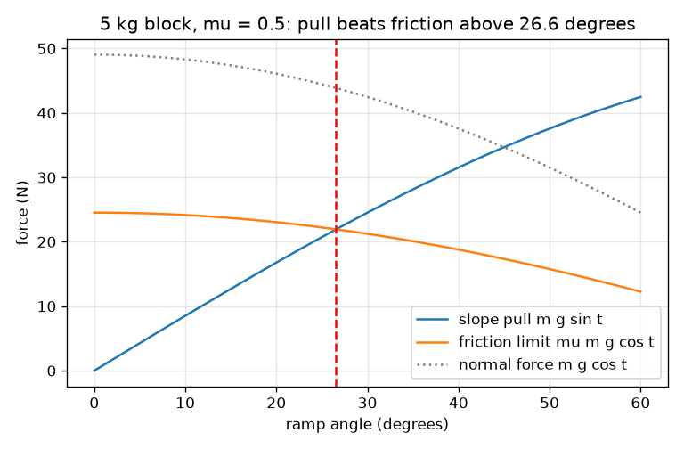
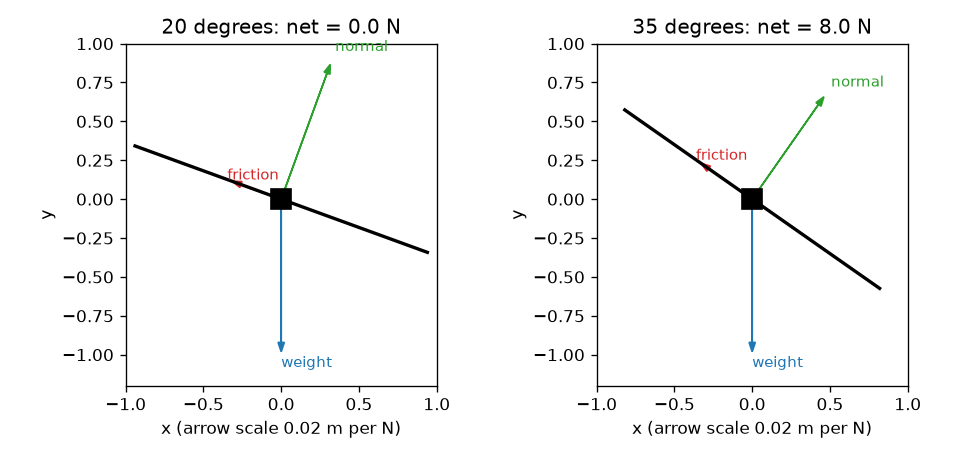

# அமர்வு 1: சாய்தளத்தில் விசைகள்: உராய்வு ஒரு வரம்பு

[Session 1 — हिन्दी](README.hi.md) · [Session 1 — മലയാളം](README.ml.md)

*நிலை 1 (கருத்தியல் ஊடாடும் மாதிரி) · சுமார் 60 நிமிடங்கள் · openincline*

> இது ஒரு எளிமைப்படுத்தப்பட்ட கல்வி மாதிரி. இது சரிபார்க்கப்பட்ட வடிவமைப்புக் கருவி அல்ல; உண்மையான கட்டமைப்புகள், மின் நிறுவல்கள், வாகனங்கள், தொழில்துறை செயல்முறைகள் அல்லது மருத்துவ முடிவுகளுக்கு இதைப் பயன்படுத்தக் கூடாது.

**முன்தேவைகள் (Prerequisites)**

- பள்ளி முக்கோணவியல் (trigonometry): சைன், கோசைன் மற்றும் டேஞ்சன்ட்.
- விசை நியூட்டனில் (newton) அளக்கப்படுகிறது என்று உங்களுக்குத் தெரியும்.
- நீங்கள் PRIMER.md ஐப் படித்து, `python start.py 1` ஐ ஒரு முறை இயக்கியிருக்கிறீர்கள்.

**கற்றல் நோக்கங்கள் (Learning objectives).** இந்த அமர்வுக்குப் பிறகு உங்களால் முடியும்:

- சாய்தளத்தில் உள்ள கட்டையின் எடையைச் சரிவின் வழியே ஒரு பகுதியாகவும் சரிவுக்குள் ஒரு பகுதியாகவும் பிரிக்க.
- உராய்வுக்கு சாத்தியமான மிகப்பெரிய மதிப்பு, mu பெருக்கல் செங்குத்து விசை (normal force), ஏன் உள்ளது என்று விளக்க.
- ஒரு கட்டை பிடித்து நிற்குமா வழுக்குமா என்று கணக்கீட்டால் தீர்மானிக்க.
- கோணத்துக்கு எதிரான சரிவு இழுவை மற்றும் உராய்வு வரம்பின் வரைபடத்தைப் படித்து, அவை எங்கு சந்திக்கின்றன என்று கண்டறிய.

## A. நிஜ உலகப் பிரச்சினை
மலையில் நிறுத்தப்பட்ட கார், ஏற்றும் சாய்தளத்தில் ஒரு பெட்டி, சாய்ந்த மேசையில் ஒரு புத்தகம். மேற்பரப்பைச் சிறிது சாய்த்தால் எதுவும் நகராது; இன்னும் சாய்த்தால் திடீரென வழுக்குகிறது. வழுக்கல் தொடங்கும் கோணத்தை எது தீர்மானிக்கிறது? கனமான கட்டைக்கு அதிகச் செங்குத்தான சாய்தளம் தேவையா? (இது கற்றலுக்கான எளிமைப்படுத்தப்பட்ட மாதிரி, உண்மையான சாய்தளங்கள் அல்லது வாகனங்களுக்கான வடிவமைப்புக் கருவி அல்ல.)

## B. கருத்தும் கோட்பாடும்
எடை m g நேராகக் கீழ்நோக்கிச் சுட்டுகிறது. t கோணத்தில் சாய்ந்த சாய்தளத்தில் இரண்டு திசைகளைப் பயன்படுத்துவது எளிது: சாய்தளத்துக்குச் செங்குத்தாக, அங்கு சாய்தளம் செங்குத்து விசை N உடன் திருப்பித் தள்ளுகிறது; சரிவின் வழியே, அங்கு இழுவை F கட்டையை வழுக்க வைக்க முயல்கிறது. உராய்வு சரிவின் மேல்நோக்கிச் செயல்பட்டு வழுக்கலை எதிர்க்கிறது. அது ஒரு நிலையான எண் அல்ல: அது இழுவைக்குச் சரியாகப் பொருந்துகிறது, mu பெருக்கல் N என்ற மிகப்பெரிய மதிப்பு வரை, இங்கு mu (உராய்வுக் குணகம், friction coefficient) க்கு அலகு இல்லை, அது இரண்டு மேற்பரப்புகளைப் பொறுத்தது. இழுவை வரம்புக்குக் கீழே இருந்தால் எதுவும் நகராது; அது வரம்பைத் தாண்டும் என்றால் கட்டை முடுக்கமடைகிறது. m g sin t ஐ mu m g cos t உடன் ஒப்பிடும்போது நிறை நீங்குகிறது, வழுக்கல் நிபந்தனை tan t > mu எஞ்சுகிறது.

| குறியீடு | பொருள் | அலகு |
|---|---|---|
| m | கட்டையின் நிறை | kg |
| g | ஈர்ப்பு (9.81) | m/s^2 |
| t | கிடைமட்டத்திலிருந்து சாய்தளக் கோணம் | டிகிரி |
| N | செங்குத்து விசை, சாய்தளத்துக்குச் செங்குத்து | N |
| F | சரிவின் வழியே ஈர்ப்பு இழுவை | N |
| mu | உராய்வுக் குணகம் (அமர்வு 1 க்கு ஒரு மதிப்பு) | அலகு இல்லை |
| f | உண்மையில் செயல்படும் உராய்வு விசை | N |
| a | சரிவில் கீழ்நோக்கிய முடுக்கம் | m/s^2 |

**அனுமானங்கள் (Assumptions)**

- கட்டை ஒரு தட்டையான, உறுதியான சாய்தளத்தில் உள்ள புள்ளி நிறை.
- உராய்வு எளிய விதியைப் பின்பற்றுகிறது: அதிகபட்சம் mu N, தொடு பரப்பு மற்றும் வேகத்தைச் சாராதது.
- அமர்வு 1 ஓய்வுக்கும் வழுக்கலுக்கும் ஒரே mu ஐப் பயன்படுத்துகிறது; அமர்வு 2 அவற்றைப் பிரிக்கிறது.
- காற்றுத் தடை இல்லை, கட்டையின் சுழற்சி இல்லை.

$$ N=mg\cos\theta,\qquad F=mg\sin\theta $$

$$ f_{\max}=\mu N=\mu mg\cos\theta,\qquad f=\min(F,\ \mu N) $$

$$ \text{slides if } mg\sin\theta>\mu mg\cos\theta\iff \tan\theta>\mu,\qquad a=\frac{F-f}{m} $$

## C. காட்சி விளக்கம்
முதல் படம் mu = 0.5 உடன் 5 kg கட்டையின் 20 மற்றும் 35 டிகிரியில் தனிப்பொருள் விசை வரைபடங்களைக் (free-body diagrams) காட்டுகிறது: எடை நேராகக் கீழ்நோக்கி, செங்குத்து விசை சாய்தளத்திலிருந்து வெளியே, உராய்வு சரிவின் மேல்நோக்கிச் சுட்டுகின்றன. 20 டிகிரியில் உராய்வு இழுவைக்குச் சரியாகப் பொருந்துகிறது, நிகர விசை பூஜ்ஜியம்; 35 டிகிரியில் உராய்வு அதன் வரம்பில் உள்ளது, 8 N நிகர விசை எஞ்சுகிறது. இரண்டாவது படம் சரிவு இழுவை (ஏறுவது), உராய்வு வரம்பு (இறங்குவது) மற்றும் செங்குத்து விசை (இறங்குவது) ஆகியவற்றைக் கோணத்துக்கு எதிராக வரைகிறது. இழுவையும் வரம்பும் 26.6 டிகிரியில் சந்திக்கின்றன, mu = 0.5 க்கான வழுக்கல் கோணம்.

*சரிவு இழுவை ஏறுகிறது, உராய்வு வரம்பு இறங்குகிறது; அவை வழுக்கல் கோணத்தில் சந்திக்கின்றன (mu = 0.5 க்கு 26.6 டிகிரி).*

*20 டிகிரியில் (பிடித்து நிற்கிறது) மற்றும் 35 டிகிரியில் (வழுக்குகிறது) தனிப்பொருள் விசை வரைபடங்கள்.*

## D. ஊடாடும் உருவகப்படுத்துதல்
பாடத்தை இயக்கவும் (`python start.py 1`), பின்னர் நேரடிச் செயலியைத் திறக்கவும்: [அமர்வு 1: சாய்தளத்தில் கட்டை](https://krunalpanchal1995.github.io/pan-iit-oss/openincline/session-01/) (அல்லது இந்தக் கோப்புறையில் உள்ள `app.html`). கோண நழுவியை உயர்த்தி இழுவை மற்றும் உராய்வு அம்புகளைப் பாருங்கள். நிறையை மாற்றி எல்லா விசைகளும் அதற்கேற்ப மாறுகின்றன ஆனால் வழுக்கல் கோணம் நகரவில்லை என்பதைக் காணுங்கள். வரைபடக் காட்சியைத் திறந்து நீலம் மற்றும் சிவப்பு வளைவுகள் எங்கு சந்திக்கின்றன என்று கண்டறியுங்கள்.

**சவால் (Challenge).** உராய்வுக் குணகத்தை 0.6 ஆக அமைத்து, கட்டை வழுக்கத் தொடங்கும் மிகச் சிறிய முழு எண் கோணத்தைக் கண்டறியுங்கள்.

## E. தீர்க்கப்பட்ட எடுத்துக்காட்டும் சோதனையும்
**பிரச்சினை.** 5 kg கட்டை mu = 0.5 உடன் 20 டிகிரி சாய்தளத்தில் ஓய்வில் உள்ளது. N, சரிவு இழுவை, உராய்வு வரம்பு ஆகியவற்றைக் கண்டறியுங்கள். அது பிடித்து நிற்குமா? எந்தக் கோணத்தில் அது வழுக்கத் தொடங்கும்?

1. N = m g cos t = 5 * 9.81 * cos 20 = 5 * 9.81 * 0.9397 = 46.09 N.
2. இழுவை F = m g sin t = 5 * 9.81 * 0.3420 = 16.78 N.
3. உராய்வு வரம்பு = mu N = 0.5 * 46.09 = 23.05 N.
4. இழுவை 16.78 N வரம்பு 23.05 N க்குக் கீழே உள்ளது, எனவே கட்டை பிடித்து நிற்கிறது: உராய்வு 16.78 N, நிகர விசை 0.
5. வழுக்கல் கோணம் tan t = mu = 0.5 ஐத் தீர்க்கிறது, எனவே t = arctan 0.5 = 26.57 டிகிரி. சரிபார்ப்பு: tan 20 = 0.364 < 0.5, பிடித்து நிற்பதுடன் ஒத்துப்போகிறது.

**விடை.** N = 46.09 N, இழுவை = 16.78 N, வரம்பு = 23.05 N; கட்டை 16.78 N உராய்வுடன் பிடித்து நிற்கிறது. அதன் நிறை எதுவாக இருந்தாலும் 26.57 டிகிரிக்கு மேல் அது வழுக்கத் தொடங்குகிறது.

**சோதனை.** ஏதேனும் ஒரு கட்டையை ஒரு பலகையில் வைத்து, பலகையின் மேல் கைபேசிக் கோணச் செயலியை வைத்து மெதுவாகச் சாய்யுங்கள். அது வழுக்கும் கோணத்தைக் குறித்துக்கொள்ளுங்கள்; அந்தக் கோணத்தின் tan mu ஐ மதிப்பிடுகிறது. அதே பொருளின் இலேசான ஒன்றுடன் மீண்டும் செய்யுங்கள்: கோணம் ஏறக்குறைய அதேபோல் இருக்க வேண்டும். உண்மையான மேற்பரப்புகள் ஒவ்வொரு முயற்சியிலும் ஒன்று அல்லது இரண்டு டிகிரி வேறுபடும் (தூசி, கட்டை எவ்வளவு நேரம் இருந்தது, சிறிய புடைப்புகள்), மாதிரிக்கு ஒரு சரியான mu மட்டுமே உள்ளது; அந்தச் சிதறலே மாதிரிக்கும் நிஜத்துக்கும் இடையிலான முக்கிய வேறுபாடு.

## F. மதிப்பீடும் வடிவமைப்புச் சவாலும்
**கேள்வி வகை A: கருத்தியல்.** சாய்தளத்தில் ஓய்வில் உள்ள கட்டை வழுக்கத் தொடங்குமா என்பதை எது தீர்மானிக்கிறது? நிறை முக்கியமா? கட்டையின் அடிமுகத்தின் அளவு முக்கியமா?

குறிப்பு

m g sin t ஐ mu m g cos t உடன் ஒப்பிடுங்கள். எது நீங்குகிறது?

படிப்படியான தீர்வு

கோணமும் இரண்டு மேற்பரப்புகளின் உராய்வுக் குணகமும் மட்டுமே தீர்மானிக்கின்றன: tan t, mu வை விடப் பெரிதாக இருக்கும்போது கட்டை வழுக்குகிறது. நிறை m இழுவையிலும் உராய்வு வரம்பிலும் உள்ளது, நீங்குகிறது, எனவே ஒரே பொருளின் கனமான மற்றும் இலேசான கட்டைகள் ஒரே கோணத்தில் வழுக்கத் தொடங்குகின்றன. எளிய உராய்வு விதியில் தொடு பரப்பும் முக்கியமில்லை: பெரிய முகம் அதே N ஐ அதிகப் பரப்பில் பரப்புகிறது ஆனால் வரம்பு mu N மாறாது.

**கேள்வி வகை B: எண்ணியல்.** 8 kg கட்டை 15 டிகிரி சாய்தளத்தில் உள்ளது, mu = 0.35. N, இழுவை, உராய்வு வரம்பு மற்றும் செயல்படும் உராய்வைக் கண்டறியுங்கள். அது வழுக்குமா? விடை பொருத்தமானதா என்று சரிபாருங்கள்.

குறிப்பு

N = m g cos t, F = m g sin t, வரம்பு = mu N ஐப் பயன்படுத்தி, பின்னர் ஒப்பிடுங்கள்.

படிப்படியான தீர்வு

N = 8 * 9.81 * cos 15 = 75.81 N. F = 8 * 9.81 * sin 15 = 20.31 N. வரம்பு = 0.35 * 75.81 = 26.53 N. 20.31 < 26.53 என்பதால் கட்டை பிடித்து நிற்கிறது, செயல்படும் உராய்வு 20.31 N. சரிபார்ப்பு: வழுக்கல் கோணம் arctan 0.35 = 19.29 டிகிரி, 15 டிகிரிக்கு மேல், எனவே பிடித்து நிற்பது சரி. அலகுகள்: நியூட்டன்.

**கேள்வி வகை C: வரைபடம் மற்றும் உருவகப்படுத்துதல் விளக்கம்.** 5 kg கட்டையின் விசை வரைபடத்தில், சரிவு இழுவையும் உராய்வு வரம்பும் mu = 0.5 க்கு 26.6 டிகிரியில் சந்திக்கின்றன. mu = 0.8 க்கு அவை எங்கு சந்திக்கும், எந்த வளைவு நகர்கிறது? சந்திப்பின் இடப்புறம் உராய்வு வளைவு என்ன செய்கிறது?

குறிப்பு

உராய்வு-வரம்பு வளைவில் மட்டுமே mu உள்ளது. tan t = 0.8 ஐத் தீர்க்கவும்.

படிப்படியான தீர்வு

சிவப்பு உராய்வு-வரம்பு வளைவு mu உடன் மேலே அளவிடப்படுகிறது, எனவே அது மேலே நகர்ந்து சந்திப்பு வலப்புறம் arctan 0.8 = 38.66 டிகிரிக்கு நகர்கிறது. இழுவை வளைவில் mu இல்லை, அது இடத்திலேயே இருக்கும். சந்திப்பின் இடப்புறம் வரம்பு இழுவைக்கு மேலே உள்ளது, எனவே அங்கு கட்டை பிடித்து நிற்கிறது; வலப்புறம் இழுவை பெரியது, கட்டை வழுக்குகிறது.

**கேள்வி வகை D: வடிவமைப்பு மற்றும் உகப்பாக்கச் சவால்.** வடிவமைப்பு: 20 kg பெட்டி mu = 0.45 உள்ள மரச் சாய்தளத்தில் கயிறு இல்லாமல் நிற்க வேண்டும். தேவையான உராய்வு வரம்பின் அதிகபட்சம் 80 சதவீதமாக இருக்கும்படி பாதுகாப்பு விளிம்புடன் அதிகபட்ச சாய்தளக் கோணத்தைத் தேர்ந்தெடுங்கள். 1.2 m ஏற்றம் தேவை. சாய்தளம் எவ்வளவு நீளமாக இருக்க வேண்டும்? பரிமாற்றம் என்ன?

குறிப்பு

தேவையான உராய்வு இழுவை, எனவே F <= 0.8 * mu N என்றால் tan t <= 0.8 mu. நீளம் = ஏற்றம் / sin t.

படிப்படியான தீர்வு

tan t <= 0.8 * 0.45 = 0.36, எனவே t <= 19.80 டிகிரி (வழுக்கல் கோணம் 24.23 டிகிரி). சாய்தள நீளம் = 1.2 / sin 19.80 = 3.54 m. வழுக்கல் கோணத்தில் அது 2.92 m மட்டுமே, ஆனால் பாதுகாப்பு விளிம்பு இல்லாமல். பரிமாற்றம் இடத்துக்கும் பாதுகாப்புக்கும் இடையே: மேற்பரப்பு ஈரமானால் அல்லது தூசியானால் mu குறையும், அப்போது மென்மையான, நீளமான சாய்தளம் பாதுகாப்பானது. 20 kg நிறை விடையை மாற்றாது. இது வகுப்பறை மாதிரி; உண்மையான சாய்தளங்களுக்குத் தொழில்முறை வடிவமைப்பு தேவை.

[RUBRIC.md](../../RUBRIC.md) மூலம் உங்களை நீங்களே மதிப்பிடுங்கள். காகிதத்தில் செய்ய [செயல்பாட்டுத் தாளை](activity_sheet.md) அச்சிடுங்கள்.

## பொதுவான தவறான கருத்துகள்
| பொதுவான தவறான கருத்து | உண்மையில் சரியானது |
|---|---|
| கனமான கட்டை வழுக்கும் முன் அதிகச் செங்குத்தான சாய்தளம் தேவை. | நிறை நீங்குகிறது: வழுக்கல் நிபந்தனை tan t > mu இல் m இல்லை. |
| உராய்வு எப்போதும் mu பெருக்கல் N ஆகும். | கட்டை பிடித்து நிற்கும்போது உராய்வு இழுவைக்குச் சமம்; mu N என்பது அது ஆகக்கூடிய மிகப்பெரிய மதிப்பு மட்டுமே. |
| செங்குத்து விசை எப்போதும் எடைக்குச் சமம். | சாய்தளத்தில் N = m g cos t, அது எடையை விடச் சிறியது, சாய்தளம் செங்குத்தாகும்போது சுருங்குகிறது. |
| ஓய்வில் உள்ள கட்டையின் மீது விசை பூஜ்ஜியம். | பல விசைகள் செயல்படுகின்றன; அவை சமநிலையில் உள்ளன. நிகர விசை பூஜ்ஜியம், ஒவ்வொரு விசையும் அல்ல. |

## சொற்களஞ்சியம் (Glossary)
- **செங்குத்து விசை (normal force)**: ஒரு மேற்பரப்பு பொருளின் மீது செலுத்தும், மேற்பரப்புக்குச் செங்குத்தான தள்ளுதல்
- **உராய்வுக் குணகம் (friction coefficient, mu)**: செங்குத்து விசையின் ஒரு பின்னமாக மிகப்பெரிய உராய்வை நிர்ணயிக்கும் அலகற்ற எண்
- **தனிப்பொருள் விசை வரைபடம் (free-body diagram)**: ஒரு பொருளின் மீதுள்ள ஒவ்வொரு விசைக்கும் ஒரு அம்புடன் கூடிய படம்
- **நிகர விசை (net force)**: ஒரு பொருளின் மீதுள்ள அனைத்து விசைகளின் கூட்டுத்தொகை; பூஜ்ஜியம் என்றால் முடுக்கம் இல்லை
- **வழுக்கல் கோணம் (slide angle)**: ஓய்வில் உள்ள கட்டை முதன்முதலாக வழுக்கத் தொடங்கும் சாய்தளக் கோணம்

## முடிக்கவும்
1. [exercises.md](exercises.md) இல் உள்ள மூன்று நிரலாக்கப் பணிகளைச் செய்யுங்கள்.
2. உங்கள் மாற்றங்களுக்குப் பிறகு `python start.py 1` ஐ மீண்டும் இயக்குங்கள். இது சோதனைச்சாவடியுடன் (checkpoint) முடிகிறது; அது `PASS` என்று அச்சிடும்போது நீங்கள் முடித்துவிட்டீர்கள். (சோதனைச்சாவடி மட்டும்: `python start.py check 1`.)

அடுத்து: [அமர்வு 2](../session-02/README.md)
