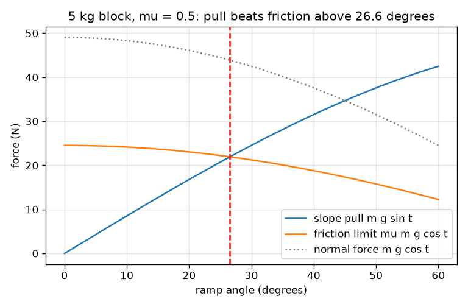
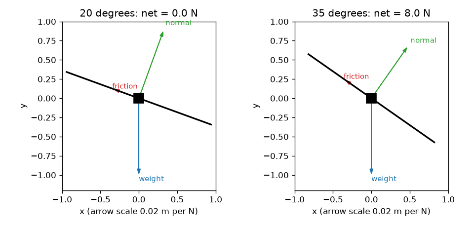

# సెషన్ 1: వాలుతలంపై బలాలు: ఘర్షణ ఒక పరిమితి

[Session 1 — हिन्दी](README.hi.md) · [Session 1 — മലയാളം](README.ml.md) · [Session 1 — தமிழ்](README.ta.md)

*స్థాయి 1 (భావనాత్మక ఇంటరాక్టివ్ నమూనా) · సుమారు 60 నిమిషాలు · openincline*

> ఇది ఒక సరళీకృత విద్యా నమూనా. ఇది ధృవీకరించబడిన డిజైన్ సాధనం కాదు; నిజమైన నిర్మాణాలు, విద్యుత్ ఇన్‌స్టలేషన్లు, వాహనాలు, పారిశ్రామిక ప్రక్రియలు లేదా వైద్య నిర్ణయాల కోసం దీనిని ఉపయోగించకూడదు.

**ముందస్తు అవసరాలు (Prerequisites)**

- పాఠశాల త్రికోణమితి (trigonometry): సైన్, కోసైన్ మరియు టాంజెంట్.
- బలాన్ని న్యూటన్లలో (newton) కొలుస్తారని మీకు తెలుసు.
- మీరు PRIMER.md చదివి, `python start.py 1` ను ఒకసారి రన్ చేశారు.

**అభ్యసన లక్ష్యాలు (Learning objectives).** ఈ సెషన్ తర్వాత మీరు చేయగలరు:

- వాలుతలంపై దిమ్మె బరువును వాలు వెంట ఒక భాగంగా మరియు వాలులోకి ఒక భాగంగా విభజించడం.
- ఘర్షణకు సాధ్యమైన అత్యధిక విలువ, mu గుణకారం లంబ బలం (normal force), ఎందుకు ఉందో వివరించడం.
- దిమ్మె నిలుస్తుందా జారుతుందా అని లెక్కతో నిర్ణయించడం.
- కోణానికి వ్యతిరేకంగా వాలు లాగుడు మరియు ఘర్షణ పరిమితి గ్రాఫ్‌ను చదివి, అవి ఎక్కడ కలుస్తాయో కనుగొనడం.

## A. వాస్తవ ప్రపంచ సమస్య
కొండపై ఆపిన కారు, లోడింగ్ ర్యాంప్‌పై పెట్టె, వాలుగా ఉన్న బల్లపై పుస్తకం. ఉపరితలాన్ని కొంచెం వంచితే ఏమీ కదలదు; ఇంకా వంచితే అకస్మాత్తుగా జారుతుంది. జారడం మొదలయ్యే కోణాన్ని ఏది నిర్ణయిస్తుంది? బరువైన దిమ్మెకు ఎక్కువ నిటారు ర్యాంప్ కావాలా? (ఇది నేర్చుకోవడానికి సరళీకృత నమూనా, నిజమైన ర్యాంపులు లేదా వాహనాలకు డిజైన్ సాధనం కాదు.)

## B. భావన మరియు సిద్ధాంతం
బరువు m g నేరుగా కిందికి చూపుతుంది. t కోణంలో వంగిన ర్యాంప్‌పై రెండు దిశలను ఉపయోగించడం సులభం: ర్యాంప్‌కు లంబంగా, అక్కడ ర్యాంప్ లంబ బలం N తో వెనక్కి నెడుతుంది; వాలు వెంట, అక్కడ లాగుడు F దిమ్మెను జారేలా చేయడానికి ప్రయత్నిస్తుంది. ఘర్షణ వాలు పైకి పనిచేసి జారడాన్ని ప్రతిఘటిస్తుంది. అది స్థిర సంఖ్య కాదు: అది లాగుడుకు సరిగ్గా సరిపోతుంది, mu గుణకారం N అనే అత్యధిక విలువ వరకు, ఇక్కడ mu (ఘర్షణ గుణకం, friction coefficient) కు యూనిట్ లేదు, అది రెండు ఉపరితలాలపై ఆధారపడి ఉంటుంది. లాగుడు పరిమితి కంటే తక్కువ ఉంటే ఏమీ కదలదు; అది పరిమితిని మించితే దిమ్మె త్వరణం చెందుతుంది. m g sin t ను mu m g cos t తో పోల్చినప్పుడు ద్రవ్యరాశి రద్దవుతుంది, జారే షరతు tan t > mu మిగులుతుంది.

| గుర్తు | అర్థం | యూనిట్ |
|---|---|---|
| m | దిమ్మె ద్రవ్యరాశి | kg |
| g | గురుత్వాకర్షణ (9.81) | m/s^2 |
| t | క్షితిజం నుండి ర్యాంప్ కోణం | డిగ్రీలు |
| N | లంబ బలం, ర్యాంప్‌కు లంబం | N |
| F | వాలు వెంట గురుత్వ లాగుడు | N |
| mu | ఘర్షణ గుణకం (సెషన్ 1 కు ఒక విలువ) | యూనిట్ లేదు |
| f | నిజంగా పనిచేసే ఘర్షణ బలం | N |
| a | వాలు కిందికి త్వరణం | m/s^2 |

**ఊహలు (Assumptions)**

- దిమ్మె చదునైన, దృఢమైన ర్యాంప్‌పై బిందు ద్రవ్యరాశి.
- ఘర్షణ సరళ నియమాన్ని పాటిస్తుంది: గరిష్ఠంగా mu N, స్పర్శ వైశాల్యం మరియు వేగంపై ఆధారపడదు.
- సెషన్ 1 విరామానికి మరియు జారడానికి ఒకే mu ను ఉపయోగిస్తుంది; సెషన్ 2 వాటిని వేరు చేస్తుంది.
- గాలి నిరోధం లేదు, దిమ్మె భ్రమణం లేదు.

$$ N=mg\cos\theta,\qquad F=mg\sin\theta $$

$$ f_{\max}=\mu N=\mu mg\cos\theta,\qquad f=\min(F,\ \mu N) $$

$$ \text{slides if } mg\sin\theta>\mu mg\cos\theta\iff \tan\theta>\mu,\qquad a=\frac{F-f}{m} $$

## C. దృశ్య వివరణ
మొదటి చిత్రం mu = 0.5 తో 5 kg దిమ్మె యొక్క 20 మరియు 35 డిగ్రీల వద్ద స్వేచ్ఛా-వస్తు రేఖాచిత్రాలను (free-body diagrams) చూపిస్తుంది: బరువు నేరుగా కిందికి, లంబ బలం ర్యాంప్ నుండి బయటకు, ఘర్షణ వాలు పైకి చూపుతాయి. 20 డిగ్రీల వద్ద ఘర్షణ లాగుడుకు సరిగ్గా సరిపోతుంది, నికర బలం సున్నా; 35 డిగ్రీల వద్ద ఘర్షణ దాని పరిమితిలో ఉంది, 8 N నికర బలం మిగులుతుంది. రెండవ చిత్రం వాలు లాగుడు (పెరిగేది), ఘర్షణ పరిమితి (తగ్గేది) మరియు లంబ బలం (తగ్గేది) లను కోణానికి వ్యతిరేకంగా ప్లాట్ చేస్తుంది. లాగుడు మరియు పరిమితి 26.6 డిగ్రీల వద్ద కలుస్తాయి, mu = 0.5 కు జారే కోణం.

*వాలు లాగుడు పెరుగుతుంది, ఘర్షణ పరిమితి తగ్గుతుంది; అవి జారే కోణం వద్ద కలుస్తాయి (mu = 0.5 కు 26.6 డిగ్రీలు).*

*20 డిగ్రీల వద్ద (నిలుస్తుంది) మరియు 35 డిగ్రీల వద్ద (జారుతుంది) స్వేచ్ఛా-వస్తు రేఖాచిత్రాలు.*

## D. ఇంటరాక్టివ్ సిమ్యులేషన్
పాఠాన్ని రన్ చేయండి (`python start.py 1`), తర్వాత లైవ్ యాప్‌ను తెరవండి: [సెషన్ 1: ర్యాంప్‌పై దిమ్మె](https://krunalpanchal1995.github.io/pan-iit-oss/openincline/session-01/) (లేదా ఈ ఫోల్డర్‌లోని `app.html`). కోణ స్లైడర్‌ను పెంచి లాగుడు మరియు ఘర్షణ బాణాలను చూడండి. ద్రవ్యరాశిని మార్చి ప్రతి బలం మారుతుంది కానీ జారే కోణం కదలదని చూడండి. గ్రాఫ్ వీక్షణను తెరిచి నీలి మరియు ఎరుపు వక్రాలు ఎక్కడ కలుస్తాయో కనుగొనండి.

**సవాలు (Challenge).** ఘర్షణ గుణకాన్ని 0.6 కు సెట్ చేసి, దిమ్మె జారడం మొదలయ్యే అతి చిన్న పూర్ణ కోణాన్ని కనుగొనండి.

## E. సాధించిన ఉదాహరణ మరియు ప్రయోగం
**సమస్య.** 5 kg దిమ్మె mu = 0.5 తో 20 డిగ్రీల ర్యాంప్‌పై విరామంలో ఉంది. N, వాలు లాగుడు, ఘర్షణ పరిమితిని కనుగొనండి. అది నిలుస్తుందా? ఏ కోణంలో అది జారడం మొదలవుతుంది?

1. N = m g cos t = 5 * 9.81 * cos 20 = 5 * 9.81 * 0.9397 = 46.09 N.
2. లాగుడు F = m g sin t = 5 * 9.81 * 0.3420 = 16.78 N.
3. ఘర్షణ పరిమితి = mu N = 0.5 * 46.09 = 23.05 N.
4. లాగుడు 16.78 N పరిమితి 23.05 N కంటే తక్కువ, కాబట్టి దిమ్మె నిలుస్తుంది: ఘర్షణ 16.78 N మరియు నికర బలం 0.
5. జారే కోణం tan t = mu = 0.5 ను సాధిస్తుంది, కాబట్టి t = arctan 0.5 = 26.57 డిగ్రీలు. సరిచూపు: tan 20 = 0.364 < 0.5, నిలవడంతో సరిపోతుంది.

**సమాధానం.** N = 46.09 N, లాగుడు = 16.78 N, పరిమితి = 23.05 N; దిమ్మె 16.78 N ఘర్షణతో నిలుస్తుంది. దాని ద్రవ్యరాశి ఏదైనా 26.57 డిగ్రీల పైన అది జారడం మొదలవుతుంది.

**ప్రయోగం.** ఏదైనా దిమ్మెను బోర్డుపై పెట్టి, బోర్డుపై ఫోన్ కోణ యాప్‌తో నెమ్మదిగా వంచండి. అది జారే కోణాన్ని గమనించండి; ఆ కోణం tan mu ను అంచనా వేస్తుంది. అదే పదార్థం యొక్క తేలికైన వస్తువుతో పునరావృతం చేయండి: కోణం దాదాపు ఒకేలా ఉండాలి. నిజమైన ఉపరితలాలు ప్రతి ప్రయత్నంలో ఒకటి లేదా రెండు డిగ్రీలు మారుతాయి (దుమ్ము, దిమ్మె ఎంతసేపు ఉంది, చిన్న గతుకులు), నమూనాకు ఒక ఖచ్చితమైన mu ఉంది; ఆ వ్యాప్తియే నమూనా మరియు వాస్తవం మధ్య ప్రధాన తేడా.

## F. మూల్యాంకనం మరియు డిజైన్ సవాలు
**ప్రశ్న రకం A: భావనాత్మక.** ర్యాంప్‌పై విరామంలో ఉన్న దిమ్మె జారడం మొదలవుతుందా అని ఏది నిర్ణయిస్తుంది? ద్రవ్యరాశి ముఖ్యమా? దిమ్మె అడుగు ముఖం పరిమాణం ముఖ్యమా?

సూచన

m g sin t ను mu m g cos t తో పోల్చండి. ఏది రద్దవుతుంది?

దశలవారీ పరిష్కారం

కోణం మరియు రెండు ఉపరితలాల ఘర్షణ గుణకం మాత్రమే నిర్ణయిస్తాయి: tan t, mu కంటే పెద్దదైనప్పుడు దిమ్మె జారుతుంది. ద్రవ్యరాశి m లాగుడులో మరియు ఘర్షణ పరిమితిలో రెండింటిలో ఉంది, రద్దవుతుంది, కాబట్టి ఒకే పదార్థం యొక్క బరువైన మరియు తేలికైన దిమ్మెలు ఒకే కోణంలో జారడం మొదలుపెడతాయి. సరళ ఘర్షణ నియమంలో స్పర్శ వైశాల్యం కూడా ముఖ్యం కాదు: పెద్ద ముఖం అదే N ను ఎక్కువ వైశాల్యంలో వ్యాపింపజేస్తుంది కానీ పరిమితి mu N మారదు.

**ప్రశ్న రకం B: సంఖ్యాత్మక.** 8 kg దిమ్మె 15 డిగ్రీల ర్యాంప్‌పై ఉంది, mu = 0.35. N, లాగుడు, ఘర్షణ పరిమితి మరియు పనిచేసే ఘర్షణను కనుగొనండి. అది జారుతుందా? సమాధానం సహేతుకమేనా సరిచూడండి.

సూచన

N = m g cos t, F = m g sin t, పరిమితి = mu N ఉపయోగించి, తర్వాత పోల్చండి.

దశలవారీ పరిష్కారం

N = 8 * 9.81 * cos 15 = 75.81 N. F = 8 * 9.81 * sin 15 = 20.31 N. పరిమితి = 0.35 * 75.81 = 26.53 N. 20.31 < 26.53 కాబట్టి దిమ్మె నిలుస్తుంది మరియు పనిచేసే ఘర్షణ 20.31 N. సరిచూపు: జారే కోణం arctan 0.35 = 19.29 డిగ్రీలు, 15 డిగ్రీల కంటే ఎక్కువ, కాబట్టి నిలవడం సరైనదే. యూనిట్లు: న్యూటన్లు.

**ప్రశ్న రకం C: గ్రాఫ్ మరియు సిమ్యులేషన్ వ్యాఖ్యానం.** 5 kg దిమ్మె బల గ్రాఫ్‌పై, వాలు లాగుడు మరియు ఘర్షణ పరిమితి mu = 0.5 కు 26.6 డిగ్రీల వద్ద కలుస్తాయి. mu = 0.8 కు అవి ఎక్కడ కలుస్తాయి, ఏ వక్రం కదులుతుంది? కలయికకు ఎడమ వైపు ఘర్షణ వక్రం ఏమి చేస్తుంది?

సూచన

ఘర్షణ-పరిమితి వక్రంలో మాత్రమే mu ఉంది. tan t = 0.8 సాధించండి.

దశలవారీ పరిష్కారం

ఎరుపు ఘర్షణ-పరిమితి వక్రం mu తో పాటు పైకి స్కేల్ అవుతుంది, కాబట్టి అది పైకి కదిలి కలయిక కుడివైపు arctan 0.8 = 38.66 డిగ్రీలకు కదులుతుంది. లాగుడు వక్రంలో mu లేదు, అది అక్కడే ఉంటుంది. కలయికకు ఎడమ వైపు పరిమితి లాగుడు కంటే పైన ఉంది, కాబట్టి అక్కడ దిమ్మె నిలుస్తుంది; కుడివైపు లాగుడు పెద్దది, దిమ్మె జారుతుంది.

**ప్రశ్న రకం D: డిజైన్ మరియు ఆప్టిమైజేషన్ సవాలు.** డిజైన్: 20 kg పెట్టె mu = 0.45 ఉన్న చెక్క ర్యాంప్‌పై తాడు లేకుండా నిలవాలి. అవసరమైన ఘర్షణ పరిమితిలో గరిష్ఠంగా 80 శాతం ఉండేలా భద్రతా మార్జిన్‌తో గరిష్ఠ ర్యాంప్ కోణాన్ని ఎంచుకోండి. 1.2 m ఎత్తు కావాలి. ర్యాంప్ ఎంత పొడవు ఉండాలి? ట్రేడ్-ఆఫ్ ఏమిటి?

సూచన

అవసరమైన ఘర్షణ లాగుడే, కాబట్టి F <= 0.8 * mu N అంటే tan t <= 0.8 mu. పొడవు = ఎత్తు / sin t.

దశలవారీ పరిష్కారం

tan t <= 0.8 * 0.45 = 0.36, కాబట్టి t <= 19.80 డిగ్రీలు (జారే కోణం 24.23 డిగ్రీలు). ర్యాంప్ పొడవు = 1.2 / sin 19.80 = 3.54 m. జారే కోణంలో అది 2.92 m మాత్రమే, కానీ భద్రతా మార్జిన్ లేకుండా. ట్రేడ్-ఆఫ్ స్థలం మరియు భద్రత మధ్య: ఉపరితలం తడిసినా దుమ్ముపట్టినా mu తగ్గుతుంది, అప్పుడు సున్నితమైన, పొడవైన ర్యాంప్ సురక్షితం. 20 kg ద్రవ్యరాశి సమాధానాన్ని మార్చదు. ఇది తరగతి గది నమూనా; నిజమైన ర్యాంపులకు వృత్తిపరమైన డిజైన్ కావాలి.

[RUBRIC.md](../../RUBRIC.md) తో మిమ్మల్ని మీరు స్కోర్ చేసుకోండి. కాగితంపై పని చేయడానికి [కార్యాచరణ పత్రాన్ని](activity_sheet.md) ప్రింట్ చేయండి.

## సాధారణ అపోహలు
| సాధారణ అపోహ | నిజానికి సరైనది |
|---|---|
| బరువైన దిమ్మె జారే ముందు ఎక్కువ నిటారు ర్యాంప్ కావాలి. | ద్రవ్యరాశి రద్దవుతుంది: జారే షరతు tan t > mu లో m లేదు. |
| ఘర్షణ ఎల్లప్పుడూ mu గుణకారం N. | దిమ్మె నిలిచినప్పుడు ఘర్షణ లాగుడుకు సమానం; mu N అనేది అది కాగల అత్యధిక విలువ మాత్రమే. |
| లంబ బలం ఎల్లప్పుడూ బరువుకు సమానం. | ర్యాంప్‌పై N = m g cos t, అది బరువు కంటే చిన్నది, ర్యాంప్ నిటారుగా అయ్యేకొద్దీ తగ్గుతుంది. |
| విరామంలో ఉన్న దిమ్మెపై బలం సున్నా. | అనేక బలాలు పనిచేస్తాయి; అవి సమతుల్యంగా ఉంటాయి. నికర బలం సున్నా, ప్రతి బలం కాదు. |

## పదకోశం (Glossary)
- **లంబ బలం (normal force)**: ఒక ఉపరితలం వస్తువుపై కలిగించే, ఉపరితలానికి లంబంగా ఉండే నెట్టుడు
- **ఘర్షణ గుణకం (friction coefficient, mu)**: లంబ బలంలో భిన్నంగా అత్యధిక ఘర్షణను నిర్ణయించే యూనిట్ లేని సంఖ్య
- **స్వేచ్ఛా-వస్తు రేఖాచిత్రం (free-body diagram)**: ఒక వస్తువుపై ఉన్న ప్రతి బలానికి ఒక బాణంతో గీసిన చిత్రం
- **నికర బలం (net force)**: వస్తువుపై అన్ని బలాల మొత్తం; సున్నా అంటే త్వరణం లేదు
- **జారే కోణం (slide angle)**: విరామంలో ఉన్న దిమ్మె మొదటిసారి జారడం మొదలయ్యే ర్యాంప్ కోణం

## ముగించండి
1. [exercises.md](exercises.md) లోని మూడు కోడింగ్ పనులను చేయండి.
2. మీ మార్పుల తర్వాత `python start.py 1` ను మళ్ళీ రన్ చేయండి. ఇది చెక్‌పాయింట్‌తో ముగుస్తుంది; అది `PASS` అని ప్రింట్ చేసినప్పుడు మీరు పూర్తి చేశారు. (చెక్‌పాయింట్ మాత్రమే: `python start.py check 1`.)

తదుపరి: [సెషన్ 2](../session-02/README.md)
