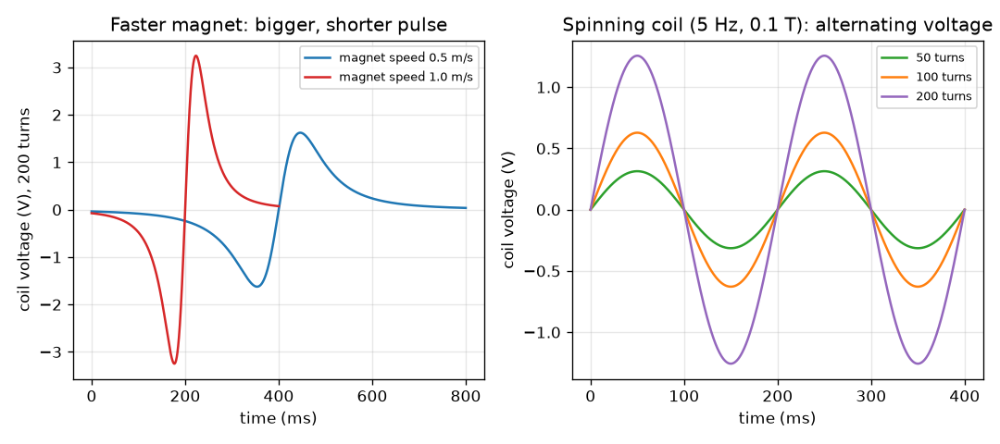

# सत्र 1: बदलता फ़्लक्स वोल्टता बनाता है

*स्तर 1 (वैचारिक इंटरैक्टिव मॉडल) · लगभग 60 मिनट · openinduction*

> यह एक सरलीकृत शैक्षिक मॉडल है। यह कोई प्रमाणित डिज़ाइन टूल नहीं है और इसका उपयोग वास्तविक संरचनाओं, बिजली की वायरिंग (electrical installations), वाहनों, औद्योगिक प्रक्रियाओं या चिकित्सा निर्णयों के लिए नहीं किया जाना चाहिए।

**पूर्व-आवश्यकताएँ (Prerequisites)**

- वोल्टता और चुंबक के क्षेत्र का विचार।
- आपने PRIMER.md पढ़ लिया है और एक बार `python start.py 1` चलाया है।

**सीखने के उद्देश्य (Learning objectives).** इस सत्र के बाद आप:

- बता सकेंगे कि विद्युतचुंबकीय प्रेरण (electromagnetic induction) क्या है: कुंडली (coil) से होकर बदलता फ़्लक्स एक वोल्टता बनाता है।
- एक सरल स्थिति के लिए emf = फेरे x (फ़्लक्स का परिवर्तन) / (लगा समय) का उपयोग कर सकेंगे।
- समझा सकेंगे कि तेज़ चुंबक या अधिक फेरे अधिक वोल्टता क्यों देते हैं, और स्थिर चुंबक कोई वोल्टता क्यों नहीं देता।
- समझा सकेंगे कि घूमती कुंडली प्रत्यावर्ती वोल्टता (alternating voltage) क्यों देती है और उसका शिखर मान गणना कर सकेंगे।

## A. वास्तविक दुनिया की समस्या
साइकिल के डायनेमो (dynamo) में कोई बैटरी नहीं होती, फिर भी पैडल चलाने पर वह लैंप जला देता है। उसके अंदर केवल एक चुंबक और तार की एक कुंडली होती है, और कुछ भी एक-दूसरे को छूता नहीं। हर बिजलीघर इसी तरकीब से चलता है: कुछ घूमता है, और एक वोल्टता प्रकट होती है। वह वोल्टता कहाँ से आती है, और उसे बड़ा या छोटा क्या बनाता है? यह एक कम-वोल्टता वाला शैक्षिक मॉडल है: हम छोटी संख्याओं का उपयोग करते हैं और कभी मेन्स बिजली (mains electricity) के साथ काम नहीं करते।

## B. अवधारणा और सिद्धांत
चुंबकीय फ़्लक्स (magnetic flux) (प्रतीक Phi) मापता है कि कितना चुंबकीय क्षेत्र किसी कुंडली से होकर गुज़रता है: प्रबल क्षेत्र, या क्षेत्र की ओर मुख किए बड़ी कुंडली, का अर्थ है अधिक फ़्लक्स। फ़ैराडे ने पाया कि कुंडली केवल तभी वोल्टता (जिसे EMF, विद्युत वाहक बल (electromotive force) कहते हैं) उत्पन्न करती है जब उससे होकर फ़्लक्स बदल रहा हो। वोल्टता का आकार फेरों की संख्या गुणा फ़्लक्स के परिवर्तन की दर है। विरामावस्था में चुंबक, चाहे कितना भी प्रबल हो, कोई वोल्टता नहीं बनाता। चुंबक को अंदर धकेलिए तो वोल्टता का एक चिह्न होता है; बाहर खींचिए तो चिह्न उलट जाता है: यह लेंज़ का नियम (Lenz's law) है, प्रेरित वोल्टता उस परिवर्तन का विरोध करती है जिसने उसे पैदा किया। यदि कुंडली किसी क्षेत्र में घूमती है, तो हर चक्कर में फ़्लक्स बढ़ता और घटता है, इसलिए वोल्टता धनात्मक और ऋणात्मक के बीच झूलती है: प्रत्यावर्ती धारा (alternating current, AC)। शिखर वोल्टता N B A 2 pi f है।

| प्रतीक | अर्थ | इकाई |
|---|---|---|
| emf | प्रेरित वोल्टता (विद्युत वाहक बल) | V |
| N | कुंडली के फेरों की संख्या | कोई इकाई नहीं |
| Phi | एक फेरे से होकर चुंबकीय फ़्लक्स | Wb (वेबर) |
| delta Phi / delta t | फ़्लक्स का परिवर्तन भाग लगा समय | Wb/s |
| B | चुंबकीय क्षेत्र की प्रबलता | T (टेस्ला) |
| A | कुंडली का क्षेत्रफल | m^2 |
| f | प्रति सेकंड चक्कर, आवृत्ति | Hz |

**मान्यताएँ (Assumptions)**

- कुंडली का कोई प्रतिरोध नहीं है और उसमें कोई धारा नहीं बहती (हम खुले परिपथ की वोल्टता मापते हैं)।
- चुंबक कुंडली के अक्ष के साथ स्थिर चाल से चलता है, और कुंडली से होकर उसका फ़्लक्स एक सरल घंटी के आकार का वक्र है (उदाहरणात्मक)।
- घूमती कुंडली के लिए क्षेत्र एकसमान है।
- केवल कम-वोल्टता वाले शैक्षिक मान।

$$ \mathcal{E}_{\mathrm{avg}} = N\,\frac{\Delta\Phi}{\Delta t} $$

$$ \Phi = B A\cos\theta $$

$$ \mathcal{E}_{\mathrm{peak}} = N B A\,2\pi f $$

## C. दृश्य व्याख्या
बायाँ चित्र 200 फेरों वाली एक कुंडली दिखाता है जिसमें से एक चुंबक दो चालों पर धकेला जाता है। जब चुंबक अंदर जाता है तब वोल्टता एक चिह्न की स्पंद (pulse) होती है और जब बाहर आता है तब विपरीत चिह्न की स्पंद। 0.5 m/s पर शिखर 1.62 V है और गुज़रने में 800 ms लगते हैं; 1.0 m/s पर शिखर 3.25 V है और गुज़रने में 400 ms लगते हैं: दोगुनी चाल आधे समय में दोगुना शिखर देती है, पर हर स्पंद का क्षेत्रफल (वोल्ट-सेकंड) वही रहता है। दायाँ चित्र 0.1 T क्षेत्र में 5 Hz पर घूमती कुंडली दिखाता है: वोल्टता एक ज्या तरंग (sine wave) है जिसकी ऊँचाई फेरों की संख्या के अनुपात में बढ़ती है।

*बाएँ: 200 फेरों वाली कुंडली से दो चालों पर धकेला गया चुंबक। दाएँ: 5 Hz पर घूमती कुंडली प्रत्यावर्ती वोल्टता बनाती है जो फेरों के साथ बढ़ती है।*

## D. इंटरैक्टिव सिमुलेशन
पाठ चलाइए (`python start.py 1`), फिर लाइव ऐप खोलिए: [सत्र 1: चुंबकीय क्षेत्र में घूमती कुंडली](https://krunalpanchal1995.github.io/pan-iit-oss/openinduction/session-01/) (या इसी फ़ोल्डर में `app.html`)। कुंडली को घुमाने के लिए कोण स्लाइडर खिसकाइए और रीडआउट में फ़्लक्स और वोल्टता देखिए; फिर फेरे, क्षेत्र और चाल को एक-एक करके बढ़ाइए और देखिए कि कौन-सा तरंग की ऊँचाई बदलता है और कौन-सा उसकी लंबाई।

**चुनौती।** शिखर वोल्टता को कम से कम 5 V बनाइए।

## E. हल किया गया उदाहरण और प्रयोग
**समस्या।** (a) 200 फेरों वाली कुंडली में धकेला गया एक चुंबक उससे होकर फ़्लक्स को 0.05 s में 0.5 mWb बदल देता है। औसत वोल्टता क्या है, और यदि धक्का 0.025 s लेता है तो? (b) 100 फेरों, 0.002 m^2 क्षेत्रफल वाली, 0.1 T क्षेत्र में 5 Hz पर घुमाई गई कुंडली की शिखर वोल्टता क्या है?

1. (a) 0.5 mWb = 0.0005 Wb में बदलिए। वोल्टता = N x delta Phi / delta t = 200 x 0.0005 / 0.05 = 2.0 V।
2. दोगुना तेज़: 200 x 0.0005 / 0.025 = 4.0 V। दोगुनी चाल, दोगुनी वोल्टता।
3. (b) शिखर = N B A 2 pi f = 100 x 0.1 x 0.002 x 2 x 3.1416 x 5।
4. 100 x 0.1 x 0.002 = 0.02, और 2 pi x 5 = 31.416, इसलिए शिखर = 0.02 x 31.416 = 0.628 V।

**उत्तर।** (a) 2 V, और धक्का दोगुना तेज़ होने पर 4 V। (b) शिखर 0.628 V है।

**प्रयोग।** एक गत्ते की नली पर एनामेल किए हुए तार (enamelled wire) के लगभग 200 फेरे लपेटिए, उसे एक संवेदनशील वोल्टमीटर (या अपनी सबसे छोटी मिलीवोल्ट रेंज पर मल्टीमीटर) से जोड़िए और एक छड़ चुंबक को धीमी और तेज़ चालों पर अंदर-बाहर कीजिए। आपको ऐसा विक्षेप (deflection) दिखना चाहिए जो चिह्न बदलता है और तेज़ धक्कों के लिए बड़ा होता है। वास्तविक पाठ्यांक मॉडल से छोटे और अधिक शोरयुक्त होंगे: वास्तविक फ़्लक्स आदर्श घंटी वक्र नहीं है, और कुंडली में प्रतिरोध और प्रेरकत्व (inductance) होता है। इनमें से किसी भी प्रयोग के लिए कभी मेन्स बिजली का उपयोग न करें।

## F. मूल्यांकन और डिज़ाइन चुनौती
**प्रश्न प्रकार A: वैचारिक।** कुंडली के अंदर रखा एक प्रबल चुंबक कोई वोल्टता क्यों नहीं बनाता? और जब आप चुंबक को अंदर धकेलते हैं तो विद्युत ऊर्जा कहाँ से आती है?

संकेत

पूछिए कि वोल्टता प्रकट होने के लिए क्या बदलना चाहिए। फिर पूछिए कि धकेलने का काम कौन करता है।

चरण-दर-चरण हल

वोल्टता के लिए बदलता फ़्लक्स चाहिए; विरामावस्था में चुंबक स्थिर फ़्लक्स देता है, इसलिए परिवर्तन शून्य है और वोल्टता शून्य है चाहे चुंबक कितना भी प्रबल हो। जब आप चुंबक को अंदर धकेलते हैं और धारा बहती है, तो प्रेरित धारा अपना क्षेत्र बनाती है जो गति का विरोध करता है (लेंज़ का नियम), इसलिए आपको अधिक ज़ोर से धकेलना पड़ता है: विद्युत ऊर्जा आपके हाथ के कार्य से आती है, चुंबक से नहीं।

**प्रश्न प्रकार B: संख्यात्मक।** 500 फेरों वाली एक कुंडली से होकर फ़्लक्स 0.02 s में 0 से 0.2 mWb तक बढ़ता है। औसत वोल्टता क्या है? जाँचिए कि उत्तर समझदारी भरा है।

संकेत

पहले 0.2 mWb को Wb में बदलिए, फिर emf = N x delta Phi / delta t का उपयोग कीजिए।

चरण-दर-चरण हल

0.2 mWb = 0.0002 Wb। emf = 500 x 0.0002 / 0.02 = 5.0 V। समझदारी जाँच: प्रति सेकंड 100 गुना फ़्लक्स परिवर्तन (0.01 Wb/s) गुणा 500 फेरे 5 V देते हैं। इकाई: वेबर प्रति सेकंड वोल्ट है।

**प्रश्न प्रकार C: ग्राफ़ और सिमुलेशन की व्याख्या।** बाएँ चित्र में चुंबक की चाल दोगुनी की गई है। (i) शिखर वोल्टता, (ii) स्पंद कितनी देर चलता है, (iii) एक स्पंद का क्षेत्रफल, इनका क्या होता है?

संकेत

लाल वक्र की तुलना नीले वक्र से कीजिए।

चरण-दर-चरण हल

(i) शिखर दोगुना हो जाता है, 1.62 V से 3.25 V। (ii) स्पंद आधी देर चलता है, 800 ms के बजाय 400 ms। (iii) एक स्पंद का क्षेत्रफल अपरिवर्तित रहता है (लगभग 0.19 वोल्ट-सेकंड), क्योंकि यह N गुणा फ़्लक्स के कुल परिवर्तन के बराबर है, जो चाल पर निर्भर नहीं करता।

**प्रश्न प्रकार D: डिज़ाइन और अनुकूलन (optimisation) चुनौती।** डिज़ाइन: आप 3 V की शिखर वोल्टता वाली घूमती कुंडली चाहते हैं। आपके पास N = 100 फेरे, A = 0.002 m^2 और एक 0.1 T चुंबक है। आपको कौन-सी आवृत्ति चाहिए? यदि आपका हाथ कुंडली को केवल 5 Hz पर घुमा सकता है, तो इसके बजाय आपको कितने फेरे चाहिए? समझौता (trade-off) क्या है?

संकेत

शिखर = N B A 2 pi f को f के लिए, फिर N के लिए पुनर्व्यवस्थित कीजिए।

चरण-दर-चरण हल

N B A = 100 x 0.1 x 0.002 = 0.02, इसलिए f = 3 / (0.02 x 2 pi) = 23.9 Hz। 5 Hz पर: N = 3 / (0.1 x 0.002 x 2 pi x 5) = 477.5, इसलिए लगभग 478 फेरे। समझौता: अधिक फेरों का अर्थ है अधिक तार, अधिक भार और अधिक प्रतिरोध, जो ऊर्जा को ऊष्मा के रूप में बर्बाद करता है (सत्र 3); तेज़ घुमाव के लिए गियर या अधिक मेहनत चाहिए। मान्यता: आदर्श कुंडली, कोई लोड नहीं।

[RUBRIC.md](../../RUBRIC.md) से स्वयं को अंक दीजिए। काग़ज़ पर काम करने के लिए [गतिविधि पत्रक (activity sheet)](activity_sheet.md) प्रिंट कीजिए।

## आम भ्रांतियाँ (Common misconceptions)
| आम भ्रांति | वास्तव में क्या सही है |
|---|---|
| प्रबल चुंबक हमेशा कुंडली में वोल्टता बनाता है। | केवल बदलता फ़्लक्स वोल्टता बनाता है। विरामावस्था में चुंबक, चाहे कितना भी प्रबल हो, कोई वोल्टता नहीं बनाता। |
| चुंबक ख़र्च हो जाता है और विद्युत ऊर्जा वहीं से आती है। | ऊर्जा उससे आती है जो चुंबक या कुंडली को चलाता है (आपका हाथ, पैडल, भाप)। धारा बहने पर लेंज़ का नियम गति को कठिन बना देता है। |
| वोल्टता हमेशा धनात्मक होती है। | अंदर जाना और बाहर आना विपरीत चिह्न देते हैं, और घूमती कुंडली ऐसी वोल्टता देती है जो धनात्मक और ऋणात्मक के बीच झूलती है: AC। |
| फेरे दोगुने करने से परिपथ में धारा दोगुनी हो जाती है। | फेरे दोगुने करने से वोल्टता दोगुनी होती है। धारा पूरे परिपथ के प्रतिरोध पर भी निर्भर करती है। |

## शब्दावली (Glossary)
- **फ़्लक्स (flux)**: किसी कुंडली से होकर गुज़रने वाले चुंबकीय क्षेत्र की मात्रा; इकाई वेबर (Wb)
- **EMF**: विद्युत वाहक बल (electromotive force): कुंडली में प्रेरित वोल्टता; इकाई वोल्ट
- **प्रेरण (induction)**: बदलते चुंबकीय फ़्लक्स से वोल्टता बनाना
- **लेंज़ का नियम (Lenz's law)**: प्रेरित वोल्टता उस परिवर्तन का विरोध करने के लिए कार्य करती है जो उसे पैदा करता है
- **AC**: प्रत्यावर्ती धारा या वोल्टता: यह धनात्मक और ऋणात्मक के बीच झूलती है

## समापन
1. [exercises.md](exercises.md) में दिए गए तीन कोडिंग कार्य कीजिए।
2. अपने बदलावों के बाद `python start.py 1` फिर से चलाइए। यह चेकपॉइंट (checkpoint) के साथ समाप्त होता है; जब यह `PASS` प्रिंट करे, तो आपका काम पूरा हुआ। (केवल चेकपॉइंट: `python start.py check 1`।)

आगे: [सत्र 2](../session-02/README.md)
