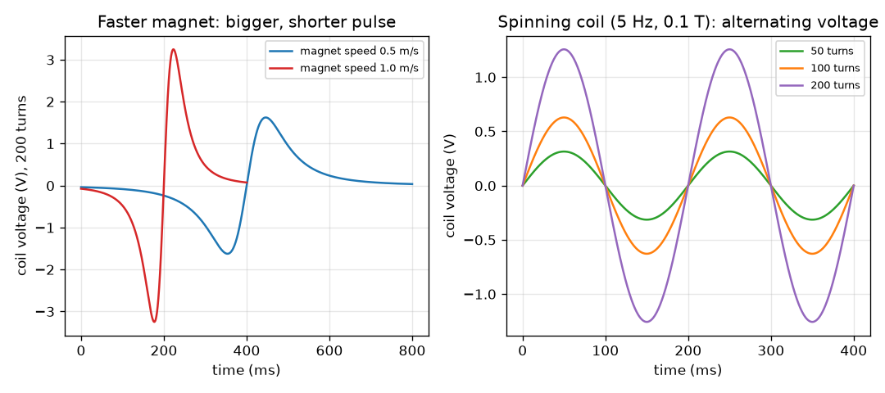

# സെഷൻ 1: മാറുന്ന ഫ്ലക്സ് ഒരു വോൾട്ടേജ് ഉണ്ടാക്കുന്നു

[Session 1 — हिन्दी](README.hi.md)

*ലെവൽ 1 (ആശയപരമായ ഇന്ററാക്ടീവ് മോഡൽ) · ഏകദേശം 60 മിനിറ്റ് · openinduction*

> ഇത് ലളിതമാക്കിയ ഒരു വിദ്യാഭ്യാസ മോഡൽ (educational model) ആണ്. ഇത് സാധൂകരിക്കപ്പെട്ട ഒരു ഡിസൈൻ ഉപകരണമല്ല; യഥാർത്ഥ നിർമ്മിതികൾ, വൈദ്യുത ഇൻസ്റ്റലേഷനുകൾ, വാഹനങ്ങൾ, വ്യാവസായിക പ്രക്രിയകൾ അല്ലെങ്കിൽ വൈദ്യശാസ്ത്ര തീരുമാനങ്ങൾ എന്നിവയ്ക്ക് ഇത് ഉപയോഗിക്കരുത്.

**മുൻ‌അറിവ് (Prerequisites)**

- വോൾട്ടേജും ഒരു കാന്തത്തിന്റെ ഫീൽഡ് എന്ന ആശയവും.
- നിങ്ങൾ PRIMER.md വായിക്കുകയും `python start.py 1` ഒരിക്കൽ റൺ ചെയ്യുകയും ചെയ്തിട്ടുണ്ട്.

**പഠന ലക്ഷ്യങ്ങൾ (Learning objectives).** ഈ സെഷനു ശേഷം നിങ്ങൾക്ക് കഴിയും:

- വൈദ്യുതകാന്തിക പ്രേരണം (electromagnetic induction) എന്താണെന്ന് പ്രസ്താവിക്കാൻ: ഒരു കോയിലിലൂടെയുള്ള മാറുന്ന ഫ്ലക്സ് ഒരു വോൾട്ടേജ് ഉണ്ടാക്കുന്നു.
- ലളിതമായ ഒരു സാഹചര്യത്തിന് emf = ചുറ്റുകൾ x (ഫ്ലക്സിലെ മാറ്റം) / (എടുത്ത സമയം) ഉപയോഗിക്കാൻ.
- വേഗമേറിയ കാന്തമോ കൂടുതൽ ചുറ്റുകളോ കൂടുതൽ വോൾട്ടേജ് നൽകുന്നത് എന്തുകൊണ്ടെന്നും, നിശ്ചലമായ കാന്തം ഒന്നും നൽകാത്തത് എന്തുകൊണ്ടെന്നും വിശദീകരിക്കാൻ.
- കറങ്ങുന്ന കോയിൽ ഒരു ഏകാന്തര വോൾട്ടേജ് (alternating voltage) നൽകുന്നത് എന്തുകൊണ്ടെന്ന് വിശദീകരിക്കാനും അതിന്റെ പീക്ക് കണക്കാക്കാനും.

## A. യഥാർത്ഥ ജീവിതത്തിലെ പ്രശ്നം
ഒരു സൈക്കിൾ ഡൈനാമോയ്ക്ക് ബാറ്ററിയില്ല, എങ്കിലും നിങ്ങൾ ചവിട്ടുമ്പോൾ അത് ഒരു ലാമ്പ് കത്തിക്കുന്നു. അകത്ത് ഒരു കാന്തവും ഒരു കമ്പിച്ചുരുളും മാത്രമേയുള്ളൂ, ഒന്നും തമ്മിൽ തൊടുന്നില്ല. ഇതേ വിദ്യയാണ് ഓരോ വൈദ്യുതനിലയത്തെയും പ്രവർത്തിപ്പിക്കുന്നത്: എന്തോ കറങ്ങുന്നു, ഒരു വോൾട്ടേജ് പ്രത്യക്ഷപ്പെടുന്നു. ആ വോൾട്ടേജ് എവിടെ നിന്ന് വരുന്നു, അതിനെ വലുതോ ചെറുതോ ആക്കുന്നത് എന്താണ്? ഇത് കുറഞ്ഞ വോൾട്ടേജുള്ള ഒരു വിദ്യാഭ്യാസ മോഡലാണ്: ഞങ്ങൾ ചെറിയ സംഖ്യകൾ ഉപയോഗിക്കുന്നു, മെയിൻസ് വൈദ്യുതി ഉപയോഗിച്ച് ഒരിക്കലും പ്രവർത്തിക്കുന്നില്ല.

## B. ആശയവും സിദ്ധാന്തവും
കാന്തിക ഫ്ലക്സ് (magnetic flux) (ചിഹ്നം Phi) ഒരു കോയിലിലൂടെ എത്ര കാന്തിക ഫീൽഡ് കടന്നുപോകുന്നു എന്ന് അളക്കുന്നു: ശക്തമായ ഫീൽഡ്, അല്ലെങ്കിൽ ഫീൽഡിനെ അഭിമുഖീകരിക്കുന്ന വലിയ കോയിൽ, കൂടുതൽ ഫ്ലക്സ് എന്നാണ് അർത്ഥം. ഒരു കോയിലിലൂടെയുള്ള ഫ്ലക്സ് മാറിക്കൊണ്ടിരിക്കുമ്പോൾ മാത്രമേ അത് ഒരു വോൾട്ടേജ് (EMF, ഇലക്ട്രോമോട്ടീവ് ഫോഴ്സ്) ഉണ്ടാക്കൂ എന്ന് ഫാരഡെ കണ്ടെത്തി. വോൾട്ടേജിന്റെ വലിപ്പം ചുറ്റുകളുടെ എണ്ണം ഗുണം ഫ്ലക്സിന്റെ മാറ്റനിരക്കാണ്. നിശ്ചലമായ ഒരു കാന്തം, എത്ര ശക്തമായാലും, വോൾട്ടേജ് ഉണ്ടാക്കുന്നില്ല. കാന്തത്തെ അകത്തേക്ക് തള്ളുമ്പോൾ വോൾട്ടേജിന് ഒരു ചിഹ്നമുണ്ട്; പുറത്തേക്ക് വലിക്കുമ്പോൾ ചിഹ്നം മറിയുന്നു: ഇതാണ് ലെൻസ് നിയമം (Lenz's law), പ്രേരിത വോൾട്ടേജ് അതിനെ ഉണ്ടാക്കിയ മാറ്റത്തെ എതിർക്കുന്നു. ഒരു ഫീൽഡിൽ കോയിൽ കറങ്ങിയാൽ ഓരോ ചുറ്റിലും ഫ്ലക്സ് കൂടുകയും കുറയുകയും ചെയ്യുന്നു, അതിനാൽ വോൾട്ടേജ് പോസിറ്റീവിലേക്കും നെഗറ്റീവിലേക്കും ആടുന്നു: ഏകാന്തര വൈദ്യുതി (alternating current, AC). പീക്ക് വോൾട്ടേജ് N B A 2 pi f ആണ്.

| ചിഹ്നം | അർത്ഥം | യൂണിറ്റ് |
|---|---|---|
| emf | പ്രേരിത വോൾട്ടേജ് (ഇലക്ട്രോമോട്ടീവ് ഫോഴ്സ്) | V |
| N | കോയിലിന്റെ ചുറ്റുകളുടെ എണ്ണം | യൂണിറ്റ് ഇല്ല |
| Phi | ഒരു ചുറ്റിലൂടെയുള്ള കാന്തിക ഫ്ലക്സ് | Wb (വെബർ) |
| delta Phi / delta t | ഫ്ലക്സിലെ മാറ്റത്തെ എടുത്ത സമയം കൊണ്ട് ഹരിച്ചത് | Wb/s |
| B | കാന്തിക ഫീൽഡ് ശക്തി | T (ടെസ്‌ല) |
| A | കോയിലിന്റെ വിസ്തീർണ്ണം | m^2 |
| f | സെക്കൻഡിലെ ചുറ്റുകൾ, ആവൃത്തി | Hz |

**അനുമാനങ്ങൾ (Assumptions)**

- കോയിലിന് പ്രതിരോധമില്ല, കറന്റ് വഹിക്കുന്നുമില്ല (ഓപ്പൺ-സർക്യൂട്ട് വോൾട്ടേജ് ആണ് ഞങ്ങൾ അളക്കുന്നത്).
- കാന്തം കോയിലിന്റെ അക്ഷത്തിലൂടെ സ്ഥിരവേഗത്തിൽ നീങ്ങുന്നു, കോയിലിലൂടെയുള്ള അതിന്റെ ഫ്ലക്സ് ഒരു ലളിതമായ മണിയാകൃതി വക്രമാണ് (ഉദാഹരണത്തിന്).
- കറങ്ങുന്ന കോയിലിന് ഫീൽഡ് ഏകീകൃതമാണ്.
- കുറഞ്ഞ വോൾട്ടേജ് വിദ്യാഭ്യാസ വിലകൾ മാത്രം.

$$ \mathcal{E}_{\mathrm{avg}} = N\,\frac{\Delta\Phi}{\Delta t} $$

$$ \Phi = B A\cos\theta $$

$$ \mathcal{E}_{\mathrm{peak}} = N B A\,2\pi f $$

## C. ദൃശ്യ വിശദീകരണം
ഇടതുവശത്തെ ചിത്രം രണ്ട് വേഗങ്ങളിൽ ഒരു കാന്തം കടത്തിവിട്ട 200 ചുറ്റുള്ള ഒരു കോയിൽ കാണിക്കുന്നു. കാന്തം അകത്തേക്ക് പോകുമ്പോൾ വോൾട്ടേജ് ഒരു ചിഹ്നത്തിലുള്ള പൾസും, പുറത്തേക്ക് വരുമ്പോൾ വിപരീത ചിഹ്നത്തിലുള്ള പൾസുമാണ്. 0.5 m/s-ൽ പീക്ക് 1.62 V-ഉം കടന്നുപോകാൻ 800 ms-ഉം എടുക്കുന്നു; 1.0 m/s-ൽ പീക്ക് 3.25 V-ഉം 400 ms-ഉം: ഇരട്ടി വേഗം പകുതി സമയത്തിൽ ഇരട്ടി പീക്ക് നൽകുന്നു, എന്നാൽ ഓരോ പൾസിന്റെയും വിസ്തീർണ്ണം (വോൾട്ട്-സെക്കൻഡ്) ഒന്നുതന്നെയാണ്. വലതുവശത്തെ ചിത്രം 0.1 T ഫീൽഡിൽ 5 Hz-ൽ കറങ്ങുന്ന കോയിൽ കാണിക്കുന്നു: വോൾട്ടേജ് ഒരു സൈൻ തരംഗമാണ്, അതിന്റെ ഉയരം ചുറ്റുകളുടെ എണ്ണത്തിന് ആനുപാതികമായി വളരുന്നു.

*ഇടത്: 200 ചുറ്റുള്ള കോയിലിലൂടെ രണ്ട് വേഗങ്ങളിൽ കടത്തിവിടുന്ന ഒരു കാന്തം. വലത്: 5 Hz-ൽ കറങ്ങുന്ന കോയിൽ ചുറ്റുകൾക്കനുസരിച്ച് വളരുന്ന ഏകാന്തര വോൾട്ടേജ് ഉണ്ടാക്കുന്നു.*

## D. ഇന്ററാക്ടീവ് സിമുലേഷൻ
പാഠം റൺ ചെയ്യുക (`python start.py 1`), എന്നിട്ട് ലൈവ് ആപ്പ് തുറക്കുക: [സെഷൻ 1: കാന്തിക ഫീൽഡിൽ കറങ്ങുന്ന കോയിൽ](https://krunalpanchal1995.github.io/pan-iit-oss/openinduction/session-01/) (അല്ലെങ്കിൽ ഈ ഫോൾഡറിലെ `app.html`). കോയിൽ തിരിക്കാൻ ആംഗിൾ സ്ലൈഡർ വലിച്ചുനീക്കി റീഡ്ഔട്ടിൽ ഫ്ലക്സും വോൾട്ടേജും നിരീക്ഷിക്കുക; പിന്നെ ചുറ്റുകൾ, ഫീൽഡ്, വേഗം എന്നിവ ഒന്നൊന്നായി ഉയർത്തി, ഏതാണ് തരംഗത്തിന്റെ ഉയരം മാറ്റുന്നതെന്നും ഏതാണ് അതിന്റെ നീളം മാറ്റുന്നതെന്നും കാണുക.

**വെല്ലുവിളി.** പീക്ക് വോൾട്ടേജ് കുറഞ്ഞത് 5 V ആക്കുക.

## E. ഉദാഹരണവും പരീക്ഷണവും
**പ്രശ്നം.** (a) 200 ചുറ്റുള്ള ഒരു കോയിലിലേക്ക് തള്ളുന്ന കാന്തം അതിലൂടെയുള്ള ഫ്ലക്സിനെ 0.05 s-ൽ 0.5 mWb മാറ്റുന്നു. ശരാശരി വോൾട്ടേജ് എത്ര? തള്ളൽ 0.025 s എടുത്താലോ? (b) 100 ചുറ്റും 0.002 m^2 വിസ്തീർണ്ണവുമുള്ള ഒരു കോയിൽ 0.1 T ഫീൽഡിൽ 5 Hz-ൽ കറക്കിയാൽ പീക്ക് വോൾട്ടേജ് എത്ര?

1. (a) 0.5 mWb = 0.0005 Wb ആക്കുക. വോൾട്ടേജ് = N x delta Phi / delta t = 200 x 0.0005 / 0.05 = 2.0 V.
2. ഇരട്ടി വേഗത്തിൽ: 200 x 0.0005 / 0.025 = 4.0 V. ഇരട്ടി വേഗം, ഇരട്ടി വോൾട്ടേജ്.
3. (b) പീക്ക് = N B A 2 pi f = 100 x 0.1 x 0.002 x 2 x 3.1416 x 5.
4. 100 x 0.1 x 0.002 = 0.02, 2 pi x 5 = 31.416, അതിനാൽ പീക്ക് = 0.02 x 31.416 = 0.628 V.

**ഉത്തരം.** (a) 2 V, തള്ളൽ ഇരട്ടി വേഗത്തിലാകുമ്പോൾ 4 V. (b) പീക്ക് 0.628 V ആണ്.

**പരീക്ഷണം.** ഒരു കാർഡ്ബോർഡ് ട്യൂബിൽ ഏകദേശം 200 ചുറ്റ് ഇനാമൽ പൂശിയ കമ്പി ചുറ്റുക, അത് സംവേദനക്ഷമമായ ഒരു വോൾട്ട്മീറ്ററുമായി (അല്ലെങ്കിൽ ഏറ്റവും ചെറിയ മില്ലിവോൾട്ട് റേഞ്ചിലുള്ള മൾട്ടിമീറ്ററുമായി) ബന്ധിപ്പിക്കുക, ഒരു ബാർ മാഗ്നറ്റ് പതുക്കെയും വേഗത്തിലും അകത്തേക്കും പുറത്തേക്കും തള്ളുക. ചിഹ്നം മാറുന്നതും വേഗത്തിൽ തള്ളുമ്പോൾ വലുതുമായ ഒരു വിക്ഷേപം (deflection) നിങ്ങൾ കാണണം. യഥാർത്ഥ റീഡിംഗുകൾ മോഡലിനേക്കാൾ ചെറുതും ശബ്ദമുള്ളതുമായിരിക്കും: യഥാർത്ഥ ഫ്ലക്സ് ആദർശ മണി വക്രമല്ല, കോയിലിന് പ്രതിരോധവും ഇൻഡക്റ്റൻസും ഉണ്ട്. ഈ പരീക്ഷണങ്ങൾക്കൊന്നും മെയിൻസ് വൈദ്യുതി ഒരിക്കലും ഉപയോഗിക്കരുത്.

## F. വിലയിരുത്തലും ഡിസൈൻ വെല്ലുവിളിയും
**ചോദ്യ തരം A: ആശയപരം.** ഒരു കോയിലിനുള്ളിൽ വിശ്രമിക്കുന്ന ശക്തമായ കാന്തം വോൾട്ടേജ് ഉണ്ടാക്കാത്തത് എന്തുകൊണ്ട്? കാന്തത്തെ അകത്തേക്ക് തള്ളുമ്പോൾ വൈദ്യുതോർജം എവിടെ നിന്ന് വരുന്നു?

സൂചന

ഒരു വോൾട്ടേജ് പ്രത്യക്ഷപ്പെടാൻ എന്ത് മാറണം എന്ന് ചോദിക്കുക. പിന്നെ തള്ളുന്നത് ആരെന്ന് ചോദിക്കുക.

ഘട്ടം ഘട്ടമായുള്ള പരിഹാരം

ഒരു വോൾട്ടേജിന് മാറുന്ന ഫ്ലക്സ് വേണം; നിശ്ചലമായ കാന്തം സ്ഥിര ഫ്ലക്സ് നൽകുന്നു, അതിനാൽ മാറ്റം പൂജ്യമാണ്, കാന്തം എത്ര ശക്തമായാലും വോൾട്ടേജ് പൂജ്യമാണ്. നിങ്ങൾ കാന്തത്തെ അകത്തേക്ക് തള്ളുകയും ഒരു കറന്റ് ഒഴുകുകയും ചെയ്യുമ്പോൾ, പ്രേരിത കറന്റ് ചലനത്തെ എതിർക്കുന്ന സ്വന്തം ഫീൽഡ് ഉണ്ടാക്കുന്നു (ലെൻസ് നിയമം), അതിനാൽ നിങ്ങൾ കൂടുതൽ ശക്തിയായി തള്ളണം: വൈദ്യുതോർജം വരുന്നത് നിങ്ങളുടെ കൈയുടെ പ്രവൃത്തിയിൽ നിന്നാണ്, കാന്തത്തിൽ നിന്നല്ല.

**ചോദ്യ തരം B: സംഖ്യാപരം.** 500 ചുറ്റുള്ള ഒരു കോയിലിലൂടെയുള്ള ഫ്ലക്സ് 0.02 s-ൽ 0-ൽ നിന്ന് 0.2 mWb ആയി വളരുന്നു. ശരാശരി വോൾട്ടേജ് എത്ര? ഉത്തരം യുക്തിസഹമാണോ എന്ന് പരിശോധിക്കുക.

സൂചന

ആദ്യം 0.2 mWb-നെ Wb ആക്കുക, പിന്നെ emf = N x delta Phi / delta t ഉപയോഗിക്കുക.

ഘട്ടം ഘട്ടമായുള്ള പരിഹാരം

0.2 mWb = 0.0002 Wb. emf = 500 x 0.0002 / 0.02 = 5.0 V. യുക്തി പരിശോധന: സെക്കൻഡിലെ ഫ്ലക്സ് മാറ്റം (0.01 Wb/s) ഗുണം 500 ചുറ്റുകൾ 5 V നൽകുന്നു. യൂണിറ്റ്: വെബർ പെർ സെക്കൻഡ് ആണ് വോൾട്ട്.

**ചോദ്യ തരം C: ഗ്രാഫും സിമുലേഷനും വ്യാഖ്യാനിക്കൽ.** ഇടതുവശത്തെ ചിത്രത്തിൽ കാന്തത്തിന്റെ വേഗം ഇരട്ടിയാക്കുന്നു. (i) പീക്ക് വോൾട്ടേജ്, (ii) പൾസ് എത്ര നേരം നീണ്ടുനിൽക്കുന്നു, (iii) ഒരു പൾസിന്റെ വിസ്തീർണ്ണം എന്നിവയ്ക്ക് എന്തു സംഭവിക്കുന്നു?

സൂചന

ചുവന്ന വക്രത്തെ നീല വക്രവുമായി താരതമ്യം ചെയ്യുക.

ഘട്ടം ഘട്ടമായുള്ള പരിഹാരം

(i) പീക്ക് ഇരട്ടിയാകുന്നു, 1.62 V-ൽ നിന്ന് 3.25 V-ലേക്ക്. (ii) പൾസ് പകുതി നേരം നീണ്ടുനിൽക്കുന്നു, 800 ms-ന് പകരം 400 ms. (iii) ഒരു പൾസിന്റെ വിസ്തീർണ്ണം മാറുന്നില്ല (ഏകദേശം 0.19 വോൾട്ട്-സെക്കൻഡ്), കാരണം അത് N ഗുണം ഫ്ലക്സിന്റെ ആകെ മാറ്റത്തിന് തുല്യമാണ്, അത് വേഗത്തെ ആശ്രയിക്കുന്നില്ല.

**ചോദ്യ തരം D: ഡിസൈനും ഒപ്റ്റിമൈസേഷൻ (optimisation) വെല്ലുവിളിയും.** ഡിസൈൻ: 3 V പീക്ക് വോൾട്ടേജുള്ള ഒരു കറങ്ങുന്ന കോയിൽ നിങ്ങൾക്ക് വേണം. നിങ്ങളുടെ പക്കൽ N = 100 ചുറ്റുകൾ, A = 0.002 m^2, ഒരു 0.1 T കാന്തം എന്നിവയുണ്ട്. നിങ്ങൾക്ക് ഏത് ആവൃത്തി വേണം? നിങ്ങളുടെ കൈക്ക് കോയിൽ 5 Hz-ൽ മാത്രമേ തിരിക്കാൻ കഴിയൂ എങ്കിൽ, പകരം എത്ര ചുറ്റുകൾ വേണം? ട്രേഡ്-ഓഫ് (trade-off) എന്താണ്?

സൂചന

പീക്ക് = N B A 2 pi f എന്നത് f-നായും പിന്നെ N-നായും പുനഃക്രമീകരിക്കുക.

ഘട്ടം ഘട്ടമായുള്ള പരിഹാരം

N B A = 100 x 0.1 x 0.002 = 0.02, അതിനാൽ f = 3 / (0.02 x 2 pi) = 23.9 Hz. 5 Hz-ൽ: N = 3 / (0.1 x 0.002 x 2 pi x 5) = 477.5, അതിനാൽ ഏകദേശം 478 ചുറ്റുകൾ. ട്രേഡ്-ഓഫ്: കൂടുതൽ ചുറ്റുകൾ എന്നാൽ കൂടുതൽ കമ്പി, കൂടുതൽ ഭാരം, കൂടുതൽ പ്രതിരോധം, ഇത് ഊർജത്തെ ചൂടായി പാഴാക്കുന്നു (സെഷൻ 3); വേഗത്തിലുള്ള കറക്കത്തിന് ഗിയറിങ്ങോ കൂടുതൽ പ്രയത്നമോ വേണം. അനുമാനം: ആദർശ കോയിൽ, ലോഡ് ഇല്ല.

[RUBRIC.md](../../RUBRIC.md) ഉപയോഗിച്ച് സ്വയം സ്കോർ ചെയ്യുക. പേപ്പറിൽ ചെയ്യാൻ [ആക്ടിവിറ്റി ഷീറ്റ്](activity_sheet.md) പ്രിന്റ് ചെയ്യുക.

## സാധാരണ തെറ്റിദ്ധാരണകൾ
| സാധാരണ തെറ്റിദ്ധാരണ | യഥാർത്ഥത്തിൽ ശരിയായത് |
|---|---|
| ശക്തമായ കാന്തം എപ്പോഴും കോയിലിൽ വോൾട്ടേജ് ഉണ്ടാക്കുന്നു. | മാറുന്ന ഫ്ലക്സ് മാത്രമേ വോൾട്ടേജ് ഉണ്ടാക്കൂ. നിശ്ചലമായ കാന്തം, എത്ര ശക്തമായാലും, ഒന്നും ഉണ്ടാക്കുന്നില്ല. |
| കാന്തം ഉപയോഗിച്ചുതീരുന്നു, അവിടെ നിന്നാണ് വൈദ്യുതോർജം വരുന്നത്. | കാന്തത്തെയോ കോയിലിനെയോ ചലിപ്പിക്കുന്നതിൽ നിന്നാണ് (നിങ്ങളുടെ കൈ, പെഡലുകൾ, നീരാവി) ഊർജം വരുന്നത്. കറന്റ് ഒഴുകുമ്പോൾ ലെൻസ് നിയമം ചലനത്തെ ബുദ്ധിമുട്ടുള്ളതാക്കുന്നു. |
| വോൾട്ടേജ് എപ്പോഴും പോസിറ്റീവ് ആണ്. | അകത്തേക്ക് പോകുന്നതും പുറത്തേക്ക് വരുന്നതും വിപരീത ചിഹ്നങ്ങൾ നൽകുന്നു, കറങ്ങുന്ന കോയിൽ പോസിറ്റീവിലേക്കും നെഗറ്റീവിലേക്കും ആടുന്ന വോൾട്ടേജ് നൽകുന്നു: AC. |
| ചുറ്റുകൾ ഇരട്ടിയാക്കുന്നത് സർക്യൂട്ടിലെ കറന്റ് ഇരട്ടിയാക്കുന്നു. | ചുറ്റുകൾ ഇരട്ടിയാക്കുന്നത് വോൾട്ടേജ് ഇരട്ടിയാക്കുന്നു. കറന്റ് മുഴുവൻ സർക്യൂട്ടിന്റെയും പ്രതിരോധത്തെയും ആശ്രയിക്കുന്നു. |

## പദാവലി (Glossary)
- **ഫ്ലക്സ് (flux)**: ഒരു കോയിലിലൂടെ കടന്നുപോകുന്ന കാന്തിക ഫീൽഡിന്റെ അളവ്; യൂണിറ്റ് വെബർ (Wb)
- **EMF**: ഇലക്ട്രോമോട്ടീവ് ഫോഴ്സ്: ഒരു കോയിലിൽ പ്രേരിതമാകുന്ന വോൾട്ടേജ്; യൂണിറ്റ് വോൾട്ട്
- **പ്രേരണം (induction)**: മാറുന്ന കാന്തിക ഫ്ലക്സ് ഉപയോഗിച്ച് വോൾട്ടേജ് ഉണ്ടാക്കൽ
- **ലെൻസ് നിയമം (Lenz's law)**: പ്രേരിത വോൾട്ടേജ് അതിനെ ഉണ്ടാക്കുന്ന മാറ്റത്തെ എതിർക്കാൻ പ്രവർത്തിക്കുന്നു
- **AC**: ഏകാന്തര വൈദ്യുതി അല്ലെങ്കിൽ വോൾട്ടേജ്: ഇത് പോസിറ്റീവിനും നെഗറ്റീവിനും ഇടയിൽ ആടുന്നു

## പൂർത്തിയാക്കുക
1. [exercises.md](exercises.md)-ലെ മൂന്ന് കോഡിംഗ് ടാസ്കുകൾ ചെയ്യുക.
2. മാറ്റങ്ങൾക്കു ശേഷം `python start.py 1` വീണ്ടും റൺ ചെയ്യുക. അത് ചെക്ക്‌പോയിന്റോടെ (checkpoint) അവസാനിക്കുന്നു; അത് `PASS` എന്ന് പ്രിന്റ് ചെയ്യുമ്പോൾ നിങ്ങൾ പൂർത്തിയാക്കി. (ചെക്ക്‌പോയിന്റ് മാത്രം: `python start.py check 1`.)

അടുത്തത്: [സെഷൻ 2](../session-02/README.md)
