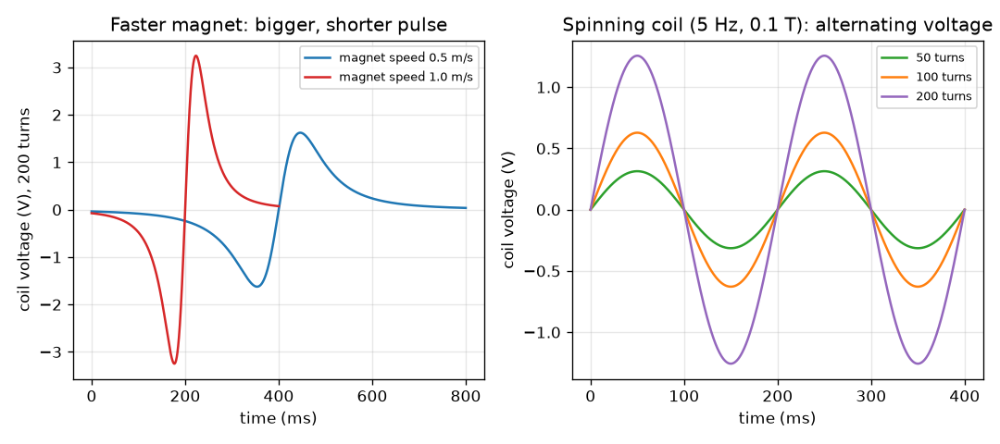

# அமர்வு 1: மாறும் பாயம் ஒரு மின்னழுத்தத்தை உருவாக்குகிறது

[Session 1 — हिन्दी](README.hi.md)

*நிலை 1 (கருத்தியல் ஊடாடும் மாதிரி) · சுமார் 60 நிமிடங்கள் · openinduction*

> இது எளிமைப்படுத்தப்பட்ட ஒரு கல்வி மாதிரி (educational model). இது சரிபார்க்கப்பட்ட வடிவமைப்புக் கருவி அல்ல; உண்மையான கட்டமைப்புகள், மின் நிறுவல்கள், வாகனங்கள், தொழில்துறை செயல்முறைகள் அல்லது மருத்துவ முடிவுகளுக்கு இதைப் பயன்படுத்தக் கூடாது.

**முன்தேவைகள் (Prerequisites)**

- மின்னழுத்தமும் ஒரு காந்தத்தின் புலம் என்ற கருத்தும்.
- நீங்கள் PRIMER.md படித்து `python start.py 1` ஒருமுறை இயக்கியிருக்கிறீர்கள்.

**கற்றல் நோக்கங்கள் (Learning objectives).** இந்த அமர்வுக்குப் பிறகு உங்களால் முடியும்:

- மின்காந்தத் தூண்டல் (electromagnetic induction) என்றால் என்ன என்று கூற: ஒரு சுருளின் வழியாக மாறும் பாயம் ஒரு மின்னழுத்தத்தை உருவாக்குகிறது.
- ஒரு எளிய நிலைக்கு emf = சுற்றுகள் x (பாயத்தின் மாற்றம்) / (எடுத்த நேரம்) பயன்படுத்த.
- வேகமான காந்தம் அல்லது அதிகச் சுற்றுகள் ஏன் அதிக மின்னழுத்தம் தருகின்றன, அசையாத காந்தம் ஏன் எதுவும் தருவதில்லை என்று விளக்க.
- சுழலும் சுருள் ஏன் மாறுதிசை மின்னழுத்தத்தைத் தருகிறது என்று விளக்கி அதன் உச்சத்தைக் கணக்கிட.

## A. நிஜ உலகப் பிரச்சினை
ஒரு மிதிவண்டி டைனமோவில் மின்கலம் இல்லை, இருந்தும் நீங்கள் மிதிக்கும்போது அது ஒரு விளக்கை ஒளிரச் செய்கிறது. உள்ளே ஒரு காந்தமும் ஒரு கம்பிச் சுருளும் மட்டுமே உள்ளன, எதுவும் தொடுவதில்லை. இதே தந்திரம்தான் ஒவ்வொரு மின் நிலையத்தையும் இயக்குகிறது: ஏதோ ஒன்று சுழல்கிறது, ஒரு மின்னழுத்தம் தோன்றுகிறது. அந்த மின்னழுத்தம் எங்கிருந்து வருகிறது, அதைப் பெரிதாகவோ சிறிதாகவோ ஆக்குவது எது? இது குறைந்த மின்னழுத்தக் கல்வி மாதிரி: நாம் சிறிய எண்களைப் பயன்படுத்துகிறோம், மெயின்ஸ் மின்சாரத்துடன் ஒருபோதும் வேலை செய்வதில்லை.

## B. கருத்தும் கோட்பாடும்
காந்தப் பாயம் (magnetic flux) (குறியீடு Phi) ஒரு சுருளின் வழியாக எவ்வளவு காந்தப் புலம் செல்கிறது என்று அளக்கிறது: வலுவான புலம், அல்லது புலத்தை நோக்கிய பெரிய சுருள், அதிகப் பாயத்தைக் குறிக்கும். ஒரு சுருளின் வழியாகச் செல்லும் பாயம் மாறிக்கொண்டிருக்கும்போது மட்டுமே அது ஒரு மின்னழுத்தத்தை (EMF, மின்னியக்கு விசை) உருவாக்குகிறது என்று ஃபாரடே கண்டறிந்தார். மின்னழுத்தத்தின் அளவு சுற்றுகளின் எண்ணிக்கை பெருக்கல் பாயத்தின் மாற்ற வீதம். ஓய்வில் உள்ள காந்தம், எவ்வளவு வலுவானதாக இருந்தாலும், மின்னழுத்தம் உருவாக்குவதில்லை. காந்தத்தை உள்ளே தள்ளினால் மின்னழுத்தத்துக்கு ஒரு குறி இருக்கும்; வெளியே இழுத்தால் குறி மாறும்: இதுவே லென்ஸ் விதி (Lenz's law), தூண்டப்பட்ட மின்னழுத்தம் அதை உண்டாக்கிய மாற்றத்தை எதிர்க்கிறது. புலத்தில் சுருள் சுழன்றால், ஒவ்வொரு சுற்றிலும் பாயம் ஏறி இறங்குகிறது, எனவே மின்னழுத்தம் நேர் மற்றும் எதிர்த் திசைகளில் ஊசலாடுகிறது: மாறுதிசை மின்னோட்டம் (alternating current, AC). உச்ச மின்னழுத்தம் N B A 2 pi f.

| குறியீடு | பொருள் | அலகு |
|---|---|---|
| emf | தூண்டப்பட்ட மின்னழுத்தம் (மின்னியக்கு விசை) | V |
| N | சுருளின் சுற்றுகளின் எண்ணிக்கை | அலகு இல்லை |
| Phi | ஒரு சுற்றின் வழியாகச் செல்லும் காந்தப் பாயம் | Wb (வெபர்) |
| delta Phi / delta t | பாயத்தின் மாற்றத்தை எடுத்த நேரத்தால் வகுத்தது | Wb/s |
| B | காந்தப் புல வலிமை | T (டெஸ்லா) |
| A | சுருளின் பரப்பளவு | m^2 |
| f | வினாடிக்குச் சுற்றுகள், அதிர்வெண் | Hz |

**அனுமானங்கள் (Assumptions)**

- சுருளுக்கு மின்தடை இல்லை, மின்னோட்டம் கொண்டு செல்வதும் இல்லை (திறந்த-சுற்று மின்னழுத்தத்தை அளக்கிறோம்).
- காந்தம் சுருளின் அச்சில் மாறா வேகத்தில் நகர்கிறது, சுருளின் வழியாக அதன் பாயம் ஒரு எளிய மணி வடிவ வளைவு (எடுத்துக்காட்டுக்கு).
- சுழலும் சுருளுக்குப் புலம் சீரானது.
- குறைந்த மின்னழுத்தக் கல்வி மதிப்புகள் மட்டுமே.

$$ \mathcal{E}_{\mathrm{avg}} = N\,\frac{\Delta\Phi}{\Delta t} $$

$$ \Phi = B A\cos\theta $$

$$ \mathcal{E}_{\mathrm{peak}} = N B A\,2\pi f $$

## C. காட்சி விளக்கம்
இடதுபுறப் படம் இரண்டு வேகங்களில் ஒரு காந்தம் தள்ளப்படும் 200 சுற்றுச் சுருளைக் காட்டுகிறது. காந்தம் உள்ளே செல்லும்போது மின்னழுத்தம் ஒரு குறியின் துடிப்பு, வெளியே வரும்போது எதிர்க் குறியின் துடிப்பு. 0.5 m/s-இல் உச்சம் 1.62 V, கடக்க 800 ms ஆகிறது; 1.0 m/s-இல் உச்சம் 3.25 V, 400 ms: இருமடங்கு வேகம் பாதி நேரத்தில் இருமடங்கு உச்சத்தைத் தருகிறது, ஆனால் ஒவ்வொரு துடிப்பின் பரப்பளவு (வோல்ட்-வினாடி) ஒன்றே. வலதுபுறப் படம் 0.1 T புலத்தில் 5 Hz-இல் சுழலும் சுருளைக் காட்டுகிறது: மின்னழுத்தம் ஒரு சைன் அலை, அதன் உயரம் சுற்றுகளின் எண்ணிக்கைக்கு விகிதமாக வளர்கிறது.

*இடது: 200 சுற்றுச் சுருளின் வழியாக இரண்டு வேகங்களில் தள்ளப்படும் காந்தம். வலது: 5 Hz-இல் சுழலும் சுருள் சுற்றுகளுடன் வளரும் மாறுதிசை மின்னழுத்தத்தை உருவாக்குகிறது.*

## D. ஊடாடும் உருவகப்படுத்தல் (Interactive simulation)
பாடத்தை இயக்குங்கள் (`python start.py 1`), பிறகு நேரடிச் செயலியைத் திறக்கவும்: [அமர்வு 1: காந்தப் புலத்தில் சுழலும் சுருள்](https://krunalpanchal1995.github.io/pan-iit-oss/openinduction/session-01/) (அல்லது இந்தக் கோப்புறையில் உள்ள `app.html`). சுருளைத் திருப்பக் கோண ஸ்லைடரை இழுத்து வாசிப்பில் பாயத்தையும் மின்னழுத்தத்தையும் கவனியுங்கள்; பிறகு சுற்றுகள், புலம், வேகம் ஆகியவற்றை ஒவ்வொன்றாக உயர்த்தி, எது அலையின் உயரத்தை மாற்றுகிறது, எது அதன் நீளத்தை மாற்றுகிறது என்று பாருங்கள்.

**சவால்.** உச்ச மின்னழுத்தம் குறைந்தது 5 V ஆகும்படி செய்யுங்கள்.

## E. தீர்க்கப்பட்ட எடுத்துக்காட்டும் சோதனையும்
**கணக்கு.** (a) 200 சுற்றுச் சுருளுக்குள் தள்ளப்படும் காந்தம் அதன் வழியாகச் செல்லும் பாயத்தை 0.05 s-இல் 0.5 mWb மாற்றுகிறது. சராசரி மின்னழுத்தம் என்ன? தள்ளுதல் 0.025 s எடுத்தால்? (b) 100 சுற்றுகளும் 0.002 m^2 பரப்பளவும் கொண்ட சுருள் 0.1 T புலத்தில் 5 Hz-இல் சுழன்றால் உச்ச மின்னழுத்தம் என்ன?

1. (a) 0.5 mWb = 0.0005 Wb என மாற்றுங்கள். மின்னழுத்தம் = N x delta Phi / delta t = 200 x 0.0005 / 0.05 = 2.0 V.
2. இருமடங்கு வேகத்தில்: 200 x 0.0005 / 0.025 = 4.0 V. இருமடங்கு வேகம், இருமடங்கு மின்னழுத்தம்.
3. (b) உச்சம் = N B A 2 pi f = 100 x 0.1 x 0.002 x 2 x 3.1416 x 5.
4. 100 x 0.1 x 0.002 = 0.02, 2 pi x 5 = 31.416, எனவே உச்சம் = 0.02 x 31.416 = 0.628 V.

**விடை.** (a) 2 V, தள்ளுதல் இருமடங்கு வேகமாக இருக்கும்போது 4 V. (b) உச்சம் 0.628 V.

**சோதனை.** ஒரு அட்டைக் குழாயில் சுமார் 200 சுற்று எனாமல் பூசிய கம்பியைச் சுற்றி, அதை உணர்திறன் மிக்க ஒரு வோல்ட்மீட்டருடன் (அல்லது மிகச் சிறிய மில்லிவோல்ட் வரம்பில் உள்ள மல்டிமீட்டருடன்) இணைத்து, ஒரு கம்பிக் காந்தத்தை மெதுவாகவும் வேகமாகவும் உள்ளே வெளியே தள்ளுங்கள். குறி மாறும், வேகமாகத் தள்ளும்போது பெரிதாகும் ஒரு விலகலை நீங்கள் காண வேண்டும். உண்மையான அளவீடுகள் மாதிரியைவிடச் சிறியவையாகவும் இரைச்சலாகவும் இருக்கும்: உண்மையான பாயம் இலட்சிய மணி வளைவு அல்ல, சுருளுக்கு மின்தடையும் தூண்டமும் உண்டு. இந்தச் சோதனைகளில் எதற்கும் மெயின்ஸ் மின்சாரத்தை ஒருபோதும் பயன்படுத்தாதீர்கள்.

## F. மதிப்பீடும் வடிவமைப்புச் சவாலும்
**கேள்வி வகை A: கருத்தியல்.** சுருளுக்குள் ஓய்வில் இருக்கும் வலுவான காந்தம் ஏன் மின்னழுத்தம் உருவாக்குவதில்லை? காந்தத்தை உள்ளே தள்ளும்போது மின் ஆற்றல் எங்கிருந்து வருகிறது?

குறிப்பு

ஒரு மின்னழுத்தம் தோன்ற எது மாற வேண்டும் என்று கேளுங்கள். பிறகு தள்ளுவது யார் என்று கேளுங்கள்.

படிப்படியான தீர்வு

ஒரு மின்னழுத்தத்துக்கு மாறும் பாயம் தேவை; ஓய்வில் உள்ள காந்தம் மாறாப் பாயத்தைத் தருகிறது, எனவே மாற்றம் பூஜ்ஜியம், காந்தம் எவ்வளவு வலுவானதாக இருந்தாலும் மின்னழுத்தம் பூஜ்ஜியம். நீங்கள் காந்தத்தை உள்ளே தள்ளி மின்னோட்டம் பாயும்போது, தூண்டப்பட்ட மின்னோட்டம் இயக்கத்தை எதிர்க்கும் தன் சொந்தப் புலத்தை உருவாக்குகிறது (லென்ஸ் விதி), எனவே நீங்கள் கடுமையாகத் தள்ள வேண்டும்: மின் ஆற்றல் உங்கள் கையின் வேலையிலிருந்து வருகிறது, காந்தத்திலிருந்து அல்ல.

**கேள்வி வகை B: எண்ணியல்.** 500 சுற்றுச் சுருளின் வழியாகப் பாயம் 0.02 s-இல் 0-இல் இருந்து 0.2 mWb ஆக வளர்கிறது. சராசரி மின்னழுத்தம் என்ன? விடை பொருத்தமானதா என்று சரிபாருங்கள்.

குறிப்பு

முதலில் 0.2 mWb-ஐ Wb ஆக மாற்றி, பிறகு emf = N x delta Phi / delta t பயன்படுத்துங்கள்.

படிப்படியான தீர்வு

0.2 mWb = 0.0002 Wb. emf = 500 x 0.0002 / 0.02 = 5.0 V. பொருத்தச் சரிபார்ப்பு: வினாடிக்குப் பாய மாற்றம் (0.01 Wb/s) பெருக்கல் 500 சுற்றுகள் 5 V தருகிறது. அலகு: வெபர் பெர் வினாடி என்பதே வோல்ட்.

**கேள்வி வகை C: வரைபடம் மற்றும் உருவகப்படுத்தல் விளக்கம்.** இடதுபுறப் படத்தில் காந்தத்தின் வேகம் இருமடங்காக்கப்படுகிறது. (i) உச்ச மின்னழுத்தம், (ii) துடிப்பு எவ்வளவு நேரம் நீடிக்கிறது, (iii) ஒரு துடிப்பின் பரப்பளவு ஆகியவற்றுக்கு என்ன ஆகிறது?

குறிப்பு

சிவப்பு வளைவை நீல வளைவுடன் ஒப்பிடுங்கள்.

படிப்படியான தீர்வு

(i) உச்சம் இருமடங்காகிறது, 1.62 V-இல் இருந்து 3.25 V-க்கு. (ii) துடிப்பு பாதி நேரம் நீடிக்கிறது, 800 ms-க்குப் பதிலாக 400 ms. (iii) ஒரு துடிப்பின் பரப்பளவு மாறவில்லை (சுமார் 0.19 வோல்ட்-வினாடி), ஏனெனில் அது N பெருக்கல் பாயத்தின் மொத்த மாற்றத்துக்குச் சமம், அது வேகத்தைச் சார்ந்ததல்ல.

**கேள்வி வகை D: வடிவமைப்பு மற்றும் உகப்பாக்கம் (optimisation) சவால்.** வடிவமைப்பு: 3 V உச்ச மின்னழுத்தம் கொண்ட சுழலும் சுருள் உங்களுக்கு வேண்டும். உங்களிடம் N = 100 சுற்றுகள், A = 0.002 m^2, ஒரு 0.1 T காந்தம் உள்ளன. உங்களுக்கு என்ன அதிர்வெண் தேவை? உங்கள் கையால் சுருளை 5 Hz-இல் மட்டுமே திருப்ப முடியுமென்றால், அதற்குப் பதிலாக எத்தனை சுற்றுகள் தேவை? பரிமாற்றம் (trade-off) என்ன?

குறிப்பு

உச்சம் = N B A 2 pi f என்பதை f-க்காகவும், பிறகு N-க்காகவும் மாற்றி எழுதுங்கள்.

படிப்படியான தீர்வு

N B A = 100 x 0.1 x 0.002 = 0.02, எனவே f = 3 / (0.02 x 2 pi) = 23.9 Hz. 5 Hz-இல்: N = 3 / (0.1 x 0.002 x 2 pi x 5) = 477.5, எனவே சுமார் 478 சுற்றுகள். பரிமாற்றம்: அதிகச் சுற்றுகள் என்றால் அதிகக் கம்பி, அதிக எடை, அதிக மின்தடை, இது ஆற்றலை வெப்பமாக வீணாக்குகிறது (அமர்வு 3); வேகமான சுழற்சிக்குப் பற்சக்கரம் அல்லது அதிக முயற்சி தேவை. அனுமானம்: இலட்சியச் சுருள், சுமை இல்லை.

[RUBRIC.md](../../RUBRIC.md) கொண்டு உங்களை மதிப்பிடுங்கள். தாளில் செய்ய [செயல்பாட்டுத் தாள்](activity_sheet.md)-ஐ அச்சிடுங்கள்.

## பொதுவான தவறான கருத்துகள்
| பொதுவான தவறான கருத்து | உண்மையில் சரியானது |
|---|---|
| வலுவான காந்தம் எப்போதும் சுருளில் மின்னழுத்தம் உருவாக்கும். | மாறும் பாயம் மட்டுமே மின்னழுத்தம் உருவாக்கும். ஓய்வில் உள்ள காந்தம், எவ்வளவு வலுவானதாக இருந்தாலும், எதுவும் உருவாக்காது. |
| காந்தம் பயன்படுத்தித் தீர்ந்துவிடுகிறது, அதுதான் மின் ஆற்றலின் மூலம். | காந்தத்தை அல்லது சுருளை நகர்த்தும் எதிலிருந்தும் (உங்கள் கை, மிதிகள், நீராவி) ஆற்றல் வருகிறது. மின்னோட்டம் பாயும்போது லென்ஸ் விதி இயக்கத்தைக் கடினமாக்குகிறது. |
| மின்னழுத்தம் எப்போதும் நேர்மறை. | உள்ளே செல்வதும் வெளியே வருவதும் எதிர்க் குறிகள் தருகின்றன, சுழலும் சுருள் நேர் எதிராக ஊசலாடும் மின்னழுத்தம் தருகிறது: AC. |
| சுற்றுகளை இருமடங்காக்கினால் சுற்றில் மின்னோட்டம் இருமடங்காகும். | சுற்றுகளை இருமடங்காக்கினால் மின்னழுத்தம் இருமடங்காகும். மின்னோட்டம் முழுச் சுற்றின் மின்தடையையும் சார்ந்தது. |

## சொற்களஞ்சியம் (Glossary)
- **பாயம் (flux)**: ஒரு சுருளின் வழியாகச் செல்லும் காந்தப் புலத்தின் அளவு; அலகு வெபர் (Wb)
- **EMF**: மின்னியக்கு விசை: ஒரு சுருளில் தூண்டப்படும் மின்னழுத்தம்; அலகு வோல்ட்
- **தூண்டல் (induction)**: மாறும் காந்தப் பாயத்தால் மின்னழுத்தம் உருவாக்குதல்
- **லென்ஸ் விதி (Lenz's law)**: தூண்டப்பட்ட மின்னழுத்தம் அதை உண்டாக்கும் மாற்றத்தை எதிர்க்கச் செயல்படுகிறது
- **AC**: மாறுதிசை மின்னோட்டம் அல்லது மின்னழுத்தம்: இது நேர்மறைக்கும் எதிர்மறைக்கும் இடையே ஊசலாடுகிறது

## முடிவு
1. [exercises.md](exercises.md)-இல் உள்ள மூன்று நிரலாக்கப் பணிகளைச் செய்யுங்கள்.
2. உங்கள் மாற்றங்களுக்குப் பிறகு `python start.py 1` மீண்டும் இயக்குங்கள். அது சோதனைச் சாவடியுடன் (checkpoint) முடிகிறது; அது `PASS` என்று அச்சிடும்போது நீங்கள் முடித்துவிட்டீர்கள். (சோதனைச் சாவடி மட்டும்: `python start.py check 1`.)

அடுத்து: [அமர்வு 2](../session-02/README.md)
