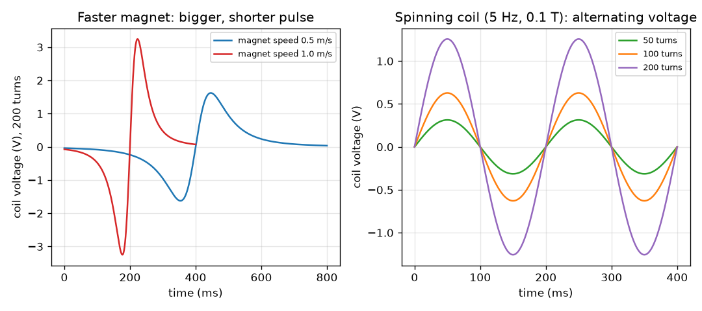

# సెషన్ 1: మారే అభివాహం వోల్టేజ్‌ను సృష్టిస్తుంది

[Session 1 — हिन्दी](README.hi.md)

*స్థాయి 1 (భావనాత్మక ఇంటరాక్టివ్ నమూనా) · సుమారు 60 నిమిషాలు · openinduction*

> ఇది సరళీకరించిన ఒక విద్యా నమూనా (educational model). ఇది ధృవీకరించబడిన డిజైన్ సాధనం కాదు; నిజమైన నిర్మాణాలు, విద్యుత్ ఇన్‌స్టాలేషన్‌లు, వాహనాలు, పారిశ్రామిక ప్రక్రియలు లేదా వైద్య నిర్ణయాల కోసం దీనిని ఉపయోగించకూడదు.

**ముందస్తు జ్ఞానం (Prerequisites)**

- వోల్టేజ్ మరియు అయస్కాంత క్షేత్రం అనే భావన.
- మీరు PRIMER.md చదివి `python start.py 1` ఒకసారి రన్ చేశారు.

**అభ్యాస లక్ష్యాలు (Learning objectives).** ఈ సెషన్ తర్వాత మీరు చేయగలరు:

- విద్యుదయస్కాంత ప్రేరణ (electromagnetic induction) అంటే ఏమిటో చెప్పడం: ఒక చుట్ట గుండా మారే అభివాహం వోల్టేజ్‌ను సృష్టిస్తుంది.
- ఒక సరళమైన సందర్భానికి emf = చుట్లు x (అభివాహంలో మార్పు) / (పట్టిన సమయం) ఉపయోగించడం.
- వేగవంతమైన అయస్కాంతం లేదా ఎక్కువ చుట్లు ఎక్కువ వోల్టేజ్ ఎందుకు ఇస్తాయో, నిశ్చలమైన అయస్కాంతం ఎందుకు ఏమీ ఇవ్వదో వివరించడం.
- తిరిగే చుట్ట ప్రత్యావర్తన వోల్టేజ్ ఎందుకు ఇస్తుందో వివరించి దాని శిఖరాన్ని లెక్కించడం.

## A. వాస్తవ ప్రపంచ సమస్య
సైకిల్ డైనమోకు బ్యాటరీ లేదు, అయినా మీరు పెడల్ తొక్కినప్పుడు అది దీపాన్ని వెలిగిస్తుంది. లోపల ఒక అయస్కాంతం, ఒక తీగ చుట్ట మాత్రమే ఉన్నాయి, ఏదీ తాకదు. ఇదే ఉపాయం ప్రతి విద్యుత్ కేంద్రాన్ని నడుపుతుంది: ఏదో ఒకటి తిరుగుతుంది, వోల్టేజ్ కనిపిస్తుంది. ఆ వోల్టేజ్ ఎక్కడి నుండి వస్తుంది, దానిని పెద్దదిగా లేదా చిన్నదిగా చేసేది ఏమిటి? ఇది తక్కువ వోల్టేజ్ విద్యా నమూనా: మేము చిన్న సంఖ్యలను ఉపయోగిస్తాం, మెయిన్స్ విద్యుత్‌తో ఎప్పుడూ పని చేయం.

## B. భావన మరియు సిద్ధాంతం
అయస్కాంత అభివాహం (magnetic flux) (చిహ్నం Phi) ఒక చుట్ట గుండా ఎంత అయస్కాంత క్షేత్రం వెళ్తుందో కొలుస్తుంది: బలమైన క్షేత్రం, లేదా క్షేత్రానికి ఎదురుగా ఉన్న పెద్ద చుట్ట, ఎక్కువ అభివాహం అని అర్థం. ఒక చుట్ట గుండా అభివాహం మారుతున్నప్పుడు మాత్రమే అది వోల్టేజ్‌ను (EMF, విద్యుత్ చాలక బలం) సృష్టిస్తుందని ఫారడే కనుగొన్నాడు. వోల్టేజ్ పరిమాణం చుట్ల సంఖ్య గుణకారం అభివాహం మార్పు రేటు. విశ్రాంతిలో ఉన్న అయస్కాంతం, ఎంత బలమైనదైనా, వోల్టేజ్ సృష్టించదు. అయస్కాంతాన్ని లోపలికి నెడితే వోల్టేజ్‌కు ఒక గుర్తు ఉంటుంది; బయటికి లాగితే గుర్తు తిరగబడుతుంది: ఇదే లెంజ్ నియమం (Lenz's law), ప్రేరిత వోల్టేజ్ దానిని కలిగించిన మార్పును వ్యతిరేకిస్తుంది. చుట్ట క్షేత్రంలో తిరిగితే, ప్రతి చుట్టులో అభివాహం పెరుగుతూ తగ్గుతూ ఉంటుంది, కాబట్టి వోల్టేజ్ ధన, ఋణ దిశలలో ఊగుతుంది: ప్రత్యావర్తన విద్యుత్ ప్రవాహం (alternating current, AC). శిఖర వోల్టేజ్ N B A 2 pi f.

| చిహ్నం | అర్థం | యూనిట్ |
|---|---|---|
| emf | ప్రేరిత వోల్టేజ్ (విద్యుత్ చాలక బలం) | V |
| N | చుట్ట యొక్క చుట్ల సంఖ్య | యూనిట్ లేదు |
| Phi | ఒక చుట్టు గుండా అయస్కాంత అభివాహం | Wb (వెబర్) |
| delta Phi / delta t | అభివాహంలో మార్పును పట్టిన సమయంతో భాగించినది | Wb/s |
| B | అయస్కాంత క్షేత్ర బలం | T (టెస్లా) |
| A | చుట్ట వైశాల్యం | m^2 |
| f | సెకనుకు చుట్లు, పౌనఃపున్యం | Hz |

**ఊహలు (Assumptions)**

- చుట్టకు నిరోధం లేదు, కరెంట్ మోయదు (ఓపెన్-సర్క్యూట్ వోల్టేజ్‌ను కొలుస్తాం).
- అయస్కాంతం చుట్ట అక్షం వెంబడి స్థిర వేగంతో కదులుతుంది, చుట్ట గుండా దాని అభివాహం ఒక సరళమైన గంట ఆకారపు వక్రం (ఉదాహరణకు).
- తిరిగే చుట్టకు క్షేత్రం ఏకరూపమైనది.
- తక్కువ వోల్టేజ్ విద్యా విలువలు మాత్రమే.

$$ \mathcal{E}_{\mathrm{avg}} = N\,\frac{\Delta\Phi}{\Delta t} $$

$$ \Phi = B A\cos\theta $$

$$ \mathcal{E}_{\mathrm{peak}} = N B A\,2\pi f $$

## C. దృశ్య వివరణ
ఎడమ చిత్రం రెండు వేగాలలో ఒక అయస్కాంతాన్ని నెట్టిన 200 చుట్ల చుట్టను చూపిస్తుంది. అయస్కాంతం లోపలికి వెళ్ళేటప్పుడు వోల్టేజ్ ఒక గుర్తు యొక్క పల్స్, బయటికి వచ్చేటప్పుడు వ్యతిరేక గుర్తు యొక్క పల్స్. 0.5 m/s వద్ద శిఖరం 1.62 V, దాటడానికి 800 ms పడుతుంది; 1.0 m/s వద్ద శిఖరం 3.25 V, 400 ms: రెట్టింపు వేగం సగం సమయంలో రెట్టింపు శిఖరాన్ని ఇస్తుంది, కానీ ప్రతి పల్స్ వైశాల్యం (వోల్ట్-సెకన్లు) అదే. కుడి చిత్రం 0.1 T క్షేత్రంలో 5 Hz వద్ద తిరిగే చుట్టను చూపిస్తుంది: వోల్టేజ్ ఒక సైన్ తరంగం, దాని ఎత్తు చుట్ల సంఖ్యకు అనులోమానుపాతంలో పెరుగుతుంది.

*ఎడమ: 200 చుట్ల చుట్ట గుండా రెండు వేగాలలో నెట్టిన అయస్కాంతం. కుడి: 5 Hz వద్ద తిరిగే చుట్ట చుట్లతో పెరిగే ప్రత్యావర్తన వోల్టేజ్‌ను చేస్తుంది.*

## D. ఇంటరాక్టివ్ సిమ్యులేషన్
పాఠాన్ని రన్ చేయండి (`python start.py 1`), తర్వాత లైవ్ యాప్‌ను తెరవండి: [సెషన్ 1: అయస్కాంత క్షేత్రంలో తిరిగే చుట్ట](https://krunalpanchal1995.github.io/pan-iit-oss/openinduction/session-01/) (లేదా ఈ ఫోల్డర్‌లోని `app.html`). చుట్టను తిప్పడానికి కోణం స్లైడర్‌ను లాగి రీడౌట్‌లో అభివాహాన్ని, వోల్టేజ్‌ను గమనించండి; తర్వాత చుట్లు, క్షేత్రం, వేగాన్ని ఒక్కొక్కటిగా పెంచి, ఏది తరంగం ఎత్తును మారుస్తుందో, ఏది దాని పొడవును మారుస్తుందో చూడండి.

**సవాలు.** శిఖర వోల్టేజ్‌ను కనీసం 5 V చేయండి.

## E. సాధించిన ఉదాహరణ మరియు ప్రయోగం
**సమస్య.** (a) 200 చుట్ల చుట్టలోకి నెట్టిన అయస్కాంతం దాని గుండా అభివాహాన్ని 0.05 s లో 0.5 mWb మారుస్తుంది. సగటు వోల్టేజ్ ఎంత? నెట్టడానికి 0.025 s పడితే? (b) 100 చుట్లు, 0.002 m^2 వైశాల్యం ఉన్న చుట్ట 0.1 T క్షేత్రంలో 5 Hz వద్ద తిరిగితే శిఖర వోల్టేజ్ ఎంత?

1. (a) 0.5 mWb = 0.0005 Wb గా మార్చండి. వోల్టేజ్ = N x delta Phi / delta t = 200 x 0.0005 / 0.05 = 2.0 V.
2. రెట్టింపు వేగంతో: 200 x 0.0005 / 0.025 = 4.0 V. రెట్టింపు వేగం, రెట్టింపు వోల్టేజ్.
3. (b) శిఖరం = N B A 2 pi f = 100 x 0.1 x 0.002 x 2 x 3.1416 x 5.
4. 100 x 0.1 x 0.002 = 0.02, 2 pi x 5 = 31.416, కాబట్టి శిఖరం = 0.02 x 31.416 = 0.628 V.

**సమాధానం.** (a) 2 V, నెట్టడం రెట్టింపు వేగంగా ఉన్నప్పుడు 4 V. (b) శిఖరం 0.628 V.

**ప్రయోగం.** ఒక కార్డ్‌బోర్డ్ గొట్టంపై సుమారు 200 చుట్లు ఎనామెల్ తీగను చుట్టి, దానిని సున్నితమైన వోల్ట్‌మీటర్‌కు (లేదా అతి చిన్న మిల్లీవోల్ట్ రేంజ్‌లో మల్టీమీటర్‌కు) కలిపి, బార్ అయస్కాంతాన్ని నెమ్మదిగా మరియు వేగంగా లోపలికి బయటికి నెట్టండి. గుర్తు మారే, వేగంగా నెట్టినప్పుడు పెద్దదయ్యే విక్షేపణను మీరు చూడాలి. నిజమైన రీడింగ్‌లు నమూనా కంటే చిన్నవిగా, గోలగా ఉంటాయి: నిజమైన అభివాహం ఆదర్శ గంట వక్రం కాదు, చుట్టకు నిరోధం మరియు ప్రేరకత్వం ఉన్నాయి. ఈ ప్రయోగాలలో దేనికీ మెయిన్స్ విద్యుత్‌ను ఎప్పుడూ ఉపయోగించవద్దు.

## F. మూల్యాంకనం మరియు డిజైన్ సవాలు
**ప్రశ్న రకం A: భావనాత్మక.** చుట్ట లోపల విశ్రాంతిలో ఉన్న బలమైన అయస్కాంతం వోల్టేజ్ ఎందుకు సృష్టించదు? అయస్కాంతాన్ని లోపలికి నెట్టినప్పుడు విద్యుత్ శక్తి ఎక్కడి నుండి వస్తుంది?

సూచన

వోల్టేజ్ కనిపించడానికి ఏది మారాలో అడగండి. తర్వాత నెట్టేది ఎవరో అడగండి.

దశలవారీ పరిష్కారం

వోల్టేజ్‌కు మారే అభివాహం కావాలి; విశ్రాంతిలో ఉన్న అయస్కాంతం స్థిర అభివాహం ఇస్తుంది, కాబట్టి మార్పు సున్నా, అయస్కాంతం ఎంత బలమైనదైనా వోల్టేజ్ సున్నా. మీరు అయస్కాంతాన్ని లోపలికి నెట్టి కరెంట్ ప్రవహించినప్పుడు, ప్రేరిత కరెంట్ చలనాన్ని ప్రతిఘటించే తన స్వంత క్షేత్రాన్ని సృష్టిస్తుంది (లెంజ్ నియమం), కాబట్టి మీరు గట్టిగా నెట్టాలి: విద్యుత్ శక్తి మీ చేతి పని నుండి వస్తుంది, అయస్కాంతం నుండి కాదు.

**ప్రశ్న రకం B: సంఖ్యాత్మక.** 500 చుట్ల చుట్ట గుండా అభివాహం 0.02 s లో 0 నుండి 0.2 mWb కి పెరుగుతుంది. సగటు వోల్టేజ్ ఎంత? సమాధానం సహేతుకమో సరిచూడండి.

సూచన

మొదట 0.2 mWb ను Wb గా మార్చి, తర్వాత emf = N x delta Phi / delta t ఉపయోగించండి.

దశలవారీ పరిష్కారం

0.2 mWb = 0.0002 Wb. emf = 500 x 0.0002 / 0.02 = 5.0 V. సహేతుక పరిశీలన: సెకనుకు అభివాహ మార్పు (0.01 Wb/s) గుణకారం 500 చుట్లు 5 V ఇస్తుంది. యూనిట్: వెబర్ పర్ సెకను అంటే వోల్ట్.

**ప్రశ్న రకం C: గ్రాఫ్ మరియు సిమ్యులేషన్ వ్యాఖ్యానం.** ఎడమ చిత్రంలో అయస్కాంతం వేగాన్ని రెట్టింపు చేస్తారు. (i) శిఖర వోల్టేజ్, (ii) పల్స్ ఎంతసేపు ఉంటుంది, (iii) ఒక పల్స్ వైశాల్యానికి ఏమవుతుంది?

సూచన

ఎరుపు వక్రాన్ని నీలం వక్రంతో పోల్చండి.

దశలవారీ పరిష్కారం

(i) శిఖరం రెట్టింపు అవుతుంది, 1.62 V నుండి 3.25 V కి. (ii) పల్స్ సగం సేపు ఉంటుంది, 800 ms బదులు 400 ms. (iii) ఒక పల్స్ వైశాల్యం మారదు (సుమారు 0.19 వోల్ట్-సెకన్లు), ఎందుకంటే అది N గుణకారం అభివాహం మొత్తం మార్పుకు సమానం, అది వేగంపై ఆధారపడదు.

**ప్రశ్న రకం D: డిజైన్ మరియు ఆప్టిమైజేషన్ (optimisation) సవాలు.** డిజైన్: 3 V శిఖర వోల్టేజ్ ఉన్న తిరిగే చుట్ట మీకు కావాలి. మీ దగ్గర N = 100 చుట్లు, A = 0.002 m^2 మరియు 0.1 T అయస్కాంతం ఉన్నాయి. మీకు ఏ పౌనఃపున్యం కావాలి? మీ చేయి చుట్టను 5 Hz వద్ద మాత్రమే తిప్పగలిగితే, బదులుగా ఎన్ని చుట్లు కావాలి? ట్రేడ్-ఆఫ్ (trade-off) ఏమిటి?

సూచన

శిఖరం = N B A 2 pi f ను f కోసం, తర్వాత N కోసం పునర్వ్యవస్థీకరించండి.

దశలవారీ పరిష్కారం

N B A = 100 x 0.1 x 0.002 = 0.02, కాబట్టి f = 3 / (0.02 x 2 pi) = 23.9 Hz. 5 Hz వద్ద: N = 3 / (0.1 x 0.002 x 2 pi x 5) = 477.5, కాబట్టి సుమారు 478 చుట్లు. ట్రేడ్-ఆఫ్: ఎక్కువ చుట్లు అంటే ఎక్కువ తీగ, ఎక్కువ బరువు, ఎక్కువ నిరోధం, ఇది శక్తిని వేడిగా వృథా చేస్తుంది (సెషన్ 3); వేగంగా తిప్పడానికి గేరింగ్ లేదా ఎక్కువ శ్రమ కావాలి. ఊహ: ఆదర్శ చుట్ట, లోడ్ లేదు.

[RUBRIC.md](../../RUBRIC.md)తో మిమ్మల్ని మీరు స్కోర్ చేసుకోండి. కాగితంపై చేయడానికి [కార్యాచరణ పత్రం](activity_sheet.md) ప్రింట్ చేయండి.

## సాధారణ అపోహలు
| సాధారణ అపోహ | నిజానికి సరైనది |
|---|---|
| బలమైన అయస్కాంతం ఎల్లప్పుడూ చుట్టలో వోల్టేజ్ సృష్టిస్తుంది. | మారే అభివాహం మాత్రమే వోల్టేజ్ సృష్టిస్తుంది. విశ్రాంతిలో ఉన్న అయస్కాంతం, ఎంత బలమైనదైనా, ఏమీ సృష్టించదు. |
| అయస్కాంతం అయిపోతుంది, అక్కడి నుండే విద్యుత్ శక్తి వస్తుంది. | అయస్కాంతాన్ని లేదా చుట్టను కదిలించే దాని నుండి (మీ చేయి, పెడల్స్, ఆవిరి) శక్తి వస్తుంది. కరెంట్ ప్రవహించినప్పుడు లెంజ్ నియమం చలనాన్ని కష్టతరం చేస్తుంది. |
| వోల్టేజ్ ఎల్లప్పుడూ ధనాత్మకం. | లోపలికి వెళ్ళడం, బయటికి రావడం వ్యతిరేక గుర్తులు ఇస్తాయి, తిరిగే చుట్ట ధన, ఋణాల మధ్య ఊగే వోల్టేజ్ ఇస్తుంది: AC. |
| చుట్లను రెట్టింపు చేస్తే సర్క్యూట్‌లో కరెంట్ రెట్టింపు అవుతుంది. | చుట్లను రెట్టింపు చేస్తే వోల్టేజ్ రెట్టింపు అవుతుంది. కరెంట్ మొత్తం సర్క్యూట్ నిరోధంపై కూడా ఆధారపడుతుంది. |

## పదకోశం (Glossary)
- **అభివాహం (flux)**: ఒక చుట్ట గుండా వెళ్ళే అయస్కాంత క్షేత్రం పరిమాణం; యూనిట్ వెబర్ (Wb)
- **EMF**: విద్యుత్ చాలక బలం: చుట్టలో ప్రేరితమయ్యే వోల్టేజ్; యూనిట్ వోల్ట్
- **ప్రేరణ (induction)**: మారే అయస్కాంత అభివాహంతో వోల్టేజ్ సృష్టించడం
- **లెంజ్ నియమం (Lenz's law)**: ప్రేరిత వోల్టేజ్ దానిని కలిగించే మార్పును వ్యతిరేకించేలా పనిచేస్తుంది
- **AC**: ప్రత్యావర్తన విద్యుత్ ప్రవాహం లేదా వోల్టేజ్: ఇది ధనాత్మకం మరియు ఋణాత్మకం మధ్య ఊగుతుంది

## ముగింపు
1. [exercises.md](exercises.md)లోని మూడు కోడింగ్ పనులు చేయండి.
2. మీ మార్పుల తర్వాత `python start.py 1` మళ్ళీ రన్ చేయండి. అది చెక్‌పాయింట్‌తో (checkpoint) ముగుస్తుంది; అది `PASS` అని ప్రింట్ చేసినప్పుడు మీరు పూర్తి చేశారు. (చెక్‌పాయింట్ మాత్రమే: `python start.py check 1`.)

తర్వాత: [సెషన్ 2](../session-02/README.md)
