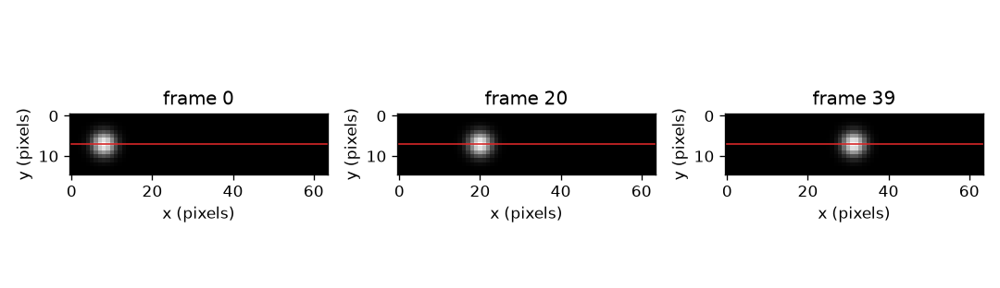
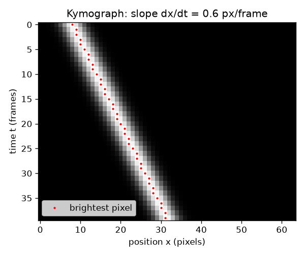

# सत्र 1: पिक्सेलों की एक पंक्ति, समय के साथ एक के ऊपर एक

*स्तर 1 (वैचारिक इंटरैक्टिव मॉडल) · लगभग 60 मिनट · openkymo*

> यह एक सरलीकृत शैक्षिक मॉडल है। यह कोई प्रमाणित डिज़ाइन उपकरण नहीं है और इसका उपयोग वास्तविक संरचनाओं, विद्युत स्थापनाओं, वाहनों, औद्योगिक प्रक्रियाओं या चिकित्सा संबंधी निर्णयों के लिए नहीं किया जाना चाहिए।

**पूर्वापेक्षाएँ (Prerequisites)**

- चाल = दूरी / समय और ग्राफ़ की ढाल (slope) (स्कूली स्तर)।
- आपने PRIMER.md पढ़ लिया है और `python start.py 1` एक बार चला लिया है।

**सीखने के उद्देश्य (Learning objectives)।** इस सत्र के बाद आप:

- हर वीडियो फ़्रेम (frame) से पिक्सेलों की एक पंक्ति लेकर उन्हें एक के ऊपर एक रखकर काइमोग्राफ़ (kymograph) बना सकेंगे।
- समझा सकेंगे कि गतिशील वस्तु तिरछी पट्टी (stripe) और स्थिर वस्तु ऊर्ध्वाधर पट्टी क्यों बनाती है।
- पट्टी की ढाल को पिक्सेल प्रति फ़्रेम में दो बिंदुओं से और रेखा फ़िट (line fit) से माप सकेंगे।
- वही गति स्थिति-बनाम-समय ग्राफ़ से और काइमोग्राफ़ से पढ़ सकेंगे।

## A. वास्तविक दुनिया की समस्या
एक मनका नली में लुढ़कता है, एक बूँद खिड़की के पास से गिरती है, एक चमकीला धब्बा लौ पर सवार रहता है। वीडियो दिखाता है कि चीज़ें चलती हैं, पर वीडियो को मापना कठिन है: हज़ारों फ़्रेम, हर एक पूरा चित्र। क्या होगा यदि आप हर फ़्रेम से पिक्सेलों की केवल एक रेखा रखें और उन रेखाओं को एक के ऊपर एक रखकर एक ही चित्र बना दें? तब पूरा वीडियो एक चित्र बन जाता है, और चाल कुछ ऐसी बन जाती है जिसे आप रूलर से पढ़ सकते हैं: एक पट्टी की ढाल।

## B. अवधारणा और सिद्धांत
वीडियो फ़्रेमों का एक ढेर है। हर फ़्रेम चमक (brightness) संख्याओं का एक ग्रिड है। ग्रिड की एक पंक्ति (रेखा) चुनिए और वह पंक्ति हर फ़्रेम से काट लीजिए। कटी हुई पंक्तियों को फ़्रेम 0 को सबसे ऊपर रखकर एक के नीचे एक रखिए: आपको एक नया चित्र मिलता है जिसे काइमोग्राफ़ कहते हैं। इसके स्तंभ रेखा के साथ स्थितियाँ (पिक्सेल) हैं और इसकी पंक्तियाँ समय (फ़्रेम) हैं। यदि एक चमकीली बूँद (blob) फ़्रेम 0 में पिक्सेल x0 पर है और हर फ़्रेम में v पिक्सेल चलती है, तो फ़्रेम t में वह x0 + v t पर है, इसलिए काइमोग्राफ़ में वह एक सीधी पट्टी खींचती है। उस पट्टी की ढाल, dx/dt, पिक्सेल प्रति फ़्रेम में चाल v है। स्थिर वस्तु के लिए v = 0 है और वह ऊर्ध्वाधर पट्टी बनाती है। तेज़ वस्तु ऐसी पट्टी बनाती है जो ऊर्ध्वाधर से अधिक झुकी होती है। सत्र 2 का खंड B पिक्सेल प्रति फ़्रेम को मीटर प्रति सेकंड में बदलता है।

| प्रतीक | अर्थ | इकाई |
|---|---|---|
| t | फ़्रेम संख्या (समय, 0 से गिना गया) | फ़्रेम |
| x | चुनी गई रेखा के साथ स्थिति | पिक्सेल |
| x0 | फ़्रेम 0 में बूँद की स्थिति | पिक्सेल |
| v | बूँद की चाल = पट्टी की ढाल dx/dt | पिक्सेल प्रति फ़्रेम |
| K(t, x) | पंक्ति t और स्तंभ x पर काइमोग्राफ़ की चमक | चमक इकाइयाँ |

**मान्यताएँ (Assumptions)**

- वस्तु चुनी गई रेखा के साथ चलती है (या रेखा गति की दिशा में रखी गई है)।
- मापते समय चाल स्थिर है।
- कैमरा नहीं हिलता और फ़्रेम समान समय अंतरालों पर लिए जाते हैं।

$$ x(t)=x_0+v\,t $$

$$ v=\frac{x_2-x_1}{t_2-t_1}=\frac{\Delta x}{\Delta t} $$

$$ K(t,x)=\text{frame}_t[\text{row},\,x] $$

## C. दृश्य व्याख्या
पहला चित्र एक छोटे वीडियो के तीन फ़्रेम (फ़्रेम 0, 20 और 39) दिखाता है जिनमें चुनी गई रेखा लाल रंग में खींची गई है: हर एक में बूँद और दाईं ओर है। दूसरा चित्र उस रेखा से बना काइमोग्राफ़ है। इसमें 40 पंक्तियाँ (फ़्रेम) और 64 स्तंभ (पिक्सेल) हैं, और चमकीली पट्टी ऊपर बाईं ओर से नीचे दाईं ओर जाती है। लाल बिंदु हर पंक्ति के सबसे चमकीले पिक्सेल को चिह्नित करते हैं; वे एक सीधी रेखा पर हैं जिसकी ढाल 0.6 पिक्सेल प्रति फ़्रेम है।

*एक छोटे वीडियो के तीन फ़्रेम; लाल रेखा वह पंक्ति है जिसे काइमोग्राफ़ में जोड़ा जाता है।*

*काइमोग्राफ़: समय नीचे की ओर, स्थिति क्षैतिज। लाल बिंदु 0.6 px/frame ढाल वाली सीधी रेखा पर हैं।*

## D. इंटरैक्टिव सिमुलेशन
पाठ चलाइए (`python start.py 1`), फिर लाइव ऐप खोलिए: [सत्र 1: एक काइमोग्राफ़ बनाइए](https://krunalpanchal1995.github.io/pan-iit-oss/openkymo/session-01/) (या इसी फ़ोल्डर में `app.html`)। चाल का स्लाइडर खिसकाइए और पट्टी को झुकते देखिए, फिर स्थिति ग्राफ़ पर जाइए और वही गति समय के सापेक्ष एक सीधी रेखा के रूप में देखिए। एक ऋणात्मक चाल और शून्य चाल आज़माइए।

**चुनौती।** बूँद को रेखा के बाएँ भाग में शुरू कराइए (x0 अधिकतम 12) और फ़्रेम 39 तक पिक्सेल 56 से आगे पहुँचाइए।

## E. हल किया गया उदाहरण और प्रयोग
**समस्या।** चित्र 1 के वीडियो में बूँद x0 = 8 से 0.6 px/frame की चाल से चलती है। फ़्रेम 10 और 30 में उसका स्तंभ और उनके बीच की ढाल ज्ञात कीजिए।

1. फ़्रेम 10 में स्थिति: 8 + 0.6 * 10 = 14।
2. फ़्रेम 30 में स्थिति: 8 + 0.6 * 30 = 26।
3. ढाल = (26 - 14) / (30 - 10) = 12 / 20 = 0.6 px/frame।
4. जाँच: 39 फ़्रेमों में बूँद 0.6 * 39 = 23.4 पिक्सेल चलती है, 8 से 31.4 तक, जो 64 पिक्सेल की रेखा के काफ़ी भीतर है।

**उत्तर।** बूँद फ़्रेम 10 में स्तंभ 14 पर और फ़्रेम 30 में स्तंभ 26 पर है; पट्टी की ढाल 0.6 px/frame है।

**प्रयोग।** एक सिक्का या कंचा मेज़ पर फ़ोन कैमरे के सामने से लुढ़काइए, फ़ोन को एक किताब पर स्थिर रखकर। हर फ़्रेम से पिक्सेलों की एक पंक्ति निकालिए (एक मुफ़्त वीडियो उपकरण या एक छोटी स्क्रिप्ट से) और उन्हें एक के नीचे एक रखिए। पट्टी की ढाल पिक्सेल प्रति फ़्रेम में मापिए, फिर रूलर और वीडियो टाइमस्टैम्प से दूरी भाग समय से तुलना कीजिए। अंतर लेंस से आते हैं (किनारे के पास की वस्तुएँ छोटी दिखती हैं), वस्तु के ठीक रेखा के साथ न चलने से, और पट्टी के किनारे को आँख से पढ़ने से: मॉडल एक पूर्ण सीधी रेखा और समान फ़्रेम अंतराल मानता है।

## F. मूल्यांकन और डिज़ाइन चुनौती
**प्रश्न प्रकार A: वैचारिक।** ऊर्ध्वाधर पट्टी का क्या अर्थ है? एक चमकीली क्षैतिज पट्टी (एक ही फ़्रेम में वही पंक्ति प्रकाशित) का क्या अर्थ होगा?

संकेत

चित्र में समय नीचे की ओर चलता है और स्थिति क्षैतिज दिशा में।

चरण-दर-चरण हल

ऊर्ध्वाधर पट्टी हर फ़्रेम में एक ही स्तंभ पर रहती है, इसलिए वस्तु नहीं चलती। क्षैतिज पट्टी केवल एक पंक्ति में, अर्थात एक ही फ़्रेम में होती है, और कई स्तंभों को ढकती है: पूरी रेखा एक ही क्षण में प्रकाशित, जैसे प्रकाश की चमक या इतनी तेज़ वस्तु जो एक फ़्रेम के भीतर पूरी रेखा पार कर जाए। यह ऐसी गतिशील वस्तु का संकेत नहीं है जिसे मापा जा सके।

**प्रश्न प्रकार B: संख्यात्मक।** एक बूँद फ़्रेम 0 में स्तंभ 5 पर और फ़्रेम 30 में स्तंभ 41 पर है। px/frame में उसकी चाल ज्ञात कीजिए और जाँचिए कि वह 40 फ़्रेमों तक 64 पिक्सेल की रेखा पर रहती है।

संकेत

चाल = स्थिति में परिवर्तन भाग फ़्रेम संख्या में परिवर्तन।

चरण-दर-चरण हल

चाल = (41 - 5) / 30 = 1.2 px/frame। 40 फ़्रेमों में यह 1.2 * 40 = 48 पिक्सेल चलती है, 5 से 53 तक, जो 64 पिक्सेल के भीतर है, इसलिए यह रेखा पर रहती है। इकाई: पिक्सेल प्रति फ़्रेम।

**प्रश्न प्रकार C: ग्राफ़ और सिमुलेशन की व्याख्या।** ऐप में, जब आप चाल को 0.3 से तिगुना करके 0.9 करते हैं, तो काइमोग्राफ़ में पट्टी कैसी दिखती है और स्थिति ग्राफ़ में रेखा कैसी दिखती है? कौन सा चित्र तेज़ वस्तु को अधिक खड़ी (steeper) दिखाता है?

संकेत

तुलना कीजिए कि हर चित्र में कौन सा अक्ष समय है।

चरण-दर-चरण हल

स्थिति ग्राफ़ में समय क्षैतिज अक्ष है, इसलिए चाल तिगुनी करने से ढाल तिगुनी हो जाती है: अधिक खड़ी रेखा (0.3 के मुकाबले 0.9 पिक्सेल प्रति फ़्रेम)। काइमोग्राफ़ में समय नीचे की ओर चलता है, इसलिए पट्टी अधिक सपाट हो जाती है, ऊर्ध्वाधर से अधिक झुकी: वह हर पंक्ति के लिए तीन गुना अधिक स्तंभ ढकती है। वही गति, अलग अक्ष।

**प्रश्न प्रकार D: डिज़ाइन और अनुकूलन चुनौती।** डिज़ाइन: रेखा 64 पिक्सेल लंबी है, बूँद पिक्सेल 8 से शुरू होती है, और आप चाहते हैं कि मापते समय वह कम से कम 30 फ़्रेमों तक रेखा पर रहे। कौन सी चालें अनुमत हैं? बहुत धीमी बूँद भी खराब चुनाव क्यों होगी?

संकेत

फ़्रेम 30 पर भी बूँद रेखा पर होनी चाहिए, इसलिए 8 + 30 v अंतिम पिक्सेल से नीचे है; सोचिए कि ढाल फ़िट को काम करने के लिए कितने पिक्सेल की गति मिलती है।

चरण-दर-चरण हल

फ़्रेम 30 पर पिक्सेल 56 से नीचे रहिए (लगभग 7 पिक्सेल का अंतर छोड़िए): 8 + 30 v <= 56 से v <= 1.6 px/frame मिलता है। बहुत धीमी बूँद, मान लीजिए 0.05 px/frame, 30 फ़्रेमों में केवल 1.5 पिक्सेल चलती है, जो बूँद की चौड़ाई से कम है, इसलिए पिक्सेल पूर्णांकन (rounding) के सामने ढाल पढ़ना कठिन है। एक उपयोगी परास लगभग 0.2 से 1.6 px/frame है। समझौता (trade-off): तेज़ बूँद रेखा को जल्दी खत्म कर देती है, धीमी बूँद कम सटीक ढाल देती है।

[RUBRIC.md](../../RUBRIC.md) से स्वयं को अंक दीजिए। कागज़ पर काम करने के लिए [गतिविधि पत्रक](activity_sheet.md) प्रिंट कीजिए।

## आम भ्रांतियाँ
| आम भ्रांति | वास्तव में क्या सच है |
|---|---|
| काइमोग्राफ़ वस्तु का चित्र है। | यह समय के साथ एक रेखा का चित्र है। ऊर्ध्वाधर अक्ष समय है, स्थान नहीं; वस्तु केवल एक पट्टी के रूप में दिखती है। |
| अधिक खड़ी पट्टी का अर्थ है तेज़ वस्तु। | यह अक्षों पर निर्भर करता है। समय नीचे की ओर चलने पर (जैसा यहाँ है) तेज़ वस्तु ऊर्ध्वाधर से अधिक झुकी पट्टी देती है; ऊर्ध्वाधर पट्टी सबसे धीमी है, चाल शून्य। |
| पट्टी की चाल मीटर प्रति सेकंड में होती है। | चित्र से पढ़ी गई ढाल पिक्सेल प्रति फ़्रेम में होती है। मीटर प्रति सेकंड पाने के लिए आपको पिक्सेल का आकार और फ़्रेम दर (frame rate) चाहिए (सत्र 2)। |
| एक काइमोग्राफ़ पूरे वीडियो की गति दिखाता है। | यह केवल चुनी गई रेखा के साथ की गति दिखाता है; रेखा के आर-पार या उससे दूर की गति नहीं मापी जाती। |

## शब्दावली
- **काइमोग्राफ़ (kymograph)**: हर फ़्रेम से पिक्सेलों की वही रेखा लेकर एक के नीचे एक रखकर बना चित्र; स्थिति क्षैतिज, समय नीचे की ओर
- **फ़्रेम (frame)**: वीडियो का एक चित्र, एक क्षण पर लिया गया
- **पिक्सेल (pixel)**: चित्र का एक छोटा वर्ग जिसका एक चमक मान होता है
- **पट्टी (stripe)**: काइमोग्राफ़ में गतिशील वस्तु का चमकीला पथ
- **ढाल (slope)**: पट्टी हर नीचे के चरण (फ़्रेम) में कितनी क्षैतिज (पिक्सेल) चलती है

## समापन
1. [exercises.md](exercises.md) में दिए तीन कोडिंग कार्य कीजिए।
2. अपने बदलावों के बाद `python start.py 1` फिर से चलाइए। यह चेकपॉइंट (checkpoint) पर समाप्त होता है; जब यह `PASS` छापे, तो आपका काम पूरा है। (केवल चेकपॉइंट: `python start.py check 1`।)

अगला: [सत्र 2](../session-02/README.md)
