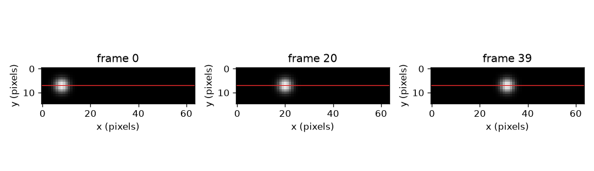
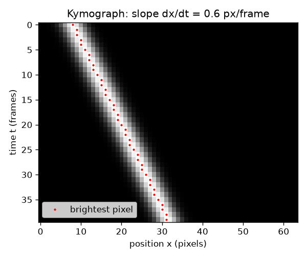

# സെഷൻ 1: ഒരു വരി പിക്സലുകൾ, സമയത്തിനനുസരിച്ച് അടുക്കിയത്

[Session 1 — हिन्दी](README.hi.md)

*ലെവൽ 1 (ആശയപരമായ ഇന്ററാക്ടീവ് മോഡൽ) · ഏകദേശം 60 മിനിറ്റ് · openkymo*

> ഇത് പഠനാവശ്യത്തിനുള്ള ലളിതമാക്കിയ ഒരു മോഡലാണ്. ഇത് സാധൂകരിക്കപ്പെട്ട ഒരു ഡിസൈൻ ഉപകരണമല്ല; യഥാർത്ഥ ഘടനകൾ, വൈദ്യുത ഇൻസ്റ്റലേഷനുകൾ, വാഹനങ്ങൾ, വ്യാവസായിക പ്രക്രിയകൾ അല്ലെങ്കിൽ വൈദ്യശാസ്ത്ര തീരുമാനങ്ങൾ എന്നിവയ്ക്കായി ഇത് ഉപയോഗിക്കരുത്.

**മുൻ‌അറിവ് (Prerequisites)**

- വേഗം = ദൂരം / സമയം, ഒരു ഗ്രാഫിന്റെ ചരിവ് (സ്കൂൾ തലം).
- നിങ്ങൾ PRIMER.md വായിച്ചിട്ടുണ്ട്, `python start.py 1` ഒരിക്കൽ റൺ ചെയ്തിട്ടുണ്ട്.

**പഠന ലക്ഷ്യങ്ങൾ (Learning objectives).** ഈ സെഷനു ശേഷം നിങ്ങൾക്ക് കഴിയും:

- ഓരോ വീഡിയോ ഫ്രെയിമിൽ നിന്നും ഒരു വരി പിക്സലുകൾ അടുക്കി ഒരു കൈമോഗ്രാഫ് (kymograph) ഉണ്ടാക്കാൻ.
- ചലിക്കുന്ന വസ്തു ചരിഞ്ഞ വരയും നിശ്ചലമായ വസ്തു ലംബ വരയും ഉണ്ടാക്കുന്നത് എന്തുകൊണ്ടെന്ന് വിശദീകരിക്കാൻ.
- വരയുടെ ചരിവ്, രണ്ട് ബിന്ദുക്കളിൽ നിന്നും ഒരു രേഖാ ഫിറ്റിൽ നിന്നും, പിക്സൽ പ്രതി ഫ്രെയിമിൽ അളക്കാൻ.
- ഒരേ ചലനം സ്ഥാനം-സമയം ഗ്രാഫിൽ നിന്നും കൈമോഗ്രാഫിൽ നിന്നും വായിക്കാൻ.

## A. യഥാർത്ഥ ലോക പ്രശ്നം
ഒരു മുത്ത് ഒരു കുഴലിലൂടെ ഉരുളുന്നു, ഒരു തുള്ളി ഒരു ജനലിനരികിലൂടെ വീഴുന്നു, ഒരു തിളങ്ങുന്ന പാട് തീജ്വാലയിൽ സഞ്ചരിക്കുന്നു. കാര്യങ്ങൾ ചലിക്കുന്നുവെന്ന് ഒരു വീഡിയോ കാണിക്കുന്നു, പക്ഷേ വീഡിയോ അളക്കാൻ ബുദ്ധിമുട്ടാണ്: ആയിരക്കണക്കിന് ഫ്രെയിമുകൾ, ഓരോന്നും ഒരു പൂർണ്ണ ചിത്രം. ഓരോ ഫ്രെയിമിൽ നിന്നും ഒരു വരി പിക്സലുകൾ മാത്രം സൂക്ഷിച്ച് ആ വരികൾ ഒരൊറ്റ ചിത്രമായി അടുക്കിയാലോ? അപ്പോൾ ഒരു മുഴുവൻ വീഡിയോ ഒരൊറ്റ ചിത്രമാകുന്നു, വേഗം ഒരു സ്കെയിൽ കൊണ്ട് വായിക്കാവുന്ന ഒന്നാകുന്നു: ഒരു വരയുടെ ചരിവ്.

## B. ആശയവും സിദ്ധാന്തവും
ഒരു വീഡിയോ ഫ്രെയിമുകളുടെ അട്ടിയാണ്. ഓരോ ഫ്രെയിമും തെളിച്ച സംഖ്യകളുടെ ഒരു ഗ്രിഡാണ്. ഗ്രിഡിന്റെ ഒരു വരി (ലൈൻ) തിരഞ്ഞെടുത്ത് ഓരോ ഫ്രെയിമിൽ നിന്നും ആ വരി മുറിച്ചെടുക്കുക. മുറിച്ച വരികൾ ഫ്രെയിം 0 മുകളിൽ വരുന്ന രീതിയിൽ അടുക്കുക: നിങ്ങൾക്ക് കൈമോഗ്രാഫ് എന്ന പുതിയ ചിത്രം ലഭിക്കും. അതിന്റെ നിരകൾ ലൈനിലെ സ്ഥാനങ്ങളും (പിക്സലുകൾ) വരികൾ സമയവുമാണ് (ഫ്രെയിമുകൾ). ഒരു തിളക്കമുള്ള ബ്ലോബ് (blob) ഫ്രെയിം 0-ൽ പിക്സൽ x0-ൽ ഇരിക്കുകയും ഓരോ ഫ്രെയിമിലും v പിക്സൽ നീങ്ങുകയും ചെയ്യുന്നുവെങ്കിൽ, ഫ്രെയിം t-ൽ അത് x0 + v t-ൽ ആണ്, അതിനാൽ കൈമോഗ്രാഫിൽ അത് ഒരു നേർരേഖ വരയ്ക്കുന്നു. ആ വരയുടെ ചരിവ്, dx/dt, പിക്സൽ പ്രതി ഫ്രെയിമിൽ വേഗം v ആണ്. നിശ്ചലമായ വസ്തുവിന് v = 0, അത് ലംബ വര ഉണ്ടാക്കുന്നു. വേഗമേറിയ വസ്തു ലംബത്തിൽ നിന്ന് കൂടുതൽ ചരിഞ്ഞ വര ഉണ്ടാക്കുന്നു. സെഷൻ 2-ലെ വിഭാഗം B പിക്സൽ പ്രതി ഫ്രെയിമിനെ മീറ്റർ പ്രതി സെക്കൻഡാക്കി മാറ്റുന്നു.

| ചിഹ്നം | അർത്ഥം | യൂണിറ്റ് |
|---|---|---|
| t | ഫ്രെയിം നമ്പർ (സമയം, 0 മുതൽ എണ്ണുന്നു) | ഫ്രെയിമുകൾ |
| x | തിരഞ്ഞെടുത്ത ലൈനിലെ സ്ഥാനം | പിക്സലുകൾ |
| x0 | ഫ്രെയിം 0-ലെ ബ്ലോബിന്റെ സ്ഥാനം | പിക്സലുകൾ |
| v | ബ്ലോബിന്റെ വേഗം = വരയുടെ ചരിവ് dx/dt | പിക്സൽ പ്രതി ഫ്രെയിം |
| K(t, x) | വരി t, നിര x-ലെ കൈമോഗ്രാഫ് തെളിച്ചം | തെളിച്ച യൂണിറ്റുകൾ |

**അനുമാനങ്ങൾ (Assumptions)**

- വസ്തു തിരഞ്ഞെടുത്ത ലൈനിലൂടെ നീങ്ങുന്നു (അല്ലെങ്കിൽ ലൈൻ ചലനത്തിന് അനുസൃതമായി വയ്ക്കുന്നു).
- നാം അളക്കുന്ന സമയത്ത് വേഗം സ്ഥിരമാണ്.
- ക്യാമറ നീങ്ങുന്നില്ല, ഫ്രെയിമുകൾ തുല്യ സമയ ഇടവേളകളിൽ എടുത്തതാണ്.

$$ x(t)=x_0+v\,t $$

$$ v=\frac{x_2-x_1}{t_2-t_1}=\frac{\Delta x}{\Delta t} $$

$$ K(t,x)=\text{frame}_t[\text{row},\,x] $$

## C. ദൃശ്യ വിശദീകരണം
ആദ്യത്തെ ചിത്രം ഒരു ചെറിയ വീഡിയോയുടെ മൂന്ന് ഫ്രെയിമുകൾ (ഫ്രെയിം 0, 20, 39) തിരഞ്ഞെടുത്ത ലൈൻ ചുവപ്പിൽ വരച്ച് കാണിക്കുന്നു: ഓരോന്നിലും ബ്ലോബ് കൂടുതൽ വലത്തോട്ട് ഇരിക്കുന്നു. രണ്ടാമത്തെ ചിത്രം ആ ലൈനിൽ നിന്ന് ഉണ്ടാക്കിയ കൈമോഗ്രാഫ് ആണ്. അതിന് 40 വരികളും (ഫ്രെയിമുകൾ) 64 നിരകളും (പിക്സലുകൾ) ഉണ്ട്, തിളക്കമുള്ള വര മുകളിൽ ഇടത്തുനിന്ന് താഴെ വലത്തോട്ട് പോകുന്നു. ചുവന്ന കുത്തുകൾ ഓരോ വരിയിലെയും ഏറ്റവും തിളക്കമുള്ള പിക്സലിനെ അടയാളപ്പെടുത്തുന്നു; അവ 0.6 പിക്സൽ പ്രതി ഫ്രെയിം ചരിവുള്ള ഒരു നേർരേഖയിൽ കിടക്കുന്നു.

*ഒരു ചെറിയ വീഡിയോയുടെ മൂന്ന് ഫ്രെയിമുകൾ; ചുവന്ന വര കൈമോഗ്രാഫിലേക്ക് അടുക്കുന്ന വരിയാണ്.*

*കൈമോഗ്രാഫ്: സമയം താഴേക്ക്, സ്ഥാനം കുറുകെ. ചുവന്ന കുത്തുകൾ 0.6 px/frame ചരിവുള്ള നേർരേഖയിൽ കിടക്കുന്നു.*

## D. ഇന്ററാക്ടീവ് സിമുലേഷൻ
പാഠം റൺ ചെയ്യുക (`python start.py 1`), എന്നിട്ട് ലൈവ് ആപ്പ് തുറക്കുക: [സെഷൻ 1: ഒരു കൈമോഗ്രാഫ് ഉണ്ടാക്കുക](https://krunalpanchal1995.github.io/pan-iit-oss/openkymo/session-01/) (അല്ലെങ്കിൽ ഈ ഫോൾഡറിലെ `app.html`). വേഗം സ്ലൈഡർ നീക്കി വര ചരിയുന്നത് കാണുക, പിന്നെ സ്ഥാനം ഗ്രാഫിലേക്ക് മാറി അതേ ചലനം സമയത്തിനെതിരായ നേർരേഖയായി കാണുക. ഒരു നെഗറ്റീവ് വേഗവും പൂജ്യം വേഗവും പരീക്ഷിക്കുക.

**വെല്ലുവിളി.** ബ്ലോബ് ലൈനിന്റെ ഇടത്തെ ഭാഗത്ത് തുടങ്ങണം (x0 പരമാവധി 12) ഫ്രെയിം 39-ൽ പിക്സൽ 56-നപ്പുറം എത്തണം.

## E. ചെയ്തുകാണിച്ച ഉദാഹരണവും പരീക്ഷണവും
**പ്രശ്നം.** ചിത്രം 1-ലെ വീഡിയോയിൽ ബ്ലോബ് x0 = 8-ൽ നിന്ന് 0.6 px/frame വേഗത്തിൽ നീങ്ങുന്നു. ഫ്രെയിം 10, 30 എന്നിവയിലെ അതിന്റെ നിരയും അവയ്ക്കിടയിലെ ചരിവും കണ്ടെത്തുക.

1. ഫ്രെയിം 10-ലെ സ്ഥാനം: 8 + 0.6 * 10 = 14.
2. ഫ്രെയിം 30-ലെ സ്ഥാനം: 8 + 0.6 * 30 = 26.
3. ചരിവ് = (26 - 14) / (30 - 10) = 12 / 20 = 0.6 px/frame.
4. യുക്തിപരിശോധന: 39 ഫ്രെയിമുകളിൽ ബ്ലോബ് 0.6 * 39 = 23.4 പിക്സൽ നീങ്ങുന്നു, 8-ൽ നിന്ന് 31.4-ലേക്ക്, 64 പിക്സൽ ലൈനിനുള്ളിൽ തന്നെ.

**ഉത്തരം.** ബ്ലോബ് ഫ്രെയിം 10-ൽ നിര 14-ലും ഫ്രെയിം 30-ൽ നിര 26-ലും ആണ്; വരയുടെ ചരിവ് 0.6 px/frame.

**പരീക്ഷണം.** ഒരു ബുക്കിൽ ഉറപ്പിച്ച ഫോൺ ക്യാമറയ്ക്ക് മുന്നിലൂടെ ഒരു നാണയമോ ഗോലിയോ മേശപ്പുറത്ത് ഉരുട്ടുക. ഓരോ ഫ്രെയിമിൽ നിന്നും ഒരു വരി പിക്സലുകൾ എടുത്ത് (സൗജന്യ വീഡിയോ ടൂളോ ചെറിയ സ്ക്രിപ്റ്റോ ഉപയോഗിച്ച്) അടുക്കുക. വരയുടെ ചരിവ് പിക്സൽ പ്രതി ഫ്രെയിമിൽ അളക്കുക, എന്നിട്ട് ഒരു സ്കെയിലിൽ നിന്നുള്ള ദൂരവും വീഡിയോ ടൈംസ്റ്റാമ്പുകളും ഉപയോഗിച്ച് ദൂരം/സമയവുമായി താരതമ്യം ചെയ്യുക. വ്യത്യാസങ്ങൾ ലെൻസിൽ നിന്ന് (അരികിനടുത്തുള്ള വസ്തുക്കൾ ചെറുതായി തോന്നും), വസ്തു ലൈനിലൂടെ കൃത്യമായി നീങ്ങാത്തതിൽ നിന്ന്, വരയുടെ അറ്റം കണ്ണുകൊണ്ട് വായിക്കുന്നതിൽ നിന്ന് വരുന്നു: മോഡൽ തികഞ്ഞ നേർരേഖയും തുല്യ ഫ്രെയിം ഇടവേളയും അനുമാനിക്കുന്നു.

## F. മൂല്യനിർണ്ണയവും ഡിസൈൻ വെല്ലുവിളിയും
**ചോദ്യ തരം A: ആശയപരം.** ഒരു ലംബ വര എന്താണ് അർത്ഥമാക്കുന്നത്? ഒരു തിളക്കമുള്ള തിരശ്ചീന വര (ഒരൊറ്റ ഫ്രെയിമിൽ അതേ വരി പ്രകാശിക്കുന്നത്) എന്ത് അർത്ഥമാക്കും?

സൂചന

ചിത്രത്തിൽ സമയം താഴേക്കും സ്ഥാനം കുറുകെയും ഓടുന്നു.

പടിപടിയായുള്ള പരിഹാരം

ഒരു ലംബ വര ഓരോ ഫ്രെയിമിലും ഒരേ നിരയിൽ നിൽക്കുന്നു, അതിനാൽ വസ്തു നീങ്ങുന്നില്ല. ഒരു തിരശ്ചീന വര ഒരു വരിയിൽ മാത്രം, അതായത് ഒരൊറ്റ ഫ്രെയിമിൽ, കിടക്കുകയും പല നിരകൾ ഉൾക്കൊള്ളുകയും ചെയ്യുന്നു: ലൈൻ മുഴുവൻ ഒരേ നിമിഷത്തിൽ പ്രകാശിച്ചു, ഉദാഹരണത്തിന് ഒരു പ്രകാശ മിന്നൽ, അല്ലെങ്കിൽ ഒരൊറ്റ ഫ്രെയിമിനുള്ളിൽ മുഴുവൻ ലൈനും കടക്കുന്ന അത്ര വേഗമുള്ള വസ്തു. ഇത് അളക്കാവുന്ന ചലിക്കുന്ന വസ്തുവിന്റെ ലക്ഷണമല്ല.

**ചോദ്യ തരം B: സംഖ്യാപരം.** ഒരു ബ്ലോബ് ഫ്രെയിം 0-ൽ നിര 5-ലും ഫ്രെയിം 30-ൽ നിര 41-ലും ആണ്. അതിന്റെ വേഗം px/frame-ൽ കണ്ടെത്തുക, 40 ഫ്രെയിമുകൾക്ക് അത് 64 പിക്സൽ ലൈനിൽ നിൽക്കുമെന്ന് പരിശോധിക്കുക.

സൂചന

വേഗം = സ്ഥാനമാറ്റത്തെ ഫ്രെയിം നമ്പറിലെ മാറ്റം കൊണ്ട് ഹരിച്ചത്.

പടിപടിയായുള്ള പരിഹാരം

വേഗം = (41 - 5) / 30 = 1.2 px/frame. 40 ഫ്രെയിമുകളിൽ അത് 1.2 * 40 = 48 പിക്സൽ സഞ്ചരിക്കുന്നു, 5-ൽ നിന്ന് 53-ലേക്ക്, ഇത് 64 പിക്സലിനുള്ളിലാണ്, അതിനാൽ അത് ലൈനിൽ നിൽക്കുന്നു. യൂണിറ്റ്: പിക്സൽ പ്രതി ഫ്രെയിം.

**ചോദ്യ തരം C: ഗ്രാഫ്, സിമുലേഷൻ വ്യാഖ്യാനം.** ആപ്പിൽ, വേഗം 0.3-ൽ നിന്ന് 0.9 ആയി മൂന്നിരട്ടിയാക്കുമ്പോൾ കൈമോഗ്രാഫിൽ വര എങ്ങനെ കാണപ്പെടുന്നു, സ്ഥാനം ഗ്രാഫിൽ രേഖ എങ്ങനെ കാണപ്പെടുന്നു? ഏത് ചിത്രമാണ് വേഗമേറിയ വസ്തുവിനെ കൂടുതൽ കുത്തനെ കാണിക്കുന്നത്?

സൂചന

ഓരോ ചിത്രത്തിലും ഏത് അക്ഷമാണ് സമയം എന്ന് താരതമ്യം ചെയ്യുക.

പടിപടിയായുള്ള പരിഹാരം

സ്ഥാനം ഗ്രാഫിൽ സമയം തിരശ്ചീന അക്ഷമാണ്, അതിനാൽ വേഗം മൂന്നിരട്ടിയാക്കുന്നത് ചരിവ് മൂന്നിരട്ടിയാക്കുന്നു: കൂടുതൽ കുത്തനെയുള്ള രേഖ (0.3-നെതിരെ 0.9 പിക്സൽ പ്രതി ഫ്രെയിം). കൈമോഗ്രാഫിൽ സമയം താഴേക്ക് ഓടുന്നു, അതിനാൽ വര കൂടുതൽ പരന്നതാകുന്നു, ലംബത്തിൽ നിന്ന് കൂടുതൽ ചരിയുന്നു: ഓരോ വരിക്കും അത് മൂന്നിരട്ടി നിരകൾ ഉൾക്കൊള്ളുന്നു. ഒരേ ചലനം, വ്യത്യസ്ത അക്ഷങ്ങൾ.

**ചോദ്യ തരം D: ഡിസൈൻ, ഒപ്റ്റിമൈസേഷൻ വെല്ലുവിളി.** ഡിസൈൻ: ലൈൻ 64 പിക്സൽ നീളമുള്ളതാണ്, ബ്ലോബ് പിക്സൽ 8-ൽ തുടങ്ങുന്നു, നിങ്ങൾ അളക്കുമ്പോൾ അത് കുറഞ്ഞത് 30 ഫ്രെയിമുകൾ ലൈനിൽ നിൽക്കണം. ഏതൊക്കെ വേഗങ്ങൾ അനുവദനീയമാണ്? വളരെ സാവധാനത്തിലുള്ള ബ്ലോബും മോശം തിരഞ്ഞെടുപ്പാകുന്നത് എന്തുകൊണ്ട്?

സൂചന

ഫ്രെയിം 30-ലും ബ്ലോബ് ലൈനിൽ ഉണ്ടായിരിക്കണം, അതിനാൽ 8 + 30 v അവസാന പിക്സലിന് താഴെയാണ്; ഒരു ചരിവ് ഫിറ്റിന് പ്രവർത്തിക്കാൻ എത്ര പിക്സൽ ചലനം ഉണ്ടെന്ന് ചിന്തിക്കുക.

പടിപടിയായുള്ള പരിഹാരം

ഫ്രെയിം 30-ൽ പിക്സൽ 56-ന് താഴെ നിൽക്കുക (ഏകദേശം 7 പിക്സൽ മാർജിൻ വിടുക): 8 + 30 v <= 56 ഇത് v <= 1.6 px/frame നൽകുന്നു. വളരെ സാവധാനത്തിലുള്ള ബ്ലോബ്, ഉദാഹരണത്തിന് 0.05 px/frame, 30 ഫ്രെയിമുകളിൽ 1.5 പിക്സൽ മാത്രമേ നീങ്ങൂ, ഒരു ബ്ലോബിന്റെ വീതിയേക്കാൾ കുറവ്, അതിനാൽ പിക്സൽ റൗണ്ടിംഗിനെതിരെ ചരിവ് വായിക്കാൻ ബുദ്ധിമുട്ടാണ്. ഉപയോഗപ്രദമായ പരിധി ഏകദേശം 0.2 മുതൽ 1.6 px/frame വരെയാണ്. വിട്ടുവീഴ്ച (trade-off): വേഗമേറിയ ബ്ലോബ് ലൈൻ വേഗം തീർക്കുന്നു, സാവധാനത്തിലുള്ളത് കൃത്യത കുറഞ്ഞ ചരിവ് നൽകുന്നു.

[RUBRIC.md](../../RUBRIC.md) ഉപയോഗിച്ച് സ്വയം സ്കോർ ചെയ്യുക. കടലാസിൽ പ്രവർത്തിക്കാൻ [ആക്ടിവിറ്റി ഷീറ്റ്](activity_sheet.md) പ്രിന്റ് ചെയ്യുക.

## സാധാരണ തെറ്റിദ്ധാരണകൾ
| സാധാരണ തെറ്റിദ്ധാരണ | യഥാർത്ഥത്തിൽ ശരിയായത് |
|---|---|
| കൈമോഗ്രാഫ് വസ്തുവിന്റെ ചിത്രമാണ്. | ഇത് ഒരു ലൈനിന്റെ കാലക്രമേണയുള്ള ചിത്രമാണ്. ലംബ അക്ഷം സമയമാണ്, സ്ഥലമല്ല; വസ്തു ഒരു വരയായി മാത്രം പ്രത്യക്ഷപ്പെടുന്നു. |
| കൂടുതൽ കുത്തനെയുള്ള വര വേഗമേറിയ വസ്തു എന്നാണ്. | അത് അക്ഷങ്ങളെ ആശ്രയിച്ചിരിക്കുന്നു. സമയം താഴേക്ക് ഓടുമ്പോൾ (ഇവിടെ പോലെ) വേഗമേറിയ വസ്തു ലംബത്തിൽ നിന്ന് കൂടുതൽ ചരിഞ്ഞ വര നൽകുന്നു; ലംബ വര ഏറ്റവും സാവധാനമുള്ളതാണ്, വേഗം പൂജ്യം. |
| വരയുടെ വേഗം മീറ്റർ പ്രതി സെക്കൻഡിലാണ്. | ചിത്രത്തിൽ നിന്ന് വായിക്കുന്ന ചരിവ് പിക്സൽ പ്രതി ഫ്രെയിമിലാണ്. മീറ്റർ പ്രതി സെക്കൻഡ് ലഭിക്കാൻ നിങ്ങൾക്ക് പിക്സൽ വലിപ്പവും ഫ്രെയിം റേറ്റും വേണം (സെഷൻ 2). |
| ഒരു കൈമോഗ്രാഫ് മുഴുവൻ വീഡിയോയിലെയും ചലനം കാണിക്കുന്നു. | തിരഞ്ഞെടുത്ത ലൈനിലൂടെയുള്ള ചലനം മാത്രമേ ഇത് കാണിക്കുന്നുള്ളൂ; ലൈനിന് കുറുകെയോ അതിൽ നിന്ന് അകലേക്കോ ഉള്ള ചലനം അളക്കപ്പെടുന്നില്ല. |

## പദാവലി
- **കൈമോഗ്രാഫ് (kymograph)**: ഓരോ ഫ്രെയിമിൽ നിന്നും ഒരേ വരി പിക്സലുകൾ അടുക്കി ഉണ്ടാക്കിയ ചിത്രം; സ്ഥാനം കുറുകെ, സമയം താഴേക്ക്
- **ഫ്രെയിം (frame)**: വീഡിയോയുടെ ഒരു ചിത്രം, ഒരു നിമിഷത്തിൽ എടുത്തത്
- **പിക്സൽ (pixel)**: ഒരു തെളിച്ച മൂല്യമുള്ള ചിത്രത്തിന്റെ ഒരു ചെറിയ ചതുരം
- **വര (stripe)**: കൈമോഗ്രാഫിൽ ചലിക്കുന്ന വസ്തുവിന്റെ തിളക്കമുള്ള പാത
- **ചരിവ് (slope)**: താഴേക്കുള്ള ഓരോ ചുവടിനും (ഫ്രെയിമുകൾ) വര കുറുകെ (പിക്സലുകൾ) എത്ര നീങ്ങുന്നു

## പൂർത്തിയാക്കുക
1. [exercises.md](exercises.md)-ലെ മൂന്ന് കോഡിംഗ് ജോലികൾ ചെയ്യുക.
2. നിങ്ങളുടെ മാറ്റങ്ങൾക്ക് ശേഷം `python start.py 1` വീണ്ടും റൺ ചെയ്യുക. അത് ചെക്ക്‌പോയിന്റോടെ അവസാനിക്കുന്നു; അത് `PASS` എന്ന് പ്രിന്റ് ചെയ്യുമ്പോൾ നിങ്ങൾ പൂർത്തിയാക്കി. (ചെക്ക്‌പോയിന്റ് മാത്രം: `python start.py check 1`.)

അടുത്തത്: [സെഷൻ 2](../session-02/README.md)
