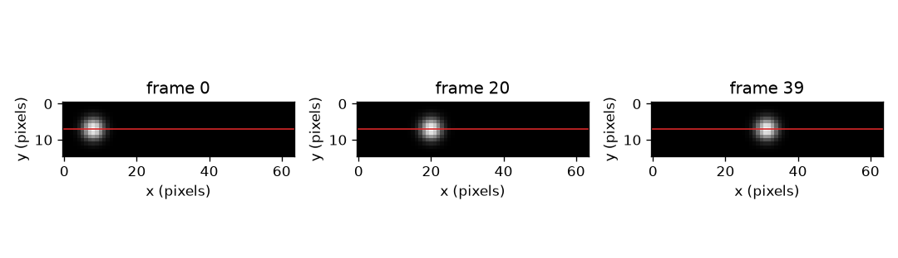
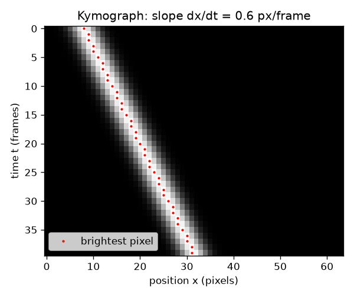

# அமர்வு 1: ஒரு வரிசைப் பிக்சல்கள், காலத்தில் அடுக்கப்பட்டவை

[Session 1 — हिन्दी](README.hi.md) · [Session 1 — മലയാളം](README.ml.md)

*நிலை 1 (கருத்தியல் ஊடாடும் மாதிரி) · சுமார் 60 நிமிடங்கள் · openkymo*

> இது கல்விக்கான எளிமைப்படுத்தப்பட்ட மாதிரி. இது சரிபார்க்கப்பட்ட வடிவமைப்புக் கருவி அல்ல; உண்மையான கட்டமைப்புகள், மின் நிறுவல்கள், வாகனங்கள், தொழில்துறை செயல்முறைகள் அல்லது மருத்துவ முடிவுகளுக்கு இதைப் பயன்படுத்தக் கூடாது.

**முன்தேவைகள் (Prerequisites)**

- வேகம் = தொலைவு / நேரம் மற்றும் ஒரு வரைபடத்தின் சாய்வு (பள்ளி நிலை).
- நீங்கள் PRIMER.md படித்து, `python start.py 1` ஒருமுறை இயக்கியுள்ளீர்கள்.

**கற்றல் நோக்கங்கள் (Learning objectives).** இந்த அமர்வுக்குப் பிறகு நீங்கள்:

- ஒவ்வொரு காணொளிச் சட்டத்திலிருந்தும் ஒரு வரிசைப் பிக்சல்களை அடுக்கி ஒரு கைமோகிராஃப் (kymograph) உருவாக்க முடியும்.
- நகரும் பொருள் சாய்ந்த கோட்டையும் நிலையான பொருள் செங்குத்துக் கோட்டையும் ஏன் உருவாக்குகிறது என்று விளக்க முடியும்.
- கோட்டின் சாய்வை, இரு புள்ளிகளிலிருந்தும் ஒரு கோடு பொருத்தத்திலிருந்தும், பிக்சல்/சட்டத்தில் அளக்க முடியும்.
- ஒரே இயக்கத்தை நிலை-நேர வரைபடத்திலிருந்தும் கைமோகிராஃபிலிருந்தும் படிக்க முடியும்.

## A. நிஜ உலகப் பிரச்சினை
ஒரு மணி குழாயில் உருள்கிறது, ஒரு துளி ஜன்னலைக் கடந்து விழுகிறது, ஒரு ஒளிரும் திட்டு தீச்சுடரில் பயணிக்கிறது. பொருட்கள் நகர்கின்றன என்று காணொளி காட்டுகிறது, ஆனால் காணொளியை அளப்பது கடினம்: ஆயிரக்கணக்கான சட்டங்கள், ஒவ்வொன்றும் ஒரு முழுப் படம். ஒவ்வொரு சட்டத்திலிருந்தும் ஒரு வரிசைப் பிக்சல்களை மட்டும் வைத்து, அந்த வரிசைகளை ஒரே படமாக அடுக்கினால் என்ன? அப்போது ஒரு முழுக் காணொளி ஒரே படமாகிறது, வேகம் ஒரு அளவுகோலால் படிக்கக்கூடிய ஒன்றாகிறது: ஒரு கோட்டின் சாய்வு.

## B. கருத்தும் கோட்பாடும்
ஒரு காணொளி என்பது சட்டங்களின் அடுக்கு. ஒவ்வொரு சட்டமும் பிரகாச எண்களின் ஒரு கட்டம். கட்டத்தின் ஒரு வரிசையை (கோடு) தேர்ந்தெடுத்து ஒவ்வொரு சட்டத்திலிருந்தும் அந்த வரிசையை வெட்டி எடுங்கள். வெட்டிய வரிசைகளைச் சட்டம் 0 மேலே இருக்கும்படி அடுக்குங்கள்: கைமோகிராஃப் எனப்படும் புதிய படம் கிடைக்கும். அதன் நெடுவரிசைகள் கோட்டின் வழியே நிலைகள் (பிக்சல்கள்), அதன் வரிசைகள் நேரம் (சட்டங்கள்). ஒரு ஒளிரும் திட்டு (blob) சட்டம் 0-இல் பிக்சல் x0-இல் இருந்து ஒவ்வொரு சட்டத்திலும் v பிக்சல் நகர்ந்தால், சட்டம் t-இல் அது x0 + v t-இல் இருக்கும், எனவே கைமோகிராஃபில் அது ஒரு நேர்கோட்டை வரைகிறது. அந்தக் கோட்டின் சாய்வு, dx/dt, பிக்சல்/சட்டத்தில் வேகம் v. நிலையான பொருளுக்கு v = 0, அது செங்குத்துக் கோட்டை உருவாக்குகிறது. வேகமான பொருள் செங்குத்திலிருந்து மேலும் சாய்ந்த கோட்டை உருவாக்குகிறது. அமர்வு 2-இன் பிரிவு B பிக்சல்/சட்டத்தை மீட்டர்/வினாடியாக மாற்றுகிறது.

| குறியீடு | பொருள் | அலகு |
|---|---|---|
| t | சட்ட எண் (நேரம், 0-இலிருந்து எண்ணப்படுகிறது) | சட்டங்கள் |
| x | தேர்ந்தெடுத்த கோட்டின் வழியே நிலை | பிக்சல்கள் |
| x0 | சட்டம் 0-இல் திட்டின் நிலை | பிக்சல்கள் |
| v | திட்டின் வேகம் = கோட்டின் சாய்வு dx/dt | பிக்சல்/சட்டம் |
| K(t, x) | வரிசை t, நெடுவரிசை x-இல் கைமோகிராஃப் பிரகாசம் | பிரகாச அலகுகள் |

**அனுமானங்கள் (Assumptions)**

- பொருள் தேர்ந்தெடுத்த கோட்டின் வழியே நகர்கிறது (அல்லது கோடு இயக்கத்தின் வழியே வைக்கப்படுகிறது).
- நாம் அளக்கும்போது வேகம் மாறாதது.
- கேமரா நகர்வதில்லை, சட்டங்கள் சம நேர இடைவெளிகளில் எடுக்கப்படுகின்றன.

$$ x(t)=x_0+v\,t $$

$$ v=\frac{x_2-x_1}{t_2-t_1}=\frac{\Delta x}{\Delta t} $$

$$ K(t,x)=\text{frame}_t[\text{row},\,x] $$

## C. காட்சி விளக்கம்
முதல் படம் ஒரு சிறிய காணொளியின் மூன்று சட்டங்களை (சட்டம் 0, 20, 39) தேர்ந்தெடுத்த கோட்டைச் சிவப்பில் வரைந்து காட்டுகிறது: ஒவ்வொன்றிலும் திட்டு மேலும் வலப்பக்கம் இருக்கிறது. இரண்டாவது படம் அந்தக் கோட்டிலிருந்து உருவாக்கிய கைமோகிராஃப். அதற்கு 40 வரிசைகளும் (சட்டங்கள்) 64 நெடுவரிசைகளும் (பிக்சல்கள்) உள்ளன, ஒளிரும் கோடு மேலே இடப்பக்கத்திலிருந்து கீழே வலப்பக்கம் ஓடுகிறது. சிவப்புப் புள்ளிகள் ஒவ்வொரு வரிசையிலும் மிகப் பிரகாசமான பிக்சலைக் குறிக்கின்றன; அவை 0.6 பிக்சல்/சட்டம் சாய்வுள்ள ஒரு நேர்கோட்டில் கிடக்கின்றன.

*ஒரு சிறிய காணொளியின் மூன்று சட்டங்கள்; சிவப்புக் கோடு கைமோகிராஃபில் அடுக்கப்படும் வரிசை.*

*கைமோகிராஃப்: நேரம் கீழ்நோக்கி, நிலை குறுக்கே. சிவப்புப் புள்ளிகள் 0.6 px/frame சாய்வுள்ள நேர்கோட்டில் கிடக்கின்றன.*

## D. ஊடாடும் உருவகப்படுத்தல்
பாடத்தை இயக்குங்கள் (`python start.py 1`), பிறகு நேரடிச் செயலியைத் திறங்கள்: [அமர்வு 1: ஒரு கைமோகிராஃப் உருவாக்குங்கள்](https://krunalpanchal1995.github.io/pan-iit-oss/openkymo/session-01/) (அல்லது இந்தக் கோப்புறையிலுள்ள `app.html`). வேக ஸ்லைடரை நகர்த்திக் கோடு சாய்வதைப் பாருங்கள், பிறகு நிலை வரைபடத்துக்கு மாறி அதே இயக்கத்தை நேரத்துக்கு எதிரான நேர்கோடாகப் பாருங்கள். ஒரு எதிர்மறை வேகத்தையும் பூஜ்ஜிய வேகத்தையும் முயலுங்கள்.

**சவால்.** திட்டு கோட்டின் இடப்பகுதியில் தொடங்க வேண்டும் (x0 அதிகபட்சம் 12) சட்டம் 39-க்குள் பிக்சல் 56-ஐத் தாண்டிச் செல்ல வேண்டும்.

## E. தீர்க்கப்பட்ட எடுத்துக்காட்டும் பரிசோதனையும்
**பிரச்சினை.** படம் 1-இன் காணொளியில் திட்டு x0 = 8-இலிருந்து 0.6 px/frame வேகத்தில் நகர்கிறது. சட்டம் 10 மற்றும் 30-இல் அதன் நெடுவரிசையையும் அவற்றுக்கு இடையிலான சாய்வையும் காணுங்கள்.

1. சட்டம் 10-இல் நிலை: 8 + 0.6 * 10 = 14.
2. சட்டம் 30-இல் நிலை: 8 + 0.6 * 30 = 26.
3. சாய்வு = (26 - 14) / (30 - 10) = 12 / 20 = 0.6 px/frame.
4. சரிபார்ப்பு: 39 சட்டங்களில் திட்டு 0.6 * 39 = 23.4 பிக்சல் நகர்கிறது, 8-இலிருந்து 31.4-க்கு, 64 பிக்சல் கோட்டுக்குள்ளேயே.

**விடை.** திட்டு சட்டம் 10-இல் நெடுவரிசை 14-இலும் சட்டம் 30-இல் நெடுவரிசை 26-இலும் உள்ளது; கோட்டின் சாய்வு 0.6 px/frame.

**பரிசோதனை.** ஒரு புத்தகத்தின் மேல் பொருத்திய தொலைபேசிக் கேமராவுக்கு முன்னால் ஒரு நாணயத்தையோ கோலியையோ மேசையில் உருட்டுங்கள். ஒவ்வொரு சட்டத்திலிருந்தும் ஒரு வரிசைப் பிக்சல்களை எடுத்து (இலவசக் காணொளிக் கருவி அல்லது ஒரு சிறிய ஸ்கிரிப்ட் மூலம்) அடுக்குங்கள். கோட்டின் சாய்வைப் பிக்சல்/சட்டத்தில் அளந்து, ஒரு அளவுகோலிலிருந்து தொலைவு மற்றும் காணொளி நேரமுத்திரைகளைப் பயன்படுத்தித் தொலைவு/நேரத்துடன் ஒப்பிடுங்கள். வேறுபாடுகள் லென்ஸிலிருந்து (ஓரத்தருகே உள்ள பொருட்கள் சிறியதாகத் தெரியும்), பொருள் கோட்டின் வழியே சரியாக நகராததிலிருந்து, கோட்டின் விளிம்பைக் கண்ணால் படிப்பதிலிருந்து வருகின்றன: மாதிரி சரியான நேர்கோட்டையும் சம சட்ட இடைவெளியையும் அனுமானிக்கிறது.

## F. மதிப்பீடும் வடிவமைப்புச் சவாலும்
**கேள்வி வகை A: கருத்தியல்.** ஒரு செங்குத்துக் கோடு என்ன பொருள்படுகிறது? ஒரு ஒளிரும் கிடைமட்டக் கோடு (ஒரே சட்டத்தில் அதே வரிசை ஒளிர்வது) என்ன பொருள்படும்?

குறிப்பு

படத்தில் நேரம் கீழ்நோக்கியும் நிலை குறுக்கேயும் ஓடுகிறது.

படிப்படியான தீர்வு

ஒரு செங்குத்துக் கோடு ஒவ்வொரு சட்டத்திலும் அதே நெடுவரிசையில் நிற்கிறது, எனவே பொருள் நகரவில்லை. ஒரு கிடைமட்டக் கோடு ஒரே வரிசையில் மட்டும், அதாவது ஒரே சட்டத்தில், கிடந்து பல நெடுவரிசைகளை மூடுகிறது: முழுக் கோடும் ஒரே கணத்தில் ஒளிர்ந்தது, உதாரணமாக ஒரு ஒளிப் பளிச்சிடல், அல்லது ஒரே சட்டத்துக்குள் முழுக் கோட்டையும் கடக்கும் அளவுக்கு வேகமான பொருள். இது அளக்கக்கூடிய நகரும் பொருளின் அறிகுறி அல்ல.

**கேள்வி வகை B: எண்ணியல்.** ஒரு திட்டு சட்டம் 0-இல் நெடுவரிசை 5-இலும் சட்டம் 30-இல் நெடுவரிசை 41-இலும் உள்ளது. அதன் வேகத்தை px/frame-இல் காணுங்கள், 40 சட்டங்களுக்கு அது 64 பிக்சல் கோட்டில் தங்கும் என்று சரிபாருங்கள்.

குறிப்பு

வேகம் = நிலை மாற்றத்தைச் சட்ட எண் மாற்றத்தால் வகுத்தது.

படிப்படியான தீர்வு

வேகம் = (41 - 5) / 30 = 1.2 px/frame. 40 சட்டங்களில் அது 1.2 * 40 = 48 பிக்சல் பயணிக்கிறது, 5-இலிருந்து 53-க்கு, இது 64 பிக்சலுக்குள், எனவே அது கோட்டில் தங்குகிறது. அலகு: பிக்சல்/சட்டம்.

**கேள்வி வகை C: வரைபடம் மற்றும் உருவகப்படுத்தல் விளக்கம்.** செயலியில், வேகத்தை 0.3-இலிருந்து 0.9-க்கு மூன்று மடங்காக்கும்போது கைமோகிராஃபில் கோடு எப்படித் தெரிகிறது, நிலை வரைபடத்தில் கோடு எப்படித் தெரிகிறது? எந்தப் படம் வேகமான பொருளை மேலும் செங்குத்தாகக் காட்டுகிறது?

குறிப்பு

ஒவ்வொரு படத்திலும் எந்த அச்சு நேரம் என்று ஒப்பிடுங்கள்.

படிப்படியான தீர்வு

நிலை வரைபடத்தில் நேரம் கிடைமட்ட அச்சு, எனவே வேகத்தை மூன்று மடங்காக்குவது சாய்வை மூன்று மடங்காக்குகிறது: மேலும் செங்குத்தான கோடு (0.3-க்கு எதிராக 0.9 பிக்சல்/சட்டம்). கைமோகிராஃபில் நேரம் கீழ்நோக்கி ஓடுகிறது, எனவே கோடு மேலும் தட்டையாகிறது, செங்குத்திலிருந்து மேலும் சாய்கிறது: ஒவ்வொரு வரிசைக்கும் அது மூன்று மடங்கு நெடுவரிசைகளை மூடுகிறது. அதே இயக்கம், வேறு அச்சுகள்.

**கேள்வி வகை D: வடிவமைப்பு மற்றும் உகப்பாக்கச் சவால்.** வடிவமைப்பு: கோடு 64 பிக்சல் நீளம், திட்டு பிக்சல் 8-இல் தொடங்குகிறது, நீங்கள் அளக்கும்போது அது குறைந்தது 30 சட்டங்கள் கோட்டில் தங்க வேண்டும். எந்த வேகங்கள் அனுமதிக்கப்படுகின்றன? மிக மெதுவான திட்டும் ஏன் மோசமான தேர்வு?

குறிப்பு

சட்டம் 30-இலும் திட்டு கோட்டில் இருக்க வேண்டும், எனவே 8 + 30 v கடைசிப் பிக்சலுக்குக் கீழ்; ஒரு சாய்வுப் பொருத்தம் வேலை செய்ய எத்தனை பிக்சல் இயக்கம் உள்ளது என்று சிந்தியுங்கள்.

படிப்படியான தீர்வு

சட்டம் 30-இல் பிக்சல் 56-க்குக் கீழ் இருங்கள் (சுமார் 7 பிக்சல் விளிம்பு விடுங்கள்): 8 + 30 v <= 56 இது v <= 1.6 px/frame தருகிறது. மிக மெதுவான திட்டு, உதாரணமாக 0.05 px/frame, 30 சட்டங்களில் 1.5 பிக்சல் மட்டுமே நகரும், ஒரு திட்டின் அகலத்தை விடக் குறைவு, எனவே பிக்சல் முழுமையாக்கத்துக்கு எதிராகச் சாய்வைப் படிப்பது கடினம். பயனுள்ள வரம்பு சுமார் 0.2 முதல் 1.6 px/frame. சமரசம் (trade-off): வேகமான திட்டு கோட்டை விரைவில் தீர்க்கிறது, மெதுவானது குறைந்த துல்லியமான சாய்வைத் தருகிறது.

[RUBRIC.md](../../RUBRIC.md) மூலம் உங்களை மதிப்பிடுங்கள். தாளில் வேலை செய்ய [செயல்பாட்டுத் தாளை](activity_sheet.md) அச்சிடுங்கள்.

## பொதுவான தவறான கருத்துகள்
| பொதுவான தவறான கருத்து | உண்மையில் சரியானது |
|---|---|
| கைமோகிராஃப் என்பது பொருளின் படம். | இது ஒரு கோட்டின் காலப்போக்கிலான படம். செங்குத்து அச்சு நேரம், இடம் அல்ல; பொருள் ஒரு கோடாக மட்டுமே தோன்றுகிறது. |
| மேலும் செங்குத்தான கோடு என்றால் வேகமான பொருள். | அது அச்சுகளைப் பொறுத்தது. நேரம் கீழ்நோக்கி ஓடும்போது (இங்கே போல) வேகமான பொருள் செங்குத்திலிருந்து மேலும் சாய்ந்த கோட்டைத் தருகிறது; செங்குத்துக் கோடு எல்லாவற்றிலும் மெதுவானது, வேகம் பூஜ்ஜியம். |
| கோட்டின் வேகம் மீட்டர்/வினாடியில் உள்ளது. | படத்திலிருந்து படிக்கும் சாய்வு பிக்சல்/சட்டத்தில் உள்ளது. மீட்டர்/வினாடி பெற பிக்சல் அளவும் சட்ட வீதமும் தேவை (அமர்வு 2). |
| ஒரு கைமோகிராஃப் முழுக் காணொளியின் இயக்கத்தையும் காட்டுகிறது. | தேர்ந்தெடுத்த கோட்டின் வழியே உள்ள இயக்கத்தை மட்டுமே காட்டுகிறது; கோட்டுக்குக் குறுக்கே அல்லது அதிலிருந்து விலகும் இயக்கம் அளக்கப்படுவதில்லை. |

## சொற்களஞ்சியம்
- **கைமோகிராஃப் (kymograph)**: ஒவ்வொரு சட்டத்திலிருந்தும் அதே வரிசைப் பிக்சல்களை அடுக்கி உருவாக்கிய படம்; நிலை குறுக்கே, நேரம் கீழே
- **சட்டம் (frame)**: காணொளியின் ஒரு படம், ஒரு கணத்தில் எடுக்கப்பட்டது
- **பிக்சல் (pixel)**: ஒரு பிரகாச மதிப்புடன் படத்தின் ஒரு சிறு சதுரம்
- **கோடு (stripe)**: கைமோகிராஃபில் நகரும் பொருளின் ஒளிரும் தடம்
- **சாய்வு (slope)**: கீழ்நோக்கிய ஒவ்வொரு படிக்கும் (சட்டங்கள்) கோடு குறுக்கே (பிக்சல்கள்) எவ்வளவு நகர்கிறது

## முடிவு
1. [exercises.md](exercises.md)-இல் உள்ள மூன்று நிரலாக்கப் பணிகளைச் செய்யுங்கள்.
2. உங்கள் மாற்றங்களுக்குப் பிறகு `python start.py 1` மீண்டும் இயக்குங்கள். அது சோதனைச் சாவடியுடன் முடிகிறது; அது `PASS` என்று அச்சிடும்போது நீங்கள் முடித்துவிட்டீர்கள். (சோதனைச் சாவடி மட்டும்: `python start.py check 1`.)

அடுத்து: [அமர்வு 2](../session-02/README.md)
