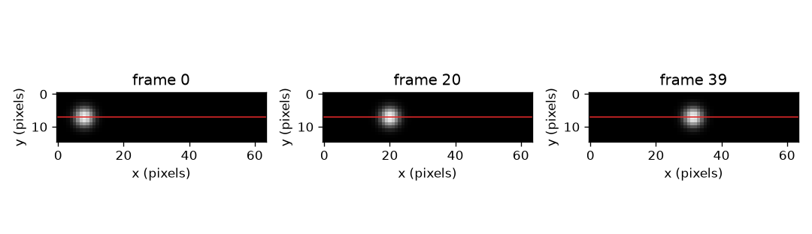
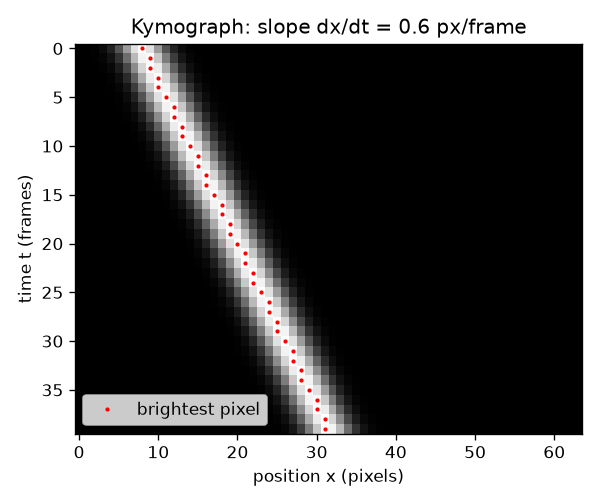

# సెషన్ 1: ఒక వరుస పిక్సెల్స్, కాలంలో అమర్చబడినవి

[Session 1 — हिन्दी](README.hi.md) · [Session 1 — മലയാളം](README.ml.md) · [Session 1 — தமிழ்](README.ta.md)

*స్థాయి 1 (భావనాత్మక ఇంటరాక్టివ్ నమూనా) · సుమారు 60 నిమిషాలు · openkymo*

> ఇది విద్య కోసం సరళీకరించిన నమూనా. ఇది ధ్రువీకరించబడిన డిజైన్ సాధనం కాదు; నిజమైన నిర్మాణాలు, విద్యుత్ ఇన్‌స్టలేషన్లు, వాహనాలు, పారిశ్రామిక ప్రక్రియలు లేదా వైద్య నిర్ణయాల కోసం దీనిని ఉపయోగించకూడదు.

**ముందస్తు అవసరాలు (Prerequisites)**

- వేగం = దూరం / కాలం మరియు గ్రాఫ్ వాలు (పాఠశాల స్థాయి).
- మీరు PRIMER.md చదివి, `python start.py 1` ఒకసారి రన్ చేశారు.

**అభ్యసన లక్ష్యాలు (Learning objectives).** ఈ సెషన్ తర్వాత మీరు:

- ప్రతి వీడియో ఫ్రేమ్ నుండి ఒక వరుస పిక్సెల్స్‌ను అమర్చి కైమోగ్రాఫ్ (kymograph) తయారు చేయగలరు.
- కదిలే వస్తువు ఏటవాలు చారను, నిశ్చలంగా ఉన్న వస్తువు నిలువు చారను ఎందుకు ఇస్తాయో వివరించగలరు.
- చార వాలును, రెండు బిందువుల నుండి మరియు ఒక రేఖా ఫిట్ నుండి, పిక్సెల్/ఫ్రేమ్‌లో కొలవగలరు.
- అదే కదలికను స్థానం-కాలం గ్రాఫ్ నుండి మరియు కైమోగ్రాఫ్ నుండి చదవగలరు.

## A. నిజ జీవిత సమస్య
ఒక పూస గొట్టం వెంట దొర్లుతుంది, ఒక చుక్క కిటికీ దాటి పడుతుంది, ఒక మెరిసే మచ్చ మంటపై ప్రయాణిస్తుంది. వస్తువులు కదులుతున్నాయని వీడియో చూపిస్తుంది, కానీ వీడియోను కొలవడం కష్టం: వేలాది ఫ్రేమ్‌లు, ప్రతి ఒక్కటి పూర్తి చిత్రం. ప్రతి ఫ్రేమ్ నుండి ఒక వరుస పిక్సెల్స్‌ను మాత్రమే ఉంచి ఆ వరుసలను ఒకే చిత్రంగా అమరిస్తే ఏమవుతుంది? అప్పుడు మొత్తం వీడియో ఒకే చిత్రమవుతుంది, వేగం ఒక స్కేలుతో చదవగలిగేదిగా మారుతుంది: ఒక చార వాలు.

## B. భావన మరియు సిద్ధాంతం
ఒక వీడియో అంటే ఫ్రేమ్‌ల కుప్ప. ప్రతి ఫ్రేమ్ ప్రకాశ సంఖ్యల గ్రిడ్. గ్రిడ్‌లో ఒక వరుస (లైన్) ఎంచుకుని ప్రతి ఫ్రేమ్ నుండి ఆ వరుసను కత్తిరించండి. కత్తిరించిన వరుసలను ఫ్రేమ్ 0 పైన ఉండేలా అమర్చండి: కైమోగ్రాఫ్ అనే కొత్త చిత్రం వస్తుంది. దాని నిలువు వరుసలు లైన్ వెంట స్థానాలు (పిక్సెల్స్), దాని అడ్డు వరుసలు కాలం (ఫ్రేమ్‌లు). ఒక మెరిసే బ్లాబ్ (blob) ఫ్రేమ్ 0 లో పిక్సెల్ x0 వద్ద ఉండి ప్రతి ఫ్రేమ్‌లో v పిక్సెల్స్ కదిలితే, ఫ్రేమ్ t లో అది x0 + v t వద్ద ఉంటుంది, కాబట్టి కైమోగ్రాఫ్‌లో అది ఒక సరళ రేఖను గీస్తుంది. ఆ చార వాలు, dx/dt, పిక్సెల్/ఫ్రేమ్‌లో వేగం v. నిశ్చల వస్తువుకు v = 0, అది నిలువు చారను చేస్తుంది. వేగవంతమైన వస్తువు నిలువు నుండి ఇంకా ఎక్కువ ఏటవాలు చారను చేస్తుంది. సెషన్ 2 లోని విభాగం B పిక్సెల్/ఫ్రేమ్‌ను మీటర్/సెకనుగా మారుస్తుంది.

| గుర్తు | అర్థం | యూనిట్ |
|---|---|---|
| t | ఫ్రేమ్ సంఖ్య (కాలం, 0 నుండి లెక్కిస్తారు) | ఫ్రేమ్‌లు |
| x | ఎంచుకున్న లైన్ వెంట స్థానం | పిక్సెల్స్ |
| x0 | ఫ్రేమ్ 0 లో బ్లాబ్ స్థానం | పిక్సెల్స్ |
| v | బ్లాబ్ వేగం = చార వాలు dx/dt | పిక్సెల్/ఫ్రేమ్ |
| K(t, x) | అడ్డు వరుస t, నిలువు వరుస x వద్ద కైమోగ్రాఫ్ ప్రకాశం | ప్రకాశ యూనిట్లు |

**ఊహలు (Assumptions)**

- వస్తువు ఎంచుకున్న లైన్ వెంట కదులుతుంది (లేదా లైన్ కదలిక వెంట ఉంచబడుతుంది).
- మనం కొలిచే సమయంలో వేగం స్థిరం.
- కెమెరా కదలదు, ఫ్రేమ్‌లు సమాన కాల అంతరాలతో తీయబడతాయి.

$$ x(t)=x_0+v\,t $$

$$ v=\frac{x_2-x_1}{t_2-t_1}=\frac{\Delta x}{\Delta t} $$

$$ K(t,x)=\text{frame}_t[\text{row},\,x] $$

## C. దృశ్య వివరణ
మొదటి చిత్రం ఒక చిన్న వీడియో యొక్క మూడు ఫ్రేమ్‌లను (ఫ్రేమ్ 0, 20, 39) ఎంచుకున్న లైన్‌ను ఎరుపులో గీసి చూపిస్తుంది: ప్రతి దానిలో బ్లాబ్ ఇంకా కుడివైపుకు ఉంటుంది. రెండవ చిత్రం ఆ లైన్ నుండి తయారు చేసిన కైమోగ్రాఫ్. దానికి 40 అడ్డు వరుసలు (ఫ్రేమ్‌లు) మరియు 64 నిలువు వరుసలు (పిక్సెల్స్) ఉన్నాయి, మెరిసే చార పైన ఎడమ నుండి కింద కుడికి నడుస్తుంది. ఎరుపు చుక్కలు ప్రతి వరుసలో అత్యంత ప్రకాశవంతమైన పిక్సెల్‌ను గుర్తిస్తాయి; అవి 0.6 పిక్సెల్/ఫ్రేమ్ వాలు ఉన్న ఒక సరళ రేఖపై ఉంటాయి.

*ఒక చిన్న వీడియో యొక్క మూడు ఫ్రేమ్‌లు; ఎరుపు రేఖ కైమోగ్రాఫ్‌లోకి అమర్చబడే వరుస.*

*కైమోగ్రాఫ్: కాలం కిందికి, స్థానం అడ్డంగా. ఎరుపు చుక్కలు 0.6 px/frame వాలు ఉన్న సరళ రేఖపై ఉంటాయి.*

## D. ఇంటరాక్టివ్ సిమ్యులేషన్
పాఠాన్ని రన్ చేయండి (`python start.py 1`), తర్వాత లైవ్ యాప్ తెరవండి: [సెషన్ 1: ఒక కైమోగ్రాఫ్ తయారు చేయండి](https://krunalpanchal1995.github.io/pan-iit-oss/openkymo/session-01/) (లేదా ఈ ఫోల్డర్‌లోని `app.html`). వేగం స్లైడర్‌ను కదిలించి చార ఏటవాలుగా మారడం చూడండి, తర్వాత స్థానం గ్రాఫ్‌కు మారి అదే కదలికను కాలానికి వ్యతిరేకంగా సరళ రేఖగా చూడండి. ఒక రుణ వేగాన్ని మరియు సున్నా వేగాన్ని ప్రయత్నించండి.

**సవాలు.** బ్లాబ్ లైన్ ఎడమ భాగంలో మొదలవ్వాలి (x0 గరిష్టంగా 12) మరియు ఫ్రేమ్ 39 నాటికి పిక్సెల్ 56 దాటి ఉండాలి.

## E. సాధించిన ఉదాహరణ మరియు ప్రయోగం
**సమస్య.** చిత్రం 1 లోని వీడియోలో బ్లాబ్ x0 = 8 నుండి 0.6 px/frame వేగంతో కదులుతుంది. ఫ్రేమ్ 10 మరియు 30 లో దాని నిలువు వరుసను, వాటి మధ్య వాలును కనుగొనండి.

1. ఫ్రేమ్ 10 లో స్థానం: 8 + 0.6 * 10 = 14.
2. ఫ్రేమ్ 30 లో స్థానం: 8 + 0.6 * 30 = 26.
3. వాలు = (26 - 14) / (30 - 10) = 12 / 20 = 0.6 px/frame.
4. సరిచూపు: 39 ఫ్రేమ్‌లలో బ్లాబ్ 0.6 * 39 = 23.4 పిక్సెల్స్ కదులుతుంది, 8 నుండి 31.4 కి, 64 పిక్సెల్ లైన్ లోపలే.

**సమాధానం.** బ్లాబ్ ఫ్రేమ్ 10 లో నిలువు వరుస 14 లో, ఫ్రేమ్ 30 లో నిలువు వరుస 26 లో ఉంది; చార వాలు 0.6 px/frame.

**ప్రయోగం.** ఒక పుస్తకంపై స్థిరంగా పెట్టిన ఫోన్ కెమెరా ముందు ఒక నాణెం లేదా గోళీని బల్లపై దొర్లించండి. ప్రతి ఫ్రేమ్ నుండి ఒక వరుస పిక్సెల్స్ తీసుకుని (ఉచిత వీడియో సాధనం లేదా చిన్న స్క్రిప్ట్‌తో) అమర్చండి. చార వాలును పిక్సెల్/ఫ్రేమ్‌లో కొలిచి, స్కేలు నుండి దూరం మరియు వీడియో టైమ్‌స్టాంపులతో దూరం/కాలంతో పోల్చండి. తేడాలు లెన్స్ నుండి (అంచుకు దగ్గరగా ఉన్న వస్తువులు చిన్నవిగా కనిపిస్తాయి), వస్తువు లైన్ వెంట సరిగ్గా కదలకపోవడం నుండి, చార అంచును కంటితో చదవడం నుండి వస్తాయి: నమూనా పరిపూర్ణ సరళ రేఖను మరియు సమాన ఫ్రేమ్ అంతరాన్ని ఊహిస్తుంది.

## F. మూల్యాంకనం మరియు డిజైన్ సవాలు
**ప్రశ్న రకం A: భావనాత్మక.** నిలువు చార అంటే ఏమిటి? ఒక మెరిసే అడ్డ చార (ఒకే ఫ్రేమ్‌లో అదే వరుస వెలగడం) అంటే ఏమిటి?

సూచన

చిత్రంలో కాలం కిందికి మరియు స్థానం అడ్డంగా నడుస్తాయి.

దశలవారీ పరిష్కారం

నిలువు చార ప్రతి ఫ్రేమ్‌లో అదే నిలువు వరుసలో ఉంటుంది, కాబట్టి వస్తువు కదలదు. అడ్డ చార ఒకే అడ్డు వరుసలో మాత్రమే, అంటే ఒకే ఫ్రేమ్‌లో, ఉండి అనేక నిలువు వరుసలను కప్పుతుంది: మొత్తం లైన్ ఒకే క్షణంలో వెలిగింది, ఉదాహరణకు కాంతి మెరుపు, లేదా ఒకే ఫ్రేమ్‌లో మొత్తం లైన్‌ను దాటేంత వేగవంతమైన వస్తువు. ఇది కొలవగల కదిలే వస్తువు సంకేతం కాదు.

**ప్రశ్న రకం B: సంఖ్యాత్మక.** ఒక బ్లాబ్ ఫ్రేమ్ 0 లో నిలువు వరుస 5 లో మరియు ఫ్రేమ్ 30 లో నిలువు వరుస 41 లో ఉంది. దాని వేగాన్ని px/frame లో కనుగొని, 40 ఫ్రేమ్‌ల వరకు అది 64 పిక్సెల్ లైన్‌లో ఉంటుందని సరిచూడండి.

సూచన

వేగం = స్థాన మార్పును ఫ్రేమ్ సంఖ్య మార్పుతో భాగించినది.

దశలవారీ పరిష్కారం

వేగం = (41 - 5) / 30 = 1.2 px/frame. 40 ఫ్రేమ్‌లలో అది 1.2 * 40 = 48 పిక్సెల్స్ ప్రయాణిస్తుంది, 5 నుండి 53 కి, ఇది 64 పిక్సెల్స్ లోపల, కాబట్టి అది లైన్‌లో ఉంటుంది. యూనిట్: పిక్సెల్/ఫ్రేమ్.

**ప్రశ్న రకం C: గ్రాఫ్ మరియు సిమ్యులేషన్ వ్యాఖ్యానం.** యాప్‌లో, వేగాన్ని 0.3 నుండి 0.9 కి మూడు రెట్లు చేసినప్పుడు కైమోగ్రాఫ్‌లో చార ఎలా కనిపిస్తుంది, స్థానం గ్రాఫ్‌లో రేఖ ఎలా కనిపిస్తుంది? ఏ చిత్రం వేగవంతమైన వస్తువును ఎక్కువ నిటారుగా చూపిస్తుంది?

సూచన

ప్రతి చిత్రంలో ఏ అక్షం కాలమో పోల్చండి.

దశలవారీ పరిష్కారం

స్థానం గ్రాఫ్‌లో కాలం అడ్డ అక్షం, కాబట్టి వేగాన్ని మూడు రెట్లు చేస్తే వాలు మూడు రెట్లు: ఎక్కువ నిటారైన రేఖ (0.3 కి వ్యతిరేకంగా 0.9 పిక్సెల్/ఫ్రేమ్). కైమోగ్రాఫ్‌లో కాలం కిందికి నడుస్తుంది, కాబట్టి చార మరింత చదునుగా మారుతుంది, నిలువు నుండి ఎక్కువ ఏటవాలుగా: ప్రతి వరుసకు అది మూడు రెట్లు నిలువు వరుసలను కప్పుతుంది. అదే కదలిక, వేర్వేరు అక్షాలు.

**ప్రశ్న రకం D: డిజైన్ మరియు ఆప్టిమైజేషన్ సవాలు.** డిజైన్: లైన్ 64 పిక్సెల్స్ పొడవు, బ్లాబ్ పిక్సెల్ 8 వద్ద మొదలవుతుంది, మీరు కొలిచేటప్పుడు అది కనీసం 30 ఫ్రేమ్‌లు లైన్‌లో ఉండాలి. ఏ వేగాలు అనుమతించబడతాయి? చాలా నెమ్మదిగా ఉన్న బ్లాబ్ కూడా చెడ్డ ఎంపిక ఎందుకు?

సూచన

ఫ్రేమ్ 30 లో కూడా బ్లాబ్ లైన్‌లో ఉండాలి, కాబట్టి 8 + 30 v చివరి పిక్సెల్ కంటే కింద; వాలు ఫిట్ పని చేయడానికి ఎన్ని పిక్సెల్స్ కదలిక ఉందో ఆలోచించండి.

దశలవారీ పరిష్కారం

ఫ్రేమ్ 30 లో పిక్సెల్ 56 కింద ఉండండి (సుమారు 7 పిక్సెల్స్ మార్జిన్ వదలండి): 8 + 30 v <= 56 వల్ల v <= 1.6 px/frame. చాలా నెమ్మదైన బ్లాబ్, ఉదాహరణకు 0.05 px/frame, 30 ఫ్రేమ్‌లలో 1.5 పిక్సెల్స్ మాత్రమే కదులుతుంది, బ్లాబ్ వెడల్పు కంటే తక్కువ, కాబట్టి పిక్సెల్ రౌండింగ్‌కు వ్యతిరేకంగా వాలు చదవడం కష్టం. ఉపయోగకరమైన పరిధి సుమారు 0.2 నుండి 1.6 px/frame. రాజీ (trade-off): వేగవంతమైన బ్లాబ్ లైన్‌ను త్వరగా వాడేస్తుంది, నెమ్మదైనది తక్కువ ఖచ్చితమైన వాలును ఇస్తుంది.

[RUBRIC.md](../../RUBRIC.md) తో మిమ్మల్ని మీరు స్కోర్ చేసుకోండి. కాగితంపై పని చేయడానికి [కార్యాచరణ పత్రం](activity_sheet.md) ప్రింట్ చేయండి.

## సాధారణ అపోహలు
| సాధారణ అపోహ | నిజానికి ఏది సరైనది |
|---|---|
| కైమోగ్రాఫ్ అనేది వస్తువు చిత్రం. | ఇది ఒక లైన్ యొక్క కాలక్రమ చిత్రం. నిలువు అక్షం కాలం, స్థలం కాదు; వస్తువు ఒక చారగా మాత్రమే కనిపిస్తుంది. |
| ఎక్కువ నిటారైన చార అంటే వేగవంతమైన వస్తువు. | అది అక్షాలపై ఆధారపడి ఉంటుంది. కాలం కిందికి నడిచినప్పుడు (ఇక్కడ లాగా) వేగవంతమైన వస్తువు నిలువు నుండి ఎక్కువ ఏటవాలు చారను ఇస్తుంది; నిలువు చార అన్నింటిలో నెమ్మదైనది, వేగం సున్నా. |
| చార వేగం మీటర్/సెకనులో ఉంటుంది. | చిత్రం నుండి చదివే వాలు పిక్సెల్/ఫ్రేమ్‌లో ఉంటుంది. మీటర్/సెకను పొందడానికి పిక్సెల్ పరిమాణం మరియు ఫ్రేమ్ రేటు కావాలి (సెషన్ 2). |
| ఒక కైమోగ్రాఫ్ మొత్తం వీడియోలోని కదలికను చూపిస్తుంది. | ఇది ఎంచుకున్న లైన్ వెంట కదలికను మాత్రమే చూపిస్తుంది; లైన్‌కు అడ్డంగా లేదా దాని నుండి దూరంగా కదలిక కొలవబడదు. |

## పదకోశం
- **కైమోగ్రాఫ్ (kymograph)**: ప్రతి ఫ్రేమ్ నుండి అదే వరుస పిక్సెల్స్‌ను అమర్చి తయారు చేసిన చిత్రం; స్థానం అడ్డంగా, కాలం కిందికి
- **ఫ్రేమ్ (frame)**: వీడియో యొక్క ఒక చిత్రం, ఒక క్షణంలో తీసినది
- **పిక్సెల్ (pixel)**: ఒక ప్రకాశ విలువ గల చిత్రం యొక్క ఒక చిన్న చతురస్రం
- **చార (stripe)**: కైమోగ్రాఫ్‌లో కదిలే వస్తువు యొక్క మెరిసే మార్గం
- **వాలు (slope)**: కిందికి ప్రతి అడుగుకు (ఫ్రేమ్‌లు) చార అడ్డంగా (పిక్సెల్స్) ఎంత కదులుతుంది

## ముగింపు
1. [exercises.md](exercises.md) లోని మూడు కోడింగ్ పనులు చేయండి.
2. మీ మార్పుల తర్వాత `python start.py 1` మళ్లీ రన్ చేయండి. అది చెక్‌పాయింట్‌తో ముగుస్తుంది; అది `PASS` అని ప్రింట్ చేసినప్పుడు మీరు పూర్తి చేశారు. (చెక్‌పాయింట్ మాత్రమే: `python start.py check 1`.)

తర్వాత: [సెషన్ 2](../session-02/README.md)
