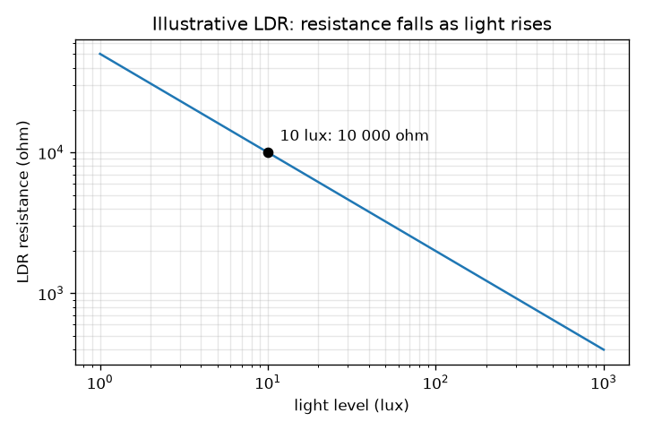
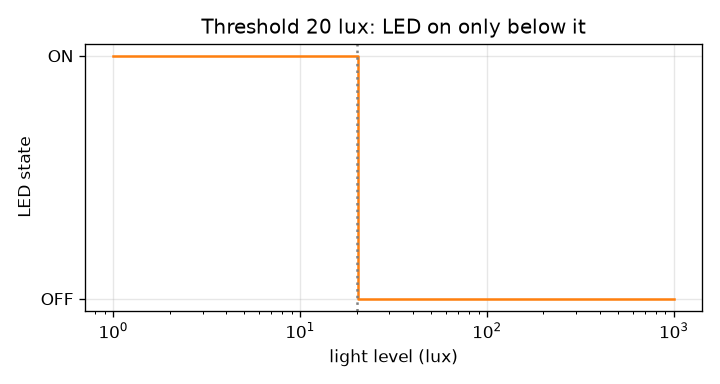

# सत्र 1: एक सेंसर (sensor), एक निर्णय और एक स्विच

*स्तर 1 (वैचारिक इंटरैक्टिव मॉडल) · लगभग 60 मिनट · openledcontrol*

> यह एक सरलीकृत शैक्षिक मॉडल है। यह कोई प्रमाणित डिज़ाइन उपकरण नहीं है और इसका उपयोग वास्तविक संरचनाओं, विद्युत संस्थापनों, वाहनों, औद्योगिक प्रक्रियाओं या चिकित्सा निर्णयों के लिए नहीं किया जाना चाहिए।

**पूर्वापेक्षाएँ (Prerequisites)**

- यह जानना कि विद्युत धारा (current) एक प्रतिरोधक (resistor) से बहती है और बड़ा प्रतिरोध (resistance) कम धारा बहने देता है।
- आपने PRIMER.md पढ़ लिया है और एक बार `python start.py 1` चला लिया है।

**सीखने के उद्देश्य (Learning objectives)।** इस सत्र के बाद आप:

- समझा सकेंगे कि प्रकाश-निर्भर प्रतिरोधक (light dependent resistor, LDR) प्रकाश को कैसे महसूस करता है।
- प्रकाश-सक्रिय LED नियंत्रक (controller) का ब्लॉक आरेख (block diagram) बना सकेंगे और उस पर नाम लिख सकेंगे।
- उदाहरणात्मक LDR वक्र का उपयोग करके दिए गए प्रकाश स्तर पर उसका प्रतिरोध ज्ञात कर सकेंगे।
- एक सीमा-मान (threshold) के साथ तय कर सकेंगे कि LED कब चालू होनी चाहिए, और इसे ग्राफ़ से पढ़ सकेंगे।

## A. वास्तविक दुनिया की समस्या
बगीचे के रास्ते की एक बत्ती शाम ढलते ही अपने-आप जल जाती है और सुबह होते ही बुझ जाती है। कोई स्विच नहीं छूता। एक छोटा परिपथ (circuit) कैसे जानता है कि अँधेरा हो रहा है, और वह लैंप को कैसे चालू करता है? इस सत्र में आप उन तीन कामों से मिलेंगे जो हर स्वचालित नियंत्रक करता है: महसूस करना (sense), निर्णय लेना (decide), कार्य करना (act)। इस रिपॉज़िटरी के सभी परिपथ कम-वोल्टेज वाले शैक्षिक मॉडल हैं (कुछ वोल्ट, कुछ मिलीऐम्पियर), मेन्स (mains) प्रकाश व्यवस्था के डिज़ाइन नहीं।

## B. अवधारणा और सिद्धांत
प्रकाश-निर्भर प्रतिरोधक (LDR) एक ऐसा प्रतिरोधक है जिसका प्रतिरोध उस पर प्रकाश पड़ने पर घटता है: अँधेरे में बड़ा, तेज़ रोशनी में छोटा। प्रकाश स्तर लक्स (lux) में मापा जाता है (मोमबत्ती से रोशन कमरा कुछ लक्स, एक दफ़्तर कुछ सौ, एक धूप वाला दिन दसियों हज़ार)। वास्तविक LDR एक पुर्ज़े से दूसरे पुर्ज़े में भिन्न होते हैं, इसलिए हम एक मान ली गई, उदाहरणात्मक वक्र का उपयोग करते हैं: 10 लक्स पर प्रतिरोध 10 000 ohm है, और प्रकाश में हर दस गुना वृद्धि प्रतिरोध को 10 की घात 0.7 (लगभग 5) से भाग देती है। एक नियंत्रक में चार ब्लॉक एक शृंखला में होते हैं: LDR और उसका विभाजक (divider) (महसूस करता है), एक तुलनित्र (comparator) (निर्णय लेता है: क्या प्रकाश सीमा-मान से नीचे है?), एक ट्रांज़िस्टर स्विच (LED की धारा वहन करता है) और अपने प्रतिरोधक के साथ LED (लैंप)। सत्र 1 में तुलनित्र बस 'लक्स सीमा-मान से नीचे' है।

| प्रतीक | अर्थ | इकाई |
|---|---|---|
| lux | सेंसर पर प्रकाश स्तर | lux |
| R_ldr | LDR प्रतिरोध | ohm |
| R10 | 10 लक्स पर मान लिया गया LDR प्रतिरोध (10 000) | ohm |
| gamma | LDR वक्र की मान ली गई ढलान (0.7) | कोई इकाई नहीं |
| threshold | वह प्रकाश स्तर जिसके नीचे LED चालू होती है | lux |

**मान्यताएँ (Assumptions)**

- LDR वक्र एक मान लिया गया, उदाहरणात्मक मॉडल है, कोई डेटा शीट नहीं।
- LDR तुरंत प्रतिक्रिया करता है (वास्तविक LDR दसियों मिलीसेकंड या अधिक लेते हैं)।
- केवल कम-वोल्टेज शैक्षिक मॉडल; इस विचार को कभी भी मेन्स वायरिंग से न जोड़ें।
- सेंसर के चारों ओर हर जगह प्रकाश स्तर एक जैसा है।

$$ R_{\mathrm{ldr}}=R_{10}\left(\frac{\text{lux}}{10}\right)^{-\gamma},\qquad R_{10}=10\,000\ \Omega,\ \gamma=0.7 $$

$$ \text{LED on}\iff \text{lux}<\text{threshold} $$

## C. दृश्य व्याख्या
पहला चित्र log-log अक्षों पर उदाहरणात्मक LDR वक्र है: नीचे की ओर झुकी एक सीधी रेखा, क्योंकि हर बार प्रकाश किसी दिए गए गुणक से बढ़ने पर प्रतिरोध उसी गुणक से घटता है। यह आधार बिंदु (10 लक्स, 10 000 ohm) से होकर गुज़रती है। दूसरा चित्र 20 लक्स सीमा-मान के लिए प्रकाश के सापेक्ष LED की अवस्था दिखाता है: ON (अँधेरी तरफ़, बाएँ) से OFF (रोशन तरफ़, दाएँ) तक एक सीढ़ी (step)। ऐप का पहला दृश्य ब्लॉक आरेख है: निर्णय बदलने पर चारों डिब्बे जगमगाते हैं।

*उदाहरणात्मक LDR: log-log अक्षों पर एक सीधी रेखा, जो (10 लक्स, 10 000 ohm) से होकर गुज़रती है।*

*20 लक्स सीमा-मान: LED केवल अँधेरी तरफ़ चालू है।*

## D. इंटरैक्टिव सिमुलेशन
पाठ चलाएँ (`python start.py 1`), फिर लाइव ऐप खोलें: [सत्र 1: महसूस करो, निर्णय लो, स्विच करो](https://krunalpanchal1995.github.io/pan-iit-oss/openledcontrol/session-01/) (या इस फ़ोल्डर में `app.html`)। प्रकाश वाले स्लाइडर को खिसकाएँ और पहले डिब्बे में LDR प्रतिरोध तथा शृंखला के अंत में LED को देखें। फिर सीमा-मान बदलें और देखें कि ग्राफ़ पर डैश वाली रेखा कहाँ खिसकती है।

**चुनौती।** एक ऊँचा सीमा-मान चुनकर LED को तब चालू करें जब कमरा 25 लक्स या उससे अधिक पर हो।

## E. हल किया गया उदाहरण और प्रयोग
**समस्या।** 2 लक्स पर, उदाहरणात्मक वक्र के साथ LDR प्रतिरोध क्या है, और 20 लक्स सीमा-मान के साथ क्या LED चालू है?

1. प्रकाश भाग 10: 2 / 10 = 0.2।
2. R = 10 000 * 0.2 ^ (-0.7)। चूँकि 0.2 ^ (-0.7) = 5 ^ 0.7 = 3.085, R = 10 000 * 3.085 = 30 852 ohm।
3. सीमा-मान से तुलना करें: 2 लक्स, 20 लक्स से नीचे है, इसलिए कमरा पर्याप्त अँधेरा है।
4. तुलनित्र 'अँधेरा' कहता है, ट्रांज़िस्टर बंद (closed) होता है और LED ON है।
5. सामान्य जाँच (sanity check): 2 लक्स, 10 लक्स के आधार बिंदु से अधिक अँधेरा है, इसलिए प्रतिरोध 10 000 ohm से ऊपर होना चाहिए। वह है।

**उत्तर।** R लगभग 30 850 ohm है और LED ON है।

**प्रयोग।** एक LDR को प्रतिरोध पर सेट किए गए मल्टीमीटर से जोड़ें। इसे तेज़ रोशनी वाले कमरे में, अपने हाथ की छाया में, और एक कप से ढककर पढ़ें। आपको एक बड़ी सीमा दिखेगी, उदाहरण के लिए कुछ किलो-ओम से सैकड़ों किलो-ओम तक, और सटीक संख्याएँ मॉडल से मेल नहीं खाएँगी: वास्तविक LDR की अपनी वक्र होती है, वे रंग और तापमान पर निर्भर करते हैं, और धीरे प्रतिक्रिया करते हैं। मॉडल दिशा सही बताता है (प्रकाश के साथ प्रतिरोध घटता है); संख्याएँ एक मान्यता हैं।

## F. मूल्यांकन और डिज़ाइन चुनौती
**प्रश्न प्रकार A: वैचारिक।** ऐसा सेंसर जिसका प्रतिरोध बदलता है, नियंत्रक के लिए उपयोगी क्यों है? LDR को सीधे LED से जोड़ने के बजाय हमें एक अलग 'निर्णय' ब्लॉक की भी आवश्यकता क्यों है?

संकेत

प्रतिरोध अभी हाँ/ना उत्तर नहीं है, और LED को निश्चित रूप से चालू या बंद होना चाहिए।

चरण-दर-चरण हल

प्रतिरोध में बदलाव को एक ऐसे वोल्टेज में बदला जा सकता है जो प्रकाश का अनुसरण करता है (सत्र 2), जिसे एक परिपथ माप सकता है। लेकिन LED को चुने गए प्रकाश स्तर पर एक स्पष्ट चालू/बंद आदेश चाहिए: तुलनित्र सतत (continuous) संकेत को हाँ या ना में बदलता है, और फिर ट्रांज़िस्टर LED को धारा देता है। निर्णय ब्लॉक के बिना LED बस थोड़ी तेज़ या मंद चमकती, और एक छोटा सेंसर संकेत LED की धारा वहन नहीं कर पाता।

**प्रश्न प्रकार B: संख्यात्मक।** R = 10 000 * (lux / 10) ^ (-0.7) का उपयोग करके 1 लक्स और 1 000 लक्स पर LDR प्रतिरोध ज्ञात करें। वे किस गुणक से भिन्न हैं? गुणक की सामान्य जाँच करें।

संकेत

1 लक्स से lux/10 = 0.1 मिलता है और 1 000 लक्स से 100।

चरण-दर-चरण हल

1 लक्स पर: 10 000 * 0.1 ^ (-0.7) = 10 000 * 5.012 = 50 119 ohm। 1 000 लक्स पर: 10 000 * 100 ^ (-0.7) = 10 000 * 0.03981 = 398 ohm। गुणक = 50 119 / 398 = 125.9, जो 1 000 ^ 0.7 = 125.9 के बराबर है (हज़ार गुना अधिक प्रकाश, प्रतिरोध लगभग 126 गुना कम)। इकाइयाँ: ohm।

**प्रश्न प्रकार C: ग्राफ़ और सिमुलेशन की व्याख्या।** ऐप के ग्राफ़ में वक्र बाईं ओर तीव्र और दाईं ओर लगभग सपाट है। इससे क्या पता चलता है कि LDR 5 लक्स और 15 लक्स में कितनी अच्छी तरह अंतर करता है, 405 लक्स और 415 लक्स की तुलना में?

संकेत

दोनों जगहों पर प्रकाश में समान बदलाव के लिए प्रतिरोध के बदलाव की तुलना करें।

चरण-दर-चरण हल

बाईं ओर (मंद प्रकाश) प्रकाश में छोटा बदलाव प्रतिरोध को बहुत बदल देता है, इसलिए मंद प्रकाश स्तरों में अंतर करना आसान है। दाईं ओर 10 लक्स का बदलाव प्रतिरोध को केवल कुछ ohm बदलता है, इसलिए तेज़ प्रकाश स्तरों में अंतर करना कठिन है। इसीलिए LDR नियंत्रक शाम के आसपास (दसियों लक्स) सबसे अच्छा काम करते हैं, तेज़ दिन के प्रकाश को सटीक मापने के लिए नहीं।

**प्रश्न प्रकार D: डिज़ाइन और अनुकूलन (optimisation) चुनौती।** डिज़ाइन: रास्ते की बत्ती शाम ढलते चालू होनी चाहिए। 5 लक्स और 50 लक्स के सीमा-मानों की तुलना करें। आप कौन-सा चुनेंगे और क्यों? हर सीमा-मान पर LDR प्रतिरोध बताएँ।

संकेत

सोचें कि हर सीमा-मान कब पहुँचता है, ऊर्जा उपयोग और सुरक्षा के बारे में, और दोनों पर R की गणना करें।

चरण-दर-चरण हल

5 लक्स पर R = 16 245 ohm; 50 लक्स पर R = 3 241 ohm। 50 लक्स का सीमा-मान पहले, गहरे झुटपुटे में चालू होता है, जो पैदल चलने वालों के लिए सुरक्षित है लेकिन अधिक LED घंटे ख़र्च करता है; 5 लक्स तब चालू होता है जब सचमुच अँधेरा हो, ऊर्जा बचाता है लेकिन एक मंद अवधि छोड़ देता है। रास्ते के लिए एक समझदार समझौता लगभग 20 से 30 लक्स है। समझौता (trade-off): सुरक्षा और आराम बनाम ऊर्जा, और बाद में (सत्र 3) सीमा-मान के पास बार-बार चालू-बंद होने (chatter) के विरुद्ध।

[RUBRIC.md](../../RUBRIC.md) से स्वयं को अंक दें। काग़ज़ पर काम करने के लिए [गतिविधि पत्रक](activity_sheet.md) प्रिंट करें।

## सामान्य भ्रांतियाँ (Common misconceptions)
| सामान्य भ्रांति | वास्तव में क्या सही है |
|---|---|
| LDR प्रकाश बनाता है। | LDR केवल अपना प्रतिरोध बदलकर प्रकाश को महसूस करता है; प्रकाश LED बनाती है। |
| बड़े LDR प्रतिरोध का अर्थ है अधिक प्रकाश। | इसका उलटा है: प्रकाश बढ़ने पर प्रतिरोध घटता है। |
| सेंसर सीधे LED को स्विच करता है। | सेंसर केवल एक प्रतिरोध बदलता है; निर्णय और स्विच अलग ब्लॉक हैं। |
| मॉडल में 10 000 ohm 'वास्तविक' LDR मान है। | यह एक मान ली गई, उदाहरणात्मक संख्या है। वास्तविक पुर्ज़े बहुत भिन्न होते हैं और आपको डेटा शीट पढ़नी चाहिए या मापना चाहिए। |

## शब्दावली (Glossary)
- **LDR**: प्रकाश-निर्भर प्रतिरोधक (light dependent resistor): एक प्रतिरोधक जिसका प्रतिरोध उस पर प्रकाश पड़ने पर घटता है
- **लक्स (lux)**: किसी सतह पर प्रकाश स्तर की इकाई
- **सीमा-मान (threshold)**: वह प्रकाश स्तर जिस पर नियंत्रक अपना निर्णय बदलता है
- **तुलनित्र (comparator)**: एक परिपथ जो किसी संकेत की सीमा-मान से तुलना करता है और हाँ या ना देता है
- **ट्रांज़िस्टर स्विच (transistor switch)**: पूरी तरह चालू या पूरी तरह बंद उपयोग किया जाने वाला ट्रांज़िस्टर, जो एक छोटे नियंत्रण संकेत के अधीन बड़ी धारा वहन करता है

## समापन
1. [exercises.md](exercises.md) में दिए तीन कोडिंग कार्य करें।
2. अपने बदलावों के बाद `python start.py 1` फिर से चलाएँ। यह चेकपॉइंट (checkpoint) के साथ समाप्त होता है; जब यह `PASS` प्रिंट करे, तो आपका काम पूरा है। (केवल चेकपॉइंट: `python start.py check 1`।)

आगे: [सत्र 2](../session-02/README.md)
