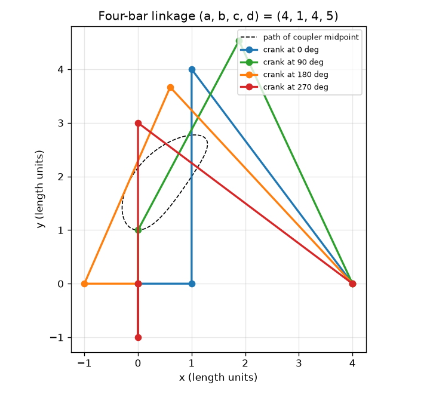
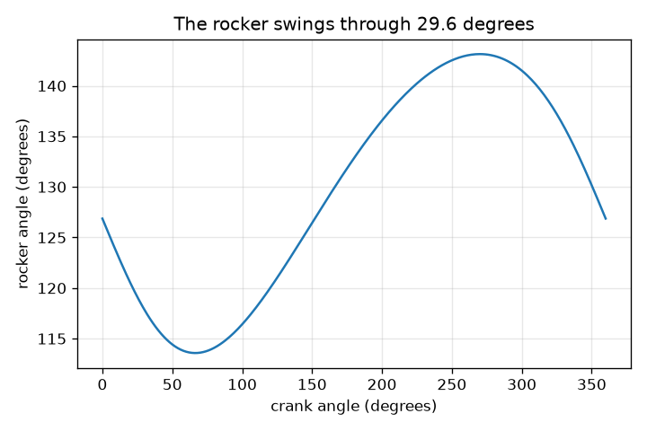

# सत्र 1: चार छड़ें, चार पिन, एक गति

*स्तर 1 (संकल्पनात्मक इंटरैक्टिव मॉडल) · लगभग 60 मिनट · openlinkage*

> यह एक सरलीकृत शैक्षिक मॉडल है। यह कोई प्रमाणित डिज़ाइन टूल नहीं है और इसका उपयोग वास्तविक संरचनाओं, विद्युत स्थापनाओं, वाहनों, औद्योगिक प्रक्रियाओं या चिकित्सा निर्णयों के लिए नहीं किया जाना चाहिए।

**पूर्व-आवश्यकताएँ (Prerequisites)**

- स्कूल ज्यामिति: वृत्त, त्रिभुज, कोण।
- आपने PRIMER.md पढ़ लिया है और `python start.py 1` एक बार चला लिया है।

**सीखने के उद्देश्य (Learning objectives)।** इस सत्र के बाद आप:

- समझा सकेंगे कि चार-छड़ संयोजन (four-bar linkage) में एक घूमती छड़ (क्रैंक, crank) बाक़ी हर छड़ की स्थिति क्यों तय कर देती है।
- दो वृत्तों की मदद से चार-छड़ संयोजन के पिन रख सकेंगे और जाँच सकेंगे कि छड़ों की लंबाई कभी नहीं बदलती।
- क्रैंक कोण के विरुद्ध रॉकर (rocker) कोण का ग्राफ़ पढ़ सकेंगे और रॉकर का झूलन (swing) ज्ञात कर सकेंगे।
- कपलर बिंदु (coupler point) द्वारा खींचे गए वक्र का वर्णन कर सकेंगे और बता सकेंगे कि छड़ पर उसकी स्थिति वक्र को कैसे बदलती है।

## A. वास्तविक दुनिया की समस्या
विंडस्क्रीन वाइपर, चलने वाला खिलौना और साइकिल का सस्पेंशन, सभी पिनों से जुड़ी कठोर छड़ों से चलते हैं। कोई भी हर छड़ को नहीं धकेलता: एक मोटर एक छड़ (क्रैंक) को घुमाती है और बाक़ी सब एक निश्चित तरीके से उसका अनुसरण करती हैं। इससे भी अजीब, बीच वाली छड़ (कपलर, coupler) पर एक बिंदु एक वक्र खींचता है, और उस वक्र को लगभग सीधा बनाया जा सकता है, जिससे कुछ चलने वाली मशीनें अपने पैर चलाती हैं। चार पिनों से जुड़ी कुछ कठोर छड़ें एक स्थिर घूर्णन को झूलती गति और एक लूपदार पथ में कैसे बदल सकती हैं?

## B. संकल्पना और सिद्धांत
फ़्रेम (भूमि छड़, ground bar) की लंबाई a है, जिसके स्थिर पिन O2 = (0, 0) और O4 = (a, 0) पर हैं। क्रैंक (लंबाई b) O2 के चारों ओर घूमता है, इसलिए उसका खुला सिरा A, b(cos t, sin t) पर है। कपलर (लंबाई c) A को एक पिन B से जोड़ता है, और रॉकर (लंबाई d) B को O4 से जोड़ता है। तो B, A से दूरी c पर और O4 से दूरी d पर है: यह वहाँ है जहाँ दो वृत्त काटते हैं। B का स्थान ज्ञात करने के लिए, A को केंद्र मानकर त्रिज्या c का एक वृत्त और O4 को केंद्र मानकर त्रिज्या d का दूसरा वृत्त खींचिए। वे सामान्यतः दो बिंदुओं पर काटते हैं, जिससे दो संभावित संयोजन (assemblies) मिलते हैं; यह पाठ A से O4 की ओर निर्देशित रेखा के बाईं ओर वाला बिंदु चुनता है। एक बार क्रैंक कोण t चुन लेने पर, A, B और रॉकर कोण सभी तय हो जाते हैं: संयोजन में एक स्वातंत्र्य (freedom) है। एक समतल छड़ में 3 स्वातंत्र्य होते हैं (x, y, कोण); एक पिन 2 हटाता है, और भूमि छड़ स्थिर है, इसलिए n छड़ें और j पिन M = 3(n - 1) - 2j स्वातंत्र्य छोड़ते हैं। चार-छड़ के लिए, M = 3*3 - 2*4 = 1। रॉकर की हर चरम स्थिति पर, क्रैंक और कपलर एक सीधी रेखा में होते हैं। O2 से B की दूरी c + b होती है जब वे एक ही दिशा में इंगित करते हैं, या |c - b| जब वे पीछे मुड़ जाते हैं। दोनों रॉकर कोण ज्ञात करने के लिए त्रिभुज O2-O4-B पर कोज्या नियम (law of cosines) लगाइए; उनका अंतर झूलन है।

| प्रतीक | अर्थ | इकाई |
|---|---|---|
| a | भूमि छड़: O2 से O4 की दूरी (a, b, c, d किसी भी एक इकाई में लंबाइयाँ हैं) | लंबाई इकाइयाँ |
| b | क्रैंक की लंबाई (O2 से A) | लंबाई इकाइयाँ |
| c | कपलर की लंबाई (A से B) | लंबाई इकाइयाँ |
| d | रॉकर की लंबाई (O4 से B) | लंबाई इकाइयाँ |
| t | क्रैंक कोण, +x अक्ष से | डिग्री |
| k | कपलर बिंदु P = A + k (B - A), k = 0.5 मध्य है | कोई इकाई नहीं |
| n, j, M | छड़ों की संख्या, पिनों की संख्या, स्वातंत्र्यों की संख्या | कोई इकाई नहीं |

**मान्यताएँ (Assumptions)**

- सभी छड़ें कठोर हैं और पिनों में कोई ढील या घर्षण नहीं है।
- सब कुछ एक ही तल में चलता है।
- हम A-से-O4 के बाईं ओर वाला संयोजन उपयोग करते हैं (दूसरा संयोजन दर्पण प्रतिबिंब है)।
- उदाहरण के लिए लंबाइयाँ: a = 4, b = 1, c = 4, d = 5 (क्रैंक सबसे छोटी छड़ है)।

$$ \mathbf A=b(\cos t,\ \sin t),\qquad \lVert\mathbf B-\mathbf A\rVert=c,\qquad \lVert\mathbf B-\mathbf O_4\rVert=d $$

$$ M=3(n-1)-2j\qquad(\text{four-bar: }3\cdot 3-2\cdot 4=1) $$

$$ \cos\psi=\frac{a^2+d^2-r^2}{2ad},\qquad r=c+b\ \text{or}\ |c-b|\ \text{(the two extreme positions)} $$

$$ \text{swing}=\left|\psi_{c+b}-\psi_{c-b}\right| $$

## C. दृश्य व्याख्या
पहला चित्र उदाहरण संयोजन (a, b, c, d) = (4, 1, 4, 5) को चार मुद्राओं में दिखाता है, साथ में कपलर मध्यबिंदु का डैश वाला पथ। हर मुद्रा में चारों छड़ों की लंबाइयाँ समान हैं; केवल कोण बदलते हैं। दूसरा चित्र क्रैंक कोण के विरुद्ध रॉकर कोण आलेखित करता है। क्रैंक का एक चक्कर रॉकर को 113.58 और 143.13 डिग्री के बीच झुलाता है, यानी 29.55 डिग्री का झूलन, और फिर पूरी गति दोहराई जाती है।

*चार क्रैंक कोणों पर संयोजन (4, 1, 4, 5), कपलर मध्यबिंदु के पथ के साथ।*

*क्रैंक कोण के विरुद्ध रॉकर कोण: 29.55 डिग्री का झूलन।*

## D. इंटरैक्टिव सिमुलेशन
पाठ चलाइए (`python start.py 1`), फिर लाइव ऐप खोलिए: [सत्र 1: एक चार-छड़ संयोजन](https://krunalpanchal1995.github.io/pan-iit-oss/openlinkage/session-01/) (या इसी फ़ोल्डर में `app.html`)। क्रैंक कोण स्लाइडर खिसकाइए और बाक़ी छड़ों को अनुसरण करते देखिए, फिर कपलर बिंदु स्लाइडर खिसकाइए और डैश वाले वक्र का आकार बदलते देखिए। ग्राफ़ दृश्य पर जाइए और रॉकर कोण पढ़िए।

**चुनौती।** क्रैंक को उस कोण पर घुमाइए जहाँ रॉकर सबसे अधिक बाईं ओर झुकता है (270 डिग्री) और कपलर बिंदु को पिन B पर रखिए (k = 1)।

## E. हल किया गया उदाहरण और प्रयोग
**समस्या।** (a, b, c, d) = (4, 1, 4, 5) के लिए पिन B और रॉकर कोण ज्ञात कीजिए जब क्रैंक भूमि छड़ के साथ पड़ा हो (t = 0)। फिर रॉकर का कुल झूलन ज्ञात कीजिए।

1. t = 0 पर क्रैंक का सिरा A = (1, 0) है। रॉकर धुरी O4 = (4, 0) है, इसलिए A, O4 से 3 इकाई दूर है।
2. B, A से 4 और O4 से 5 दूर है। भुजाओं 3, 4, 5 वाले त्रिभुज में भुजाओं 3 और 4 के बीच समकोण होता है, इसलिए B ठीक A के ऊपर है: B = (1, 4)।
3. रॉकर O4 = (4, 0) से B = (1, 4) की ओर इंगित करता है, सदिश (-3, 4)। +x अक्ष से इसका कोण atan2(4, -3) = 126.87 डिग्री है।
4. चरम स्थितियाँ: |O2 B| = c + b = 5 से cos(psi) = (16 + 25 - 25)/40 = 0.4, psi = 66.42 डिग्री; |O2 B| = c - b = 3 से cos(psi) = (16 + 25 - 9)/40 = 0.8, psi = 36.87 डिग्री।
5. झूलन = 66.42 - 36.87 = 29.55 डिग्री। पूरे चक्कर में रॉकर कोण की नमूना-आधारित जाँच वही झूलन देती है।

**उत्तर।** B = (1, 4), t = 0 पर रॉकर कोण 126.87 डिग्री, और रॉकर 29.55 डिग्री तक झूलता है (113.58 और 143.13 डिग्री के बीच)।

**प्रयोग।** कार्डबोर्ड की चार पट्टियाँ 4, 1, 4 और 5 cm लंबी काटिए (सिरों पर छेद), उन्हें पेपर फ़ास्टनरों से जोड़िए, और 4 cm वाली भूमि पट्टी को एक बोर्ड पर पिन कर दीजिए। 1 cm वाले क्रैंक को हाथ से घुमाइए, 0, 90, 180 और 270 डिग्री के क्रैंक कोणों पर चाँदे (protractor) से रॉकर कोण चिह्नित कीजिए और 126.87, 115.06, 132.84 और 143.13 डिग्री से तुलना कीजिए। कुछ डिग्री के भीतर सहमति की अपेक्षा कीजिए। अंतर छेदों की दूरी और फ़ास्टनरों में ढील से आते हैं: मॉडल में पूरी तरह कठोर छड़ें और शून्य आकार के पिन हैं।

## F. मूल्यांकन और डिज़ाइन चुनौती
**प्रश्न प्रकार A: संकल्पनात्मक।** केवल क्रैंक को घुमाने से कपलर और रॉकर की स्थिति भी क्यों तय हो जाती है? संयोजन को दो मोटरों की आवश्यकता हो, इसके लिए क्या अलग होना चाहिए?

संकेत

स्वातंत्र्य गिनिए: M = 3(n - 1) - 2j। एक पिन क्या हटाता है?

चरण-दर-चरण हल

चारों में से हर पिन एक मुक्त समतल छड़ के 3 स्वातंत्र्यों में से 2 हटाता है, और एक छड़ ज़मीन से स्थिर है, इसलिए M = 3*3 - 2*4 = 1: एक ही निवेश सब कुछ तय कर देता है। ज्यामितीय रूप से, क्रैंक कोण चुनते ही A ज्ञात हो जाता है, और B को A से दूरी c और O4 से दूरी d पर होना चाहिए, जिससे अधिकतम दो बिंदु बचते हैं (दो वृत्त दो बार काटते हैं)। दो मोटरों की आवश्यकता के लिए संयोजन में M = 2 होना चाहिए, उदाहरण के लिए 5 पिनों वाला पाँच-छड़ लूप: M = 3*4 - 2*5 = 2।

**प्रश्न प्रकार B: संख्यात्मक।** (a, b, c, d) = (4, 1, 4, 5) के लिए पिन B और रॉकर कोण ज्ञात कीजिए जब क्रैंक कोण 180 डिग्री हो।

संकेत

A = (-1, 0), इसलिए A, O4 से 5 दूर है। A से रेखा के साथ x = (c^2 - d^2 + D^2)/(2D), और उसके आर-पार h = sqrt(c^2 - x^2) का उपयोग कीजिए।

चरण-दर-चरण हल

D = 5, x = (16 - 25 + 25)/10 = 1.6, h = sqrt(16 - 2.56) = 3.666। A से O4 की रेखा +x की ओर इंगित करती है, इसलिए B = (-1 + 1.6, 3.666) = (0.6, 3.666)। O4 से रॉकर सदिश (0.6 - 4, 3.666) = (-3.4, 3.666) है, इसलिए कोण atan2(3.666, -3.4) = 132.84 डिग्री है। जाँच: B से O4 की दूरी sqrt(11.56 + 13.44) = 5 है।

**प्रश्न प्रकार C: ग्राफ़ और सिमुलेशन की व्याख्या।** क्रैंक कोण के विरुद्ध रॉकर कोण के ग्राफ़ में, किन क्रैंक कोणों पर रॉकर अपनी दो चरम स्थितियों में है, और झूलन कितना बड़ा है?

संकेत

चरम स्थितियाँ वक्र के सबसे ऊँचे और सबसे निचले बिंदु हैं। सोचिए कि कब क्रैंक और कपलर एक सीधी रेखा में होते हैं।

चरण-दर-चरण हल

रॉकर कोण 270 डिग्री के क्रैंक कोण पर सबसे बड़ा (143.13 डिग्री) होता है, जहाँ क्रैंक कपलर के विरुद्ध पीछे मुड़ा होता है (|O2 B| = c - b = 3), और लगभग 66.4 डिग्री के क्रैंक कोण पर सबसे छोटा (113.58 डिग्री) होता है, जहाँ क्रैंक और कपलर एक ही दिशा में इंगित करते हैं (|O2 B| = c + b = 5)। झूलन 143.13 - 113.58 = 29.55 डिग्री है।

**प्रश्न प्रकार D: डिज़ाइन और इष्टतमीकरण (optimisation) चुनौती।** डिज़ाइन: a = 4, c = 4 और d = 5 के साथ रॉकर को कम से कम 40 डिग्री झूलना चाहिए। 1.0, 1.5 और 2.0 में से एक क्रैंक लंबाई चुनिए और अपने चुनाव को उचित ठहराइए।

संकेत

दोनों चरम स्थितियों पर कोज्या नियम से हर क्रैंक लंबाई के लिए झूलन की गणना कीजिए।

चरण-दर-चरण हल

झूलन 29.55 डिग्री (b = 1.0), 44.72 डिग्री (b = 1.5) और 60.49 डिग्री (b = 2.0) हैं। केवल b = 1.5 और b = 2.0 ही 40 डिग्री तक पहुँचते हैं। काम करने वाला सबसे छोटा क्रैंक, b = 1.5, 44.72 डिग्री का झूलन देता है, लगभग 4.7 डिग्री का मार्जिन। b = 2.0 60.49 डिग्री झूलता है, आवश्यकता से बहुत अधिक, इसलिए रॉकर उपयोग की माँग से तेज़ चलेगा। मान्यता: यहाँ केवल झूलन मायने रखता है; सत्र 2 संचरण कोण (transmission angle) जोड़ता है।

[RUBRIC.md](../../RUBRIC.md) से स्वयं को अंक दीजिए। कागज़ पर काम करने के लिए [गतिविधि पत्रक](activity_sheet.md) प्रिंट कीजिए।

## सामान्य भ्रांतियाँ (Common misconceptions)
| सामान्य भ्रांति | वास्तव में क्या सच है |
|---|---|
| कपलर बस एक जोड़ने वाली छड़ है जो कुछ नहीं करती। | कपलर सबसे समृद्ध छड़ है: उस पर हर बिंदु अपना वक्र खींचता है, और किसी पैर का पंजा ठीक ऐसा ही एक बिंदु है। |
| एक क्रैंक कोण रॉकर की कोई भी स्थिति दे सकता है। | निश्चित छड़ लंबाइयों के लिए एक क्रैंक कोण अधिकतम दो रॉकर स्थितियाँ देता है (दो वृत्त कटान), और हम उनमें से एक का अनुसरण करते हैं। |
| रॉकर का झूलन क्रैंक के झूलन के बराबर होता है। | क्रैंक 360 डिग्री घूमता है पर रॉकर यहाँ केवल 29.55 डिग्री झूलता है; गति का प्रकार घूर्णन से दोलन (oscillation) में बदल जाता है। |
| लंबा क्रैंक हमेशा मशीन को बड़ा बनाता है पर और कुछ नहीं बदलता। | क्रैंक की लंबाई रॉकर का झूलन तय करती है: b = 1, 1.5, 2 के लिए 29.55, 44.72 और 60.49 डिग्री। |

## शब्दावली (Glossary)
- **संयोजन (linkage)**: पिनों से जुड़ी छड़ें ताकि वे साथ-साथ चलें
- **क्रैंक (crank)**: वह छड़ जो एक स्थिर पिन के चारों ओर पूरा चक्कर लगाती है
- **कपलर (coupler)**: क्रैंक और रॉकर को जोड़ने वाली बीच की छड़; इसके बिंदु कपलर वक्र खींचते हैं
- **रॉकर (rocker)**: निर्गत छड़ जो एक स्थिर पिन के चारों ओर आगे-पीछे झूलती है
- **भूमि (ground)**: दो स्थिर पिनों के बीच की स्थिर फ़्रेम छड़
- **स्वातंत्र्य कोटियाँ (degrees of freedom)**: किसी तंत्र की स्थिति तय करने के लिए आवश्यक स्वतंत्र निवेशों की संख्या (गतिशीलता M, mobility)

## समापन
1. [exercises.md](exercises.md) में दिए गए तीन कोडिंग कार्य कीजिए।
2. अपने बदलावों के बाद `python start.py 1` फिर से चलाइए। यह checkpoint के साथ समाप्त होता है; जब यह `PASS` छापे, तो आपका काम पूरा है। (केवल checkpoint: `python start.py check 1`।)

अगला: [सत्र 2](../session-02/README.md)
