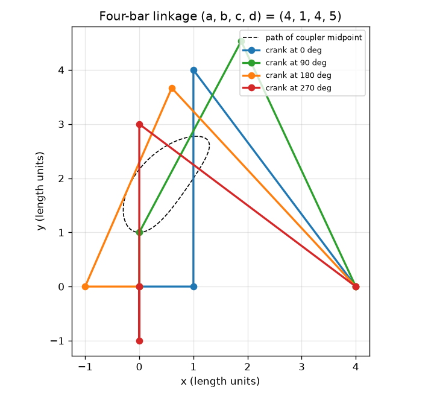
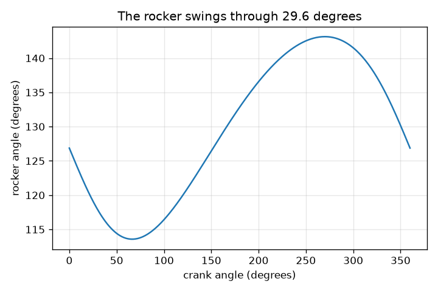

# സെഷൻ 1: നാല് ദണ്ഡുകൾ, നാല് പിന്നുകൾ, ഒരു ചലനം

[Session 1 — हिन्दी](README.hi.md)

*ലെവൽ 1 (ആശയപരമായ ഇന്ററാക്ടീവ് മോഡൽ) · ഏകദേശം 60 മിനിറ്റ് · openlinkage*

> ഇത് ലളിതമാക്കിയ ഒരു വിദ്യാഭ്യാസ മോഡലാണ്. ഇത് സാധൂകരിക്കപ്പെട്ട ഒരു ഡിസൈൻ ഉപകരണമല്ല; യഥാർത്ഥ നിർമ്മിതികൾ, വൈദ്യുത ഇൻസ്റ്റലേഷനുകൾ, വാഹനങ്ങൾ, വ്യാവസായിക പ്രക്രിയകൾ അല്ലെങ്കിൽ വൈദ്യശാസ്ത്രപരമായ തീരുമാനങ്ങൾ എന്നിവയ്ക്ക് ഇത് ഉപയോഗിക്കരുത്.

**മുൻ‌അറിവ് (Prerequisites)**

- സ്കൂൾ ജ്യാമിതി: വൃത്തങ്ങൾ, ത്രികോണങ്ങൾ, കോണുകൾ.
- നിങ്ങൾ PRIMER.md വായിക്കുകയും `python start.py 1` ഒരു തവണ റൺ ചെയ്യുകയും ചെയ്തിട്ടുണ്ട്.

**പഠന ലക്ഷ്യങ്ങൾ (Learning objectives).** ഈ സെഷനു ശേഷം നിങ്ങൾക്ക് കഴിയും:

- ഒരു തിരിയുന്ന ദണ്ഡ് (ക്രാങ്ക് (crank)) ഫോർ-ബാർ ലിങ്കേജിലെ മറ്റെല്ലാ ദണ്ഡുകളുടെയും സ്ഥാനം നിശ്ചയിക്കുന്നത് എന്തുകൊണ്ടെന്ന് വിശദീകരിക്കാൻ.
- രണ്ട് വൃത്തങ്ങൾ ഉപയോഗിച്ച് ഫോർ-ബാർ ലിങ്കേജിന്റെ പിന്നുകൾ സ്ഥാപിക്കാനും ദണ്ഡുകളുടെ നീളം ഒരിക്കലും മാറുന്നില്ലെന്ന് പരിശോധിക്കാനും.
- ക്രാങ്ക് കോണിനെതിരെ റോക്കർ കോണിന്റെ ഗ്രാഫ് വായിച്ച് റോക്കറിന്റെ ആട്ടം (swing) കണ്ടെത്താൻ.
- ഒരു കപ്ലർ ബിന്ദു വരയ്ക്കുന്ന വക്രത്തെയും ദണ്ഡിലെ അതിന്റെ സ്ഥാനം വക്രത്തെ എങ്ങനെ മാറ്റുന്നുവെന്നും വിവരിക്കാൻ.

## A. യഥാർത്ഥ ലോക പ്രശ്നം
വിൻഡ്‌സ്ക്രീൻ വൈപ്പർ, നടക്കുന്ന കളിപ്പാട്ടം, സൈക്കിൾ സസ്പെൻഷൻ എന്നിവയെല്ലാം പിന്നുകളിൽ ചേർത്ത ദൃഢമായ ദണ്ഡുകളാൽ ചലിക്കുന്നു. ആരും എല്ലാ ദണ്ഡുകളെയും തള്ളുന്നില്ല: ഒരു മോട്ടോർ ഒരു ദണ്ഡിനെ (ക്രാങ്ക്) തിരിക്കുന്നു, മറ്റെല്ലാം നിശ്ചിതമായ രീതിയിൽ പിന്തുടരുന്നു. അതിലും വിചിത്രം, നടുവിലെ ദണ്ഡിലെ (കപ്ലർ) ഒരു ബിന്ദു ഒരു വക്രം വരയ്ക്കുന്നു, ആ വക്രം ഏതാണ്ട് നേർരേഖയാക്കാൻ രൂപപ്പെടുത്താം, ചില നടക്കുന്ന യന്ത്രങ്ങൾ കാലുകൾ ചലിപ്പിക്കുന്നത് അങ്ങനെയാണ്. നാല് പിന്നുകളിൽ ചേർത്ത കുറച്ച് ദൃഢ ദണ്ഡുകൾക്ക് ഒരു സ്ഥിര ഭ്രമണത്തെ ആടുന്ന ചലനമായും ചുറ്റുന്ന പാതയായും എങ്ങനെ മാറ്റാൻ കഴിയും?

## B. ആശയവും സിദ്ധാന്തവും
ഫ്രെയിമിന് (ഗ്രൗണ്ട് ബാർ) നീളം a ആണ്, അതിന്റെ സ്ഥിര പിന്നുകൾ O2 = (0, 0), O4 = (a, 0) എന്നിവയിലാണ്. ക്രാങ്ക് (നീളം b) O2-നെ ചുറ്റി തിരിയുന്നു, അതിനാൽ അതിന്റെ സ്വതന്ത്ര അറ്റം A, b(cos t, sin t)-ൽ ആണ്. കപ്ലർ (നീളം c) A-യെ ഒരു പിൻ B-യുമായി ബന്ധിപ്പിക്കുന്നു, റോക്കർ (നീളം d) B-യെ O4-മായി ബന്ധിപ്പിക്കുന്നു. അതിനാൽ B, A-യിൽ നിന്ന് c ദൂരത്തിലും O4-ൽ നിന്ന് d ദൂരത്തിലുമാണ്: രണ്ട് വൃത്തങ്ങൾ കൂട്ടിമുട്ടുന്നിടത്ത്. B കണ്ടെത്താൻ, A കേന്ദ്രമായി c ആരമുള്ള ഒരു വൃത്തവും O4 കേന്ദ്രമായി d ആരമുള്ള മറ്റൊന്നും വരയ്ക്കുക. അവ സാധാരണയായി രണ്ട് ബിന്ദുക്കളിൽ കൂട്ടിമുട്ടുന്നു, രണ്ട് സാധ്യമായ അസംബ്ലികൾ നൽകുന്നു; ഈ പാഠം A-യിൽ നിന്ന് O4-ലേക്കുള്ള ദിശാരേഖയുടെ ഇടതുവശത്തുള്ള ബിന്ദു തിരഞ്ഞെടുക്കുന്നു. ക്രാങ്ക് കോൺ t തിരഞ്ഞെടുത്തുകഴിഞ്ഞാൽ, A, B, റോക്കർ കോൺ എല്ലാം നിശ്ചയിക്കപ്പെടുന്നു: ലിങ്കേജിന് ഒരു സ്വാതന്ത്ര്യമേയുള്ളൂ. ഒരു തലത്തിലെ ദണ്ഡിന് 3 സ്വാതന്ത്ര്യങ്ങളുണ്ട് (x, y, കോൺ); ഒരു പിൻ 2 നീക്കം ചെയ്യുന്നു, ഗ്രൗണ്ട് ബാർ സ്ഥിരമാണ്, അതിനാൽ n ദണ്ഡുകളും j പിന്നുകളും M = 3(n - 1) - 2j സ്വാതന്ത്ര്യങ്ങൾ ബാക്കിയാക്കുന്നു. ഫോർ-ബാറിന്, M = 3*3 - 2*4 = 1. ഓരോ റോക്കർ അങ്ങേയറ്റത്തും ക്രാങ്കും കപ്ലറും ഒരേ നേർരേഖയിലാണ്. O2-ൽ നിന്ന് B-യിലേക്കുള്ള ദൂരം അവ ഒരേ ദിശയിൽ ചൂണ്ടുമ്പോൾ c + b ആണ്, അല്ലെങ്കിൽ മടങ്ങുമ്പോൾ |c - b|. രണ്ട് റോക്കർ കോണുകളും കണ്ടെത്താൻ ത്രികോണം O2-O4-B-യിൽ കോസൈൻ നിയമം (law of cosines) പ്രയോഗിക്കുക; അവയുടെ വ്യത്യാസമാണ് ആട്ടം.

| ചിഹ്നം | അർത്ഥം | യൂണിറ്റ് |
|---|---|---|
| a | ഗ്രൗണ്ട് ബാർ: O2 മുതൽ O4 വരെയുള്ള ദൂരം (a, b, c, d ഒരേ യൂണിറ്റിലെ നീളങ്ങളാണ്) | നീളത്തിന്റെ യൂണിറ്റുകൾ |
| b | ക്രാങ്കിന്റെ നീളം (O2 മുതൽ A വരെ) | നീളത്തിന്റെ യൂണിറ്റുകൾ |
| c | കപ്ലറിന്റെ നീളം (A മുതൽ B വരെ) | നീളത്തിന്റെ യൂണിറ്റുകൾ |
| d | റോക്കറിന്റെ നീളം (O4 മുതൽ B വരെ) | നീളത്തിന്റെ യൂണിറ്റുകൾ |
| t | +x അക്ഷത്തിൽ നിന്നുള്ള ക്രാങ്ക് കോൺ | ഡിഗ്രി |
| k | കപ്ലർ ബിന്ദു P = A + k (B - A), k = 0.5 നടുവിലാണ് | യൂണിറ്റ് ഇല്ല |
| n, j, M | ദണ്ഡുകളുടെ എണ്ണം, പിന്നുകളുടെ എണ്ണം, സ്വാതന്ത്ര്യങ്ങളുടെ എണ്ണം | യൂണിറ്റ് ഇല്ല |

**അനുമാനങ്ങൾ (Assumptions)**

- എല്ലാ ദണ്ഡുകളും ദൃഢമാണ്, പിന്നുകൾക്ക് വിടവോ ഘർഷണമോ ഇല്ല.
- എല്ലാം ഒരു തലത്തിൽ ചലിക്കുന്നു.
- A-യിൽ നിന്ന് O4-ലേക്കുള്ള രേഖയുടെ ഇടതുവശത്തെ അസംബ്ലി ഉപയോഗിക്കുന്നു (മറ്റേ അസംബ്ലി പ്രതിബിംബമാണ്).
- ഉദാഹരണത്തിന്റെ നീളങ്ങൾ: a = 4, b = 1, c = 4, d = 5 (ക്രാങ്ക് ഏറ്റവും ചെറിയ ദണ്ഡാണ്).

$$ \mathbf A=b(\cos t,\ \sin t),\qquad \lVert\mathbf B-\mathbf A\rVert=c,\qquad \lVert\mathbf B-\mathbf O_4\rVert=d $$

$$ M=3(n-1)-2j\qquad(\text{four-bar: }3\cdot 3-2\cdot 4=1) $$

$$ \cos\psi=\frac{a^2+d^2-r^2}{2ad},\qquad r=c+b\ \text{or}\ |c-b|\ \text{(the two extreme positions)} $$

$$ \text{swing}=\left|\psi_{c+b}-\psi_{c-b}\right| $$

## C. ദൃശ്യ വിശദീകരണം
ആദ്യ ചിത്രം ഉദാഹരണ ലിങ്കേജ് (a, b, c, d) = (4, 1, 4, 5) നാല് നിലകളിൽ, കപ്ലർ മധ്യബിന്ദുവിന്റെ ഡാഷ് ചെയ്ത പാതയോടെ കാണിക്കുന്നു. എല്ലാ നിലകളിലും നാല് ദണ്ഡുകൾക്കും ഒരേ നീളമാണ്; കോണുകൾ മാത്രം മാറുന്നു. രണ്ടാമത്തെ ചിത്രം ക്രാങ്ക് കോണിനെതിരെ റോക്കർ കോൺ വരയ്ക്കുന്നു. ക്രാങ്കിന്റെ ഒരു തിരിയൽ റോക്കറിനെ 113.58-നും 143.13 ഡിഗ്രിക്കും ഇടയിൽ ആടിക്കുന്നു, 29.55 ഡിഗ്രി ആട്ടം, തുടർന്ന് മുഴുവൻ ചലനവും ആവർത്തിക്കുന്നു.

*നാല് ക്രാങ്ക് കോണുകളിൽ ലിങ്കേജ് (4, 1, 4, 5), കപ്ലർ മധ്യബിന്ദുവിന്റെ പാതയോടെ.*

*ക്രാങ്ക് കോണിനെതിരെ റോക്കർ കോൺ: 29.55 ഡിഗ്രി ആട്ടം.*

## D. ഇന്ററാക്ടീവ് സിമുലേഷൻ
പാഠം റൺ ചെയ്യുക (`python start.py 1`), തുടർന്ന് ലൈവ് ആപ്പ് തുറക്കുക: [സെഷൻ 1: ഒരു ഫോർ-ബാർ ലിങ്കേജ്](https://krunalpanchal1995.github.io/pan-iit-oss/openlinkage/session-01/) (അല്ലെങ്കിൽ ഈ ഫോൾഡറിലെ `app.html`). ക്രാങ്ക് കോൺ സ്ലൈഡർ വലിച്ച് മറ്റ് ദണ്ഡുകൾ പിന്തുടരുന്നത് കാണുക, തുടർന്ന് കപ്ലർ ബിന്ദു സ്ലൈഡർ നീക്കി ഡാഷ് ചെയ്ത വക്രത്തിന്റെ ആകൃതി മാറുന്നത് കാണുക. ഗ്രാഫ് കാഴ്ചയിലേക്ക് മാറി റോക്കർ കോൺ വായിക്കുക.

**വെല്ലുവിളി.** റോക്കർ ഏറ്റവും ഇടത്തേക്ക് ചായുന്ന കോണിലേക്ക് (270 ഡിഗ്രി) ക്രാങ്ക് തിരിച്ച് കപ്ലർ ബിന്ദു പിൻ B-യിൽ (k = 1) വയ്ക്കുക.

## E. പ്രവർത്തിച്ച ഉദാഹരണവും പരീക്ഷണവും
**പ്രശ്നം.** (a, b, c, d) = (4, 1, 4, 5)-ന്, ക്രാങ്ക് ഗ്രൗണ്ട് ബാറിനൊപ്പം കിടക്കുമ്പോൾ (t = 0) പിൻ B-യും റോക്കർ കോണും കണ്ടെത്തുക. തുടർന്ന് റോക്കറിന്റെ ആകെ ആട്ടം കണ്ടെത്തുക.

1. t = 0-ൽ ക്രാങ്കിന്റെ അഗ്രം A = (1, 0) ആണ്. റോക്കർ പിവറ്റ് O4 = (4, 0) ആണ്, അതിനാൽ A, O4-ൽ നിന്ന് 3 യൂണിറ്റ് അകലെയാണ്.
2. B, A-യിൽ നിന്ന് 4-ഉം O4-ൽ നിന്ന് 5-ഉം ആണ്. 3, 4, 5 വശങ്ങളുള്ള ത്രികോണത്തിന് 3-നും 4-നും ഇടയിൽ മട്ടകോൺ ഉണ്ട്, അതിനാൽ B നേരെ A-യ്ക്ക് മുകളിലാണ്: B = (1, 4).
3. റോക്കർ O4 = (4, 0)-ൽ നിന്ന് B = (1, 4)-ലേക്ക് ചൂണ്ടുന്നു, സദിശം (-3, 4). +x അക്ഷത്തിൽ നിന്നുള്ള അതിന്റെ കോൺ atan2(4, -3) = 126.87 ഡിഗ്രി.
4. അങ്ങേയറ്റങ്ങൾ: |O2 B| = c + b = 5 നൽകുന്നത് cos(psi) = (16 + 25 - 25)/40 = 0.4, psi = 66.42 ഡിഗ്രി; |O2 B| = c - b = 3 നൽകുന്നത് cos(psi) = (16 + 25 - 9)/40 = 0.8, psi = 36.87 ഡിഗ്രി.
5. ആട്ടം = 66.42 - 36.87 = 29.55 ഡിഗ്രി. ഒരു പൂർണ്ണ തിരിയലിൽ റോക്കർ കോണിന്റെ സാമ്പിൾ പരിശോധന അതേ ആട്ടം നൽകുന്നു.

**ഉത്തരം.** B = (1, 4), t = 0-ൽ റോക്കർ കോൺ 126.87 ഡിഗ്രി, റോക്കർ 29.55 ഡിഗ്രിയിലൂടെ ആടുന്നു (113.58-നും 143.13 ഡിഗ്രിക്കും ഇടയിൽ).

**പരീക്ഷണം.** 4, 1, 4, 5 cm നീളമുള്ള നാല് കാർഡ്ബോർഡ് സ്ട്രിപ്പുകൾ (അറ്റങ്ങളിൽ ദ്വാരങ്ങൾ) മുറിക്കുക, പേപ്പർ ഫാസ്റ്റനറുകൾ കൊണ്ട് ചേർക്കുക, 4 cm ഗ്രൗണ്ട് സ്ട്രിപ്പ് ഒരു ബോർഡിൽ പിൻ ചെയ്യുക. 1 cm ക്രാങ്ക് കൈകൊണ്ട് തിരിക്കുക, ക്രാങ്ക് കോണുകൾ 0, 90, 180, 270 ഡിഗ്രിയിൽ പ്രൊട്രാക്ടർ ഉപയോഗിച്ച് റോക്കർ കോൺ അടയാളപ്പെടുത്തി 126.87, 115.06, 132.84, 143.13 ഡിഗ്രിയുമായി താരതമ്യം ചെയ്യുക. ഏതാനും ഡിഗ്രിക്കുള്ളിൽ യോജിപ്പ് പ്രതീക്ഷിക്കുക. ദ്വാര അകലത്തിൽ നിന്നും ഫാസ്റ്റനറുകളിലെ അയവിൽ നിന്നുമാണ് വ്യത്യാസങ്ങൾ വരുന്നത്: മോഡലിന് തികച്ചും ദൃഢമായ ദണ്ഡുകളും പൂജ്യം വലിപ്പമുള്ള പിന്നുകളുമുണ്ട്.

## F. മൂല്യനിർണ്ണയവും ഡിസൈൻ വെല്ലുവിളിയും
**ചോദ്യ തരം A: ആശയപരം.** ക്രാങ്ക് മാത്രം തിരിക്കുന്നത് കപ്ലറിന്റെയും റോക്കറിന്റെയും സ്ഥാനവും നിശ്ചയിക്കുന്നത് എന്തുകൊണ്ട്? ലിങ്കേജിന് രണ്ട് മോട്ടോറുകൾ വേണ്ടിവരാൻ എന്ത് വ്യത്യാസപ്പെടണം?

സൂചന

സ്വാതന്ത്ര്യങ്ങൾ എണ്ണുക: M = 3(n - 1) - 2j. ഒരു പിൻ എന്താണ് നീക്കം ചെയ്യുന്നത്?

ഘട്ടം ഘട്ടമായുള്ള പരിഹാരം

നാല് പിന്നുകളിൽ ഓരോന്നും ഒരു സ്വതന്ത്ര തല ദണ്ഡിനുള്ള 3 സ്വാതന്ത്ര്യങ്ങളിൽ 2 നീക്കം ചെയ്യുന്നു, ഒരു ദണ്ഡ് നിലത്ത് ഉറപ്പിച്ചിരിക്കുന്നു, അതിനാൽ M = 3*3 - 2*4 = 1: ഒരൊറ്റ ഇൻപുട്ട് എല്ലാം നിശ്ചയിക്കുന്നു. ജ്യാമിതീയമായി, ക്രാങ്ക് കോൺ തിരഞ്ഞെടുത്താൽ A അറിയാം, B, A-യിൽ നിന്ന് c ദൂരത്തിലും O4-ൽ നിന്ന് d ദൂരത്തിലുമായിരിക്കണം, ഇത് പരമാവധി രണ്ട് ബിന്ദുക്കൾ ബാക്കിയാക്കുന്നു (രണ്ട് വൃത്തങ്ങൾ രണ്ട് തവണ കൂട്ടിമുട്ടുന്നു). രണ്ട് മോട്ടോറുകൾ വേണ്ടിവരാൻ ലിങ്കേജിന് M = 2 വേണം, ഉദാഹരണത്തിന് 5 പിന്നുകളുള്ള ഫൈവ്-ബാർ ലൂപ്പ്: M = 3*4 - 2*5 = 2.

**ചോദ്യ തരം B: സംഖ്യാപരം.** (a, b, c, d) = (4, 1, 4, 5)-ന്, ക്രാങ്ക് കോൺ 180 ഡിഗ്രി ആയിരിക്കുമ്പോൾ പിൻ B-യും റോക്കർ കോണും കണ്ടെത്തുക.

സൂചന

A = (-1, 0), അതിനാൽ A, O4-ൽ നിന്ന് 5 അകലെയാണ്. A-യിൽ നിന്നുള്ള രേഖയിലൂടെ x = (c^2 - d^2 + D^2)/(2D), അതിന് കുറുകെ h = sqrt(c^2 - x^2) ഉപയോഗിക്കുക.

ഘട്ടം ഘട്ടമായുള്ള പരിഹാരം

D = 5, x = (16 - 25 + 25)/10 = 1.6, h = sqrt(16 - 2.56) = 3.666. A-യിൽ നിന്ന് O4-ലേക്കുള്ള രേഖ +x ദിശയിൽ ചൂണ്ടുന്നു, അതിനാൽ B = (-1 + 1.6, 3.666) = (0.6, 3.666). O4-ൽ നിന്നുള്ള റോക്കർ സദിശം (0.6 - 4, 3.666) = (-3.4, 3.666), അതിനാൽ കോൺ atan2(3.666, -3.4) = 132.84 ഡിഗ്രി. പരിശോധന: B-യിൽ നിന്ന് O4-ലേക്കുള്ള ദൂരം sqrt(11.56 + 13.44) = 5.

**ചോദ്യ തരം C: ഗ്രാഫും സിമുലേഷനും വ്യാഖ്യാനിക്കൽ.** ക്രാങ്ക് കോണിനെതിരെ റോക്കർ കോണിന്റെ ഗ്രാഫിൽ, റോക്കർ അതിന്റെ രണ്ട് അങ്ങേയറ്റ സ്ഥാനങ്ങളിൽ ഏത് ക്രാങ്ക് കോണുകളിലാണ്, ആട്ടം എത്ര വലുതാണ്?

സൂചന

അങ്ങേയറ്റങ്ങൾ വക്രത്തിന്റെ ഏറ്റവും ഉയർന്നതും താഴ്ന്നതുമായ ബിന്ദുക്കളാണ്. ക്രാങ്കും കപ്ലറും ഒരേ നേർരേഖയിലാകുന്നത് എപ്പോഴെന്ന് ചിന്തിക്കുക.

ഘട്ടം ഘട്ടമായുള്ള പരിഹാരം

റോക്കർ കോൺ ഏറ്റവും വലുത് (143.13 ഡിഗ്രി) ക്രാങ്ക് കോൺ 270 ഡിഗ്രിയിലാണ്, അവിടെ ക്രാങ്ക് കപ്ലറിനോട് മടങ്ങിയിരിക്കുന്നു (|O2 B| = c - b = 3), ഏറ്റവും ചെറുത് (113.58 ഡിഗ്രി) ക്രാങ്ക് കോൺ ഏകദേശം 66.4 ഡിഗ്രിയിലാണ്, അവിടെ ക്രാങ്കും കപ്ലറും ഒരേ ദിശയിൽ ചൂണ്ടുന്നു (|O2 B| = c + b = 5). ആട്ടം 143.13 - 113.58 = 29.55 ഡിഗ്രി.

**ചോദ്യ തരം D: ഡിസൈനും ഒപ്റ്റിമൈസേഷൻ വെല്ലുവിളിയും.** ഡിസൈൻ: a = 4, c = 4, d = 5 ഉള്ളപ്പോൾ റോക്കർ കുറഞ്ഞത് 40 ഡിഗ്രി ആടണം. 1.0, 1.5, 2.0 എന്നിവയിൽ നിന്ന് ഒരു ക്രാങ്ക് നീളം തിരഞ്ഞെടുത്ത് നിങ്ങളുടെ തിരഞ്ഞെടുപ്പ് ന്യായീകരിക്കുക.

സൂചന

രണ്ട് അങ്ങേയറ്റ സ്ഥാനങ്ങളിൽ കോസൈൻ നിയമം ഉപയോഗിച്ച് ഓരോ ക്രാങ്ക് നീളത്തിനും ആട്ടം കണക്കാക്കുക.

ഘട്ടം ഘട്ടമായുള്ള പരിഹാരം

ആട്ടങ്ങൾ 29.55 ഡിഗ്രി (b = 1.0), 44.72 ഡിഗ്രി (b = 1.5), 60.49 ഡിഗ്രി (b = 2.0). b = 1.5, b = 2.0 എന്നിവ മാത്രമേ 40 ഡിഗ്രിയിൽ എത്തുന്നുള്ളൂ. പ്രവർത്തിക്കുന്ന ഏറ്റവും ചെറിയ ക്രാങ്ക്, b = 1.5, 44.72 ഡിഗ്രി ആട്ടം നൽകുന്നു, ഏകദേശം 4.7 ഡിഗ്രി മാർജിൻ. b = 2.0 60.49 ഡിഗ്രി ആടുന്നു, ആവശ്യത്തേക്കാൾ വളരെ കൂടുതൽ, അതിനാൽ റോക്കർ ആപ്ലിക്കേഷൻ ആവശ്യപ്പെടുന്നതിലും വേഗത്തിൽ നീങ്ങും. അനുമാനം: ഇവിടെ ആട്ടം മാത്രമാണ് പ്രധാനം; സെഷൻ 2 ട്രാൻസ്മിഷൻ കോൺ ചേർക്കുന്നു.

[RUBRIC.md](../../RUBRIC.md) ഉപയോഗിച്ച് സ്വയം സ്കോർ ചെയ്യുക. പേപ്പറിൽ ചെയ്യാൻ [പ്രവർത്തന ഷീറ്റ്](activity_sheet.md) പ്രിന്റ് ചെയ്യുക.

## സാധാരണ തെറ്റിദ്ധാരണകൾ
| സാധാരണ തെറ്റിദ്ധാരണ | യഥാർത്ഥത്തിൽ ശരിയായത് |
|---|---|
| കപ്ലർ ഒന്നും ചെയ്യാത്ത വെറും ബന്ധിപ്പിക്കുന്ന ദണ്ഡാണ്. | കപ്ലർ ഏറ്റവും സമ്പന്നമായ ദണ്ഡാണ്: അതിലെ ഓരോ ബിന്ദുവും സ്വന്തം വക്രം വരയ്ക്കുന്നു, കാലിന്റെ പാദം കൃത്യമായി അത്തരമൊരു ബിന്ദുവാണ്. |
| ഒരു ക്രാങ്ക് കോണിന് റോക്കറിന്റെ ഏത് സ്ഥാനവും നൽകാൻ കഴിയും. | നിശ്ചിത ദണ്ഡ് നീളങ്ങൾക്ക് ഒരു ക്രാങ്ക് കോൺ പരമാവധി രണ്ട് റോക്കർ സ്ഥാനങ്ങൾ നൽകുന്നു (രണ്ട് വൃത്ത സംഗമങ്ങൾ), നാം അതിലൊന്ന് പിന്തുടരുന്നു. |
| റോക്കർ ആട്ടം ക്രാങ്ക് ആട്ടത്തിന് തുല്യമാണ്. | ക്രാങ്ക് 360 ഡിഗ്രി തിരിയുന്നു, പക്ഷേ ഇവിടെ റോക്കർ 29.55 ഡിഗ്രിയിലൂടെ മാത്രമേ ആടുന്നുള്ളൂ; ചലന തരം ഭ്രമണത്തിൽ നിന്ന് ദോലനത്തിലേക്ക് മാറുന്നു. |
| നീളമുള്ള ക്രാങ്ക് യന്ത്രത്തെ വലുതാക്കുന്നു, മറ്റൊന്നും മാറ്റുന്നില്ല. | ക്രാങ്ക് നീളം റോക്കർ ആട്ടം നിശ്ചയിക്കുന്നു: b = 1, 1.5, 2 എന്നിവയ്ക്ക് 29.55, 44.72, 60.49 ഡിഗ്രി. |

## പദാവലി (Glossary)
- **ലിങ്കേജ് (linkage)**: ഒരുമിച്ച് ചലിക്കുന്ന വിധം പിന്നുകളിൽ ചേർത്ത ദണ്ഡുകൾ
- **ക്രാങ്ക് (crank)**: ഒരു സ്ഥിര പിന്നിനെ ചുറ്റി പൂർണ്ണമായി തിരിയുന്ന ദണ്ഡ്
- **കപ്ലർ (coupler)**: ക്രാങ്കിനെയും റോക്കറിനെയും ബന്ധിപ്പിക്കുന്ന നടുവിലെ ദണ്ഡ്; അതിന്റെ ബിന്ദുക്കൾ കപ്ലർ വക്രങ്ങൾ വരയ്ക്കുന്നു
- **റോക്കർ (rocker)**: ഒരു സ്ഥിര പിന്നിനെ ചുറ്റി മുന്നോട്ടും പിന്നോട്ടും ആടുന്ന ഔട്ട്പുട്ട് ദണ്ഡ്
- **ഗ്രൗണ്ട് (ground)**: രണ്ട് സ്ഥിര പിന്നുകൾക്കിടയിലെ സ്ഥിര ഫ്രെയിം ദണ്ഡ്
- **സ്വാതന്ത്ര്യ ഡിഗ്രി (degrees of freedom)**: ഒരു യന്ത്രസംവിധാനത്തിന്റെ സ്ഥാനം നിശ്ചയിക്കാൻ ആവശ്യമായ സ്വതന്ത്ര ഇൻപുട്ടുകളുടെ എണ്ണം (മൊബിലിറ്റി M)

## പൂർത്തിയാക്കുക
1. [exercises.md](exercises.md)-ലെ മൂന്ന് കോഡിംഗ് ടാസ്കുകൾ ചെയ്യുക.
2. നിങ്ങളുടെ മാറ്റങ്ങൾക്ക് ശേഷം `python start.py 1` വീണ്ടും റൺ ചെയ്യുക. അത് ചെക്ക്‌പോയിന്റോടെ അവസാനിക്കുന്നു; അത് `PASS` പ്രിന്റ് ചെയ്യുമ്പോൾ, നിങ്ങൾ പൂർത്തിയാക്കി. (ചെക്ക്‌പോയിന്റ് മാത്രം: `python start.py check 1`.)

അടുത്തത്: [സെഷൻ 2](../session-02/README.md)
