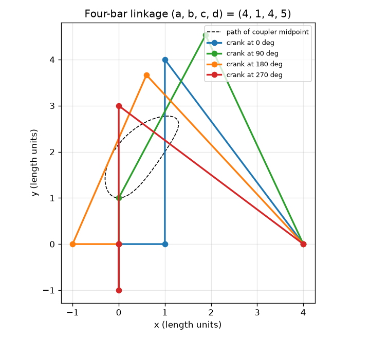
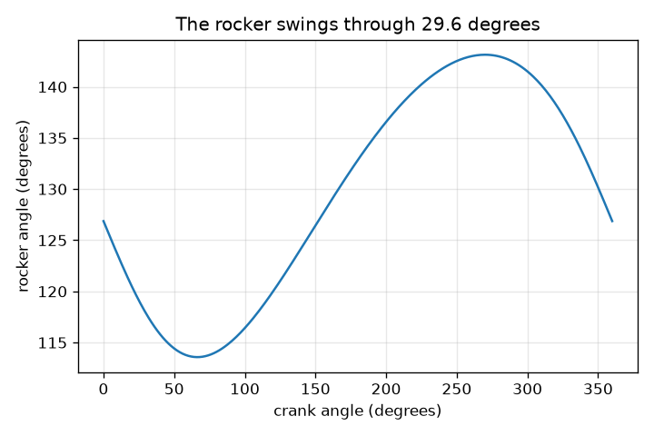

# அமர்வு 1: நான்கு கம்பிகள், நான்கு ஊசிகள், ஒரு இயக்கம்

[Session 1 — हिन्दी](README.hi.md)

*நிலை 1 (கருத்தியல் ஊடாடும் மாதிரி) · சுமார் 60 நிமிடங்கள் · openlinkage*

> இது எளிமைப்படுத்தப்பட்ட ஒரு கல்வி மாதிரி. இது சரிபார்க்கப்பட்ட வடிவமைப்புக் கருவி அல்ல; உண்மையான கட்டமைப்புகள், மின் நிறுவல்கள், வாகனங்கள், தொழில்துறை செயல்முறைகள் அல்லது மருத்துவ முடிவுகளுக்கு இதைப் பயன்படுத்தக் கூடாது.

**முன்தேவைகள் (Prerequisites)**

- பள்ளி வடிவியல்: வட்டங்கள், முக்கோணங்கள், கோணங்கள்.
- நீங்கள் PRIMER.md படித்து, `python start.py 1` ஐ ஒரு முறை இயக்கியிருக்க வேண்டும்.

**கற்றல் நோக்கங்கள் (Learning objectives).** இந்த அமர்வுக்குப் பிறகு நீங்கள்:

- சுழலும் ஒரு கம்பி (கிராங்க் (crank)) நான்கு-கம்பி இணைப்பமைப்பில் மற்ற எல்லாக் கம்பிகளின் நிலையையும் தீர்மானிப்பது ஏன் என்று விளக்க முடியும்.
- இரண்டு வட்டங்களைக் கொண்டு நான்கு-கம்பி இணைப்பமைப்பின் ஊசிகளை அமைத்து, கம்பி நீளங்கள் ஒருபோதும் மாறுவதில்லை என்பதைச் சரிபார்க்க முடியும்.
- கிராங்க் கோணத்திற்கு எதிரான ராக்கர் கோணத்தின் வரைபடத்தைப் படித்து ராக்கரின் ஆட்டத்தைக் (swing) கண்டறிய முடியும்.
- இணைப்பிக் (coupler) புள்ளி வரையும் வளைவையும், கம்பியில் அதன் நிலை வளைவை எப்படி மாற்றுகிறது என்பதையும் விவரிக்க முடியும்.

## A. நிஜ உலகப் பிரச்சனை
கண்ணாடித் துடைப்பான், நடக்கும் பொம்மை, சைக்கிள் தாங்கு அமைப்பு ஆகிய அனைத்தும் ஊசிகளில் இணைக்கப்பட்ட விறைப்பான கம்பிகளால் இயங்குகின்றன. யாரும் ஒவ்வொரு கம்பியையும் தள்ளுவதில்லை: ஒரு மோட்டார் ஒரு கம்பியைச் (கிராங்க்) சுழற்றுகிறது, மற்றவை அனைத்தும் நிலையான முறையில் பின்தொடர்கின்றன. இன்னும் விந்தை, நடுக் கம்பியில் (இணைப்பி) உள்ள ஒரு புள்ளி ஒரு வளைவை வரைகிறது, அந்த வளைவை ஏறத்தாழ நேராக அமைக்க முடியும், சில நடக்கும் இயந்திரங்கள் தங்கள் பாதங்களை நகர்த்தும் விதம் அதுவே. நான்கு ஊசிகளில் இணைக்கப்பட்ட சில விறைப்புக் கம்பிகள் ஒரு நிலையான சுழற்சியை ஆடும் இயக்கமாகவும் சுற்றும் பாதையாகவும் எப்படி மாற்ற முடியும்?

## B. கருத்தும் கோட்பாடும்
சட்டத்தின் (தரைக் கம்பி) நீளம் a, அதன் நிலையான ஊசிகள் O2 = (0, 0) மற்றும் O4 = (a, 0)-ல் உள்ளன. கிராங்க் (நீளம் b) O2-ஐச் சுற்றிச் சுழல்கிறது, எனவே அதன் சுதந்திர முனை A, b(cos t, sin t)-ல் உள்ளது. இணைப்பி (நீளம் c) A-ஐ ஒரு ஊசி B உடன் இணைக்கிறது, ராக்கர் (நீளம் d) B-ஐ O4 உடன் இணைக்கிறது. எனவே B, A-லிருந்து c தூரத்திலும் O4-லிருந்து d தூரத்திலும் உள்ளது: இரண்டு வட்டங்கள் சந்திக்கும் இடத்தில். B-ஐக் கண்டறிய, A மையமாக c ஆரமுள்ள ஒரு வட்டத்தையும் O4 மையமாக d ஆரமுள்ள மற்றொன்றையும் வரையுங்கள். அவை பொதுவாக இரண்டு புள்ளிகளில் சந்திக்கின்றன, இரண்டு சாத்தியமான பொருத்தங்களைத் தருகின்றன; இந்தப் பாடம் A-லிருந்து O4-க்கான திசைக்கோட்டின் இடப்பக்கப் புள்ளியைத் தேர்ந்தெடுக்கிறது. கிராங்க் கோணம் t தேர்ந்தெடுக்கப்பட்டவுடன், A, B, ராக்கர் கோணம் அனைத்தும் நிர்ணயிக்கப்படுகின்றன: இணைப்பமைப்புக்கு ஒரே ஒரு சுதந்திரம் உண்டு. தளத்தில் உள்ள ஒரு கம்பிக்கு 3 சுதந்திரங்கள் (x, y, கோணம்); ஒரு ஊசி 2-ஐ நீக்குகிறது, தரைக் கம்பி நிலையானது, எனவே n கம்பிகளும் j ஊசிகளும் M = 3(n - 1) - 2j சுதந்திரங்களை மிச்சப்படுத்துகின்றன. நான்கு-கம்பிக்கு, M = 3*3 - 2*4 = 1. ஒவ்வொரு ராக்கர் எல்லையிலும் கிராங்கும் இணைப்பியும் ஒரே நேர்கோட்டில் இருக்கும். O2-லிருந்து B-க்கான தூரம் அவை ஒரே திசையில் இருக்கும்போது c + b, மடங்கும்போது |c - b|. இரண்டு ராக்கர் கோணங்களையும் கண்டறிய முக்கோணம் O2-O4-B-ல் கொசைன் விதியைப் (law of cosines) பயன்படுத்துங்கள்; அவற்றின் வேறுபாடே ஆட்டம்.

| குறியீடு | பொருள் | அலகு |
|---|---|---|
| a | தரைக் கம்பி: O2 முதல் O4 வரையிலான தூரம் (a, b, c, d ஒரே அலகில் உள்ள நீளங்கள்) | நீள அலகுகள் |
| b | கிராங்க் நீளம் (O2 முதல் A வரை) | நீள அலகுகள் |
| c | இணைப்பி நீளம் (A முதல் B வரை) | நீள அலகுகள் |
| d | ராக்கர் நீளம் (O4 முதல் B வரை) | நீள அலகுகள் |
| t | +x அச்சிலிருந்து கிராங்க் கோணம் | டிகிரி |
| k | இணைப்பிப் புள்ளி P = A + k (B - A), k = 0.5 நடுவில் உள்ளது | அலகு இல்லை |
| n, j, M | கம்பிகளின் எண்ணிக்கை, ஊசிகளின் எண்ணிக்கை, சுதந்திரங்களின் எண்ணிக்கை | அலகு இல்லை |

**அனுமானங்கள் (Assumptions)**

- எல்லாக் கம்பிகளும் விறைப்பானவை, ஊசிகளில் தளர்வோ உராய்வோ இல்லை.
- எல்லாம் ஒரு தளத்தில் இயங்குகின்றன.
- A-லிருந்து O4-க்கான கோட்டின் இடப்பக்கப் பொருத்தத்தைப் பயன்படுத்துகிறோம் (மற்றப் பொருத்தம் கண்ணாடிப் பிம்பம்).
- உதாரணத்தின் நீளங்கள்: a = 4, b = 1, c = 4, d = 5 (கிராங்க் மிகக் குட்டையான கம்பி).

$$ \mathbf A=b(\cos t,\ \sin t),\qquad \lVert\mathbf B-\mathbf A\rVert=c,\qquad \lVert\mathbf B-\mathbf O_4\rVert=d $$

$$ M=3(n-1)-2j\qquad(\text{four-bar: }3\cdot 3-2\cdot 4=1) $$

$$ \cos\psi=\frac{a^2+d^2-r^2}{2ad},\qquad r=c+b\ \text{or}\ |c-b|\ \text{(the two extreme positions)} $$

$$ \text{swing}=\left|\psi_{c+b}-\psi_{c-b}\right| $$

## C. காட்சி விளக்கம்
முதல் படம் உதாரண இணைப்பமைப்பு (a, b, c, d) = (4, 1, 4, 5)-ஐ நான்கு நிலைகளில், இணைப்பி நடுப்புள்ளியின் கோடிட்ட பாதையுடன் காட்டுகிறது. ஒவ்வொரு நிலையிலும் நான்கு கம்பிகளுக்கும் ஒரே நீளம்; கோணங்கள் மட்டுமே மாறுகின்றன. இரண்டாவது படம் கிராங்க் கோணத்திற்கு எதிராக ராக்கர் கோணத்தை வரைகிறது. கிராங்கின் ஒரு சுற்று ராக்கரை 113.58-க்கும் 143.13 டிகிரிக்கும் இடையே ஆட வைக்கிறது, 29.55 டிகிரி ஆட்டம், பிறகு முழு இயக்கமும் மீண்டும் நிகழ்கிறது.

*நான்கு கிராங்க் கோணங்களில் இணைப்பமைப்பு (4, 1, 4, 5), இணைப்பி நடுப்புள்ளியின் பாதையுடன்.*

*கிராங்க் கோணத்திற்கு எதிரான ராக்கர் கோணம்: 29.55 டிகிரி ஆட்டம்.*

## D. ஊடாடும் உருவகப்படுத்தல்
பாடத்தை இயக்கவும் (`python start.py 1`), பிறகு நேரடிச் செயலியைத் திறக்கவும்: [அமர்வு 1: ஒரு நான்கு-கம்பி இணைப்பமைப்பு](https://krunalpanchal1995.github.io/pan-iit-oss/openlinkage/session-01/) (அல்லது இந்தக் கோப்புறையில் உள்ள `app.html`). கிராங்க் கோண ஸ்லைடரை இழுத்து மற்றக் கம்பிகள் பின்தொடர்வதைப் பாருங்கள், பிறகு இணைப்பிப் புள்ளி ஸ்லைடரை நகர்த்தி கோடிட்ட வளைவு வடிவம் மாறுவதைப் பாருங்கள். வரைபடக் காட்சிக்கு மாறி ராக்கர் கோணத்தைப் படியுங்கள்.

**சவால்.** ராக்கர் மிக இடப்பக்கம் சாயும் கோணத்திற்கு (270 டிகிரி) கிராங்கைத் திருப்பி, இணைப்பிப் புள்ளியை ஊசி B மீது (k = 1) வையுங்கள்.

## E. தீர்க்கப்பட்ட உதாரணமும் சோதனையும்
**பிரச்சனை.** (a, b, c, d) = (4, 1, 4, 5)-க்கு, கிராங்க் தரைக் கம்பியோடு படுத்திருக்கும்போது (t = 0) ஊசி B-யையும் ராக்கர் கோணத்தையும் கண்டறியுங்கள். பிறகு ராக்கரின் மொத்த ஆட்டத்தைக் கண்டறியுங்கள்.

1. t = 0-ல் கிராங்க் நுனி A = (1, 0). ராக்கர் சுழல்புள்ளி O4 = (4, 0), எனவே A, O4-லிருந்து 3 அலகு தொலைவில் உள்ளது.
2. B, A-லிருந்து 4-ம் O4-லிருந்து 5-ம் ஆகும். 3, 4, 5 பக்கங்கள் கொண்ட முக்கோணத்தில் 3-க்கும் 4-க்கும் இடையே செங்கோணம் உள்ளது, எனவே B நேராக A-க்கு மேலே உள்ளது: B = (1, 4).
3. ராக்கர் O4 = (4, 0)-லிருந்து B = (1, 4)-ஐ நோக்கிச் செல்கிறது, திசையன் (-3, 4). +x அச்சிலிருந்து அதன் கோணம் atan2(4, -3) = 126.87 டிகிரி.
4. எல்லைகள்: |O2 B| = c + b = 5 தருவது cos(psi) = (16 + 25 - 25)/40 = 0.4, psi = 66.42 டிகிரி; |O2 B| = c - b = 3 தருவது cos(psi) = (16 + 25 - 9)/40 = 0.8, psi = 36.87 டிகிரி.
5. ஆட்டம் = 66.42 - 36.87 = 29.55 டிகிரி. முழுச் சுற்றில் ராக்கர் கோணத்தின் மாதிரிச் சரிபார்ப்பு அதே ஆட்டத்தைத் தருகிறது.

**விடை.** B = (1, 4), t = 0-ல் ராக்கர் கோணம் 126.87 டிகிரி, ராக்கர் 29.55 டிகிரி ஆடுகிறது (113.58-க்கும் 143.13 டிகிரிக்கும் இடையே).

**சோதனை.** 4, 1, 4, 5 cm நீளமுள்ள நான்கு அட்டைத் துண்டுகளை (முனைகளில் துளைகளுடன்) வெட்டி, காகித இணைப்பிகளால் இணைத்து, 4 cm தரைத் துண்டை ஒரு பலகையில் பொருத்துங்கள். 1 cm கிராங்கைக் கையால் சுழற்றி, கிராங்க் கோணங்கள் 0, 90, 180, 270 டிகிரியில் கோணமானியால் ராக்கர் கோணத்தைக் குறித்து 126.87, 115.06, 132.84, 143.13 டிகிரியுடன் ஒப்பிடுங்கள். சில டிகிரிக்குள் ஒத்துப்போகும் என்று எதிர்பாருங்கள். துளை இடைவெளியிலும் இணைப்பிகளின் தளர்விலும் இருந்து வேறுபாடுகள் வருகின்றன: மாதிரியில் முழுமையான விறைப்புக் கம்பிகளும் பூஜ்ஜிய அளவு ஊசிகளும் உள்ளன.

## F. மதிப்பீடும் வடிவமைப்புச் சவாலும்
**கேள்வி வகை A: கருத்தியல்.** கிராங்கை மட்டும் சுழற்றுவது இணைப்பி மற்றும் ராக்கரின் நிலையையும் தீர்மானிப்பது ஏன்? இணைப்பமைப்புக்கு இரண்டு மோட்டார்கள் தேவைப்பட என்ன வேறுபட வேண்டும்?

குறிப்பு

சுதந்திரங்களை எண்ணுங்கள்: M = 3(n - 1) - 2j. ஒரு ஊசி எதை நீக்குகிறது?

படிப்படியான தீர்வு

நான்கு ஊசிகளில் ஒவ்வொன்றும் ஒரு சுதந்திரத் தளக் கம்பிக்கு உள்ள 3 சுதந்திரங்களில் 2-ஐ நீக்குகிறது, ஒரு கம்பி தரையில் நிலைநிறுத்தப்பட்டுள்ளது, எனவே M = 3*3 - 2*4 = 1: ஒரே உள்ளீடு எல்லாவற்றையும் தீர்மானிக்கிறது. வடிவியல் ரீதியாக, கிராங்க் கோணம் தேர்ந்தெடுக்கப்பட்டால் A தெரியும், B, A-லிருந்து c தூரத்திலும் O4-லிருந்து d தூரத்திலும் இருக்க வேண்டும், இது அதிகபட்சம் இரண்டு புள்ளிகளை விடுகிறது (இரண்டு வட்டங்கள் இருமுறை சந்திக்கும்). இரண்டு மோட்டார்கள் தேவைப்பட இணைப்பமைப்புக்கு M = 2 வேண்டும், எடுத்துக்காட்டாக 5 ஊசிகள் கொண்ட ஐந்து-கம்பி வளையம்: M = 3*4 - 2*5 = 2.

**கேள்வி வகை B: எண்ணியல்.** (a, b, c, d) = (4, 1, 4, 5)-க்கு, கிராங்க் கோணம் 180 டிகிரியாக இருக்கும்போது ஊசி B-யையும் ராக்கர் கோணத்தையும் கண்டறியுங்கள்.

குறிப்பு

A = (-1, 0), எனவே A, O4-லிருந்து 5 தொலைவில் உள்ளது. A-லிருந்து செல்லும் கோட்டின் வழியாக x = (c^2 - d^2 + D^2)/(2D), அதன் குறுக்கே h = sqrt(c^2 - x^2) பயன்படுத்துங்கள்.

படிப்படியான தீர்வு

D = 5, x = (16 - 25 + 25)/10 = 1.6, h = sqrt(16 - 2.56) = 3.666. A-லிருந்து O4-க்கான கோடு +x திசையில் செல்கிறது, எனவே B = (-1 + 1.6, 3.666) = (0.6, 3.666). O4-லிருந்து ராக்கர் திசையன் (0.6 - 4, 3.666) = (-3.4, 3.666), எனவே கோணம் atan2(3.666, -3.4) = 132.84 டிகிரி. சரிபார்ப்பு: B-லிருந்து O4-க்கான தூரம் sqrt(11.56 + 13.44) = 5.

**கேள்வி வகை C: வரைபடம் மற்றும் உருவகப்படுத்தல் விளக்கம்.** கிராங்க் கோணத்திற்கு எதிரான ராக்கர் கோண வரைபடத்தில், ராக்கர் அதன் இரண்டு எல்லை நிலைகளில் எந்தக் கிராங்க் கோணங்களில் உள்ளது, ஆட்டம் எவ்வளவு பெரியது?

குறிப்பு

எல்லைகள் வளைவின் மிக உயர்ந்த, மிகத் தாழ்ந்த புள்ளிகள். கிராங்கும் இணைப்பியும் ஒரே நேர்கோட்டில் எப்போது வரும் என்று சிந்தியுங்கள்.

படிப்படியான தீர்வு

ராக்கர் கோணம் மிகப் பெரியது (143.13 டிகிரி) கிராங்க் கோணம் 270 டிகிரியில், அங்கே கிராங்க் இணைப்பியோடு மடங்கியுள்ளது (|O2 B| = c - b = 3), மிகச் சிறியது (113.58 டிகிரி) கிராங்க் கோணம் சுமார் 66.4 டிகிரியில், அங்கே கிராங்கும் இணைப்பியும் ஒரே திசையில் உள்ளன (|O2 B| = c + b = 5). ஆட்டம் 143.13 - 113.58 = 29.55 டிகிரி.

**கேள்வி வகை D: வடிவமைப்பு மற்றும் உகப்பாக்கச் சவால்.** வடிவமைப்பு: a = 4, c = 4, d = 5 உடன் ராக்கர் குறைந்தது 40 டிகிரி ஆட வேண்டும். 1.0, 1.5, 2.0-ல் இருந்து ஒரு கிராங்க் நீளத்தைத் தேர்ந்தெடுத்து உங்கள் தேர்வை நியாயப்படுத்துங்கள்.

குறிப்பு

இரண்டு எல்லை நிலைகளிலும் கொசைன் விதியைப் பயன்படுத்தி ஒவ்வொரு கிராங்க் நீளத்திற்கும் ஆட்டத்தைக் கணக்கிடுங்கள்.

படிப்படியான தீர்வு

ஆட்டங்கள் 29.55 டிகிரி (b = 1.0), 44.72 டிகிரி (b = 1.5), 60.49 டிகிரி (b = 2.0). b = 1.5 மற்றும் b = 2.0 மட்டுமே 40 டிகிரியை எட்டுகின்றன. வேலை செய்யும் மிகச் சிறிய கிராங்க், b = 1.5, 44.72 டிகிரி ஆட்டம் தருகிறது, சுமார் 4.7 டிகிரி இடைவெளி. b = 2.0 60.49 டிகிரி ஆடுகிறது, தேவையை விட மிக அதிகம், எனவே ராக்கர் பயன்பாடு கோருவதை விட வேகமாக நகரும். அனுமானம்: இங்கே ஆட்டம் மட்டுமே முக்கியம்; அமர்வு 2 பரிமாற்றக் கோணத்தைச் சேர்க்கிறது.

[RUBRIC.md](../../RUBRIC.md) மூலம் உங்களை மதிப்பிட்டுக் கொள்ளுங்கள். காகிதத்தில் செய்ய [செயல்பாட்டுத் தாள்](activity_sheet.md) அச்சிடுங்கள்.

## பொதுவான தவறான கருத்துகள்
| பொதுவான தவறான கருத்து | உண்மையில் சரியானது |
|---|---|
| இணைப்பி எதுவும் செய்யாத வெறும் இணைப்புக் கம்பி. | இணைப்பி மிகவும் செறிவான கம்பி: அதிலுள்ள ஒவ்வொரு புள்ளியும் தனக்கே உரிய வளைவை வரைகிறது, காலின் பாதம் சரியாக அத்தகைய ஒரு புள்ளி. |
| ஒரு கிராங்க் கோணம் ராக்கரின் எந்த நிலையையும் தரலாம். | நிலையான கம்பி நீளங்களுக்கு ஒரு கிராங்க் கோணம் அதிகபட்சம் இரண்டு ராக்கர் நிலைகளைத் தருகிறது (இரண்டு வட்டச் சந்திப்புகள்), நாம் ஒன்றைப் பின்பற்றுகிறோம். |
| ராக்கர் ஆட்டம் கிராங்க் ஆட்டத்திற்குச் சமம். | கிராங்க் 360 டிகிரி சுழல்கிறது, ஆனால் இங்கே ராக்கர் 29.55 டிகிரி மட்டுமே ஆடுகிறது; இயக்க வகை சுழற்சியிலிருந்து அலைவுக்கு மாறுகிறது. |
| நீண்ட கிராங்க் இயந்திரத்தைப் பெரிதாக்குகிறது, வேறெதையும் மாற்றாது. | கிராங்க் நீளம் ராக்கர் ஆட்டத்தை நிர்ணயிக்கிறது: b = 1, 1.5, 2-க்கு 29.55, 44.72, 60.49 டிகிரி. |

## சொற்களஞ்சியம் (Glossary)
- **இணைப்பமைப்பு (linkage)**: ஒன்றாக இயங்கும்படி ஊசிகளில் இணைக்கப்பட்ட கம்பிகள்
- **கிராங்க் (crank)**: ஒரு நிலையான ஊசியைச் சுற்றி முழுமையாகச் சுழலும் கம்பி
- **இணைப்பி (coupler)**: கிராங்கையும் ராக்கரையும் இணைக்கும் நடுக் கம்பி; அதன் புள்ளிகள் இணைப்பி வளைவுகளை வரைகின்றன
- **ராக்கர் (rocker)**: ஒரு நிலையான ஊசியைச் சுற்றி முன்னும் பின்னும் ஆடும் வெளியீட்டுக் கம்பி
- **தரை (ground)**: இரண்டு நிலையான ஊசிகளுக்கு இடையிலுள்ள நிலையான சட்டக் கம்பி
- **சுதந்திர அளவுகள் (degrees of freedom)**: ஒரு இயக்கமைப்பின் நிலையைத் தீர்மானிக்கத் தேவையான சுதந்திர உள்ளீடுகளின் எண்ணிக்கை (இயங்குதிறன் M)

## நிறைவு
1. [exercises.md](exercises.md) இல் உள்ள மூன்று நிரலாக்கப் பணிகளைச் செய்யுங்கள்.
2. உங்கள் மாற்றங்களுக்குப் பிறகு `python start.py 1` ஐ மீண்டும் இயக்குங்கள். அது சோதனைச் சாவடியுடன் (checkpoint) முடிகிறது; அது `PASS` என அச்சிடும்போது, நீங்கள் முடித்துவிட்டீர்கள். (சோதனைச் சாவடி மட்டும்: `python start.py check 1`.)

அடுத்து: [அமர்வு 2](../session-02/README.md)
