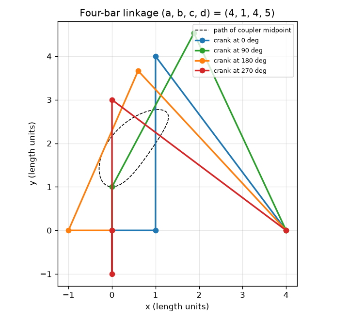
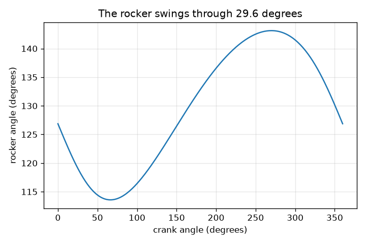

# సెషన్ 1: నాలుగు కడ్డీలు, నాలుగు పిన్నులు, ఒక చలనం

[Session 1 — हिन्दी](README.hi.md)

*స్థాయి 1 (భావనాత్మక ఇంటరాక్టివ్ మోడల్) · సుమారు 60 నిమిషాలు · openlinkage*

> ఇది సరళీకరించిన విద్యా మోడల్. ఇది ధృవీకరించబడిన డిజైన్ సాధనం కాదు; నిజమైన నిర్మాణాలు, విద్యుత్ ఇన్‌స్టాలేషన్‌లు, వాహనాలు, పారిశ్రామిక ప్రక్రియలు లేదా వైద్య నిర్ణయాల కోసం దీనిని ఉపయోగించకూడదు.

**ముందస్తు అవసరాలు (Prerequisites)**

- పాఠశాల జ్యామితి: వృత్తాలు, త్రిభుజాలు, కోణాలు.
- మీరు PRIMER.md చదివి, `python start.py 1` ను ఒకసారి రన్ చేసి ఉండాలి.

**అభ్యాస లక్ష్యాలు (Learning objectives).** ఈ సెషన్ తర్వాత మీరు:

- తిరిగే ఒక కడ్డీ (క్రాంక్ (crank)) ఫోర్-బార్ లింకేజ్‌లోని మిగిలిన అన్ని కడ్డీల స్థానాన్ని ఎందుకు నిర్ణయిస్తుందో వివరించగలరు.
- రెండు వృత్తాలతో ఫోర్-బార్ లింకేజ్ పిన్నులను ఉంచి, కడ్డీల పొడవులు ఎప్పుడూ మారవని సరిచూడగలరు.
- క్రాంక్ కోణానికి వ్యతిరేకంగా రాకర్ కోణం గ్రాఫ్‌ను చదివి రాకర్ ఊపును (swing) కనుగొనగలరు.
- కప్లర్ బిందువు గీసే వక్రాన్ని, కడ్డీపై దాని స్థానం వక్రాన్ని ఎలా మారుస్తుందో వివరించగలరు.

## A. నిజ జీవిత సమస్య
విండ్‌స్క్రీన్ వైపర్, నడిచే బొమ్మ, సైకిల్ సస్పెన్షన్ అన్నీ పిన్నులతో కలిపిన దృఢమైన కడ్డీలతో కదులుతాయి. ఎవరూ ప్రతి కడ్డీని నెట్టరు: ఒక మోటారు ఒక కడ్డీని (క్రాంక్) తిప్పుతుంది, మిగిలినవన్నీ నిర్ణీత పద్ధతిలో అనుసరిస్తాయి. ఇంకా విచిత్రం, మధ్య కడ్డీపై (కప్లర్) ఒక బిందువు ఒక వక్రాన్ని గీస్తుంది, ఆ వక్రాన్ని దాదాపు సరళరేఖగా తీర్చిదిద్దవచ్చు, కొన్ని నడిచే యంత్రాలు తమ పాదాలను కదిలించేది అలాగే. నాలుగు పిన్నులతో కలిపిన కొన్ని దృఢ కడ్డీలు ఒక స్థిర భ్రమణాన్ని ఊగే చలనంగా మరియు తిరిగే మార్గంగా ఎలా మార్చగలవు?

## B. భావన మరియు సిద్ధాంతం
ఫ్రేమ్ (గ్రౌండ్ బార్) పొడవు a, దాని స్థిర పిన్నులు O2 = (0, 0) మరియు O4 = (a, 0) వద్ద ఉన్నాయి. క్రాంక్ (పొడవు b) O2 చుట్టూ తిరుగుతుంది, కాబట్టి దాని స్వేచ్ఛా చివర A, b(cos t, sin t) వద్ద ఉంది. కప్లర్ (పొడవు c) A ను ఒక పిన్ను B తో కలుపుతుంది, రాకర్ (పొడవు d) B ను O4 తో కలుపుతుంది. కాబట్టి B, A నుండి c దూరంలో మరియు O4 నుండి d దూరంలో ఉంది: రెండు వృత్తాలు కలిసే చోట. B ను కనుగొనడానికి, A కేంద్రంగా c వ్యాసార్థం గల వృత్తాన్ని, O4 కేంద్రంగా d వ్యాసార్థం గల మరొకదాన్ని గీయండి. అవి సాధారణంగా రెండు బిందువుల వద్ద కలుస్తాయి, రెండు సాధ్యమైన అమరికలను ఇస్తాయి; ఈ పాఠం A నుండి O4 కు దిశా రేఖకు ఎడమవైపు ఉన్న బిందువును ఎంచుకుంటుంది. క్రాంక్ కోణం t ఎంచుకున్న తర్వాత, A, B, రాకర్ కోణం అన్నీ నిర్ణయించబడతాయి: లింకేజ్‌కు ఒక స్వేచ్ఛ ఉంది. తలంలో ఒక కడ్డీకి 3 స్వేచ్ఛలు (x, y, కోణం); ఒక పిన్ను 2 ను తొలగిస్తుంది, గ్రౌండ్ బార్ స్థిరం, కాబట్టి n కడ్డీలు మరియు j పిన్నులు M = 3(n - 1) - 2j స్వేచ్ఛలను మిగులుస్తాయి. ఫోర్-బార్‌కు, M = 3*3 - 2*4 = 1. ప్రతి రాకర్ అంచు వద్ద క్రాంక్ మరియు కప్లర్ ఒకే సరళరేఖపై ఉంటాయి. O2 నుండి B కు దూరం అవి ఒకే దిశలో ఉన్నప్పుడు c + b, మడిచినప్పుడు |c - b|. రెండు రాకర్ కోణాలను కనుగొనడానికి త్రిభుజం O2-O4-B లో కొసైన్ నియమాన్ని (law of cosines) ఉపయోగించండి; వాటి భేదమే ఊపు.

| చిహ్నం | అర్థం | యూనిట్ |
|---|---|---|
| a | గ్రౌండ్ బార్: O2 నుండి O4 కు దూరం (a, b, c, d ఒకే యూనిట్‌లో పొడవులు) | పొడవు యూనిట్లు |
| b | క్రాంక్ పొడవు (O2 నుండి A వరకు) | పొడవు యూనిట్లు |
| c | కప్లర్ పొడవు (A నుండి B వరకు) | పొడవు యూనిట్లు |
| d | రాకర్ పొడవు (O4 నుండి B వరకు) | పొడవు యూనిట్లు |
| t | +x అక్షం నుండి క్రాంక్ కోణం | డిగ్రీలు |
| k | కప్లర్ బిందువు P = A + k (B - A), k = 0.5 మధ్యలో ఉంది | యూనిట్ లేదు |
| n, j, M | కడ్డీల సంఖ్య, పిన్నుల సంఖ్య, స్వేచ్ఛల సంఖ్య | యూనిట్ లేదు |

**ఊహలు (Assumptions)**

- అన్ని కడ్డీలు దృఢమైనవి, పిన్నులకు వదులు లేదా ఘర్షణ లేదు.
- అన్నీ ఒకే తలంలో కదులుతాయి.
- A నుండి O4 కు రేఖకు ఎడమవైపు అమరికను ఉపయోగిస్తాము (మరొక అమరిక ప్రతిబింబం).
- ఉదాహరణ పొడవులు: a = 4, b = 1, c = 4, d = 5 (క్రాంక్ అతి చిన్న కడ్డీ).

$$ \mathbf A=b(\cos t,\ \sin t),\qquad \lVert\mathbf B-\mathbf A\rVert=c,\qquad \lVert\mathbf B-\mathbf O_4\rVert=d $$

$$ M=3(n-1)-2j\qquad(\text{four-bar: }3\cdot 3-2\cdot 4=1) $$

$$ \cos\psi=\frac{a^2+d^2-r^2}{2ad},\qquad r=c+b\ \text{or}\ |c-b|\ \text{(the two extreme positions)} $$

$$ \text{swing}=\left|\psi_{c+b}-\psi_{c-b}\right| $$

## C. దృశ్య వివరణ
మొదటి చిత్రం ఉదాహరణ లింకేజ్ (a, b, c, d) = (4, 1, 4, 5) ను నాలుగు స్థితుల్లో, కప్లర్ మధ్య బిందువు యొక్క చుక్కల మార్గంతో చూపిస్తుంది. ప్రతి స్థితిలో నాలుగు కడ్డీలకు ఒకే పొడవు; కోణాలు మాత్రమే మారుతాయి. రెండవ చిత్రం క్రాంక్ కోణానికి వ్యతిరేకంగా రాకర్ కోణాన్ని గీస్తుంది. క్రాంక్ యొక్క ఒక తిరుగుడు రాకర్‌ను 113.58 మరియు 143.13 డిగ్రీల మధ్య ఊగేలా చేస్తుంది, 29.55 డిగ్రీల ఊపు, తర్వాత మొత్తం చలనం పునరావృతమవుతుంది.

*నాలుగు క్రాంక్ కోణాల వద్ద లింకేజ్ (4, 1, 4, 5), కప్లర్ మధ్య బిందువు మార్గంతో.*

*క్రాంక్ కోణానికి వ్యతిరేకంగా రాకర్ కోణం: 29.55 డిగ్రీల ఊపు.*

## D. ఇంటరాక్టివ్ సిమ్యులేషన్
పాఠాన్ని రన్ చేయండి (`python start.py 1`), తర్వాత లైవ్ యాప్‌ను తెరవండి: [సెషన్ 1: ఒక ఫోర్-బార్ లింకేజ్](https://krunalpanchal1995.github.io/pan-iit-oss/openlinkage/session-01/) (లేదా ఈ ఫోల్డర్‌లోని `app.html`). క్రాంక్ కోణ స్లయిడర్‌ను లాగి మిగిలిన కడ్డీలు అనుసరించడం చూడండి, తర్వాత కప్లర్ బిందు స్లయిడర్‌ను కదిలించి చుక్కల వక్రం ఆకారం మారడం చూడండి. గ్రాఫ్ వ్యూకు మారి రాకర్ కోణాన్ని చదవండి.

**సవాలు.** రాకర్ అత్యంత ఎడమ వైపు వాలే కోణానికి (270 డిగ్రీలు) క్రాంక్‌ను తిప్పి, కప్లర్ బిందువును పిన్ను B పై (k = 1) ఉంచండి.

## E. సాధించిన ఉదాహరణ మరియు ప్రయోగం
**సమస్య.** (a, b, c, d) = (4, 1, 4, 5) కు, క్రాంక్ గ్రౌండ్ బార్ వెంట పడుకుని ఉన్నప్పుడు (t = 0) పిన్ను B ను మరియు రాకర్ కోణాన్ని కనుగొనండి. తర్వాత రాకర్ మొత్తం ఊపును కనుగొనండి.

1. t = 0 వద్ద క్రాంక్ కొన A = (1, 0). రాకర్ పివట్ O4 = (4, 0), కాబట్టి A, O4 నుండి 3 యూనిట్ల దూరంలో ఉంది.
2. B, A నుండి 4 మరియు O4 నుండి 5 దూరంలో ఉంది. 3, 4, 5 భుజాలు గల త్రిభుజానికి 3 మరియు 4 మధ్య లంబకోణం ఉంటుంది, కాబట్టి B నేరుగా A పైన ఉంది: B = (1, 4).
3. రాకర్ O4 = (4, 0) నుండి B = (1, 4) వైపు చూపుతుంది, సదిశ (-3, 4). +x అక్షం నుండి దాని కోణం atan2(4, -3) = 126.87 డిగ్రీలు.
4. అంచులు: |O2 B| = c + b = 5 ఇచ్చేది cos(psi) = (16 + 25 - 25)/40 = 0.4, psi = 66.42 డిగ్రీలు; |O2 B| = c - b = 3 ఇచ్చేది cos(psi) = (16 + 25 - 9)/40 = 0.8, psi = 36.87 డిగ్రీలు.
5. ఊపు = 66.42 - 36.87 = 29.55 డిగ్రీలు. పూర్తి తిరుగుడులో రాకర్ కోణం నమూనా సరిచూపు అదే ఊపును ఇస్తుంది.

**సమాధానం.** B = (1, 4), t = 0 వద్ద రాకర్ కోణం 126.87 డిగ్రీలు, రాకర్ 29.55 డిగ్రీలు ఊగుతుంది (113.58 మరియు 143.13 డిగ్రీల మధ్య).

**ప్రయోగం.** 4, 1, 4, 5 cm పొడవు గల నాలుగు కార్డ్‌బోర్డ్ పట్టీలను (చివర్లలో రంధ్రాలతో) కత్తిరించి, పేపర్ ఫాస్టెనర్లతో కలిపి, 4 cm గ్రౌండ్ పట్టీని బోర్డుపై పిన్ చేయండి. 1 cm క్రాంక్‌ను చేతితో తిప్పి, క్రాంక్ కోణాలు 0, 90, 180, 270 డిగ్రీల వద్ద ప్రొట్రాక్టర్‌తో రాకర్ కోణాన్ని గుర్తించి 126.87, 115.06, 132.84, 143.13 డిగ్రీలతో పోల్చండి. కొన్ని డిగ్రీల లోపల సరిపోలిక ఆశించండి. రంధ్రాల దూరం మరియు ఫాస్టెనర్ల వదులు వల్ల తేడాలు వస్తాయి: మోడల్‌లో పూర్తి దృఢమైన కడ్డీలు మరియు సున్నా పరిమాణం గల పిన్నులు ఉన్నాయి.

## F. మూల్యాంకనం మరియు డిజైన్ సవాలు
**ప్రశ్న రకం A: భావనాత్మక.** క్రాంక్‌ను మాత్రమే తిప్పడం కప్లర్ మరియు రాకర్ స్థానాన్ని కూడా ఎందుకు నిర్ణయిస్తుంది? లింకేజ్‌కు రెండు మోటార్లు అవసరం కావాలంటే ఏది భిన్నంగా ఉండాలి?

సూచన

స్వేచ్ఛలను లెక్కించండి: M = 3(n - 1) - 2j. ఒక పిన్ను ఏమి తొలగిస్తుంది?

దశలవారీ పరిష్కారం

నాలుగు పిన్నుల్లో ప్రతి ఒక్కటి స్వేచ్ఛా తల కడ్డీకి ఉన్న 3 స్వేచ్ఛల్లో 2 ను తొలగిస్తుంది, ఒక కడ్డీ నేలకు స్థిరం, కాబట్టి M = 3*3 - 2*4 = 1: ఒకే ఇన్‌పుట్ అన్నింటినీ నిర్ణయిస్తుంది. జ్యామితీయంగా, క్రాంక్ కోణం ఎంచుకుంటే A తెలుస్తుంది, B, A నుండి c దూరంలో మరియు O4 నుండి d దూరంలో ఉండాలి, ఇది గరిష్టంగా రెండు బిందువులను మిగులుస్తుంది (రెండు వృత్తాలు రెండుసార్లు కలుస్తాయి). రెండు మోటార్లు అవసరం కావాలంటే లింకేజ్‌కు M = 2 ఉండాలి, ఉదాహరణకు 5 పిన్నులున్న ఫైవ్-బార్ లూప్: M = 3*4 - 2*5 = 2.

**ప్రశ్న రకం B: సంఖ్యాత్మక.** (a, b, c, d) = (4, 1, 4, 5) కు, క్రాంక్ కోణం 180 డిగ్రీలు ఉన్నప్పుడు పిన్ను B ను మరియు రాకర్ కోణాన్ని కనుగొనండి.

సూచన

A = (-1, 0), కాబట్టి A, O4 నుండి 5 దూరంలో ఉంది. A నుండి వెళ్ళే రేఖ వెంట x = (c^2 - d^2 + D^2)/(2D), దానికి అడ్డంగా h = sqrt(c^2 - x^2) ఉపయోగించండి.

దశలవారీ పరిష్కారం

D = 5, x = (16 - 25 + 25)/10 = 1.6, h = sqrt(16 - 2.56) = 3.666. A నుండి O4 కు రేఖ +x వైపు చూపుతుంది, కాబట్టి B = (-1 + 1.6, 3.666) = (0.6, 3.666). O4 నుండి రాకర్ సదిశ (0.6 - 4, 3.666) = (-3.4, 3.666), కాబట్టి కోణం atan2(3.666, -3.4) = 132.84 డిగ్రీలు. సరిచూపు: B నుండి O4 కు దూరం sqrt(11.56 + 13.44) = 5.

**ప్రశ్న రకం C: గ్రాఫ్ మరియు సిమ్యులేషన్ వ్యాఖ్యానం.** క్రాంక్ కోణానికి వ్యతిరేకంగా రాకర్ కోణం గ్రాఫ్‌లో, రాకర్ దాని రెండు అంచు స్థానాల్లో ఏ క్రాంక్ కోణాల వద్ద ఉంది, ఊపు ఎంత పెద్దది?

సూచన

అంచులు వక్రం యొక్క అత్యధిక, అత్యల్ప బిందువులు. క్రాంక్ మరియు కప్లర్ ఒకే సరళరేఖపై ఎప్పుడు ఉంటాయో ఆలోచించండి.

దశలవారీ పరిష్కారం

రాకర్ కోణం అత్యధికం (143.13 డిగ్రీలు) క్రాంక్ కోణం 270 డిగ్రీల వద్ద, అక్కడ క్రాంక్ కప్లర్‌కు మడిచి ఉంది (|O2 B| = c - b = 3), అత్యల్పం (113.58 డిగ్రీలు) క్రాంక్ కోణం సుమారు 66.4 డిగ్రీల వద్ద, అక్కడ క్రాంక్ మరియు కప్లర్ ఒకే దిశలో ఉన్నాయి (|O2 B| = c + b = 5). ఊపు 143.13 - 113.58 = 29.55 డిగ్రీలు.

**ప్రశ్న రకం D: డిజైన్ మరియు ఆప్టిమైజేషన్ సవాలు.** డిజైన్: a = 4, c = 4, d = 5 తో రాకర్ కనీసం 40 డిగ్రీలు ఊగాలి. 1.0, 1.5, 2.0 నుండి ఒక క్రాంక్ పొడవును ఎంచుకుని మీ ఎంపికను సమర్థించండి.

సూచన

రెండు అంచు స్థానాల్లో కొసైన్ నియమం ఉపయోగించి ప్రతి క్రాంక్ పొడవుకు ఊపును లెక్కించండి.

దశలవారీ పరిష్కారం

ఊపులు 29.55 డిగ్రీలు (b = 1.0), 44.72 డిగ్రీలు (b = 1.5), 60.49 డిగ్రీలు (b = 2.0). b = 1.5 మరియు b = 2.0 మాత్రమే 40 డిగ్రీలకు చేరుతాయి. పనిచేసే అతి చిన్న క్రాంక్, b = 1.5, 44.72 డిగ్రీల ఊపును ఇస్తుంది, సుమారు 4.7 డిగ్రీల మార్జిన్. b = 2.0 60.49 డిగ్రీలు ఊగుతుంది, అవసరం కంటే చాలా ఎక్కువ, కాబట్టి రాకర్ అనువర్తనం కోరే దానికంటే వేగంగా కదులుతుంది. ఊహ: ఇక్కడ ఊపు మాత్రమే ముఖ్యం; సెషన్ 2 ప్రసార కోణాన్ని (transmission angle) జోడిస్తుంది.

[RUBRIC.md](../../RUBRIC.md) తో మిమ్మల్ని మీరు స్కోర్ చేసుకోండి. కాగితంపై పని చేయడానికి [కార్యాచరణ షీట్](activity_sheet.md) ప్రింట్ చేయండి.

## సాధారణ అపోహలు
| సాధారణ అపోహ | వాస్తవంగా నిజమైనది |
|---|---|
| కప్లర్ ఏమీ చేయని కేవలం కలిపే కడ్డీ. | కప్లర్ అత్యంత సమృద్ధమైన కడ్డీ: దానిపై ప్రతి బిందువు తనదైన వక్రాన్ని గీస్తుంది, కాలి పాదం సరిగ్గా అలాంటి బిందువు. |
| ఒక క్రాంక్ కోణం రాకర్ యొక్క ఏ స్థానాన్నైనా ఇవ్వగలదు. | స్థిర కడ్డీ పొడవులకు ఒక క్రాంక్ కోణం గరిష్టంగా రెండు రాకర్ స్థానాలను ఇస్తుంది (రెండు వృత్త ఖండనలు), మనం ఒకదాన్ని అనుసరిస్తాము. |
| రాకర్ ఊపు క్రాంక్ ఊపుకు సమానం. | క్రాంక్ 360 డిగ్రీలు తిరుగుతుంది, కానీ ఇక్కడ రాకర్ 29.55 డిగ్రీలు మాత్రమే ఊగుతుంది; చలన రకం భ్రమణం నుండి డోలనానికి మారుతుంది. |
| పొడవైన క్రాంక్ యంత్రాన్ని పెద్దది చేస్తుంది, మరేమీ మార్చదు. | క్రాంక్ పొడవు రాకర్ ఊపును నిర్ణయిస్తుంది: b = 1, 1.5, 2 లకు 29.55, 44.72, 60.49 డిగ్రీలు. |

## పదకోశం (Glossary)
- **లింకేజ్ (linkage)**: కలిసి కదిలేలా పిన్నులతో కలిపిన కడ్డీలు
- **క్రాంక్ (crank)**: ఒక స్థిర పిన్ను చుట్టూ పూర్తిగా తిరిగే కడ్డీ
- **కప్లర్ (coupler)**: క్రాంక్ మరియు రాకర్‌ను కలిపే మధ్య కడ్డీ; దాని బిందువులు కప్లర్ వక్రాలను గీస్తాయి
- **రాకర్ (rocker)**: ఒక స్థిర పిన్ను చుట్టూ ముందుకు వెనక్కు ఊగే అవుట్‌పుట్ కడ్డీ
- **గ్రౌండ్ (ground)**: రెండు స్థిర పిన్నుల మధ్య స్థిర ఫ్రేమ్ కడ్డీ
- **స్వేచ్ఛా అంశాలు (degrees of freedom)**: ఒక యంత్రాంగం స్థానాన్ని నిర్ణయించడానికి అవసరమైన స్వతంత్ర ఇన్‌పుట్ల సంఖ్య (మొబిలిటీ M)

## ముగింపు
1. [exercises.md](exercises.md) లోని మూడు కోడింగ్ పనులు చేయండి.
2. మీ మార్పుల తర్వాత `python start.py 1` ను మళ్ళీ రన్ చేయండి. అది చెక్‌పాయింట్‌తో ముగుస్తుంది; అది `PASS` అని ప్రింట్ చేసినప్పుడు, మీరు పూర్తి చేసినట్లు. (చెక్‌పాయింట్ మాత్రమే: `python start.py check 1`.)

తదుపరి: [సెషన్ 2](../session-02/README.md)
