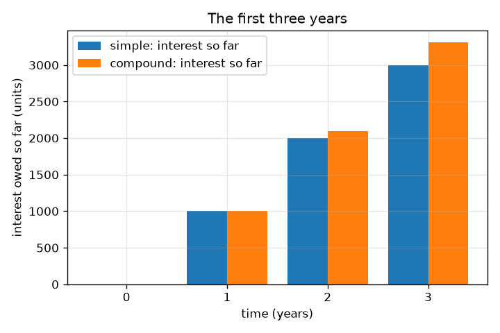
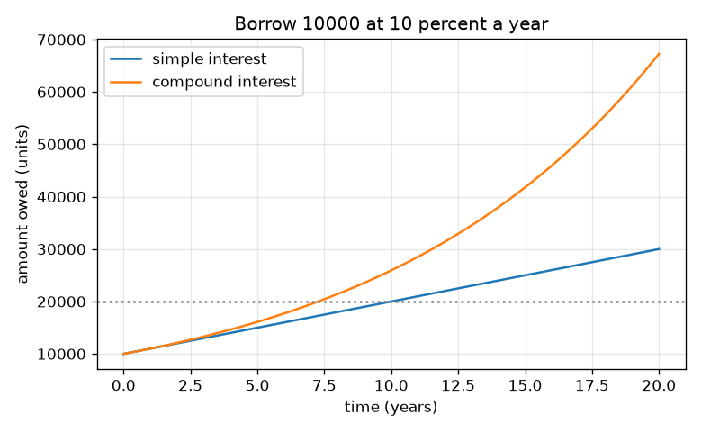

# सत्र 1: आप उधार से अधिक क्यों लौटाते हैं

*स्तर 1 (वैचारिक इंटरैक्टिव मॉडल) · लगभग 60 मिनट · openloan*

> यह एक सरलीकृत शैक्षिक मॉडल (simplified educational model) है। यह कोई सत्यापित डिज़ाइन टूल नहीं है और इसका उपयोग वास्तविक संरचनाओं, बिजली की स्थापनाओं, वाहनों, औद्योगिक प्रक्रियाओं या चिकित्सा निर्णयों के लिए नहीं किया जाना चाहिए।

**पूर्व-आवश्यकताएँ (Prerequisites)**

- प्रतिशत और सरल गुणा।
- आपने PRIMER.md पढ़ लिया है और `python start.py 1` एक बार चला लिया है।

**सीखने के उद्देश्य (Learning objectives).** इस सत्र के बाद आप:

- ब्याज (interest) को किसी और के पैसे का उपयोग करने की कीमत के रूप में समझा सकेंगे।
- साधारण ब्याज (simple interest) और चक्रवृद्धि ब्याज (compound interest) के साथ बकाया राशि निकाल सकेंगे।
- समझा सकेंगे कि चक्रवृद्धि ब्याज साधारण ब्याज से तेज़ी से क्यों बढ़ता है।
- समय के सापेक्ष बकाया राशि का ग्राफ़ पढ़ सकेंगे।

## A. वास्तविक दुनिया की समस्या
एक मित्र आज आपको 10000 इकाइयाँ उधार देता है और केवल 10000 ही वापस चाहता है। बैंक ब्याज लेता है: आप उधार से अधिक लौटाएँगे। अगर ब्याज 10 प्रतिशत प्रति वर्ष है तो 3 वर्ष बाद आप पर कितना बकाया होगा? और जो कर्ज़ अपने आप में ब्याज जोड़ता है, वह और तेज़ी से क्यों बढ़ता जाता है? यह रिपॉज़िटरी काल्पनिक ऋणदाताओं और दरों के साथ सामान्य शिक्षा है; यह वित्तीय सलाह नहीं है।

## B. अवधारणा और सिद्धांत
मूलधन (principal) P उधार ली गई राशि है। दर r भिन्न के रूप में वार्षिक ब्याज है (10 प्रतिशत = 0.10)। साधारण ब्याज में ऋणदाता हर वर्ष केवल मूल P पर r P लेता है, इसलिए t वर्ष बाद आप पर A = P (1 + r t) बकाया है। चक्रवृद्धि ब्याज में हर वर्ष का ब्याज कर्ज़ में जुड़ जाता है, इसलिए अगले वर्ष का ब्याज बड़ी राशि पर लगता है: कर्ज़ हर वर्ष (1 + r) से गुणा होता है और t वर्ष बाद आप पर A = P (1 + r)^t बकाया है। एक वर्ष बाद दोनों बराबर हैं; उसके बाद चक्रवृद्धि ब्याज अधिक है। साधारण ब्याज एक सीधी रेखा में बढ़ता है, चक्रवृद्धि ब्याज ऊपर की ओर मुड़ने वाले वक्र में।

| प्रतीक | अर्थ | इकाई |
|---|---|---|
| P | मूलधन: उधार ली गई राशि | इकाइयाँ (कोई भी मुद्रा) |
| r | भिन्न के रूप में प्रति वर्ष ब्याज दर (0.10 = 10 प्रतिशत) | प्रति वर्ष |
| t | समय | वर्ष |
| A | t वर्ष बाद बकाया राशि | इकाइयाँ |

**मान्यताएँ (Assumptions)**

- अंत तक कुछ भी चुकाया नहीं जाता।
- पूरे समय दर समान रहती है।
- चक्रवृद्धि स्थिति में ब्याज वर्ष में एक बार जोड़ा जाता है।
- सभी ऋणदाता और दरें काल्पनिक हैं।

$$ A_{\text{simple}}=P\,(1+r\,t) $$

$$ A_{\text{compound}}=P\,(1+r)^{t} $$

$$ t_{\text{double, simple}}=\frac{1}{r},\qquad t_{\text{double, compound}}=\frac{\ln 2}{\ln(1+r)} $$

## C. दृश्य व्याख्या
पहला चित्र 10 प्रतिशत पर 10000 इकाइयों के लिए समय के सापेक्ष बकाया राशि दिखाता है: साधारण ब्याज एक सीधी रेखा है, चक्रवृद्धि ब्याज ऊपर की ओर मुड़ता है, और 20 वर्ष बाद वे 30000 और 67275 हैं। दूसरा चित्र पहले तीन वर्षों में से हर वर्ष का बकाया ब्याज स्तंभों के रूप में दिखाता है: दोनों विधियाँ वर्ष 1 में मेल खाती हैं और उसके बाद अलग होती जाती हैं (2 वर्ष बाद 12000 बनाम 12100, 3 वर्ष बाद 13000 बनाम 13310)।

*पहले तीन वर्षों में बकाया ब्याज: वर्ष 1 में बराबर, फिर चक्रवृद्धि आगे निकल जाता है।*

*10 प्रतिशत पर 20 वर्षों में बकाया राशि: एक सीधी रेखा बनाम एक वक्र।*

## D. इंटरैक्टिव सिमुलेशन
पाठ चलाइए (`python start.py 1`), फिर लाइव ऐप खोलिए: [सत्र 1: साधारण बनाम चक्रवृद्धि ब्याज](https://krunalpanchal1995.github.io/pan-iit-oss/openloan/session-01/) (या इस फ़ोल्डर में `app.html`)। मूलधन, दर और वर्ष स्लाइडरों को खिसकाइए। स्तंभ दृश्य में दोनों स्तंभों की तुलना कीजिए, फिर ग्राफ़ दृश्य में सीधी रेखा और वक्र को अलग होते देखिए।

**चुनौती (Challenge).** ऐसी सेटिंग ढूँढिए जहाँ चक्रवृद्धि ब्याज साधारण ब्याज से कम से कम 2000 इकाइयाँ अधिक पड़े।

## E. हल किया गया उदाहरण और प्रयोग
**समस्या.** आप 10 प्रतिशत प्रति वर्ष पर 3 वर्ष के लिए 10000 इकाइयाँ उधार लेते हैं और अंत में सब कुछ चुकाते हैं। साधारण ब्याज और चक्रवृद्धि ब्याज के साथ आप पर कितना बकाया है, और अंतर कितना है?

1. साधारण: ब्याज = 10000 * 0.10 * 3 = 3000, इसलिए आप पर 10000 + 3000 = 13000 बकाया है।
2. चक्रवृद्धि, वर्ष 1: 10000 * 1.1 = 11000।
3. वर्ष 2: 11000 * 1.1 = 12100। वर्ष 3: 12100 * 1.1 = 13310। (या 10000 * 1.1^3 = 13310।)
4. अंतर = 13310 - 13000 = 310 इकाइयाँ: पहले के ब्याज पर लगा ब्याज।

**उत्तर.** साधारण ब्याज: 13000 इकाइयाँ। चक्रवृद्धि ब्याज: 13310 इकाइयाँ। चक्रवृद्धि 310 अधिक पड़ता है।

**प्रयोग (Experiment).** कैलकुलेटर या स्प्रेडशीट का उपयोग कीजिए: 10000 से शुरू कीजिए और हर परिणाम लिखते हुए तीन बार 1.1 से गुणा कीजिए; 10000 + 3 * 1000 से तुलना कीजिए। वास्तविक ऋणदाता ऐसे विवरण जोड़ते हैं जो यह मॉडल छोड़ देता है (शुल्क, दैनिक ब्याज, पूर्णांकन, बदलने वाली दरें), इसलिए वास्तविक विवरण-पत्र मॉडल से थोड़ा अलग होगा। मॉडल अपनी मान्यताओं के लिए सटीक है; वास्तविकता में इनसे अधिक मान्यताएँ होती हैं।

## F. मूल्यांकन और डिज़ाइन चुनौती
**प्रश्न प्रकार A: वैचारिक (Conceptual).** दोनों एक ही दर का उपयोग करते हैं, फिर भी चक्रवृद्धि ब्याज साधारण ब्याज से तेज़ी से क्यों बढ़ता है? वे कब बराबर होते हैं?

संकेत

पूछिए कि दूसरे वर्ष में ब्याज किस पर लगता है।

चरण-दर-चरण हल

साधारण ब्याज में ब्याज हमेशा मूल मूलधन पर लगता है। चक्रवृद्धि ब्याज में पिछले वर्ष का ब्याज कर्ज़ में जुड़ चुका है, इसलिए इस वर्ष का ब्याज बड़ी राशि पर लगता है: ब्याज पर ब्याज। वे ठीक एक वर्ष बाद (और समय शून्य पर) बराबर होते हैं; वर्ष 2 से आगे चक्रवृद्धि अधिक है।

**प्रश्न प्रकार B: संख्यात्मक (Numerical).** आप 8 प्रतिशत प्रति वर्ष पर 2 वर्ष के लिए 5000 इकाइयाँ उधार लेते हैं। साधारण और चक्रवृद्धि ब्याज के साथ बकाया राशि निकालिए। जाँचिए कि आपके उत्तर तर्कसंगत हैं।

संकेत

साधारण: 5000 (1 + 0.08 * 2)। चक्रवृद्धि: 5000 * 1.08 * 1.08।

चरण-दर-चरण हल

साधारण: 5000 * 1.16 = 5800 इकाइयाँ। चक्रवृद्धि: 5000 * 1.1664 = 5832 इकाइयाँ। तर्कसंगतता जाँच (sanity check): दोनों 5000 से अधिक हैं, चक्रवृद्धि साधारण से थोड़ा अधिक है, और अंतर (32 इकाइयाँ) 5000 * 0.08^2 है, यानी पहले वर्ष के ब्याज पर ब्याज।

**प्रश्न प्रकार C: ग्राफ़ और सिमुलेशन की व्याख्या.** 10 प्रतिशत पर 10000 इकाइयों के ग्राफ़ में, 20 वर्ष बाद बकाया राशियाँ क्या हैं, और वक्रों के बीच बढ़ता अंतर आपको क्या बताता है?

संकेत

क्षैतिज अक्ष पर 20 वर्ष पर दोनों वक्रों को पढ़िए।

चरण-दर-चरण हल

साधारण ब्याज 30000 इकाइयाँ देता है, चक्रवृद्धि लगभग 67275 इकाइयाँ। अंतर बढ़ता रहता है क्योंकि साधारण ब्याज हर वर्ष एक ही हिस्सा जोड़ता है जबकि चक्रवृद्धि ब्याज ऐसा हिस्सा जोड़ता है जो कर्ज़ के साथ बढ़ता है। लंबे कर्ज़ों में ही चक्रवृद्धि सबसे अधिक मायने रखता है।

**प्रश्न प्रकार D: डिज़ाइन और अनुकूलन (optimisation) चुनौती.** डिज़ाइन: एक मित्र 12 प्रतिशत साधारण ब्याज पर 5 वर्ष के लिए 10000 इकाइयाँ देने का प्रस्ताव देता है। एक बैंक वही ऋण 10 प्रतिशत चक्रवृद्धि पर देता है। 5 वर्षों में कौन सस्ता है? क्या 20 वर्ष पर आपका उत्तर बदलेगा?

संकेत

5 वर्ष के लिए दोनों राशियाँ निकालिए, फिर सोचिए कि कौन-सा वक्र ऊपर की ओर मुड़ता है।

चरण-दर-चरण हल

मित्र: 10000 * (1 + 0.12 * 5) = 16000 इकाइयाँ। बैंक: 10000 * 1.1^5 = 16105.10 इकाइयाँ। 5 वर्षों में मित्र का प्रस्ताव लगभग 105 इकाइयाँ सस्ता है, भले ही उसकी दर अधिक है। मान्यता: अंत से पहले कुछ भी नहीं चुकाया जाता और कोई शुल्क नहीं। बहुत लंबे समय में चक्रवृद्धि वक्र ऊपर की ओर मुड़ता है और अंततः किसी भी सीधी रेखा को पार कर जाता है, इसलिए उत्तर उलट सकता है। सीख: जितने समय के लिए आप वास्तव में उधार लेंगे उस पूरे समय की कुल राशि की तुलना कीजिए, केवल घोषित दर की नहीं।

[RUBRIC.md](../../RUBRIC.md) से स्वयं को अंक दीजिए। कागज़ पर काम करने के लिए [गतिविधि पत्रक](activity_sheet.md) प्रिंट कीजिए।

## सामान्य भ्रांतियाँ
| सामान्य भ्रांति (misconception) | वास्तव में क्या सच है |
|---|---|
| ब्याज एक निश्चित राशि है जो इस पर निर्भर नहीं करती कि आप कितने समय के लिए उधार लेते हैं। | ब्याज समय के साथ बढ़ता है; जितना लंबा बकाया, उतना अधिक भुगतान। |
| 3 वर्ष के लिए 10 प्रतिशत प्रति वर्ष का अर्थ है 30 प्रतिशत अधिक। | यह केवल साधारण ब्याज के लिए सच है (10000 पर 3000)। चक्रवृद्धि के साथ यह 10000 पर 3310 है, क्योंकि हर वर्ष का ब्याज कर्ज़ में जुड़ जाता है। |
| चक्रवृद्धि ब्याज हमेशा साधारण ब्याज से बहुत अधिक होता है। | वर्ष 1 में वे बराबर हैं और छोटे ऋणों के लिए अंतर छोटा है; यह लंबे समय और ऊँची दरों के लिए बड़ा हो जाता है। |

## शब्दावली
- **मूलधन (principal)**: उधार ली गई राशि
- **ब्याज (interest)**: उधार के पैसे का उपयोग करने के लिए चुकाई गई कीमत
- **साधारण ब्याज (simple interest)**: केवल मूल मूलधन पर लगने वाला ब्याज
- **चक्रवृद्धि ब्याज (compound interest)**: मूलधन और पहले से जोड़े गए ब्याज पर लगने वाला ब्याज
- **दर (rate)**: मूलधन के प्रतिशत या भिन्न के रूप में प्रति वर्ष ब्याज

## समापन
1. [exercises.md](exercises.md) में दिए तीन कोडिंग कार्य कीजिए।
2. अपने बदलावों के बाद `python start.py 1` फिर से चलाइए। यह चेकपॉइंट (checkpoint) के साथ समाप्त होता है; जब यह `PASS` छापे, तो आपका काम पूरा है। (केवल चेकपॉइंट: `python start.py check 1`।)

आगे: [सत्र 2](../session-02/README.md)
