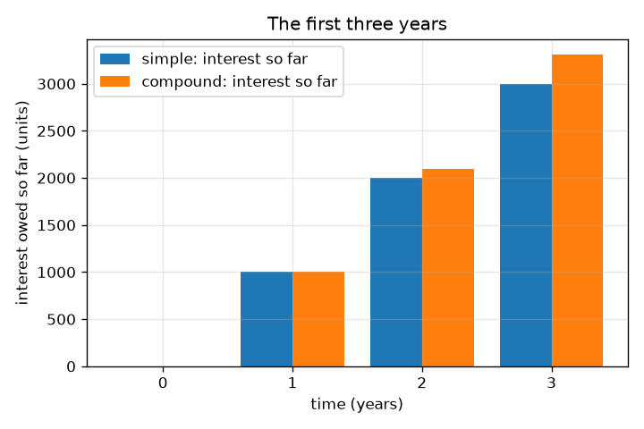
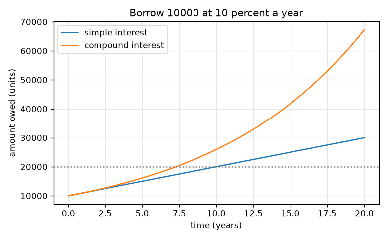

# സെഷൻ 1: കടം വാങ്ങിയതിനേക്കാൾ കൂടുതൽ തിരിച്ചടയ്ക്കുന്നത് എന്തുകൊണ്ട്

[Session 1 — हिन्दी](README.hi.md) · [Session 1 — മലയാളം](README.ml.md)

*ലെവൽ 1 (ആശയപരമായ ഇന്ററാക്ടീവ് മോഡൽ) · ഏകദേശം 60 മിനിറ്റ് · openloan*

> ഇത് ലളിതമാക്കിയ ഒരു വിദ്യാഭ്യാസ മോഡലാണ്. ഇത് സാധൂകരിക്കപ്പെട്ട (validated) ഒരു ഡിസൈൻ ഉപകരണമല്ല; യഥാർത്ഥ നിർമ്മിതികൾ, ഇലക്ട്രിക്കൽ ഇൻസ്റ്റലേഷനുകൾ, വാഹനങ്ങൾ, വ്യാവസായിക പ്രക്രിയകൾ അല്ലെങ്കിൽ മെഡിക്കൽ തീരുമാനങ്ങൾ എന്നിവയ്ക്ക് ഇത് ഉപയോഗിക്കരുത്.

**മുൻ‌വ്യവസ്ഥകൾ (Prerequisites)**

- ശതമാനങ്ങളും ലളിതമായ ഗുണനവും.
- നിങ്ങൾ PRIMER.md വായിക്കുകയും `python start.py 1` ഒരിക്കൽ റൺ ചെയ്യുകയും ചെയ്തിട്ടുണ്ട്.

**പഠന ലക്ഷ്യങ്ങൾ (Learning objectives).** ഈ സെഷനു ശേഷം നിങ്ങൾക്ക് കഴിയും:

- പലിശയെ (interest) മറ്റൊരാളുടെ പണം ഉപയോഗിക്കുന്നതിന്റെ വിലയായി വിശദീകരിക്കാൻ.
- സാധാരണ പലിശ (simple interest), കൂട്ടുപലിശ (compound interest) എന്നിവ ഉപയോഗിച്ച് കടപ്പെട്ട തുക കണക്കാക്കാൻ.
- കൂട്ടുപലിശ സാധാരണ പലിശയെക്കാൾ വേഗത്തിൽ വളരുന്നത് എന്തുകൊണ്ടെന്ന് വിശദീകരിക്കാൻ.
- സമയത്തിനെതിരായ കടപ്പെട്ട തുകയുടെ ഗ്രാഫ് വായിക്കാൻ.

## A. യഥാർത്ഥ ലോക പ്രശ്നം
ഒരു സുഹൃത്ത് ഇന്ന് നിങ്ങൾക്ക് 10000 യൂണിറ്റ് കടം തരുന്നു, 10000 മാത്രം തിരികെ ആഗ്രഹിക്കുന്നു. ഒരു ബാങ്ക് പലിശ ഈടാക്കുന്നു: വാങ്ങിയതിലും കൂടുതൽ നിങ്ങൾ തിരിച്ചടയ്ക്കും. പലിശ വർഷം 10 ശതമാനമാണെങ്കിൽ 3 വർഷത്തിനു ശേഷം നിങ്ങൾ എത്ര കടപ്പെട്ടിരിക്കും? സ്വയം പലിശ ചേർക്കുന്ന ഒരു കടം കൂടുതൽ കൂടുതൽ വേഗത്തിൽ വളരുന്നത് എന്തുകൊണ്ട്? ഈ റിപ്പോസിറ്ററി സാങ്കല്പിക വായ്പാദാതാക്കളും നിരക്കുകളും ഉള്ള പൊതു വിദ്യാഭ്യാസമാണ്; ഇത് സാമ്പത്തിക ഉപദേശമല്ല.

## B. ആശയവും സിദ്ധാന്തവും
മുതൽ (principal) P എന്നത് കടം വാങ്ങിയ തുകയാണ്. നിരക്ക് r എന്നത് ഒരു ഭിന്നസംഖ്യയായി വാർഷിക പലിശയാണ് (10 ശതമാനം = 0.10). സാധാരണ പലിശയിൽ വായ്പാദാതാവ് ഓരോ വർഷവും യഥാർത്ഥ P-ക്ക് മാത്രം r P ഈടാക്കുന്നു, അതിനാൽ t വർഷത്തിനു ശേഷം നിങ്ങൾ A = P (1 + r t) കടപ്പെട്ടിരിക്കും. കൂട്ടുപലിശയിൽ ഓരോ വർഷത്തെ പലിശയും കടത്തിലേക്ക് ചേർക്കുന്നു, അതിനാൽ അടുത്ത വർഷത്തെ പലിശ വലിയ തുകയ്ക്ക് ഈടാക്കുന്നു: കടം ഓരോ വർഷവും (1 + r) കൊണ്ട് ഗുണിക്കപ്പെടുന്നു, t വർഷത്തിനു ശേഷം നിങ്ങൾ A = P (1 + r)^t കടപ്പെട്ടിരിക്കും. ഒരു വർഷത്തിനു ശേഷം രണ്ടും തുല്യമാണ്; അതിനുശേഷം കൂട്ടുപലിശ കൂടുതലാണ്. സാധാരണ പലിശ ഒരു നേർരേഖയിൽ വളരുന്നു, കൂട്ടുപലിശ മുകളിലേക്ക് വളയുന്ന ഒരു വക്രത്തിൽ.

| ചിഹ്നം | അർത്ഥം | യൂണിറ്റ് |
|---|---|---|
| P | മുതൽ: കടം വാങ്ങിയ തുക | യൂണിറ്റുകൾ (ഏത് കറൻസിയും) |
| r | വർഷത്തിലെ പലിശ നിരക്ക് ഭിന്നസംഖ്യയായി (0.10 = 10 ശതമാനം) | per year |
| t | സമയം | വർഷം |
| A | t വർഷത്തിനു ശേഷം കടപ്പെട്ട തുക | യൂണിറ്റുകൾ |

**അനുമാനങ്ങൾ (Assumptions)**

- അവസാനം വരെ ഒന്നും തിരിച്ചടയ്ക്കുന്നില്ല.
- മുഴുവൻ സമയവും നിരക്ക് ഒരേപോലെ തുടരുന്നു.
- കൂട്ടുപലിശയിൽ വർഷത്തിൽ ഒരിക്കൽ പലിശ ചേർക്കുന്നു.
- എല്ലാ വായ്പാദാതാക്കളും നിരക്കുകളും സാങ്കല്പികമാണ്.

$$ A_{\text{simple}}=P\,(1+r\,t) $$

$$ A_{\text{compound}}=P\,(1+r)^{t} $$

$$ t_{\text{double, simple}}=\frac{1}{r},\qquad t_{\text{double, compound}}=\frac{\ln 2}{\ln(1+r)} $$

## C. ദൃശ്യ വിശദീകരണം
ആദ്യ ചിത്രം 10 ശതമാനത്തിൽ 10000 യൂണിറ്റിന് സമയത്തിനെതിരെ കടപ്പെട്ട തുക പ്ലോട്ട് ചെയ്യുന്നു: സാധാരണ പലിശ ഒരു നേർരേഖയാണ്, കൂട്ടുപലിശ മുകളിലേക്ക് വളയുന്നു, 20 വർഷത്തിനു ശേഷം അവ 30000-ഉം 67275-ഉം ആണ്. രണ്ടാമത്തെ ചിത്രം ആദ്യ മൂന്ന് വർഷങ്ങളിലെ കടപ്പെട്ട പലിശ ബാറുകളായി കാണിക്കുന്നു: ഒന്നാം വർഷം രണ്ട് രീതികളും യോജിക്കുന്നു, പിന്നീട് അകന്നുപോകുന്നു (2 വർഷത്തിനു ശേഷം 12000 നെതിരെ 12100, 3 വർഷത്തിനു ശേഷം 13000 നെതിരെ 13310).

*ആദ്യ മൂന്ന് വർഷങ്ങളിൽ കടപ്പെട്ട പലിശ: ഒന്നാം വർഷം തുല്യം, പിന്നെ കൂട്ടുപലിശ മുന്നിലെത്തുന്നു.*

*10 ശതമാനത്തിൽ 20 വർഷത്തിനിടെ കടപ്പെട്ട തുക: ഒരു നേർരേഖയും ഒരു വക്രവും.*

## D. ഇന്ററാക്ടീവ് സിമുലേഷൻ
പാഠം റൺ ചെയ്യുക (`python start.py 1`), തുടർന്ന് ലൈവ് ആപ്പ് തുറക്കുക: [സെഷൻ 1: സാധാരണ പലിശയും കൂട്ടുപലിശയും](https://krunalpanchal1995.github.io/pan-iit-oss/openloan/session-01/) (അല്ലെങ്കിൽ ഈ ഫോൾഡറിലെ `app.html`). മുതൽ, നിരക്ക്, വർഷം സ്ലൈഡറുകൾ നീക്കുക. ബാർ വ്യൂവിൽ രണ്ട് ബാറുകളും താരതമ്യം ചെയ്യുക, പിന്നെ ഗ്രാഫ് വ്യൂവിൽ നേർരേഖയും വക്രവും വേർപിരിയുന്നത് കാണുക.

**വെല്ലുവിളി (Challenge).** കൂട്ടുപലിശയ്ക്ക് സാധാരണ പലിശയെക്കാൾ കുറഞ്ഞത് 2000 യൂണിറ്റ് കൂടുതൽ ചെലവാകുന്ന ഒരു ക്രമീകരണം കണ്ടെത്തുക.

## E. പരിഹരിച്ച ഉദാഹരണവും പരീക്ഷണവും
**പ്രശ്നം.** നിങ്ങൾ വർഷം 10 ശതമാനത്തിൽ 3 വർഷത്തേക്ക് 10000 യൂണിറ്റ് കടം വാങ്ങുകയും അവസാനം എല്ലാം തിരിച്ചടയ്ക്കുകയും ചെയ്യുന്നു. സാധാരണ പലിശയിലും കൂട്ടുപലിശയിലും നിങ്ങൾ എത്ര കടപ്പെട്ടിരിക്കും, വ്യത്യാസം എത്ര?

1. സാധാരണ: പലിശ = 10000 * 0.10 * 3 = 3000, അതിനാൽ നിങ്ങൾ 10000 + 3000 = 13000 കടപ്പെട്ടിരിക്കും.
2. കൂട്ടുപലിശ, ഒന്നാം വർഷം: 10000 * 1.1 = 11000.
3. രണ്ടാം വർഷം: 11000 * 1.1 = 12100. മൂന്നാം വർഷം: 12100 * 1.1 = 13310. (അല്ലെങ്കിൽ 10000 * 1.1^3 = 13310.)
4. വ്യത്യാസം = 13310 - 13000 = 310 യൂണിറ്റ്: മുൻ പലിശയ്ക്ക് ഈടാക്കിയ പലിശ.

**ഉത്തരം.** സാധാരണ പലിശ: 13000 യൂണിറ്റ്. കൂട്ടുപലിശ: 13310 യൂണിറ്റ്. കൂട്ടൽ 310 കൂടുതൽ ചെലവാക്കുന്നു.

**പരീക്ഷണം.** ഒരു കാൽക്കുലേറ്ററോ സ്പ്രെഡ്ഷീറ്റോ ഉപയോഗിക്കുക: 10000-ൽ തുടങ്ങി 1.1 കൊണ്ട് മൂന്ന് തവണ ഗുണിക്കുക, ഓരോ ഫലവും കുറിക്കുക; 10000 + 3 * 1000 എന്നതുമായി താരതമ്യം ചെയ്യുക. യഥാർത്ഥ വായ്പാദാതാക്കൾ ഈ മോഡൽ ഒഴിവാക്കുന്ന വിശദാംശങ്ങൾ ചേർക്കുന്നു (ഫീസ്, ദൈനംദിന പലിശ, റൗണ്ടിംഗ്, മാറുന്ന നിരക്കുകൾ), അതിനാൽ ഒരു യഥാർത്ഥ സ്റ്റേറ്റ്മെന്റ് മോഡലിൽ നിന്ന് അല്പം വ്യത്യാസപ്പെടും. മോഡൽ അതിന്റെ സ്വന്തം അനുമാനങ്ങൾക്ക് കൃത്യമാണ്; യാഥാർത്ഥ്യത്തിന് കൂടുതൽ അനുമാനങ്ങളുണ്ട്.

## F. വിലയിരുത്തലും ഡിസൈൻ വെല്ലുവിളിയും
**ചോദ്യ തരം A: ആശയപരം.** രണ്ടും ഒരേ നിരക്ക് ഉപയോഗിച്ചിട്ടും കൂട്ടുപലിശ സാധാരണ പലിശയെക്കാൾ വേഗത്തിൽ വളരുന്നത് എന്തുകൊണ്ട്? അവ എപ്പോൾ തുല്യമാണ്?

സൂചന

രണ്ടാം വർഷം പലിശ എന്തിനാണ് ഈടാക്കുന്നതെന്ന് ചോദിക്കുക.

ഘട്ടം ഘട്ടമായുള്ള പരിഹാരം

സാധാരണ പലിശയിൽ പലിശ എപ്പോഴും യഥാർത്ഥ മുതലിനാണ് ഈടാക്കുന്നത്. കൂട്ടുപലിശയിൽ കഴിഞ്ഞ വർഷത്തെ പലിശ കടത്തിൽ ചേർത്തിരിക്കുന്നു, അതിനാൽ ഈ വർഷത്തെ പലിശ വലിയ തുകയ്ക്ക് ഈടാക്കുന്നു: പലിശയ്ക്കുമേൽ പലിശ. കൃത്യം ഒരു വർഷത്തിനു ശേഷം (സമയം പൂജ്യത്തിലും) അവ തുല്യമാണ്; രണ്ടാം വർഷം മുതൽ കൂട്ടുപലിശ വലുതാണ്.

**ചോദ്യ തരം B: സംഖ്യാപരം.** നിങ്ങൾ വർഷം 8 ശതമാനത്തിൽ 2 വർഷത്തേക്ക് 5000 യൂണിറ്റ് കടം വാങ്ങുന്നു. സാധാരണ പലിശയിലും കൂട്ടുപലിശയിലും കടപ്പെട്ട തുക കണ്ടെത്തുക. നിങ്ങളുടെ ഉത്തരങ്ങൾ യുക്തിസഹമാണോ എന്ന് പരിശോധിക്കുക.

സൂചന

സാധാരണ: 5000 (1 + 0.08 * 2). കൂട്ടുപലിശ: 5000 * 1.08 * 1.08.

ഘട്ടം ഘട്ടമായുള്ള പരിഹാരം

സാധാരണ: 5000 * 1.16 = 5800 യൂണിറ്റ്. കൂട്ടുപലിശ: 5000 * 1.1664 = 5832 യൂണിറ്റ്. യുക്തിപരിശോധന (sanity check): രണ്ടും 5000-ന് മുകളിലാണ്, കൂട്ടുപലിശ സാധാരണയെക്കാൾ അല്പം വലുതാണ്, വ്യത്യാസം (32 യൂണിറ്റ്) 5000 * 0.08^2 ആണ്, ഒന്നാം വർഷത്തെ പലിശയുടെ പലിശ.

**ചോദ്യ തരം C: ഗ്രാഫ്, സിമുലേഷൻ വ്യാഖ്യാനം.** 10 ശതമാനത്തിൽ 10000 യൂണിറ്റിന്റെ ഗ്രാഫിൽ, 20 വർഷത്തിനു ശേഷം കടപ്പെട്ട തുകകൾ എത്രയാണ്, വക്രങ്ങൾക്കിടയിലെ വർദ്ധിക്കുന്ന വിടവ് നിങ്ങളോട് എന്ത് പറയുന്നു?

സൂചന

തിരശ്ചീന അക്ഷത്തിൽ 20 വർഷത്തിൽ രണ്ട് വക്രങ്ങളും വായിക്കുക.

ഘട്ടം ഘട്ടമായുള്ള പരിഹാരം

സാധാരണ പലിശ 30000 യൂണിറ്റ് നൽകുന്നു, കൂട്ടുപലിശ ഏകദേശം 67275 യൂണിറ്റ്. സാധാരണ പലിശ ഓരോ വർഷവും ഒരേ കഷണം ചേർക്കുമ്പോൾ കൂട്ടുപലിശ കടത്തിനൊപ്പം വളരുന്ന കഷണം ചേർക്കുന്നതിനാൽ വിടവ് വർദ്ധിച്ചുകൊണ്ടിരിക്കുന്നു. നീണ്ട കടങ്ങളിലാണ് കൂട്ടൽ ഏറ്റവും പ്രധാനം.

**ചോദ്യ തരം D: ഡിസൈൻ, ഒപ്റ്റിമൈസേഷൻ വെല്ലുവിളി.** ഡിസൈൻ: ഒരു സുഹൃത്ത് 12 ശതമാനം സാധാരണ പലിശയിൽ 5 വർഷത്തേക്ക് 10000 യൂണിറ്റ് വാഗ്ദാനം ചെയ്യുന്നു. ഒരു ബാങ്ക് അതേ വായ്പ 10 ശതമാനം കൂട്ടുപലിശയിൽ വാഗ്ദാനം ചെയ്യുന്നു. 5 വർഷത്തിൽ ഏതാണ് ചെലവ് കുറവ്? 20 വർഷത്തിൽ നിങ്ങളുടെ ഉത്തരം മാറുമോ?

സൂചന

5 വർഷത്തേക്ക് രണ്ട് തുകകളും കണക്കാക്കുക, പിന്നെ ഏത് വക്രമാണ് മുകളിലേക്ക് വളയുന്നതെന്ന് ചിന്തിക്കുക.

ഘട്ടം ഘട്ടമായുള്ള പരിഹാരം

സുഹൃത്ത്: 10000 * (1 + 0.12 * 5) = 16000 യൂണിറ്റ്. ബാങ്ക്: 10000 * 1.1^5 = 16105.10 യൂണിറ്റ്. 5 വർഷത്തിൽ സുഹൃത്തിന്റെ വാഗ്ദാനം, നിരക്ക് കൂടുതലാണെങ്കിലും, ഏകദേശം 105 യൂണിറ്റ് ചെലവ് കുറവാണ്. അനുമാനം: അവസാനത്തിന് മുമ്പ് ഒന്നും തിരിച്ചടയ്ക്കുന്നില്ല, ഫീസുമില്ല. വളരെ ദീർഘമായ സമയങ്ങളിൽ കൂട്ടുപലിശ വക്രം മുകളിലേക്ക് വളഞ്ഞ് ഏത് നേർരേഖയെയും ഒടുവിൽ മറികടക്കും, അതിനാൽ ഉത്തരം തിരിയാം. പാഠം: പ്രധാന നിരക്കല്ല, നിങ്ങൾ യഥാർത്ഥത്തിൽ കടം വാങ്ങുന്ന സമയത്തെ ആകെ തുകയാണ് താരതമ്യം ചെയ്യേണ്ടത്.

[RUBRIC.md](../../RUBRIC.md) ഉപയോഗിച്ച് സ്വയം സ്കോർ ചെയ്യുക. കടലാസിൽ പ്രവർത്തിക്കാൻ [ആക്ടിവിറ്റി ഷീറ്റ്](activity_sheet.md) പ്രിന്റ് ചെയ്യുക.

## സാധാരണ തെറ്റിദ്ധാരണകൾ
| സാധാരണ തെറ്റിദ്ധാരണ | യഥാർത്ഥത്തിൽ സത്യം എന്താണ് |
|---|---|
| നിങ്ങൾ എത്ര കാലം കടം വാങ്ങുന്നു എന്നതിനെ ആശ്രയിക്കാത്ത ഒരു സ്ഥിര തുകയാണ് പലിശ. | പലിശ സമയത്തിനൊപ്പം വളരുന്നു; എത്ര കാലം കടപ്പെട്ടിരിക്കുന്നുവോ അത്രയും കൂടുതൽ നൽകണം. |
| വർഷം 10 ശതമാനം 3 വർഷത്തേക്ക് എന്നാൽ 30 ശതമാനം കൂടുതൽ. | അത് സാധാരണ പലിശയ്ക്ക് മാത്രമേ ശരിയാകൂ (10000-ൽ 3000). കൂട്ടുപലിശയിൽ അത് 10000-ൽ 3310 ആണ്, കാരണം ഓരോ വർഷത്തെ പലിശയും കടത്തിൽ ചേർക്കുന്നു. |
| കൂട്ടുപലിശ എപ്പോഴും സാധാരണ പലിശയെക്കാൾ വളരെ വലുതാണ്. | ഒന്നാം വർഷം അവ തുല്യമാണ്, ചെറിയ വായ്പകൾക്ക് വ്യത്യാസം ചെറുതാണ്; നീണ്ട സമയങ്ങൾക്കും ഉയർന്ന നിരക്കുകൾക്കും അത് വലുതാകുന്നു. |

## പദാവലി (Glossary)
- **മുതൽ (principal)**: കടം വാങ്ങിയ തുക
- **പലിശ (interest)**: കടം വാങ്ങിയ പണം ഉപയോഗിക്കുന്നതിന് നൽകുന്ന വില
- **സാധാരണ പലിശ (simple interest)**: യഥാർത്ഥ മുതലിന് മാത്രം ഈടാക്കുന്ന പലിശ
- **കൂട്ടുപലിശ (compound interest)**: മുതലിനും ഇതിനകം ചേർത്ത പലിശയ്ക്കും ഈടാക്കുന്ന പലിശ
- **നിരക്ക് (rate)**: മുതലിന്റെ ശതമാനമായോ ഭിന്നസംഖ്യയായോ വർഷത്തിലെ പലിശ

## പൂർത്തിയാക്കുക
1. [exercises.md](exercises.md)-ലെ മൂന്ന് കോഡിംഗ് ടാസ്കുകൾ ചെയ്യുക.
2. നിങ്ങളുടെ മാറ്റങ്ങൾക്കു ശേഷം `python start.py 1` വീണ്ടും റൺ ചെയ്യുക. അത് ചെക്ക്‌പോയിന്റോടെ അവസാനിക്കുന്നു; അത് `PASS` പ്രിന്റ് ചെയ്യുമ്പോൾ, നിങ്ങൾ പൂർത്തിയാക്കി. (ചെക്ക്‌പോയിന്റ് മാത്രം: `python start.py check 1`.)

അടുത്തത്: [സെഷൻ 2](../session-02/README.md)
