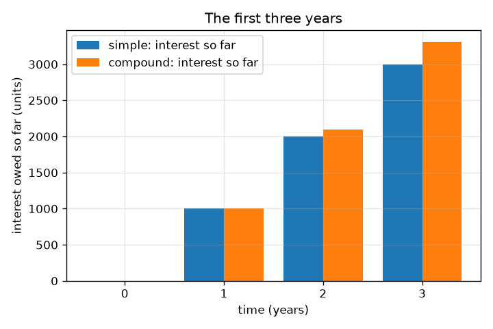
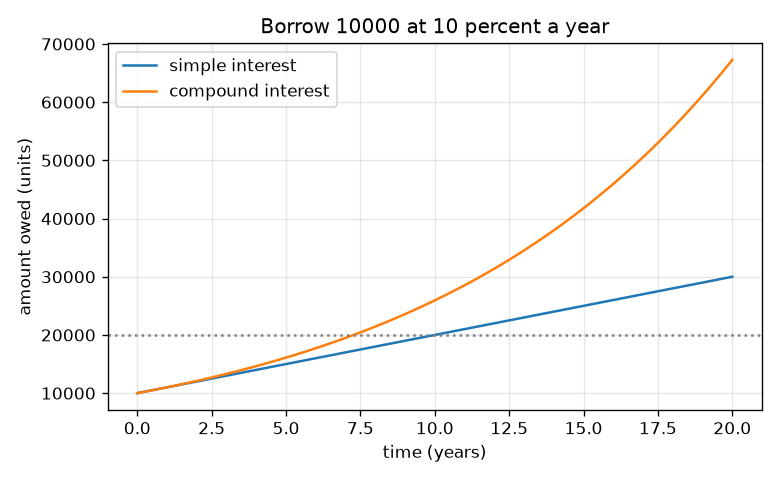

# அமர்வு 1: வாங்கியதை விட அதிகமாக ஏன் திருப்பிச் செலுத்துகிறீர்கள்

[Session 1 — हिन्दी](README.hi.md) · [Session 1 — മലയാളം](README.ml.md) · [Session 1 — தமிழ்](README.ta.md)

*நிலை 1 (கருத்தியல் ஊடாடும் மாதிரி) · சுமார் 60 நிமிடங்கள் · openloan*

> இது ஒரு எளிமைப்படுத்தப்பட்ட கல்வி மாதிரி. இது சரிபார்க்கப்பட்ட (validated) வடிவமைப்புக் கருவி அல்ல; உண்மையான கட்டமைப்புகள், மின் நிறுவல்கள், வாகனங்கள், தொழில்துறை செயல்முறைகள் அல்லது மருத்துவ முடிவுகளுக்கு இதைப் பயன்படுத்தக் கூடாது.

**முன்தேவைகள் (Prerequisites)**

- சதவீதங்களும் எளிய பெருக்கலும்.
- நீங்கள் PRIMER.md படித்து, `python start.py 1` ஐ ஒருமுறை இயக்கியிருக்கிறீர்கள்.

**கற்றல் நோக்கங்கள் (Learning objectives).** இந்த அமர்வுக்குப் பிறகு உங்களால் முடியும்:

- வட்டியை (interest) மற்றொருவரின் பணத்தைப் பயன்படுத்தும் விலையாக விளக்க.
- எளிய வட்டி (simple interest) மற்றும் கூட்டு வட்டி (compound interest) கொண்டு செலுத்த வேண்டிய தொகையைக் கணக்கிட.
- கூட்டு வட்டி எளிய வட்டியை விட ஏன் வேகமாக வளர்கிறது என்பதை விளக்க.
- நேரத்துக்கு எதிரான செலுத்த வேண்டிய தொகையின் வரைபடத்தைப் படிக்க.

## A. நிஜ உலகப் பிரச்சினை
ஒரு நண்பர் இன்று உங்களுக்கு 10000 அலகுகள் கடன் தருகிறார், 10000 மட்டுமே திரும்ப வேண்டும் என்கிறார். ஒரு வங்கி வட்டி வசூலிக்கிறது: வாங்கியதை விட அதிகமாகத் திருப்பிச் செலுத்துவீர்கள். வட்டி ஆண்டுக்கு 10 சதவீதம் என்றால் 3 ஆண்டுகளுக்குப் பிறகு நீங்கள் எவ்வளவு செலுத்த வேண்டும்? தனக்குத்தானே வட்டி சேர்க்கும் கடன் ஏன் மேலும் மேலும் வேகமாக வளர்கிறது? இந்தக் களஞ்சியம் கற்பனைக் கடன் வழங்குநர்களும் விகிதங்களும் கொண்ட பொதுக் கல்வி; இது நிதி ஆலோசனை அல்ல.

## B. கருத்தும் கோட்பாடும்
அசல் (principal) P என்பது வாங்கிய தொகை. விகிதம் r என்பது ஒரு பின்னமாக ஆண்டு வட்டி (10 சதவீதம் = 0.10). எளிய வட்டியில் கடன் வழங்குபவர் ஒவ்வோர் ஆண்டும் அசல் P மீது மட்டுமே r P வசூலிக்கிறார், எனவே t ஆண்டுகளுக்குப் பிறகு நீங்கள் செலுத்த வேண்டியது A = P (1 + r t). கூட்டு வட்டியில் ஒவ்வோர் ஆண்டின் வட்டியும் கடனுடன் சேர்க்கப்படுகிறது, எனவே அடுத்த ஆண்டின் வட்டி பெரிய தொகையின் மீது வசூலிக்கப்படுகிறது: கடன் ஒவ்வோர் ஆண்டும் (1 + r) ஆல் பெருக்கப்படுகிறது, t ஆண்டுகளுக்குப் பிறகு நீங்கள் செலுத்த வேண்டியது A = P (1 + r)^t. ஓராண்டுக்குப் பிறகு இரண்டும் சமம்; அதன் பிறகு கூட்டு வட்டி அதிகம். எளிய வட்டி நேர்கோட்டில் வளர்கிறது, கூட்டு வட்டி மேல்நோக்கி வளையும் வளைவில்.

| குறியீடு | பொருள் | அலகு |
|---|---|---|
| P | அசல்: வாங்கிய தொகை | அலகுகள் (எந்த நாணயமும்) |
| r | ஆண்டுக்கான வட்டி விகிதம் பின்னமாக (0.10 = 10 சதவீதம்) | per year |
| t | நேரம் | ஆண்டுகள் |
| A | t ஆண்டுகளுக்குப் பிறகு செலுத்த வேண்டிய தொகை | அலகுகள் |

**அனுமானங்கள் (Assumptions)**

- இறுதி வரை எதுவும் திருப்பிச் செலுத்தப்படுவதில்லை.
- முழு காலத்துக்கும் விகிதம் மாறாமல் இருக்கும்.
- கூட்டு வட்டி நிலையில் ஆண்டுக்கு ஒருமுறை வட்டி சேர்க்கப்படுகிறது.
- அனைத்துக் கடன் வழங்குநர்களும் விகிதங்களும் கற்பனை.

$$ A_{\text{simple}}=P\,(1+r\,t) $$

$$ A_{\text{compound}}=P\,(1+r)^{t} $$

$$ t_{\text{double, simple}}=\frac{1}{r},\qquad t_{\text{double, compound}}=\frac{\ln 2}{\ln(1+r)} $$

## C. காட்சி விளக்கம்
முதல் படம் 10 சதவீதத்தில் 10000 அலகுகளுக்கு நேரத்துக்கு எதிராகச் செலுத்த வேண்டிய தொகையை வரைகிறது: எளிய வட்டி நேர்கோடு, கூட்டு வட்டி மேல்நோக்கி வளைகிறது, 20 ஆண்டுகளுக்குப் பிறகு அவை 30000 மற்றும் 67275. இரண்டாவது படம் முதல் மூன்று ஆண்டுகளில் செலுத்த வேண்டிய வட்டியைப் பட்டைகளாகக் காட்டுகிறது: ஆண்டு 1 இல் இரண்டு முறைகளும் ஒத்துப்போகின்றன, பின்னர் விலகுகின்றன (2 ஆண்டுகளுக்குப் பிறகு 12000 க்கு எதிராக 12100, 3 ஆண்டுகளுக்குப் பிறகு 13000 க்கு எதிராக 13310).

*முதல் மூன்று ஆண்டுகளில் செலுத்த வேண்டிய வட்டி: ஆண்டு 1 இல் சமம், பின்னர் கூட்டு வட்டி முன்னேறுகிறது.*

*10 சதவீதத்தில் 20 ஆண்டுகளுக்குச் செலுத்த வேண்டிய தொகை: ஒரு நேர்கோடும் ஒரு வளைவும்.*

## D. ஊடாடும் உருவகப்படுத்தல் (Interactive simulation)
பாடத்தை இயக்குங்கள் (`python start.py 1`), பின்னர் நேரடிச் செயலியைத் திறங்கள்: [அமர்வு 1: எளிய வட்டி vs கூட்டு வட்டி](https://krunalpanchal1995.github.io/pan-iit-oss/openloan/session-01/) (அல்லது இந்தக் கோப்புறையில் உள்ள `app.html`). அசல், விகிதம், ஆண்டுகள் ஸ்லைடர்களை நகர்த்துங்கள். பட்டைக் காட்சியில் இரண்டு பட்டைகளையும் ஒப்பிடுங்கள், பின்னர் வரைபடக் காட்சியில் நேர்கோடும் வளைவும் பிரிவதைப் பாருங்கள்.

**சவால் (Challenge).** கூட்டு வட்டி எளிய வட்டியை விடக் குறைந்தது 2000 அலகுகள் அதிகமாகச் செலவாகும் ஓர் அமைப்பைக் கண்டறியுங்கள்.

## E. தீர்க்கப்பட்ட எடுத்துக்காட்டும் சோதனையும்
**பிரச்சினை.** நீங்கள் ஆண்டுக்கு 10 சதவீதத்தில் 3 ஆண்டுகளுக்கு 10000 அலகுகள் கடன் வாங்கி, இறுதியில் அனைத்தையும் திருப்பிச் செலுத்துகிறீர்கள். எளிய வட்டியிலும் கூட்டு வட்டியிலும் நீங்கள் எவ்வளவு செலுத்த வேண்டும், வித்தியாசம் என்ன?

1. எளிய: வட்டி = 10000 * 0.10 * 3 = 3000, எனவே நீங்கள் 10000 + 3000 = 13000 செலுத்த வேண்டும்.
2. கூட்டு, ஆண்டு 1: 10000 * 1.1 = 11000.
3. ஆண்டு 2: 11000 * 1.1 = 12100. ஆண்டு 3: 12100 * 1.1 = 13310. (அல்லது 10000 * 1.1^3 = 13310.)
4. வித்தியாசம் = 13310 - 13000 = 310 அலகுகள்: முந்தைய வட்டியின் மீது வசூலிக்கப்பட்ட வட்டி.

**விடை.** எளிய வட்டி: 13000 அலகுகள். கூட்டு வட்டி: 13310 அலகுகள். கூட்டுதல் 310 அதிகம் செலவாகிறது.

**சோதனை.** ஒரு கால்குலேட்டர் அல்லது விரிதாளைப் பயன்படுத்துங்கள்: 10000 இல் தொடங்கி 1.1 ஆல் மூன்று முறை பெருக்கி, ஒவ்வொரு முடிவையும் குறித்துக்கொள்ளுங்கள்; 10000 + 3 * 1000 உடன் ஒப்பிடுங்கள். உண்மைக் கடன் வழங்குநர்கள் இந்த மாதிரி தவிர்க்கும் விவரங்களைச் சேர்க்கிறார்கள் (கட்டணங்கள், தினசரி வட்டி, முழுமையாக்கல், மாறும் விகிதங்கள்), எனவே உண்மை அறிக்கை மாதிரியிலிருந்து சற்று வேறுபடும். மாதிரி தன் சொந்த அனுமானங்களுக்குத் துல்லியமானது; யதார்த்தத்தில் இன்னும் அதிக அனுமானங்கள் உள்ளன.

## F. மதிப்பீடும் வடிவமைப்புச் சவாலும்
**கேள்வி வகை A: கருத்தியல்.** இரண்டும் ஒரே விகிதத்தைப் பயன்படுத்தினாலும் கூட்டு வட்டி எளிய வட்டியை விட ஏன் வேகமாக வளர்கிறது? அவை எப்போது சமம்?

குறிப்பு

இரண்டாம் ஆண்டில் வட்டி எதன் மீது வசூலிக்கப்படுகிறது என்று கேளுங்கள்.

படிப்படியான தீர்வு

எளிய வட்டியில் வட்டி எப்போதும் அசல் தொகையின் மீதே வசூலிக்கப்படுகிறது. கூட்டு வட்டியில் கடந்த ஆண்டின் வட்டி கடனில் சேர்க்கப்பட்டுள்ளது, எனவே இந்த ஆண்டின் வட்டி பெரிய தொகையின் மீது வசூலிக்கப்படுகிறது: வட்டியின் மீது வட்டி. சரியாக ஓராண்டுக்குப் பிறகு (மற்றும் நேரம் பூஜ்ஜியத்தில்) அவை சமம்; ஆண்டு 2 முதல் கூட்டு வட்டி பெரியது.

**கேள்வி வகை B: எண்ணியல்.** நீங்கள் ஆண்டுக்கு 8 சதவீதத்தில் 2 ஆண்டுகளுக்கு 5000 அலகுகள் கடன் வாங்குகிறீர்கள். எளிய வட்டியிலும் கூட்டு வட்டியிலும் செலுத்த வேண்டிய தொகையைக் காண்க. உங்கள் விடைகள் நியாயமானவையா என்று சரிபாருங்கள்.

குறிப்பு

எளிய: 5000 (1 + 0.08 * 2). கூட்டு: 5000 * 1.08 * 1.08.

படிப்படியான தீர்வு

எளிய: 5000 * 1.16 = 5800 அலகுகள். கூட்டு: 5000 * 1.1664 = 5832 அலகுகள். நம்பகத்தன்மைச் சோதனை (sanity check): இரண்டும் 5000 ஐ விட அதிகம், கூட்டு எளிய வட்டியை விடச் சற்றுப் பெரியது, வித்தியாசம் (32 அலகுகள்) 5000 * 0.08^2, முதல் ஆண்டு வட்டியின் மீதான வட்டி.

**கேள்வி வகை C: வரைபடம் மற்றும் உருவகப்படுத்தல் விளக்கம்.** 10 சதவீதத்தில் 10000 அலகுகளுக்கான வரைபடத்தில், 20 ஆண்டுகளுக்குப் பிறகு செலுத்த வேண்டிய தொகைகள் என்ன, வளைவுகளுக்கு இடையே விரியும் இடைவெளி உங்களுக்கு என்ன சொல்கிறது?

குறிப்பு

கிடை அச்சில் 20 ஆண்டுகளில் இரண்டு வளைவுகளையும் படியுங்கள்.

படிப்படியான தீர்வு

எளிய வட்டி 30000 அலகுகள் தருகிறது, கூட்டு வட்டி சுமார் 67275 அலகுகள். எளிய வட்டி ஒவ்வோர் ஆண்டும் ஒரே துண்டைச் சேர்க்கும்போது, கூட்டு வட்டி கடனுடன் வளரும் துண்டைச் சேர்ப்பதால் இடைவெளி விரிந்துகொண்டே போகிறது. நீண்ட கடன்களில்தான் கூட்டுதல் அதிகம் முக்கியம்.

**கேள்வி வகை D: வடிவமைப்பு மற்றும் உகப்பாக்கச் சவால்.** வடிவமைப்பு: ஒரு நண்பர் 12 சதவீத எளிய வட்டியில் 5 ஆண்டுகளுக்கு 10000 அலகுகள் தருகிறார். ஒரு வங்கி அதே கடனை 10 சதவீத கூட்டு வட்டியில் தருகிறது. 5 ஆண்டுகளில் எது மலிவு? 20 ஆண்டுகளில் உங்கள் விடை மாறுமா?

குறிப்பு

5 ஆண்டுகளுக்கு இரண்டு தொகைகளையும் கணக்கிட்டு, எந்த வளைவு மேல்நோக்கி வளைகிறது என்று சிந்தியுங்கள்.

படிப்படியான தீர்வு

நண்பர்: 10000 * (1 + 0.12 * 5) = 16000 அலகுகள். வங்கி: 10000 * 1.1^5 = 16105.10 அலகுகள். 5 ஆண்டுகளில் நண்பரின் வாய்ப்பு, விகிதம் அதிகம் என்றாலும், சுமார் 105 அலகுகள் மலிவு. அனுமானம்: இறுதிக்கு முன் எதுவும் திருப்பிச் செலுத்தப்படவில்லை, கட்டணங்களும் இல்லை. மிக நீண்ட காலங்களில் கூட்டு வளைவு மேல்நோக்கி வளைந்து எந்த நேர்கோட்டையும் இறுதியில் கடந்துவிடும், எனவே விடை தலைகீழாகலாம். பாடம்: தலைப்பு விகிதத்தை அல்ல, நீங்கள் உண்மையில் கடன் வாங்கப்போகும் காலத்துக்கான மொத்தத் தொகையை ஒப்பிடுங்கள்.

[RUBRIC.md](../../RUBRIC.md) கொண்டு உங்களுக்கு நீங்களே மதிப்பெண் இடுங்கள். தாளில் வேலை செய்ய [செயல்பாட்டுத் தாளை](activity_sheet.md) அச்சிடுங்கள்.

## பொதுவான தவறான கருத்துகள்
| பொதுவான தவறான கருத்து | உண்மையில் சரியானது என்ன |
|---|---|
| வட்டி என்பது நீங்கள் எவ்வளவு காலம் கடன் வாங்குகிறீர்கள் என்பதைச் சாராத நிலையான தொகை. | வட்டி நேரத்துடன் வளர்கிறது; எவ்வளவு காலம் கடன்பட்டிருக்கிறீர்களோ அவ்வளவு அதிகம் செலுத்துவீர்கள். |
| ஆண்டுக்கு 10 சதவீதம் 3 ஆண்டுகளுக்கு என்றால் 30 சதவீதம் அதிகம். | அது எளிய வட்டிக்கு மட்டுமே உண்மை (10000 இல் 3000). கூட்டு வட்டியில் அது 10000 இல் 3310, ஏனெனில் ஒவ்வோர் ஆண்டின் வட்டியும் கடனுடன் சேர்க்கப்படுகிறது. |
| கூட்டு வட்டி எப்போதும் எளிய வட்டியை விட மிகவும் பெரியது. | ஆண்டு 1 இல் அவை சமம், குறுகிய கடன்களுக்கு வித்தியாசம் சிறியது; நீண்ட காலங்களுக்கும் அதிக விகிதங்களுக்கும் அது பெரிதாகிறது. |

## சொற்களஞ்சியம் (Glossary)
- **அசல் (principal)**: வாங்கிய தொகை
- **வட்டி (interest)**: கடன் வாங்கிய பணத்தைப் பயன்படுத்துவதற்குச் செலுத்தும் விலை
- **எளிய வட்டி (simple interest)**: அசல் தொகையின் மீது மட்டும் வசூலிக்கப்படும் வட்டி
- **கூட்டு வட்டி (compound interest)**: அசலும் ஏற்கனவே சேர்க்கப்பட்ட வட்டியும் சேர்ந்த தொகையின் மீது வசூலிக்கப்படும் வட்டி
- **விகிதம் (rate)**: அசலின் சதவீதமாக அல்லது பின்னமாக ஆண்டுக்கான வட்டி

## முடிக்க
1. [exercises.md](exercises.md) இல் உள்ள மூன்று நிரலாக்கப் பணிகளைச் செய்யுங்கள்.
2. உங்கள் மாற்றங்களுக்குப் பிறகு `python start.py 1` ஐ மீண்டும் இயக்குங்கள். அது சோதனைச் சாவடியுடன் (checkpoint) முடிகிறது; அது `PASS` என அச்சிடும்போது, நீங்கள் முடித்துவிட்டீர்கள். (சோதனைச் சாவடி மட்டும்: `python start.py check 1`.)

அடுத்து: [அமர்வு 2](../session-02/README.md)
