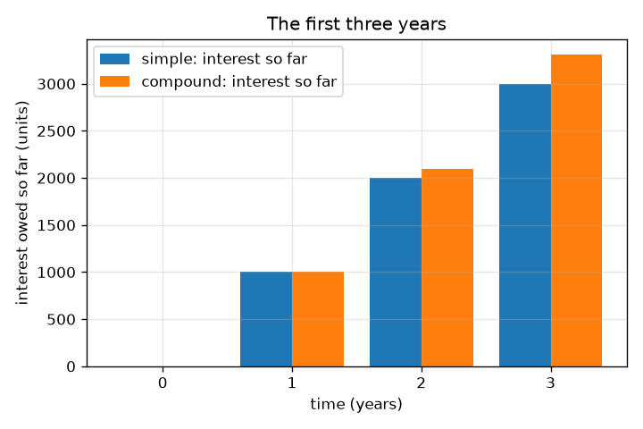
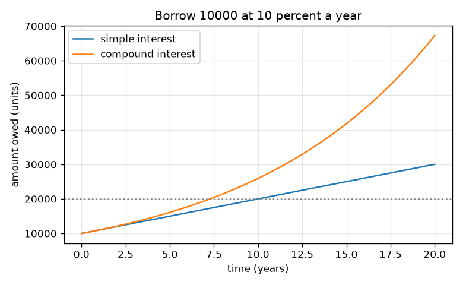

# సెషన్ 1: తీసుకున్న దానికంటే ఎక్కువ ఎందుకు తిరిగి చెల్లిస్తారు

[Session 1 — हिन्दी](README.hi.md) · [Session 1 — മലയാളം](README.ml.md) · [Session 1 — தமிழ்](README.ta.md) · [Session 1 — తెలుగు](README.te.md)

*స్థాయి 1 (భావనాత్మక ఇంటరాక్టివ్ మోడల్) · సుమారు 60 నిమిషాలు · openloan*

> ఇది సరళీకరించిన ఒక విద్యా మోడల్. ఇది ధృవీకరించబడిన (validated) డిజైన్ సాధనం కాదు; నిజమైన నిర్మాణాలు, విద్యుత్ ఇన్‌స్టలేషన్‌లు, వాహనాలు, పారిశ్రామిక ప్రక్రియలు లేదా వైద్య నిర్ణయాల కోసం దీనిని ఉపయోగించకూడదు.

**ముందస్తు అవసరాలు (Prerequisites)**

- శాతాలు మరియు సాధారణ గుణకారం.
- మీరు PRIMER.md చదివి, `python start.py 1` ను ఒకసారి రన్ చేశారు.

**అభ్యాస లక్ష్యాలు (Learning objectives).** ఈ సెషన్ తర్వాత మీరు చేయగలరు:

- వడ్డీని (interest) వేరొకరి డబ్బును వాడుకునే ధరగా వివరించడం.
- సాధారణ వడ్డీ (simple interest) మరియు చక్రవడ్డీ (compound interest) తో చెల్లించాల్సిన మొత్తాన్ని లెక్కించడం.
- చక్రవడ్డీ సాధారణ వడ్డీ కంటే ఎందుకు వేగంగా పెరుగుతుందో వివరించడం.
- సమయానికి వ్యతిరేకంగా చెల్లించాల్సిన మొత్తం గ్రాఫ్‌ను చదవడం.

## A. నిజ జీవిత సమస్య
ఒక స్నేహితుడు ఈరోజు మీకు 10000 యూనిట్లు అప్పు ఇచ్చి, 10000 మాత్రమే తిరిగి కోరతాడు. ఒక బ్యాంకు వడ్డీ వసూలు చేస్తుంది: తీసుకున్న దానికంటే ఎక్కువ తిరిగి చెల్లిస్తారు. వడ్డీ ఏడాదికి 10 శాతం అయితే 3 సంవత్సరాల తర్వాత మీరు ఎంత చెల్లించాలి? తనకు తానే వడ్డీ చేర్చుకునే అప్పు మరింత మరింత వేగంగా ఎందుకు పెరుగుతుంది? ఈ రిపాజిటరీ కల్పిత రుణదాతలు మరియు రేట్లతో కూడిన సాధారణ విద్య; ఇది ఆర్థిక సలహా కాదు.

## B. భావన మరియు సిద్ధాంతం
అసలు (principal) P అంటే తీసుకున్న మొత్తం. రేటు r అంటే భిన్నంగా వార్షిక వడ్డీ (10 శాతం = 0.10). సాధారణ వడ్డీలో రుణదాత ప్రతి సంవత్సరం అసలు P పై మాత్రమే r P వసూలు చేస్తాడు, కాబట్టి t సంవత్సరాల తర్వాత మీరు చెల్లించాల్సింది A = P (1 + r t). చక్రవడ్డీలో ప్రతి సంవత్సరం వడ్డీ అప్పుకు కలుపబడుతుంది, కాబట్టి తరువాతి సంవత్సరం వడ్డీ పెద్ద మొత్తంపై వసూలు చేయబడుతుంది: అప్పు ప్రతి సంవత్సరం (1 + r) తో గుణించబడుతుంది, t సంవత్సరాల తర్వాత మీరు చెల్లించాల్సింది A = P (1 + r)^t. ఒక సంవత్సరం తర్వాత రెండూ సమానం; ఆ తర్వాత చక్రవడ్డీ ఎక్కువ. సాధారణ వడ్డీ సరళరేఖలో పెరుగుతుంది, చక్రవడ్డీ పైకి వంగే వక్రరేఖలో.

| గుర్తు | అర్థం | యూనిట్ |
|---|---|---|
| P | అసలు: తీసుకున్న మొత్తం | యూనిట్లు (ఏ కరెన్సీ అయినా) |
| r | సంవత్సరానికి వడ్డీ రేటు భిన్నంగా (0.10 = 10 శాతం) | per year |
| t | సమయం | సంవత్సరాలు |
| A | t సంవత్సరాల తర్వాత చెల్లించాల్సిన మొత్తం | యూనిట్లు |

**ఊహలు (Assumptions)**

- చివరి వరకు ఏదీ తిరిగి చెల్లించబడదు.
- మొత్తం సమయం రేటు ఒకేలా ఉంటుంది.
- చక్రవడ్డీ సందర్భంలో సంవత్సరానికి ఒకసారి వడ్డీ కలుపబడుతుంది.
- అన్ని రుణదాతలు మరియు రేట్లు కల్పితం.

$$ A_{\text{simple}}=P\,(1+r\,t) $$

$$ A_{\text{compound}}=P\,(1+r)^{t} $$

$$ t_{\text{double, simple}}=\frac{1}{r},\qquad t_{\text{double, compound}}=\frac{\ln 2}{\ln(1+r)} $$

## C. దృశ్య వివరణ
మొదటి చిత్రం 10 శాతం వద్ద 10000 యూనిట్లకు సమయానికి వ్యతిరేకంగా చెల్లించాల్సిన మొత్తాన్ని ప్లాట్ చేస్తుంది: సాధారణ వడ్డీ సరళరేఖ, చక్రవడ్డీ పైకి వంగుతుంది, 20 సంవత్సరాల తర్వాత అవి 30000 మరియు 67275. రెండవ చిత్రం మొదటి మూడు సంవత్సరాలలో చెల్లించాల్సిన వడ్డీని బార్‌లుగా చూపిస్తుంది: సంవత్సరం 1 లో రెండు పద్ధతులు ఏకీభవిస్తాయి, ఆ తర్వాత దూరమవుతాయి (2 సంవత్సరాల తర్వాత 12000 కు వ్యతిరేకంగా 12100, 3 సంవత్సరాల తర్వాత 13000 కు వ్యతిరేకంగా 13310).

*మొదటి మూడు సంవత్సరాలలో చెల్లించాల్సిన వడ్డీ: సంవత్సరం 1 లో సమానం, ఆ తర్వాత చక్రవడ్డీ ముందుకు సాగుతుంది.*

*10 శాతం వద్ద 20 సంవత్సరాలలో చెల్లించాల్సిన మొత్తం: ఒక సరళరేఖ మరియు ఒక వక్రరేఖ.*

## D. ఇంటరాక్టివ్ సిమ్యులేషన్
పాఠాన్ని రన్ చేయండి (`python start.py 1`), ఆపై లైవ్ యాప్ తెరవండి: [సెషన్ 1: సాధారణ వడ్డీ vs చక్రవడ్డీ](https://krunalpanchal1995.github.io/pan-iit-oss/openloan/session-01/) (లేదా ఈ ఫోల్డర్‌లోని `app.html`). అసలు, రేటు, సంవత్సరాల స్లైడర్‌లను కదపండి. బార్ వ్యూలో రెండు బార్‌లను పోల్చండి, ఆపై గ్రాఫ్ వ్యూలో సరళరేఖ మరియు వక్రరేఖ విడిపోవడం చూడండి.

**సవాలు (Challenge).** చక్రవడ్డీకి సాధారణ వడ్డీ కంటే కనీసం 2000 యూనిట్లు ఎక్కువ ఖర్చయ్యే సెట్టింగ్‌ను కనుగొనండి.

## E. సాధించిన ఉదాహరణ మరియు ప్రయోగం
**సమస్య.** మీరు ఏడాదికి 10 శాతం వద్ద 3 సంవత్సరాలకు 10000 యూనిట్లు అప్పు తీసుకుని చివర్లో అంతా తిరిగి చెల్లిస్తారు. సాధారణ వడ్డీతో మరియు చక్రవడ్డీతో మీరు ఎంత చెల్లించాలి, తేడా ఎంత?

1. సాధారణ: వడ్డీ = 10000 * 0.10 * 3 = 3000, కాబట్టి మీరు 10000 + 3000 = 13000 చెల్లించాలి.
2. చక్రవడ్డీ, సంవత్సరం 1: 10000 * 1.1 = 11000.
3. సంవత్సరం 2: 11000 * 1.1 = 12100. సంవత్సరం 3: 12100 * 1.1 = 13310. (లేదా 10000 * 1.1^3 = 13310.)
4. తేడా = 13310 - 13000 = 310 యూనిట్లు: ముందటి వడ్డీపై వసూలు చేసిన వడ్డీ.

**సమాధానం.** సాధారణ వడ్డీ: 13000 యూనిట్లు. చక్రవడ్డీ: 13310 యూనిట్లు. కలపడం 310 ఎక్కువ ఖర్చు చేస్తుంది.

**ప్రయోగం.** కాలిక్యులేటర్ లేదా స్ప్రెడ్‌షీట్ ఉపయోగించండి: 10000 తో మొదలుపెట్టి 1.1 తో మూడుసార్లు గుణించి, ప్రతి ఫలితాన్ని రాయండి; 10000 + 3 * 1000 తో పోల్చండి. నిజమైన రుణదాతలు ఈ మోడల్ వదిలేసిన వివరాలను కలుపుతారు (ఫీజులు, రోజువారీ వడ్డీ, రౌండింగ్, మారే రేట్లు), కాబట్టి నిజమైన స్టేట్‌మెంట్ మోడల్ నుండి కొద్దిగా భిన్నంగా ఉంటుంది. మోడల్ తన సొంత ఊహలకు ఖచ్చితమైనది; వాస్తవంలో ఇంకా ఎక్కువ ఊహలు ఉన్నాయి.

## F. మూల్యాంకనం మరియు డిజైన్ సవాలు
**ప్రశ్న రకం A: భావనాత్మకం.** రెండూ ఒకే రేటును వాడినా చక్రవడ్డీ సాధారణ వడ్డీ కంటే ఎందుకు వేగంగా పెరుగుతుంది? అవి ఎప్పుడు సమానం?

సూచన

రెండవ సంవత్సరం వడ్డీ దేనిపై వసూలు చేస్తారో అడగండి.

దశలవారీ పరిష్కారం

సాధారణ వడ్డీలో వడ్డీ ఎల్లప్పుడూ అసలు మొత్తంపైనే వసూలు చేయబడుతుంది. చక్రవడ్డీలో గత సంవత్సరం వడ్డీ అప్పుకు కలుపబడింది, కాబట్టి ఈ సంవత్సరం వడ్డీ పెద్ద మొత్తంపై వసూలు చేయబడుతుంది: వడ్డీపై వడ్డీ. సరిగ్గా ఒక సంవత్సరం తర్వాత (మరియు సమయం సున్నా వద్ద) అవి సమానం; సంవత్సరం 2 నుండి చక్రవడ్డీ ఎక్కువ.

**ప్రశ్న రకం B: సంఖ్యాత్మకం.** మీరు ఏడాదికి 8 శాతం వద్ద 2 సంవత్సరాలకు 5000 యూనిట్లు అప్పు తీసుకుంటారు. సాధారణ మరియు చక్రవడ్డీతో చెల్లించాల్సిన మొత్తాన్ని కనుగొనండి. మీ సమాధానాలు సహేతుకమేనా అని తనిఖీ చేయండి.

సూచన

సాధారణ: 5000 (1 + 0.08 * 2). చక్రవడ్డీ: 5000 * 1.08 * 1.08.

దశలవారీ పరిష్కారం

సాధారణ: 5000 * 1.16 = 5800 యూనిట్లు. చక్రవడ్డీ: 5000 * 1.1664 = 5832 యూనిట్లు. సహేతుకత తనిఖీ (sanity check): రెండూ 5000 కంటే ఎక్కువ, చక్రవడ్డీ సాధారణ వడ్డీ కంటే కొంచెం పెద్దది, తేడా (32 యూనిట్లు) 5000 * 0.08^2, మొదటి సంవత్సరం వడ్డీపై వడ్డీ.

**ప్రశ్న రకం C: గ్రాఫ్ మరియు సిమ్యులేషన్ వ్యాఖ్యానం.** 10 శాతం వద్ద 10000 యూనిట్ల గ్రాఫ్‌లో, 20 సంవత్సరాల తర్వాత చెల్లించాల్సిన మొత్తాలు ఎంత, వక్రరేఖల మధ్య పెరుగుతున్న అంతరం మీకు ఏమి చెబుతుంది?

సూచన

క్షితిజ అక్షంపై 20 సంవత్సరాల వద్ద రెండు వక్రరేఖలను చదవండి.

దశలవారీ పరిష్కారం

సాధారణ వడ్డీ 30000 యూనిట్లు ఇస్తుంది, చక్రవడ్డీ సుమారు 67275 యూనిట్లు. సాధారణ వడ్డీ ప్రతి సంవత్సరం ఒకే ముక్కను కలుపుతుండగా, చక్రవడ్డీ అప్పుతో పాటు పెరిగే ముక్కను కలుపుతుంది కాబట్టి అంతరం పెరుగుతూనే ఉంటుంది. దీర్ఘకాలిక అప్పులలో కలపడం అత్యంత ముఖ్యం.

**ప్రశ్న రకం D: డిజైన్ మరియు ఆప్టిమైజేషన్ సవాలు.** డిజైన్: ఒక స్నేహితుడు 12 శాతం సాధారణ వడ్డీతో 5 సంవత్సరాలకు 10000 యూనిట్లు ఆఫర్ చేస్తాడు. ఒక బ్యాంకు అదే అప్పును 10 శాతం చక్రవడ్డీతో ఆఫర్ చేస్తుంది. 5 సంవత్సరాలలో ఏది చౌక? 20 సంవత్సరాలలో మీ సమాధానం మారుతుందా?

సూచన

5 సంవత్సరాలకు రెండు మొత్తాలను లెక్కించి, ఏ వక్రరేఖ పైకి వంగుతుందో ఆలోచించండి.

దశలవారీ పరిష్కారం

స్నేహితుడు: 10000 * (1 + 0.12 * 5) = 16000 యూనిట్లు. బ్యాంకు: 10000 * 1.1^5 = 16105.10 యూనిట్లు. 5 సంవత్సరాలలో స్నేహితుడి ఆఫర్, రేటు ఎక్కువైనా, సుమారు 105 యూనిట్లు చౌక. ఊహ: చివరికి ముందు ఏదీ తిరిగి చెల్లించబడదు, ఫీజులు లేవు. చాలా ఎక్కువ కాలాలలో చక్రవడ్డీ వక్రరేఖ పైకి వంగి చివరికి ఏ సరళరేఖనైనా దాటుతుంది, కాబట్టి సమాధానం తిరగబడవచ్చు. పాఠం: ప్రధాన రేటును కాదు, మీరు నిజంగా అప్పు తీసుకునే కాలానికి మొత్తం మొత్తాన్ని పోల్చండి.

[RUBRIC.md](../../RUBRIC.md) తో మీకు మీరే స్కోర్ ఇచ్చుకోండి. కాగితంపై పని చేయడానికి [కార్యాచరణ పత్రాన్ని](activity_sheet.md) ప్రింట్ చేయండి.

## సాధారణ అపోహలు
| సాధారణ అపోహ | వాస్తవంగా నిజం ఏమిటి |
|---|---|
| వడ్డీ అనేది మీరు ఎంతకాలం అప్పు తీసుకుంటారనే దానిపై ఆధారపడని స్థిర మొత్తం. | వడ్డీ సమయంతో పెరుగుతుంది; ఎంతకాలం బాకీ ఉంటే అంత ఎక్కువ చెల్లిస్తారు. |
| ఏడాదికి 10 శాతం 3 సంవత్సరాలకు అంటే 30 శాతం ఎక్కువ. | అది సాధారణ వడ్డీకి మాత్రమే నిజం (10000 పై 3000). చక్రవడ్డీతో అది 10000 పై 3310, ఎందుకంటే ప్రతి సంవత్సరం వడ్డీ అప్పుకు కలుపబడుతుంది. |
| చక్రవడ్డీ ఎల్లప్పుడూ సాధారణ వడ్డీ కంటే చాలా పెద్దది. | సంవత్సరం 1 లో అవి సమానం, చిన్న అప్పులకు తేడా చిన్నది; దీర్ఘ కాలాలకు మరియు అధిక రేట్లకు అది పెద్దదవుతుంది. |

## పదకోశం (Glossary)
- **అసలు (principal)**: తీసుకున్న మొత్తం
- **వడ్డీ (interest)**: అప్పుగా తీసుకున్న డబ్బును వాడుకున్నందుకు చెల్లించే ధర
- **సాధారణ వడ్డీ (simple interest)**: అసలు మొత్తంపై మాత్రమే వసూలు చేసే వడ్డీ
- **చక్రవడ్డీ (compound interest)**: అసలు మరియు ఇప్పటికే కలిపిన వడ్డీ కలిపిన మొత్తంపై వసూలు చేసే వడ్డీ
- **రేటు (rate)**: అసలులో శాతంగా లేదా భిన్నంగా సంవత్సరానికి వడ్డీ

## ముగించండి
1. [exercises.md](exercises.md) లోని మూడు కోడింగ్ పనులు చేయండి.
2. మీ మార్పుల తర్వాత `python start.py 1` ను మళ్ళీ రన్ చేయండి. అది చెక్‌పాయింట్‌తో ముగుస్తుంది; అది `PASS` అని ప్రింట్ చేసినప్పుడు, మీరు పూర్తి చేశారు. (చెక్‌పాయింట్ మాత్రమే: `python start.py check 1`.)

తదుపరి: [సెషన్ 2](../session-02/README.md)
