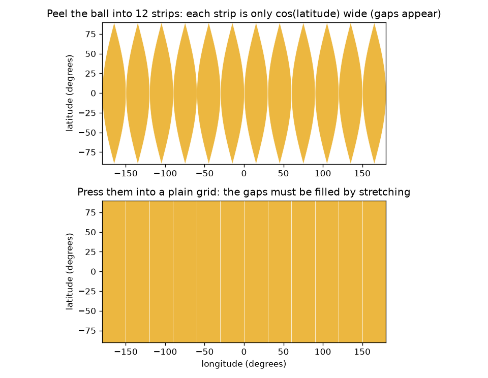
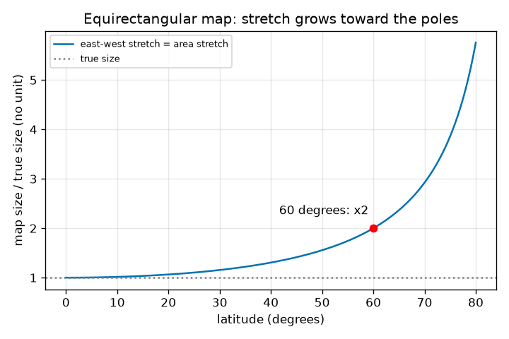

# सत्र 1: गेंद का सपाट नक़्शा विकृत क्यों होना ही चाहिए

*स्तर 1 (वैचारिक इंटरैक्टिव मॉडल) · लगभग 60 मिनट · openmapproject*

> यह एक सरलीकृत शैक्षिक मॉडल है। यह कोई प्रमाणित डिज़ाइन उपकरण नहीं है और इसका उपयोग वास्तविक संरचनाओं, विद्युत संस्थापनों, वाहनों, औद्योगिक प्रक्रियाओं या चिकित्सा निर्णयों के लिए नहीं किया जाना चाहिए।

**पूर्व-आवश्यकताएँ (Prerequisites)**

- स्कूल की त्रिकोणमिति: किसी कोण का कोसाइन (cosine)।
- आपने PRIMER.md पढ़ लिया है और एक बार `python start.py 1` चला लिया है।

**सीखने के उद्देश्य (Learning objectives)।** इस सत्र के बाद आप:

- संतरे के छिलके की मदद से समझा सकेंगे कि एक गोले (sphere) को बिना खींचे या फाड़े सपाट क्यों नहीं किया जा सकता।
- पृथ्वी पर किसी बिंदु का वर्णन अक्षांश (latitude) और देशांतर (longitude) से कर सकेंगे और उसे समआयताकार नक़्शे (equirectangular map) पर रख सकेंगे।
- किसी अक्षांश वृत्त (circle of latitude) की वास्तविक लंबाई और सपाट ग्रिड नक़्शे का खिंचाव (stretch) 1 / cos(latitude) निकाल सकेंगे।
- अक्षांश के विरुद्ध खिंचाव का ग्राफ़ पढ़ सकेंगे।

## A. वास्तविक जीवन की समस्या
एक संतरे को एक ही टुकड़े में छीलिए और छिलके को मेज़ पर सपाट दबाइए। वह फट जाता है, या आपको उसे खींचना पड़ता है। पृथ्वी एक गेंद है, और इसका हर सपाट नक़्शा एक दबाया हुआ छिलका है। सबसे सरल नक़्शा अक्षांश और देशांतर को ही वर्गाकार काग़ज़ पर ग्रिड रेखाओं के रूप में उपयोग करता है। क्या यह नॉर्वे और नाइजीरिया को सही आकार में दिखाता है? 60 डिग्री उत्तर पर यह कितना ग़लत है, और क्यों?

## B. अवधारणा और सिद्धांत
अक्षांश भूमध्य रेखा (equator) से उत्तर (+) या दक्षिण (-) का कोण है; देशांतर एक संदर्भ याम्योत्तर (reference meridian) से पूर्व या पश्चिम का कोण है। समआयताकार नक़्शे पर अक्षांश phi और देशांतर lambda (रेडियन में) वाला बिंदु x = R lambda, y = R phi पर खींचा जाता है, जहाँ R गेंद की त्रिज्या है। एक अक्षांश वृत्त की त्रिज्या R cos(phi) है, इसलिए उसकी वास्तविक लंबाई 2 pi R cos(phi) है। नक़्शा हर अक्षांश वृत्त को भूमध्य रेखा की लंबाई, 2 pi R, के साथ खींचता है। इसलिए पूर्व-पश्चिम दूरियाँ 1 / cos(phi) गुणांक से बहुत लंबी खींची जाती हैं, जबकि उत्तर-दक्षिण दूरियाँ अपने वास्तविक आकार में खींची जाती हैं। क्षेत्रफल इन दोनों का गुणनफल है, इसलिए नक़्शे पर क्षेत्रफल वास्तविक क्षेत्रफल गुणा 1 / cos(phi) है।

| प्रतीक | अर्थ | इकाई |
|---|---|---|
| phi | अक्षांश, उत्तर में धनात्मक | रेडियन (ऐप में डिग्री) |
| lambda | देशांतर, पूर्व में धनात्मक | रेडियन (ऐप में डिग्री) |
| R | गोले की त्रिज्या (पृथ्वी के लिए 6371 km) | km |
| x, y | सपाट नक़्शे पर स्थिति | km |
| stretch | नक़्शे की लंबाई भाग वास्तविक लंबाई | कोई इकाई नहीं |

**मान्यताएँ (Assumptions)**

- पृथ्वी 6371 km त्रिज्या का एक पूर्ण गोला है (वास्तविक पृथ्वी लगभग 0.3 प्रतिशत चपटी है)।
- सूत्रों के अंदर कोण रेडियन में हैं; ऐप और पाठ डिग्री का उपयोग करते हैं।
- यह एक सरलीकृत शैक्षिक मॉडल है।

$$ x = R\lambda,\qquad y = R\varphi $$

$$ L_{\text{true}}(\varphi)=2\pi R\cos\varphi,\qquad L_{\text{map}}=2\pi R $$

$$ \text{east-west stretch}=\frac{L_{\text{map}}}{L_{\text{true}}}=\frac{1}{\cos\varphi}=\sec\varphi $$

$$ \frac{\text{area on map}}{\text{true area}}=\sec\varphi $$

## C. दृश्य व्याख्या
पहला चित्र गेंद को 12 पट्टियों में छीलता है। गेंद पर हर पट्टी केवल cos(latitude) चौड़ी है, इसलिए ध्रुवों की ओर अंतराल खुल जाते हैं; उसके नीचे का सादा ग्रिड पट्टियों को बगल में खींचकर अंतरालों को भरता है। दूसरा चित्र अक्षांश के विरुद्ध खिंचाव 1 / cos(latitude) आलेखित करता है: यह भूमध्य रेखा पर 1, 30 डिग्री पर 1.155, 60 डिग्री पर ठीक 2 और 80 डिग्री पर 5.76 है, और ध्रुव पर बिना सीमा के बढ़ता है।

*छिली हुई गेंद: अक्षांश के साथ पट्टियाँ संकरी होती हैं, इसलिए सादे ग्रिड को उन्हें खींचना पड़ता है।*

*पूर्व-पश्चिम खिंचाव 1 / cos(latitude): भूमध्य रेखा पर 1, 60 डिग्री पर 2, 80 डिग्री पर 5.76।*

## D. इंटरैक्टिव सिमुलेशन
पाठ चलाएँ (`python start.py 1`), फिर लाइव ऐप खोलें: [सत्र 1: सपाट ग्रिड नक़्शा कितना खींचता है?](https://krunalpanchal1995.github.io/pan-iit-oss/openmapproject/session-01/) (या इसी फ़ोल्डर में `app.html`)। अक्षांश स्लाइडर हिलाएँ और नक़्शे पर नीले टुकड़े तथा गेंद पर हरी वास्तविक आकृति को देखें: नीला टुकड़ा अपनी चौड़ाई बनाए रखता है जबकि हरा संकरा होता जाता है। फिर ग्राफ़ दृश्य खोलें और देखें कि बिंदु वक्र पर कहाँ बैठता है। टुकड़े की चौड़ाई बदलें और नोट करें कि कौन-सी संख्याएँ बदलती हैं।

**चुनौती।** ऐसा अक्षांश खोजें जहाँ सपाट नक़्शा पूर्व-पश्चिम दूरियों को कम से कम 1.99 गुना (लगभग 2) खींचता है।

## E. हल किया गया उदाहरण और प्रयोग
**समस्या।** 6371 km त्रिज्या वाली गेंद पर 60 डिग्री उत्तर का अक्षांश वृत्त कितना लंबा है, सपाट ग्रिड नक़्शा उसे कितना लंबा खींचता है, और खिंचाव क्या है?

1. भूमध्य रेखा: 2 pi R = 2 x 3.14159 x 6371 = 40030.2 km। नक़्शा हर अक्षांश वृत्त को इसी लंबाई के साथ खींचता है।
2. 60 डिग्री पर वास्तविक वृत्त: 2 pi R cos 60 = 40030.2 x 0.5 = 20015.1 km।
3. खिंचाव = नक़्शे की लंबाई / वास्तविक लंबाई = 40030.2 / 20015.1 = 2.000। यह 1 / cos 60 = 1 / 0.5 = 2 है।
4. देशांतर का एक डिग्री भूमध्य रेखा पर R x pi/180 = 111.19 km है पर 60 डिग्री उत्तर पर केवल 55.60 km; नक़्शा दोनों को 111.19 km के रूप में खींचता है।

**उत्तर।** वास्तविक वृत्त 20015.1 km है, नक़्शा 40030.2 km खींचता है, इसलिए 60 डिग्री उत्तर पर पूर्व-पश्चिम लंबाइयाँ और क्षेत्रफल दोगुने बड़े खींचे जाते हैं।

**प्रयोग।** एक संतरा और एक मार्कर लें। भूमध्य रेखा और लगभग 60 डिग्री उत्तर पर एक अक्षांश वृत्त खींचें (सतह के साथ भूमध्य रेखा से ध्रुव तक के रास्ते का दो-तिहाई)। हर वृत्त के चारों ओर एक धागा लपेटें और दोनों लंबाइयाँ मापें: आपको 2 के क़रीब अनुपात मिलना चाहिए। ऐप और checkpoint.py से तुलना करें। मॉडल में एक पूर्ण गोला है; एक वास्तविक संतरा ऊबड़-खाबड़ है और आपके धागे की मोटाई है, इसलिए कुछ प्रतिशत की त्रुटि की अपेक्षा करें।

## F. मूल्यांकन और डिज़ाइन चुनौती
**प्रश्न प्रकार A: वैचारिक।** संतरे के छिलके को बिना फाड़े या खींचे सपाट क्यों नहीं दबाया जा सकता? पृथ्वी के हर सपाट नक़्शे के लिए इसका क्या अर्थ है?

संकेत

गेंद पर एक अक्षांश वृत्त की लंबाई की तुलना उस चौड़ाई से करें जो सपाट ग्रिड उसे देता है।

चरण-दर-चरण हल

ध्रुवों के पास छिलका संकरी पट्टियों में सिकुड़ जाता है: एक अक्षांश वृत्त भूमध्य रेखा से बहुत छोटा है (अक्षांश के cos गुना लंबा)। एक सपाट आयत की हर ऊँचाई पर चौड़ाई एक जैसी होती है, इसलिए उसे भरने के लिए पट्टियों को बगल में खींचना होगा या अंतराल छोड़ने होंगे। इसलिए किसी भी सपाट नक़्शे को कुछ लंबाइयाँ, क्षेत्रफल या कोण बदलने ही होंगे। यह हर जगह पूर्ण नहीं हो सकता; आप चुनते हैं कि कौन-सा दोष स्वीकार करना है।

**प्रश्न प्रकार B: संख्यात्मक।** 45 डिग्री उत्तर पर, देशांतर के 10 डिग्री की वास्तविक लंबाई क्या है, समआयताकार नक़्शा उसे कितना लंबा खींचता है, और खिंचाव क्या है? R = 6371 km का उपयोग करें।

संकेत

वास्तविक लंबाई = R cos(phi) गुणा रेडियन में कोण; नक़्शे की लंबाई = R गुणा रेडियन में कोण।

चरण-दर-चरण हल

10 डिग्री = 0.17453 रेडियन। वास्तविक लंबाई = 6371 x cos 45 x 0.17453 = 6371 x 0.70711 x 0.17453 = 786.3 km। नक़्शे की लंबाई = 6371 x 0.17453 = 1111.9 km। खिंचाव = 1111.9 / 786.3 = 1.414 = 1 / cos 45। जाँच (sanity check): यह 1 (भूमध्य रेखा) और 2 (60 डिग्री) के बीच है, जैसा होना चाहिए।

**प्रश्न प्रकार C: ग्राफ़ और सिमुलेशन की व्याख्या।** खिंचाव ग्राफ़ में, 60 डिग्री और 80 डिग्री पर खिंचाव पढ़ें। इस नक़्शे पर 60 और 80 डिग्री के बीच एक निश्चित आकार के देश का क्षेत्रफल कितने गुना बढ़ता है?

संकेत

इस नक़्शे पर क्षेत्रफल खिंचाव पूर्व-पश्चिम खिंचाव के बराबर है।

चरण-दर-चरण हल

वक्र 60 डिग्री पर 2.00 और 80 डिग्री पर 5.76 से होकर गुज़रता है। इसलिए निश्चित वास्तविक आकार का देश 60 डिग्री की तुलना में 80 डिग्री पर 5.76 / 2.00 = 2.88 गुना बड़ा दिखता है। वक्र अधिक से अधिक खड़ा होता जाता है: नक़्शा मध्य अक्षांशों की तुलना में ध्रुव के पास बहुत ख़राब है।

**प्रश्न प्रकार D: डिज़ाइन और अनुकूलन (optimisation) चुनौती।** एक मौसम कार्यालय किसी क्षेत्र का ऐसा सपाट ग्रिड नक़्शा चाहता है जिसमें पूर्व-पश्चिम लंबाइयाँ कभी 25 प्रतिशत से अधिक न खिंचें। क्षेत्र अधिकतम किस अक्षांश तक पहुँच सकता है? 70 डिग्री तक पहुँचने वाले क्षेत्र के लिए आप क्या करेंगे?

संकेत

1 / cos(phi) = 1.25 हल करें।

चरण-दर-चरण हल

cos(phi) = 1 / 1.25 = 0.8, इसलिए phi = 36.9 डिग्री। क्षेत्र 36.9 डिग्री उत्तर या दक्षिण तक पहुँच सकता है। 70 डिग्री पर खिंचाव 1 / cos 70 = 2.92 है, इसलिए सादा ग्रिड अनुपयुक्त है; एक अलग प्रक्षेप (projection) चुनें (सत्र 2 और 3) या उस अक्षांश पर केंद्रित नक़्शा। समझौता (trade-off): सादा ग्रिड गणना और आलेखन में सबसे सरल है, पर केवल भूमध्य रेखा के पास अच्छा है।

[RUBRIC.md](../../RUBRIC.md) से स्वयं को अंक दें। काग़ज़ पर काम करने के लिए [गतिविधि पत्रक (activity sheet)](activity_sheet.md) प्रिंट करें।

## सामान्य भ्रांतियाँ (Common misconceptions)
| सामान्य भ्रांति | वास्तव में क्या सच है |
|---|---|
| यदि नक़्शा बनाने वाला पर्याप्त सावधान हो तो सपाट नक़्शा पूर्ण बनाया जा सकता है। | किसी गोले का कोई भी सपाट नक़्शा सभी लंबाइयाँ, कोण और क्षेत्रफल नहीं रख सकता; कुछ विकृति (distortion) अपरिहार्य है। |
| वास्तव में ध्रुव नक़्शे के ऊपर एक लंबी रेखा है। | ध्रुव एक अकेला बिंदु है; सादा ग्रिड उसे पूरे ऊपरी किनारे के रूप में खींचता है, जो खिंचाव की चरम स्थिति है। |
| ग्रिड रेखाओं की बराबर दूरी का अर्थ है ज़मीन पर बराबर दूरियाँ। | अक्षांश का एक डिग्री हमेशा 111.19 km है, पर देशांतर का एक डिग्री cos(latitude) से सिकुड़ता है, 60 डिग्री पर 55.60 km हो जाता है। |
| विकृति नक़्शे पर हर जगह एक जैसी है। | सादे ग्रिड पर यह भूमध्य रेखा पर शून्य है और ध्रुवों की ओर बढ़ती है; विकृति स्थान पर निर्भर करती है। |

## शब्दावली (Glossary)
- **अक्षांश (latitude)**: भूमध्य रेखा से उत्तर या दक्षिण का कोण, -90 से +90 डिग्री तक
- **देशांतर (longitude)**: संदर्भ याम्योत्तर से पूर्व या पश्चिम का कोण, -180 से +180 डिग्री तक
- **समआयताकार नक़्शा (equirectangular map)**: वह नक़्शा जो देशांतर और अक्षांश को सादे ग्रिड निर्देशांकों के रूप में उपयोग करता है
- **अक्षांश वृत्त (circle of latitude)**: एक ही अक्षांश वाले सभी बिंदु; इसे समांतर (parallel) भी कहते हैं
- **खिंचाव (stretch)**: नक़्शे की लंबाई भाग वह वास्तविक लंबाई जिसे वह दर्शाती है

## समापन
1. [exercises.md](exercises.md) में दिए गए तीन कोडिंग कार्य करें।
2. अपने बदलावों के बाद `python start.py 1` फिर से चलाएँ। यह चेकपॉइंट के साथ समाप्त होता है; जब यह `PASS` छापे, तो आपका काम पूरा हो गया। (केवल चेकपॉइंट: `python start.py check 1`।)

आगे: [सत्र 2](../session-02/README.md)
