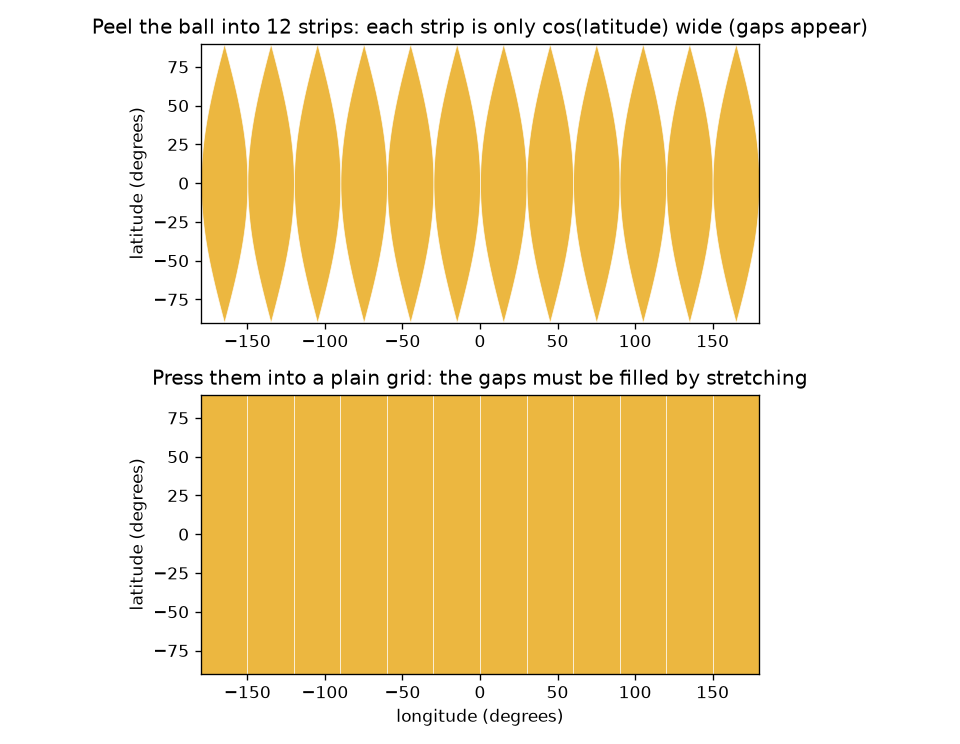
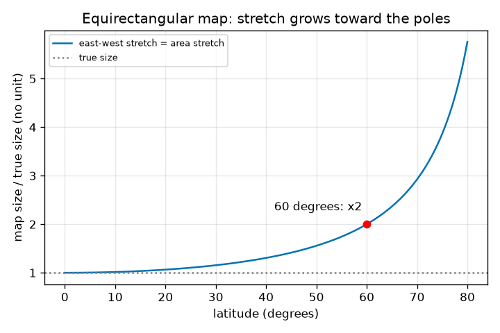

# സെഷൻ 1: ഒരു ഗോളത്തിന്റെ പരന്ന ഭൂപടം എന്തുകൊണ്ട് വികലമാകണം

[Session 1 — हिन्दी](README.hi.md) · [Session 1 — മലയാളം](README.ml.md)

*ലെവൽ 1 (ആശയപരമായ ഇന്ററാക്ടീവ് മോഡൽ) · ഏകദേശം 60 മിനിറ്റ് · openmapproject*

> ഇത് ലളിതമാക്കിയ ഒരു വിദ്യാഭ്യാസ മോഡലാണ്. ഇത് സാധൂകരിക്കപ്പെട്ട (validated) ഡിസൈൻ ഉപകരണമല്ല; യഥാർത്ഥ ഘടനകൾ, വൈദ്യുത സംവിധാനങ്ങൾ, വാഹനങ്ങൾ, വ്യാവസായിക പ്രക്രിയകൾ അല്ലെങ്കിൽ വൈദ്യശാസ്ത്ര തീരുമാനങ്ങൾ എന്നിവയ്ക്ക് ഇത് ഉപയോഗിക്കരുത്.

**മുൻ‌അറിവ് (Prerequisites)**

- സ്കൂൾ ത്രികോണമിതി: ഒരു കോണിന്റെ കൊസൈൻ.
- നിങ്ങൾ PRIMER.md വായിക്കുകയും `python start.py 1` ഒരിക്കൽ പ്രവർത്തിപ്പിക്കുകയും ചെയ്തിട്ടുണ്ട്.

**പഠന ലക്ഷ്യങ്ങൾ (Learning objectives).** ഈ സെഷനു ശേഷം നിങ്ങൾക്ക് കഴിയും:

- ഓറഞ്ച് തൊലി ഉപയോഗിച്ച്, ഒരു ഗോളത്തെ വലിച്ചുനീട്ടാതെയോ കീറാതെയോ പരത്താൻ കഴിയാത്തത് എന്തുകൊണ്ടെന്ന് വിശദീകരിക്കാൻ.
- ഭൂമിയിലെ ഒരു ബിന്ദുവിനെ അക്ഷാംശം, രേഖാംശം (latitude, longitude) എന്നിവ കൊണ്ട് വിവരിക്കാനും ഇക്വിറെക്ടാംഗുലർ ഭൂപടത്തിൽ സ്ഥാപിക്കാനും.
- ഒരു അക്ഷാംശ വൃത്തത്തിന്റെ യഥാർത്ഥ നീളവും പരന്ന ഗ്രിഡ് ഭൂപടത്തിന്റെ വലിച്ചിൽ (stretch) 1 / cos(latitude)-ഉം കണക്കാക്കാൻ.
- അക്ഷാംശത്തിനെതിരായ വലിച്ചിലിന്റെ ഗ്രാഫ് വായിക്കാൻ.

## A. യഥാർത്ഥ ലോക പ്രശ്നം
ഒരു ഓറഞ്ചിന്റെ തൊലി ഒറ്റ കഷണമായി ഉരിഞ്ഞ് ഒരു മേശപ്പുറത്ത് പരത്തി അമർത്തുക. അത് പിളരുന്നു, അല്ലെങ്കിൽ നിങ്ങൾക്ക് അത് വലിച്ചുനീട്ടേണ്ടി വരുന്നു. ഭൂമി ഒരു പന്താണ്, അതിന്റെ ഓരോ പരന്ന ഭൂപടവും അമർത്തിപ്പരത്തിയ തൊലിയാണ്. ഏറ്റവും ലളിതമായ ഭൂപടം അക്ഷാംശവും രേഖാംശവും ചതുര കടലാസിലെ ഗ്രിഡ് രേഖകളായി ഉപയോഗിക്കുന്നു. അത് നോർവേയെയും നൈജീരിയയെയും ശരിയായ വലുപ്പത്തിൽ കാണിക്കുന്നുണ്ടോ? 60 ഡിഗ്രി വടക്ക് അത് എത്ര തെറ്റാണ്, എന്തുകൊണ്ട്?

## B. ആശയവും സിദ്ധാന്തവും
അക്ഷാംശം എന്നത് ഭൂമധ്യരേഖയുടെ വടക്ക് (+) അല്ലെങ്കിൽ തെക്ക് (-) ഉള്ള കോണാണ്; രേഖാംശം എന്നത് ഒരു റഫറൻസ് മെറിഡിയന്റെ കിഴക്കോ പടിഞ്ഞാറോ ഉള്ള കോണാണ്. ഇക്വിറെക്ടാംഗുലർ ഭൂപടത്തിൽ അക്ഷാംശം phi, രേഖാംശം lambda (റേഡിയനിൽ) ഉള്ള ഒരു ബിന്ദു x = R lambda, y = R phi എന്ന സ്ഥാനത്ത് വരയ്ക്കുന്നു, ഇവിടെ R പന്തിന്റെ ആരമാണ്. ഒരു അക്ഷാംശ വൃത്തത്തിന്റെ ആരം R cos(phi) ആണ്, അതിനാൽ അതിന്റെ യഥാർത്ഥ നീളം 2 pi R cos(phi) ആണ്. ഭൂപടം ഓരോ അക്ഷാംശ വൃത്തത്തെയും ഭൂമധ്യരേഖയുടെ നീളത്തിൽ, 2 pi R, വരയ്ക്കുന്നു. അതിനാൽ കിഴക്ക്-പടിഞ്ഞാറ് ദൂരങ്ങൾ 1 / cos(phi) ഘടകത്താൽ വളരെ നീളത്തിൽ വരയ്ക്കപ്പെടുന്നു, വടക്ക്-തെക്ക് ദൂരങ്ങൾ യഥാർത്ഥ വലുപ്പത്തിൽ വരയ്ക്കപ്പെടുന്നു. വിസ്തീർണ്ണം രണ്ടിന്റെയും ഗുണനഫലമാണ്, അതിനാൽ ഭൂപടത്തിലെ വിസ്തീർണ്ണം യഥാർത്ഥ വിസ്തീർണ്ണം ഗുണം 1 / cos(phi) ആണ്.

| ചിഹ്നം | അർത്ഥം | യൂണിറ്റ് |
|---|---|---|
| phi | അക്ഷാംശം, വടക്ക് പോസിറ്റീവ് | റേഡിയൻ (ആപ്പിൽ ഡിഗ്രി) |
| lambda | രേഖാംശം, കിഴക്ക് പോസിറ്റീവ് | റേഡിയൻ (ആപ്പിൽ ഡിഗ്രി) |
| R | ഗോളത്തിന്റെ ആരം (ഭൂമിക്ക് 6371 km) | km |
| x, y | പരന്ന ഭൂപടത്തിലെ സ്ഥാനം | km |
| stretch | ഭൂപട നീളം ഹരണം യഥാർത്ഥ നീളം | യൂണിറ്റില്ല |

**അനുമാനങ്ങൾ (Assumptions)**

- ഭൂമി 6371 km ആരമുള്ള ഒരു പൂർണ്ണ ഗോളമാണ് (യഥാർത്ഥ ഭൂമി ഏകദേശം 0.3 ശതമാനം പരന്നതാണ്).
- സൂത്രവാക്യങ്ങൾക്കുള്ളിൽ കോണുകൾ റേഡിയനിലാണ്; ആപ്പും വാചകവും ഡിഗ്രി ഉപയോഗിക്കുന്നു.
- ഇത് ലളിതമാക്കിയ വിദ്യാഭ്യാസ മോഡലാണ്.

$$ x = R\lambda,\qquad y = R\varphi $$

$$ L_{\text{true}}(\varphi)=2\pi R\cos\varphi,\qquad L_{\text{map}}=2\pi R $$

$$ \text{east-west stretch}=\frac{L_{\text{map}}}{L_{\text{true}}}=\frac{1}{\cos\varphi}=\sec\varphi $$

$$ \frac{\text{area on map}}{\text{true area}}=\sec\varphi $$

## C. ദൃശ്യ വിശദീകരണം
ആദ്യ ചിത്രം പന്തിനെ 12 സ്ട്രിപ്പുകളായി ഉരിക്കുന്നു. പന്തിൽ ഓരോ സ്ട്രിപ്പിനും cos(latitude) മാത്രമേ വീതിയുള്ളൂ, അതിനാൽ ധ്രുവങ്ങളിലേക്ക് വിടവുകൾ തുറക്കുന്നു; അതിനു താഴെയുള്ള സാധാരണ ഗ്രിഡ് സ്ട്രിപ്പുകളെ വശങ്ങളിലേക്ക് വലിച്ചുനീട്ടി വിടവുകൾ നിറയ്ക്കുന്നു. രണ്ടാമത്തെ ചിത്രം അക്ഷാംശത്തിനെതിരെ വലിച്ചിൽ 1 / cos(latitude) പ്ലോട്ട് ചെയ്യുന്നു: ഭൂമധ്യരേഖയിൽ അത് 1 ആണ്, 30 ഡിഗ്രിയിൽ 1.155, 60 ഡിഗ്രിയിൽ കൃത്യം 2, 80 ഡിഗ്രിയിൽ 5.76, ധ്രുവത്തിൽ പരിധിയില്ലാതെ വളരുന്നു.

*ഉരിച്ച പന്ത്: സ്ട്രിപ്പുകൾ അക്ഷാംശത്തോടൊപ്പം ഇടുങ്ങുന്നു, അതിനാൽ സാധാരണ ഗ്രിഡ് അവയെ വലിച്ചുനീട്ടണം.*

*കിഴക്ക്-പടിഞ്ഞാറ് വലിച്ചിൽ 1 / cos(latitude): ഭൂമധ്യരേഖയിൽ 1, 60 ഡിഗ്രിയിൽ 2, 80 ഡിഗ്രിയിൽ 5.76.*

## D. ഇന്ററാക്ടീവ് സിമുലേഷൻ
പാഠം പ്രവർത്തിപ്പിക്കുക (`python start.py 1`), തുടർന്ന് ലൈവ് ആപ്പ് തുറക്കുക: [സെഷൻ 1: പരന്ന ഗ്രിഡ് ഭൂപടം എത്ര വലിച്ചുനീട്ടുന്നു?](https://krunalpanchal1995.github.io/pan-iit-oss/openmapproject/session-01/) (അല്ലെങ്കിൽ ഈ ഫോൾഡറിലെ `app.html`). അക്ഷാംശ സ്ലൈഡർ നീക്കി ഭൂപടത്തിലെ നീല പാച്ചും പന്തിലെ പച്ച യഥാർത്ഥ രൂപവും നിരീക്ഷിക്കുക: നീല പാച്ച് അതിന്റെ വീതി നിലനിർത്തുന്നു, പച്ചയായത് ഇടുങ്ങുന്നു. തുടർന്ന് ഗ്രാഫ് കാഴ്ച തുറന്ന് വക്രത്തിൽ ബിന്ദു എവിടെയാണെന്ന് കാണുക. പാച്ചിന്റെ വീതി മാറ്റി ഏത് സംഖ്യകൾ മാറുന്നു എന്ന് ശ്രദ്ധിക്കുക.

**വെല്ലുവിളി.** പരന്ന ഭൂപടം കിഴക്ക്-പടിഞ്ഞാറ് ദൂരങ്ങളെ കുറഞ്ഞത് 1.99 മടങ്ങ് (ഏകദേശം 2) വലിച്ചുനീട്ടുന്ന ഒരു അക്ഷാംശം കണ്ടെത്തുക.

## E. ഉദാഹരണ പ്രശ്നവും പരീക്ഷണവും
**പ്രശ്നം.** 6371 km ആരമുള്ള ഒരു പന്തിൽ 60 ഡിഗ്രി വടക്കുള്ള അക്ഷാംശ വൃത്തത്തിന്റെ നീളം എത്ര, പരന്ന ഗ്രിഡ് ഭൂപടം അതിനെ എത്ര നീളത്തിൽ വരയ്ക്കുന്നു, വലിച്ചിൽ എത്ര?

1. ഭൂമധ്യരേഖ: 2 pi R = 2 x 3.14159 x 6371 = 40030.2 km. ഭൂപടം ഓരോ അക്ഷാംശ വൃത്തത്തെയും ഈ നീളത്തിൽ വരയ്ക്കുന്നു.
2. 60 ഡിഗ്രിയിലെ യഥാർത്ഥ വൃത്തം: 2 pi R cos 60 = 40030.2 x 0.5 = 20015.1 km.
3. വലിച്ചിൽ = ഭൂപട നീളം / യഥാർത്ഥ നീളം = 40030.2 / 20015.1 = 2.000. ഇത് 1 / cos 60 = 1 / 0.5 = 2 ആണ്.
4. രേഖാംശത്തിന്റെ ഒരു ഡിഗ്രി ഭൂമധ്യരേഖയിൽ R x pi/180 = 111.19 km ആണ്, പക്ഷേ 60 ഡിഗ്രി വടക്ക് 55.60 km മാത്രം; ഭൂപടം രണ്ടിനെയും 111.19 km ആയി വരയ്ക്കുന്നു.

**ഉത്തരം.** യഥാർത്ഥ വൃത്തം 20015.1 km ആണ്, ഭൂപടം 40030.2 km വരയ്ക്കുന്നു, അതിനാൽ 60 ഡിഗ്രി വടക്ക് കിഴക്ക്-പടിഞ്ഞാറ് നീളങ്ങളും വിസ്തീർണ്ണങ്ങളും രണ്ടിരട്ടി വലുതായി വരയ്ക്കപ്പെടുന്നു.

**പരീക്ഷണം.** ഒരു ഓറഞ്ചും ഒരു മാർക്കറും എടുക്കുക. ഭൂമധ്യരേഖയും ഏകദേശം 60 ഡിഗ്രി വടക്കുള്ള ഒരു അക്ഷാംശ വൃത്തവും വരയ്ക്കുക (ഉപരിതലത്തിലൂടെ ഭൂമധ്യരേഖയിൽ നിന്ന് ധ്രുവത്തിലേക്കുള്ള വഴിയുടെ മൂന്നിൽ രണ്ട് ഭാഗം). ഓരോ വൃത്തത്തിനും ചുറ്റും ഒരു ചരട് ചുറ്റി രണ്ട് നീളങ്ങൾ അളക്കുക: 2-നോട് അടുത്ത അനുപാതം കിട്ടണം. ആപ്പുമായും checkpoint.py-യുമായും താരതമ്യം ചെയ്യുക. മോഡലിന് പൂർണ്ണ ഗോളമാണുള്ളത്; യഥാർത്ഥ ഓറഞ്ച് ഉരുളക്കട്ടയുള്ളതാണ്, നിങ്ങളുടെ ചരടിന് കനമുണ്ട്, അതിനാൽ ഏതാനും ശതമാനം പിശക് പ്രതീക്ഷിക്കുക.

## F. മൂല്യനിർണ്ണയവും ഡിസൈൻ വെല്ലുവിളിയും
**ചോദ്യ തരം A: ആശയപരം.** ഒരു ഓറഞ്ചിന്റെ തൊലി കീറാതെയോ വലിച്ചുനീട്ടാതെയോ എന്തുകൊണ്ട് പരത്തി അമർത്താൻ കഴിയില്ല? ഭൂമിയുടെ ഓരോ പരന്ന ഭൂപടത്തിനും ഇത് എന്താണ് അർത്ഥമാക്കുന്നത്?

സൂചന

പന്തിലെ ഒരു അക്ഷാംശ വൃത്തത്തിന്റെ നീളത്തെ പരന്ന ഗ്രിഡ് അതിന് നൽകുന്ന വീതിയുമായി താരതമ്യം ചെയ്യുക.

ഘട്ടം ഘട്ടമായുള്ള പരിഹാരം

ധ്രുവങ്ങൾക്ക് സമീപം തൊലി ഇടുങ്ങിയ സ്ട്രിപ്പുകളായി ഞെരുങ്ങുന്നു: ഒരു അക്ഷാംശ വൃത്തം ഭൂമധ്യരേഖയേക്കാൾ വളരെ ചെറുതാണ് (അക്ഷാംശത്തിന്റെ കൊസൈൻ മടങ്ങ് മാത്രം നീളം). ഒരു പരന്ന ചതുരത്തിന് ഓരോ ഉയരത്തിലും ഒരേ വീതിയാണ്, അതിനാൽ അത് നിറയ്ക്കാൻ സ്ട്രിപ്പുകൾ വശങ്ങളിലേക്ക് വലിച്ചുനീട്ടണം, അല്ലെങ്കിൽ വിടവുകൾ ഇടണം. അതിനാൽ ഏതൊരു പരന്ന ഭൂപടവും ചില നീളങ്ങളോ വിസ്തീർണ്ണങ്ങളോ കോണുകളോ മാറ്റണം. അത് എല്ലായിടത്തും പൂർണ്ണമാകാൻ കഴിയില്ല; ഏത് ന്യൂനത സ്വീകരിക്കണമെന്ന് നിങ്ങൾ തിരഞ്ഞെടുക്കുന്നു.

**ചോദ്യ തരം B: സംഖ്യാപരം.** 45 ഡിഗ്രി വടക്ക്, 10 ഡിഗ്രി രേഖാംശത്തിന്റെ യഥാർത്ഥ നീളം എത്ര, ഇക്വിറെക്ടാംഗുലർ ഭൂപടം അതിനെ എത്ര നീളത്തിൽ വരയ്ക്കുന്നു, വലിച്ചിൽ എത്ര? R = 6371 km ഉപയോഗിക്കുക.

സൂചന

യഥാർത്ഥ നീളം = R cos(phi) ഗുണം റേഡിയനിലെ കോൺ; ഭൂപട നീളം = R ഗുണം റേഡിയനിലെ കോൺ.

ഘട്ടം ഘട്ടമായുള്ള പരിഹാരം

10 ഡിഗ്രി = 0.17453 റേഡിയൻ. യഥാർത്ഥ നീളം = 6371 x cos 45 x 0.17453 = 6371 x 0.70711 x 0.17453 = 786.3 km. ഭൂപട നീളം = 6371 x 0.17453 = 1111.9 km. വലിച്ചിൽ = 1111.9 / 786.3 = 1.414 = 1 / cos 45. യുക്തിപരിശോധന (sanity check): അത് 1 (ഭൂമധ്യരേഖ), 2 (60 ഡിഗ്രി) എന്നിവയ്ക്കിടയിലാണ്, അങ്ങനെതന്നെയാകണം.

**ചോദ്യ തരം C: ഗ്രാഫ്, സിമുലേഷൻ വ്യാഖ്യാനം.** വലിച്ചിൽ ഗ്രാഫിൽ 60 ഡിഗ്രിയിലെയും 80 ഡിഗ്രിയിലെയും വലിച്ചിൽ വായിക്കുക. ഈ ഭൂപടത്തിൽ 60-നും 80 ഡിഗ്രിക്കും ഇടയിൽ ഒരു നിശ്ചിത വലുപ്പമുള്ള രാജ്യത്തിന്റെ വിസ്തീർണ്ണം എത്ര മടങ്ങ് വളരുന്നു?

സൂചന

ഈ ഭൂപടത്തിൽ വിസ്തീർണ്ണ വലിച്ചിൽ കിഴക്ക്-പടിഞ്ഞാറ് വലിച്ചിലിന് തുല്യമാണ്.

ഘട്ടം ഘട്ടമായുള്ള പരിഹാരം

വക്രം 60 ഡിഗ്രിയിൽ 2.00-ലൂടെയും 80 ഡിഗ്രിയിൽ 5.76-ലൂടെയും കടന്നുപോകുന്നു. അതിനാൽ ഒരു നിശ്ചിത യഥാർത്ഥ വലുപ്പമുള്ള രാജ്യം 80 ഡിഗ്രിയിൽ 60 ഡിഗ്രിയിലേതിനേക്കാൾ 5.76 / 2.00 = 2.88 മടങ്ങ് വലുതായി കാണപ്പെടുന്നു. വക്രം കൂടുതൽ കൂടുതൽ കുത്തനെ ഉയരുന്നു: മധ്യ അക്ഷാംശങ്ങളേക്കാൾ ധ്രുവത്തിന് സമീപം ഭൂപടം വളരെ മോശമാണ്.

**ചോദ്യ തരം D: ഡിസൈൻ, ഒപ്റ്റിമൈസേഷൻ വെല്ലുവിളി.** ഒരു കാലാവസ്ഥാ ഓഫീസിന് ഒരു പ്രദേശത്തിന്റെ പരന്ന ഗ്രിഡ് ഭൂപടം വേണം, അതിൽ കിഴക്ക്-പടിഞ്ഞാറ് നീളങ്ങൾ 25 ശതമാനത്തിൽ കൂടുതൽ ഒരിക്കലും വലിച്ചുനീട്ടപ്പെടരുത്. പ്രദേശത്തിന് എത്തിച്ചേരാവുന്ന ഏറ്റവും ഉയർന്ന അക്ഷാംശം എത്ര? 70 ഡിഗ്രിയിൽ എത്തുന്ന ഒരു പ്രദേശത്തിന് നിങ്ങൾ എന്തു ചെയ്യും?

സൂചന

1 / cos(phi) = 1.25 പരിഹരിക്കുക.

ഘട്ടം ഘട്ടമായുള്ള പരിഹാരം

cos(phi) = 1 / 1.25 = 0.8, അതിനാൽ phi = 36.9 ഡിഗ്രി. പ്രദേശത്തിന് വടക്കോ തെക്കോ 36.9 ഡിഗ്രി വരെ എത്താം. 70 ഡിഗ്രിയിൽ വലിച്ചിൽ 1 / cos 70 = 2.92 ആണ്, അതിനാൽ സാധാരണ ഗ്രിഡ് അനുയോജ്യമല്ല; ഒരു വ്യത്യസ്ത പ്രൊജക്ഷൻ (സെഷൻ 2, 3) അല്ലെങ്കിൽ ആ അക്ഷാംശത്തെ കേന്ദ്രമാക്കിയ ഭൂപടം തിരഞ്ഞെടുക്കുക. വിട്ടുവീഴ്ച (trade-off): സാധാരണ ഗ്രിഡ് കണക്കാക്കാനും വരയ്ക്കാനും ഏറ്റവും ലളിതമാണ്, പക്ഷേ ഭൂമധ്യരേഖയ്ക്ക് സമീപം മാത്രമേ നല്ലതുള്ളൂ.

[RUBRIC.md](../../RUBRIC.md) ഉപയോഗിച്ച് സ്വയം സ്കോർ ചെയ്യുക. പേപ്പറിൽ ചെയ്യാൻ [പ്രവർത്തന ഷീറ്റ്](activity_sheet.md) പ്രിന്റ് ചെയ്യുക.

## സാധാരണ തെറ്റിദ്ധാരണകൾ
| സാധാരണ തെറ്റിദ്ധാരണ | യഥാർത്ഥത്തിൽ ശരിയായത് |
|---|---|
| ഭൂപടനിർമ്മാതാവ് ആവശ്യത്തിന് ശ്രദ്ധാലുവാണെങ്കിൽ പരന്ന ഭൂപടം പൂർണ്ണമാക്കാം. | ഒരു ഗോളത്തിന്റെ ഒരു പരന്ന ഭൂപടത്തിനും എല്ലാ നീളങ്ങളും കോണുകളും വിസ്തീർണ്ണങ്ങളും നിലനിർത്താൻ കഴിയില്ല; കുറച്ച് വികലത ഒഴിവാക്കാനാവില്ല. |
| യഥാർത്ഥത്തിൽ ധ്രുവം ഭൂപടത്തിന്റെ മുകളിലെ ഒരു നീണ്ട രേഖയാണ്. | ധ്രുവം ഒരൊറ്റ ബിന്ദുവാണ്; സാധാരണ ഗ്രിഡ് അതിനെ മുകളിലെ അരിക് മുഴുവനായി വരയ്ക്കുന്നു, ഇത് വലിച്ചിലിന്റെ അങ്ങേയറ്റത്തെ സന്ദർഭമാണ്. |
| ഗ്രിഡ് രേഖകളുടെ തുല്യ അകലം എന്നാൽ നിലത്ത് തുല്യ ദൂരം. | അക്ഷാംശത്തിന്റെ ഒരു ഡിഗ്രി എപ്പോഴും 111.19 km ആണ്, പക്ഷേ രേഖാംശത്തിന്റെ ഒരു ഡിഗ്രി cos(latitude) കൊണ്ട് ചുരുങ്ങുന്നു, 60 ഡിഗ്രിയിൽ 55.60 km ആകുന്നു. |
| വികലത ഭൂപടത്തിൽ എല്ലായിടത്തും ഒന്നുതന്നെയാണ്. | സാധാരണ ഗ്രിഡിൽ അത് ഭൂമധ്യരേഖയിൽ പൂജ്യമാണ്, ധ്രുവങ്ങളിലേക്ക് വളരുന്നു; വികലത സ്ഥലത്തെ ആശ്രയിക്കുന്നു. |

## പദാവലി (Glossary)
- **അക്ഷാംശം (latitude)**: ഭൂമധ്യരേഖയുടെ വടക്കോ തെക്കോ ഉള്ള കോൺ, -90 മുതൽ +90 ഡിഗ്രി വരെ
- **രേഖാംശം (longitude)**: റഫറൻസ് മെറിഡിയന്റെ കിഴക്കോ പടിഞ്ഞാറോ ഉള്ള കോൺ, -180 മുതൽ +180 ഡിഗ്രി വരെ
- **ഇക്വിറെക്ടാംഗുലർ ഭൂപടം (equirectangular map)**: രേഖാംശവും അക്ഷാംശവും സാധാരണ ഗ്രിഡ് നിർദ്ദേശാങ്കങ്ങളായി ഉപയോഗിക്കുന്ന ഭൂപടം
- **അക്ഷാംശ വൃത്തം (circle of latitude)**: ഒരേ അക്ഷാംശത്തിലുള്ള എല്ലാ ബിന്ദുക്കളും; സമാന്തരം (parallel) എന്നും വിളിക്കുന്നു
- **വലിച്ചിൽ (stretch)**: ഭൂപട നീളം, അത് പ്രതിനിധീകരിക്കുന്ന യഥാർത്ഥ നീളം കൊണ്ട് ഹരിച്ചത്

## പൂർത്തിയാക്കുക
1. [exercises.md](exercises.md)-ലെ മൂന്ന് കോഡിംഗ് ടാസ്കുകൾ ചെയ്യുക.
2. നിങ്ങളുടെ മാറ്റങ്ങൾക്ക് ശേഷം `python start.py 1` വീണ്ടും പ്രവർത്തിപ്പിക്കുക. അത് ചെക്ക്പോയിന്റോടെ അവസാനിക്കുന്നു; അത് `PASS` പ്രിന്റ് ചെയ്യുമ്പോൾ നിങ്ങൾ പൂർത്തിയാക്കി. (ചെക്ക്പോയിന്റ് മാത്രം: `python start.py check 1`.)

അടുത്തത്: [സെഷൻ 2](../session-02/README.md)
