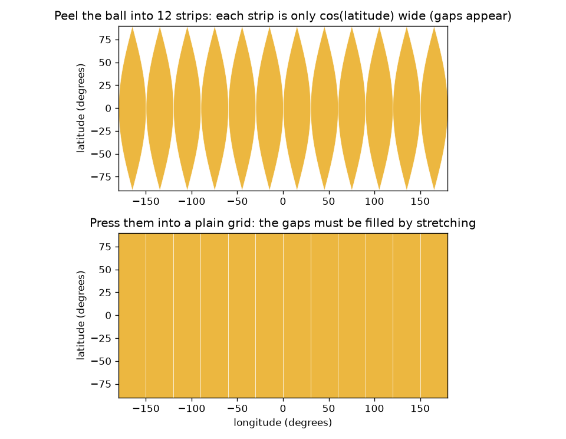
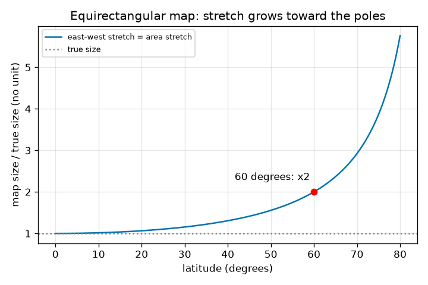

# அமர்வு 1: ஒரு பந்தின் தட்டையான வரைபடம் ஏன் சிதைந்தே ஆக வேண்டும்

[Session 1 — हिन्दी](README.hi.md) · [Session 1 — മലയാളം](README.ml.md) · [Session 1 — தமிழ்](README.ta.md)

*நிலை 1 (கருத்தியல் ஊடாடும் மாதிரி) · சுமார் 60 நிமிடங்கள் · openmapproject*

> இது எளிமைப்படுத்தப்பட்ட ஒரு கல்வி மாதிரி. இது சரிபார்க்கப்பட்ட (validated) வடிவமைப்புக் கருவி அல்ல; உண்மையான கட்டமைப்புகள், மின் நிறுவல்கள், வாகனங்கள், தொழில்துறை செயல்முறைகள் அல்லது மருத்துவ முடிவுகளுக்கு இதைப் பயன்படுத்தக் கூடாது.

**முன்தேவைகள் (Prerequisites)**

- பள்ளி முக்கோணவியல்: ஒரு கோணத்தின் கொசைன்.
- நீங்கள் PRIMER.md-ஐப் படித்து `python start.py 1`-ஐ ஒருமுறை இயக்கியிருக்கிறீர்கள்.

**கற்றல் நோக்கங்கள் (Learning objectives).** இந்த அமர்வுக்குப் பிறகு நீங்கள்:

- ஆரஞ்சுத் தோலைக் கொண்டு, ஒரு கோளத்தை இழுக்காமலோ கிழிக்காமலோ தட்டையாக்க முடியாது என்பதை ஏன் என்று விளக்க முடியும்.
- பூமியின் ஒரு புள்ளியை அட்சரேகை, தீர்க்கரேகை (latitude, longitude) கொண்டு விவரித்து, சமசெவ்வக (equirectangular) வரைபடத்தில் இடமுடியும்.
- ஒரு அட்சரேகை வட்டத்தின் உண்மை நீளத்தையும், தட்டையான கட்ட வரைபடத்தின் நீட்சி (stretch) 1 / cos(latitude)-ஐயும் கணக்கிட முடியும்.
- அட்சரேகைக்கு எதிரான நீட்சியின் வரைபடத்தைப் படிக்க முடியும்.

## A. நிஜ உலகச் சிக்கல்
ஒரு ஆரஞ்சுப் பழத்தின் தோலை ஒரே துண்டாக உரித்து மேசையில் தட்டையாக அழுத்துங்கள். அது பிளக்கிறது, அல்லது அதை இழுக்க வேண்டியிருக்கிறது. பூமி ஒரு பந்து, அதன் ஒவ்வொரு தட்டையான வரைபடமும் அழுத்தப்பட்ட தோல். மிக எளிய வரைபடம் அட்சரேகையையும் தீர்க்கரேகையையும் சதுரத் தாளில் கட்டக் கோடுகளாகப் பயன்படுத்துகிறது. அது நார்வேயையும் நைஜீரியாவையும் சரியான அளவில் காட்டுகிறதா? 60 டிகிரி வடக்கில் அது எவ்வளவு தவறு, ஏன்?

## B. கருத்தும் கோட்பாடும்
அட்சரேகை என்பது நிலநடுக்கோட்டுக்கு வடக்கே (+) அல்லது தெற்கே (-) உள்ள கோணம்; தீர்க்கரேகை என்பது ஒரு குறிப்பு நெடுங்கோட்டுக்குக் கிழக்கே அல்லது மேற்கே உள்ள கோணம். சமசெவ்வக வரைபடத்தில் அட்சரேகை phi, தீர்க்கரேகை lambda (ரேடியனில்) உள்ள ஒரு புள்ளி x = R lambda, y = R phi என்ற இடத்தில் வரையப்படுகிறது, இங்கு R பந்தின் ஆரம். ஒரு அட்சரேகை வட்டத்தின் ஆரம் R cos(phi), எனவே அதன் உண்மை நீளம் 2 pi R cos(phi). வரைபடம் ஒவ்வொரு அட்சரேகை வட்டத்தையும் நிலநடுக்கோட்டின் நீளத்தில், 2 pi R, வரைகிறது. எனவே கிழக்கு-மேற்கு தூரங்கள் 1 / cos(phi) காரணியால் மிக நீளமாக வரையப்படுகின்றன, வடக்கு-தெற்கு தூரங்கள் உண்மை அளவில் வரையப்படுகின்றன. பரப்பு இரண்டின் பெருக்கல், எனவே வரைபடத்தில் உள்ள பரப்பு உண்மைப் பரப்பு பெருக்கல் 1 / cos(phi).

| குறியீடு | பொருள் | அலகு |
|---|---|---|
| phi | அட்சரேகை, வடக்கு நேர்மறை | ரேடியன் (செயலியில் டிகிரி) |
| lambda | தீர்க்கரேகை, கிழக்கு நேர்மறை | ரேடியன் (செயலியில் டிகிரி) |
| R | கோளத்தின் ஆரம் (பூமிக்கு 6371 km) | km |
| x, y | தட்டையான வரைபடத்தில் நிலை | km |
| stretch | வரைபட நீளம் வகுத்தல் உண்மை நீளம் | அலகு இல்லை |

**அனுமானங்கள் (Assumptions)**

- பூமி 6371 km ஆரம் கொண்ட சரியான கோளம் (உண்மைப் பூமி சுமார் 0.3 சதவீதம் தட்டையானது).
- சூத்திரங்களுக்குள் கோணங்கள் ரேடியனில்; செயலியும் உரையும் டிகிரியைப் பயன்படுத்துகின்றன.
- இது எளிமைப்படுத்தப்பட்ட கல்வி மாதிரி.

$$ x = R\lambda,\qquad y = R\varphi $$

$$ L_{\text{true}}(\varphi)=2\pi R\cos\varphi,\qquad L_{\text{map}}=2\pi R $$

$$ \text{east-west stretch}=\frac{L_{\text{map}}}{L_{\text{true}}}=\frac{1}{\cos\varphi}=\sec\varphi $$

$$ \frac{\text{area on map}}{\text{true area}}=\sec\varphi $$

## C. காட்சி விளக்கம்
முதல் படம் பந்தை 12 கீற்றுகளாக உரிக்கிறது. பந்தில் ஒவ்வொரு கீற்றும் cos(latitude) அகலம் மட்டுமே உடையது, எனவே துருவங்களை நோக்கி இடைவெளிகள் திறக்கின்றன; அதன் கீழுள்ள சாதாரணக் கட்டம் கீற்றுகளைப் பக்கவாட்டில் இழுத்து இடைவெளிகளை நிரப்புகிறது. இரண்டாவது படம் அட்சரேகைக்கு எதிராக நீட்சி 1 / cos(latitude)-ஐ வரைகிறது: நிலநடுக்கோட்டில் அது 1, 30 டிகிரியில் 1.155, 60 டிகிரியில் சரியாக 2, 80 டிகிரியில் 5.76, துருவத்தில் வரம்பின்றி வளர்கிறது.

*உரித்த பந்து: கீற்றுகள் அட்சரேகையுடன் குறுகுகின்றன, எனவே சாதாரணக் கட்டம் அவற்றை இழுக்க வேண்டும்.*

*கிழக்கு-மேற்கு நீட்சி 1 / cos(latitude): நிலநடுக்கோட்டில் 1, 60 டிகிரியில் 2, 80 டிகிரியில் 5.76.*

## D. ஊடாடும் உருவகப்படுத்தல்
பாடத்தை இயக்கவும் (`python start.py 1`), பிறகு நேரடி செயலியைத் திறக்கவும்: [அமர்வு 1: தட்டையான கட்ட வரைபடம் எவ்வளவு நீள்கிறது?](https://krunalpanchal1995.github.io/pan-iit-oss/openmapproject/session-01/) (அல்லது இந்தக் கோப்புறையில் உள்ள `app.html`). அட்சரேகை நழுவியை (slider) நகர்த்தி வரைபடத்தில் உள்ள நீலத் திட்டையும் பந்தில் உள்ள பச்சை உண்மை வடிவத்தையும் கவனிக்கவும்: நீலத் திட்டு அதன் அகலத்தைத் தக்கவைக்கிறது, பச்சை குறுகுகிறது. பிறகு வரைபடக் காட்சியைத் திறந்து புள்ளி வளைவில் எங்கே இருக்கிறது என்று பார்க்கவும். திட்டின் அகலத்தை மாற்றி எந்த எண்கள் மாறுகின்றன என்பதைக் கவனிக்கவும்.

**சவால்.** தட்டையான வரைபடம் கிழக்கு-மேற்கு தூரங்களைக் குறைந்தது 1.99 மடங்கு (சுமார் 2) நீட்டும் ஓர் அட்சரேகையைக் கண்டறியவும்.

## E. தீர்க்கப்பட்ட உதாரணமும் சோதனையும்
**சிக்கல்.** 6371 km ஆரம் கொண்ட பந்தில் 60 டிகிரி வடக்கில் உள்ள அட்சரேகை வட்டத்தின் நீளம் என்ன, தட்டையான கட்ட வரைபடம் அதை எவ்வளவு நீளமாக வரைகிறது, நீட்சி என்ன?

1. நிலநடுக்கோடு: 2 pi R = 2 x 3.14159 x 6371 = 40030.2 km. வரைபடம் ஒவ்வொரு அட்சரேகை வட்டத்தையும் இந்த நீளத்தில் வரைகிறது.
2. 60 டிகிரியில் உண்மை வட்டம்: 2 pi R cos 60 = 40030.2 x 0.5 = 20015.1 km.
3. நீட்சி = வரைபட நீளம் / உண்மை நீளம் = 40030.2 / 20015.1 = 2.000. இது 1 / cos 60 = 1 / 0.5 = 2.
4. ஒரு டிகிரி தீர்க்கரேகை நிலநடுக்கோட்டில் R x pi/180 = 111.19 km, ஆனால் 60 டிகிரி வடக்கில் 55.60 km மட்டுமே; வரைபடம் இரண்டையும் 111.19 km ஆக வரைகிறது.

**விடை.** உண்மை வட்டம் 20015.1 km, வரைபடம் 40030.2 km வரைகிறது, எனவே 60 டிகிரி வடக்கில் கிழக்கு-மேற்கு நீளங்களும் பரப்புகளும் இரு மடங்கு பெரிதாக வரையப்படுகின்றன.

**சோதனை.** ஒரு ஆரஞ்சுப் பழத்தையும் ஒரு குறிப்பானையும் (marker) எடுக்கவும். நிலநடுக்கோட்டையும் சுமார் 60 டிகிரி வடக்கில் உள்ள ஒரு அட்சரேகை வட்டத்தையும் வரையவும் (மேற்பரப்பு வழியே நிலநடுக்கோட்டிலிருந்து துருவம் வரையிலான தூரத்தின் மூன்றில் இரண்டு பங்கு). ஒவ்வொரு வட்டத்தைச் சுற்றியும் ஒரு நூலைச் சுற்றி இரு நீளங்களை அளக்கவும்: 2-க்கு அருகிலான விகிதம் கிடைக்க வேண்டும். செயலியுடனும் checkpoint.py-உடனும் ஒப்பிடவும். மாதிரியில் சரியான கோளம் உள்ளது; உண்மை ஆரஞ்சு மேடுபள்ளமானது, உங்கள் நூலுக்குத் தடிமன் உண்டு, எனவே சில சதவீதப் பிழையை எதிர்பாருங்கள்.

## F. மதிப்பீடும் வடிவமைப்புச் சவாலும்
**கேள்வி வகை A: கருத்தியல்.** ஒரு ஆரஞ்சுத் தோலைக் கிழிக்காமலோ இழுக்காமலோ ஏன் தட்டையாக அழுத்த முடியாது? பூமியின் ஒவ்வொரு தட்டையான வரைபடத்திற்கும் இது என்ன பொருள்?

குறிப்பு

பந்தில் ஒரு அட்சரேகை வட்டத்தின் நீளத்தை தட்டையான கட்டம் அதற்குத் தரும் அகலத்துடன் ஒப்பிடவும்.

படிப்படியான தீர்வு

துருவங்களுக்கு அருகில் தோல் குறுகிய கீற்றுகளாக நெருக்கப்படுகிறது: ஒரு அட்சரேகை வட்டம் நிலநடுக்கோட்டை விட மிகச் சிறியது (அட்சரேகையின் கொசைன் மடங்கு மட்டுமே நீளம்). ஒரு தட்டையான செவ்வகத்துக்கு ஒவ்வொரு உயரத்திலும் ஒரே அகலம், எனவே அதை நிரப்பக் கீற்றுகளைப் பக்கவாட்டில் இழுக்க வேண்டும் அல்லது இடைவெளிகளை விட வேண்டும். எனவே எந்தத் தட்டையான வரைபடமும் சில நீளங்களை, பரப்புகளை அல்லது கோணங்களை மாற்றியே தீர வேண்டும். அது எல்லா இடங்களிலும் சரியாக இருக்க முடியாது; எந்தக் குறையை ஏற்பது என்பதை நீங்கள் தேர்ந்தெடுக்கிறீர்கள்.

**கேள்வி வகை B: எண்ணியல்.** 45 டிகிரி வடக்கில் 10 டிகிரி தீர்க்கரேகையின் உண்மை நீளம் என்ன, சமசெவ்வக வரைபடம் அதை எவ்வளவு நீளமாக வரைகிறது, நீட்சி என்ன? R = 6371 km பயன்படுத்தவும்.

குறிப்பு

உண்மை நீளம் = R cos(phi) பெருக்கல் ரேடியனில் கோணம்; வரைபட நீளம் = R பெருக்கல் ரேடியனில் கோணம்.

படிப்படியான தீர்வு

10 டிகிரி = 0.17453 ரேடியன். உண்மை நீளம் = 6371 x cos 45 x 0.17453 = 6371 x 0.70711 x 0.17453 = 786.3 km. வரைபட நீளம் = 6371 x 0.17453 = 1111.9 km. நீட்சி = 1111.9 / 786.3 = 1.414 = 1 / cos 45. நியாயச் சோதனை (sanity check): அது 1 (நிலநடுக்கோடு) மற்றும் 2 (60 டிகிரி) ஆகியவற்றுக்கு இடையில் உள்ளது, அப்படித்தான் இருக்க வேண்டும்.

**கேள்வி வகை C: வரைபடம் மற்றும் உருவகப்படுத்தல் விளக்கம்.** நீட்சி வரைபடத்தில் 60 டிகிரியிலும் 80 டிகிரியிலும் நீட்சியைப் படிக்கவும். இந்த வரைபடத்தில் 60-க்கும் 80 டிகிரிக்கும் இடையே ஒரு நிலையான அளவுள்ள நாட்டின் பரப்பு எத்தனை மடங்கு வளர்கிறது?

குறிப்பு

இந்த வரைபடத்தில் பரப்பு நீட்சி கிழக்கு-மேற்கு நீட்சிக்குச் சமம்.

படிப்படியான தீர்வு

வளைவு 60 டிகிரியில் 2.00 வழியாகவும் 80 டிகிரியில் 5.76 வழியாகவும் செல்கிறது. எனவே ஒரு நிலையான உண்மை அளவுள்ள நாடு 80 டிகிரியில் 60 டிகிரியை விட 5.76 / 2.00 = 2.88 மடங்கு பெரிதாகத் தெரிகிறது. வளைவு மேலும் மேலும் செங்குத்தாக உயர்கிறது: நடு அட்சரேகைகளை விடத் துருவத்துக்கு அருகில் வரைபடம் மிக மோசம்.

**கேள்வி வகை D: வடிவமைப்பு மற்றும் உகப்பாக்கச் சவால்.** ஒரு வானிலை அலுவலகத்துக்கு ஒரு பகுதியின் தட்டையான கட்ட வரைபடம் தேவை, அதில் கிழக்கு-மேற்கு நீளங்கள் 25 சதவீதத்துக்கு மேல் ஒருபோதும் நீட்டப்படக் கூடாது. அந்தப் பகுதி அடையக்கூடிய மிக உயர்ந்த அட்சரேகை என்ன? 70 டிகிரியை அடையும் பகுதிக்கு நீங்கள் என்ன செய்வீர்கள்?

குறிப்பு

1 / cos(phi) = 1.25-ஐத் தீர்க்கவும்.

படிப்படியான தீர்வு

cos(phi) = 1 / 1.25 = 0.8, எனவே phi = 36.9 டிகிரி. அந்தப் பகுதி வடக்கு அல்லது தெற்கே 36.9 டிகிரி வரை செல்லலாம். 70 டிகிரியில் நீட்சி 1 / cos 70 = 2.92, எனவே சாதாரணக் கட்டம் பொருத்தமற்றது; வேறு ஒரு எறிவு (projection) (அமர்வு 2, 3) அல்லது அந்த அட்சரேகையை மையமாகக் கொண்ட வரைபடத்தைத் தேர்ந்தெடுக்கவும். சமரசம் (trade-off): சாதாரணக் கட்டம் கணக்கிடவும் வரையவும் மிக எளிது, ஆனால் நிலநடுக்கோட்டுக்கு அருகில் மட்டுமே நல்லது.

[RUBRIC.md](../../RUBRIC.md) கொண்டு உங்களை நீங்களே மதிப்பிடுங்கள். தாளில் செய்ய [செயல்பாட்டுத் தாளை](activity_sheet.md) அச்சிடுங்கள்.

## பொதுவான தவறான கருத்துகள்
| பொதுவான தவறான கருத்து | உண்மையில் சரியானது |
|---|---|
| வரைபடம் தயாரிப்பவர் போதுமான கவனமாக இருந்தால் தட்டையான வரைபடத்தைச் சரியாக்க முடியும். | ஒரு கோளத்தின் எந்தத் தட்டையான வரைபடமும் எல்லா நீளங்களையும் கோணங்களையும் பரப்புகளையும் தக்கவைக்க முடியாது; சிறிது சிதைவு தவிர்க்க முடியாதது. |
| உண்மையில் துருவம் வரைபடத்தின் மேலே ஒரு நீண்ட கோடு. | துருவம் ஒரே ஒரு புள்ளி; சாதாரணக் கட்டம் அதை மேல் விளிம்பு முழுவதுமாக வரைகிறது, இது நீட்சியின் தீவிர நிலை. |
| கட்டக் கோடுகளின் சம இடைவெளி என்றால் தரையில் சம தூரம். | ஒரு டிகிரி அட்சரேகை எப்போதும் 111.19 km, ஆனால் ஒரு டிகிரி தீர்க்கரேகை cos(latitude) அளவு சுருங்கி 60 டிகிரியில் 55.60 km ஆகிறது. |
| சிதைவு வரைபடத்தில் எங்கும் ஒரே மாதிரி. | சாதாரணக் கட்டத்தில் அது நிலநடுக்கோட்டில் பூஜ்யம், துருவங்களை நோக்கி வளர்கிறது; சிதைவு இடத்தைப் பொறுத்தது. |

## சொற்களஞ்சியம் (Glossary)
- **அட்சரேகை (latitude)**: நிலநடுக்கோட்டுக்கு வடக்கே அல்லது தெற்கே உள்ள கோணம், -90 முதல் +90 டிகிரி வரை
- **தீர்க்கரேகை (longitude)**: குறிப்பு நெடுங்கோட்டுக்குக் கிழக்கே அல்லது மேற்கே உள்ள கோணம், -180 முதல் +180 டிகிரி வரை
- **சமசெவ்வக வரைபடம் (equirectangular map)**: தீர்க்கரேகையையும் அட்சரேகையையும் சாதாரணக் கட்ட ஆயத்தொலைவுகளாகப் பயன்படுத்தும் வரைபடம்
- **அட்சரேகை வட்டம் (circle of latitude)**: ஒரே அட்சரேகையில் உள்ள எல்லாப் புள்ளிகளும்; இணைவட்டம் (parallel) எனவும் அழைக்கப்படுகிறது
- **நீட்சி (stretch)**: வரைபட நீளம், அது குறிக்கும் உண்மை நீளத்தால் வகுக்கப்பட்டது

## நிறைவு
1. [exercises.md](exercises.md)-இல் உள்ள மூன்று நிரலாக்கப் பணிகளைச் செய்யவும்.
2. உங்கள் மாற்றங்களுக்குப் பிறகு `python start.py 1`-ஐ மீண்டும் இயக்கவும். அது சோதனைச்சாவடியுடன் (checkpoint) முடிகிறது; அது `PASS` என அச்சிடும்போது நீங்கள் முடித்துவிட்டீர்கள். (சோதனைச்சாவடி மட்டும்: `python start.py check 1`.)

அடுத்து: [அமர்வு 2](../session-02/README.md)
